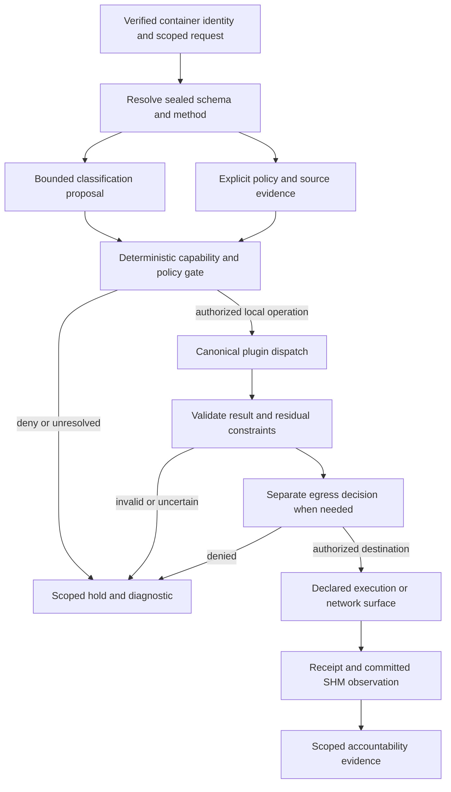

# Schema-tagged routing: a contribution framework for local decisions and accountable execution

*Concept draft, 30 September 2026. Implementation scope: scaffolding and subflooring. This paper proposes reviewable boundaries and experiments; it does not claim a deployed policy engine, installed local classifier, new capability grant or active network enforcement.*

## Introduction

A useful router should explain whose request it handles, what the operation means, which data may cross a boundary, and what actually happened. These questions require distinct owners for schemas, identity, retrieval, dispatch and networking.

The proposed contribution is a schema-tagged planning layer over existing OP-DBUS contracts. Tags describe declared operations and proposed handling constraints. A local classifier can suggest interpretations; a deterministic gate checks the verified caller, current method contract, explicit policy and available grants. Execution stays with the existing admitted plugin methods. Receipts and observations make the result reviewable.

Start with a typed UI exposing source-backed evidence, draft associations and unavailable capabilities. Then compare shadow-mode proposals with deterministic outcomes without changing providers, flows or proxy configuration.

## What exists, what is seeded, and what remains proposed

The [routing discovery](../reports/btrfs-cache-memory/20260930-implementation/routing/NOTES.md) and [compliance contract report](../reports/compliance-scaffold/20260930-discovery/contracts.md) distinguish source behavior from captured state and future integration.

| Surface | Existing source or captured evidence | Scaffold or seed | Future work requiring separate validation |
|---|---|---|---|
| Plugin contracts | Manifest-pinned sealed schemas, typed methods, capabilities and OSCAL subids | Display exact schema/method references | Define any new association DTO in its owning plugin |
| Schema tags | Captured `gemma_brain`, `tched_router`, `openflow`, `ovsdb_bridge` and `xray` schemas have empty `tags` arrays | Explicitly labeled local draft tags | Reviewed declarations and versioned semantics |
| Classification | Gemma taxonomy uses deterministic keyword substring matching | Bounded taxonomy examples and dry runs | Constrained local-model proposals and measured evaluation |
| Model routes | `ResolveRoute` matches a declared hint or model identifier | Provider/model catalog choices | Policy-aware planning without bypassing route admission |
| Compliance evidence | Maintained Cozo generations and source-checked mappings | Small dated captures and typed display | A declared read method integrating the maintained package |
| Execution | Existing identity admission and separate network methods | Desired-operation preview | Authorized activation with actual receipts and readback |

Those five captured schemas cannot populate a declared-tag picker. OSCAL subids, keyword taxonomy entries and schema tags are different objects. The current Gemma classifier counts keyword matches and orders ties deterministically; its name does not establish an installed model.

## One schema authority, explicit versions

Each plugin owns its typed input, output and state contract; transport shapes and UI rendering derive from its sealed schema. Proposals retain plugin ID, method key, transport name, schema hash/version and catalog identity. A method key can differ from its transport name.

Schema hashes identify contract bytes, catalog hashes identify membership, and taxonomy revisions identify classification configuration. Updating one does not silently update the others. Unresolvable associations become stale.

Annotations express metadata; consumers must explicitly implement any behavioral meaning. JSON Schema documents annotation keywords separately from validation keywords, so a label alone cannot establish an authorization or processing requirement. Here, the proposed policy interpretation of tags must be defined and tested by the deterministic gate. [JSON Schema annotation reference](https://json-schema.org/understanding-json-schema/reference/annotations).

Captures remain fixtures, not a second schema authority. Future registration DTOs must use plugin scaffold helpers, declare capability/side effect and enforce owner/revision checks.

## Tags, identity and provenance

Proposed planning record:

| Information | Illustrative contents | Authority boundary |
|---|---|---|
| Verified caller | Principal, container identity, session, permitted project scope | Supplied by identity validation, never a model label |
| Operation reference | Plugin, method key, schema/catalog hashes, declared subid | Resolved from the sealed catalog |
| Classification proposal | Draft tag, taxonomy revision, classifier version, uncertainty | A suggestion with bounded vocabulary |
| Policy and evidence | Rule revision, source references, compliance generation | Explicit rules and provenance; mappings are evidence |
| Execution record | Decision ID, admitted method, receipt linkage, observed outcome | Actual call/result/error and state observation |

For example, a draft may associate a redaction role with a schema method and registered provider/model candidate. It cannot assign identity, grant capability or alter the network. Undeclared tags and unavailable candidates remain visibly provisional.

Labels retain their origin: declaration, user selection, keyword match, model proposal or validated transform. Sensitive input retains its constraints when classification is unknown; a reassuring model label cannot erase them.

Container identity is central to ownership. The local 3tchedFS lungs surface binds calls to an identity/session and exposes `call`, `result` and `error`. Canonical admitted dispatch remains the control path, and MutationEngine commits authoritative state to SHM. Current operation receipts and diagnostics can be held locally; their storage need not match state storage. Correlation should connect the request, admitted operation, receipt and committed state observation without turning a receipt buffer into another state authority.

## Proposed decision pipeline

This proposed sequence includes undeployed stages. Model output is untrusted gate input. Unknown tags, stale hashes, missing grants or invalid results produce explicit outcomes, never a more permissive identity or backend.

## Scenario: sending sensitive material to a redactor

Consider a cloud-assisted incident summary containing names, account identifiers and internal addresses. Preserve useful structure while controlling disclosure; a model's promise to redact is insufficient.

First, identify the input owner and container/session/project scope. Verify the actual transform contract, caller grant and local runtime: a provider name cannot prove execution locality. Without a supported transform, retain an unavailable local draft.

Second, admit a bounded local transform using only necessary scoped content. Limit input/output bytes, time and concurrency. An illustrative output is transformed text plus findings and unresolved spans; no existing redactor method is claimed. Preserve originals only under their owner's retention policy.

Third, validate structure and residual disclosure risk using deterministic detectors, consistency checks and scoped review. Removing names can leave identifying dates, roles or rare events. Confidence cannot prove anonymity. Record removal categories and unknown risks without exposing removed secrets.

Fourth, separately authorize egress against destination, actual provider route, purpose, rule revision and current grants. Transformation and valid JSON cannot grant cloud permission. Denied or unresolved outputs stay local with an explanation.

Finally, correlate transform receipts and egress outcomes using bounded identifiers, revisions and protected references. Do not log originals, removed tokens or sensitive detector snippets by default. Hashes also reveal equality and can assist guessing; scope their visibility. OPA's decision logs provide an optional reference for revision/decision records and input/result masking; OPA adoption is not required. [OPA decision logs](https://www.openpolicyagent.org/docs/management-decision-logs).

There must be no automatic promotion to an `anonymous` label. A defensible result is narrower: the specified transform completed, listed checks passed, stated residual risks remain, and the separately evaluated destination was permitted or denied.

## Scenario: Accountability with independent recent-event evidence

Accountability places control-plane chat above an independent recent-event query. Chat has its own identity, grants and history. The evidence query separately verifies access, scope, time window and provenance. Adjacent panels do not merge identities or histories.

If chat reports a routing change, retrieve recent events and actual receipts, showing identity, admitted method, time and observed result. Semantic similarity locates candidates; it cannot prove execution or authorization. A conversation passage is not a native receipt.

Distinguish request, acceptance, SHM publication, native readback, failure and cancellation. Proxy receipts need not establish persisted configuration; OpenFlow receipts can include exact-member verification. Missing events remain gaps.

NotebookLM history and other memory sources provide context only through verified named access. Preserve owner, conversation ID, capture/retrieval time and revision. Conversation provenance is separate from current SHM, grants and compliance authority; unavailable sources remain unavailable.

## Scenario: retrieving source policy evidence

Compliance retrieval starts with the discoverable `compliance:mappings` registry in the maintained package. It preserves supplied policy-to-control assertions, including both `implements[].requirements` and `implements[].controls`. Direction, framework versions, ASVS lifecycle relations and unresolved references remain explicit. Cozo stores these source-checked relationships; it does not turn their existence into deployed compliance.

Captures show 3,047 assertions, 557 historical assertions and 1,738 unresolved targets. `cp-access-aws` maps to CIS Safeguard 6.5 through `controls` and CSA references through `requirements`. Preserve those source assertions and unresolved endpoint status together.

Graph generations and embedding context fingerprints are separate. Use the maintained active-generation Qdrant scope. Empty groups mean zero results, never an unfiltered query; captured AC-2 scope is empty. Reject mixed generations and label truncated routes.

Future reviewed Cozo rules require their own owner/revision and concrete operation/destination constraints. Corpus mappings may supply rationale; they remain distinct from rules and grants. Neither nearest-neighbor documents nor control references authorize execution.

## Local/cloud choices and network roles

Local execution can reduce external disclosure and recurring costs while consuming owned CPU, memory and queues. Cloud routes add provider, latency, billing and disclosure constraints. Use measured availability and explicit budgets; a busy worker must not trigger a boundary-crossing fallback.

Application intent must remain distinct from packet forwarding. OVSDB owns switch configuration such as bridges, ports and interfaces; OpenFlow controls packet-flow matches and actions. OVS supplies these management and forwarding interfaces as separate components. [Open vSwitch overview](https://docs.openvswitch.org/en/stable/intro/what-is-ovs/), [OVSDB reference](https://docs.openvswitch.org/en/stable/ref/ovsdb.7/).

Xray is a proxy-routing surface. Its documented routing evaluates rules in order and selects the first matching outbound or balancer using connection attributes. It does not interpret document confidentiality or compliance prose. Translating an authorized application decision into proxy metadata would require an explicit validated adapter. [Xray routing](https://xtls.github.io/en/config/routing.html).

Current contracts provide exact OpenFlow mutations, constrained OVSDB operations and selected Xray handlers/counters, not general schema-tag network enforcement. Model-role assignment does not install flows. Future adapters require owner-scoped native comparisons and observations; partial completion is not a cross-system transaction.

## Failure handling and resource ownership

Acquire bounded admission before copying inputs. Independently limit payloads, taxonomy, results, queues, active calls and receipts. Give stages deadlines and cancellation ownership. Release queued reservations on cancellation; reconcile effects after native execution instead of blindly retrying.

A proposed quarantine is an owner-scoped hold with bounded retention, not a global second store. Preserve only the diagnostic and minimal protected references needed for review. Invalid model output, stale catalog identity, unavailable evidence or a denied egress decision must not trigger raw-content logging or an unrestricted retry.

Backpressure should be visible as capacity or timeout status. Logging failure must also have an explicit policy: if an operation requires durable audit evidence, missing audit capacity should be detected before dispatch. Retrying uncertain native outcomes requires reconciliation and idempotency rules. The scaffold should expose these distinctions even before all execution stages exist.

## Acceptance criteria and contributor roadmap

Start with a typed boundary and honest UI: preserve schema/corpus identities, validate endpoints, reject mixed generations, honor empty scopes, show historical/unresolved status and distinguish captures from live responses. Absent declared tags remain absent. Drafts invoke no mutations.

The next contribution is shadow-mode evaluation. Use bounded fixtures and dry-run proposals; compare keyword and optional local-model classifications against reviewed examples. Measure false negatives, ambiguity, latency, memory and cost. Assert that no grant, provider selection, flow or proxy rule changes during a dry run. Model output containing instructions to bypass the gate must remain data.

Subsequent stages can define one plugin-owned association contract, then one supported transformation, each with revision checks, capability admission and failure tests. Activate only a narrowly reviewed scenario after receipt correlation, cancellation, residual-risk checks and observability are demonstrated. Network integration comes later, through existing ownership boundaries and exact native observations.

Choose one boundary, state its authority, link evidence and reproduce a failure. The contribution is an explainable, reviewable scaffold, not a promise of a complete new engine.
