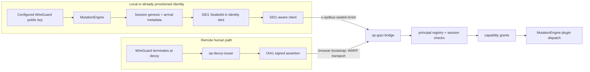

# Identity and Transport

The identity subsystem owns identity minting, session anchoring, and the
MutationEngine-authored SealedId envelope. A SealedId is a `SID1` credential;
it is separate from an `OPBLOB01` plugin blob. Plugin blobs define the plugin
catalog. SID1 binds one registered WireGuard-derived principal to one anchored
session and is carried unchanged to an authenticated receiver.

## Two identity paths

The owner-defined network boundary is that WireGuard terminates at the decoy
and WARP transports traffic and identity toward the server. WARP transport by
itself is not an authentication proof, and the source does not establish that
WARP injects either SID1 or OIA1. The decoy route below is the explicit source
mechanism for producing OIA1; the SID1 route is produced by the server-side
MutationEngine.

## Server-owned SID1 lifecycle

`MutationEngine::bootstrap_control_plane_chatbot_identity` and
`MutationEngine::bootstrap_configured_local_human_identity` derive the session
and principal IDs from the configured WireGuard public key, register the key in
the `human_principal` registry when needed, and call
`MutationEngine::mint_and_store_genesis`.

The current bootstrap requires the provisioned identity record to be recovered
from the configured durable store first. It does not invent an Incus instance
when none exists. The singleton chatbot process's first-arrival binding remains
an owner decision tracked in OD-58.

- [mutation_engine.rs](../../../crates/op-grpc-bridge/src/mutation_engine.rs)
  (`bootstrap_*_identity`, `ensure_verified_human_session_context`,
  `mint_and_store_genesis`).
- The genesis stamp includes the session ID, public key, chain head, catalog
  hash, trace ID, and arrival time. The session arrival is anchored only after
  the verified identity path permits it.
- `sealed_sealed_id` constructs `op_identity::sealed_id::SealedId` with
  `principal_kind = "wireguard-principal"` and transport scope
  `dbus,grpc,mcp,mqtt`, then calls `to_inline_ref`.
- [sealed_id.rs](../../../crates/op-identity/src/sealed_id.rs) defines the
  fixed `SID1` wire format: bounded fields followed by a SHA-256 integrity
  trailer. Its inline sled spelling is `sid1:<base64url>` and its binary HTTP
  and gRPC metadata name is `x-opdbus-sealed-id-bin`.
- [identity_sled_dispatch.rs](../../../crates/op-grpc-bridge/src/identity_sled_dispatch.rs)
  persists `sealed_id` with the identity session. An anchored session keeps its
  authored SID1; callers cannot supply or replace it.

The client rule is possession and forwarding: read the selected sled's exact
SID1, validate that its claims still match the projection, and forward the
authored bytes using the transport's encoding. [session_projection.rs](../../../crates/op-identity/src/session_projection.rs)
implements `mcp_sealed_id_header`; [op-identity-headers.rs](../../../crates/op-identity/src/bin/op-identity-headers.rs)
emits the JSON header object consumed by a direct HTTP/MCP header helper. A
client must not derive a new SID1, rebuild claims, hash a footprint, or mint a
replacement credential.

| Surface | Credential representation |
|---|---|
| Stored identity sled | `sealed_id: sid1:<unpadded-base64url>` containing the SID1 binary envelope. |
| Direct HTTP/MCP | `x-opdbus-sealed-id-bin` contains the canonical base64url payload without the `sid1:` prefix; the helper forwards it unchanged. |
| Native gRPC | Binary metadata under the same name carries decoded SID1 bytes. Tonic's `MetadataValue::from_bytes` handles gRPC's wire encoding; inserting the HTTP header text as binary bytes would double-encode it. |
| D-Bus | Credential bytes are supplied to `RegisterCurrentSender`; subsequent calls use the authenticated bus-sender binding. This is not an HTTP header on every D-Bus call. |

The SHA-256 trailer detects changes to the envelope; it is not an issuer
signature. Authentication requires the receiver's exact match to the
authoritative anchored sled and current principal registration. SID1 is
reusable within the session's valid term; OIA1 has a separate one-use nonce.

## OIA1 decoy assertion path

OIA1 has a different role. It is a short-lived Ed25519 assertion that lets the
server authenticate a remote human arrival before that human's anchored session
context is available. [op-decoy-issuer.rs](../../../crates/op-identity/src/bin/op-decoy-issuer.rs)
runs on the decoy, reads the connection source address on its WireGuard inner
listener, and resolves that address to one exact `/32` or `/128` `wg show`
allowed-ips entry. It then uses `DecoyIssuer::issue` to return an OIA1 wire
envelope. The source file documents that the decoy is the sole WireGuard
termination point and that the resulting assertion is carried as
`x-oracle-identity-assertion-bin`.

The bridge's [oracle_assertion.rs](../../../crates/op-grpc-bridge/src/oracle_assertion.rs)
validates OIA1 framing, the configured decoy key ID and Ed25519 signature,
time bounds, replay nonce, configured source binding, and the registered human
principal. It then calls
`MutationEngine::ensure_verified_human_session_context`, which anchors or
recovers the server-owned session context. OIA1 is therefore an arrival proof;
it is not the SID1 envelope and it does not become a plugin blob.

Production's default source-binding mode is `trusted-decoy-signature`, so the
signature and trust store remain authoritative when WARP/Xray changes the TCP
source address. `exact-peer-ip` is an explicit legacy/test mode. This setting
does not prove the health or correctness of a WARP tunnel.

## Admission and dispatch

All three server surfaces converge on the same identity and authorization
invariants:

- **Plugin gRPC/gRPC-Web:** [interceptor.rs](../../../crates/op-grpc-bridge/src/interceptor.rs)
  accepts exactly one OIA1 or SID1 credential. SID1 is opened and matched to
  the authoritative sled, then the active principal registry is checked.
  Missing, malformed, expired, mismatched or revoked credentials are rejected;
  OIA1 also rejects a consumed replay nonce. The generated method path requires the schema's declared
  capability, a matching `x-opdbus-capability` header, and an exact principal
  grant in [grpc_server.rs](../../../crates/op-grpc-bridge/src/grpc_server.rs).
- **D-Bus:** D-Bus does not pass through the gRPC interceptor. The
  `DbusIdentityV1.RegisterCurrentSender` method accepts a SID1 or OIA1 payload,
  binds the proof to the bus-assigned sender and process credentials, checks the
  identity binding grant, and records the sender binding in
  [dbus_identity.rs](../../../crates/op-grpc-bridge/src/dbus_identity.rs).
  Later `PluginV1` calls revalidate that binding before dispatch.
- **MCP:** the unified `:8090/mcp` HTTP handler accepts either OIA1 or SID1,
  rejects both or neither, and for SID1 requires an exact MCP grant plus a
  registered, non-revoked principal. The handler is in
  [mcp_frontend.rs](../../../crates/op-grpc-bridge/src/mcp_frontend.rs).

StateSync and EventChain now use the strict credential interceptor alongside
PluginService. Their handlers enforce operation-specific authority. Public
state reads select sealed public SHM; private UI workspace reads additionally
require the owner's current session, exact `gemma.read` grant, pinned contract
and explicit activation/recovery. The private stream rechecks admission while
delivering committed jobs/specs descendants, including after lag and deletion.

OvsdbMirror, RuntimeMirror, ComponentRegistry, Mail, PrivacyNetwork,
DbusPassthrough and dedicated Chat still use the legacy interceptor in
`grpc_server.rs`. Their authentication and per-operation authority need separate
assessment; accepting SID1 at PluginService does not establish a uniform gate
across every legacy service.

After admission, gRPC `PluginService.CallMethod` and generated plugin methods
call `MutationEngine::dispatch_method_call_with_identity`. The bridge is a
transport and authorization adapter; plugin behavior remains behind the
MutationEngine and the D-Bus/plugin schema path.

## Built-in client repair and remaining transport work

The native plugin client in [grpc_client.rs](../../../crates/op-grpc-bridge/src/grpc_client.rs)
requires an explicit identity session selector, reads the private credential
projection, validates its authored claims and forwards the exact decoded SID1
bytes. The request also carries the schema-declared capability metadata.

The [HTTP adapter](../../../crates/op-web/src/handlers/tched_router.rs) accepts
exactly one bounded canonical SID1/OIA1 header and forwards the caller's bytes.
It does not fall back to the server's identity. Legacy non-plugin service
interceptors remain unchanged. The new built-in-client TLS fixture exercises
receiver acceptance, rejection of reconstructed/missing/dual credentials and
principal grants. Current full formatting/Clippy/workspace-test receipts and
remaining gaps are recorded on [OD-58](../../../WISHLIST.md); earlier passing
counts do not identify the latest checkout.

The production UI in `3tched.com` obtains OIA1 from the decoy's
`/identity/self` endpoint. Each bootstrap RPC uses a fresh assertion because
nonces are single-use. Only an exact `UNAUTHENTICATED / UnknownPrincipal`
response starts self-registration through `human_principal.register_key`,
with the assertion's own public key and the declared `human_principal.write`
capability. Backend verification and exact grants remain authoritative.
An operator must first provision the identity through the canonical
`identity_sled.provision_container` method. Registration does not fabricate
an Incus instance or bypass provisioning.

After registration, the UI resolves its context and reads that session's
authored SID1 through `identity_sled.get_identity`. It only re-encodes those
bytes for binary metadata; it does not mint or persist credentials. Server
and source tests do not substitute for a fresh remote browser confirmation.

## Source proof

Meaningful tests cover the credential boundaries and identity ownership:

- `sealed_id::tests::sid1_round_trips_deterministically` and
  `sid1_rejects_tampering_and_trailing_bytes`.
- `identity_sled_dispatch::tests::parked_anchored_sled_authenticates_sid1` and
  `callers_cannot_write_mutation_engine_sealed_id`.
- `session_projection::tests::mcp_header_forwards_exact_sled_sealed_id_and_rejects_projection_drift`.
- Interceptor tests for parked SID1 authentication, current principal
  registration, and rejecting OIA1 plus SID1 together.
- OIA1 validator tests for unknown keys, signature, lifetime, source binding,
  replay, and registry failure behavior.

The pre-repair source verification gate was 1,126 passed, zero failed,
and eight ignored. Its fingerprints are historical and do not identify the
repaired source. A separate
[local metadata observation](topology-observation.json) found two protected
identity records, both with an inline `sid1:` value, genesis and instance
binding. Only aggregate counts were retained; credentials were not printed.
Presence alone does not prove integrity validation, transport injection or
receiver acceptance. Current deployment receipts in `SIGNALS.md` supersede
this historical observation; remote browser confirmation is a separate check.

## Sealed NextDNS assignments

An operator can assign a NextDNS profile and device name to an exact WireGuard
public key through `OP_IDENTITY_NEXTDNS_BINDINGS` in the bridge's service
configuration. It is a bounded JSON array of objects with `wireguard_pubkey`,
`profile_id`, and `device_name`. Startup validates canonical public keys, unique
assignments, six lowercase hexadecimal profile identifiers and bounded device
names. Invalid configuration prevents startup. The assignment is loaded once;
there is no global DNS fallback and no request header or plugin argument can
supply or replace it.

MutationEngine adds the configured pair to that key's SID1 when it first authors
the credential. An optional `NDN1` extension follows the original transport scope
and precedes the integrity seal. Credentials without an assignment retain their
exact original encoding. Both variants are accepted by updated readers, and
receivers still require the exact bytes stored by the identity owner. Recomputing
the public integrity checksum cannot authorize a different assignment.

The association records configured NextDNS context; it does not attest which
resolver handled a particular browser query. No API token is included. Clients
forward the entire SID1 through the existing binary identity metadata and must
not mint credentials or add parallel NextDNS identity headers.

Existing credentials are not rewritten at startup. Their owner can invoke the
existing `identity_sled.refresh_credential` with `{}` and its exact capability.
The owner loads the trusted assignment, preserves principal/session/genesis and
all arrival claims, and commits the replacement through Cozo and canonical SHM.
The existing transport upgrade to `dbus,grpc,mcp,mqtt` remains supported. A missing
assignment cannot silently remove a previously sealed one. A repeated refresh
with the same assignment and current transport is a no-op; after an actual
refresh, the old credential no longer matches the authoritative sled.

Deploy compatible readers before enabling assigned minting. Retain a received
release that understands `NDN1` as the rollback target; old binaries reject
extended credentials. Do not roll back identity records or restore old credentials
as part of a binary rollback. The plugin schema, Cozo columns and proto remain
unchanged because the complete context lives in the existing sealed credential.

## Seeded leaf provisioning and boot ownership

The identity device record in Cozo registers the persistent Btrfs device. It
is not a request to create a second human Cozo database. Provisioning composes
a prepared read-only core seed with a newly created blank writable device;
later starts remount and verify that same sprout. A populated independent
filesystem must never be passed to device-add, nor may an identity device be
added to the shared host/Incus pool. The original image remains retained during
any repair of an existing identity.

The sprout has distinct direct Btrfs subvolumes for its Incus pool and private
persistent data. The Cozo device record names the actual sprout mount root;
the container's `persist` disk names the sibling `persist` subvolume. An
unprivileged container uses an idmapped disk (`shift=true`) to write there;
changing the container to privileged or chowning the old data is unnecessary.
Native verification checks the actual mount boundary, seed digest and flags,
seed/leaf device ancestry, backing file identities and subvolume ownership.
Incus pool capacity alone does not establish any of those facts.

`op-identity-storage mount-all` is the root-only boot prerequisite in the
versioned `incusd` runit definition. It reads descriptors from
`/etc/op-dbus/identity-storage/<session UUID>.json`, mounts verified leaves,
and checks the persistent subvolume before Incus starts. A missing directory
means no seeded boot mounts have been installed. A malformed or unverifiable
committed descriptor fails the prerequisite. Only the installer's exact
`.boot-<UUID>.tmp` staging names are ignored after an interrupted atomic write;
no committed descriptor is silently skipped.

The storage owner installs each descriptor through
`op_network::seeded_boot::install_verified` while holding the native mount
guard. The fixed-directory descriptor format is owned by that module; callers
must not write a parallel JSON representation. Installation is atomic and
fsynced, accepts an identical existing descriptor, and refuses to overwrite a
different one. It contains mount configuration, not credentials or authority
to activate an identity. Cozo revision and journal checks still govern
activation if a later identity commit fails.

Incus can cache a pool as `Unavailable` if the daemon starts before its source
is mounted. Native mount verification and a successful pool/volume GET are
insufficient readiness evidence: the pool must additionally report `Created`.
The owner refuses activation while unavailable; it does not poll or restart
the shared daemon. Mount-before-daemon ordering prevents that cold-start race.
Ship the helper binary and matching runit definition in the same received
release; never install the hook alone. Source and private fixtures do not prove
that this boot ordering has been activated on a live host.

The core seed must contain only the pinned image cache and empty Incus volume
categories, with no existing container, VM, custom volume or snapshot. The
native owner validates this layout before creating a leaf or its filesystem
journal and checks it again before device-add. An existing-root repair also
checks the prepared sprout before importing its pool. This is a one-time
admission check: a provisioned leaf legitimately contains its identity root,
so boot and later starts verify provenance without requiring an empty pool.
The earlier Cozo intent fence can remain after rejected provisioning even
when no native leaf was created; that outcome requires reconciliation and
must not be reported as successful provisioning or retried automatically.

An existing identity whose Incus root is missing needs a separately prepared,
blank destination leaf before `repair_own_root` can run. The shipped root-only
`op-identity-storage prepare-leaf <session UUID> <plan SHA-256>` mode reads
exactly `/var/lib/op-dbus/identity-leaf-plans/<session UUID>.json`. The plan
directory is root-owned mode 0700; the plan is a root-owned mode 0600 regular
file, opened without following symlinks and checked against the argument's
SHA-256 before any filesystem effect. Its version-1, unknown-field-rejecting
fields are `version`, `session_id`, `seed_image_path`, `seed_sha256`,
`seed_fsid`, `image_fingerprint`, `new_leaf_image_path`, `leaf_size_bytes`,
and `mount_point`. The paths are absolute and normalized. The seed path must
name the fixed received-release artifact; the leaf path must be absent, and
the mount point must be a private empty directory. Native preparation
exclusively creates the blank leaf, composes it with the pinned clean seed,
creates the empty sibling `persist` subvolume, and journals the observed
sprout FSID. The command emits a JSON receipt with the plan digest, observed
FSID, leaf, persist source, and journal path for the operator's later repair
plan. It never changes Incus, Cozo, keys or grants, and it does not install a
boot descriptor. An existing leaf or journal is a reconciliation case, not a
retry. The authenticated repair owner installs the boot descriptor from its
held verified mount under the repair journal after admission.

Before authoring the version-3 repair plan, obtain a fresh authenticated
`inspect_own_root_repair_preflight` response. Copy its revision, native ETag
and `expected_first_start_idmap_sha256` into that root-owned plan. The digest
pins the original native last-state ID map without returning its contents.
Incus can remove generated ID-map metadata during rebuild; the repair owner
checks this pin before effects and uses it only for a repaired identity's
first mapping when the normal next-map field is absent. Existing current
mappings, the instance UUID, image and user configuration remain pinned.

Incus may leave an ordinary mode-0100 directory containing only its mode-0400
`backup.yaml` after the root subvolume disappears. Rebuild cannot replace that
stub directly. The repair owner records a quarantine intent in Cozo, verifies
the exact mounted pool and stub, and preserves the entire directory by an
exclusive rename within the same pool, outside `containers/`. It records the
preserved inode and backup digest before requesting rebuild. A real subvolume,
symlink, unexpected entry or changed inode is refused. The backup is retained;
this operation never substitutes an ordinary directory for the Btrfs root.
A crash between the rename and its committed receipt requires reconciliation,
not an automatic retry.

The image cache is a nested read-only Btrfs subvolume. Preparing or transporting
the pool's parent snapshot alone omits its contents; transfer both members
explicitly before sealing the seed image. Stage the verified seed image inside
the prepared release and transport that release through Btrfs send/receive.
Boot descriptors pin its absolute received-release path, never the mutable
`current` symlink. That release remains a storage dependency after a newer
executable release is selected and must be retained while any leaf uses it.

Release selection rollback before identity provisioning can restore the prior
catalog and Incus run script together. After a leaf is committed, a compatible
storage helper and the mount-before-Incus prerequisite must remain installed:
selecting an older release without them does not undo the storage transaction
and would break cold boot. Preserve the fixed seed path and boot descriptor
during any later binary rollback; uncertain storage phases require their own
reconciliation rather than filesystem selection alone.
