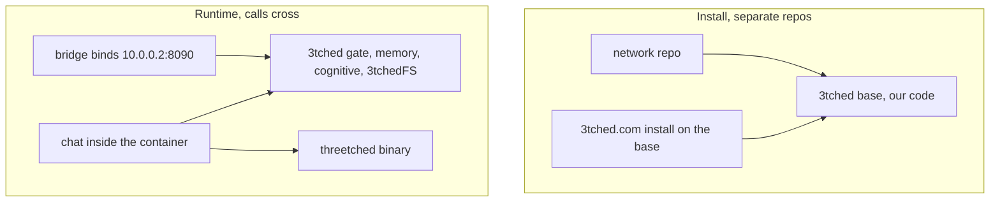

# Design — 3tched core

Status: draft. Authorizes no build, release, or service change. The base is
mostly already deployed. This design records which shared surfaces 3tched
owns at install, and which calls it accepts at runtime.

## Overview

3tched is our code and the base the other two install against. The network
is already its own repo and its host bridge is up. The container repo
(`/srv/git/3tched.com`) installs on this base and owns chat plus the
threetched binary.

threetched is the upstream ZeroClaw binary. It is not a second spelling of
3tched, and it is not a crate we maintain. Models, providers, and skills
stay with that binary. Grants, capabilities, persistent memory, the
cognitive layer, and 3tchedFS stay here.

## Architecture

## Components and interfaces

### Gate

3tched evaluates grants and capabilities. The identity is the container, so
a pass happens for a caller inside the container. Host chat did not pass,
because it was not that identity. A listener on host port 8080 must not
pass either. Rendering is not this component. The container passes the spec
through, and the user's browser renders it. See `container-chat`.

### 3tchedFS and the bridge

The bridge is our code. It includes 3tchedFS. 3tchedFS is the FUSE mirror of
runtime shared memory, and the mount carries the identity. One lungs socket,
`/run/opdbus/lungs/lungs.sock`, accepts connections from containers. The
kernel peer distinguishes callers. The network does not implement this
socket and does not listen on `10.0.0.2:8090`.

### What 3tched does not absorb

- ZeroClaw source, patches, or a reimplementation of models, providers, and
  skills.
- Chat source. That repo is `/srv/git/3tched.com`.
- WireGuard, WARP, or the host bridge. That repo is `/srv/git/network`.

Runtime calls from chat into the gate, memory, the cognitive layer, and
3tchedFS are the shared surface. They are supposed to happen. They do not
move ownership.

## Data models

No new store. Persistent memory and the cognitive layer stay in the stores
3tched already runs. The sealed catalog may name `threetched` as the binary
surface. That name is the binary, not a second copy of our code.

## Error handling

A bridge artifact with no 3tchedFS is a failed build, not a deploy. A host
caller, including anything bound to port 8080, does not pass the gate. A
missing container caller fails closed. This spec does not add a placeholder
listener on 8080 or on 8090.

## Testing strategy

Boundary checks, not a redeploy. A build of the bridge fails when 3tchedFS
is absent. A host caller is denied the gate. A caller inside the container
can pass. A test that imports ZeroClaw source into this repo fails. No Cargo
workspace build is authorized by this draft.
