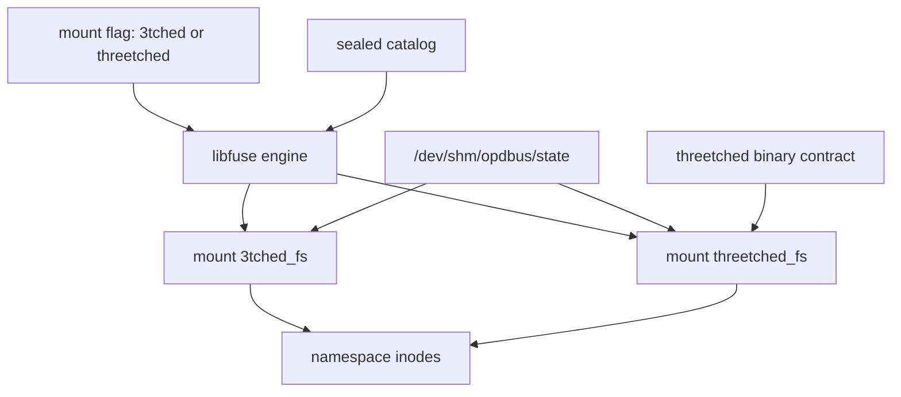

# Design — 3tchedFS and threetchedFS

Status: SPECIFICATION ONLY. Companion to `requirements.md`. No implementation,
build, test, seal, activation, or service restart is authorized.

Spec id: `3tchedfs-threetchedfs`
Continued from Grok session `01a1bcf4-6f0f-7680-b6d0-ca5a76110bf9`.

## Overview

One libfuse engine projects two surfaces. A mount flag selects `3tched` or
`threetched`. The mount names stay `3tched_fs` and `threetched_fs`. The
filesystem schema plugin stays `_3tched_fs`. The `threetched` plugin stays the
binary contract. The `fuse` plugin stops being a second filesystem contract.

Inodes stay a function of surface plus path. They are not written to SHM.
Live reads keep using committed `/dev/shm/opdbus/state`. Frozen workspace reads
stay on the object store. Direct SHM keeps refusing frozen values.

## Architecture

The mount reads the catalog and SHM. It does not reseal either.

### Decision: one filesystem plugin, two mount names

**Context:** The session treated libfuse as a third surface. Requirement 6
needed a decision before design.

**Options:**

1. Rename `_3tched_fs` to `threetched_fs` and drop the `3tched` mount.
   Pros: one name. Cons: violates the distinct-surface rule.
2. Keep two filesystem plugins plus `fuse`.
   Pros: no catalog change. Cons: three filesystem authorities.
3. One filesystem plugin, surface flag, two mount names, binary plugin kept.
   Pros: matches the approved requirements. Cons: `fuse` callers must move.

**Decision:** Option 3.

**Rationale:** Surfaces stay distinct. The engine is shared. The binary
contract is not a filesystem.

**Implications:** Source consolidation only. Reseal and activation stay a
separate owner step.

## Components and Interfaces

### Mount command

**Purpose:** Select the surface before the namespace is built.

**Interface:**

- Input: `--surface 3tched` or `--surface threetched`
- Output: a mount whose view names `3tched_fs` or `threetched_fs`
- Dependencies: existing lungs socket or credential flags in
  `crates/_3tched-fs/src/main.rs`

Missing or unknown values refuse the mount. `threetched` is the only flag that
grafts `ThreetchedSurface`. `3tched` does not.

### Filesystem plugin

**Purpose:** One sealed description of the filesystem protocol.

**Responsibilities:**

- `_3tched_fs` remains the plugin id.
- Contract text names both mounts and the surface flag.
- `fuse.rs` no longer publishes that contract.
- `threetched.rs` is not edited into a filesystem plugin.

**Files:**

- `crates/op-plugins/src/state_plugins/_3tched_fs.rs`
- `crates/op-plugins/src/state_plugins/_3tched_fs_contract.rs`
- `crates/op-plugins/src/state_plugins/fuse.rs`
- `crates/op-plugins/src/state_plugins/mod.rs`

### Namespace

**Purpose:** Path, inode, and file-kind projection.

**Files:** `crates/_3tched-fs/src/namespace.rs`

Inode input is `"{surface}:{path}"`, then the existing blake3 high-bit rule.
Root stays inode `1`. A collision still fails the projection. Refresh of an
unchanged path keeps the inode.

The surface flag does not touch the handle table. `HANDLE_LIMIT` stays 256 in
`crates/_3tched-fs/src/fuse_buffers.rs`. `open` still takes one slot and
`Charge` still returns it on drop. A 257th open is `ENOMEM`. Active handles
are not evicted.

### SHM and frozen reads

**Purpose:** Keep one authority for each fact from the inventory in
`requirements.md` section 3.

| Fact | Authority | File? |
| --- | --- | --- |
| Live plugin value | `/dev/shm/opdbus/state/<plugin>.json` | yes, view mount |
| Frozen plugin value | object store | yes, workspace mount |
| Sealed schema | `/dev/shm/opdbus/plugin-blobs` | yes, `schema.json` |
| Call body | not stored | call file only |
| Inode map | namespace | no |
| `state/.manifest.json` | generation counter | no |
| `plugin-blobs/.manifest.json` | refresh input | no separate file |
| Mount identity, instance uuid, unavailable set | namespace | no |
| Method receipt | existing receipt | no second SHM copy |
| `credentials/` | secret store | no |
| `capability-grants.json` | grants, out of spec | no |
| `.op-release-original-*-plugin-blobs` | old catalog copy | no |
| `/dev/shm/3tchedfs` | ephemeral | no |

Overlooked cases this design closes:

1. Invalid live state fails the read. No schema-template or `{}` fallback.
2. Direct SHM stays directory, static JSON, object hash, and live value.
   Method files, capabilities, threetched command files, call files, and
   symlinks stay on the FUSE mount. Direct SHM refuses them.
3. `FileSource::Value` and `NodeKind::LiveFile` are one pointer, one inode,
   one body.

`Backend::DirectShm` still refuses frozen values.

### Deploy helper

**Purpose:** Pass the flag the mount now requires.

**File:** `deploy/runit/libexec-3tched/mount-3tchedfs`

The helper passes `--surface` and checks `view.json` for the matching mount
name. It does not reseal and does not restart services.

## Data Models

### Surface

| Field | Type | Required | Description |
| --- | --- | --- | --- |
| name | `3tched` or `threetched` | yes | Flag value |
| mount | `3tched_fs` or `threetched_fs` | yes | Derived, not free text |
| graft_binary | bool | yes | True only for `threetched` |

No other name is valid. `chat` and `chat_fs` are rejected as mount or transport
names on this path.

### Inode

| Field | Type | Required | Description |
| --- | --- | --- | --- |
| surface | string | yes | Part of the hash input |
| path | string | yes | Projected path |
| ino | u64 | yes | Derived, not stored in SHM |

Validation: root path hashes are not used; root is fixed at `1`. Equal inputs
yield one inode. Unequal inputs that collide fail.

## Error Handling

| Condition | Response | SHM write |
| --- | --- | --- |
| Missing or unknown surface | refuse mount | no |
| Inode collision | fail projection | no |
| Schema and live state disagree | fail read or refresh | no |
| Plugin absent from catalog | omit or refuse that plugin | no |
| Unbound identity writes a call file | refuse write | no |
| Direct SHM asked for a frozen value | refuse read | no |
| Catalog generation changes | refresh from catalog | no reseal |

Failures stay on the mount call. They do not create an empty state object to
make the read succeed.

## Testing Strategy

This spec does not authorize tests, fmt, Clippy, or `/verify`. After an
explicit owner request, the checks are:

- Missing flag and unknown flag refuse the mount.
- `3tched` does not graft the binary surface. `threetched` does.
- The same path on two surfaces does not share an inode.
- A changed body at the same path keeps its inode.
- Direct SHM rejects a frozen read.
- A call-file write is not present as a SHM state file.
- `view.json` mount name matches the flag.

Those checks are not a deploy gate.

## Out of scope

- Reseal, persist, `activate-golden.sh`, and service restart.
- Renaming `_3tched_fs` to `threetched_fs`.
- Replacing the `threetched` binary plugin.
- A SHM inode table.
- New grants, identity minting, or SQLite.
