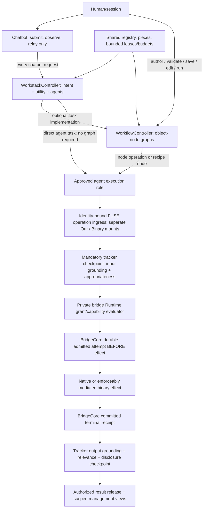

# Agent Orchestration Center — Design

## 1. Decision, scope and evidence baseline

**Owner-authorized orchestration source implementation, 2026-11-19; in progress, not built/tested/deployed.** This workstream owns separate native Workflows and Workstacks, shared recipes/pieces, delegation, typed judgment policy and receipt-linked caller cutover. Another GPT owns canonical PluginSchema/FUSE/schema delivery; the user owns the KiroWeen UI. Our scope ends at the actual backend docking point. All builds/checks remain on hold pending owner coordination across four streams. The single parent delivery coordinator owns authorized selective task commits/pushes; workers do not mutate Git.

Profile/recipe **is not** worker process **is not** container identity. Existing approved roles/containers can serve multiple recipes. **Every accepted chatbot request, including reasoning-only conversation, enters a workstack IntentSpec and attributed agent run.** Chatbot submits, observes and relays only: no direct answers, tools or internet. An authorized user may separately author/save/run a workflow without a workstack wrapper; this does not grant chatbot execution rights. Requestor, response author and executor remain distinct.

### Mandatory FUSE ingress — owner correction

The owner confirms **all calls now use FUSE and the upgraded bridge hosts mounts**; this is ground truth, not a claim to re-test. Narrow current source corroborates real linkage: `lib.rs:65-66`; `runtime_bootstrap.rs:87` starts local mounts; `runtime_fuse.rs:348-426` derives the container caller and instantiates separate `Surface::Our` and `Surface::Binary` library mounts. `FuseExecutor::call` (:261-302) invokes Runtime privately after the callback and validates receipt attribution/operation ID/disclosure. That backing call is not an authorized alternative caller transport.

**Normative reading of every later execution/task contract:** workstack/workflow controllers, agents, inference/Jev infrastructure, graph CRUD/preview and checkpoint/resume all initiate operations through their identity-bound FUSE `operations/<plugin>/<method>/call` namespace on the correct separate mount. FUSE callback -> mandatory tracker checkpoint -> private Runtime evaluator/core attempt -> native owner -> receipt/output checkpoint is the sole call boundary. Older source findings about nested Runtime calls document inspected implementation paths, not permission to retain a direct caller bypass. Private schema/authority/commit helpers inside the callback need not recursively write FUSE; a newly initiated agent/tool operation does. Library placement in the bridge changes no identity/mount/authorization rule. No raw client, socket or same-process `Runtime::call` ingress is permitted.


Evidence recorded before writing: branch policy `OK (only main dev)`; branch `dev`; HEAD `66128374e29c4e8b32b715968a95adcb7d44c97e`; shared tree initially 303 staged, 450 unstaged and 14 untracked paths. These documents do not describe a clean-HEAD implementation. `HANDOFF.md` and `SIGNALS.md` were absent; neither was recreated. No application code, prior FUSE/socketless spec, services, credentials, grants or storage was changed. Source references below describe the inspected tree, not deployed behavior. Historical fcc79b3/372ff9c and OD-61 are context, not evidence that former bridge modules remain linked.

## 2. Current-state review: native agents and retained runtime

### 2.1 Authoritative graph and useful foundations

| Area | Retained source evidence | Assessment |
|---|---|---|
| Factory and catalog | `crates/op-agents/src/lib.rs:25-64`; `unified/registry.rs:22-84,144-146`; `agent_catalog.rs:28-77` | Factory uses shared `GLOBAL_REGISTRY` plus `UnifiedAgentAdapter`, not the former per-agent match. Registry combines execution/persona/orchestration factories and migrated catalog entries. Preserve shared metadata as the single catalog input. |
| Dynamic composition | `crates/op-agents/src/dynamic/pieces.rs:10-52,74-338`; `dynamic/assemble.rs:13-27,98-113` | Reusable Behavior/Knowledge/Example/Capability fragments, markdown ingestion, memory-derived pieces and explicit piece IDs/provenance are already available. Build on these types. |
| Linked bridge | `crates/op-grpc-bridge/src/lib.rs:55-80`; `runtime_workspace.rs:20-29,108-110,125-137` | Runtime, cognitive, chat, workspace, FUSE, sled ledger and workspace workflow owner are linked. Disk files `agent_runs.rs`, `specialist.rs`, `agent_catalog_dispatch.rs`, `agent_workflow.rs`, `mutation_engine.rs`, `workstack_runner.rs`, `workstack_service.rs` are not linked by this bridge graph. Do not revive them. |
| Real specialist path | `crates/op-grpc-bridge/src/runtime_cognitive.rs:127-179,267-350` | Catalog personas consult through dynamic assembly and nested `chat_router.Chat`; raw persona `execute` intentionally refuses unauthenticated consultation (`op-agents/src/unified/persona/base.rs:170-197`). |
| Canonical methods | `crates/op-plugins/src/state_plugins/cognitive_agents.rs:181-227,325-429`; `runtime_cognitive.rs:144-152,435-442` | Methods derive from registry descriptors into plugin-owned schema; nested calls re-enter Runtime. Preserve this owner, not a new agent proto or schema directory. |
| Effect authority | `runtime.rs:114-137,347-375,414-491`; `core.rs:17-23`; `core_operations.rs:120-220,265-289` | Shared admission, sealed method pinning, exact grants, durable scoped attempts, terminal proof and committed projection already exist. Method attempts are durable before dispatch; receipt recovery is exact principal/session scoped. |
| Workflow execution | `runtime_workspace_workflows.rs:44-55,91-149,174-243,251-300`; `workflows_plugin.rs:30-160,271-348` | Existing bounded workflow owner: 64 slots, 2 permits, 1–32 string steps, durable CAS, start-after-commit, pause/cancel and no replay. Reuse mechanics for graph runs/shared primitives; this is **not** the target workstack intent/utility owner. |
| Two FUSE surfaces | `runtime_fuse.rs:1-15,215-254,261-302,348-441` | Library instantiated in bridge and dispatches through Runtime. Identity derives from anchored container; separate Our/Binary mounts remain mandatory everywhere. Source linkage is not evidence mounts are running. |

### 2.2 Findings requiring the proposed changes

**N1 — Chatbot conversation currently directs original-caller tools, not an execution agent.** `runtime_chat_conversations.rs:129-134` selects a distinct responder, but `answer` obtains caller-grant-visible tools (`:217-225`, `runtime_chat.rs:359-370`) and performs model-requested calls through the original `ctx.caller` (`:253-268`). The responder authors the response; it does not become the executor. Existing calls are re-admitted, so this is **not an established unauthorized admission bypass**. It is a mismatch with the owner's new zero-execution chatbot contract. Remove this execution choice from the conversation role; submit agent work under explicit delegation instead. Also separate conversation inference/retrieval infrastructure from chatbot authority: current chat and embedding nested calls still use the caller (`runtime_chat_ctl.rs:54-57,117-118,146-147`).

**N2 — Workflow and cognitive orchestration overlap but are not one management center.** Current cognitive workflow validates 1–64 steps, rejects nested orchestration, prechecks child grants and invokes admitted children (`runtime_cognitive.rs:587-678`). Library `OrchestrationAgent.execute_workflow` directly invokes registry agents without verified receipt context (`unified/orchestration/base.rs:54-122`), while ordinary execute refuses run_workflow (:181-234); this is not evidence of a retained bridge bypass. Target cutover separates behind-the-scenes task/agent policy into WorkstackController and authored graph execution into WorkflowController, sharing mechanics and mandatory tracker-led admission. Same-caller child-grant intersection cannot serve zero-exec chatbot delegation; independently approved executors remain necessary.

**N3 — Metadata is not authority or durable success.** `AgentRequest` has no verified execution identity or operation link, and `AgentResponse.success` is only a boolean (`unified/agent_trait.rs:48-81`); `AgentCapability` is a declaration (`:23-46`). `security_profile: None` on orchestrators (`unified/orchestration/base.rs:158-160`) must not mean security is delegated to prompt text. A completed tool method receipt and a successful domain outcome are different: exit status may report failure even though the method itself completed.

**N4 — Modular cutover and budgeting are incomplete.** The specialist hardcodes executor labels (`runtime_cognitive.rs:286`), builds a pool per request and consults selected namespace plus shared `agent_pieces` (`:288-313`), lexically matches snippets (`:303-306`), then appends a requested static persona and up to 8,000 knowledge characters **after** assembly (`:318-332`). The assembler calls its limit `budget_chars` but charges bytes; admits an oversized first piece; inserts an uncharged fallback behavior; renders framing, executors, activity, context and examples outside the selection accounting (`dynamic/assemble.rs:115-257`). Memory/runtime sources get 1.3 relevance weight (`:279-282`), not security authority. Memory exposure is not inferred from that weight: `selected_context` verifies session and `bind_memory` constrains ordinary memory operations (`runtime_cognitive.rs:445-450,475-494`); shared `agent_pieces` read is a deliberate specialist path whose trusted publisher/access policy must be made explicit. There is no demonstrated generic arbitrary-namespace write vulnerability in this review.

**N5 — Tracker is useful observation, not yet a durable center.** `RuntimeInner` now owns `ExecutionTracker::new(1024)` (`runtime.rs:267-273,313`) and `Runtime::call` starts tracking full arguments plus principal before admission (`:386-407`). The record ID is random; operation ID appears only in the terminal summary. The waiter performs complete/fail **outside** the spawned native owner, so dropping the waiter can leave Running while native effects finish. `execution_tracker.rs:80-106` clones and broadcasts the whole Started record and removes the oldest record even if active. Terminal updates silently no-op after eviction (`:110-187`); `list_recent_completed` includes active records (`:207-223`); raw error text is logged (`:180-184`). These are source findings, not claims about externally reachable tracker subscriptions.

There are already two related tracking models: `execution_context.rs:7-57,94-119` has parent/trace relationships and a separate status enum, while `record.rs:21-39,101-159` and the actual tracker use another ID/status model without parent linkage. Unify the real tracked record and context metadata; do not introduce a third parallel execution model. `record.rs` hash fields/defaults and optional integrity functions do not establish an append-only durable ledger. Core operation proofs already do.

**N6 — Historical gate inheritance is not target cross-FUSE authority.** Inspected Runtime roots hold a global mutex and historical nested calls inherit execution/path (`runtime.rs:95-137,414-423`); `for_background` drops the gate/path (:56-64), and workflow start commits before spawning (:122-149). Target R19 requires every NEW child/tool/judgment caller operation to use FUSE: persist/defer continuation, end/release ancestor root, then initiate a fresh container-bound FUSE call. No authenticated cross-FUSE root inheritance is established or permitted. Only private non-operation callback helpers remain under the same gate. Correlation IDs link two calls, never inherit authorization. Preserve serial effects; no new lock service/concurrency promise.

### 2.3 Workstacks are not workflows

Actual repository workstack data is `op_chat::orchestration::Workstack` (`crates/op-chat/src/orchestration/workstack_executor.rs:31-107`): ID, name, description/category, **phases**, variables, required agents and optional timeout. A phase contains tools, agents, operation/arguments, explicit phase dependencies, condition, rollback calls, continue-on-failure and timeout. This is not evidence of a LIFO stack or a queue of work items. The crate exports this model (`crates/op-chat/src/orchestration/mod.rs:62,117-130`); it is a source/library model, not proof of current bridge deployment.

Historical `workstack_service.rs:3-10,12-24` reads a `workstacks` array from a workflows runtime document and uses the old MutationEngine. That facade/runner is **unlinked** from current bridge `lib.rs`. Current `WorkflowsState` declares `workflows` and `config`, not `workstacks` (`workflows_plugin.rs:13-27`); current retained workspace methods do not expose workstack controls. The domain label in a topic hash (`runtime_workspace_workflows.rs:227`) does not change that.

The **target** has separate WorkstackController intent/utility tasks and WorkflowController user-authored object-node graphs. A workstack coordinates agents directly or optionally selects a workflow run; neither system must wrap the other. Source currently lacks a linked workstack policy owner, so propose a canonical Rust-owned `workstacks` PluginSchema and native Runtime controller, not restoration of the old raw service. Workstack task/phase state never moves into workflow records. Behind-the-scenes means ordinary agent requests require no user-authored graph, **not** hidden audit or unauthorized status.

### Native-first lineage: preserve the original 3tched design, not only its linear runner

The foundation is **our native 3tched orchestration**, including the original `op-chat::orchestration` and `op-workflows` graph/context/tracker design. The currently linked 32-step runner is a safe execution-owner starting point, not the full desired feature model. Upstream threetched contributes bounded turn/context/roster ideas; it is not the architecture source for a replacement scheduler.

| Original native feature and retained source | Chosen preservation/adaptation | Design/task/manual evidence |
|---|---|---|
| `VerifiedScope`, `ScopeVerifier`, `ExecutionControl`, `WorkstackEventSink`, `crates/op-chat/src/orchestration/mod.rs:65-108` | Principal/session/genesis-bound ownership, default-deny cross-owner control, scoped progress distinct from durable commits | §§4.3,5.3; T3–T5; `response_author_is_not_executor`, `requestor_cannot_read_executor_private_recovery` |
| Workstack phases/tools/agents/dependencies/variables/rollback, `workstack_executor.rs:31-107,269-384` | Preserve authored phased workstack domain; borrow dependency resolution and explicit context/result ownership for bounded agent DAGs | §§2.3,4.4,5.1; T2,T6; `workstack_reference_does_not_alias_workflow`, `dag_rejects_cycles_and_bad_bindings` |
| Scoped `ToolExecutor` default unsupported, `workstack_executor.rs:419-441` | Verified dispatch context and explicit Unsupported when scoped execution is unavailable; never fall back to unscoped tools | §§2.6,4.3; T3,T8; `denied_tool_has_no_alternate_raw_path` |
| Object-to-node `WorkflowNode`, `NodePort`, `NodeConnection`, `WorkflowDefinition`, `crates/op-workflows/src/{node,flow}.rs`; `builtin/{plugin_node,dbus_node,tool_node}.rs` | **Each eligible canonical discovered object becomes a composable node**, with schema-derived ports, real object identity, version/policy pins and explicit graph edges; rebuild incomplete execution through Runtime, not generic tool-list reduction | §4.4; T2,T6; `every_eligible_object_has_schema_derived_node`, `node_mutation_requires_declared_operation` |
| `WorkflowContext` and original tracker-centered orchestrator, `op-workflows/src/lib.rs:10-29`; `orchestrator.rs:247-265` | Explicit run-owned context/results, plan/workflow/run distinctions and unified tracker/materialization | §§4.2,5.3–5.4; T4–T6; `accepted_run_has_durable_core_proof`, `terminal_event_counted_once` |
| Intermediate-result cache, `op-workflows/src/orchestrator.rs:164-222` | If retained, reuse existing owner only after scope/proof/input/schema/policy/read-freshness validation; never use cached result to skip an effect admission/receipt | §4.4 and rules below; T6; `cached_result_cannot_replace_effect_or_authorization` |
| PatternTracker proposal intent, `op-workflows/src/orchestrator.rs:80-151` | Patterns become reviewable versioned recipe proposals, never automatic callable method/capability promotion | §4.1 and rules below; T6; `learned_pattern_requires_recipe_review_without_grants` |
| Three native workstack seeds `full_stack_feature`, `code_review`, `ovs_network_setup`, `op-chat/src/orchestration/mod.rs:130-257` | Preserve useful authored phase/expertise recipes and provenance as domain references/seed data without flattening away workstack identity | §§2.3,4.1,4.4; T1,T2,T6; `workstack_domain_unchanged` |

Plans are proposals; recipes/workflows are versioned authored definitions; workstacks retain their own phased domain model; a run instantiates authorized work; tasks/attempts/operations track execution. Shared context is scoped run data, not ambient mutable authority. Resource ownership means explicit project/target scope and scheduler leases/budgets here, not a new lock service or permission to parallelize effects.

Do not retain unknown conditions defaulting true (`workstack_executor.rs:387-408`), automatic rollback/retry after unknown effects, or historical lint/test/deploy steps contrary to manual owner policy. Do not enable the blocked raw registry/sequence facades (`op-workflows/src/orchestrator.rs:269-275,337-343,497-501`) or restore old transports merely to reuse the graph. Existing cache/pattern owners may supply scoped observations/proposals; no new cache database, automatic optimization or throughput claim is added. A cached read must match authorized input/contract/policy and a still-valid read observation; cached execution output may be displayed as historical evidence, never asserted as a newly executed effect. Accepted learned recipes still require normal management approval/version pinning and current execution authority.
Original lineage report `/tmp/original-operation-dbus-orchestration-review.md` records source manifest URL `https://github.com/3tched/operation-dbus-proto` returning public 404, no separate local checkout, and retained history to import `8d01947e497be9ab66e7bdd15717494c60b031d1` (2026-09-14), not an established original-remote commit. No historical utility scorer/formula was recovered; user-confirmed intent/utility is the required target. Removed regex-confidence/direct-registry intent/hybrid executors (`88c8f033`) must not return. `op-state/src/plugin_workflow.rs:1-5,55-87` explicitly says each plugin becomes a connectable node, but registration constructs/discards it (:322-330). Automatic discovery/working transport is not proven; original pool execution is unsupported/simulated and engine “parallel” batches await sequentially. Preserve architecture, repair wiring.


### 2.4 External provenance and boundary

The current pin is ZeroClaw `v0.8.4`, commit `a56c345d51dd8ab562e9351e0d4ab83f6a741db9` (`vendor/threetched/source.pin:1-6`). The checked-in builder extracts the verified source and builds it without applying local patches (`build-threetched.sh:172-177`); the manifest explicitly says `source.mode = unmodified-upstream` (`:213-225`). Historical prose about a checked-in patch stack is not the current build contract.

The actual callable integration remains discovered, sealed `threetched` methods, not arbitrary upstream internals. `crates/op-plugins/src/state_plugins/threetched.rs:165-219` derives exact command capabilities/input/output schemas from the pinned capture. Runtime use consumes sealed schema (`:224-237`); command preparation verifies pinned provenance/config selector (`:306-330`). A future recipe imports only functionality represented by that sealed method set. Presence in upstream source does not prove the method exists or is authorized in this installation.

### 2.5 Pinned threetched review: best mechanisms, not inherited authority

Upstream citations here and Appendix B are members of the exact pinned `vendor/threetched/source.tar.gz`, not application-repository Rust modules. **R/** expands to `crates/zeroclaw-runtime/src/`; **C/** to `crates/zeroclaw-config/src/`; **U/** to the archive root. The independent read-only review is `/tmp/threetched-agent-review-20261119.md`; source extraction `/tmp/threetched-agent-review-20261119.pH8q0B/`. No extracted program was executed. That review found archive/pin and staged candidate/manifest digest consistency; this design does not claim a build, independent reproducibility or live deployment.

| Upstream mechanism and source | Native reuse | Boundary/correction |
|---|---|---|
| Common `run_tool_call_loop`, R/agent/turn/mod.rs:276-326; caller R/agent/agent.rs:2315-2366 | One bounded reasoning turn lifecycle with typed requests/results | Source also supports direct tool calls and natural-language completion. It does not enforce delegate-every-request chatbot behavior. |
| Separate aliased agent, risk/runtime, skill, workspace and memory refs, C/schema.rs:3535-3590,3654-3737 | Recipe/profile/piece separation and explicit discovered roster | Alias/workspace is not our container identity; same-risk-profile reach defaults true (:3668-3686), unlike explicit native delegation approval. |
| Reachable roster, C/schema.rs:3860-3933; narrowed ephemeral subtask, R/tools/spawn_subagent.rs:88-119,141-192 | Context isolation, explicit allowed targets, bounded child scope | Model target names do not grant authority or a new identity. Native code validates all actual executors. |
| Progressive skills, R/skills/mod.rs:1610-1689 and R/tools/read_skill.rs:46-114; scoped memory, `zeroclaw-memory/src/agent_scoped.rs:9-39,83-100,167-214` | Summary-first, canonical on-demand authorized pieces and bounded scoped context | Skill/memory text is data, not a grant; retain native ledger/Qdrant owners and no SQLite dependency. |
| Task lifecycle/owner epoch, R/control_plane/task_registry.rs:7-137; reaper :40-103 | Stable ID, parent/owner references, explicit Lost/TimedOut/interruption | Optional supervision and missing producer fields are not durable completion/resumption. Do not import a second SQLite task authority. |
| Correlation/optional local receipts, R/agent/tool_execution.rs:112-139,235-268; R/agent/tool_receipts.rs:13-65 | Correlated task/tool observations | Ephemeral HMAC result evidence is not native authorization or BridgeCore terminal proof. |

Specific unsafe assumptions are excluded:

- Agentic delegate invocation sets `approval: None` and `shared_budget: None` (R/tools/delegate.rs:2637-2657,2674-2683); missing approval manager is NotRequired (R/agent/turn/approval_gate.rs:27-30). Bounded mode therefore does not automatically preserve top-level per-tool approvals or common iteration budget.
- Independent targets build their own policy/tool envelope; parent subset protection is not universal (R/tools/delegate.rs:418-505,688-739,2507-2529). Native independent executor authority is allowed only under the explicit owner-approved delegation predicate in §4.3, not by borrowing an upstream alias.
- Empty risk-profile allowed tools become unrestricted at that layer, and a name containing `__` is auto-admitted by a delegate allowlist exception (R/tools/delegate.rs:918-945). Native empty sets mean no task tools; exact sealed methods/grants have no string-based exceptions. MCP remains retired.
- Background capacity check has awaits before insertion, and parallel fanout is separate (R/tools/delegate.rs:1442-1534,1706-1736,1764-1834,2181-2198). Use real reserved capacity/budgets, not advisory map length.
- Parent-session cancellation wiring is not established by the delegate's independently created token; explicit cancel differs from parent exit (R/tools/mod.rs:1413-1441; R/tools/delegate.rs:253,1529-1534,2249-2256). Background receipt/cost task-local context is also not universally inherited (:1547-1574,1757-1762,1818-1829,2617-2624).
- Supervision startup may fail without stopping the daemon; producer registry writes may be ignored and omit parent/principal/route (R/daemon/mod.rs:382-393; R/tools/delegate.rs:1490-1516,1630-1649). Reaper marks loss, not safe resumption; no missing-terminal effect replay follows.

These findings are source-review conclusions, not a claim that the installed threetched configuration exposes any particular risk mode.

### 2.6 Registered adapter support matrix — no hidden binary tools

An outer `Runtime::call` tracks only that admitted plugin invocation. **It does not automatically mediate shell/file/network/delegate tools privately executed inside the binary.** Current upstream registers raw tools (R/tools/mod.rs:570-618). A prompt telling it not to use tools, or an empty upstream allowlist, is insufficient enforcement.

| Adapter mode | Proposed registration status | Required evidence/contract |
|---|---|---|
| Native reasoning recipe, authorized inference role, no task tools | Supported target design; not yet implemented by this spec | Provider boundary admitted through existing owner; typed result, budget and tracker linkage. No native tool execution in chatbot. |
| Native recipe using existing Rust/Python/JS/Go/shell backends | Supported target design subject to policy/executor grants | Every effect enters normal Runtime admission; exact schema/receipt; no raw registry execution. |
| External inference-only adapter | Conditional, unavailable until enforceable tool-free contract is verified | Only an actually discovered sealed method and an enforced no-tools mode; no private raw loop, recursive agent, reflection or fallback tools. No invented endpoint. |
| External tool-capable adapter exclusively exposing discovered FUSE operation tools | Conditional, unavailable until full mediation is demonstrated | Every host attempt, including child/delegate/reflection/default/fallback path, returns through the correct separate Our/Binary namespaces and shared Runtime admission. No direct host syscall/tool bypass. |
| Stock autonomous threetched loop with internal shell/file/network/delegate registry | **Unsupported for orchestration execution** on current evidence | No proof of exclusive mediation; reject mode rather than simulate support, assume patches or rely on prompt-only prohibition. |
| Upstream task/SOP/goal/todo internals lacking sealed integration | **Unsupported as native execution APIs** | Source-defined internal function is not a callable discovered plugin contract. |

Adapter support is typed recipe/runtime binding metadata pinned to binary/capture/catalog/schema revision and enforcement mode, not a new plugin schema source. Registry admission rejects an unavailable mode before scheduling. Existing independently authorized binary commands are not globally deleted by this design, but the center must not treat a receipt for such a command as proof that its internal tools satisfy the all-tools boundary. If a verified tool-free/mediated mode is absent, native recipes plus existing authorized inference remain the complete supported path; no stub adapter or binary patch is promised here.


### 2.7 OpenClaw workflow meld: native graphs with durable approval/input gates

Read official [Lobster](https://docs.openclaw.ai/tools/lobster.md), [Automation](https://docs.openclaw.ai/automation.md) and [OpenProse migration](https://docs.openclaw.ai/prose.md), plus corroboration `/tmp/openclaw-workflow-review-20261119.md`. Lobster is optional `@openclaw/lobster`, embedding `@clawdbot/lobster` **in-process**, not an external subprocess service. No install/execute occurred.

| Mechanism | Selected native meld | Rejected/import boundary |
|---|---|---|
| Named typed dataflow, schema validation, bounded outputs/time | Object-node port edges and native graph budgets/pins | No second shell DSL, arbitrary command/script node, ambient env/token or new runtime |
| Approval AND structured-input checkpoint persists and ends call | Core-owned pending continuation; release gate/permit; resume only remaining work | No process waits for human and no replay of completed/unknown effects |
| Any schema-valid JSON answer; invalid input preserves pending gate | Validate before one-shot CAS; exactly one approval/response/cancel; successive gates possible | No guessed answer or invalid-input consumption |
| Snapshot-safe continuation claim and pre-dispatch-only restore | Native expected-revision/fenced CAS and consumed audit; preserve original operation after unsafe dispatch | No universal retry or restoration after uncertain effects |
| Upstream token permits resume without user/session binding; local JSON store and no pending list | Replace with non-bearer verified scope/approver binding and authorized canonical SHM pending-gate discovery | No possession-as-authority, `~/.lobster/state`, second DB or raw secret token |
| Workflow visualization | Native object graph preview/editor in existing Svelte/json-render catalog | Lobster graph renderer is not our object discovery/port editor |

Source corroboration is **standalone Lobster** commit [`c6c5533cc7d9e768bbaee7c4a7716e2575857a7a`](https://github.com/openclaw/lobster/tree/c6c5533cc7d9e768bbaee7c4a7716e2575857a7a), 2026-11-17: [validation/claim/unsafe dispatch](https://github.com/openclaw/lobster/blob/c6c5533cc7d9e768bbaee7c4a7716e2575857a7a/src/core/tool_runtime.ts#L319-L470), [snapshot claim/restore](https://github.com/openclaw/lobster/blob/c6c5533cc7d9e768bbaee7c4a7716e2575857a7a/src/state/store.ts#L461-L548), [checkpoint state](https://github.com/openclaw/lobster/blob/c6c5533cc7d9e768bbaee7c4a7716e2575857a7a/src/pipeline_resume_state.ts#L121-L276). OpenClaw host `main` plugin package observed version 2026.11.5 pins embedded dependency **2026.10.1**, so reviewed standalone HEAD is **not proof** the installed embedded package has identical code. No installed OpenClaw was inspected. Host [runner](https://github.com/openclaw/openclaw/blob/main/extensions/lobster/src/lobster-runner.ts) and [package](https://github.com/openclaw/openclaw/blob/main/extensions/lobster/package.json) are moving-main evidence, distinguished from that immutable standalone commit.

Docs remove shared Tasks/TaskFlow and bundled OpenProse `/prose` (v2026.8.1); do not portray them as current bundled workflow engines. Upstream shell/env/approval metadata and optional isolated JSON inference do not establish native tool-free mediation or verified approver identity. Keep our two entities, canonical schemas, one tracker-led Runtime checkpoint and core writer; no OpenClaw runtime installation/import is proposed.

## 3. Chosen architecture and alternatives

### 3.1 Two native systems, one admitted effect and management plane



WorkstackController is deterministic task/intent/utility policy code, not an LLM deciding grants. WorkflowController independently owns graph lifecycle and ready-node/port execution. The center joins their management views without collapsing state. Agent models propose plans/judgments; code validates authority and chooses feasible actions.

Evolve `runtime_workspace_workflows.rs` as WorkflowController. Propose `runtime_workstacks.rs` and Rust-owned `state_plugins/workstacks_plugin.rs` because no linked workstack owner exists. These are future modules/schema, not current callable surfaces. Extract only shared bounded lease/budget/admission/receipt mechanics, not another generic orchestrator or lock service. Separate domain controllers share one Runtime effect gate and core writer.

### 3.2 Rejected alternatives

- One executable/container/identity per persona: needless process/config drift and an authority-confusion risk; no requirement needs it.
- Keep old static persona execution and add a separate dynamic-agent engine: two dispatch/catalog conventions and incomplete coverage; rejected. Static Rust may remain as seed metadata only after clean caller migration.
- Treat chatbot grants intersected with child grants as delegation: makes zero-exec submission impossible; rejected. Use narrow submit plus an independently authorized executor, constrained by the requestor's resource scope and explicit policy.
- Run the external agent's autonomous raw tool loop alongside native scheduling: duplicate budget/state/admission authority; rejected. Borrow bounded reasoning/delegation concepts as native task behavior.
- Promote the in-memory tracker or episode Cozo rows to a second effect ledger: rejected. Core method attempts/terminals are effect authority; tracker is rebuilt from committed events.
- Relax the global Runtime gate for parallel tool effects: excluded until separately demonstrated resource ownership/locking design. This spec retains serial effects.

## 4. State and authority contracts

### 4.1 Recipe registry and lifecycle

`AgentRecipe` is typed data derived from the shared registry, not a plugin/service per persona. Required fields:

| Field | Contract |
|---|---|
| `recipe_id`, `version`, `content_digest` | Stable intent ID, monotonically versioned immutable content; unique within authorized catalog scope. |
| `status` | `Enabled`, `Disabled`, `Retired`; disable affects new admission and future dispatch, never rewrites effects. |
| `source_refs`, `piece_refs` | Native descriptor/source, imported config revision or historical contribution; piece ID, content digest, source revision, trust and access scope. |
| `input_contract`, `output_contract` | Closed typed schema owned by the existing plugin contract; no free-form executable template language. |
| `execution_role_id` | Reference to an existing registered execution role; never an asserted principal or a credential embedded in recipe text. |
| `required_operations` | Exact sealed plugin/method/schema bindings; declared needs, not grants. Reasoning-only recipes may have no task tools. |
| `plan_template`, `limits` | Typed DAG/step recipe, semantic selection policy and bounded budgets; cannot override deployment policy. |

Proposed agent-recipe management belongs to the justified new **workstacks** PluginSchema (`state_plugins/workstacks_plugin.rs`, future), derived from shared `op-agents`, not per-persona services. Proposed methods: `list_agent_recipes`, `get_agent_recipe`, `create_agent_recipe`, `update_agent_recipe`, `disable_agent_recipe`, `retire_agent_recipe`. Scaffold-generated exact capabilities distinguish management from chatbot submission. Updates require expected revision and create immutable versions. Identity/project owners approve roles/policies; recipe CRUD grants nothing. Existing **workflows** PluginSchema remains graph-definition/run owner, not workstack storage.

At run acceptance, pin recipe version, piece digests, schema/catalog hashes, policy revision, typed inputs and budgets. Updating a recipe affects only new runs. Disabling blocks new runs and future task dispatch for pinned versions; in-flight operations are still reconciled. Retiring disallows new pins and retains content referenced by active/auditable runs. Import changes do not mutate pinned data. No permanent compatibility aliases are added; existing documented aliases are classified in Appendix A, and all retained consumers migrate together before obsolete persona methods/paths are removed.

### 4.2 Run, task, child and receipt identities

| Object | Required identity/state |
|---|---|
| `RunSpec` | Distinct agent/workflow run ID/kind; requestor/session/genesis; conversation/turn; optional parent WorkstackTaskRef; recipe or workflow version pin; approved role; scoped typed inputs/limits. Standalone workflow runs need no workstack parent. |
| `TaskSpec` | Domain-specific scheduled unit: agent task or workflow-node binding where applicable, pins, typed dependencies/I/O and budget. Workstack intent task, graph node and attempt are not synonyms. |
| `TaskAttempt` | Attempt ID, run/task IDs, lease owner/epoch/fence/deadline, dispatch phase, operation ID if a tool, safe outcome and receipt locator. |
| `ChildRunRef` | Parent run/task, child run ID and its accepted-submission receipt. A submitted child is not a completed tool. Child completion records its own terminal aggregate plus underlying operation references. |
| `OperationRef` | Canonical operation UUID supplied to Runtime admission; executor principal/session; exact plugin/method/schema; core attempt and terminal event proof; policy/delegation attribution. |
| `RunEvent` | Run ID + monotonically increasing revision/cursor, event type, actor/executor/requestor attribution, safe payload and core ledger proof. |
| `ObjectNodeRef` | Workflow-local node ID plus actual plugin/object path, schema hash/version, selected method or declared read-property binding, port schema pointers/digests, recipe record/version when applicable and policy revision. |
| `WorkflowGraph` | Immutable versioned definition of object-backed nodes, named typed input/output ports and explicit `NodeConnection` edges, distinct from a run's node states/tasks/attempts. |
| `WorkstackSpec` / `WorkstackTask` | Versioned orchestration, task/phase IDs, IntentSpec, dependency/condition policy, implementation refs, utility decisions and budget/lifecycle. |
| `IntentSpec` / `UtilityDecision` | Desired outcome/evidence/constraints/provenance; policy-pinned feasible alternatives, semantic judgments, exact utility inputs/result and chosen agent or optional workflow. |

Keep `OperationId` distinct from run/task/attempt IDs, but use the actual admitted operation ID as the tool tracker key. The controller preallocates an ID and durably binds it before dispatch; Runtime owns acceptance of that ID. An allocation/denial before `begin_operation` is not a durable tool attempt. Record it as a redacted refusal, never as completed execution.

A workstack task can submit an agent run directly or optionally a workflow run, preserving accepted-child receipt and terminal relationship. User-authored workflows may run independently. Shared bounds cover 64 total expanded tasks/nodes per ROOT request across all child runs and both controllers/domains, and 64 aggregate active runs, not fresh allowance per child or domain. Recursive expansion grants no hidden budget/authority; cycles and unsupported expansion refuse explicitly.

### 4.3 Delegation authorization without chatbot execution grants

The deterministic authorization predicate for a delegated operation is:

```text
valid requestor submission + approved policy binding
AND live independently verified executor/container
AND executor current exact sealed method capability
AND operation/resource permitted by policy
AND requestor project/resource scope permits the requested target
AND pinned recipe/role remains enabled and applicable
AND budget/deadline/lease fence valid
```

This is **not** `chatbot tool grants ∩ executor tool grants`. Submission permission authorizes asking under the approved policy; execution permission belongs to the independently authorized executor. Requestor target scope, read-only restrictions and explicit human approvals still constrain the request. Read-only source context is never silently upgraded by choosing a different executor. Neither model confidence nor a recipe capability declaration can satisfy a missing policy/grant.

`DelegationBinding` records requestor scope, executor-role/principal/container binding reference, allowed sealed operations/resource selectors, policy ID/revision, approving owner, expiry, budget and disclosure rules. It stores references, never credentials. Resolve actual `VerifiedCaller` from the existing identity/container owner, not from model arguments or a generic root/service principal. `configured_responder` remains response-author selection, not implicit execution delegation.

Audit both identities through a versioned delegation attribution carried by Runtime into the **existing** core attempt/terminal record binding. Existing core actor/session checks remain executor-based; do not forge the requestor as executor. Extend audit attribution through the same ledger owner rather than bypassing `begin_operation`. Exact executor-scoped `recover_operation` stays private. Requestor run-status methods expose only policy-approved receipt locators/status summaries, not unrestricted executor results or another principal's private recovery interface.

A helper job container runs under the executor's constrained job channel but is not itself an identity. Identity material stays with its container owner/bridge. Helpers receive bounded arguments, approved working resources and output channel only. No SID1/IID1/OIA1, identity sled, grant document or ambient network/provider token is injected.

### 4.4 Object-node workflow graph, typed ports and data flow

**Central native mechanism: make each eligible existing object a node, then connect its ports to create workflows.** Reuse/adapt `op-workflows::WorkflowNode`, `NodePort`, `NodeConnection` (`node.rs:1-7,81-94,136-210`) and `WorkflowDefinition` (`flow.rs:15-50,104-158`). Original builtin PluginNode wrapped plugin query/diff/apply, DbusMethodNode represented service/path/interface/method, and ToolNode represented a tool (`builtin/{plugin_node,dbus_node,tool_node}.rs`). Their current execute functions refuse absent authorized executors; neither those refusal bodies nor the blocked engine are a working object workflow implementation. Repair composition through the retained verified Runtime owner rather than re-enabling raw adapters.

Object-node discovery consumes the **canonical sealed plugin catalog, PluginSchema and supported actual object introspection/committed object graph**. Eligibility requires an actual declared object/binding, a usable schema and authorized visibility. Every eligible object is addressable as a node; a selection shortlist does not remove it. Root plugin objects may be discovered from sealed catalog declarations; child objects are offered only where the actual schema/object graph supports and proves them. The workflow editor/controller cannot invent a service or object just because a model supplied a path.

An object node is pinned by `{plugin_id, object_path, schema_hash, schema_version, operation_or_read_binding, policy_revision}` plus its workflow-local node ID. Method argument/return schemas yield input/output ports with stable schema-pointer identities. Declared readable properties yield **read-only** ports from the canonical committed SHM projection under current scope/read authorization and recorded observation revision. A field being present in state does not make it writable. Mutation requires a declared method, exact grant/policy and normal Runtime attempt/terminal receipt. No generic writable-state port, direct database/property update or raw D-Bus/client fallback is introduced.

Agent-recipe nodes refer to the actual **workstacks** plugin's schema-owned recipe record/operation and pinned version, not per-persona D-Bus objects/services. Publish the future record contract before node discovery. A workflow may reference this object without becoming a workstack or requiring its coordination. Node metadata remains a canonical PluginSchema-derived view, never a second node catalog.

A graph edge is `{from_node, from_port, to_node, to_port, expected_contract_digest}`; input/output ports retain required/default semantics derived from the source schema. Schema-owned plan validation must support capacity for 64 total expanded tasks/nodes per ROOT request across all child runs and both controllers/domains, with no fresh child or domain allowance. Validate object existence, pins, authorized operation/read bindings, named ports, JSON contract compatibility, required inputs, bounded defaults, unique node IDs and acyclicity before acceptance. Pin schema/policy per node and port; revalidate at execution. A missing output or stale/missing object/port refuses or blocks dependent execution truthfully, not a fabricated default success.

The immutable object graph is **not** a run/task list. Scheduling derives task dependency/binding references from graph node/port IDs; the task's operation/attempt/receipt references then describe one execution of that definition. Keep graph node identity, object identity, run ID, task ID, attempt ID and operation ID distinct. The initial profile bounds graph expansion and total scheduled tasks to 64 total expanded tasks/nodes per ROOT request across all child runs and both controllers/domains, with no fresh child or domain allowance. Workstack phases may reference such a workflow graph while keeping their own phase/control/domain state.

Property-only graph observations still occur in an attributed agent run and carry read authorization, committed projection revision and safe observation references. Tool-bearing node operations, including inference for an agent node, always use the shared Runtime path. Graph preview/discovery/validation are typed proposed management methods under the existing workflows PluginSchema, not invented currently callable endpoints. The preview reports unresolved/unsupported objects rather than fabricating existence.

Task input bindings are derived from validated graph edges and copy only declared, size-bounded predecessor outputs. They never interpolate command strings, environment variables, credentials or execution principals. Validate actual predecessor output against its pinned contract before releasing dependents. A model-generated graph is merely a proposal.

Conditions are closed typed predicates over explicit status or validated result fields, not arbitrary expression evaluation. Preserve existing `expect_success`/`expect_failure` semantics deliberately when translating current cognitive workflows; do not claim unknown means expected failure. A method-completed receipt and a nonzero process exit can legitimately satisfy an expected-failure task while preserving the true method/domain outcomes separately.

No automatic rollback or compensation is inferred from a failure. Workstack rollback fields belong to the separate workstack domain. Any future compensating tool action is another explicitly authorized task/operation with its own receipt and budget, never deletion of the original effect proof.

### 4.5 Workstack task intent, feasibility and utility

WorkstackController owns behind-the-scenes task orchestration, not user graph authoring. Every accepted chatbot request records `IntentSpec {goal, desired_output_contract, success_evidence, requestor_scope, project_resources, constraints, dependencies, budget, source_refs}`. It may coordinate reasoning agents directly or choose a pinned workflow as one implementation; no mandatory workflow wrapper or rewriting the author's graph.

Code filters candidate recipes/workflow versions by enabled/version state, exact executor capability, approved delegation, resource/read-only scope, dependencies, budget/deadline and adapter mode. Jev supplies atomic semantic-fit judgments over this feasible set; it never approves permissions, computes budgets or authors utility policy.

`UtilityPolicy` is scoped, owner-approved and versioned, declaring feature meanings, normalization/bounds, weights, hard constraints, tie-break rules and uncertainty/review bands. This spec invents **no production weights** or precise cost/risk estimates. Code performs exact arithmetic over grounded policy inputs: semantic-fit features, evidenced resources/cost/latency, dependency impact and approved risk classes. Missing policy or required estimates yields NeedsReview; infeasible candidates never compete on score.

Persist all considered/rejected alternatives, feasibility reasons, evidence/question revisions, policy revision, exact normalized inputs/result, tie/uncertainty handling, selected pins and budget allocation in UtilityDecision. Re-evaluate only undispatched work after new evidence or an explicit policy revision. Never replay unknown effects or overwrite decision history. Intent satisfaction requires typed success evidence plus method/domain receipts, not high utility.

Workstack lifecycle is `Accepted -> IntentBound -> Evaluating -> Coordinating -> Satisfied`, with explicit Blocked/NeedsReview/Paused/CancelRequested/Cancelled/Failed/Interrupted/OutcomeUnknown. Workflow lifecycle independently tracks graph versions/nodes/runs. Behind-the-scenes policy remains durable and authorized-inspectable through the shared tracker plane.

### 4.6 User-authored workflow lifecycle and editor

WorkflowController owns canonical object-node discovery/preview/validate, create/save, list/get, edit(expected revision) creating an immutable version, disable, run/pause/resume/cancel. Saving is metadata management, not execution approval. Runs pin graph/object/port/schema/policy versions and use an independently approved executor. Edits never change active runs; disable blocks new work while preserving receipts. Standalone workflows need no workstack wrapper.

The user implements the KiroWeen UI. This workstream supplies actual backend docking only: canonical object nodes/typed ports, graph discovery/preview/validation/immutable CRUD/run/control, separate workstack recipes/intent/utility/status/control, scoped committed state/events/receipt references and durable approval/structured-input gates. The identity-door connector must translate to verified container-bound Our/Binary FUSE before tracker/private Runtime admission. No frontend files are edited/restored; its empty current worktree is not a blocker. No browser host filesystem/mount/credential exposure or alternate API is introduced.

### 4.7 Current ownership and schema/FUSE-owner docking handoff


[Showing lines 1-280 of 587 (50.0KB limit). Use :281 to continue]