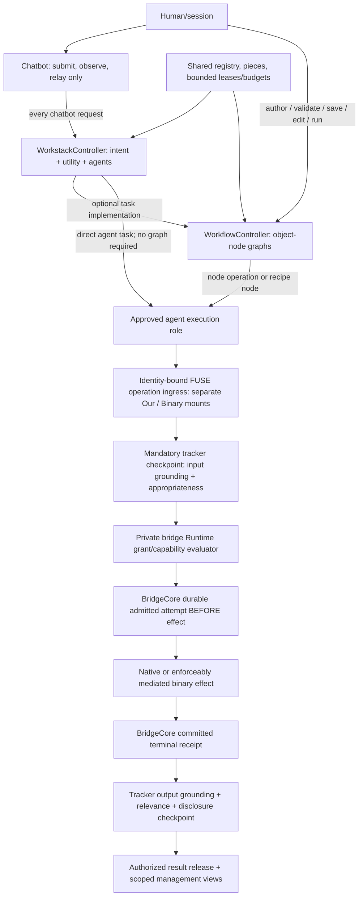

# Agent Orchestration Center — Design

## 1. Decision, scope and evidence baseline

**Owner-authorized orchestration source implementation, 2026-11-19; in progress, not built/tested/deployed.** This workstream owns separate native Workflows and Workstacks, shared recipes/pieces, delegation, typed judgment policy and receipt-linked caller cutover. Another GPT owns canonical PluginSchema/FUSE/schema delivery; the user owns the KiroWeen UI. Our scope ends at the actual backend docking point. All builds/checks remain on hold pending owner coordination across four streams. The single parent delivery coordinator owns authorized selective task commits/pushes; workers do not mutate Git.

Profile/recipe **is not** worker process **is not** container identity. Existing approved roles/containers can serve multiple recipes. **Every accepted chatbot request, including reasoning-only conversation, enters a workstack IntentSpec and attributed agent run.** Chatbot submits, observes and relays only: no direct answers, tools or internet. An authorized user may separately author/save/run a workflow without a workstack wrapper; this does not grant chatbot execution rights. Requestor, response author and executor remain distinct.

### Mandatory FUSE ingress — owner correction

The owner confirms **all calls now use FUSE and the upgraded bridge hosts mounts**; this is ground truth, not a claim to re-test. Narrow current source corroborates real linkage: `lib.rs:65-66`; `runtime_bootstrap.rs:87` starts local mounts; `runtime_fuse.rs:348-426` derives the container caller and instantiates separate `Surface::Our` and `Surface::Binary` library mounts. `FuseExecutor::call` (:261-302) invokes Runtime privately after the callback and validates receipt attribution/operation ID/disclosure. That backing call is not an authorized alternative caller transport.

**Normative reading of every later execution/task contract:** workstack/workflow controllers, agents, inference/Jev infrastructure, graph CRUD/preview and checkpoint/resume all initiate operations through their identity-bound FUSE `operations/<plugin>/<method>/call` namespace on the correct separate mount. FUSE callback -> mandatory tracker checkpoint -> private Runtime evaluator/core attempt -> native owner -> receipt/output checkpoint is the sole call boundary. Older source findings about nested Runtime calls document inspected implementation paths, not permission to retain a direct caller bypass. Private schema/authority/commit helpers inside the callback need not recursively write FUSE; a newly initiated agent/tool operation does. Library placement in the bridge changes no identity/mount/authorization rule. No raw client, socket or same-process `Runtime::call` ingress is permitted.


Evidence recorded before writing: branch policy `OK (only main dev)`; branch `dev`; HEAD `66128374e29c4e8b32b715968a95adcb7d44c97e`; shared tree initially 303 staged, 450 unstaged and 14 untracked paths. These documents do not describe a clean-HEAD implementation. `HANDOFF.md` and `SIGNALS.md` were absent; neither was recreated. No application code, prior FUSE/socketless spec, services, credentials, grants or storage was changed. Source references below describe the inspected tree, not deployed behavior. Historical fcc79b3/372ff9c and OD-61 are context, not evidence that former bridge modules remain linked.

## 2. Current-state review: native agents and retained runtime

### 2.1 Authoritative graph and useful foundations

| Area | Retained source evidence | Assessment |
|---|---|---|
| Factory and catalog | `crates/op-agents/src/lib.rs:25-64`; `unified/registry.rs:22-84,144-146`; `agent_catalog.rs:28-77` | Factory uses shared `GLOBAL_REGISTRY` plus `UnifiedAgentAdapter`, not the former per-agent match. Registry combines execution/persona/orchestration factories and migrated catalog entries. Preserve shared metadata as the single catalog input. |
| Dynamic composition | `crates/op-agents/src/dynamic/pieces.rs:10-52,74-338`; `dynamic/assemble.rs:13-27,98-113` | Reusable Behavior/Knowledge/Example/Capability fragments, markdown ingestion, memory-derived pieces and explicit piece IDs/provenance are already available. Build on these types. |
| Linked bridge | `crates/op-grpc-bridge/src/lib.rs:55-80`; `runtime_workspace.rs:20-29,108-110,125-137` | Runtime, cognitive, chat, workspace, FUSE, sled ledger and workspace workflow owner are linked. Disk files `agent_runs.rs`, `specialist.rs`, `agent_catalog_dispatch.rs`, `agent_workflow.rs`, `mutation_engine.rs`, `workstack_runner.rs`, `workstack_service.rs` are not linked by this bridge graph. Do not revive them. |
| Real specialist path | `crates/op-grpc-bridge/src/runtime_cognitive.rs:127-179,267-350` | Catalog personas consult through dynamic assembly and nested `chat_router.Chat`; raw persona `execute` intentionally refuses unauthenticated consultation (`op-agents/src/unified/persona/base.rs:170-197`). |
| Canonical methods | `crates/op-plugins/src/state_plugins/cognitive_agents.rs:181-227,325-429`; `runtime_cognitive.rs:144-152,435-442` | Methods derive from registry descriptors into plugin-owned schema; nested calls re-enter Runtime. Preserve this owner, not a new agent proto or schema directory. |
| Effect authority | `runtime.rs:114-137,347-375,414-491`; `core.rs:17-23`; `core_operations.rs:120-220,265-289` | Shared admission, sealed method pinning, exact grants, durable scoped attempts, terminal proof and committed projection already exist. Method attempts are durable before dispatch; receipt recovery is exact principal/session scoped. |
| Workflow execution | `runtime_workspace_workflows.rs:44-55,91-149,174-243,251-300`; `workflows_plugin.rs:30-160,271-348` | Existing bounded workflow owner: 64 slots, 2 permits, 1–32 string steps, durable CAS, start-after-commit, pause/cancel and no replay. Reuse mechanics for graph runs/shared primitives; this is **not** the target workstack intent/utility owner. |
| Two FUSE surfaces | `runtime_fuse.rs:1-15,215-254,261-302,348-441` | Library instantiated in bridge and dispatches through Runtime. Identity derives from anchored container; separate Our/Binary mounts remain mandatory everywhere. Source linkage is not evidence mounts are running. |

### 2.2 Findings requiring the proposed changes

**N1 — Chatbot conversation currently directs original-caller tools, not an execution agent.** `runtime_chat_conversations.rs:129-134` selects a distinct responder, but `answer` obtains caller-grant-visible tools (`:217-225`, `runtime_chat.rs:359-370`) and performs model-requested calls through the original `ctx.caller` (`:253-268`). The responder authors the response; it does not become the executor. Existing calls are re-admitted, so this is **not an established unauthorized admission bypass**. It is a mismatch with the owner's new zero-execution chatbot contract. Remove this execution choice from the conversation role; submit agent work under explicit delegation instead. Also separate conversation inference/retrieval infrastructure from chatbot authority: current chat and embedding nested calls still use the caller (`runtime_chat_ctl.rs:54-57,117-118,146-147`).

**N2 — Workflow and cognitive orchestration overlap but are not one management center.** Current cognitive workflow validates 1–64 steps, rejects nested orchestration, prechecks child grants and invokes admitted children (`runtime_cognitive.rs:587-678`). Library `OrchestrationAgent.execute_workflow` directly invokes registry agents without verified receipt context (`unified/orchestration/base.rs:54-122`), while ordinary execute refuses run_workflow (:181-234); this is not evidence of a retained bridge bypass. Target cutover separates behind-the-scenes task/agent policy into WorkstackController and authored graph execution into WorkflowController, sharing mechanics and mandatory tracker-led admission. Same-caller child-grant intersection cannot serve zero-exec chatbot delegation; independently approved executors remain necessary.

**N3 — Metadata is not authority or durable success.** `AgentRequest` has no verified execution identity or operation link, and `AgentResponse.success` is only a boolean (`unified/agent_trait.rs:48-81`); `AgentCapability` is a declaration (`:23-46`). `security_profile: None` on orchestrators (`unified/orchestration/base.rs:158-160`) must not mean security is delegated to prompt text. A completed tool method receipt and a successful domain outcome are different: exit status may report failure even though the method itself completed.

**N4 — Modular cutover and budgeting are incomplete.** The specialist hardcodes executor labels (`runtime_cognitive.rs:286`), builds a pool per request and consults selected namespace plus shared `agent_pieces` (`:288-313`), lexically matches snippets (`:303-306`), then appends a requested static persona and up to 8,000 knowledge characters **after** assembly (`:318-332`). The assembler calls its limit `budget_chars` but charges bytes; admits an oversized first piece; inserts an uncharged fallback behavior; renders framing, executors, activity, context and examples outside the selection accounting (`dynamic/assemble.rs:115-257`). Memory/runtime sources get 1.3 relevance weight (`:279-282`), not security authority. Memory exposure is not inferred from that weight: `selected_context` verifies session and `bind_memory` constrains ordinary memory operations (`runtime_cognitive.rs:445-450,475-494`); shared `agent_pieces` read is a deliberate specialist path whose trusted publisher/access policy must be made explicit. There is no demonstrated generic arbitrary-namespace write vulnerability in this review.

**N5 — Tracker is useful observation, not yet a durable center.** `RuntimeInner` now owns `ExecutionTracker::new(1024)` (`runtime.rs:267-273,313`) and `Runtime::call` starts tracking full arguments plus principal before admission (`:386-407`). The record ID is random; operation ID appears only in the terminal summary. The waiter performs complete/fail **outside** the spawned native owner, so dropping the waiter can leave Running while native effects finish. `execution_tracker.rs:80-106` clones and broadcasts the whole Started record and removes the oldest record even if active. Terminal updates silently no-op after eviction (`:110-187`); `list_recent_completed` includes active records (`:207-223`); raw error text is logged (`:180-184`). These are source findings, not claims about externally reachable tracker subscriptions.

There are already two related tracking models: `execution_context.rs:7-57,94-119` has parent/trace relationships and a separate status enum, while `record.rs:21-39,101-159` and the actual tracker use another ID/status model without parent linkage. Unify the real tracked record and context metadata; do not introduce a third parallel execution model. `record.rs` hash fields/defaults and optional integrity functions do not establish an append-only durable ledger. Core operation proofs already do.

**N6 — Historical gate inheritance is not target cross-FUSE authority.** Inspected Runtime roots hold a global mutex and historical nested calls inherit execution/path (`runtime.rs:95-137,414-423`); `for_background` drops the gate/path (:56-64), and workflow start commits before spawning (:122-149). Target R19 requires every NEW child/tool/judgment caller operation to use FUSE: persist/defer continuation, end/release ancestor root, then initiate a fresh container-bound FUSE call. No authenticated cross-FUSE root inheritance is established or permitted. Only private non-operation callback helpers remain under the same gate. Correlation IDs link two calls, never inherit authorization. Preserve serial effects; no new lock service/concurrency promise.

### 2.3 Workstacks are not workflows

Actual repository workstack data is `op_chat::orchestration::Workstack` (`crates/op-chat/src/orchestration/workstack_executor.rs:31-107`): ID, name, description/category, **phases**, variables, required agents and optional timeout. A phase contains tools, agents, operation/arguments, explicit phase dependencies, condition, rollback calls, continue-on-failure and timeout. This is not evidence of a LIFO stack or a queue of work items. The crate exports this model (`crates/op-chat/src/orchestration/mod.rs:62,117-130`); it is a source/library model, not proof of current bridge deployment.

Historical `workstack_service.rs:3-10,12-24` reads a `workstacks` array from a workflows runtime document and uses the old MutationEngine. That facade/runner is **unlinked** from current bridge `lib.rs`. Current `WorkflowsState` declares `workflows` and `config`, not `workstacks` (`workflows_plugin.rs:13-27`); current retained workspace methods do not expose workstack controls. The domain label in a topic hash (`runtime_workspace_workflows.rs:227`) does not change that.

The **target** has separate WorkstackController intent/utility tasks and WorkflowController user-authored object-node graphs. A workstack coordinates agents directly or optionally selects a workflow run; neither system must wrap the other. Source currently lacks a linked workstack policy owner, so propose a canonical Rust-owned `workstacks` PluginSchema and native Runtime controller, not restoration of the old raw service. Workstack task/phase state never moves into workflow records. Behind-the-scenes means ordinary agent requests require no user-authored graph, **not** hidden audit or unauthorized status.

### Native-first lineage: preserve the original 3tched design, not only its linear runner

The foundation is **our native 3tched orchestration**, including the original `op-chat::orchestration` and `op-workflows` graph/context/tracker design. The currently linked 32-step runner is a safe execution-owner starting point, not the full desired feature model. Upstream threetched contributes bounded turn/context/roster ideas; it is not the architecture source for a replacement scheduler.

| Original native feature and retained source | Chosen preservation/adaptation | Design/task/manual evidence |
|---|---|---|
| `VerifiedScope`, `ScopeVerifier`, `ExecutionControl`, `WorkstackEventSink`, `crates/op-chat/src/orchestration/mod.rs:65-108` | Principal/session/genesis-bound ownership, default-deny cross-owner control, scoped progress distinct from durable commits | §§4.3,5.3; T3–T5; `response_author_is_not_executor`, `requestor_cannot_read_executor_private_recovery` |
| Workstack phases/tools/agents/dependencies/variables/rollback, `workstack_executor.rs:31-107,269-384` | Preserve authored phased workstack domain; borrow dependency resolution and explicit context/result ownership for bounded agent DAGs | §§2.3,4.4,5.1; T2,T6; `workstack_reference_does_not_alias_workflow`, `dag_rejects_cycles_and_bad_bindings` |
| Scoped `ToolExecutor` default unsupported, `workstack_executor.rs:419-441` | Verified dispatch context and explicit Unsupported when scoped execution is unavailable; never fall back to unscoped tools | §§2.6,4.3; T3,T8; `denied_tool_has_no_alternate_raw_path` |
| Object-to-node `WorkflowNode`, `NodePort`, `NodeConnection`, `WorkflowDefinition`, `crates/op-workflows/src/{node,flow}.rs`; `builtin/{plugin_node,dbus_node,tool_node}.rs` | **Each eligible canonical discovered object becomes a composable node**, with schema-derived ports, real object identity, version/policy pins and explicit graph edges; rebuild incomplete execution through Runtime, not generic tool-list reduction | §4.4; T2,T6; `every_eligible_object_has_schema_derived_node`, `node_mutation_requires_declared_operation` |
| `WorkflowContext` and original tracker-centered orchestrator, `op-workflows/src/lib.rs:10-29`; `orchestrator.rs:247-265` | Explicit run-owned context/results, plan/workflow/run distinctions and unified tracker/materialization | §§4.2,5.3–5.4; T4–T6; `accepted_run_has_durable_core_proof`, `terminal_event_counted_once` |
| Intermediate-result cache, `op-workflows/src/orchestrator.rs:164-222` | If retained, reuse existing owner only after scope/proof/input/schema/policy/read-freshness validation; never use cached result to skip an effect admission/receipt | §4.4 and rules below; T6; `cached_result_cannot_replace_effect_or_authorization` |
| PatternTracker proposal intent, `op-workflows/src/orchestrator.rs:80-151` | Patterns become reviewable versioned recipe proposals, never automatic callable method/capability promotion | §4.1 and rules below; T6; `learned_pattern_requires_recipe_review_without_grants` |
| Three native workstack seeds `full_stack_feature`, `code_review`, `ovs_network_setup`, `op-chat/src/orchestration/mod.rs:130-257` | Preserve useful authored phase/expertise recipes and provenance as domain references/seed data without flattening away workstack identity | §§2.3,4.1,4.4; T1,T2,T6; `workstack_domain_unchanged` |

Plans are proposals; recipes/workflows are versioned authored definitions; workstacks retain their own phased domain model; a run instantiates authorized work; tasks/attempts/operations track execution. Shared context is scoped run data, not ambient mutable authority. Resource ownership means explicit project/target scope and scheduler leases/budgets here, not a new lock service or permission to parallelize effects.

Do not retain unknown conditions defaulting true (`workstack_executor.rs:387-408`), automatic rollback/retry after unknown effects, or historical lint/test/deploy steps contrary to manual owner policy. Do not enable the blocked raw registry/sequence facades (`op-workflows/src/orchestrator.rs:269-275,337-343,497-501`) or restore old transports merely to reuse the graph. Existing cache/pattern owners may supply scoped observations/proposals; no new cache database, automatic optimization or throughput claim is added. A cached read must match authorized input/contract/policy and a still-valid read observation; cached execution output may be displayed as historical evidence, never asserted as a newly executed effect. Accepted learned recipes still require normal management approval/version pinning and current execution authority.
Original lineage report `/tmp/original-operation-dbus-orchestration-review.md` records source manifest URL `https://github.com/3tched/operation-dbus-proto` returning public 404, no separate local checkout, and retained history to import `8d01947e497be9ab66e7bdd15717494c60b031d1` (2026-09-14), not an established original-remote commit. No historical utility scorer/formula was recovered; user-confirmed intent/utility is the required target. Removed regex-confidence/direct-registry intent/hybrid executors (`88c8f033`) must not return. `op-state/src/plugin_workflow.rs:1-5,55-87` explicitly says each plugin becomes a connectable node, but registration constructs/discards it (:322-330). Automatic discovery/working transport is not proven; original pool execution is unsupported/simulated and engine “parallel” batches await sequentially. Preserve architecture, repair wiring.


### 2.4 External provenance and boundary

The current pin is ZeroClaw `v0.8.4`, commit `a56c345d51dd8ab562e9351e0d4ab83f6a741db9` (`vendor/threetched/source.pin:1-6`). The checked-in builder extracts the verified source and builds it without applying local patches (`build-threetched.sh:172-177`); the manifest explicitly says `source.mode = unmodified-upstream` (`:213-225`). Historical prose about a checked-in patch stack is not the current build contract.

The actual callable integration remains discovered, sealed `threetched` methods, not arbitrary upstream internals. `crates/op-plugins/src/state_plugins/threetched.rs:165-219` derives exact command capabilities/input/output schemas from the pinned capture. Runtime use consumes sealed schema (`:224-237`); command preparation verifies pinned provenance/config selector (`:306-330`). A future recipe imports only functionality represented by that sealed method set. Presence in upstream source does not prove the method exists or is authorized in this installation.

### 2.5 Pinned threetched review: best mechanisms, not inherited authority

Upstream citations here and Appendix B are members of the exact pinned `vendor/threetched/source.tar.gz`, not application-repository Rust modules. **R/** expands to `crates/zeroclaw-runtime/src/`; **C/** to `crates/zeroclaw-config/src/`; **U/** to the archive root. The independent read-only review is `/tmp/threetched-agent-review-20261119.md`; source extraction `/tmp/threetched-agent-review-20261119.pH8q0B/`. No extracted program was executed. That review found archive/pin and staged candidate/manifest digest consistency; this design does not claim a build, independent reproducibility or live deployment.

| Upstream mechanism and source | Native reuse | Boundary/correction |
|---|---|---|
| Common `run_tool_call_loop`, R/agent/turn/mod.rs:276-326; caller R/agent/agent.rs:2315-2366 | One bounded reasoning turn lifecycle with typed requests/results | Source also supports direct tool calls and natural-language completion. It does not enforce delegate-every-request chatbot behavior. |
| Separate aliased agent, risk/runtime, skill, workspace and memory refs, C/schema.rs:3535-3590,3654-3737 | Recipe/profile/piece separation and explicit discovered roster | Alias/workspace is not our container identity; same-risk-profile reach defaults true (:3668-3686), unlike explicit native delegation approval. |
| Reachable roster, C/schema.rs:3860-3933; narrowed ephemeral subtask, R/tools/spawn_subagent.rs:88-119,141-192 | Context isolation, explicit allowed targets, bounded child scope | Model target names do not grant authority or a new identity. Native code validates all actual executors. |
| Progressive skills, R/skills/mod.rs:1610-1689 and R/tools/read_skill.rs:46-114; scoped memory, `zeroclaw-memory/src/agent_scoped.rs:9-39,83-100,167-214` | Summary-first, canonical on-demand authorized pieces and bounded scoped context | Skill/memory text is data, not a grant; retain native ledger/Qdrant owners and no SQLite dependency. |
| Task lifecycle/owner epoch, R/control_plane/task_registry.rs:7-137; reaper :40-103 | Stable ID, parent/owner references, explicit Lost/TimedOut/interruption | Optional supervision and missing producer fields are not durable completion/resumption. Do not import a second SQLite task authority. |
| Correlation/optional local receipts, R/agent/tool_execution.rs:112-139,235-268; R/agent/tool_receipts.rs:13-65 | Correlated task/tool observations | Ephemeral HMAC result evidence is not native authorization or BridgeCore terminal proof. |

Specific unsafe assumptions are excluded:

- Agentic delegate invocation sets `approval: None` and `shared_budget: None` (R/tools/delegate.rs:2637-2657,2674-2683); missing approval manager is NotRequired (R/agent/turn/approval_gate.rs:27-30). Bounded mode therefore does not automatically preserve top-level per-tool approvals or common iteration budget.
- Independent targets build their own policy/tool envelope; parent subset protection is not universal (R/tools/delegate.rs:418-505,688-739,2507-2529). Native independent executor authority is allowed only under the explicit owner-approved delegation predicate in §4.3, not by borrowing an upstream alias.
- Empty risk-profile allowed tools become unrestricted at that layer, and a name containing `__` is auto-admitted by a delegate allowlist exception (R/tools/delegate.rs:918-945). Native empty sets mean no task tools; exact sealed methods/grants have no string-based exceptions. MCP remains retired.
- Background capacity check has awaits before insertion, and parallel fanout is separate (R/tools/delegate.rs:1442-1534,1706-1736,1764-1834,2181-2198). Use real reserved capacity/budgets, not advisory map length.
- Parent-session cancellation wiring is not established by the delegate's independently created token; explicit cancel differs from parent exit (R/tools/mod.rs:1413-1441; R/tools/delegate.rs:253,1529-1534,2249-2256). Background receipt/cost task-local context is also not universally inherited (:1547-1574,1757-1762,1818-1829,2617-2624).
- Supervision startup may fail without stopping the daemon; producer registry writes may be ignored and omit parent/principal/route (R/daemon/mod.rs:382-393; R/tools/delegate.rs:1490-1516,1630-1649). Reaper marks loss, not safe resumption; no missing-terminal effect replay follows.

These findings are source-review conclusions, not a claim that the installed threetched configuration exposes any particular risk mode.

### 2.6 Registered adapter support matrix — no hidden binary tools

An outer `Runtime::call` tracks only that admitted plugin invocation. **It does not automatically mediate shell/file/network/delegate tools privately executed inside the binary.** Current upstream registers raw tools (R/tools/mod.rs:570-618). A prompt telling it not to use tools, or an empty upstream allowlist, is insufficient enforcement.

| Adapter mode | Proposed registration status | Required evidence/contract |
|---|---|---|
| Native reasoning recipe, authorized inference role, no task tools | Supported target design; not yet implemented by this spec | Provider boundary admitted through existing owner; typed result, budget and tracker linkage. No native tool execution in chatbot. |
| Native recipe using existing Rust/Python/JS/Go/shell backends | Supported target design subject to policy/executor grants | Every effect enters normal Runtime admission; exact schema/receipt; no raw registry execution. |
| External inference-only adapter | Conditional, unavailable until enforceable tool-free contract is verified | Only an actually discovered sealed method and an enforced no-tools mode; no private raw loop, recursive agent, reflection or fallback tools. No invented endpoint. |
| External tool-capable adapter exclusively exposing discovered FUSE operation tools | Conditional, unavailable until full mediation is demonstrated | Every host attempt, including child/delegate/reflection/default/fallback path, returns through the correct separate Our/Binary namespaces and shared Runtime admission. No direct host syscall/tool bypass. |
| Stock autonomous threetched loop with internal shell/file/network/delegate registry | **Unsupported for orchestration execution** on current evidence | No proof of exclusive mediation; reject mode rather than simulate support, assume patches or rely on prompt-only prohibition. |
| Upstream task/SOP/goal/todo internals lacking sealed integration | **Unsupported as native execution APIs** | Source-defined internal function is not a callable discovered plugin contract. |

Adapter support is typed recipe/runtime binding metadata pinned to binary/capture/catalog/schema revision and enforcement mode, not a new plugin schema source. Registry admission rejects an unavailable mode before scheduling. Existing independently authorized binary commands are not globally deleted by this design, but the center must not treat a receipt for such a command as proof that its internal tools satisfy the all-tools boundary. If a verified tool-free/mediated mode is absent, native recipes plus existing authorized inference remain the complete supported path; no stub adapter or binary patch is promised here.


### 2.7 OpenClaw workflow meld: native graphs with durable approval/input gates

Read official [Lobster](https://docs.openclaw.ai/tools/lobster.md), [Automation](https://docs.openclaw.ai/automation.md) and [OpenProse migration](https://docs.openclaw.ai/prose.md), plus corroboration `/tmp/openclaw-workflow-review-20261119.md`. Lobster is optional `@openclaw/lobster`, embedding `@clawdbot/lobster` **in-process**, not an external subprocess service. No install/execute occurred.

| Mechanism | Selected native meld | Rejected/import boundary |
|---|---|---|
| Named typed dataflow, schema validation, bounded outputs/time | Object-node port edges and native graph budgets/pins | No second shell DSL, arbitrary command/script node, ambient env/token or new runtime |
| Approval AND structured-input checkpoint persists and ends call | Core-owned pending continuation; release gate/permit; resume only remaining work | No process waits for human and no replay of completed/unknown effects |
| Any schema-valid JSON answer; invalid input preserves pending gate | Validate before one-shot CAS; exactly one approval/response/cancel; successive gates possible | No guessed answer or invalid-input consumption |
| Snapshot-safe continuation claim and pre-dispatch-only restore | Native expected-revision/fenced CAS and consumed audit; preserve original operation after unsafe dispatch | No universal retry or restoration after uncertain effects |
| Upstream token permits resume without user/session binding; local JSON store and no pending list | Replace with non-bearer verified scope/approver binding and authorized canonical SHM pending-gate discovery | No possession-as-authority, `~/.lobster/state`, second DB or raw secret token |
| Workflow visualization | Native object graph preview/editor in existing Svelte/json-render catalog | Lobster graph renderer is not our object discovery/port editor |

Source corroboration is **standalone Lobster** commit [`c6c5533cc7d9e768bbaee7c4a7716e2575857a7a`](https://github.com/openclaw/lobster/tree/c6c5533cc7d9e768bbaee7c4a7716e2575857a7a), 2026-11-17: [validation/claim/unsafe dispatch](https://github.com/openclaw/lobster/blob/c6c5533cc7d9e768bbaee7c4a7716e2575857a7a/src/core/tool_runtime.ts#L319-L470), [snapshot claim/restore](https://github.com/openclaw/lobster/blob/c6c5533cc7d9e768bbaee7c4a7716e2575857a7a/src/state/store.ts#L461-L548), [checkpoint state](https://github.com/openclaw/lobster/blob/c6c5533cc7d9e768bbaee7c4a7716e2575857a7a/src/pipeline_resume_state.ts#L121-L276). OpenClaw host `main` plugin package observed version 2026.11.5 pins embedded dependency **2026.10.1**, so reviewed standalone HEAD is **not proof** the installed embedded package has identical code. No installed OpenClaw was inspected. Host [runner](https://github.com/openclaw/openclaw/blob/main/extensions/lobster/src/lobster-runner.ts) and [package](https://github.com/openclaw/openclaw/blob/main/extensions/lobster/package.json) are moving-main evidence, distinguished from that immutable standalone commit.

Docs remove shared Tasks/TaskFlow and bundled OpenProse `/prose` (v2026.8.1); do not portray them as current bundled workflow engines. Upstream shell/env/approval metadata and optional isolated JSON inference do not establish native tool-free mediation or verified approver identity. Keep our two entities, canonical schemas, one tracker-led Runtime checkpoint and core writer; no OpenClaw runtime installation/import is proposed.

## 3. Chosen architecture and alternatives

### 3.1 Two native systems, one admitted effect and management plane



WorkstackController is deterministic task/intent/utility policy code, not an LLM deciding grants. WorkflowController independently owns graph lifecycle and ready-node/port execution. The center joins their management views without collapsing state. Agent models propose plans/judgments; code validates authority and chooses feasible actions.

Evolve `runtime_workspace_workflows.rs` as WorkflowController. Propose `runtime_workstacks.rs` and Rust-owned `state_plugins/workstacks_plugin.rs` because no linked workstack owner exists. These are future modules/schema, not current callable surfaces. Extract only shared bounded lease/budget/admission/receipt mechanics, not another generic orchestrator or lock service. Separate domain controllers share one Runtime effect gate and core writer.

### 3.2 Rejected alternatives

- One executable/container/identity per persona: needless process/config drift and an authority-confusion risk; no requirement needs it.
- Keep old static persona execution and add a separate dynamic-agent engine: two dispatch/catalog conventions and incomplete coverage; rejected. Static Rust may remain as seed metadata only after clean caller migration.
- Treat chatbot grants intersected with child grants as delegation: makes zero-exec submission impossible; rejected. Use narrow submit plus an independently authorized executor, constrained by the requestor's resource scope and explicit policy.
- Run the external agent's autonomous raw tool loop alongside native scheduling: duplicate budget/state/admission authority; rejected. Borrow bounded reasoning/delegation concepts as native task behavior.
- Promote the in-memory tracker or episode Cozo rows to a second effect ledger: rejected. Core method attempts/terminals are effect authority; tracker is rebuilt from committed events.
- Relax the global Runtime gate for parallel tool effects: excluded until separately demonstrated resource ownership/locking design. This spec retains serial effects.

## 4. State and authority contracts

### 4.1 Recipe registry and lifecycle

`AgentRecipe` is typed data derived from the shared registry, not a plugin/service per persona. Required fields:

| Field | Contract |
|---|---|
| `recipe_id`, `version`, `content_digest` | Stable intent ID, monotonically versioned immutable content; unique within authorized catalog scope. |
| `status` | `Enabled`, `Disabled`, `Retired`; disable affects new admission and future dispatch, never rewrites effects. |
| `source_refs`, `piece_refs` | Native descriptor/source, imported config revision or historical contribution; piece ID, content digest, source revision, trust and access scope. |
| `input_contract`, `output_contract` | Closed typed schema owned by the existing plugin contract; no free-form executable template language. |
| `execution_role_id` | Reference to an existing registered execution role; never an asserted principal or a credential embedded in recipe text. |
| `required_operations` | Exact sealed plugin/method/schema bindings; declared needs, not grants. Reasoning-only recipes may have no task tools. |
| `plan_template`, `limits` | Typed DAG/step recipe, semantic selection policy and bounded budgets; cannot override deployment policy. |

Proposed agent-recipe management belongs to the justified new **workstacks** PluginSchema (`state_plugins/workstacks_plugin.rs`, future), derived from shared `op-agents`, not per-persona services. Proposed methods: `list_agent_recipes`, `get_agent_recipe`, `create_agent_recipe`, `update_agent_recipe`, `disable_agent_recipe`, `retire_agent_recipe`. Scaffold-generated exact capabilities distinguish management from chatbot submission. Updates require expected revision and create immutable versions. Identity/project owners approve roles/policies; recipe CRUD grants nothing. Existing **workflows** PluginSchema remains graph-definition/run owner, not workstack storage.

At run acceptance, pin recipe version, piece digests, schema/catalog hashes, policy revision, typed inputs and budgets. Updating a recipe affects only new runs. Disabling blocks new runs and future task dispatch for pinned versions; in-flight operations are still reconciled. Retiring disallows new pins and retains content referenced by active/auditable runs. Import changes do not mutate pinned data. No permanent compatibility aliases are added; existing documented aliases are classified in Appendix A, and all retained consumers migrate together before obsolete persona methods/paths are removed.

### 4.2 Run, task, child and receipt identities

| Object | Required identity/state |
|---|---|
| `RunSpec` | Distinct agent/workflow run ID/kind; requestor/session/genesis; conversation/turn; optional parent WorkstackTaskRef; recipe or workflow version pin; approved role; scoped typed inputs/limits. Standalone workflow runs need no workstack parent. |
| `TaskSpec` | Domain-specific scheduled unit: agent task or workflow-node binding where applicable, pins, typed dependencies/I/O and budget. Workstack intent task, graph node and attempt are not synonyms. |
| `TaskAttempt` | Attempt ID, run/task IDs, lease owner/epoch/fence/deadline, dispatch phase, operation ID if a tool, safe outcome and receipt locator. |
| `ChildRunRef` | Parent run/task, child run ID and its accepted-submission receipt. A submitted child is not a completed tool. Child completion records its own terminal aggregate plus underlying operation references. |
| `OperationRef` | Canonical operation UUID supplied to Runtime admission; executor principal/session; exact plugin/method/schema; core attempt and terminal event proof; policy/delegation attribution. |
| `RunEvent` | Run ID + monotonically increasing revision/cursor, event type, actor/executor/requestor attribution, safe payload and core ledger proof. |
| `ObjectNodeRef` | Workflow-local node ID plus actual plugin/object path, schema hash/version, selected method or declared read-property binding, port schema pointers/digests, recipe record/version when applicable and policy revision. |
| `WorkflowGraph` | Immutable versioned definition of object-backed nodes, named typed input/output ports and explicit `NodeConnection` edges, distinct from a run's node states/tasks/attempts. |
| `WorkstackSpec` / `WorkstackTask` | Versioned orchestration, task/phase IDs, IntentSpec, dependency/condition policy, implementation refs, utility decisions and budget/lifecycle. |
| `IntentSpec` / `UtilityDecision` | Desired outcome/evidence/constraints/provenance; policy-pinned feasible alternatives, semantic judgments, exact utility inputs/result and chosen agent or optional workflow. |

Keep `OperationId` distinct from run/task/attempt IDs, but use the actual admitted operation ID as the tool tracker key. The controller preallocates an ID and durably binds it before dispatch; Runtime owns acceptance of that ID. An allocation/denial before `begin_operation` is not a durable tool attempt. Record it as a redacted refusal, never as completed execution.

A workstack task can submit an agent run directly or optionally a workflow run, preserving accepted-child receipt and terminal relationship. User-authored workflows may run independently. Shared bounds cover 64 total expanded tasks/nodes per ROOT request across all child runs and both controllers/domains, and 64 aggregate active runs, not fresh allowance per child or domain. Recursive expansion grants no hidden budget/authority; cycles and unsupported expansion refuse explicitly.

### 4.3 Delegation authorization without chatbot execution grants

The deterministic authorization predicate for a delegated operation is:

```text
valid requestor submission + approved policy binding
AND live independently verified executor/container
AND executor current exact sealed method capability
AND operation/resource permitted by policy
AND requestor project/resource scope permits the requested target
AND pinned recipe/role remains enabled and applicable
AND budget/deadline/lease fence valid
```

This is **not** `chatbot tool grants ∩ executor tool grants`. Submission permission authorizes asking under the approved policy; execution permission belongs to the independently authorized executor. Requestor target scope, read-only restrictions and explicit human approvals still constrain the request. Read-only source context is never silently upgraded by choosing a different executor. Neither model confidence nor a recipe capability declaration can satisfy a missing policy/grant.

`DelegationBinding` records requestor scope, executor-role/principal/container binding reference, allowed sealed operations/resource selectors, policy ID/revision, approving owner, expiry, budget and disclosure rules. It stores references, never credentials. Resolve actual `VerifiedCaller` from the existing identity/container owner, not from model arguments or a generic root/service principal. `configured_responder` remains response-author selection, not implicit execution delegation.

Audit both identities through a versioned delegation attribution carried by Runtime into the **existing** core attempt/terminal record binding. Existing core actor/session checks remain executor-based; do not forge the requestor as executor. Extend audit attribution through the same ledger owner rather than bypassing `begin_operation`. Exact executor-scoped `recover_operation` stays private. Requestor run-status methods expose only policy-approved receipt locators/status summaries, not unrestricted executor results or another principal's private recovery interface.

A helper job container runs under the executor's constrained job channel but is not itself an identity. Identity material stays with its container owner/bridge. Helpers receive bounded arguments, approved working resources and output channel only. No SID1/IID1/OIA1, identity sled, grant document or ambient network/provider token is injected.

### 4.4 Object-node workflow graph, typed ports and data flow

**Central native mechanism: make each eligible existing object a node, then connect its ports to create workflows.** Reuse/adapt `op-workflows::WorkflowNode`, `NodePort`, `NodeConnection` (`node.rs:1-7,81-94,136-210`) and `WorkflowDefinition` (`flow.rs:15-50,104-158`). Original builtin PluginNode wrapped plugin query/diff/apply, DbusMethodNode represented service/path/interface/method, and ToolNode represented a tool (`builtin/{plugin_node,dbus_node,tool_node}.rs`). Their current execute functions refuse absent authorized executors; neither those refusal bodies nor the blocked engine are a working object workflow implementation. Repair composition through the retained verified Runtime owner rather than re-enabling raw adapters.

Object-node discovery consumes the **canonical sealed plugin catalog, PluginSchema and supported actual object introspection/committed object graph**. Eligibility requires an actual declared object/binding, a usable schema and authorized visibility. Every eligible object is addressable as a node; a selection shortlist does not remove it. Root plugin objects may be discovered from sealed catalog declarations; child objects are offered only where the actual schema/object graph supports and proves them. The workflow editor/controller cannot invent a service or object just because a model supplied a path.

An object node is pinned by `{plugin_id, object_path, schema_hash, schema_version, operation_or_read_binding, policy_revision}` plus its workflow-local node ID. Method argument/return schemas yield input/output ports with stable schema-pointer identities. Declared readable properties yield **read-only** ports from the canonical committed SHM projection under current scope/read authorization and recorded observation revision. A field being present in state does not make it writable. Mutation requires a declared method, exact grant/policy and normal Runtime attempt/terminal receipt. No generic writable-state port, direct database/property update or raw D-Bus/client fallback is introduced.

Agent-recipe nodes refer to the actual **workstacks** plugin's schema-owned recipe record/operation and pinned version, not per-persona D-Bus objects/services. Publish the future record contract before node discovery. A workflow may reference this object without becoming a workstack or requiring its coordination. Node metadata remains a canonical PluginSchema-derived view, never a second node catalog.

A graph edge is `{from_node, from_port, to_node, to_port, expected_contract_digest}`; input/output ports retain required/default semantics derived from the source schema. Schema-owned plan validation must support capacity for 64 total expanded tasks/nodes per ROOT request across all child runs and both controllers/domains, with no fresh child or domain allowance. Validate object existence, pins, authorized operation/read bindings, named ports, JSON contract compatibility, required inputs, bounded defaults, unique node IDs and acyclicity before acceptance. Pin schema/policy per node and port; revalidate at execution. A missing output or stale/missing object/port refuses or blocks dependent execution truthfully, not a fabricated default success.

The immutable object graph is **not** a run/task list. Scheduling derives task dependency/binding references from graph node/port IDs; the task's operation/attempt/receipt references then describe one execution of that definition. Keep graph node identity, object identity, run ID, task ID, attempt ID and operation ID distinct. The initial profile bounds graph expansion and total scheduled tasks to 64 total expanded tasks/nodes per ROOT request across all child runs and both controllers/domains, with no fresh child or domain allowance. Workstack phases may reference such a workflow graph while keeping their own phase/control/domain state.

Property-only graph observations still occur in an attributed agent run and carry read authorization, committed projection revision and safe observation references. Tool-bearing node operations, including inference for an agent node, always use the shared Runtime path. Graph preview/discovery/validation are typed proposed management methods under the existing workflows PluginSchema, not invented currently callable endpoints. The preview reports unresolved/unsupported objects rather than fabricating existence.

Task input bindings are derived from validated graph edges and copy only declared, size-bounded predecessor outputs. They never interpolate command strings, environment variables, credentials or execution principals. Validate actual predecessor output against its pinned contract before releasing dependents. A model-generated graph is merely a proposal.

Conditions are closed typed predicates over explicit status or validated result fields, not arbitrary expression evaluation. Preserve existing `expect_success`/`expect_failure` semantics deliberately when translating current cognitive workflows; do not claim unknown means expected failure. A method-completed receipt and a nonzero process exit can legitimately satisfy an expected-failure task while preserving the true method/domain outcomes separately.

No automatic rollback or compensation is inferred from a failure. Workstack rollback fields belong to the separate workstack domain. Any future compensating tool action is another explicitly authorized task/operation with its own receipt and budget, never deletion of the original effect proof.

### 4.5 Workstack task intent, feasibility and utility

WorkstackController owns behind-the-scenes task orchestration, not user graph authoring. Every accepted chatbot request records `IntentSpec {goal, desired_output_contract, success_evidence, requestor_scope, project_resources, constraints, dependencies, budget, source_refs}`. It may coordinate reasoning agents directly or choose a pinned workflow as one implementation; no mandatory workflow wrapper or rewriting the author's graph.

Code filters candidate recipes/workflow versions by enabled/version state, exact executor capability, approved delegation, resource/read-only scope, dependencies, budget/deadline and adapter mode. Jev supplies atomic semantic-fit judgments over this feasible set; it never approves permissions, computes budgets or authors utility policy.

`UtilityPolicy` is scoped, owner-approved and versioned, declaring feature meanings, normalization/bounds, weights, hard constraints, tie-break rules and uncertainty/review bands. This spec invents **no production weights** or precise cost/risk estimates. Code performs exact arithmetic over grounded policy inputs: semantic-fit features, evidenced resources/cost/latency, dependency impact and approved risk classes. Missing policy or required estimates yields NeedsReview; infeasible candidates never compete on score.

Persist all considered/rejected alternatives, feasibility reasons, evidence/question revisions, policy revision, exact normalized inputs/result, tie/uncertainty handling, selected pins and budget allocation in UtilityDecision. Re-evaluate only undispatched work after new evidence or an explicit policy revision. Never replay unknown effects or overwrite decision history. Intent satisfaction requires typed success evidence plus method/domain receipts, not high utility.

Workstack lifecycle is `Accepted -> IntentBound -> Evaluating -> Coordinating -> Satisfied`, with explicit Blocked/NeedsReview/Paused/CancelRequested/Cancelled/Failed/Interrupted/OutcomeUnknown. Workflow lifecycle independently tracks graph versions/nodes/runs. Behind-the-scenes policy remains durable and authorized-inspectable through the shared tracker plane.

### 4.6 User-authored workflow lifecycle and editor

WorkflowController owns canonical object-node discovery/preview/validate, create/save, list/get, edit(expected revision) creating an immutable version, disable, run/pause/resume/cancel. Saving is metadata management, not execution approval. Runs pin graph/object/port/schema/policy versions and use an independently approved executor. Edits never change active runs; disable blocks new work while preserving receipts. Standalone workflows need no workstack wrapper.

The user implements the KiroWeen UI. This workstream supplies actual backend docking only: canonical object nodes/typed ports, graph discovery/preview/validation/immutable CRUD/run/control, separate workstack recipes/intent/utility/status/control, scoped committed state/events/receipt references and durable approval/structured-input gates. The identity-door connector must translate to verified container-bound Our/Binary FUSE before tracker/private Runtime admission. No frontend files are edited/restored; its empty current worktree is not a blocker. No browser host filesystem/mount/credential exposure or alternate API is introduced.

### 4.7 Current ownership and schema/FUSE-owner docking handoff

**Orchestration worker:** `crates/op-agents/**`, `crates/op-workflows/**`, bridge `runtime_workspace.rs`, `runtime_workspace_workflows.rs`, `runtime_cognitive.rs`, `runtime_chat*.rs` and new workspace-owned `runtime_workstacks*`, `runtime_workflow*`, `runtime_agent*` modules; existing three agent Kiro documents. **Control-foundation peer:** orchestration Runtime/tracker/core CAS/event hooks only. **Other GPT:** all canonical `op-plugins` schemas/registration/capture, generic FUSE/mount/toolsets and door/schema delivery. **User:** KiroWeen frontend. Deleted root boards/frontend source are not restored. No live credentials/grants/containers/storage/seals/services are changed.

The following are REQUESTED canonical declarations, not assumed existing/sealed methods. Derive the listed Rust DTOs directly; no second JSON-schema file/catalog/API. Capability families are proposals for the schema owner to declare, not authority; Runtime must resolve and enforce the actual sealed declaration. Missing delivered bindings return unavailable/NeedsReview, never fabricated success.

| Requested methods | Input DTO (`op_agents::orchestration`) | Output DTO | Effect / proposed capability family |
|---|---|---|---|
| workstacks `list_agent_recipes`, `get_agent_recipe` | `PageInput`, `IdInput` | `RecordPage`, `RecordOutput` | Read / `cap.software.workstacks.recipes.read@v1` |
| workstacks `create_agent_recipe`, `update_agent_recipe` | `PutRecipeInput` | `RecordOutput` | Mutation / `cap.software.workstacks.recipes.manage@v1` |
| workstacks `disable_agent_recipe`, `retire_agent_recipe` | `RevisionInput` | `RecordOutput` | Mutation / recipe management |
| workstacks `list_execution_roles`, `get_execution_role`, `list_utility_policies`, `get_utility_policy` | `PageInput`, `IdInput` | `RecordPage`, `RecordOutput` | Read / `cap.software.workstacks.policy.read@v1` |
| workstacks `put_execution_role`, `put_utility_policy` | `PutRoleInput`, `PutUtilityPolicyInput` | `RecordOutput` | Mutation / `cap.software.workstacks.policy.manage@v1`, plus existing project/identity owner checks |
| workstacks `disable_execution_role`, `disable_utility_policy` | `RevisionInput` | `RecordOutput` | Mutation / policy management |
| workstacks `submit_intent` | `SubmitIntentInput` | `RunSummary` | Mutation / `cap.software.workstacks.submit@v1`, independent of executor tool grants |
| workstacks `get_workstack`, `list_workstacks` | `IdInput`, `PageInput` | `RunSummary`, `RecordPage` | Read / `cap.software.workstacks.observe@v1` |
| workstacks `pause_workstack`, `resume_workstack`, `cancel_workstack` | `RevisionInput` | `RunSummary` | Mutation / `cap.software.workstacks.control@v1` |
| workflows `discover_nodes` | `DiscoveryInput` | `NodeDiscoveryOutput` | Read / actual graph discovery capability |
| workflows `preview_workflow`, `validate_workflow` | `ObjectWorkflow` | `WorkflowValidationOutput` | Read / graph discovery |
| workflows `create_workflow`, `update_workflow` | `PutWorkflowInput` | `RecordOutput` | Mutation / distinct graph author capability |
| workflows `get_workflow`, `list_workflows` | `IdInput`, `PageInput` | `RecordOutput`, `RecordPage` | Read / distinct graph read capability |
| workflows `disable_workflow` | `RevisionInput` | `RecordOutput` | Mutation / graph author |
| workflows `run_workflow` | `RunWorkflowInput` | `RunSummary` | Mutation / distinct graph execution capability |
| workflows `pause_workflow`, `resume_workflow`, `cancel_workflow` | `RevisionInput` | `RunSummary` | Mutation / graph control |
| both domains `list_pending_checkpoints`, `resume_checkpoint` | `PageInput`, `ResumeCheckpointInput` | `RecordPage`, `RunSummary` | Read / observe; Mutation / control AND exact pending approver capability |
| workflows `get_workflow_run`, `list_workflow_runs` | `IdInput`, `PageInput` | `RunSummary`, `RecordPage` | Read / actual scoped run-observation capability declared by schema owner |
| workstacks `get_workstack_result` | `IdInput` | `op_agents::orchestration::WorkstackResultOutput`: typed pending / available `ReasoningResult` with closed `reasoning_unverified` classification / not-satisfied with original effect refs; DTO source exists, getter integration pending | Native scoped Read / actual result-read capability requested from schema owner; reader admission, sourceExecutor independently proven, no provider right required on reader |
| chat_router `judge` (requested name) | `op_agents::judgment::SystemOneInput`; no model override or prompt parsing | `op_agents::judgment::SystemOneOutput` | Mutation: external inference/network/cost, not harmless Read; exact capability declared by schema owner, finite tracked infrastructure class |
| chat_router `complete_text` (requested name) | `op_agents::inference::CompleteTextInput` (`messages`, bounded `max_output_tokens`; no model, alias, tools or delegation) | `op_agents::inference::CompleteTextOutput` | Mutation: external inference/network/cost, not harmless Read; exact capability declared by schema owner, ordinary attributed operation |

Shared DTO detail: `ObjectWorkflow`, `ObjectNode`, `ObjectBinding`, `TypedPort`, `ObjectConnection` distinguish definitions from runs/tasks/attempts/operations. `recipes::{AgentRecipe,IntentSpec,RunBudget,OperationBinding,ExecutorDelegationRole,UtilityPolicy,ImportedEntry}` are credential-free versioned data. Verified management caller stamps role approval identity; a model/caller principal string is not authority. Both plugin states need separate private root `records` maps for core materialization; no workstack state in workflow records.

Required executor resolution: `resolve_executor(requestor,exact_principal,exact_container) -> VerifiedCaller` resolves only an existing anchored binding. All checkpointed mounted operations use the single frozen hook below; no separate `invoke_fuse` plus correlation argument convention. Persist/defer continuation and release the ancestor root before every fresh operation; no nested direct Runtime fallback.

**Frozen checkpointed ingress revision (after documentation commit `75d244bbacd99f0992eaa0d1b5bd05264c430d0a`):** orchestration callers use exactly `Runtime::invoke_fuse_with_checkpoint(&VerifiedCaller, plugin:&str, method:&str, args:Value, operation_id:Uuid, checkpoint:CallCheckpoint) -> Result<RuntimeResult,RuntimeError>`. The control-foundation peer supplies typed `CallCheckpoint` policy/attribution/evidence ownership; the FUSE/schema owner must implement the actual mounted call and trusted out-of-band reservation on the SAME FD. This is a requested dependency, not delivered/acknowledged mounted-client functionality. Do not substitute `invoke_fuse` plus ad-hoc argument metadata or a direct Runtime fallback.

**Optional native provider groups:** `ExecutorDelegationRole.inference:Option<ProviderDelegation>` and `judgment:Option<JudgmentDelegation>` are coupled, all-or-none approved groups. `ProviderDelegation` owns the exact operation, existing native `agent_alias`, non-secret `NativeProviderProfile` and attributed owner-approved token/spend quote; `JudgmentDelegation` adds the question-policy version. `semantic_policy` explicitly selects `DeterministicOnly` or `RequireJudgment`. Plain deterministic operation-only workflows need neither group, model/Jev rights nor model budget. Actual recipe inference requires its inference group; actual semantic selection/required judgment requires its judgment group. Trusted checkpoint metadata derives the alias from the approved group; existing `for_agent_alias`/`current_provider` resolves and rechecks the actual configured provider/model, never global dashboard or caller model arguments.

**Provider-only inference ruling:** stock websocket `Chat` is NOT a supported tool-free inference adapter: `chat_router_generation.rs` has no enforceable upstream stateless mode, and rejecting tool events after receipt cannot undo an upstream private tool loop. The orchestration-owned `runtime_agent_provider.rs` implements direct, single-request HTTP completion under the retained `ChatRouterRuntimeClient`. The approved inference group's `agent_alias` is an existing native agent key supplied only by trusted checkpoint context. Its actual enabled profile must explicitly declare `wire_api = chat_completions` or `responses`; the protected existing provider owner must authorize the actual HTTPS endpoint and credential kind. No family/model dispatcher, CLI/OAuth-to-HTTP fallback, redirects, tools, delegates or upstream websocket are used. This primitive is usable only AFTER real container-owned receiver admission; concrete handlers/interfaces alone do not prove mounted execution or activation.

**Actual-resource docking requirement:** canonical operation metadata must declare the actual argument JSON pointers identifying project/resource selectors, their exact/canonical-descendant relations and read/write meaning. The receiving backend must independently enforce a pinned project/workspace and read-only boundary (or an equivalent exact argument/resource contract implemented by that handler). Controller checks compare actual schema-validated arguments against requestor-approved scope and that enforceable receiver binding. Intent resource lists, model read-only claims, semantic fit, generic shell grants or metadata asserting isolation are not evidence of backend enforcement. Until the canonical binding and real receiver enforcement exist, affected unsafe host/tool operations return `NeedsReview` BEFORE effects; no invented field permission, unconstrained helper process or fallback executor.

**Container-owned inference backing dependency:** before constructing a native provider client or disclosing any bytes, the final orchestration adapter calls `Runtime::require_container_owned_inference(&VerifiedCaller) -> Result<(),RuntimeError>`. The actual FUSE/receiver owner must implement proof that the mounted callback reaches that verified executor's real container-owned provider/config/key namespace, or an explicitly authorized identity-scoped receiver. Role/container/principal strings alone cannot establish backing; a host read-only mirror is DENIED even if a stale method schema labels inference Read. This guard and the actual mounted checkpoint call are required dependencies, not a default no-op, local-loopback fallback or delivered positive execution claim.

**Private delayed-postflight frame:** `EvidenceOwner::initialize` retains bounded actual arguments privately and durably records only safe operation/policy/schema/source references. The required `capture_completed` callback verifies the actual native request/result and immutable original receipt proofs, then captures the original response privately BEFORE any subsequent withholding; it performs no orchestration CAS/SHM publication or child/provider call. Raw arguments, executor output, Jev state and content-derived argument/request/result/target digests never enter requestor projection. Native core bindings remain private. After actual FUSE return and ancestor-root release, the coordinator may record safe receipt references, perform an explicitly permitted minimal fresh Jev request and use the private original-receipt-only `Runtime::reconcile_checkpoint` hook. No new native effect/attempt occurs during reconciliation. Lost private frames remain `NeedsReview`; never reconstruct a receipt/body or repeat inference. Reasoning permits cover a single actual provider invocation only and are dropped before child/Jev/approval/input continuations. Pending `arguments_binding_id` is a fresh opaque non-bearer locator; exact private args binding is retained only in the native gate frame.
**Actual final-reader operation:** requested `workstacks.get_workstack_result(IdInput)` is a distinct native scoped reader operation, not a class switch or replacement attempt for an already-completed provider call. Native-owned resolver contract: `WorkspaceRuntime::resolve_result_checkpoint(runtime:&Runtime, caller:&VerifiedCaller, operation_id:Uuid, target:&CheckpointTarget, args:&Value, existing:Option<&CallCheckpoint>) -> Result<CallCheckpoint,RuntimeError>`, for this exact owned method before execution context/tracker reservation. With no existing checkpoint, the resolver may mint only a native reader `AgentFinal` checkpoint: its actual actor is the reader, while original sourceExecutor/run/task/receipt provenance is independently validated by the getter owner. Existing checkpoint restrictions are preserved and conjoined with mandatory getter evidence (or rejected), never replaced to expand permission; unknown methods have no fallback. Pending returns a typed pending state, method completion is not run completion, and failed/domain-false results preserve original effect references. A valid unverified analysis may be released using actual native domain/source proof and current reader disclosure authority without model/provider grants on the reader. The resolver/concrete getter integration remains in progress; canonical getter declaration and mounted backing remain other-owner dependencies.

**Observed pushed source receipts; all UNBUILT / UNTESTED / UNDEPLOYED:** seed/context foundation `a87473c`; ownership docs `75d244b`; tracker cutover `2a41126`; typed inference/judgment contracts A `7a06c52855add277b86d3d74b48caba41be33b38`; private checkpoint B `518e3d6`; shared capacity fix `25c4d54d391b2e3a486422369c5d5ed2333adebd`; provider primitive C `1f053f66`; private capture/reconcile `908ee684`. Short SHAs are the parent-observed receipt prefixes, not inferred deployment state. Concrete controllers, private frames/semantic continuation, getter/caller cutover and generic/schema-owner hooks are NOT thereby accepted or complete.

**Pure graph DTO docking:** the seven independent types `DefinitionStatus`, `ObjectBinding`, `TypedPort`, `ObjectNode`, `ObjectConnection`, `ObjectWorkflow`, `CheckpointRequirement` live in `op_agents::object_graph`, separate from unfinished role/workstack transport DTOs in `op_agents::orchestration`. Canonical schema delivery must derive the actual Rust contracts, not a parallel handwritten JSON schema.


Core reads: `orchestration_get(scope,domain,key)` and cursor-paged `orchestration_list(scope,domain,prefix,after,limit)`. Writes derive an opaque `orchestration_writer` from the actual admitted mutation operation and use `orchestration_cas(writer,expected_revision,value) -> {record,proof}`. Writer pins scope/key/schema/capability; background reconciliation can retain it without acquiring another execution gate or tool grant. Exactly workflows/workstacks domains, one durable core append BEFORE SHM, no second database, one ROOT-shared expansion/capacity policy.

Discover actual catalog object paths and declared Read-method output properties now. Field-only reads and children require actual canonical binding/introspection and exact authorization; absent declarations are explicitly unavailable, never synthesized permissions/objects. Schema/FUSE-owner acknowledgement is required before end-to-end availability claims.

**Build handoff:** no Cargo/rustc/npm/Vite/typecheck/test/lint/fmt/smoke/API operation has run. A future native build requires actual interface delivery and the user's explicit release of the four-stream build hold. Record task commit SHAs only from delivery-coordinator receipts; no such receipt means no pushed-task claim.


## 5. Scheduling, state machine and persistence

### 5.1 Separate controllers sharing start-after-commit mechanics

1. Chatbot requests enter the workstacks contract; graph author/run operations enter workflows. Validate domain definition, scope, approved executor/policy, typed inputs and shared capacity.
2. Durably commit accepted WorkstackTask/IntentSpec or WorkflowRun plus receipt linkage through BridgeCore before acknowledging acceptance.
3. Wake the appropriate controller after commit with no submitting root gate. WorkstackController chooses agents/optional workflow; WorkflowController executes graph readiness/ports, not intent utility.
4. Claim eligible domain work through shared durable revision/epoch/fenced-lease/budget mechanics, without duplicate capacity pools or effect authority.
5. Independent reasoning may overlap only outside native-effect admission. All actual provider/retrieval/tool operations enter identity-bound FUSE and mandatory tracker/private Runtime admission; parallel provider effects are not promised.
6. Every NEW caller child/tool/judgment operation requires persisted/deferred continuation and release/end of its ancestor root BEFORE a fresh identity-bound FUSE call. Replace formerly synchronous gate-owning APIs with accepted/pending receipts and continuations, never direct nested/reentrant execution. Private non-operation callback helpers alone may share the current gate.
7. Record the resulting receipt/outcome, update materialization once, release scheduling resources and wake dependents/control observers.

Proposed **shared** limits: 64 aggregate active runs, 2 reasoning workers and 64 total expanded tasks/nodes per ROOT request across all child runs and both controllers/domains. Neither child nor domain receives fresh allowance. The proposed 64-task/node target supersedes the historical 1–32-step source bound documented above; it does not claim that source already implements the target. Effects stay serial. Policy supplies concrete token/cost/deadline/tool ceilings; missing values refuse. Retain 128 KiB plan/16 KiB step bounds unless canonical schema changes them; reasoning loops cap at 32 transitions. No automatic effect retries or throughput claim.

### 5.2 Durable state transitions

| Entity | States and transition rules |
|---|---|
| Run | `Accepted -> Planning -> Queued -> Running -> Succeeded` when all required tasks have verified acceptable outcomes. `NeedsReview`, `Paused`, `CancelRequested`, `Cancelled`, `Failed`, `Interrupted`, `OutcomeUnknown` preserve why work stopped and committed children. |
| Task | `PendingDependencies -> Ready -> Leased -> Running -> Succeeded` or explicit `FailedBeforeEffect`, `DomainFailed`, `Denied`, `Skipped`, `NeedsReview`, `Interrupted`, `OutcomeUnknown`. A skipped condition is not success. |
| Tool attempt | `Reserved -> Admitted -> Dispatched -> ReceiptCompleted/ProvenBeforeEffect/OutcomeUnknown`. A reserved ID without a core attempt is distinguishable from dispatched work. |
| Control | `PauseRequested`/`CancelRequested` stops future dispatch; in-flight operation continues to a receipt or unresolved outcome. `Cancelled` never means effects undone. Resume revalidates policies, scopes, pins and original receipts. |

Lease expiry fences further dispatch but does not prove the old native effect stopped. Persist operation ID before dispatch; if the lease expires while in flight, reconciliation owns that ID and no replacement attempt is scheduled. A stale worker may deliver real receipt evidence but cannot advance a new fenced plan revision. The controller validates the receipt against the existing operation, then reconciles under the current owner without executing it again.

Transport waiter cancellation does not cancel native ownership. Complete/fail/unknown tracker updates occur inside the detached owner, including panic/join/recovery handling; the waiter only receives a result. Deadlines stop further dispatch and move uncertain effects to reconciliation. The current timeout around `Runtime::call_nested` (`runtime_workspace_workflows.rs:202-219`) can lose the waiter while its native task continues; preserve receipt correlation instead of trusting the timeout as failure-before-effect.
### 5.2a Durable approval/input continuation

Both domain owners commit `PendingCheckpoint {domain, run, task_or_node, revision, kind, response_schema, pending_plan_hash, arguments_hash, requester_scope, executor_delegation_ref, approver_capability, prior_receipts}` through the core writer, expose a safe authorized preview via scoped canonical SHM and end the call. Release permit/root gate; no waiting process.

Resume supplies a non-authorizing locator and exactly one approval decision, JSON answer or cancellation. JSON may be any response_schema-valid value. Invalid parse/schema leaves the checkpoint pending. Revalidate verified principal/session/container, delegation/resources, required approver capability, definition/schema/policy pins and exact pending preview/args, then CAS-consume expected revision and commit transition before new dispatch. Duplicate/concurrent/stale/revoked/changed-plan resumes refuse. Another gate may follow; prior completed/unknown operations never replay. Consumed checkpoint audit remains; locator possession grants nothing.


Shutdown preserves Runtime's close-and-drain contract. Stop new scheduling; let admitted roots finish; persist pending/nonterminal phases. Restart creates a new epoch, fences old leases and marks unowned tasks interrupted. Reconcile existing core attempt/terminal proofs before any explicit continuation. A missing terminal remains unknown, even if the process is no longer running. Never replay effectful work solely because the scheduler or subscriber lost a message.

### 5.3 One effect ledger, rebuildable orchestration views

Current BridgeCore persists through its Cozo-backed append owner (`core_persistence.rs:1,319-375`); the session sled ledger and Qdrant pipeline are separate ownership domains. This design does not change storage engines or promote an episode store to session authority.

Keep workstack intent/utility/task, workflow graph/run and shared lease/receipt links as **distinct private plugin-owned projections** of the core writer. Extend versioned bindings as needed; no new general database or tracker effect history. Proven workflow CAS rows migrate only to WorkflowController materialization, preserving IDs/scope/unresolved phases. New workstack events populate workstacks state, not workflow tables. One core writer and rebuildable domain views prevent competing effect authorities.

The core attempt ledger owns whether a method was attempted/completed/unknown. Run state owns orchestration progress and links those proofs; it cannot contradict them. Session sled append/vectorization at session end remains with its existing owner. Cozo indexes and tracker caches are derived views, not replacement ledgers. Workstack domain state remains distinct.

### 5.4 Mandatory tracker-led control checkpoint and unified record model

Evolve `ExecutionRecord` and `ExecutionContext` into one operation-correlated context/record contract used by `ExecutionTracker`, metrics and consumers. Carry trace/parent operation, run/task/attempt references, requestor/executor/responder attribution, schema/policy pins, safe status and receipt references in the real tracked records. Remove duplicate status/ID conventions after all callers migrate; no third model or permanent alias layer.

The **target tracker is mandatory control**, not observation-only. Current source remains observational (N5); that gap is intentionally changed. One tracker-mediated admission coordinator lives under the existing Runtime owner: attributed request -> tracker preflight -> existing Runtime authorization -> core durable attempt/canonical operation ID -> dispatch once -> core receipt/outcome -> tracker response checkpoint -> authorized release. No externally reachable lower dispatch API can skip the coordinator. Reuse Runtime's exact grant evaluator; tracker neither duplicates policy evaluation nor grants credentials. Refactor inward calls to a private admitted dispatch stage, not recursive Runtime->Tracker->Runtime public calls.

| Checkpoint duty | Deterministic enforcement | Jev's bounded role |
|---|---|---|
| Request grounding/appropriateness before dispatch | Match actual sealed plugin/object/method/port/capability/schema/args and task-intent scope; validate constraints; refuse invented endpoints, stale pins and impossible claims | Atomic Noul: “Does this described operation address the stated task intent?” over approved minimal state; configured required judgment uncertain/no-fit/API error -> NeedsReview/refusal, not appropriate=true |
| Grants/capabilities before effect | Invoke existing Runtime evaluator for verified container/executor, exact method capability, delegation, resource scope, schema and budget; persist attempt before dispatch | None: model never grants/overrides permission |
| Response grounding/appropriateness before release | Exact output schema, actual domain exit/outcome distinct from transport success, receipt attribution and canonical committed SHM state/version; bind claims to authorized source references and current disclosure authority | Atomic Noul: “Does this supplied evidence support this claimed task result?”; no effect proof from semantic score; unresolved required judgment -> withhold/NeedsReview |
| Agent-final response | Same release contract for reasoning and tool-backed claims; unsupported or contradictory evidence is explicitly unverified or withheld; responder identity does not grant disclosure | Judge only approved semantic support/relevance, not truth from absent evidence or authority |

This is a concrete hallucination-prevention boundary, **not an absolute hallucination-free guarantee**. Transport OK plus nonzero domain exit is not success. Missing/contradictory evidence cannot be filled by model assertions. A withheld response never erases the actual committed effect/receipt, changes it to before-effect refusal or justifies replay.

Judgment inference is itself a tracked/admitted operation with a schema/policy-typed internal `JudgmentInfrastructure` class. The coordinator enforces that class in code: exact approved provider/schema, parent correlation, no tool recursion, bounded depth one and deterministic response validation. It does not recursively request semantic judgment of its own judgment call, but remains subject to ordinary authorization, budgets, durable tracking and disclosure. Other internal calls have no exemption. No optional/unconfigured semantic check silently satisfies a policy that requires one; deterministic-only policies explicitly declare which exact checks suffice. Minimal approved semantic state excludes secrets/private code by default.
Gate ordering: root semantic preflight precedes target effect-lock acquisition; exact schema/authority is rechecked under private Runtime admission after FUSE ingress. Postflight follows terminal commit AND root release via a fresh tracked/admitted FUSE infrastructure call. If a new child or judgment is needed while a caller operation holds the gate, persist/defer continuation and end/release that root first. There is NO inherited/reentrant root option for new caller operations across FUSE. Migrate synchronous parent APIs to accepted/pending receipts plus continuation. Only private non-operation callback helpers share a gate. Finite runtime-selected JudgmentInfrastructure remains tracked, authorized and receipted, with no self-judgment recursion; correlation conveys no authorization. Durable Proposed/Checking/Refused/ReadyForAdmission states remain distinct from the target method attempt and cannot claim target effects.


A Started event contains safe identifiers, method/schema, timestamps, bounded classification and authorized principal references—not raw `args`, prompt, stdout or secrets. Domain results remain with their private owner. If a schema has an explicit safe disclosure annotation, use it; absent annotation means omit, not best-effort string scrubbing. Error event/log values use closed codes and operation locators. Low-entropy private input digests are not exposed as a supposed anonymization technique.

Active/unresolved operation references are never evicted. Keep a bounded resident active index and reject new work at capacity; page completed history from durable scoped records. Terminal history cache eviction does not delete proofs. A lagging subscriber receives a cursor-gap response and reloads an authorized snapshot/event page. Broadcast is only a wake-up. Counters derive once from terminal event identity; a repeated receipt does not double-count. `recent_completed` filters terminal records explicitly and treats unknown as unresolved, not successful history.

## 6. Dynamic context and semantic routing

### 6.1 Reusable pieces, complete coverage and one budget

Preserve each registered specialist's exact intent ID as a recipe (Appendix A). `PieceLibrary` remains the representation for behavior/knowledge/examples/capability descriptors. Add immutable content/version/access/trust metadata, then compose a pinned per-run view rather than copying all catalog content on every consultation. Runtime/memory freshness can affect relevance only; it cannot outrank policy/trusted instructions. Scope memory and record shared `agent_pieces` publisher/provenance explicitly. Imported markdown and tool outputs remain untrusted data.

Remove the appended static-persona second path after migration: requested specialist expertise is selected as pinned recipe pieces in the same composition, not added after budgeting. Grant-filter executor descriptors before rendering; do not advertise hardcoded Rust/Python/TypeScript names as permissions.

Use one explicit budget unit throughout: model tokenizer accounting where supported, with a documented conservative byte bound if tokenizer accounting is unavailable. Reserve system policy, question, schema/tool framing and output allowance first. Add behaviors, knowledge, examples, retrieved context/activity and capabilities only if the whole rendered prompt fits. Reject an oversized required minimum; do not silently truncate authority/context needed to judge the task. Return selected and omitted piece IDs plus a safe omission reason. Capability text can describe a permitted tool but never creates that permission.

### 6.2 TypeSafe: judgments from Jev, decisions in code

Live documentation read for this design: [index](https://docs.typesafe.ai/llms.txt), [System One wire contract](https://docs.typesafe.ai/api/system-one.md), [skill suggestion](https://docs.typesafe.ai/cookbooks/skill_suggestion.md), [companion Noul](https://docs.typesafe.ai/patterns/companion-noul.md), [model jaggedness](https://docs.typesafe.ai/model-jaggedness.md). Documentation retrieval only; no live API requests, no key reads, and no private-code disclosure were performed.

Use the existing JEV routing/provider owner, not a new model-selection daemon, Cargo dispatcher or hardcoded model version. A versioned `judgment_policy` unit keeps state format, question wording/options/criteria and thresholds together. The examples below define semantic contracts, not an independently callable endpoint.

Code first filters the full addressable catalog by scope, enabled/version pins, exact sealed operation availability, executor capability and approved delegation. This is authority filtering, not keyword routing. The semantic selector then follows the cookbook's two-stage disclosure:

1. Over authorized recipe descriptions, ask Choice **“Which candidate's expertise best matches the requested analysis in `task`?”** with meaningful candidate names, plus companion Noul **“Does any candidate describe expertise needed for the requested analysis in `task`?”** The false criterion is a task whose needed expertise is absent from the provided descriptions. Include only the approved, minimal task description and relevant candidate metadata.
2. Deterministically shortlist at most three by Choice probabilities, stable-ID tie order. Over their full approved descriptions/representative pieces, ask the same Choice and companion Noul, plus one atomic Noul per candidate **“Does this candidate's documented expertise cover the requested analysis in `task`?”** Multi-domain piece inclusion uses independent Nouls, not one forced mutually exclusive Choice.
3. Resolve the resulting typed judgments in code and separately revalidate authority/pins at execution. A positive answer never authorizes a tool.

Proposed initial, **uncalibrated** policy values: Noul `> 0.7` is yes, `< 0.3` is no, boundaries and the middle band are uncertain; Choice selected probability must be `> 0.7` and selected-candidate coverage Noul `> 0.7`. Keep values with wording. Do not use answer `confidence` as a permission gate or copy the cookbook's empirical thresholds as proof they suit this system.

| Deterministic observation | Outcome |
|---|---|
| Exact filtering leaves no authorized candidate | `NoAuthorizedCandidate`; no API call and no widening grants. |
| API unavailable, malformed/missing answers, out-of-set choice, nonfinite/out-of-range probabilities | `JudgmentUnavailable`; no chosen agent and no keyword/random/default fallback. |
| Any-fit Noul `< 0.3` | `NoSemanticMatch`; ignore the forced Choice. |
| Any-fit or selected coverage uncertain/negative, selected probability `<= 0.7`, conflicting stage outcomes or exact tie | `NeedsReview`; preserve safe evidence and request clarification/authorized review. |
| Any-fit, selected coverage and Choice exceed their thresholds | `Selected(candidate_id)`; still not execution authorization. |
| Policy/grant/pin changed after selection | `AuthorizationChanged`; stop, do not silently choose another agent. |

Jev does not generate DAGs or perform arithmetic/authorization: graph checks, dates/expiry, counts, budgets, target matching and scheduling remain deterministic code. A generative agent may propose a typed plan; Jev evaluates bounded atomic semantic questions, never “what should the orchestrator do next?” Adversarial text, option ordering, unrelated large state and multi-hop questions are known risks in the jaggedness documentation. Bound and minimize state; record approved request/question revision and response probabilities privately. No production calibration is claimed. Live representative/negative/adversarial/order-variant probes require explicit owner permission, spend budget and data disclosure first.

## 7. Owned plugin contracts and clean cutover

Two canonical Rust-owned schema branches are required: existing **workflows** owns user graph discovery/preview/CRUD/version/run/control; proposed **workstacks** owns task intent/utility orchestration, agent recipes and narrow chatbot submit/status/control. Workstack controller may select a workflow but is not required for standalone graph runs. No current method/plugin existence is claimed for proposed workstacks contracts. Actual executor resolves by approved policy, never free-form caller identity override. Distinct management/submit/control/read capabilities replace assumptions that broad current workflows.write alone represents delegation.

All descriptors, operation files, gRPC shapes and projections derive from their owning PluginSchema/scaffold helpers. No separate schema directory, node catalog, per-persona service/proto, MCP or arbitrary binary-method table. Shared native registry remains the agent metadata source; binary functionality remains discovered sealed contract only.

Cutover sends cognitive agent/orchestration/chatbot work to WorkstackController and authored graph runs to WorkflowController, sharing receipt/tracker primitives rather than a universal domain table. Preserve intent IDs as recipes and migrate all retained callers before removing superseded static persona conventions. Real execution backends stay controlled operations. Reuse old source expertise but no dormant transport/provider/raw shell path. Generator comment claiming orphaned code is stale (`op-agents/src/lib.rs:12` links generator); absent `.agents/generated` stays an honest observation, no unrequested generator run.

## 8. Threat and failure boundaries

- **Confused deputy:** prevent free-form executor identity, preserve requestor target scope and require approved delegation policy plus current executor authority.
- **Prompt injection:** recipe/memory/examples/results cannot change grants, controller logic, operation binding or disclosure. Typed questions are judgments, not policy.
- **Private-state leak:** no raw tracker input/Started payloads; exact scoped views, authorized receipt summaries, no credentials in events/helpers/model state.
- **Double effect:** prebound operation IDs, durable attempt before dispatch, receipt recovery and no replay on timeout/disconnect/restart/missing terminal.
- **Deadlock/starvation:** start-after-commit, no root gate across controller waits, event-driven bounded reasoning, unchanged serialized effects.
- **Lease split brain:** CAS revision plus epoch/fence; expiry never automatically redispatches uncertain work.
- **False completion:** distinguish method receipt from domain success, reasoning result from verified fact, submission from child completion, cancellation request from stopped effect.
- **Catalog drift:** recipe/piece/schema/policy pins and immutable versions; updates do not silently rewrite running work.
- **Domain collapse:** workstack phases and control ownership are not workflow execution rows; link IDs only.

## Appendix A — Exhaustive native coverage inventory

### A.1 Source-set accounting and mapping conventions

This is **source-only extraction**, not execution of Rust factory code or a test/build. `unified/registry.rs:24-49` unions 5 execution + 9 persona + 2 orchestration stock keys with 21 explicit migrated keys (`legacy_catalog.rs:60-227`) and 62 migrated persona keys (`:229-853`): **99 unique registry keys**, comprising **81 persona, 12 execution-facing and 6 orchestration IDs**. Adapter `agent_type()` preserves the requested catalog key (`unified/adapter.rs:38-40`); therefore descriptor construction (`agent_catalog.rs:49-77`) is expected to preserve these 99 distinct IDs even where implementations are shared. This descriptor count is a static inference, not a runtime observation.

Historical `agents/` has **86 distinct literal `agent_type()` declarations**: 82 match registry keys and 4 are unmatched (A.3). Those old modules are compiled library source through `agents/mod.rs:22-39`, but `create_agent` no longer selects those classes. Do not conflate compiled source with current factory dispatch. `.agents/generated` is absent: **0 generated markdown/frontmatter files observed**, not evidence all definitions were removed from the registry. `gen-agent-defs.rs:1-22,109-146` defines derived output, not a second authoritative input. No separate specialist/persona markdown input catalog was found in the inspected native directories; skill documentation is not a persona catalog.

Table abbreviations: **U/** = `crates/op-agents/src/unified/`; **A/** = `crates/op-agents/src/agents/`. `P`, `E`, `O` are the current metadata categories, not grants. Each row maps its stable intent to `recipe:<id>` and attributed `catalog:<id>:behavior`, `:knowledge:<n>`, `:example:<n>` pieces; capability pieces are emitted only where supported and must be authority-filtered. Historical contributions add content-addressed provenance pieces without replacing newer catalog policy or re-enabling old execution.

Current linked method status, applying to every row: **P-methods** means schema-generated `cognitive.agent_<sanitized-id>_<op>` for the seven `consult/review/explain/recommend/advise/analyze/help` advice operations, dispatched to retained specialist consultation. **E-methods** means schema-generated execution operations from the registered backend dispatched to `ExecuteCatalog`. **O-methods** means schema-generated metadata/list/validate/run operations dispatched by the retained cognitive workflow function. These are source-declared/linked surfaces, **not assertions of sealing, grants, runtime availability or deployment** (`cognitive_agents.rs:325-429`; `runtime_cognitive.rs:144-152,536-558,587-678`). All are future recipe mappings, not recipe implementation claims.

| Current ID | Kind | Factory source; historical contribution where present | Proposed recipe / piece provenance | Current linked status |
|---|---|---|---|---|
| `ai-engineer` | P | U/legacy_catalog.rs; A/aiml/ai_engineer.rs:69 | `recipe:ai-engineer` / `catalog:ai-engineer:*` | P-methods |
| `api-documenter` | P | U/legacy_catalog.rs; A/content/api_documenter.rs:80 | `recipe:api-documenter` / `catalog:api-documenter:*` | P-methods |
| `arm-cortex-expert` | P | U/legacy_catalog.rs; A/specialty/arm_cortex_expert.rs:56 | `recipe:arm-cortex-expert` / `catalog:arm-cortex-expert:*` | P-methods |
| `backend-architect` | P | U/persona/mod.rs; A/architecture/backend_architect.rs:134 | `recipe:backend-architect` / `catalog:backend-architect:*` | P-methods |
| `backend-security-coder` | P | U/legacy_catalog.rs; A/security/backend_security_coder.rs:56 | `recipe:backend-security-coder` / `catalog:backend-security-coder:*` | P-methods |
| `bash-pro` | E | U/legacy_catalog.rs; A/language/bash_pro.rs:113 | `recipe:bash-pro` / shared `catalog:shell-executor:*` | E-methods |
| `business-analyst` | P | U/legacy_catalog.rs; A/business/business_analyst.rs:56 | `recipe:business-analyst` / `catalog:business-analyst:*` | P-methods |
| `c-pro` | P | U/legacy_catalog.rs; A/language/c_pro.rs:121 | `recipe:c-pro` / `catalog:c-pro:*` | P-methods |
| `cloud-architect` | P | U/legacy_catalog.rs; A/infrastructure/cloud.rs:73 | `recipe:cloud-architect` / `catalog:cloud-architect:*` | P-methods |
| `code-review-orchestrator` | O | U/orchestration/mod.rs | `recipe:code-review-orchestrator` / `catalog:code-review-orchestrator:*` | O-methods |
| `code-reviewer` | P | U/persona/mod.rs; A/analysis/code_reviewer.rs:105 | `recipe:code-reviewer` / `catalog:code-reviewer:*` | P-methods |
| `compliance-trestle` | P | U/legacy_catalog.rs; A/compliance/trestle.rs:110 | `recipe:compliance-trestle` / `catalog:compliance-trestle:*` | P-methods |
| `content-marketer` | P | U/legacy_catalog.rs; A/seo/content_marketer.rs:51 | `recipe:content-marketer` / `catalog:content-marketer:*` | P-methods |
| `context-manager` | O | U/legacy_catalog.rs; A/orchestration/context_manager.rs:71 | `recipe:context-manager` / `catalog:context-manager:*` | O-methods |
| `cpp-pro` | P | U/legacy_catalog.rs; A/language/cpp_pro.rs:91 | `recipe:cpp-pro` / `catalog:cpp-pro:*` | P-methods |
| `csharp-pro` | P | U/legacy_catalog.rs; A/language/csharp_pro.rs:105 | `recipe:csharp-pro` / `catalog:csharp-pro:*` | P-methods |
| `customer-support` | P | U/legacy_catalog.rs; A/business/customer_support.rs:56 | `recipe:customer-support` / `catalog:customer-support:*` | P-methods |
| `data-engineer` | P | U/legacy_catalog.rs; A/aiml/data_engineer.rs:56 | `recipe:data-engineer` / `catalog:data-engineer:*` | P-methods |
| `data-scientist` | P | U/legacy_catalog.rs; A/aiml/data_scientist.rs:56 | `recipe:data-scientist` / `catalog:data-scientist:*` | P-methods |
| `database-architect` | P | U/legacy_catalog.rs; A/database/database_architect.rs:92 | `recipe:database-architect` / `catalog:database-architect:*` | P-methods |
| `database-optimizer` | P | U/legacy_catalog.rs; A/database/database_optimizer.rs:96 | `recipe:database-optimizer` / `catalog:database-optimizer:*` | P-methods |
| `dbus-expert` | P | U/persona/mod.rs | `recipe:dbus-expert` / `catalog:dbus-expert:*` | P-methods |
| `debugger` | P | U/legacy_catalog.rs; A/analysis/debugger.rs:22 | `recipe:debugger` / `catalog:debugger:*` | P-methods |
| `deployment` | P | U/legacy_catalog.rs | `recipe:deployment` / `catalog:deployment:*` | P-methods |
| `devops-troubleshooter` | P | U/legacy_catalog.rs; A/operations/devops_troubleshooter.rs:103 | `recipe:devops-troubleshooter` / `catalog:devops-troubleshooter:*` | P-methods |
| `django-expert` | P | U/persona/mod.rs | `recipe:django-expert` / `catalog:django-expert:*` | P-methods |
| `django-pro` | P | U/legacy_catalog.rs; A/webframeworks/django_pro.rs:56 | `recipe:django-pro` / `catalog:django-pro:*` | P-methods |
| `docs-architect` | P | U/legacy_catalog.rs; A/content/docs_architect.rs:82 | `recipe:docs-architect` / `catalog:docs-architect:*` | P-methods |
| `dx-optimizer` | O | U/legacy_catalog.rs; A/orchestration/dx_optimizer.rs:109 | `recipe:dx-optimizer` / `catalog:dx-optimizer:*` | O-methods |
| `elixir-pro` | P | U/legacy_catalog.rs; A/language/elixir_pro.rs:105 | `recipe:elixir-pro` / `catalog:elixir-pro:*` | P-methods |
| `error-detective` | P | U/legacy_catalog.rs; A/specialty/error_detective.rs:51 | `recipe:error-detective` / `catalog:error-detective:*` | P-methods |
| `fastapi-expert` | P | U/persona/mod.rs | `recipe:fastapi-expert` / `catalog:fastapi-expert:*` | P-methods |
| `fastapi-pro` | P | U/legacy_catalog.rs; A/webframeworks/fastapi_pro.rs:56 | `recipe:fastapi-pro` / `catalog:fastapi-pro:*` | P-methods |
| `fedramp` | P | U/legacy_catalog.rs; A/compliance/fedram_agent.rs:118 | `recipe:fedramp` / `catalog:fedramp:*` | P-methods |
| `flutter-expert` | P | U/legacy_catalog.rs; A/mobile/flutter_expert.rs:56 | `recipe:flutter-expert` / `catalog:flutter-expert:*` | P-methods |
| `frontend-developer` | P | U/legacy_catalog.rs; A/architecture/frontend_developer.rs:87 | `recipe:frontend-developer` / `catalog:frontend-developer:*` | P-methods |
| `frontend-security-coder` | P | U/legacy_catalog.rs; A/security/frontend_security_coder.rs:56 | `recipe:frontend-security-coder` / `catalog:frontend-security-coder:*` | P-methods |
| `gdpr-counsel` | P | U/legacy_catalog.rs; A/compliance/gdpr_counsel.rs:137 | `recipe:gdpr-counsel` / `catalog:gdpr-counsel:*` | P-methods |
| `go-executor` | E | U/execution/mod.rs | `recipe:go-executor` / `catalog:go-executor:*` | E-methods |
| `go-pro` | E | U/legacy_catalog.rs | `recipe:go-pro` / shared `catalog:go-executor:*` | E-methods |
| `golang-pro` | E | U/legacy_catalog.rs; A/language/golang_pro.rs:203 | `recipe:golang-pro` / shared `catalog:go-executor:*` | E-methods |
| `graphql-architect` | P | U/legacy_catalog.rs; A/architecture/graphql_architect.rs:78 | `recipe:graphql-architect` / `catalog:graphql-architect:*` | P-methods |
| `hr-pro` | P | U/legacy_catalog.rs; A/business/hr_pro.rs:56 | `recipe:hr-pro` / `catalog:hr-pro:*` | P-methods |
| `hybrid-cloud-architect` | P | U/legacy_catalog.rs; A/specialty/hybrid_cloud_architect.rs:51 | `recipe:hybrid-cloud-architect` / `catalog:hybrid-cloud-architect:*` | P-methods |
| `incident-responder` | P | U/legacy_catalog.rs; A/operations/incident_responder.rs:103 | `recipe:incident-responder` / `catalog:incident-responder:*` | P-methods |
| `ios-developer` | P | U/legacy_catalog.rs; A/mobile/ios_developer.rs:56 | `recipe:ios-developer` / `catalog:ios-developer:*` | P-methods |
| `java-pro` | P | U/legacy_catalog.rs; A/language/java_pro.rs:114 | `recipe:java-pro` / `catalog:java-pro:*` | P-methods |
| `javascript-executor` | E | U/execution/mod.rs | `recipe:javascript-executor` / `catalog:javascript-executor:*` | E-methods |
| `javascript-pro` | E | U/legacy_catalog.rs; A/language/javascript_pro.rs:191 | `recipe:javascript-pro` / shared `catalog:javascript-executor:*` | E-methods |
| `julia-pro` | P | U/legacy_catalog.rs; A/language/julia_pro.rs:87 | `recipe:julia-pro` / `catalog:julia-pro:*` | P-methods |
| `k8s` | P | U/legacy_catalog.rs | `recipe:k8s` / `catalog:k8s:*` | P-methods |
| `kubernetes` | P | U/legacy_catalog.rs | `recipe:kubernetes` / `catalog:kubernetes:*` | P-methods |
| `kubernetes-expert` | P | U/persona/mod.rs | `recipe:kubernetes-expert` / `catalog:kubernetes-expert:*` | P-methods |
| `legacy-modernizer` | P | U/legacy_catalog.rs; A/specialty/legacy_modernizer.rs:51 | `recipe:legacy-modernizer` / `catalog:legacy-modernizer:*` | P-methods |
| `legal-advisor` | P | U/legacy_catalog.rs; A/business/legal_advisor.rs:57 | `recipe:legal-advisor` / `catalog:legal-advisor:*` | P-methods |
| `memory` | O | U/legacy_catalog.rs; A/orchestration/memory.rs:456 | `recipe:memory` / `catalog:memory:*` | O-methods |
| `mermaid-expert` | P | U/legacy_catalog.rs; A/content/mermaid_expert.rs:76 | `recipe:mermaid-expert` / `catalog:mermaid-expert:*` | P-methods |
| `ml-engineer` | P | U/legacy_catalog.rs; A/aiml/ml_engineer.rs:51 | `recipe:ml-engineer` / `catalog:ml-engineer:*` | P-methods |
| `mlops-engineer` | P | U/legacy_catalog.rs; A/aiml/mlops_engineer.rs:56 | `recipe:mlops-engineer` / `catalog:mlops-engineer:*` | P-methods |
| `mobile-developer` | P | U/legacy_catalog.rs; A/mobile/mobile_developer.rs:59 | `recipe:mobile-developer` / `catalog:mobile-developer:*` | P-methods |
| `mobile-security-coder` | P | U/legacy_catalog.rs; A/security/mobile_security_coder.rs:56 | `recipe:mobile-security-coder` / `catalog:mobile-security-coder:*` | P-methods |
| `network-engineer` | P | U/legacy_catalog.rs; A/infrastructure/network.rs:46 | `recipe:network-engineer` / `catalog:network-engineer:*` | P-methods |
| `observability-engineer` | P | U/legacy_catalog.rs; A/specialty/observability_engineer.rs:56 | `recipe:observability-engineer` / `catalog:observability-engineer:*` | P-methods |
| `opencontrol` | P | U/legacy_catalog.rs; A/compliance/opencontrol.rs:112 | `recipe:opencontrol` / `catalog:opencontrol:*` | P-methods |
| `oscal-auditor` | P | U/legacy_catalog.rs; A/compliance/oscal_auditor.rs:128 | `recipe:oscal-auditor` / `catalog:oscal-auditor:*` | P-methods |
| `payment-integration` | P | U/legacy_catalog.rs; A/business/payment_integration.rs:57 | `recipe:payment-integration` / `catalog:payment-integration:*` | P-methods |
| `performance-engineer` | P | U/legacy_catalog.rs; A/analysis/performance.rs:56 | `recipe:performance-engineer` / `catalog:performance-engineer:*` | P-methods |
| `php-pro` | P | U/legacy_catalog.rs; A/language/php_pro.rs:133 | `recipe:php-pro` / `catalog:php-pro:*` | P-methods |
| `policy-enforcer` | P | U/legacy_catalog.rs; A/compliance/policy_enforcer.rs:122 | `recipe:policy-enforcer` / `catalog:policy-enforcer:*` | P-methods |
| `prompt-engineer` | P | U/legacy_catalog.rs; A/aiml/prompt_engineer.rs:57 | `recipe:prompt-engineer` / `catalog:prompt-engineer:*` | P-methods |
| `python-executor` | E | U/execution/mod.rs | `recipe:python-executor` / `catalog:python-executor:*` | E-methods |
| `python-pro` | E | U/legacy_catalog.rs; A/language/python_pro.rs:195 | `recipe:python-pro` / shared `catalog:python-executor:*` | E-methods |
| `quant-analyst` | P | U/legacy_catalog.rs; A/specialty/quant_analyst.rs:51 | `recipe:quant-analyst` / `catalog:quant-analyst:*` | P-methods |
| `react-expert` | P | U/persona/mod.rs | `recipe:react-expert` / `catalog:react-expert:*` | P-methods |
| `ruby-pro` | P | U/legacy_catalog.rs; A/language/ruby_pro.rs:108 | `recipe:ruby-pro` / `catalog:ruby-pro:*` | P-methods |
| `rust-executor` | E | U/execution/mod.rs | `recipe:rust-executor` / `catalog:rust-executor:*` | E-methods |
| `rust-pro` | E | U/legacy_catalog.rs; A/language/rust_pro.rs:217 | `recipe:rust-pro` / shared `catalog:rust-executor:*` | E-methods |
| `sales-automator` | P | U/legacy_catalog.rs; A/business/sales_automator.rs:56 | `recipe:sales-automator` / `catalog:sales-automator:*` | P-methods |
| `scala-pro` | P | U/legacy_catalog.rs; A/language/scala_pro.rs:82 | `recipe:scala-pro` / `catalog:scala-pro:*` | P-methods |
| `schema-as-code` | P | U/legacy_catalog.rs; A/compliance/schema_as_code.rs:379 | `recipe:schema-as-code` / `catalog:schema-as-code:*` | P-methods |
| `search-specialist` | P | U/legacy_catalog.rs; A/seo/search_specialist.rs:301 | `recipe:search-specialist` / `catalog:search-specialist:*` | P-methods |
| `security-auditor` | P | U/persona/mod.rs; A/analysis/security_auditor.rs:95 | `recipe:security-auditor` / `catalog:security-auditor:*` | P-methods |
| `seo-content-writer` | P | U/legacy_catalog.rs; A/seo/seo_content_writer.rs:51 | `recipe:seo-content-writer` / `catalog:seo-content-writer:*` | P-methods |
| `seo-keyword-strategist` | P | U/legacy_catalog.rs; A/seo/seo_keyword_strategist.rs:52 | `recipe:seo-keyword-strategist` / `catalog:seo-keyword-strategist:*` | P-methods |
| `seo-meta-optimizer` | P | U/legacy_catalog.rs; A/seo/seo_meta_optimizer.rs:40 | `recipe:seo-meta-optimizer` / `catalog:seo-meta-optimizer:*` | P-methods |
| `sequential-thinking` | O | U/legacy_catalog.rs; A/orchestration/sequential_thinking.rs:46 | `recipe:sequential-thinking` / `catalog:sequential-thinking:*` | O-methods |
| `shell-executor` | E | U/execution/mod.rs | `recipe:shell-executor` / `catalog:shell-executor:*` | E-methods |
| `snowball-developer` | P | U/legacy_catalog.rs; A/specialty/snowball_developer.rs:51 | `recipe:snowball-developer` / `catalog:snowball-developer:*` | P-methods |
| `sql-pro` | P | U/legacy_catalog.rs; A/database/sql_pro.rs:98 | `recipe:sql-pro` / `catalog:sql-pro:*` | P-methods |
| `stig-auditor` | P | U/legacy_catalog.rs; A/compliance/stig_auditor.rs:122 | `recipe:stig-auditor` / `catalog:stig-auditor:*` | P-methods |
| `systemd-expert` | P | U/persona/mod.rs | `recipe:systemd-expert` / `catalog:systemd-expert:*` | P-methods |
| `tdd-orchestrator` | O | U/orchestration/mod.rs; A/orchestration/tdd_orchestrator.rs:74 | `recipe:tdd-orchestrator` / `catalog:tdd-orchestrator:*` | O-methods |
| `temporal-python-pro` | P | U/legacy_catalog.rs; A/webframeworks/temporal_python_pro.rs:57 | `recipe:temporal-python-pro` / `catalog:temporal-python-pro:*` | P-methods |
| `terraform` | P | U/legacy_catalog.rs | `recipe:terraform` / `catalog:terraform:*` | P-methods |
| `test-automator` | P | U/legacy_catalog.rs; A/operations/test_automator.rs:108 | `recipe:test-automator` / `catalog:test-automator:*` | P-methods |
| `tutorial-engineer` | P | U/legacy_catalog.rs; A/content/tutorial_engineer.rs:72 | `recipe:tutorial-engineer` / `catalog:tutorial-engineer:*` | P-methods |
| `typescript-pro` | E | U/legacy_catalog.rs; A/language/typescript_pro.rs:141 | `recipe:typescript-pro` / shared `catalog:javascript-executor:*` | E-methods |
| `ui-ux-designer` | P | U/legacy_catalog.rs; A/specialty/ui_ux_designer.rs:56 | `recipe:ui-ux-designer` / `catalog:ui-ux-designer:*` | P-methods |
| `unity-developer` | P | U/legacy_catalog.rs; A/specialty/unity_developer.rs:51 | `recipe:unity-developer` / `catalog:unity-developer:*` | P-methods |

### A.2 Existing shared implementations and aliases

There are no duplicate registry keys in the extracted union. Existing execution aliases are real current factory mappings, not new proposed compatibility shims: `rust-pro -> rust-executor`, `python-pro -> python-executor`, `javascript-pro -> javascript-executor`, `typescript-pro -> javascript-executor`, `golang-pro -> go-executor`, `go-pro -> go-executor`, `bash-pro -> shell-executor` (`legacy_catalog.rs:66-72`). Preserve their distinct current intent/provenance IDs in recipes while sharing backend components. `k8s`, `kubernetes`, `kubernetes-expert`, `django-pro`/`django-expert` and `fastapi-pro`/`fastapi-expert` are separately registered persona IDs, not established aliases to collapse. Names such as `java-pro`, `c-pro` and `cpp-pro` are currently personas despite RunCode capability metadata; do not fabricate executable backends from those labels. React/systemd expertise may be retained as knowledge while current application/host policy still forbids React implementation or systemctl service control here.

### A.3 Unmatched historical declarations — preserved expertise, not hot dispatch

| Historical ID and declaration | Current factory/method | Proposed attributed contribution | Cutover treatment |
|---|---|---|---|
| `deployment-engineer`, A/infrastructure/deployment.rs:100 | None under that ID | Release/deployment expertise pieces attached to `recipe:deployment`, retaining original ID/source digest | No asserted alias or old execution revival. |
| `kubernetes-architect`, A/infrastructure/kubernetes.rs:111 | None under that ID | Kubernetes architecture pieces shared by the explicit Kubernetes recipes, retaining original ID/source digest | Preserve different intent provenance, not an invented live alias. |
| `terraform-specialist`, A/infrastructure/terraform.rs:110 | None under that ID | Terraform expertise pieces attached to `recipe:terraform`, retaining original ID/source digest | No direct legacy command path. |
| `mem0`, A/orchestration/mem0_wrapper.rs:65 | None under that ID | Memory-advisor expertise attributed within `recipe:memory` | Do not revive mem0 provider, historical storage dependency or duplicate session ledger. |

All 86 historical declaration IDs are therefore either linked to one of the 99 current intent rows or explicitly classified above; none is silently counted as hot dispatch. Extraction preserves applicable expertise and examples, not historical canned outputs, obsolete deployment advice, arbitrary shell behavior or superseded identity policy. Import records account for each content section with preserved digest or an explicit policy-superseded reason; no useful knowledge/example may disappear merely because the current generic persona template is shorter.

### A.4 Coverage acceptance contract

At implementation time derive `registered_ids`, `descriptor_ids`, `recipe_seed_ids`, `historical_ids`, `historical_contribution_ids` and any `generated_frontmatter_ids` mechanically from their owners. Require `registered_ids == descriptor_ids == recipe_seed_ids` for the native stock set; every historical ID must be in the registered set or the explicit contribution classification set. Assert unique stable IDs and no accidental alias collapse. When generated markdown exists, its IDs must match its documented owner projection or be explicitly classified as stale/orphaned; absence now is recorded rather than manufactured into equality. No generator/build/test is run by this design.

External configuration inventory uses **exact set reconciliation**, not just enabled/reachable delegates. For each authorized-visible snapshot enumerate every agent, risk-profile and runtime-profile map key, including disabled, unreachable and unused entries. Preserve enabled/reachability state, profile assignments and source revision. Use `(source_id, kind, alias)` identity with an importer namespace, so an external `memory` agent or two `balanced` profile kinds cannot collide with native recipes or each other. Require `visible_keys == represented_keys ∪ explicitly_unsupported_keys`, disjointly, per source/kind; unsupported entries retain a safe reason and provenance. Never silently drop an entry because no current agent uses it. Dynamic definitions cannot mint principals, add tools or replace native schema authority; native selectors can shortlist without hiding the full catalog.


## Appendix B — Complete source-defined external profile/personality representation

| Source-defined category | All named entries | Count / archive evidence | Native representation |
|---|---|---|---|
| Risk presets, not specialist agents | `locked_down`, `balanced`, `yolo` | 3; C/presets.rs:37-63, discovered by R/quickstart/mod.rs:543 | Provenance-bearing profile metadata only. Never import wildcard commands, sandbox-off or approval bypass as native grants. |
| Runtime presets, not workers | `tight`, `local_small`, `balanced`, `unbounded` | 4; C/presets.rs:147-150,171-203; R/quickstart/mod.rs:544 | Budget/profile source metadata constrained by native policy; `unbounded` is not an accepted unlimited native budget. |
| Server personality starter | `default` | 1; R/agent/personality_templates/mod.rs:51-80; U/crates/zeroclaw-gateway/src/api_personality.rs:328-375 | Importable context seed reference, not a specialist or execution identity. |
| UI editing starts | `default`, `blank` | 2 choices; U/web/src/components/sections/PersonalityEditor.tsx:46-50,78-83,88-115 | Editor provenance; blank is not another runtime persona/template. |
| Personality context files | `SOUL.md`, `IDENTITY.md`, `USER.md`, `AGENTS.md`, `TOOLS.md`, `HEARTBEAT.md`, `BOOTSTRAP.md`, `MEMORY.md` | 8 loaded names, 7 editable (excludes BOOTSTRAP); R/agent/personality.rs:10-30 | Attributed scoped context pieces. Upstream IDENTITY.md text is not native identity material or authority. |
| Agent aliases and installed risk/runtime aliases | All authorized-visible configured keys, including disabled/unreachable agents and unused profiles | C/schema.rs:452-469,3860-3933; full-map discovery R/quickstart/mod.rs:521-525, separate reachable subset R/tools/mod.rs:1405-1414 | Reconcile exact source/kind/alias sets into represented or explicitly unsupported records; preserve state/assignments and apply native role policy. No invented researcher/coder/reviewer list. |

Installed aliases, active profile assignments and discoverable methods were not queried. Their count remains unknown, not zero. Where a sealed discovery/config method is unavailable, report unsupported import, never read service-private files or invent an endpoint. Risk/runtime/personality entries above are fully represented as source concepts, not miscounted as specialist instances. A discovered imported delegate recipe cannot enable the stock autonomous adapter rejected in §2.6.

Upstream `TaskKind` has Delegate/Subagent/Goal/PeerInbox (R/control_plane/task_registry.rs:7-18); these are task types, not specialist names or workstacks. Todo plans are display/plan lists (R/tools/todo_write.rs:6-10,24-73,114-136); SOP authored steps/checkpoints are workflows (R/sop/types.rs:237-297,688-715). The independent review found no production workstack implementation in the inspected upstream crates/root source. Do not rename tasks, plans, queues or SOP workflows as native workstacks.
