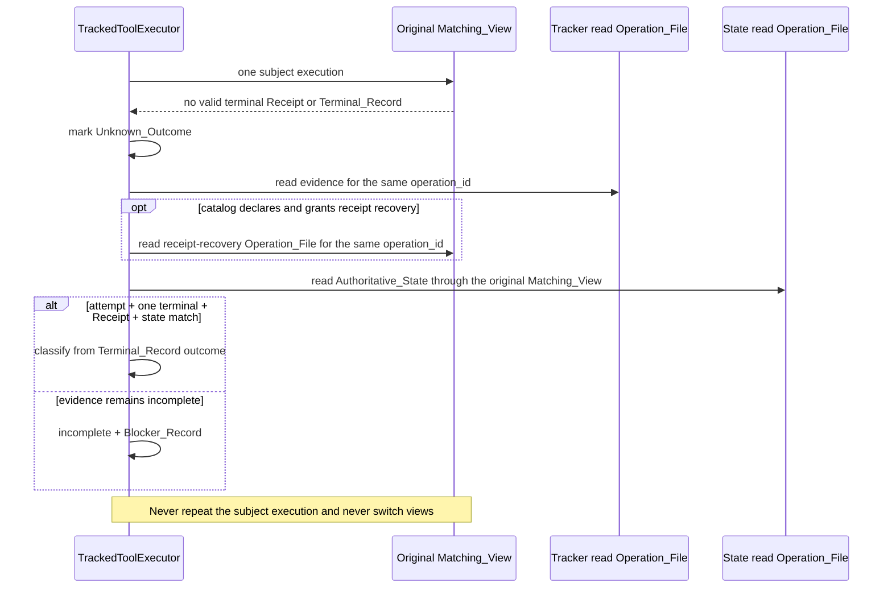
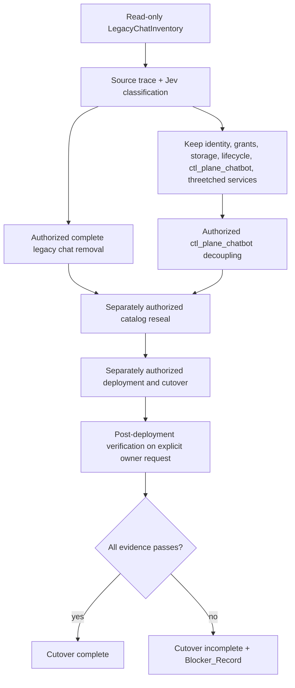

# Design Document: cockpit-container

Status: **proposed**. This document designs integration for the existing main
3tched control-plane cockpit. This rewrite changes no runtime, identity, grant,
credential, storage, service, mount, catalog, or source implementation.
Requirement references point to
`.kiro/specs/cockpit-container/requirements.md`.

## Repository relocation and integration decision

The owner moved this main cockpit specification from `/srv/git/kiroween` to
`/srv/git/odbus-verified`. The LXD subsidiary remains outside this work.
Only specification files have moved; application and runtime source have not.

Source inspection at relocation established:

- The authoritative Chat_Interface specification is `.kiro/specs/identity-chat-interface/` in this repository. Its Rust server is `crates/op-chat-interface`; cockpit-specific evidence, binding and authorization remain under `crates/op-grpc-bridge/src/cockpit/`. One combined owner integrates both without duplicating generic components or copying legacy chat.
- Production UI is owned by `/srv/git/3tched.com`; destination
  `deploy/lib/golden/build-golden.sh:62-64` selects that repository and its `dist`.
  Its current `src/svelte/connect.ts` uses the door chat adapter and issued
  identity path. That existing transport must not be silently reused as the
  guest filesystem-only interface required here.
- The retained bridge module graph is `crates/op-grpc-bridge/src/lib.rs` →
  `runtime.rs` → `runtime_chat.rs`, with control-plane methods in
  `runtime_chat_ctl.rs`. The old `mutation_engine.rs` and
  `ctl_plane_chatbot_dispatch.rs` are not declared by this module graph.
  Historical references below are discovery leads, not evidence of active code.
- The fresh `ConfirmationGate` currently holds a `toolCallId`, not a reserved
  backend `operation_id`. Current `_3tched-fs/src/invocation.rs` does declare
  `admitted_operation_id` metadata. Its admission and reservation semantics
  still require tracing; neither absence nor satisfaction of Requirement 16.2
  has been established. Task 1.5 remains a gate.

**Ownership and architecture settled by owner (2026-11-09):** this conversation owns both chat and cockpit. Server logic is Rust; TypeScript/Svelte/SvelteKit is exclusively browser Chat_UI and Canvas. The browser retains the Vercel AI SDK (`@ai-sdk/svelte` Chat with custom gRPC-Web transport) and Vercel Chat SDK; “Vercel” means SDKs, not hosting. UI and Chat_Endpoint share an origin on `10.0.0.2`, privately reachable over WireGuard through the decoy. The browser does not call Door_8090/Tonic. Tonic retains its independent backend duties.

The Rust Chat_Route runs on the VPS host, not inside the cockpit (requirements introduction). Its product calls use only host Mounted_Views bound to the existing main identity and session. This does not add a guest listener, host channel, direct door connection, or credential authority.

**Reserved boundaries:** B-33 (browser Chat SDK entry point and Generated_Element compilation location), B-30 (Chat_Endpoint port, not 8090), D-47 (Generated_Element containment), and identity-chat Task 24 (mount/bridge schema-state visibility) remain outside this implementation slice. Do not select their contracts or implement dependent work. D-48 records the visibility policy; a recorded policy is not an implemented gate.

`HANDOFF.md` task `chat-cockpit-20261109` records combined source ownership. Branch-policy preflight now passes on `dev`; the earlier waiver is no longer needed. Product tests and verification remain deferred until after deployment and explicit owner request. Transfer is not deployment or runtime authorization.

## Overview

This design preserves the existing control-plane cockpit `3tchedCockpitBot` (owner rename from `CockpitBot3tched`, 2026-11-09) and
binds the fresh identity-neutral Chat_Interface to the cockpit's existing main
3tched identity. The binding is fixed to the existing Main_Session
`b0c777e3-0955-cd8b-3d01-ca12998cae28`, Native_UUID, Grant_Set, credentials,
immutable Seed, writable Leaf, and exactly these seven Btrfs subvolumes: `@`,
`@agent_memory`, `@agent_rules`, `@agent_shared`, `@agent_skills`,
`@agent_soul`, and `@agent_user`.

The design adds no cockpit creation, clone, rename, reimage, rebuild, reseed,
repurpose, or duplicate path. It adds no grant or credential authority. It
uses the pinned identity, lifecycle, 3tched-fs, PluginV1, lungs, backend,
op-execution-tracker, and receipt interfaces as they exist. Source changes to
pinned dependencies are excluded except for separately authorized removal of
legacy chat code and the minimum separately authorized decoupling needed to
retain `ctl_plane_chatbot`.

The integration has these responsibilities:

1. bind the Chat_Interface to the cockpit's own sealed identity through a
   tracked `identity_sled.get_own_identity` Operation_File read;
2. derive tools from both mounted FUSE views and route each operation through
   the view matching the code that runs it;
3. require schema validation and one-use operator confirmation before every
   mutation;
4. establish complete tracker, receipt, and authoritative-state evidence for
   every read and mutation before reporting it complete;
5. keep `ctl_plane_chatbot`, remove its dependency on the threetched-backed
   service, and expose it as an ordinary granted 3tched tool;
6. inventory and remove legacy chat code without removing the main identity,
   its bindings, or threetched services;
7. preserve cockpit storage, lifecycle, mounts, and host-channel invariants;
   and
8. report proposed, implemented, built, tested, and deployed status as separate
   evidence stages.

### Architectural facts and evidence boundary

3tched-fs presents the runtime mirror of current committed op-dbus shared-memory
state through both FUSE views:

- `/run/mounts/3tchedFS` contains operations that run on 3tched code.
- `/run/mounts/threetched` contains operations run by
  `/usr/bin/threetched`.

Both views use the same 3tched-fs engine, sealed catalog, and identity
enforcement. They are mounted at the same time, carry the same catalog hash and
generation, and have distinct kernel mount sources. Cockpit processes never
open op-dbus SHM directly. They observe state only through the mounted FUSE
views.

A mounted path, schema, or value proves only that the corresponding projection
exists. A value read from a mounted state file is a current committed-SHM
projection at the observation time. Neither that value nor a successful FUSE
write proves that a particular Tool_Call completed.

Every Tool_Call, whether read or mutation and whether routed through the 3tched
or threetched view, follows this evidence path:

```text
Operation_File
  -> 3tched-fs
  -> PluginV1 over the existing lungs path
  -> backend plugin dispatch
  -> op-execution-tracker Attempt_Record
  -> backend outcome
  -> exactly one op-execution-tracker Terminal_Record
  -> Receipt returned through the same Operation_File
  -> matching Authoritative_State from a granted tracked read
```

Completion requires exact attribution agreement for `operation_id`, caller
identity, caller session, plugin, method, `subid`, catalog hash, catalog
generation, outcome, and hash-chain linkage. Missing, duplicated, invalid, or
mismatched evidence yields `incomplete`, never `complete`.

### Scope boundaries

The design owns only cockpit-specific binding and procedures around the fresh
Chat_Interface. It does not duplicate the Chat_Interface's conversation, UI,
provider, or persistence design. Cockpit glue supplies the existing identity,
both mounted views, and the strict Tool_Call evidence policy.

The product has no direct op-dbus, D-Bus, backend-store, SHM, container-runtime,
or lungs client. The D-Bus/PluginV1 work beneath 3tched-fs is a pinned internal
implementation detail, not an interface available to cockpit code. Product code
contains no MCP server, client, transport, or tool source. The integration adds
no socket, listener, proxy device, network interface, shared host directory,
or inbound network door. The existing lungs socket remains the cockpit's only
host channel.

## Research Findings and Design Decisions

### Sources reviewed

Read-only design inspection used these sources:

- the corrected `requirements.md` in this spec;
  - `/srv/git/kiroween/.kiro/specs/identity-chat-interface/requirements.md` and its sibling `design.md` for the identity-neutral Chat_Interface boundary (separate specification, not implemented by this cockpit design).
- `/srv/git/odbus-verified/crates/_3tched-fs/src/mounted.rs` for mount pinning,
  committed-SHM state projection, same-handle write/fsync/read behavior, and
  the no-automatic-retry rule;
- `/srv/git/odbus-verified/crates/_3tched-fs/src/fuse_fs.rs` for FUSE call-file
  execution and terminal diagnostics;
- `/srv/git/odbus-verified/crates/_3tched-fs/src/dispatch.rs` for schema
  validation, operation-ID creation, lungs binding, PluginV1
  `CallWithOperationId`, receipt validation, and unknown-outcome handling;
- `/srv/git/odbus-verified/crates/op-state-store/src/method_receipt.rs` for the
  existing receipt fields and attempt/terminal event proofs;
- `/srv/git/odbus-verified/crates/op-execution-tracker/src/record.rs` and
  `execution_tracker.rs` for execution identifiers, status, `prev_hash`,
  `exec_hash`, and terminal-state protection;
- `/srv/git/odbus-verified/crates/op-plugins/src/state_plugins/ctl_plane_chatbot.rs`
  and `ctl_plane_chatbot_methods.rs` for the retained plugin and its current
  imports from the threetched-backed service; and
  - the Rust implementation under `crates/op-grpc-bridge/` for the intended identity, registry, confirmation, routing, and receipt integration points.

The observed `/srv/git/odbus-verified` checkout HEAD was
`a2773e17783ba8e1e595fa034798e79cbab40a91`. That observation is not a release
pin. Before implementation relies on any symbol, the Baseline_Record must name
the accepted pinned commit, signature, digest, and callers required by
Requirement 2.

The generic `ExecutionRecord` and `MethodExecutionReceipt` definitions do not,
by themselves, prove that every required attribution field is preserved across
attempt, terminal, and receipt records. The Baseline_Record must trace the
actual production path and identify the source of every field. If that trace
cannot establish the required attempt/terminal split or any correlation field,
operations through the affected view remain deployment-unconfirmed.

### D-01: Preserve the existing cockpit

`3tchedCockpitBot` is selected only by the complete existing Identity_Binding:
cockpit name, Main_Session, sealed principal, Native_UUID, grants, credentials,
Seed, Leaf, and seven-subvolume set. A name/session cross-match or any mismatch
stops dependent work and creates a Blocker_Record. No component in this design
contains create or repair logic for the cockpit.

**Rationale:** preservation is safer than reconstruction and is required by the
corrected scope.

### D-02: Bind from the guest kernel, not configuration

At Chat_Session start, `CockpitIdentityBinder` invokes
`identity_sled.get_own_identity` through the cockpit's 3tched Operation_File.
It accepts only Guest_Kernel_Identity attribution. The returned identity and
session must equal the recorded Identity_Binding and Main_Session. A profile,
model response, UI request, tool result, SID1 path, or caller-selected session
cannot select the identity.

The identity read is itself a Tool_Call. The session does not start until the
read has an Attempt_Record, exactly one Terminal_Record, a matching Receipt,
and matching Authoritative_State evidence.

**Rationale:** the mount's kernel attribution and the sealed identity read are
the existing authority; configuration is only an expectation checked against
that authority.

### D-03: Derive one registry from two simultaneous views

`DualViewRegistry` opens both views, records each distinct kernel mount source,
and requires equal sealed-catalog hash and generation. It derives plugin,
method, argument schema, result schema, Required_Capability, side effect,
`subid`, and call path from the mounted catalog. It records the view that
actually exposes the operation and validates that view against the runtime
owner.

An operation exposed only in the wrong view, exposed in both views, exposed
under a forbidden threetched-service name, or observed after the catalog pin
changes is unavailable. The registry never guesses from a name and never routes
around the defect. A catalog change invalidates pending confirmations and
requires both views to be re-derived before another call.

**Rationale:** a threetched executable upgrade must affect only the threetched
side; 3tched definitions remain independent.

### D-04: Same-file Operation_File protocol

`OperationFileClient` uses the call path declared by the mounted catalog and
holds a pinned mount root and catalog snapshot for the entire call. It validates
arguments before opening the call file, opens without following links, writes
the complete canonical input, fsyncs to trigger dispatch, seeks to the beginning,
and reads the terminal Receipt or diagnostic from the same file descriptor.
It validates the result against the result schema from the same Catalog_Pin.

The source inspection currently describes concrete mounted call paths as
`plugins/<encoded-plugin>/operations/<encoded-method>/call`; the requirements
use the logical `operations/<plugin>/<method>/call` term. Product code does not
hard-code either spelling. It uses only the exact catalog-declared, root-confined
path after Baseline_Record reconciliation of the deployed contract.

A filesystem-write result is transport evidence only. It never advances a call
to complete without tracker, receipt, and state evidence.

### D-05: One finite evidence pipeline for reads and mutations

The Tool_Executor distinguishes a pre-dispatch `ToolIntent` from an admitted
`ToolCall`. 3tched-fs creates the canonical UUID `operation_id` before the
PluginV1 call and returns it in a Receipt or terminal diagnostic. Once admitted,
that ID is the sole correlation key for the call. The Chat_Interface's
`toolCallId` remains a UI/conversation key and never substitutes for
`operation_id`.

The backend must record the Attempt_Record before producing a terminal outcome
and exactly one Terminal_Record when it reaches that outcome. The
`TrackerEvidenceEvaluator` reads tracker records through a granted Operation_File
and rejects zero or multiple matching terminal records. It then validates the
Receipt and obtains Authoritative_State through a separately tracked granted
read in the same Matching_View.

For a subject mutation, the state read occurs after the subject Terminal_Record.
For a subject read, a subsequent verification read establishes the observation
used as Authoritative_State. That verification read follows the same tracked
Operation_File path and carries its own Attempt_Record, Terminal_Record, and
Receipt. It is evidence for the subject call and is not independently reported
as a completed operator Tool_Call, which prevents recursive read-back.

**Rationale:** this gives reads and mutations the same accountability rule while
keeping authoritative-state verification finite.

### D-06: Exact evidence equality

A normalized `Attribution` tuple is captured from source-proven fields, never
filled from assumptions. The evaluator requires exact equality among the
ToolCall, Attempt_Record, Terminal_Record, Receipt, and state-read evidence for
all applicable tuple fields. It additionally requires:

- attempt and terminal records to have valid hash-chain linkage;
- the terminal record to follow the attempt in the execution chain;
- the terminal outcome to equal the Receipt outcome;
- the Receipt's attempt and terminal event references to identify those records;
- the state-read observation to occur after the subject terminal record; and
- the observed state to reflect the recorded outcome.

If a deployed source does not carry one of the required fields directly or
through a source-traced authenticated envelope, the evaluator does not invent
it. The call stays incomplete and a Blocker_Record identifies the missing
correlation.

### D-07: Unknown outcomes are reconciled, never re-executed

A missing or unverifiable Receipt or Terminal_Record produces Unknown_Outcome.
The executor performs only granted read operations in the original Matching_View:
it reads tracker records for the same `operation_id`, uses a declared receipt
recovery operation when one is cataloged and granted, and reads authoritative
state. It never repeats the subject execution. If one attempt, exactly one
terminal, one matching Receipt, and matching state can be established, the
subject is classified by the terminal outcome. Otherwise it remains incomplete
and blocked.

No reconciliation uses the other view, another identity, another transport,
direct backend or SHM access, a local cache, or a raw container-runtime command.

### D-08: Mutation confirmation is bound and single use

After schema validation, `MutationConfirmationGate` stores canonical input on
the server with the `operation_id` reservation or pre-admission request ID,
caller identity/session, plugin, method, `subid`, and Catalog_Pin. The displayed
approval request is a projection of that held record. The operator's explicit
approve action must match every held value. Model text, tool output, message
text, local UI state, and filesystem state cannot confirm a mutation.

An accepted confirmation is consumed atomically for one call. A changed catalog
pin, changed identity binding, mismatch, expiry, session end, or denial discards
it. The bytes sent to the Operation_File are always the held validated bytes,
not bytes returned by the client with the confirmation.

### D-09: Denial is sticky for the session and never a routing signal

A Denial stops the call, creates a redacted Blocker_Record, and marks the tool
unavailable for the rest of the Chat_Session. Unrelated pending calls remain
unchanged. A denied call is never sent again through another Operation_File,
view, transport, identity, direct store, SHM path, container-runtime command,
or local substitute.

### D-10: Keep and decouple ctl_plane_chatbot

`ctl_plane_chatbot` remains a 3tched plugin. The fresh Chat_Interface discovers
and calls it through its 3tched-view Operation_Files under the same capability,
schema, confirmation, tracker, Receipt, and Authoritative_State rules as every
other tool.

The decoupling removes imports of threetched-service types, constants, size
limits, and plugin identifiers. Plugin-owned request/response types and limits
must be complete implementations in `ctl_plane_chatbot` or a neutral 3tched
module. A schema-diff gate compares every method and record field before and
after the decoupling. Any change beyond removal of the coupling stops the
change. No compatibility shim remains.

The observed coupling includes `ChatInput`, `ChatMessage`, and `ChatOutput` in
`ctl_plane_chatbot.rs`, and request/response limits plus a service identifier in
`ctl_plane_chatbot_methods.rs`. These are inventory candidates, not permission
to change pinned source. Source modification, build activation, catalog reseal,
and service restart each require their own Owner_Authorization.

### D-11: Clean-slate removal without identity removal

`LegacyChatInventory` records path, symbol, pinned commit, callers, and one of:

- `legacy_chat_remove`;
- `ctl_plane_chatbot_keep_and_decouple`;
- `threetched_service_keep`;
- `identity_grant_storage_lifecycle_keep`; or
- `unclear_owner_decision_required`.

Only `legacy_chat_remove` items are removed. Removal covers source, module and
build membership, plugin registration, sealed schema, generated output,
service, route, UI, test, fixture, and documentation that presents the item as
current. It leaves no unreachable remnant or compatibility adapter.

The main identity, session, credentials, grants, storage, lifecycle bindings,
and `ctl_plane_chatbot` are retained. Services run by `/usr/bin/threetched` are
retained as threetched services even when a historical name contains `chat`.
Forbidden names are recorded as defects; affected operations remain unavailable
until a separately authorized correction is deployed and verified.

The cutover is not called complete until the fresh Chat_Interface is the only
chat path for the preserved control-plane identity and post-deployment evidence
shows no active reference to removed code.

### D-12: Preserve lifecycle and storage by before/after equality

Every authorized Lifecycle_Operation snapshots, through granted tracked reads,
the Seed identity, Leaf identity, Btrfs member set, seven-subvolume set,
Identity_Binding, and Native_UUID before and after the operation. Completion
requires exact equality. Start uses the existing
`identity_sled.touch_session` Operation_File in the 3tched view.

No lifecycle path adds or removes a Btrfs member or creates, deletes, renames,
or replaces a subvolume. There is no cockpit create, recovery-by-reimage,
reseed, duplicate, or recreation procedure. An invariant mismatch yields an
incomplete lifecycle result and a Blocker_Record; the integration performs no
automated repair.

### D-13: Separate live-change gates

The following are separate Live_Changes and require separate, matching
Owner_Authorizations: legacy removal, pinned-source decoupling, catalog reseal,
build activation, deployment, service restart, mount change, and chat cutover.
Authorization names the action, main identity, `3tchedCockpitBot`, affected
files or services, and expected Operation_Files. A target or argument mismatch
stops before action and returns to the owner.

Without authorization, work is limited to read-only discovery and reversible
source changes in this repository. A Denial never authorizes a grant, identity,
credential, storage, or route change.

### D-14: Evidence records and stage reporting

Four records keep claims separate:

- **Baseline_Record:** pinned commit, source path, symbol signature, digest,
  callers, and the complete 3tched and threetched operation traces.
- **Runtime_Record:** observed mounts, kernel sources, owning processes,
  catalog pins, Guest_Kernel_Identity, current SHM projections, Tool_Call
  evidence, lifecycle snapshots, host channels, and listeners.
- **Blocker_Record:** redacted denial, unknown outcome, missing capability or
  policy, trace gap, mismatch, and dependent work.
- **Status_Report:** proposed, implemented, built, tested, and deployed status
  for every component and task, with evidence for each stage.

Mounted-projection existence, committed-SHM projection, identity binding, and
verified Tool_Call completion are distinct Runtime_Record claims.

### D-15: Jev decision evidence

Jev was given only the non-secret requirements and source observations above.
The request used `jev-latest`; the returned model was `jev-1.14.0`. The answers
support but do not authorize this design.

| Question | Answer | Probabilities / confidence | Source evidence |
|---|---|---|---|
| Does a committed-SHM value observed through FUSE alone prove a Tool_Call completed? | no | yes `0.07`; confidence `0.93` | `_3tched-fs/src/mounted.rs`, Requirements 2 and 8 |
| Is repeating an Unknown_Outcome execution safe before tracker, Receipt, and state establish its result? | no | yes `0.03`; confidence `0.97` | `_3tched-fs/src/mounted.rs`, `dispatch.rs`, Requirement 9 |
| How should the `ctl_plane_chatbot` dependency on threetched-service types and limits be classified? | retained plugin coupling defect | selected `0.99`; confidence `0.99`; alternatives: remove `0.00`, threetched service `0.00`, unclear `0.01` | `ctl_plane_chatbot.rs`, `ctl_plane_chatbot_methods.rs`, Requirement 12 |
| Which completion design matches the corrected contract? | tracker + Receipt + state | selected `1.00`; confidence `1.00`; all alternatives `0.00` | Requirements 6–9 |

## Architecture

### Component view

```mermaid
flowchart LR
  UI[Fresh identity-neutral Chat_Interface] --> Glue[CockpitChatGlue]
  Glue --> Bind[CockpitIdentityBinder]
  Bind --> Reg[DualViewRegistry]
  Reg --> Gate[Schema and Mutation Gate]
  Gate --> Exec[TrackedToolExecutor]
  Exec --> Route{Runtime owner}
  Route -->|3tched code| V3[/run/mounts/3tchedFS Operation_File]
  Route -->|/usr/bin/threetched| VT[/run/mounts/threetched Operation_File]
  V3 --> FS[3tched-fs]
  VT --> FS
  FS --> Lungs[Existing lungs path]
  Lungs --> PluginV1[PluginV1 CallWithOperationId]
  PluginV1 --> Backend[Backend plugin dispatch]
  Backend --> Attempt[Attempt_Record]
  Attempt --> Outcome[Backend outcome]
  Outcome --> Terminal[Exactly one Terminal_Record]
  Terminal --> Receipt[Receipt on same Operation_File]
  Receipt --> Evidence[TrackerEvidenceEvaluator]
  Evidence --> Readback[Tracked Authoritative_State read]
  Readback --> Complete{Exact match?}
  Complete -->|yes| Report[Completed result]
  Complete -->|no| Block[Incomplete + Blocker_Record]
```

The FUSE state projection is intentionally not drawn as a shortcut into
`Complete`. It is runtime state visibility, not Tool_Call proof.

### Operation sequence

```mermaid
sequenceDiagram
  participant C as Chat_Interface / CockpitChatGlue
  participant R as DualViewRegistry
  participant F as Matching FUSE view
  participant P as 3tched-fs + PluginV1/lungs
  participant B as Backend
  participant T as op-execution-tracker
  participant E as TrackerEvidenceEvaluator

  C->>R: resolve tool from both pinned view catalogs
  R-->>C: descriptor + Matching_View + Catalog_Pin
  C->>C: offered check and argument-schema validation
  opt mutation
    C->>C: hold validated bytes and accept exact one-use operator confirmation
    C->>C: recheck identity and Catalog_Pin
  end
  C->>F: open declared Operation_File; write validated bytes; fsync
  F->>P: 3tched-fs dispatch with Guest_Kernel_Identity
  P->>B: PluginV1 CallWithOperationId
  B->>T: append Attempt_Record before terminal outcome
  B->>B: execute backend method
  B->>T: append one Terminal_Record
  B-->>P: terminal result linked to operation_id
  P-->>F: validated Receipt
  C->>F: seek/read Receipt from same file descriptor
  C->>E: evaluate subject evidence
  E->>F: tracked granted read of tracker records
  E->>F: tracked granted read of authoritative state after subject terminal
  E->>E: compare attribution, outcome, chain links, and state
  alt all evidence matches
    E-->>C: complete
  else missing, duplicated, invalid, or mismatched evidence
    E-->>C: incomplete + redacted blocker
  end
```

### Unknown-outcome sequence



### Clean-slate cutover sequence



## Storage Architecture

### 3-Image Pre-Rootfs Layout

The Cockpit uses **one 2-partition image + two single-partition Btrfs images** for its storage:

1. **2-Partition Image (GPT):**
   - **Partition 1:** Btrfs rootfs — the current rootfs transferred from the existing seed partition to p1, then **`btrfstune -S 1`** applied to make it an immutable shared seed (single profile, not mirrored). This is the read-only OS base.
   - **Partition 2:** Sparse ext4 — **`chattr +C`** (nodatacow) applied to disable CoW on Btrfs, used for the Cozo/RocksDB store.

2. **Sparse Btrfs Image (1 partition):**
   - Added via **`btrfs device add <image> <rootfs-mount>`** (no `losetup`) onto the p1 seed before rootfs loads, making rootfs (including the identity sled and snowball ledger with immutable `sealed_id`) **read/write**.

3. **Upgrade Overlay Btrfs (1 partition):**
   - Contains **only the `@` subvolume**, used as the `btrfs send/receive` receiver and mounted as an overlay onto rootfs for upgrades/patches.

### Identity Sled

The identity sled is its own separate `content_type: filesystem` Btrfs subvolume in the Incus `3tched` pool — a blank writable surface for the host to write the sealed identity and snowball ledger. It is attached to the container as an Incus volume (not a `.img` file).

### Image Location

The images live on the same partition where the rootfs currently resides (the Incus `3tched` pool). No loop devices are used for image access; `btrfs device add` operates directly on the image file.

No step changes the main identity, Main_Session, Native_UUID, grants,
credentials, Seed, Leaf, or seven-subvolume membership.
## Components and Interfaces

### CockpitIdentityBinder

```ts
interface CockpitIdentityBinder {
  bind(expected: ExistingCockpitBinding): Promise<IdentityBindingOutcome>;
  recheck(bound: BoundCockpitIdentity): Promise<IdentityRecheckOutcome>;
}

type ExistingCockpitBinding = {
  cockpitName: "3tchedCockpitBot";
  mainSession: "b0c777e3-0955-cd8b-3d01-ca12998cae28";
  principalId: string;
  nativeUuid: string;
};
```

`bind` makes a tracked `identity_sled.get_own_identity` read through the 3tched
view and compares every returned identity/session field with recorded runtime
evidence. It never accepts caller-supplied identity or credential material.

### DualViewRegistry

```ts
type ViewKind = "3tched" | "threetched";

interface DualViewRegistry {
  derive(views: MountedViewPair, grants: ReadonlySet<string>):
    Promise<RegistryOutcome>;
  resolve(registry: RegistrySnapshot, plugin: string, method: string):
    OperationResolution;
}

type MountedViewPair = {
  "3tched": MountedViewSnapshot;
  threetched: MountedViewSnapshot;
};
```

Derivation is all-or-nothing for catalog agreement but preserves availability
reporting per view. An operation is callable only when it has exactly one
correct Matching_View declaration and its Required_Capability is held.

### OperationFileClient

```ts
interface OperationFileClient {
  invoke(input: OperationInvocation): Promise<OperationTransportOutcome>;
  readProjectedState(view: MountedViewSnapshot, plugin: string):
    Promise<CommittedShmProjection>;
}

type OperationInvocation = {
  descriptor: OperationDescriptor;
  catalogPin: CatalogPin;
  canonicalArguments: Uint8Array;
  mutationConfirmed: boolean;
};
```

`invoke` is the only product operation transport. It uses the same open call
file for write, fsync, seek, and terminal read. `readProjectedState` is for
runtime observation only and cannot return a completed Tool_Call classification.

### MutationConfirmationGate

```ts
interface MutationConfirmationGate {
  hold(intent: ValidatedMutationIntent): PendingConfirmation;
  confirm(event: OperatorConfirmation): ConfirmationOutcome;
  discard(predicate: (pending: PendingConfirmation) => boolean,
    reason: DiscardReason): number;
}
```

The gate stores canonical arguments and the full attribution expectation on the
server. It atomically accepts at most one exact confirmation.

### TrackedToolExecutor

```ts
interface TrackedToolExecutor {
  execute(intent: ValidatedToolIntent): Promise<ToolExecutionOutcome>;
  reconcileUnknown(operationId: string, context: OperationContext):
    Promise<ToolExecutionOutcome>;
}

type ToolExecutionOutcome =
  | { kind: "complete"; evidence: CompletedToolCallEvidence }
  | { kind: "denied"; blocker: BlockerRecord }
  | { kind: "failed"; evidence?: PartialToolCallEvidence; error: RedactedError }
  | { kind: "incomplete"; evidence: PartialToolCallEvidence; blocker: BlockerRecord }
  | { kind: "unknown"; evidence: PartialToolCallEvidence; blocker: BlockerRecord };
```

`execute` handles reads and mutations identically after the mutation gate. It
cannot classify `complete` without `TrackerEvidenceEvaluator` success.
`reconcileUnknown` performs reads only and never resubmits the subject call.

### TrackerEvidenceReader and TrackerEvidenceEvaluator

```ts
interface TrackerEvidenceReader {
  readByOperationId(context: OperationContext): Promise<TrackerReadEvidence>;
  recoverReceipt(context: OperationContext): Promise<ReceiptRecoveryOutcome>;
}

interface TrackerEvidenceEvaluator {
  evaluate(input: CompletionEvidenceCandidate): CompletionDecision;
}
```

The reader itself uses granted tracked Operation_Files in the original
Matching_View. The evaluator is pure and fail-closed. It requires one attempt,
exactly one terminal record, one Receipt, and one post-terminal authoritative
state observation.

### AuthoritativeStateReader

```ts
interface AuthoritativeStateReader {
  readAfterTerminal(
    subject: SubjectTerminalEvidence,
    readDescriptor: OperationDescriptor
  ): Promise<AuthoritativeStateEvidence>;
}
```

The read descriptor is discovered from the same sealed catalog. The read is a
fully tracked operation in the subject's Matching_View. If no granted read is
declared, completion is unavailable rather than inferred from a FUSE state
file.

### CockpitLifecycleGuard

```ts
interface CockpitLifecycleGuard {
  snapshot(): Promise<LifecycleSnapshotEvidence>;
  run(intent: AuthorizedLifecycleIntent): Promise<LifecycleOutcome>;
}
```

`run` accepts only the existing cockpit and an exact Owner_Authorization. It
captures tracked before/after snapshots and requires equality. Start invokes
`identity_sled.touch_session` in the 3tched view. It exposes no create, clone,
rename, reimage, reseed, or storage-repair method.

### CtlPlaneChatbotDecoupler

```ts
interface CtlPlaneChatbotDecoupler {
  inventory(pin: SourcePin): Promise<CouplingInventory>;
  compareContracts(before: PluginContract, after: PluginContract):
    ContractComparison;
}
```

This is an implementation procedure, not a runtime adapter. It removes the
threetched-service dependency while requiring all unrelated methods and fields
to remain equal. It never adds a compatibility layer or alternate transport.

### LegacyChatInventoryBuilder

```ts
interface LegacyChatInventoryBuilder {
  discover(pin: SourcePin): Promise<LegacyChatInventory>;
  classify(item: LegacyChatCandidate, sourceTrace: CallerTrace,
    jevEvidence: JevEvidence): InventoryClassification;
}
```

Jev evidence assists classification but never authorizes removal. `unclear`
items are preserved and referred to the owner.

### EvidenceRecorder and StatusReporter

```ts
interface EvidenceRecorder {
  writeBaseline(record: BaselineRecord): Promise<void>;
  writeRuntime(record: RuntimeRecord): Promise<void>;
  appendBlocker(record: BlockerRecord): Promise<void>;
}

interface StatusReporter {
  render(input: StatusEvidence): StatusReport;
}
```

Record writers reject Credential_Material and use atomic replacement for
singleton records plus append-only writes for blockers. Status logic cannot
infer one stage from another.

## Data Models

### Catalog and mounted views

```ts
type CatalogPin = {
  hash: string;
  generation: number;
};

type MountedViewSnapshot = {
  kind: ViewKind;
  mountPath: "/run/mounts/3tchedFS" | "/run/mounts/threetched";
  kernelMountSource: string;
  owningProcess: string;
  guestKernelIdentity: GuestKernelIdentity;
  catalogPin: CatalogPin;
};

type OperationDescriptor = {
  viewKind: ViewKind;
  plugin: string;
  method: string;
  subid: string;
  callPath: string;
  requiredCapability: string;
  sideEffect: "read" | "mutation";
  argumentSchema: unknown;
  resultSchema: unknown;
  catalogPin: CatalogPin;
};
```

`callPath` must resolve beneath `mountPath`, without symlink traversal or path
normalization escape. Missing or unrecognized side effects are treated as
mutation.

### Identity and attribution

```ts
type GuestKernelIdentity = {
  principalId: string;
  sessionId: string;
  mountInstanceId: string;
};

type Attribution = {
  operationId: string;
  callerIdentity: string;
  callerSession: string;
  plugin: string;
  method: string;
  subid: string;
  catalogHash: string;
  catalogGeneration: number;
};

type OperationContext = Attribution & {
  viewKind: ViewKind;
  operationFile: string;
  canonicalInputDigest: string;
};
```

The digest identifies already validated non-secret input bytes. It is not an
identity source and is never computed over Credential_Material.

### Tracker records and hash-chain linkage

```ts
type HashChainLinkage = {
  previousRecordHash: string;
  recordHash: string;
  sequence: number;
};

type AttemptRecord = Attribution & {
  recordKind: "attempt";
  startedAt: string;
  linkage: HashChainLinkage;
};

type TerminalOutcome =
  | "completed"
  | "failed"
  | "denied"
  | "cancelled"
  | "timed_out";

type TerminalRecord = Attribution & {
  recordKind: "terminal";
  outcome: TerminalOutcome;
  success: boolean;
  endedAt: string;
  linkage: HashChainLinkage;
};

type TrackerEvidence = {
  attempt: AttemptRecord;
  terminal: TerminalRecord;
};
```

The terminal linkage must follow the attempt in the existing tracker chain.
Exactly one TerminalRecord may match an `operationId`.

### Receipt and authoritative state

```ts
type ReceiptEvidence = Attribution & {
  outcome: TerminalOutcome;
  success: boolean;
  attemptEventId: number;
  attemptEventHash: string;
  terminalEventId: number;
  terminalEventHash: string;
  result: unknown;
};

type AuthoritativeStateEvidence = {
  subjectOperationId: string;
  ownerPlugin: string;
  catalogPin: CatalogPin;
  observedAfterTerminalSequence: number;
  state: unknown;
  readCall: {
    context: OperationContext;
    tracker: TrackerEvidence;
    receipt: ReceiptEvidence;
  };
};

type CompletedToolCallEvidence = {
  context: OperationContext;
  tracker: TrackerEvidence;
  receipt: ReceiptEvidence;
  authoritativeState: AuthoritativeStateEvidence;
};
```

`ReceiptEvidence` is a normalized view of source-proven receipt and authenticated
operation context. Normalization cannot add an attribution field absent from
the traced runtime path. `AuthoritativeStateEvidence` is different from a raw
`CommittedShmProjection` because it includes a separately tracked read.

### Runtime state projection

```ts
type CommittedShmProjection = {
  viewKind: ViewKind;
  plugin: string;
  catalogPin: CatalogPin;
  observedAt: string;
  value: unknown;
  evidenceClass: "committed_shm_projection";
};
```

This model has no `operationId`, tracker records, or Receipt and therefore
cannot satisfy the completed-evidence type.

### Confirmation

```ts
type PendingConfirmation = Attribution & {
  confirmationId: string;
  canonicalArguments: Uint8Array;
  inputDigest: string;
  expiresAt: string;
  state: "pending" | "consumed" | "discarded" | "expired";
};

type OperatorConfirmation = {
  confirmationId: string;
  operationId: string;
  callerIdentity: string;
  callerSession: string;
  plugin: string;
  method: string;
  subid: string;
  catalogHash: string;
  catalogGeneration: number;
  inputDigest: string;
};
```

### Preservation and lifecycle

```ts
type CockpitPreservationSnapshot = {
  cockpitName: "3tchedCockpitBot";
  nativeUuid: string;
  principalId: string;
  sessionId: "b0c777e3-0955-cd8b-3d01-ca12998cae28";
  grantSetDigest: string;
  credentialIdentity: string;
  seedIdentity: string;
  leafIdentity: string;
  btrfsMembers: readonly string[];
  subvolumes: readonly [
    "@", "@agent_memory", "@agent_rules", "@agent_shared",
    "@agent_skills", "@agent_soul", "@agent_user"
  ];
  hostChannels: readonly string[];
  listeningSockets: readonly string[];
};

type LifecycleSnapshotEvidence = {
  snapshot: CockpitPreservationSnapshot;
  reads: readonly CompletedToolCallEvidence[];
};
```

`credentialIdentity` is a non-secret stable identity or record locator. It is
never credential bytes or a digest computed from credential bytes.

### Blocker, authorization, and status

```ts
type BlockerRecord = {
  format: "cockpit.blocker/1";
  id: string;
  occurredAt: string;
  operationId?: string;
  callerIdentity: string;
  callerSession: string;
  plugin?: string;
  method?: string;
  subid?: string;
  catalogPin?: CatalogPin;
  missingCapabilityOrPolicy: string;
  redactedError: string;
  dependentTasks: readonly string[];
};

type OwnerAuthorization = {
  format: "cockpit.owner-authorization/1";
  authorizationId: string;
  action: string;
  targetIdentity: string;
  targetCockpit: "3tchedCockpitBot";
  affectedFiles: readonly string[];
  affectedServices: readonly string[];
  operationFiles: readonly string[];
  issuedAt: string;
  expiresAt?: string;
};

type EvidenceStage = "not_started" | "proposed" | "complete" | "blocked" | "unconfirmed";

type ComponentStatus = {
  component: string;
  proposed: EvidenceStage;
  implemented: EvidenceStage;
  built: EvidenceStage;
  tested: EvidenceStage;
  deployed: EvidenceStage;
  evidence: readonly string[];
};
```

A BlockerRecord contains no Credential_Material and no digest computed from it.
A deployment stage cannot become `complete` from source, build, or mounted-state
evidence alone.

## Correctness Properties

*A property is a characteristic or behavior that should hold true across all
valid executions of a system, essentially a formal statement about what the
system should do. Properties serve as the bridge between human-readable
specifications and machine-verifiable correctness guarantees.*

The prework classified routing, evidence evaluation, identity and authorization
gates, confirmation state, redaction, contract comparison, and status logic as
suitable for property-based testing. Runtime mounts, FUSE behavior, backend
tracking, storage, services, and source-removal verification remain integration
or static checks.

### Property 1: Cockpit target selection is exact

For all observed container bindings, the cockpit integration accepts a target
if and only if its name is `3tchedCockpitBot`, its session is the Main_Session,
and its recorded identity and Native_UUID match the existing
Identity_Binding; every partial or cross-match yields a Blocker_Record and no
dependent action.

**Validates: Requirements 1.6, 1.7, 1.8**

### Property 2: Runtime evidence claims do not exceed their source

For all combinations of source definitions, mounted projections, committed-SHM
values, filesystem-write results, Guest_Kernel_Identity evidence, tracker
records, Receipts, and state reads, the evidence classifier labels each item by
what is actually present and never classifies projection-only, state-only, or
write-only evidence as Tool_Call completion.

**Validates: Requirements 2.4, 2.6, 2.8, 2.9, 2.11, 8.10, 8.11, 20.10, 22.8**

### Property 3: Identity binding accepts only the existing main identity

For all `get_own_identity` results and all untrusted identity claims, session
start succeeds only when the tracked result's principal and session exactly
match the existing cockpit Identity_Binding and Main_Session; changing any
identity field, or supplying an alternate identity through another input,
causes refusal and no offered tool.

**Validates: Requirements 3.2, 3.3, 3.4, 3.7, 18.8**

### Property 4: Tool availability is the catalog-and-grant intersection

For all paired mounted catalogs and Grant_Sets, the offered tools are exactly
the correctly assigned, uniquely exposed methods whose declared
Required_Capability is held; argument schema, result schema, side effect,
`subid`, capability, Catalog_Pin, and Matching_View equal the mounted
declaration.

**Validates: Requirements 3.5, 4.6**

### Property 5: View routing is exact and has no fallback

For all registry snapshots, Tool_Calls, and denial, error, or Unknown_Outcome
results, each dispatched call uses only the view matching the operation's
runtime owner; wrong-view, duplicate-view, absent, or forbidden-name
declarations dispatch zero calls, and no result causes dispatch through the
other view or another transport.

**Validates: Requirements 4.4, 4.5, 4.7, 4.8, 4.10, 4.12, 5.5, 5.6, 6.15, 13.4, 13.5, 13.6, 20.9**

### Property 6: Threetched changes cannot alter 3tched definitions

For all paired catalog snapshots whose 3tched declarations and Grant_Set are
unchanged, changing any set of threetched declarations produces identical
3tched registry entries, schemas, capabilities, and routing decisions.

**Validates: Requirements 13.7**

### Property 7: Catalog changes invalidate execution context

For all validated or confirmed Tool_Calls, if either mounted view's catalog
hash or generation differs from the call's Catalog_Pin before dispatch, the
executor sends no call, discards the confirmation when present, and requires a
new dual-view derivation.

**Validates: Requirements 4.9, 16.7**

### Property 8: Operation paths remain confined to the matching mount

For all plugin and method names, including separator, traversal, encoding, and
symlink cases, an Operation_File opens only when the catalog-declared path
resolves beneath the pinned Matching_View root without following an escaping
link; every other path is refused before write.

**Validates: Requirements 5.7, 5.8**

### Property 9: Schema and pin consistency is end to end

For all candidate argument and result values, an invocation proceeds only when
the argument validates against the descriptor's argument schema and a returned
result is accepted only when it validates against the result schema from the
same unchanged Catalog_Pin.

**Validates: Requirements 5.3, 5.4, 16.1**

### Property 10: Completion is exact evidence equivalence

For all read and mutation Tool_Calls in either view, the evaluator returns
`complete` if and only if there is one matching Attempt_Record before backend
terminal outcome, exactly one matching Terminal_Record, one matching Receipt,
and one matching post-terminal Authoritative_State observation, with exact
equality for `operation_id`, caller identity, caller session, plugin, method,
`subid`, catalog hash, catalog generation, and outcome; deleting, duplicating,
or changing any required value returns `incomplete`.

**Validates: Requirements 2.10, 6.1, 6.2, 6.3, 6.4, 6.5, 6.6, 6.7, 6.8, 6.9, 6.11, 6.12, 6.13, 6.16, 8.1, 8.2, 8.3, 8.4, 8.5, 8.6, 8.7, 8.8, 8.9, 12.4, 16.8, 20.7**

### Property 11: Tracker linkage is ordered and valid

For all candidate tracker segments, valid Tracker_Evidence requires the attempt
and terminal records to have valid record hashes and preceding-record hashes,
the terminal to follow the attempt, and the Receipt's event references to name
those records; the first broken or missing link makes the evidence incomplete
and produces a Blocker_Record.

**Validates: Requirements 6.10, 6.14**

### Property 12: Authoritative state agrees with terminal outcome

For all method-specific outcome adapters and complete tracker/Receipt tuples,
the subject call is complete only when the post-terminal tracked read returns
state that reflects the same terminal outcome; absent, stale, or contradictory
state remains incomplete.

**Validates: Requirements 8.4, 8.5, 8.9**

### Property 13: Unknown outcomes never repeat the subject execution

For all Unknown_Outcome evidence combinations, reconciliation preserves the
same `operation_id` and Matching_View and issues only granted tracker,
receipt-recovery, and authoritative-state reads; it issues zero repeat subject
writes and classifies the result from the Terminal_Record only when all evidence
matches.

**Validates: Requirements 9.1, 9.2, 9.3, 9.4, 9.5, 9.6, 9.7**

### Property 14: Mutation execution requires one exact human confirmation

For all mutation intents and event sequences, the executor sends the held
canonical input at most once and only after schema validation and an explicit
operator confirmation matching the held operation, identity, session, plugin,
method, `subid`, input digest, and Catalog_Pin; model text, tool results, message
text, local state, mismatches, expired events, and discarded events execute
nothing.

**Validates: Requirements 16.1, 16.2, 16.3, 16.4, 16.5, 16.6, 16.8**

### Property 15: Confirmation consumption is atomic

For all interleavings of two or more approvals for the same pending mutation,
exactly one matching approval can transition the record from `pending` to
`consumed`; every later approval is refused and cannot produce another
Operation_File write.

**Validates: Requirements 16.5**

### Property 16: Denial is sticky without cross-call interference

For all Chat_Session states and denied tools, the denied Tool_Call stops, the
tool remains unavailable for the session, later requests for that plugin and
method produce zero Operation_File writes, and pending calls for unrelated
tools remain byte-for-byte unchanged.

**Validates: Requirements 17.2, 17.3, 17.4, 17.5, 17.6**

### Property 17: Denial records are complete and secret-free

For all denial inputs, the Blocker_Record contains the operation, caller
identity/session, plugin, method, `subid`, `operation_id`, Catalog_Pin, missing
capability or policy, timestamp, and redacted error while containing no
Credential_Material and no digest computed from Credential_Material.

**Validates: Requirements 17.1, 17.7, 17.8**

### Property 18: Credential checks fail closed across every output channel

For all outbound items containing Credential_Material in any registered raw,
encoded, or cross-chunk form, and for all credential-check errors or timeouts,
the complete item is withheld before its first byte reaches the destination;
only credential class, blocked channel, main identity display name, and
timestamp may be recorded.

**Validates: Requirements 18.1, 18.2, 18.3, 18.4, 18.5, 18.7**

### Property 19: Live-change authorization is exact and non-transitive

For all live-change intents and authorization sets, an action can cross its gate
only when one unexpired authorization exactly names the action, existing main
identity, `3tchedCockpitBot`, affected files or services, and Operation_Files;
authorization for one action never authorizes removal, reseal, activation,
deployment, restart, mount change, or cutover as another action.

**Validates: Requirements 11.10, 19.1, 19.2, 19.3, 19.4, 19.5, 19.6**

### Property 20: Lifecycle snapshot equality is required

For all before/after cockpit preservation snapshots, lifecycle completion is
possible only when cockpit name, Native_UUID, identity, Main_Session, grants,
credential identity, Seed, Leaf, Btrfs members, seven subvolumes, host channels,
and listeners are equal; changing any field returns incomplete and a blocker.

**Validates: Requirements 10.1, 10.2, 10.3, 10.4, 10.5, 10.6, 10.8, 10.9, 10.10, 10.11, 14.8, 19.7, 21.6**

### Property 21: ctl_plane_chatbot contract changes only by decoupling

For all before/after `ctl_plane_chatbot` contract trees, the decoupling gate
accepts the result only when every method, argument field, result field, record
field, side effect, capability, and `subid` unrelated to the removed service
coupling is identical; every additional change blocks activation.

**Validates: Requirements 12.5, 12.6, 12.9**

### Property 22: Trace gaps stop at the first unresolved transition

For all source trace sequences, the Baseline_Record identifies the first
missing caller-to-callee transition, names the last established symbol, marks
the affected view deployment-unconfirmed, and never treats a later observed
symbol as proof of the missing transition.

**Validates: Requirements 7.11, 7.12**

### Property 23: Status stages are independent evidence gates

For all component evidence sets, each of proposed, implemented, built, tested,
and deployed is computed only from its required evidence; removing a required
file/task citation, build record, owner test request, test result, or deployment
evidence changes only the dependent stage and never promotes another stage.

**Validates: Requirements 22.1, 22.2, 22.3, 22.4, 22.5, 22.6, 22.7**

## Error Handling

All failures are fail-closed. Before an error reaches the UI, logs, telemetry,
records, or persisted chat state, the Secret_Guard removes Credential_Material.
No error changes identity, view, transport, grants, credentials, storage, or
routing.

| Error kind | Detection | Required result | Permitted follow-up |
|---|---|---|---|
| `cockpit_binding_mismatch` | Name, Main_Session, principal, or Native_UUID differs | Stop dependent work; preserve observed cockpit; create Blocker_Record | Read-only re-observation or owner clarification |
| `missing_mount` | Either expected view is absent or unreadable | Mark that view and its tools unavailable; no alternate path | Read-only mount discovery |
| `mount_identity_mismatch` | Guest_Kernel_Identity differs from bound identity/session | End or refuse Chat_Session; discard its confirmations; block | Read-only identity recheck |
| `catalog_pair_mismatch` | View hashes or generations differ | Refuse calls from both stale snapshots; re-derive both views | Read-only catalog discovery |
| `view_assignment` | Operation is missing, duplicated, wrong-view, or forbidden-name-only | Mark operation unavailable; create blocker | Wait for separately authorized catalog correction |
| `path_escape` | Declared call path leaves pinned mount root or follows an escaping link | Refuse before open/write | None for that descriptor |
| `schema_input` | Arguments fail same-pin schema | Reject before confirmation and dispatch | Correct input only |
| `schema_result` | Result fails same-pin schema | Mark call incomplete; retain raw evidence only in guarded record form | Read-only evidence reconciliation |
| `confirmation` | Missing, mismatched, expired, consumed, or invalid-source approval | Leave unexecuted; preserve unrelated pending calls | New model proposal after rejection/expiry |
| `denial` | Capability, identity, policy, or operation refusal | Stop call; sticky-unavailable tool; complete redacted blocker | No retry in session and no fallback |
| `attempt_missing` | No matching Attempt_Record | Incomplete; blocker | Granted tracker read only |
| `terminal_missing` | No matching Terminal_Record | Unknown/incomplete; blocker | Granted tracker and receipt-recovery reads only |
| `terminal_duplicate` | More than one terminal matches `operation_id` | Incomplete; blocker | Read-only investigation; never choose one |
| `attribution_mismatch` | Any identity/session/plugin/method/subid/pin/ID differs | Incomplete; blocker | Read-only investigation |
| `hash_chain_invalid` | Record or preceding-record hash invalid | Incomplete; blocker | Read-only investigation |
| `receipt_missing_or_invalid` | No Receipt, malformed Receipt, bad event references, or outcome mismatch | Unknown/incomplete; blocker | Declared granted receipt recovery only |
| `state_unavailable` | No granted owner-state read or read fails | Incomplete; keep Receipt and tracker evidence distinct | Read-only retry of the evidence read only when its own contract permits |
| `state_mismatch` | Post-terminal state does not reflect terminal/Receipt | Incomplete; blocker | Read-only re-observation, no subject repeat |
| `unknown_outcome` | Terminal result cannot be established | Unknown then incomplete unless reconciliation fully matches | Same-ID tracker, receipt-recovery, and state reads only |
| `credential_detected` | Secret_Guard detects Credential_Material | Withhold whole item; class-only security event | Remove the credential-bearing item |
| `credential_check_failed` | Guard error or timeout | Withhold whole item | No unguarded output |
| `storage_invariant` | Any preservation snapshot field changes | Lifecycle/cutover incomplete; blocker; no repair | Owner-directed investigation only |
| `legacy_classification_unclear` | Source and Jev evidence do not establish role | Preserve item; ask owner | No removal |
| `contract_drift` | `ctl_plane_chatbot` differs beyond removed coupling | Stop source activation; blocker | Revise source before any live change |
| `authorization_missing` | No exact Owner_Authorization | Keep action proposed and unperformed | Ask owner for the exact action |
| `authorization_target_changed` | Actual identity, cockpit, service, mount, operation, or arguments differ | Stop before action | Ask owner to authorize the difference |
| `new_host_surface` | New host channel, socket, listener, device, or inbound door appears | Deployment incomplete; blocker | Remove through separately authorized rollback procedure |

A failed Blocker_Record write never turns a denial or incomplete call into
success. The operation remains stopped, and status reports the record-writing
failure separately.

## Testing Strategy

Tests and verification are deferred until after deployment under the workspace
rule. No test, build, lint, formatting, type-check, code-review, smoke, catalog
reseal, service restart, mount, deployment, or runtime verification command is
run during this design rewrite. Test files may be prepared during implementation
but remain unexecuted until deployment is confirmed and the owner explicitly
requests post-deployment verification.

Because verification is deferred, a deployed change remains
`deployed: unconfirmed` until the required post-deployment checks run and their
evidence is recorded. Legacy removal, decoupling, reseal, and cutover are not
reported complete before that evidence exists.

### Property-based tests

Property-based testing applies to the pure Rust logic described in
Properties 1–23: binding comparison, evidence classification, registry
projection, strict routing, path confinement, schema/pin checks, tracker
evidence evaluation, unknown-outcome reconciliation planning, confirmation,
denial, redaction, authorization, snapshot comparison, contract diffing, trace
classification, and status calculation.

Use Rust property testing (e.g., `proptest`) rather than `fast-check`.
Do not implement a custom property generator. After deployment and explicit
owner request, each property runs at least 100 generated cases and has exactly
one property test carrying this comment:

```text
Feature: cockpit-container, Property <number>: <property title>
```

Generators use synthetic identities, sessions, UUIDs, catalog pins,
capabilities, tracker records, Receipts, state values, authorizations, paths,
and credentials. Synthetic credentials are registered with the Secret_Guard
and never resemble or derive from a real SID1, OIA1, provider credential, or
identity key. Shrinking and failure output must not print generated secret
bytes.

Spies at the Operation_File, hash, record-writer, alternate-transport, and
container-runtime boundaries prove that refused inputs issue no forbidden call.
Generated trace tests model calls in memory and perform no filesystem, SHM,
network, service, container, or live-identity action.

### Example-based unit tests

After deployment and explicit owner request, focused examples cover:

- the exact fixed cockpit name and Main_Session;
- one absent view and two present views;
- a same-name/wrong-session and same-session/wrong-name mismatch;
- malformed and noncanonical `operation_id` values;
- zero, one, and two Terminal_Records for one operation;
- a Receipt whose terminal event reference or outcome differs;
- a read with no declared authoritative-state method;
- catalog change after confirmation;
- path traversal, symlink escape, and encoded separator cases;
- one denial containing synthetic credential material;
- one unclear legacy candidate that remains preserved;
- the allowed `ctl_plane_chatbot` coupling-only contract diff and one forbidden
  field change; and
- one before/after storage snapshot mismatch per preserved field.

UI snapshot tests verify that model output, local UI state, Tracker_Evidence,
Receipt, Authoritative_State, Unknown_Outcome, Denial, and incomplete status
have distinct labels and cannot be visually collapsed into one result.

### Integration tests

After deployment and explicit owner request, integration checks run in this
order:

1. **Source baseline:** confirm accepted pins, signatures, digests, callers, and
   both full operation traces. Any trace gap stops affected checks.
2. **Cockpit preservation baseline:** capture name, Native_UUID, Main_Session,
   identity, Grant_Set, credential identity, Seed, Leaf, Btrfs members, seven
   subvolumes, host channels, and listeners.
3. **Mounted views:** from inside `3tchedCockpitBot`, run the existing
   guest-kernel describe interface for both views; require distinct mount
   sources and equal catalog hash/generation.
4. **Identity binding:** run the tracked
   `identity_sled.get_own_identity` read in the 3tched view and require full
   matching evidence.
5. **Per-view read:** run one granted 3tched read and one granted threetched
   read. Each requires Attempt_Record, one Terminal_Record, Receipt, and
   Authoritative_State.
6. **ctl_plane_chatbot:** confirm the retained catalog entry and run one granted
   read with full evidence.
7. **Clean-slate cutover:** prove removed source, registrations, schemas,
   generated code, services, routes, UI, tests, fixtures, and current docs have
   no active reference; prove the preserved identity reaches only the fresh
   Chat_Interface.
8. **Lifecycle:** for each separately authorized lifecycle action, compare
   tracked before/after snapshots and prove start uses
   `identity_sled.touch_session`.
9. **Denial:** exercise one safely selected ungranted read, record one blocker,
   and prove there was no alternate-view or alternate-transport call.
10. **Post-cutover preservation:** repeat the complete cockpit snapshot and
    require exact equality.

Every Authoritative_State read used in these checks carries its own tracker and
Receipt evidence. A direct FUSE value comparison may test runtime projection
consistency, but it cannot satisfy Tool_Call completion.

### Static and smoke checks

After deployment and explicit owner request, scoped checks verify:

- no dependency, import, copy, wrapper, call, service, route, schema, generated
  output, test, fixture, or current documentation remains for removed legacy
  chat code;
- the main identity, `ctl_plane_chatbot`, and threetched services remain;
- `ctl_plane_chatbot` has no dependency on threetched-service internals;
- no direct SHM, D-Bus, backend-store, lungs, or raw container-runtime client
  exists in cockpit or Chat_Interface product code;
- no alternate-view or alternate-transport fallback exists;
- no product MCP dependency, import, server, client, transport, or tool source
  exists;
- no new host channel, listening socket, proxy device, network interface,
  shared host directory, or inbound network door exists;
- no grant materialization or cross-identity credential path exists;
- no cockpit create, clone, rename, reimage, reseed, rebuild, duplicate, or
  automated storage-repair path exists;
- no Credential_Material appears in repository or evidence records;
- no forbidden threetched-service spelling appears except in defect evidence;
- no pinned source was copied into this repository; and
- Baseline_Record, Runtime_Record, Blocker_Records, and Status_Report satisfy
  their schemas and evidence-stage rules.

### Build and command discipline

When the owner explicitly requests post-deployment checks, build only the
required scoped target for `x86_64-unknown-linux-gnu`. Run no workspace-wide
Cargo command unless the owner explicitly requests the workspace. Never run two
Cargo processes at once. Build, tests, lint, formatting, type checking, smoke,
catalog verification, and runtime verification remain separate commands and
separate Status_Report stages.

### Requirement coverage

| Design area | Requirements | Primary evidence |
|---|---|---|
| Existing cockpit preservation | 1, 10 | identity and lifecycle snapshots |
| Baseline and runtime evidence | 2, 7, 22 | source traces and typed evidence records |
| Main identity and grants | 3 | tracked identity binding and catalog/grant registry |
| Dual views and Operation_Files | 4, 5, 13 | catalog pins, mount sources, strict routing traces |
| Tracker, Receipt, and state completion | 6, 8, 9 | complete evidence tuples and reconciliation records |
| Fresh chat cutover | 11, 21 | removal search, catalog, identity, and per-view reads |
| ctl_plane_chatbot retention | 12 | coupling inventory, contract diff, catalog and read evidence |
| Host and product boundaries | 14, 15 | listener/channel inventory and static dependency checks |
| Mutation and denial gates | 16, 17 | confirmation state and Blocker_Records |
| Credential protection | 18 | Secret_Guard and repository scan evidence |
| Live-change control | 19 | one exact Owner_Authorization per action |
| In-cockpit deployment checks | 20 | guest-kernel describe and tracked reads |
| Scope and dependency discipline | 23 | diffs, pins, command records |

### Current phase status

| Item | Proposed | Implemented | Built | Tested | Deployed |
|---|---|---|---|---|---|
| Corrected cockpit design | complete | not applicable | not applicable | not run | not deployed |
| Cockpit-specific chat glue | proposed | not asserted by this document | not run | not run | not deployed |
| Tracker evidence integration | proposed | not asserted by this document | not run | not run | not deployed |
| ctl_plane_chatbot decoupling | proposed | not asserted by this document | not run | not run | not deployed |
| Legacy chat removal | proposed | not asserted by this document | not run | not run | not deployed |
| Catalog reseal and cutover | proposed | not asserted by this document | not run | not run | not deployed |
| Post-deployment verification | proposed | not applicable | not applicable | deferred | not deployed |

If source tracing cannot establish the attempt/terminal model and every required
correlation field, or if implementation discovers a requirement gap, return to
requirements clarification before creating or executing dependent tasks.
