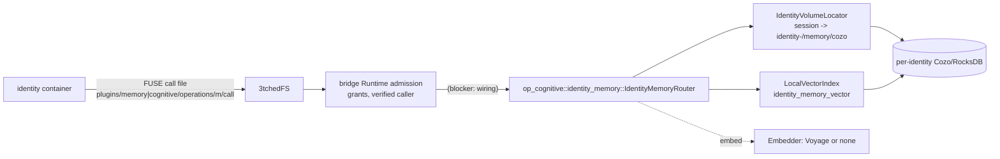

# Design Document — cognitive memory on the identity's own RocksDB

Spec id: `cognitive-memory-rocksdb`. Requirements: `requirements.md` 1–6.

## What exists today (origin/dev `ff85735`, read 2026-11-19)

The mapping did **not** exist. Findings:

| Memory | Code | Store today | Per identity? |
|---|---|---|---|
| Soul (typed) | `op-cognitive/src/soul_memory.rs` `SoulMemoryStore` | relations `soul_memories`, `agent_namespace_bindings` in the cognitive Cozo DB | no, one shared DB |
| Soul (tool) | `cognitive_tools.rs` `MemoryTool::op_ensure_soul` | namespace `soul:user-container:<ns>` + entry `_identity` in `memory_namespaces`/`memory_entries` | no, name prefix only |
| Namespace memory (`memory_*`) | `memory_store.rs` `CognitiveMemoryStore` via the `cognitive_memory` tool | `memory_namespaces {name => …}`, `memory_entries {namespace, key => …}` in the cognitive Cozo DB | no, `session/<session>/` prefix (`bind_memory`, `filter_namespaces`) |
| Memory vectors | `qdrant_shuttle.rs` (`upsert/search/delete_user_memory`), `voyage.rs` | Qdrant | no; Qdrant is down |
| `memory` plugin CRUD (10 methods) | `op-plugins/src/state_plugins/memory_methods.rs` `MemoryMethods` | one runtime document per sha256(principal, session) in the shared plugin-runtime Cozo store | no, document key only |

- The cognitive DB is opened by the bridge: `runtime_cognitive.rs`
  `CognitiveBackend::cognitive()` → `CognitiveServer::new_durable(COGNITIVE_DB_PATH
  or /var/lib/op-dbus/cognitive-memory.db)` → `CozoGraphShuttle::new_persistent`
  → `DbInstance::new("rocksdb", …)`. `new_durable` refuses to start without
  Qdrant (`server.rs:105`).
- The `memory` plugin is opened by the bridge with
  `MemoryMethods::from_documents(documents)` over the process-wide plugin-runtime
  store (`OP_PLUGIN_RUNTIME_COZO_PATH`, default `/var/lib/op-dbus/plugin-runtime-cozo`).
- FUSE path: container writes `plugins/{memory|cognitive}/operations/<m>/call`
  on its mount → 3tchedFS → bridge Runtime admission (grants checked) →
  `CognitiveBackend::dispatch` → the stores above.
- On antix1 (read-only look, 2026-11-19 02:30 EST): `/var/lib/op-dbus/identity-cozo`
  and `/var/lib/op-dbus/plugin-runtime-cozo` exist; **no**
  `cognitive-memory.db` exists, so there is no cognitive memory to migrate yet.
  No Incus containers and no `identity-*` volumes exist. `3tched-pool` is a
  btrfs pool at `/mnt/cozo-btrfs-500g/3tched-pool`.

### What "the RocksDB in the container" is

Candidates checked:

- **`/agent/user` (identity sled)** — the pool volume `identity-<session>`
  (`deploy/scripts/provision-container.sh`), read-only in the container,
  written by the host bridge (`runtime_sled_ledger.rs` writes `ledger/`). It
  is the identity's own durable storage and goes away with the identity. It
  has no database today.
- **cozo-ublk RocksDB** — the block backend under the 500 G pool device. It is
  a block store, not a key/value API for applications, and it is off-limits.
- **`cockpit-container` partition 2** ("sparse ext4, `chattr +C`, used for the
  Cozo/RocksDB store") — design only; nothing in code creates it.
- **`identity-cozo`** — the host-global identity directory Cozo, not per
  identity.

Decision (owner: "you decide"): the per-identity memory RocksDB is a Cozo
database (RocksDB engine) **inside the identity volume**, at
`<identity volume>/memory/cozo`, seen in the container as
`/agent/user/memory/cozo` (read-only; the container never opens it). This is
the only per-identity, identity-lifetime, writable-by-the-bridge location that
exists in code. When the cockpit partition-2 store lands, only the resolver's
root changes.

## Overview



Nothing new listens anywhere. The router is a library the bridge calls in
place of its current shared stores.

## Components and interfaces

All new code is in `crates/op-cognitive/src/identity_memory/`.

### `locator.rs` — `IdentityVolumeLocator` (Req 1.1–1.4, 1.6)

```rust
pub struct IdentityVolumeLocator { custom_root: PathBuf, project: String }
impl IdentityVolumeLocator {
    pub fn from_env() -> Self; // /var/lib/incus/storage-pools/$OP_CONTAINER_POOL/custom, project "default"
    pub fn new(custom_root: PathBuf, project: impl Into<String>) -> Self;
    pub fn locate(&self, session: &str) -> Result<IdentityVolume, IdentityMemoryError>;
}
pub struct IdentityVolume { session: String, root: PathBuf }
impl IdentityVolume { pub fn memory_store_path(&self) -> Result<PathBuf, IdentityMemoryError>; }
```

- Same contract as `runtime_sled_ledger::ledger_dir`: canonical UUID, volume
  dir `<custom_root>/<project>_identity-<session>`, `session_id` file must match.
- `memory_store_path` creates `memory/` with mode 0700 (`DirBuilderExt`), sets
  `FS_NOCOW_FL` with `FS_IOC_SETFLAGS` on the empty directory (best effort: a
  filesystem without the flag, e.g. tmpfs/ext4, reports `nocow: false`; never
  fatal), and returns `memory/cozo`.

### `stores.rs` — `IdentityMemoryStores` and `IdentityMemory` (Req 1.5–1.7, 2, 3)

```rust
pub struct IdentityMemory {
    pub session: String,
    pub shuttle: Arc<CozoGraphShuttle>,
    pub cognitive: Arc<CognitiveMemoryStore>,
    pub soul: Arc<SoulMemoryStore>,
    pub plugin: Arc<MemoryMethods>,
    pub vectors: Arc<LocalVectorIndex>,
}
pub struct IdentityMemoryStores { locator, open: Mutex<HashMap<String, Arc<IdentityMemory>>>, guards: Vec<Arc<CozoGraphShuttle>> }
impl IdentityMemoryStores {
    pub fn new(locator: IdentityVolumeLocator) -> Self;
    pub fn with_global_guard(self, global: Arc<CozoGraphShuttle>) -> Self; // Req 1.7
    pub fn get(&self, session: &str) -> Result<Arc<IdentityMemory>, IdentityMemoryError>;
}
```

- Opens with `CozoGraphShuttle::new_persistent_private` (0700, nofollow-held
  directory, existing seeded schema: `memory_namespaces`, `memory_entries`,
  `soul_memories`, `agent_namespace_bindings`, runtime documents).
- One handle per session per process (`Mutex<HashMap>`); a second session
  whose canonical store path equals an open one is refused (Req 1.6).
- Every handle is checked with `ensure_distinct_from` against registered
  global stores (Req 1.7).

### `vectors.rs` — `LocalVectorIndex` and `Embedder` (Req 4)

```rust
#[async_trait] pub trait Embedder: Send + Sync {
    fn model(&self) -> &str;
    async fn embed_document(&self, text: &str) -> anyhow::Result<Vec<f32>>;
    async fn embed_query(&self, text: &str) -> anyhow::Result<Vec<f32>>;
}
pub struct VoyageEmbedder(VoyageClient); // `VoyageClient::new()`; key read by voyage.rs, never logged
pub struct LocalVectorIndex { shuttle: Arc<CozoGraphShuttle>, scan_limit: usize }
impl LocalVectorIndex {
    pub fn upsert(&self, namespace, key, model, vector: &[f32], content_sha256) -> Result<()>;
    pub fn delete(&self, namespace, key) -> Result<bool>;
    pub fn search(&self, model, query: &[f32], namespaces: Option<&[String]>, limit) -> Result<Vec<VectorHit>>;
}
```

- Relation, created idempotently on first use in the per-identity DB only:
  `identity_memory_vector {namespace: String, key: String => model: String,
  dim: Int, vector: [Float], content_sha256: String, updated_at: String}`.
- Search is an exact scan with cosine similarity; per-identity sets are small.
  `scan_limit` (default 20 000, `OP_IDENTITY_MEMORY_VECTOR_SCAN_LIMIT`) makes an
  oversize set fail closed (Req 4.6). Rows with another model or dim are
  skipped (Req 4.5). Cozo HNSW is a later optimisation, not needed now.

### `router.rs` — `IdentityMemoryRouter` (Req 3, 4, 6)

```rust
pub struct VerifiedMemoryCaller { pub principal_id: String, pub session_id: String }
pub struct IdentityMemoryRouter { stores: Arc<IdentityMemoryStores>, embedder: Option<Arc<dyn Embedder>> }
impl IdentityMemoryRouter {
    pub fn supports(plugin: &str, method: &str) -> bool;
    pub async fn dispatch(&self, caller: &VerifiedMemoryCaller, plugin: &str, method: &str,
                          args: serde_json::Value) -> anyhow::Result<serde_json::Value>;
    pub fn soul(&self, caller: &VerifiedMemoryCaller) -> Result<Arc<SoulMemoryStore>>;
}
```

- `memory.*` → `IdentityMemory::plugin.dispatch(MemoryAccessContext{caller})`.
- `cognitive.memory_*` and `cognitive.cognitive_memory` → a per-identity
  `MemoryTool::new(identity.cognitive, None)` (unchanged tool logic, so
  `ensure_soul`, `_identity`, namespaces and entries behave as today), with
  vectors handled by the router:
  - `store` with `semantic: true`: run the tool with `semantic` removed, then
    embed + `vectors.upsert` (or `semantic_mirrored: false` with no embedder).
  - plain `store` over an existing key: delete its stale vector.
  - `delete`: tool delete, then `vectors.delete`.
  - `semantic_query`: embed query, `vectors.search` limited to the request's
    `namespace` when given, then `retrieve` each hit; `backend: "local"`.
- The store is selected **only** by `caller.session_id` (Req 6.1–6.2). The
  bridge's existing `bind_memory` (mode checks, `session/<s>/` names,
  `_identity` write protection) still runs before the router, so names and
  behaviour are unchanged.

### `migrate.rs` + `op-cog-admin identity-memory migrate` (Req 5)

```
op-cog-admin identity-memory migrate --session <uuid> --principal <id>
    [--cognitive-db /var/lib/op-dbus/cognitive-memory.db]
    [--runtime-db /var/lib/op-dbus/plugin-runtime-cozo]
    [--custom-root …] [--apply]
```

- Opens the sources with `new_persistent` (fails while the bridge holds the
  RocksDB lock — Req 5.5); dry run by default.
- Selects namespaces named `session/<s>/…` or `soul:user-container:session/<s>/…`,
  their entries, `soul_memories`/`agent_namespace_bindings` rows whose
  `agent_id` is the session, and the plugin document
  `owner_document_key(principal, session)` (made `pub` in `memory_methods.rs`).
- Writes with `:put` per row only when absent; identical rows are skipped;
  differing rows are reported as conflicts and left alone (Req 5.3). Reads the
  target back and compares counts (Req 5.4). Never writes the source.
- Qdrant vectors are not migrated (Qdrant is down); entries keep their
  content; re-embedding migrated `semantic` entries is a follow-up once an
  embedder is configured (re-storing an entry with `semantic: true` embeds it).

## Data models (key schema)

One RocksDB per identity = physical isolation. Cozo 0.7 stores every relation
in RocksDB's default column family under a per-relation key prefix; it
exposes no column-family API, so "prefix per relation" is the key schema:

| Relation (key prefix) | Key | Value |
|---|---|---|
| `soul_memories` | `agent_id` (= session id, or `chatbot`) | identity, personality, traits, version, created_at, updated_at |
| `agent_namespace_bindings` | `agent_id` | namespace, created_at, updated_at |
| `memory_namespaces` | `name` (`session/<s>/…`, `soul:user-container:…`) | id, kind, description, links, metadata, timestamps |
| `memory_entries` | `(namespace, key)` | id, value, tags, timestamps, expiry, access count |
| runtime documents (existing relation) | `owner_document_key(principal, session)` | the `memory` plugin document |
| `identity_memory_vector` (new) | `(namespace, key)` | model, dim, vector, content_sha256, updated_at |

On disk: `<custom_root>/default_identity-<session>/memory/cozo/` (0700, nocow).

## Error handling

`IdentityMemoryError`: `InvalidSession`, `NoIdentityVolume`,
`SessionMismatch`, `StoreConflict`, `Open(..)`. All fail closed; none falls
back to a shared store. Semantic errors say "semantic memory unavailable"
explicitly. Secrets (Voyage key) are read only by `voyage.rs` and never
logged.

## Security

- Grants are unchanged and stay at the bridge's Runtime admission; this crate
  never decides authorization. Memory is never `public`
  (`op-mcp-door/src/classify.rs::public_forbidden`: `memory_*` and plugin
  `memory`). Wonder's shared FUSE capability check will add a second gate.
- Physical isolation replaces prefix filtering: a bug in name binding can no
  longer reach another identity's rows.
- Only the host bridge writes the identity volume; the container sees it
  read-only.

## Testing strategy

`cargo test -p op-cognitive --lib identity_memory` with temp dirs as the
custom root (no Incus, no pool, no Qdrant, no network):

- locator: non-canonical UUID refused; missing volume refused; `session_id`
  mismatch refused; 0700 dir created.
- stores: same handle reused; persistence across drop/reopen; two sessions
  isolated (souls, namespaces, plugin docs); global-guard refusal.
- vectors: upsert/search/delete; model/dim skip; scan limit fails closed.
- router: every `memory_*` and plugin method; semantic store/query with a
  deterministic fake embedder; no-embedder behaviour; argument session ignored.
- migrate: dry run writes nothing; apply copies only the session's rows;
  identical skip; conflict reported; counts verified; source unchanged.

## Blockers (owner decisions)

1. **Bridge wiring (bridge code).** `runtime_cognitive.rs` must call
   `IdentityMemoryRouter::dispatch` for `memory.*` and the seven
   `cognitive.memory_*` methods (after `bind_memory`), instead of
   `self.memory.dispatch` and the shared `cognitive_memory` tool, and must
   stop requiring Qdrant for memory. Needs Jeremy/Muse approval, coordinated
   with Wonder's FUSE contracts.
2. **Running the migration on antix1** (live data). Today only the plugin
   runtime store has data; there is no cognitive DB. Needs the bridge stopped
   (it is) and an explicit go.
3. **Cockpit partition-2 store.** If the owner wants memory on the planned
   p2 ext4 nocow store instead of the identity volume, only the locator root
   changes.

## Open questions

- Should the `chatbot` soul (`soul:chatbot`, no container) live in the
  control-plane chatbot's own identity volume? Assumed yes (it has one when
  provisioned with `provision-container.sh`).
- Embedder: Voyage (`voyage.rs`, key present on the host) is the only
  implementation; a local model can implement `Embedder` later.
