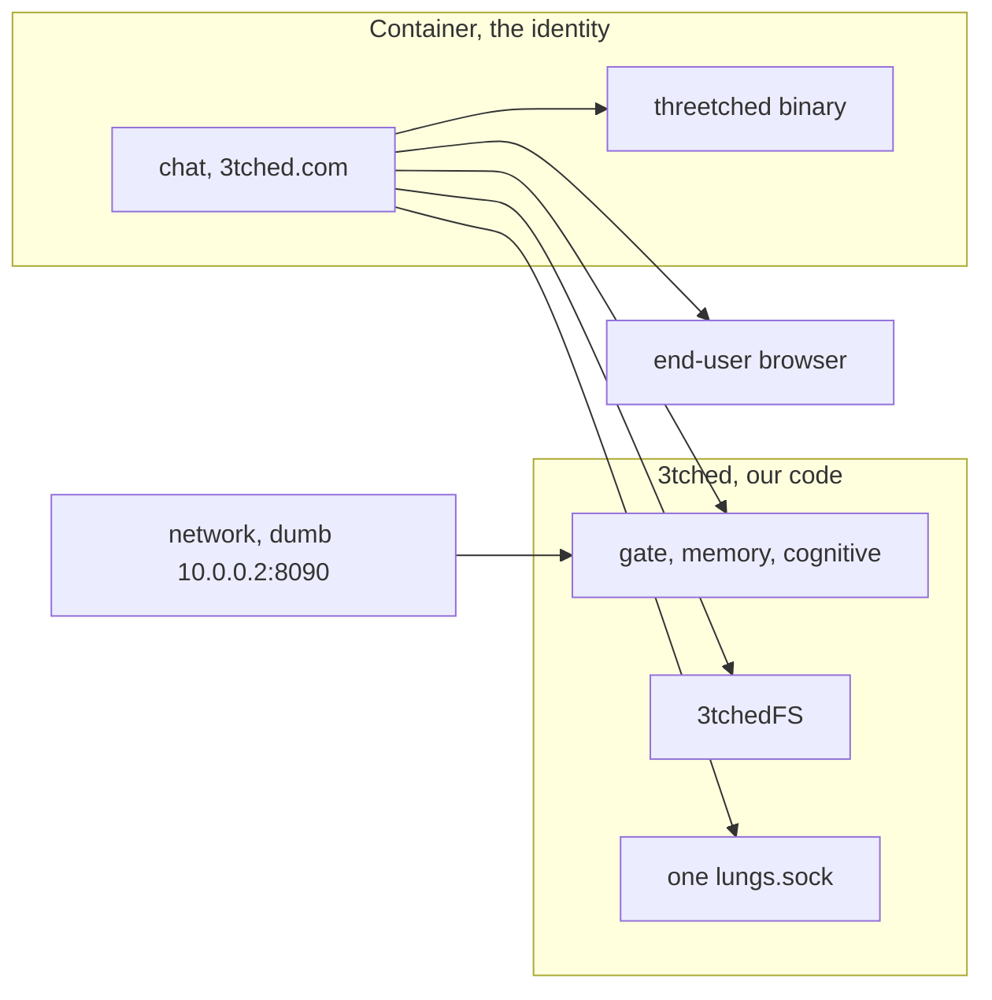

# Design — Container chat

Status: draft. Authorizes no file move, container start, or deploy. Chat is
the part that changes. The 3tched base and the network host bridge stay
where they are.

## Overview

`/srv/git/3tched.com` is the container repo. It owns all of chat, the range
of services, and the threetched install. threetched is the upstream ZeroClaw
binary, renamed, with no patches. It is binary-backed. It is not our code
and not 3tchedFS.

Chat used to run on the host. It never passed the gate there, because the
identity is the container. Chat moves into the container. The gate, which
3tched evaluates, can then pass.

Host port 8080 is the same kind of miss. A host listener is not the
container identity, so it must not pass. That is what prompted pass-through
rendering. The container passes the UI spec. The end user's browser renders
it, on the user's machine. The container does not run a desktop. How the
bytes leave the container is still open.

## Architecture

Install is three repos. The container repo installs on the 3tched base.
Runtime crosses: chat calls 3tched for the gate and the filesystem, and
calls the binary for models, providers, and skills.

## Components and interfaces

### Chat inside the container

Chat is the service range, not a frontend peeled off a host backend. The
process that must pass the gate runs in the container. A host Chat_Route,
including the 2026-11-09 placement in `identity-chat-interface`, is not this
design.

### threetched

The binary supplies models, providers, and skills. Config may keep the
ZeroClaw name where the upstream binary requires it. Our repo does not
patch the binary. 3tched does not grow a second implementation of it.

### Pass-through render

The container passes the spec as the container identity. The browser draws
pixels. No host page on 8080. No container IP for the user to type. No
Wayland and no wayvnc. Delivery, including anything discussed around IPFS,
stays unspecified until the owner decides it.

### Shared surfaces

| Surface | At install | At runtime |
| --- | --- | --- |
| Chat source | 3tched.com | Runs in the container |
| threetched binary | Container install on the 3tched base | Models, providers, skills |
| Gate, memory, cognitive | 3tched | Chat calls across |
| 3tchedFS | 3tched | Container disk I/O, identity on the mount |
| lungs.sock | 3tched, one socket | Container connects |
| Port 8080 | Not installed as a pass | Must not pass the gate |
| `10.0.0.2:8090` | Network, dumb | 3tched bridge binds it later |

## Data models

No new identity store. The container is the identity the gate already
knows. Chat does not invent a second identity on the host. Model choice is
the binary's, not a new table in 3tched.

## Error handling

No container means chat fails closed. It does not fall back to host chat or
to port 8080. A missing threetched binary fails the model call and does not
get reimplemented inside 3tched. An undecided render transport does not
justify binding 8080.

## Testing strategy

Prove the caller that passes the gate is inside the container. Prove a host
caller and a host :8080 listener do not pass. Prove model selection goes to
the threetched binary and the gate stays a call into 3tched. Do not start
the stopped container and do not deploy as part of this draft.
