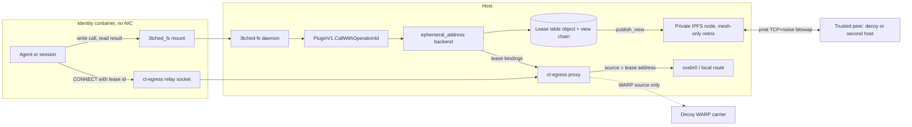

# Design — Ephemeral IP addresses over the 3tchedFS IPFS exchange

Status: SPECIFICATION ONLY. This design authorizes no code, seal, deploy,
network change, or service restart. Requirements: `requirements.md`
Requirements 1–9.

Spec id: `ephemeral-ip-ipfs`

Every statement below is marked as one of:

- **Found** — read in `origin/dev` at `6612837` on 2026-11-18.
- **Assumed** — a proposal or an unverified fact about the host or a provider.

## Overview

An identity container asks for an ephemeral address by writing JSON to a
`call` file on its own 3tchedFS mount. The host-side lease plugin picks an
address from an address source, makes a fresh Ed25519 keypair and peer ID,
and returns the lease on the same file handle. The address is held on the
host, never in the container. Egress that names the lease leaves from that
address on the one hop that already exists. The lease table is a typed
3tchedFS object. Each change becomes a new view, and the existing private
IPFS exchange publishes it as raw BLAKE3 blocks to trusted peers.

IPFS does not allocate or carry addresses here. It does two things it is
good at: it names each lease with a libp2p peer ID, and it replicates the
lease table as verified, content-addressed blocks inside a private swarm.
Allocation and enforcement stay on the host.

### Decision: IPFS is the publication and naming layer, not the data plane

**Context:** OD-127 lists three address sources: (1) a routed IPv6 prefix
with a random source per connection, (2) a WARP registration per session,
(3) "IPFS/libp2p peer identity with relay egress". The owner pointed at the
IPFS support built into 3tchedFS.

**Found:** that support (`crates/_3tched-fs/src/ipfs.rs`, feature `ipfs` in
`crates/_3tched-fs/Cargo.toml`) is a private exchange of content-addressed
views. It builds rust-ipfs 0.16 with `tcp`, `noise`, `ed25519`, `pnet` only,
runs identify, ping and bitswap, and has no DHT, pubsub, mDNS, relay, autonat
or upnp. It is CLI-only (`3tched-fs ipfs cids|publish|fetch` in
`crates/_3tched-fs/src/main.rs`), not a FUSE path. A node lives for one
command, or until signalled with `publish --serve`. The comment says the host
runs it inside "a throwaway mesh-only network namespace".

**Options considered:**

1. Carry egress over libp2p with a relay (OD-127 option 3 read literally).
   Cons: needs the relay behaviour that the build deliberately excludes, and
   it is a tunnel over TCP. It would nest under WARP or the uplink and cut
   the MTU. Rejected by the no-nested-tunnels rule.
2. Use IPNS for lease names. Cons: IPNS needs a DHT or pubsub. Both are
   deliberately excluded. Rejected for phase 1.
3. Keep allocation on the host, name each lease with a peer ID, and publish
   the lease table as a 3tchedFS view chain over the existing exchange.

**Decision:** Option 3.

**Rationale:** It uses the exchange as built. It adds no transport, no
public participation and no encapsulation. The view chain (`ViewManifest`
`parent_view` in `crates/_3tched-fs/src/store.rs`) already gives an ordered,
verified history.

### Decision: The container still has no IP

**Found:** standalone-network design, "Addresses live on the OVS bridge":
"The container has no IP." `op-tunnel-mux` (`crates/op-tunnel-mux/src/lib.rs`)
says NIC-less egress for identity containers is ct-egress. The ct-egress
proxy (`deploy/runit/ct-egress-proxy/run`) is host Xray on the Unix socket
`/run/ct-egress/proxy.sock`, relayed into each `ID-*` container by
`ct-egress-relay-<instance>` (`deploy/provisioning/30-provision-container.sh`).

**Decision:** An ephemeral address is an egress source held by the host on
behalf of a lease. The container never sees an interface, a MAC or a route.

### Decision: No macvlan

**Found:** `incus_device.rs` and `lxd.rs` can describe a macvlan NIC, and
the release kernel config has `CONFIG_MACVLAN=m`. No deploy file uses it.

**Decision:** Do not use macvlan or ipvlan. Either gives the container a NIC
and an address, which the standalone-network spec forbids.
**Assumed:** the hosting provider would also drop frames from unknown MACs
on the uplink, as most VPS providers do. This is not verified for netcup.

## Architecture



Control is file I/O. Bytes go through the egress socket. Publication goes
through the private swarm. Those three never cross.

## Components and Interfaces

### Lease plugin `ephemeral_address` (Assumed name)

- A sealed state plugin in `crates/op-plugins/src/state_plugins/`, modelled
  on `tunnel.rs` (**Found**: `TunnelState`, `SetOpenInput`,
  `CloseConnectionsOutput`, schemars with `x-oscal-subid` and
  `x-oscal-category`).
- Proposed subid: `sch.software.plugin.ephemeral-address.schema@v1`, category
  `network`, following `docs/subid-taxonomy.md`. Mutation subids carry
  `actor_id` and `capability_id` per that file's rules.
- Methods: `lease`, `renew`, `release`, `resolve`, `status`.
- The backend lives in the host bridge, like `runtime_tunnel.rs` (**Found**:
  `supports(plugin, method)`, `OnceLock<Owner>`). That is one registration
  line plus one module, and it waits for the bridge-over-FUSE work.

### FUSE surface (Found contract, Assumed paths)

**Found:** `Namespace` in `crates/_3tched-fs/src/namespace.rs` builds
`plugins/<plugin>/{object.blob.json, schema.json, value.json,
capabilities.json, object.hash, data/, operations/<method>/}`, with
`input.schema.json`, `output.schema.json`, `metadata.json` per method and a
`call` file (`NodeKind::CallFile`) on lungs mounts. A complete JSON write is
submitted on flush or release and the result is read back on the same handle
(`readable_bytes` in `crates/_3tched-fs/src/fuse_fs.rs`). Dispatch goes
through `RegisterCurrentSender` then `CallWithOperationId`
(`crates/_3tched-fs/src/dispatch.rs`).

**Assumed** paths for this feature, on the `3tched` surface only:

```text
<mount>/plugins/ephemeral_address/
  schema.json
  value.json                       # live: this identity's leases only
  operations/lease/call            # write LeaseRequest, read Lease
  operations/renew/call            # write {lease_id, ttl_secs}
  operations/release/call          # write {lease_id}
  operations/resolve/call          # write {address} or {peer_id}
  operations/status/call           # pool status, own lease count
<mount>/operations/ephemeral_address -> ../plugins/ephemeral_address/operations
```

Example, inside a container:

```sh
exec 3<>"$M/plugins/ephemeral_address/operations/lease/call"
printf '%s' '{"scope":"connection","ttl_secs":300,"family":"ipv6"}' >&3
# close-on-flush submits; read the Lease JSON back from fd 3
```

**Assumed:** shell `exec 3<>` gives the one-handle write-then-read the
`CallFile` contract needs. Tooling that closes after writing loses the
result and must call `status` instead. See Open question 7.

### Address sources

1. **Routed IPv6 prefix (preferred).** **Assumed:** the netcup vServer has
   a routed IPv6 /64 available in the CCP. `WISHLIST.md` OD-127 (**Found**)
   says "Host currently has no routed IPv6 prefix, only WARP /128s". So this
   source is blocked until the owner turns on or confirms a prefix. The
   design uses the Linux AnyIP pattern: one local route for the prefix
   (`ip -6 route add local <prefix>/64 dev lo`) plus `IP_FREEBIND`, so each
   lease's address can be bound without adding an address per lease. That
   keeps the `ovsbr0` alias set unchanged (`docs/network-topology.md`:
   "exactly three service IPv4 aliases"). The uplink path is the native
   1500-byte path with no added header.
2. **WARP address on the existing decoy carrier (fallback).** **Found:** the
   decoy's marked WARP route (`crates/op-network/src/wgcf_egress.rs`, mark
   `0x51820`, table `51820`, `wgcf-ingress`) and the decoy MSS clamp
   (`deploy/decoy-warp-ssh/README.md`). A lease takes an address already held
   on that carrier. It does not register a new WARP device per lease.
   **Assumed:** per-session WARP registration (OD-127 option 2) is a later
   phase, because each registration is a new WireGuard peer and may be
   rate-limited by Cloudflare. WARP addresses are assigned by Cloudflare, so
   "never reused" can only be best effort on this source.

The host public IPv4 `188.68.58.237` is never an address source
(Requirement 3.5).

### Egress binding

**Found:** ct-egress today uses Xray `freedom` with `domainStrategy:
UseIPv4`, and `ct_egress.nft` rejects all IPv6 for the `ct-egress` user
(`meta nfproto ipv6 reject`).

**Assumed** change, later phase: the lease plugin writes active bindings,
lease id to address and family, to a root-owned runtime file that the egress
service reads (proposed `/run/ct-egress/leases.json`). A connection that
names a lease (proposed: a `Proxy-Authorization`-style header or a
`lease_id` first frame) gets `sendThrough` set to the lease address. The
egress service checks the owner against the relay instance the connection
came through. The nft table gains an IPv6 set with the same classes as
`blocked4`, instead of a blanket IPv6 reject, and only for lease-bound
traffic. Without a lease id, behavior is unchanged (Requirement 7.5).

OD-127 names `op-tunnel-mux` `Open` on `/run/opdbus/tunnel/egress/tunnel.sock`
as a path. **Found:** `crates/op-tunnel-mux/proto/tunnel.proto` has only
`Accept` (inbound) and says egress is ct-egress, not this service. This design
uses ct-egress and leaves the mux inbound-only. See Open question 3.

### Private IPFS publication

- Reuses `ipfs::start`, `ipfs::publish_view`, `ipfs::fetch_view`,
  `ipfs::cid_for`, `ipfs::ensure_enabled`, and `ipfs::read_swarm_key`
  unchanged (**Found**).
- The lease table is one typed object in the 3tchedFS `ObjectStore`, whose
  default root is `/dev/shm/3tchedfs` (`DEFAULT_STORE_DIR`, **Found**). Each
  change writes a new object and a new `ViewManifest` with
  `parent_view = previous`.
- A long-lived publisher is needed. **Assumed:** a runit service
  `ephemeral-address-publish` runs `3tched-fs ipfs publish <view> --serve`
  in the same mesh-only network namespace, restarted with the new view id on
  each generation. It has its own `log/run` using `_runit-log` and
  `/var/log/runit/<service>`, like the host's other services.
- Trusted peers learn the current view id from the host's lease plugin
  `status` output over their existing admitted D-Bus path (for the decoy:
  `org.opdbus.v1.DecoyNative`, `crates/op-grpc-bridge/src/decoy_network.rs`).
  There is no IPNS. The view chain replaces it.

### Identity and trust (Found)

- Owner: `MountIdentity` (`HostSession { session }`, `GuestKernel`,
  `Credential`, `Unbound`) on the mount. The bridge resolves it to one
  `ContainerIdentitySled` (`session_id`, `active`, `expires_at`,
  `sealed_id`, `principal_kind`).
- SID1 (`crates/op-identity/src/sealed_id.rs`) stays the session identity.
  The lease never carries it.
- OIA1 (`crates/op-identity/src/oracle_assertion.rs`) is Ed25519-signed by
  the decoy and carries `issued_at`, `expires_at`, and the human's tunnel
  `ip_addr`. It is checked against `/etc/op-dbus/decoy-trust.json`
  (`DecoyTrustStore`). A lease under a human session never outlives the
  OIA1 `expires_at` (Requirement 2.5).
- The ephemeral peer ID is an attribution handle only. It is not a trust
  root. Trusted peers are the holders of the pnet swarm key. Each block is
  verified twice: rust-ipfs against its CID, and the store against content
  hash and typed schema.

## Data Models

All Assumed. Shapes follow the `tunnel.rs` style (`deny_unknown_fields`,
schemars).

```rust
pub enum LeaseScope { Connection, Session, Agent }
pub enum AddressFamily { Ipv6, Ipv4 }
pub enum AddressSource { RoutedPrefix, WarpCarrier }
pub enum LeaseState { Active, Released, Expired, Revoked }

pub struct LeaseRequest {
    pub scope: LeaseScope,
    pub ttl_secs: u32,                 // capped, Requirement 4.1
    pub family: Option<AddressFamily>, // None = prefer Ipv6
    pub purpose: Option<String>,       // free text, never published
}

pub struct Lease {
    pub lease_id: String,              // uuid v4
    pub address: String,               // e.g. "2001:db8::9c1e:…/128" (doc prefix)
    pub family: AddressFamily,
    pub source: AddressSource,
    pub peer_id: String,               // libp2p, from fresh Ed25519
    pub scope: LeaseScope,
    pub state: LeaseState,
    pub issued_at: i64,
    pub expires_at: i64,
    pub renewals: u32,
    pub published: bool,               // Requirement 5.3
    pub record_cid: Option<String>,    // bafkr4… raw blake3
    pub lease_view: Option<String>,    // 64-hex view id
}

/// Published form. No session id, SID1, OIA1, uid, or container name.
pub struct LeaseRecord {
    pub lease_id: String,
    pub address: String,
    pub peer_id: String,
    pub owner_tag: String, // blake3(session_id || per-host salt), hex
    pub state: LeaseState,
    pub issued_at: i64,
    pub expires_at: i64,
}

pub struct EphemeralAddressState {
    pub sources: Vec<SourceStatus>,    // available, free estimate
    pub leases: Vec<Lease>,            // caller's own; all for host root
    pub generation: u64,
    pub lease_view: Option<String>,
    pub ipfs_enabled: bool,
}
```

Tombstones: a host-local set of every address ever leased, kept with the
lease table history and not published. For a random 64-bit interface
identifier, a collision is rare enough that checking the set is
cheap insurance.

## Error Handling

| Condition | Result | Requirement |
| --- | --- | --- |
| Mount is `Unbound` or has no lungs | Refuse, no `call` file or `Unbound` error | 1.5, 2.2 |
| Sled inactive or expired | `owner_inactive` | 2.4 |
| Schema invalid | Validation error on the same handle | 1.4 |
| No address source available | `no_address_source`; never the host public IPv4 | 3.5 |
| Owner over lease limit | `lease_limit` | 3.7 |
| Renew after expiry | `expired` | 4.4 |
| Egress with someone else's or a dead lease | Connection refused, no fallback address | 7.2 |
| IPFS switch absent or swarm key mode wrong | Lease issued, `published: false`; publisher refuses to start (`ensure_enabled`, `read_swarm_key`) | 5.3 |
| Fetched view fails CID or schema check | Discard, keep last verified view | 5.7 |
| Publisher crash | Leases keep working locally; runit restarts the publisher with the current view | 5.3 |
| Bridge or 3tched-fs down | No new leases. **Assumed:** the egress service drops all lease bindings when the binding file is older than the max TTL, so leases fail closed | 4.2 |
| Host reboot | `/dev/shm` and `/run` are lost, so every lease ends. Tombstones must persist outside `/dev/shm` (Open question 5) | 4.7, 4.8 |
| Routed prefix withdrawn by the provider | Source reports unavailable; active IPv6 leases are revoked | 3.5 |

## Testing Strategy

No test runs from this spec. Tests run only after an explicit owner request,
one cargo process at a time, per `.kiro/steering/subagent-cargo.md`.

- Unit, lease plugin: TTL caps take the earliest of request, max, sled and
  OIA1. Renew keeps address and peer ID. Expired renew refused. Tombstones
  stop reuse.
- Unit, allocation: random interface identifiers stay inside the prefix; the
  public IPv4 is never returned; no source means a typed error.
- Unit, record: `LeaseRecord` serialization contains no `session_id`, SID1,
  OIA1, uid or container name.
- Namespace: a lungs mount on `3tched` shows the five `call` files; a view
  mount shows none; a `threetched` mount has no `ephemeral_address`.
- IPFS: two in-memory private nodes with the same test swarm key publish and
  fetch a lease view; a tampered block is rejected (extends the existing
  `block_verifies_against_blake3_cid` test pattern).
- Egress, isolated netns fixture (pattern: `deploy/decoy-warp-ssh/test-namespace.sh`):
  a lease-bound connection leaves from the lease address; an unowned lease is
  refused; private and host-local IPv6 destinations are rejected.
- Negative network gate: realizing a lease adds no interface, no tunnel and
  no MTU change on `eth0`, `ovsbr0`, `wgcf-ingress` or `rtly-lungs`.

## Interaction with bridge-over-FUSE

Muse is moving `op-grpc-bridge` traffic onto FUSE I/O. This spec depends on
that work and does not change it.

- Lease methods are ordinary sealed methods, so they ride whatever call-file
  path the bridge ends up exposing. No lease-specific transport.
- Egress bytes never enter FUSE or plugin state, the same rule as the
  `tunnel` plugin ("bytes never enter state").
- If the bridge-over-FUSE work also exposes egress as files (a connect or
  stream file), the lease id can become a property of that file handle and
  the egress header goes away. See Open question 4.

## Out of scope

- Inbound on ephemeral addresses.
- Public IPFS, public DHT, IPNS and gateways.
- Obfuscation cover for WARP.
- Changes to `op-grpc-bridge`, the 3tchedFS engine, `op-tunnel-mux` or the
  overlay work in progress.

## Open questions

1. **Address source.** Does the netcup vServer have, or can it get, a routed
   IPv6 /64? Without it, phase 2 only has the WARP source, which cannot
   promise "never reused".
2. **"Ephemeral IP" meaning.** Is the goal a fresh source address per
   connection or session (this design), or a reachable overlay name per agent
   (the peer ID alone, no underlay address)? The design supports both, but
   phase order changes.
3. **Egress path.** OD-127 names `op-tunnel-mux` `Open` on
   `/run/opdbus/tunnel/egress/tunnel.sock`. The current proto has no `Open`
   and says egress is ct-egress. Which one owns lease egress?
4. **Bridge-over-FUSE shape.** Will Muse's bridge expose egress as FUSE
   files? If so, the lease id should live on the handle, not a header.
5. **Tombstone persistence.** Where should the never-reuse set live across
   reboots: the Cozo store, a btrfs subvolume, or the identity sled history?
6. **Publisher lifetime.** The exchange is one command per node today. Is a
   long-lived `publish --serve` service in the mesh-only namespace
   acceptable, and who creates that namespace? It was not found in the repo.
7. **Call-file ergonomics.** Is write-then-read on one handle acceptable for
   agents, or should `lease` also write the result to `data/leases/<id>`?
8. **OIA1 `ip_addr`.** OIA1 binds the human's tunnel address, while
   standalone-network Requirement 2.6 forbids binding a proof to a host
   address. Should leases ignore that field entirely?
9. **Alias rule.** Is a local route for a whole prefix acceptable under the
   "exactly three aliases on `ovsbr0`" rule, or must the prefix sit
   somewhere else?
10. **Peers.** Which trusted peers hold the swarm key: the decoy only, or
    also a second host?
