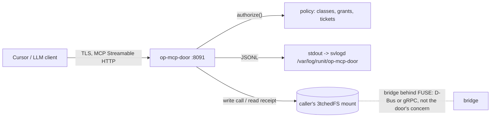

# Design — `op-mcp-door`

Spec id: `mcp-door-adapter`. Requirements: `requirements.md` 1–12.
Grounded in `origin/dev` at `c65d57e` (2026-11-19). Labels: **Found** = read
in code or on antix1; **Assumed** = a working choice to be confirmed.

## Interim pieces (Wonder's shared FUSE contracts)

Wonder (Muse) is specifying identity binding, capability checks, toolset
projection and auditable receipts as shared FUSE contracts in the FUSE spec,
for MCP and the other adapters to consume. Until they land, `grants`
(grant store and tickets), `toolsets` (file and generator), `policy`
(`authorize()`) and `audit` are interim. When the contracts land, the door
switches to them; it keeps only TLS, the OIA1 → principal/mount mapping and the
MCP protocol (endpoints, sessions, meta-tools, 50-tool cap). No FUSE or bridge
code is changed by this spec.

## Owner corrections (2026-11-19), which override the audit

1. **All calls go through FUSE.** The door talks only to 3tchedFS mounts.
   It never opens gRPC, D-Bus or any bridge socket. Behind a FUSE call the
   bridge may use D-Bus or gRPC; that is its business, not the door's.
2. **Lungs is out of the path.** The door does not reference or depend on the
   lungs socket. A missing lungs socket is not a door blocker; at worst a call
   returns the mount's own diagnostic or an unknown outcome.
3. **The door is still needed for external connections**, and the MCP server
   lives there: external clients (Cursor, LLMs) connect through the door;
   internal traffic stays on FUSE.
4. **TLS is mandatory.** No plaintext listener exists, and no switch can add
   one (Requirement 1).
5. **Bridge FUSE mounts.** The owner reports the bridge now has its own FUSE
   mounts. On `origin/dev` `c65d57e` the only mount layout in code and on the
   host is the 3tchedFS layout (**Found**): `/run/mounts/3tchedFS` (our
   surface, `mount_identity {"kind":"guest_kernel"}`, 72 plugins) and
   `/run/mounts/threetched`, fstab type `fuse.3tchedFS`
   (`deploy/host-fuse/3tchedfs.fstab`). No separate bridge mount path was
   found. The door therefore takes its mounts from configuration (`mounts.json`,
   below), so a bridge-owned mount with the same `3tchedfs/1` call-file
   contract is added by configuration, not code.

The audit's §5.2 "reuse `_3tched-fs/src/mcp.rs` as a library" is not
possible without editing 3tchedFS: `mounted` and `mcp` are private modules of
`_3tched-fs` (`crates/_3tched-fs/src/lib.rs`). The door re-implements the
client side of the call-file contract (below) and does not depend on the
`_3tched-fs` crate. The audit's "`--expected-mode` flag" gap does not affect
the door: it declares the expected mode per mount itself.

## Overview



## Components and interfaces

Crate `crates/op-mcp-door` (workspace member), binary `op-mcp-door`.

| Module | Responsibility | Req |
|---|---|---|
| `config` | Env-driven config; TLS paths; listen address; file paths | 1.2, 1.6, 1.8 |
| `catalog` | Scan `plugins/*/operations/*`, build `Tool`s, names, annotations | 4 |
| `classify` | Class taxonomy, public allow-list, hard deny-list | 7.1–7.3 |
| `toolsets` | Tiers, toolset generation, file format, selection, 50 cap | 5, 6.2–6.4 |
| `grants` | Durable document reader, ephemeral grant store, tickets | 9, 10 |
| `policy` | The single `authorize()` | 8 |
| `fusecall` | Call-file client: mount check, one write, fsync, receipt | 3 |
| `audit` | Append-only JSONL records | 11 |
| `identity` | OIA1 verification, principal and mount mapping, nonce/session binding | 12 |
| `mcp` | JSON-RPC methods, endpoints, meta-tools, sessions | 2, 6 |
| `server` | axum router, TLS acceptor (rustls), plaintext refusal | 1, 2 |

### Call-file contract (Found: `crates/_3tched-fs/src/mounted.rs`)

- Mount root carries `.3tchedfs.json` with `format == "3tchedfs/1"`,
  `workspace_id == null`, a canonical `instance_uuid`, and `mount_identity`
  (`{"kind":"host_session","session":…}`, `guest_kernel`, `credential`;
  `unbound` refuses calls). The door compares `mount_identity` with the mode
  configured for that mount (Req 3.3).
- Operation directory: `plugins/<enc(plugin)>/operations/<enc(method)>/`
  with `metadata.json` (`MethodDecl`: `args`, `returns`, `side_effect`,
  `idempotent`, `required_capability`, `subid`, `description`),
  `input.schema.json`, `output.schema.json`, `call` (0600). `enc` is
  `namespace::encode_component` (`[A-Za-z0-9._-]` kept, other bytes `%XX`,
  `.value.json` → `%2Evalue.json`), re-implemented and tested in the door.
- Call: open `call` read-write with `O_NOFOLLOW|O_CLOEXEC`; one `write_all`
  of the canonical JSON arguments (≤ 1 MiB); `fsync` executes the call; seek
  to 0; read the receipt (≤ 16 MiB) from the same handle.
- Receipt: either a diagnostic `{"plugin","method","stage","error"}` or
  `{"plugin_id","method","subid","required_capability","side_effect",
  "idempotent","result":{success, operation_id, outcome, event_id, …}}`.
  Every attribution field must equal the mounted metadata (Req 3.6).
- The door checks the mount root's device id and `.3tchedfs.json` before and
  after the call; any change → unknown outcome, never a retry (Req 3.4).
- File I/O runs on `spawn_blocking`. The opener is a trait (`CallOpener`), so
  tests drive the exact protocol against a tempdir tree with a fake engine
  that produces receipts on `fsync`.

### Catalog and naming (Req 4)

- Only `operations/*` are scanned. The `threetched` surface's JSON-Schema
  `schema.json` (audit §2) is never parsed for methods.
- Tool name: hot tools keep the bare method name (resolved in plugin order
  `cognitive`, `notebooklm`, then any). Others are `<plugin>__<method>`,
  sanitized to `[A-Za-z0-9_-]`; names over 64 characters become the first 55
  characters + `_` + 8 hex of SHA-256 of the full name.
- Collisions after sanitizing get the hash suffix too.
- `inputSchema` is the metadata `args`, byte-identical to `input.schema.json`
  (checked on the live mount). Only `metadata.json` is read per operation,
  with a 64 KiB first read and 8 scan threads: every mounted read is a FUSE
  request, and a live scan of ~1,600 operations takes about 3 minutes.
  The method id is the decoded directory name (the `schema.methods` key);
  metadata `name` can differ (D-Bus member names such as `AttachDevice`).
  Mutations get an extra optional
  boolean `confirm_side_effects`, stripped before validation and the write.

### Classes (Req 7)

Order of evaluation (first match wins):

1. `secret`: method matches `auth_tokens|refresh_auth|setup_auth|reauth|
   save_auth|adc|credential|secret|password|private_key`, or plugin `keypair`.
2. `shell`: any `command`/`cmd`/`script` string argument, or method matches
   `bash|shell`.
3. `admin`: plugins `login1 users human_principal identity_sled keyring
   elevation polkit sudo`, or method matches `reboot|poweroff|shutdown|kill_|
   grant|revoke|register_key`, or `lxd` methods starting `auth`.
4. `exec`: method matches `exec|run|spawn|execute|validate` with an `agent_`
   prefix or plugin `incus oci cron persona workflows`, `workflow_run`,
   `cozo.run_query`.
5. `network` (mutation in `net rtnetlink openflow* ovsdb_bridge rovs_commands
   wireguard wg_opdbus wgcf xray dnsresolver privacy_routes routing_decision
   proxy_server tunnel`), `storage` (mutation in `btrfs incus lxd fuse oci`).
6. `invoke`: `cognitive`/`notebooklm` reads that think or query
   (`sequential_thinking context_manager specialist gemini_query *_pro
   code_review_orchestrator notebook_query cross_notebook_query workflow_query`
   and `agent_*_{advise,analyze,consult,explain,help,recommend,review}`).
7. `write` for any other mutation; `read` for any other read.
8. `public` replaces `read` only if the tool is on the allow-list
   (`cognitive.schema_read`, `cognitive.oscal_subids`) **and** is read,
   idempotent and passes the hard deny-list (memory tools, `memory` plugin,
   `notebooklm`, any `command` argument, any non-`read` base class).

Meta-tools (`list_toolsets`, `search_tools`, `describe_tool`, `load_toolset`)
are public; `call_tool` is public to list, and each target is authorized.

### Toolsets (Req 5, 6)

**Interim source.** Tool grouping is being built FUSE-side by Wonder (Muse)
as a general, reusable mechanism. This file and `toolsets generate` are an
interim source only: the door consumes toolsets through `Toolsets`
(`load_or_generate`/`get`/`core_keys`) and does not grow its own grouping
logic. When Wonder's mechanism lands, swap the source behind `Toolsets` for
it and retire the generator; the 50-tool cap, `authorize()` and the meta-tools
stay unchanged.

File (**Assumed** path `/etc/opdbus/mcp-toolsets.json`, env
`OP_MCP_TOOLSETS_PATH`), written by `op-mcp-door toolsets generate`:

```json
{"format":"op-mcp-door/toolsets@1","catalog_view_id":"…","cap":50,
 "tiers":{"memory":["memory_store",…],"hot":["code_search",…]},
 "toolsets":[{"id":"coding","title":"…","temperature":"warm",
              "tools":["cognitive.code_search",…]}]}
```

Members are `<plugin>.<method>` (stable), mapped to tool names at load.
Domain sets follow audit §5.3 (`memory`, `memory_store`, `coding`,
`reasoning`, `schema`, `notebooklm_core`, `notebooklm_admin`, `knowledge`,
`storage`, `lxd`, `fuse`, `network`, `chat`, `system`, `identity`, plus one
`agents:<persona>` per persona and a `plugin:<id>` set per plugin so every
tool is in at least one set). A set larger than 50 can never be loaded on
`/mcp/full`; it is still reachable through `/mcp/loader`.

`core` = tier 1 + tier 2 + `list_toolsets` + `load_toolset` (19 when all
present). Selection is the union of path, query and header sets; the
authorized size of `core ∪ selection` must be ≤ 50 (Req 6.3).

### Policy: the single `authorize()` (Req 8)

```rust
pub fn authorize(&self, caller: &Caller, tool: &Tool, purpose: Purpose<'_>) -> Decision
pub enum Purpose<'a> { Discover, Call { args: &'a Value, ticket: Option<&'a str> } }
pub enum Decision { Allow(Basis), Deny(DenyReason) }
pub enum Basis { Public, Durable { capability: String }, Ephemeral { grant_id: String } }
```

1. `public` → allow (calls are rate-limited per client address).
2. Unauthenticated or no mapped mount → deny.
3. Basis: an ephemeral grant for the principal and tool (or toolset, for
   `read`/`invoke` only) that is in its window with calls left and, on
   `Call`, whose argument constraint matches; else, for any class except
   `shell`, the durable document's capabilities for the principal (direct
   plus groups) containing `required_capability`. None → deny.
4. On `Call`: mutations need `confirm_side_effects`; `shell|exec|admin|
   secret` need a ticket. Ticket and grant call counts are consumed only after
   every check passes and immediately before the FUSE write.

Discover-time decisions ignore argument constraints and tickets: a tool that
could be called with some arguments is visible.

### Grants and tickets (Req 9, 10)

- Durable: `/dev/shm/opdbus/capability-grants.json` (**Found**, root 0600,
  materialized by `op-grants-materializer`), read-only, re-read when its mtime
  changes, validated with the bridge's contract (closed groups; `*`, 64-hex
  footprint keys and unknown `$` keys reject the whole document → public only).
- Ephemeral (**Assumed** dir `/dev/shm/opdbus/mcp-door/grants/`, 0700):

```json
{"grant_id":"g-…","principal_id":"<uuid>","tool":"cognitive.memory_recall"
 | "toolset:reasoning","args_constraint":{"exact_args_sha256":"…"} |
 {"properties":{"namespace":{"prefix":"proj/"},"cwd":{"enum":["/srv"]}}},
 "not_before":1763532000,"expires_at":1763535600,"max_calls":10,
 "issued_by":"jeremy","approval_ticket_ref":null}
```

  `max_calls` is decremented by atomic rewrite (temp file + rename) under a
  process mutex. The door never creates grants on its own; the CLI
  `op-mcp-door grant issue|list|revoke` (root) writes them.
- Tickets (**Assumed** dir `/dev/shm/opdbus/mcp-door/tickets/`):
  `{"ticket_id","principal_id","tool","args_sha256","issued_at",
  "expires_at","issued_by"}`, lifetime ≤ 300 s. Consumed by `rename` into
  `consumed/` (atomic, single winner) then removed. Issued with
  `op-mcp-door ticket issue` (root). Bridging to `elevation.authorize_task`
  through FUSE is a follow-up (Open question 3).
- Canonical arguments: JSON with object keys sorted recursively, no
  whitespace; `args_sha256` is hex SHA-256 of those bytes.

### Identity (Req 12)

- OIA1 wire codec and signature check come from `op-identity`
  (`oracle_assertion::SignedAssertion::from_wire`, `verify_signature`) — not
  from the bridge. Header `x-oracle-identity-assertion-bin` (base64) or
  `Authorization: Bearer <base64>`.
- Verifying keys: `/etc/opdbus/mcp-door/oia1-keys.json`
  (`{"<decoy_key_id>":"<base64 ed25519 public key>"}`) — public keys only.
- Principal map: `/etc/opdbus/mcp-door/principals.json`
  (`{"<wireguard pubkey>":"<principal uuid>"}`).
- Mount map: `/etc/opdbus/mcp-door/mounts.json`
  (`{"default":{"path":"/run/mounts/3tchedFS","mode":{"kind":"guest_kernel"}},
  "principals":{"<uuid>":{"path":…,"mode":…}}}`). Public calls use
  `default`; non-public calls use only the principal's own entry (Req 12.4,
  12.5). Until caller-bound mounts exist (ibfam spec), mapping a principal to
  the shared host mount is an explicit owner choice in this file.
- Nonce binding: an assertion nonce binds to the first session that used it;
  any other session presenting it is rejected (Req 12.3). Each request is
  re-authenticated and must resolve to the session's principal (Req 2.8).

### Transport (Req 1, 2)

- rustls 0.23 (ring) via tokio-rustls 0.26; hyper 1 + hyper-util serving an
  axum 0.8 router. The only listener is a `TlsAcceptor` loop; a failed
  handshake drops the TCP connection, so plaintext HTTP gets no response.
- Key file mode must not grant group/other access; no `--insecure` exists.
- Env (one per file under `/etc/op-dbus/env`, loaded by `chpst -e`):
  `OP_MCP_DOOR_LISTEN` (default `127.0.0.1:8091`),
  `OP_MCP_DOOR_TLS_CERT_FILE` / `OP_MCP_DOOR_TLS_KEY_FILE` (fallback
  `THREETCHED_TLS_CERT_FILE` / `THREETCHED_TLS_KEY_FILE`, then
  `/var/lib/op-dbus/door-tls/door.{crt,key}`), `OP_MCP_DOOR_CONFIG_DIR`
  (default `/etc/opdbus/mcp-door`), `OP_MCP_DOOR_STATE_DIR` (default
  `/dev/shm/opdbus/mcp-door`), `OP_MCP_DOOR_GRANTS_DOCUMENT`,
  `OP_MCP_TOOLSETS_PATH`, `OP_MCP_DOOR_ALLOWED_ORIGINS`,
  `OP_MCP_DOOR_PUBLIC_RATE` (calls/minute/IP, default 60). No secret is
  needed by the door.
- Protocol versions: `2025-06-18`, `2025-03-26`, `2024-11-05`; the server
  answers with the client's version when supported, else `2025-06-18`.
- Responses are `application/json`; the door opens no SSE stream (GET →
  405), so `tools.listChanged` is `false` and clients re-list after
  `load_toolset`.

## Data models

`Tool { name, plugin, method, description, input_schema, output_schema,
side_effect, idempotent, required_capability, subid, class, destructive }`;
`AuditRecord` (Req 11.1) — field names per audit §6.5:
`ts, door_session, principal_id|null, identity_mode, endpoint, via, tool,
class, required_capability, basis, decision, reason, args_sha256, args?,
confirm, elevation_ticket_ref, event_id, outcome, latency_ms`.

## Error handling

| Case | Client sees | Write? |
|---|---|---|
| unknown / hidden / denied tool | JSON-RPC error `-32602` "forbidden_or_unknown" | no |
| schema violation | tool error `invalid_arguments` with validator messages | no |
| mutation unconfirmed | tool error `confirmation_required` | no |
| ticket missing / bad | tool error `elevation_required` (no detail on why) | no |
| mount mode mismatch / unbound | tool error `mount_unavailable` | no |
| receipt diagnostic | tool error with the diagnostic JSON | yes |
| uncertain FUSE outcome | tool error `unknown_outcome: do not retry` | yes |

Internal paths and grant contents never appear in client errors.

## Deploy templates (Req 11.4)

`deploy/runit/op-mcp-door/{run,check,log/run}`, `deploy/runit/op-mcp-door/
README.md`, `deploy/config/op-mcp-door/{mounts,principals,oia1-keys}.json.example`
and `deploy/config/op-mcp-door/env.example`. The log service is
`chpst -u _runit-log svlogd /var/log/runit/op-mcp-door` (no `-tt`, so every
line stays pure JSON; each record carries `ts`). Nothing is installed.

## Testing strategy

- Unit: naming, encode_component, classification (including allow-list
  entries that the deny-list must reject), toolset cap, grant windows, counts,
  argument constraints, ticket single use, canonical hashing, durable document
  rejection, OIA1 verify (signing with a test key), audit redaction.
- Integration (`tests/`): a tempdir mount tree with `.3tchedfs.json`,
  `view.json` and operations; a fake `CallOpener` engine; full JSON-RPC flows
  over the axum router for both endpoints (list filtering, hidden tools, cap
  refusal, `call_tool` parity, exactly one write per allowed call, zero writes
  on deny); a TLS test with an `rcgen` self-signed certificate proving TLS
  works and plaintext gets no HTTP response; startup refusal for missing or
  group-readable keys.
- Commands: `cargo test -p op-mcp-door` and `cargo clippy -p op-mcp-door`,
  one cargo process at a time, private target dir.

## Out of scope / blockers for later

- Routing through `op-tunnel-door` (8091 splice, or ALPN/SNI demux on 8090):
  edits `op-tunnel-mux` → owner decision.
- SID1 verification (needs principal registration state).
- Splitting coarse caps such as `cognitive.read` (reseal → owner).
- Real data needs whatever serves the mount (bridge) running; that is not a
  door dependency.

## Open questions (owner)

1. Door placement: host on `127.0.0.1:8091` (default) or inside the door
   container on `10.0.0.2:8091`, and how 8091 reaches the outside (needs an
   `op-tunnel-door` change, out of scope here).
2. Which principals map to the shared host mount until caller-bound mounts
   exist (`mounts.json`)?
3. Should tickets come from `elevation.authorize_task` receipts through FUSE
   (root password flow) instead of the door CLI?
4. Should `$SUPERADMIN`'s standing shell/exec grants be dropped (audit G6)?
   The door already demands tickets regardless.
5. Cursor and static headers: OIA1 assertions live ≤ 15 minutes, so a static
   `headers` entry in `mcp.json` expires. Is a door-issued session token (or
   SID1) wanted for IDE clients?
6. Path of the bridge's own FUSE mounts, if they differ from
   `/run/mounts/3tchedFS` (add them to `mounts.json`).
