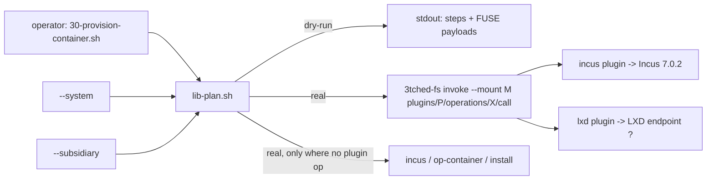

# Design — provisioning `--system` and `--subsidiary` modes

Status: SPEC ONLY. Implementation waits until after the current build.
Requirements: `requirements.md` 1–9. Tags: **Found** = read on `origin/dev`
`8da14f6` or on the live mount (read-only listing of `metadata.json` /
`input.schema.json`, 2026-11-19); **Assumed** = a design choice or an
unverified fact, listed again under Open Questions.

## Overview

Both modes extend `deploy/provisioning/30-provision-container.sh` (**Found**,
the current procedure; the copy in `/home/jeremy/provisioning/` is identical
to `origin/dev`, so there is no untracked work to import). The new logic lives
in sourced helpers so the existing `new`/`complete` code paths do not change:

| file | role |
|---|---|
| `deploy/provisioning/lib-plan.sh` | step runner: `plan_host`, `plan_incus`, `plan_fuse <plugin> <method> <json>`; prints in dry-run, executes otherwise |
| `deploy/provisioning/lib-system.sh` | manifest load/validate, class and capability checks, `--system` plan |
| `deploy/provisioning/lib-subsidiary.sh` | parent preflight, staging/export, LXD import plan, child identity plan |
| `deploy/provisioning/system-functions/<function>.json` | one reviewed manifest per function |
| `deploy/provisioning/tests/*.bats` + `tests/fixtures/` | offline tests, stubs, fake operation tree, golden dry-runs |

Not changed: `deploy/scripts/provision-workspace-subscriber.sh --system LABEL`
(**Found**: a standalone, label-only container, "grants unchanged"). It is a
different thing with the same flag name; see Open Question 9.

## Architecture



FUSE calls go through the existing same-handle client used by
`deploy/scripts/3tchedfs-invoke.sh` (**Found**: `3tched-fs invoke --mount
<M> [--confirm-side-effects] --args <json> plugins/<p>/operations/<m>/call`),
with the operator's own identity mount (`OP_3TCHEDFS_MOUNT`, default
`/run/mounts/3tchedFS`). Mutations pass `--confirm-side-effects`. An
uncertain mutation is never retried and never falls back to another
transport (same rule as `3tchedfs-invoke.sh`). Each planned call validates its
payload against the operation's sealed `input.schema.json` before writing.

## Components and Interfaces

### CLI (Req 1)

```
30-provision-container.sh new <pubkey> <iid1> [NAME]          # unchanged
30-provision-container.sh complete <NAME>                      # unchanged
30-provision-container.sh --system <function> [--dry-run]
30-provision-container.sh --subsidiary <parent> [--child-key <pubkey> --child-iid1 <file>]
                          [--lxd-pool <pool>] [--dry-run]
```

`DRY_RUN=1` equals `--dry-run`. `START=1` keeps its meaning for `--system`;
it is refused for `--subsidiary` (a subsidiary is started only after its own
admission, outside this script). Parsing happens before `need_root` so dry-run
works unprivileged, except reads that need root (they are planned as
`plan_host read …` and skipped with a note in dry-run).

### Step runner (Req 1.3, 1.4, 1.7)

```
plan_host  <label> <cmd…>          # e.g. op-container from-seed, install -d
plan_incus <args…>                 # native incus, only for plugin gaps
plan_fuse  <plugin> <method> <json> [--mutation]
```

Dry-run output format, one block per step, numbered:

```
[03] fuse incus.create_instance (mutation, cap.service.incus.instance.create@v1)
     {"config":{…},"devices":[],"image":"","instance_type":"container","name":"","operation_id":"<uuid>","profiles":[],"source_mode":"empty"}
[04] host op-container from-seed <assigned-name>
```

The capability shown is read from the operation's `metadata.json`. Secret
values are never placed in payloads; file inputs are shown as
`<file:PATH sha256:… bytes:N>`.

### `--system` (Req 2–5)

#### Function manifest

```json
{
  "format": "op-provisioning/system-function@1",
  "function": "dns-forwarder",
  "description": "NextDNS forwarder for NIC-less containers",
  "service": { "runit": "nextdns" },
  "operation": null,
  "coarse_capability_ack": false,
  "network": { "mode": "relay", "sockets": ["/run/opdbus/egress/dns.sock"] },
  "limits": { "cpu": "1", "memory": "256MiB", "processes": "128" },
  "config_dir": false
}
```

- `operation`: `null` or `{"plugin":"<id>","method":"<name>"}` (at most one).
- `network.mode`: `none` (default) | `relay` (only listed host Unix sockets,
  bound read-write without shift, under `/opt/run-mounts/sys/`) | `nic`
  (`{"network":"<managed>","acl":"<acl>"}`; ACL mandatory).
- `config_dir`: when true, host `/etc/op-dbus/system/<function>/` is bound
  read-only at the same path.
- Unknown keys reject the manifest. `jq` validates it (no new dependency).

The two example manifests shipped with the implementation (**Assumed**,
illustrative): `dns-forwarder` (no operation) and `datapath-health`
(`openflow.get_datapath_health`, read class).

#### Class and capability checks (Req 3.5–3.7)

1. Read `$M/plugins/<p>/operations/<m>/metadata.json` (**Found** fields:
   `required_capability`, `side_effect`, `subid`).
2. Reject by class using the `mcp-door-adapter` "Classes" rules: plugins
   `login1 users human_principal identity_sled keyring elevation polkit sudo
   keypair incus oci cron persona workflows`, lxd `auth*`, and methods matching
   `exec|shell|bash|run|spawn|execute|command|script|grant|revoke|register_key|
   reboot|poweroff|shutdown|kill_|credential|secret|password|private_key|
   auth_tokens|refresh_auth|setup_auth|reauth|save_auth|adc`, and any input
   schema property named `command`, `cmd` or `script`.
3. Capability granularity (**Found**): mixed. Per-method, e.g.
   `cap.service.incus.instance.start@v1`, `cap.lxd.server.get_server@v1`;
   coarse, e.g. `dnsresolver.write` (`dnsresolver.flush_caches`),
   `identity_sled.write`, `elevation.authorize`. A coarse capability needs
   `coarse_capability_ack: true` and the script prints every operation on the
   mount sharing it, so the owner sees what the grant really allows.

#### Locked-down configuration (Req 4)

Created with `incus.create_instance` (**Found**: name is server-assigned,
`source_mode` `image|empty`, caller-generated `operation_id` UUID):

```
security.privileged=false        security.nesting=false
security.idmap.isolated=true     boot.autostart=false
security.syscalls.deny_default=true   security.syscalls.deny_compat=true
security.syscalls.intercept.mknod=false  …intercept.mount=false
…intercept.bpf=false  …intercept.setxattr=false  …intercept.sysinfo=false
security.guestapi=false
limits.cpu / limits.memory / limits.processes   (defaults 1 / 256MiB / 128)
user.opdbus.mode=system
user.opdbus.system_function=<function>
user.opdbus.function_manifest_sha256=<sha256 of the manifest file>
raw.lxc:
  lxc.uts.name = sys-<function>
  lxc.mount.auto = proc:mixed sys:ro cgroup2:ro
  lxc.cap.drop = sys_admin sys_module sys_rawio sys_ptrace sys_time sys_boot
                 net_admin net_raw mknod mac_admin mac_override audit_control
                 audit_write syslog setfcap sys_resource
  lxc.init.cmd = /sbin/runit-init           (runit seeds only, as `new`)
```

Profiles: none. Devices: `root` (pool) only, plus the optional items in
Req 4.5. No `fuse`, `lungs`, `catalog`, `decoy-trust`, `tunnel`,
`opdbus-run`, `sled`.

Root: `source_mode=empty`, then the same seed swap as `new`
(`op-container from-seed` for `@seed`, the hand snapshot otherwise). Then, in
the container's own root only (never the seed), every runit service under
`etc/service/` other than `service.runit` gets a `down` file, and the
3tchedFS, bridge, door, door-tls-init and nextdns services are removed from
the active service directory unless named. The seed's sealed `ro` property is
checked first, as `new` does.

Names: Incus assigns the name; the script records `sys-<function>` as the
UTS name and label. Start only with `START=1`, via `incus.start_instance`.

#### Grant scoping without an identity (Req 5)

A system container has no principal, so it cannot hold a grant itself. The
function's one capability is held by a host-side **service principal**
`system:<function>`: a grants-document entry, not an identity (no sled, no
OIA1, no session, no key). The container reaches the operation only through a
**per-function projection**: a host directory `/run/opdbus/sys/<function>/`
that exposes exactly `operations/<method>/{call,input.schema.json,
metadata.json}` of `<plugin>`, bound to `system:<function>`, attached as one
disk device at `/run/opdbus/fn`.

That projection does not exist today (**Found**: no such mount; 3tchedFS
mounts are per identity). It is the "identity binding + capability checks"
contract Wonder is building FUSE-side (`identity-bound-fuse-application-
migration`). Until it lands: a function with `operation: null` is
provisionable; a function with an operation is refused on a real run with
`per-function projection /run/opdbus/sys/<function> absent (Wonder FUSE
contract)`, and dry-run still prints the full plan.

The script never edits grants. It writes
`$LOGDIR/system-<function>.grant-delta-<stamp>.json`:

```json
{"format":"op-provisioning/grant-delta@1","principal":"system:<function>",
 "add":["<required_capability>"],"remove":[],"reason":"--system <function>",
 "manifest_sha256":"…","operation":"<plugin>.<method>"}
```

for the owner to apply through the existing owner-approved path
(`/etc/opdbus/local/` deltas, `op-grants-materializer`; **Found** in
`3tchedfs-invoke.sh` comments).

### `--subsidiary` (Req 6–8)

#### Choice: export-and-import copy, not migration

| option | verdict |
|---|---|
| Live migration Incus → LXD (`lxd.create_instance` `source.type=migration`, pull) | rejected: the `incus` plugin has no migrate operation (**Found**: its 15 operations), the Incus 7.x and LXD migration protocols are not guaranteed compatible, and a migration moves the instance, while a subsidiary must leave the parent in place |
| `lxd.migrate_instance` | rejected: it migrates an instance that is already in LXD |
| `lxd.run_replicator` | rejected: LXD-to-LXD cluster replication |
| **Export a stopped, identity-stripped staging copy, import with `lxd.create_instance_from_backup`** | **chosen**: a copy by construction, the parent never stops, the identity is stripped before anything leaves the host |

#### Steps

1. Preflight (read): `incus config show <parent>`; sled device present;
   `user.opdbus.session_id` = sled `session_id`; exactly one instance with that
   label; parent not `user.opdbus.mode=system|subsidiary`. Read the parent's
   capability names from the grants document (root read, names only).
2. `incus.snapshot_instance {"name":"<parent>","snapshot_name":"sub-<stamp>"}`
   (`cap.service.incus.instance.snapshot@v1`). Kept; listed in the receipt.
3. Staging copy: **plugin gap G1**, `incus copy <parent>/sub-<stamp>
   sub-staging-<stamp> --instance-only --stateless --no-profiles` (native).
4. Strip identity: `incus.remove_device` for each of `sled decoy-trust lungs
   catalog fuse opdbus-run tunnel` present; `incus.modify_instance` to unset
   `user.opdbus.*` and `raw.lxc` `lxc.uts.name` (set the child's later).
5. Export: **plugin gap G1**, `incus export sub-staging-<stamp>
   /var/lib/opdbus/subsidiary-exports/<parent>-<stamp>.tar.gz --instance-only`
   (dir 0700 root, file 0600; size and SHA-256 recorded).
6. `incus.delete_instance {"name":"sub-staging-<stamp>"}`.
7. LXD profile (once): `lxd.create_profile` with `name: opdbus-subsidiary`,
   config `security.privileged=false security.nesting=false
   security.idmap.isolated=true boot.autostart=false`, no devices. If it
   exists (`lxd.get_profile`) and differs, refuse rather than edit a shared
   profile.
8. Import: `lxd.create_instance_from_backup {"args":{"backup":<bytes>,
   "pool_name":"<lxd-pool>","name":"sub-<parent>-<n>","devices":{}}}`
   (`cap.lxd.instances.create_instance_from_backup@v1`). **Gap G2**: `backup`
   is a JSON array of bytes; see Open Questions.
9. `lxd.update_instance` (after `lxd.get_instance` for the etag): profiles
   `["opdbus-subsidiary"]`, labels `user.opdbus.mode=subsidiary`,
   `user.opdbus.parent_session_id=<parent session>`,
   `user.opdbus.parent_instance=<parent>`, `user.opdbus.admission=pending`.
   Never `start: true`.
10. Child identity (only with `--child-key` and `--child-iid1`): verify with
    `op-identity-accept --issued … --pubkey … --trust-store …` (no `--out` in
    dry-run); derive the child session; refuse if it equals the parent's;
    `lxd.create_storage_pool_volume` `identity-<child-session>`; fill
    `session_id`, `wireguard_pubkey`, `issued_identity.iid1` (0600), `sealed_id`,
    `ledger/` (0700) — **gap G3**: writing into an LXD custom volume needs the
    LXD host's filesystem or a file API; add the `sled` disk device read-only at
    `/agent/user`; set `user.opdbus.session_id`, `wireguard_public_key`,
    `admission=bound`. Without the child inputs the instance stays
    `admission=pending` with no sled (Req 8.3).
11. Grant delta proposal for `<child-session>`: parent capabilities minus
    every `shell|exec|admin|secret` class capability (classified per the
    operations that require each capability); default proposal is the
    read-class subset only; nothing applied.

#### What "subsidiary" means here (**Assumed**, Open Question 1)

From `docs/src/operations/network.md` and `hackathon/docs/RUNTIME.md`
(**Found**): the Hackathon subsidiary is a separate principal (`1262e982…`)
with its own session, a stopped copy of the root chatbot container
(`etched::hackathon`) and a narrower grant (`openflow.read` only). So a
subsidiary is a **child identity**: its own key, IID1 and session, minted by
the decoy, linked to the parent by `parent_session_id`, never sharing the
parent's sled, with grants ⊆ parent's. "The container IS the identity" and
the bridge requires exactly one instance per session (**Found**,
`deploy/provisioning/README.md`), so copying the parent's sled would break
both rules.

## Data Models

- Function manifest: above. Receipt (both modes):
  `$LOGDIR/<mode>-<name>-<stamp>.receipt.json` with mode, inputs (no
  secrets), each step's label, FUSE `operation_id`/result status or native
  exit code, created objects, plugin gaps used, export size/SHA-256, and the
  grant-delta path.
- Labels: `user.opdbus.mode` ∈ `system|subsidiary` (identity containers keep
  no `mode` label, so existing tooling is unaffected).

## Error Handling

Fail closed and stop at the first error; never delete what was created,
except the staging copy and only after a successful export. Errors name the
step and the object, never internal secrets. A FUSE call whose receipt cannot
be read is "uncertain": stop, record it, do not retry. Dry-run exits 0 after
validation and planning, or with the same non-zero code a real run would hit
at validation.

## Security

- STRIDE: spoofing — system containers hold no identity and are excluded from
  adoption by label; tampering — manifests are in source and pinned by SHA-256
  label; elevation — at most one capability, class deny-list, no shell/exec,
  no profiles, dropped caps, syscall interception off, no `/dev/fuse`;
  information disclosure — no secrets printed, export files 0600 in a 0700
  dir, the parent's identity stripped before export; repudiation — receipts
  plus the bridge's audit for every FUSE call.
- The script never applies grants or mints identities; both are owner steps.

## Testing Strategy

- `shellcheck -s sh` on `30-provision-container.sh`, `lib-*.sh`,
  `40-verify.sh`.
- bats (`deploy/provisioning/tests/`): `PATH` stubs for `incus`, `btrfs`,
  `op-container`, `op-identity-accept`, `3tched-fs`, `openssl`; forbidden
  stubs for `wg`, `losetup`, `lxc`, `lxd`, `zcall` that log and exit 99; a
  fake mount tree with `.3tchedfs.json` and `metadata.json`/`input.schema.json`
  copies for the operations used.
- Golden files: `tests/golden/system-dns-forwarder.dry-run.txt`,
  `tests/golden/subsidiary-ID-1.dry-run.txt`.
- Cases: mode exclusivity, identity options refused in `--system`, manifest
  validation, class and coarse-capability refusals, no identity artefacts,
  device/config set exactness, projection-absent refusal, grant delta
  content, subsidiary preflight refusals, identity devices stripped before
  export, no `lxc`/`lxd` invocation, child session ≠ parent session,
  `admission=pending` without child inputs, `START=1` refused for
  subsidiary, `new`/`complete` dry output unchanged.
- No Rust is touched, so no cargo tests. Real execution is out of scope.

## Open Questions (for Jeremy)

1. **Subsidiary = child identity?** Assumed: own key/IID1/session minted by
   the decoy, `parent_session_id` link, grants ⊆ parent's, never the parent's
   sled. Does the decoy issuer (`op-decoy-issuer`) need a parent field in the
   IID1, and should revoking a parent capability revoke it from children?
2. **LXD endpoint.** No LXD daemon on antix1 (no socket, no `lxc`/`lxd`), and
   `LxdDispatch::new` is never constructed outside `lxd.rs`, so the `lxd`
   FUSE operations exist in the sealed catalog but have no configured
   endpoint/trust. Which LXD host, and who wires the client (bridge config)?
3. **G1 Incus export gap.** The `incus` plugin has no copy/backup/export
   operation. Use native `incus copy`/`incus export` as designed, or add
   operations to the `incus` plugin (sealed-blob change, reseal)?
4. **G2 backup payload.** `lxd.create_instance_from_backup` takes the backup as
   a JSON byte array; multi-GB roots are impractical through a call file.
   Add a path/stream argument to the plugin, or use a different LXD source?
5. **Format compatibility.** Whether LXD accepts an Incus 7.0.2 instance
   backup (`backup/index.yaml`, `backup.yaml`) is unverified; proving it needs
   a real export/import, which is out of scope here.
6. **G3 child sled on LXD.** Filling an LXD custom volume needs the LXD host's
   filesystem or a file API, and the LXD-side bridge must adopt it. Where does
   the subsidiary's bridge/lungs run?
7. **Per-function projection** for `--system` operations (Wonder's FUSE
   contract): path `/run/opdbus/sys/<function>/` and service principal
   `system:<function>` are assumptions.
8. **Coarse capabilities.** Allow `coarse_capability_ack`, or refuse coarse
   capabilities until the reseal splits them?
9. **Two `--system` flags.** `provision-workspace-subscriber.sh --system LABEL`
   already exists with different semantics (standalone, no function gate).
   Retire it, rename it, or leave both?
10. **Seed for system containers.** Reuse the 3tched seed with services marked
    down (designed), or a separate minimal seed?
