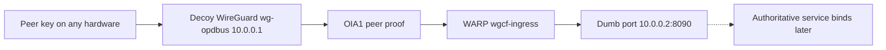

# Design — Standalone network

Status: draft. This design covers identity establishment and transport only.
It authorizes no repo, deploy, or service change. The repository is created
only after this spec is approved, and the spec is copied into it.

## Overview

The network proves a WireGuard peer at the decoy and carries that proof to one
dumb port on the host. It stops there. `10.0.0.2:8090` has no listener until
the bridge, or another authoritative service, binds it. The attached service
becomes the door. The network never speaks tonic, never mints a session
credential, and never creates a container.

### Decision: Two jobs, then a seam

**Context:** The identity path was being treated as a front, a mesh, a door,
and a container provisioner at the same time.

**Options considered:**

1. The network owns the path through the tonic door and the identity
   container. Pros: one deploy. Cons: the network cannot come up before the
   bridge, and a different authoritative service cannot attach.
2. The network owns identity establishment and transport, and stops at a dumb
   port. Pros: the network deploys alone, and any authoritative service can
   bind the same socket. Cons: the port is useless until something attaches.

**Decision:** Option 2.

**Rationale:** WireGuard's only purpose is identity. WARP's only purpose in
this spec is to transport the sealed proof. The door begins when an
authoritative service attaches. That is the seam a later bridge plugs into.

### Decision: Repository after the spec

**Context:** The network will be its own repository. Specs currently live
together.

**Decision:** Do not create the repository yet. This directory remains the
source. After approval, create the repository and copy this spec in.

**Rationale:** An empty repository would become a second source of truth
before the contract is settled.

### Decision: Obfuscation is not this design

**Context:** WARP can also hide WireGuard from detection. That behavior has
not been specified.

**Decision:** This design does not add a cover, a second tunnel, or a
detection policy. A later bird's-eye spec does that after the rest of the
network is in place.

### Decision: Addresses live on the OVS bridge

**Context:** An earlier note treated enslaving `eth0` as unsupported. That
note mixed three different things: enslaving the NIC, DHCP on that NIC, and a
second internal port named `pub0`.

**Decision:** Every OVS bridge holds its addresses on the bridge. Member
ports stay unaddressed. This bridge enslaves `eth0`. The public address
`188.68.58.237/22` and `10.0.0.2/32` are static on the bridge. The bridge MAC
is `eth0`'s MAC (`36:f1:18:56:c4:6a`). The default route remains
`via 188.68.56.1` onlink. DHCP and NAT stay off. There is no `pub0`.
Chat, the bridge, and the UI are not this spec. They cross the network at
runtime and stay in their own repos. 3tched is our code
(`.kiro/specs/3tched-core/`). The container is the 3tched.com repo and owns
chat (`.kiro/specs/container-chat/`). This network only delivers a proof to
the dumb port.

The container has no IP. The network does not draw the UI. Host port 8080
must not pass the gate: the identity is the container, and a host listener
is not that identity. Rendering passes through the container. How the bytes
reach a browser stays open. IPFS, a gated browser, and a local renderer are
conversations, not a decision.

The container, 3tched, and this network are three separate things. The
container profile keeps the container's own disks and identity. It does not
mount `/run/opdbus`, `/run/opdbus-egress`, or `/run/mounts/3tched`, and it
does not set an egress proxy. 3tched is its own mount. This network is
`ovsbr0` only.

Two dumb ports sit on this one bridge. `10.0.0.2:8090` is the dumb TCP port:
nothing listens until an authoritative service binds it. The subsidiary port
is the dumb OVS port: an unaddressed member with no container attached.
`eth0` is the uplink member, not a third dumb port. Addresses stay on the
bridge.

### Decision: The protocol is one OVS bridge, not OVN

**Context:** Containers need their own network, plus access to lungs and to
the 3tched backend. Most of their calls are disk I/O through 3tchedFS. A
subsidiary was proposed as OVN, as a second bridge, or as an Incus proxy.

**Decision:** One OVS bridge. A container's own network is a port on that
bridge. The port is unaddressed on the host. The bridge holds the addresses.
Ordinary calls go through the shared 3tchedFS mount. There is no OVN logical
switch and no Incus proxy device.

3tchedFS is a mirror of runtime shared memory. It reads
`/dev/shm/opdbus/plugin-blobs` for the sealed catalog and
`/dev/shm/opdbus/state` for live values. The catalog includes the methods,
and those methods are D-Bus. A plugin operation is dispatched only through
`org.opdbus.v1.PluginV1.CallWithOperationId`.

The FUSE mount carries the identity. The host mount is pinned to
`mount_identity.session` and the caller UID. On a call, the daemon registers
that credential on the D-Bus connection with `RegisterCurrentSender` before
`PluginV1.CallWithOperationId`. The bus peer does not have to be the
container. A session-bus listener can carry these calls. The container writes
the mirror and does not hold the credential.

The socket path is separate. `BindCurrentContainer` still takes the identity
from the kernel peer of `lungs.sock`, and that path sends no credential.
Whether a container write arrives at that socket is still unresolved. A
catalog-only mount has no `call` file. The path confirmed on 2026-10-28 is
the shared profile `3tched-lungs`, read-only disk `lungs-socket-dir`. That
profile can be attached to many containers. It is not a proxy. End-to-end
bind from the guest was not proven.

**Rationale:** OVN gives a subsidiary its own logical switch, which is another
network behind a router, realized on `br-int` rather than a port on this
bridge. An Incus proxy device belongs to one instance and cannot be shared.
A profile can. The backend is 3tched. Lungs reachability through FUSE stays
an open question, with the shared profile as the known alternative.

**Rationale:** Incus can include an unconfigured NIC with
`bridge.external_interfaces` and put a static `ipv4.address` on the bridge.
DHCP was the unsupported client. `pub0` was the unsupported extra port.
Moving the live address is still a cutover: the route has to land on the
bridge before `eth0` loses it, or SSH drops. The onlink gateway is outside
the /22, and Incus does not record that route with `ipv4.address` alone.

## Architecture

The solid path is this spec. The dotted hop is outside it. Until that hop
exists, a delivery to the port fails closed.

## Components and Interfaces

### Decoy WireGuard

- Purpose: terminate the peer and hold the session. The client's peer is the
  decoy, so the client stays up after termination.
- Interface: `wg-opdbus` at `10.0.0.1`.
- Dependency: an admitted peer key.
- The host has no WireGuard interface. This component does not move the
  session onto the host.

### Peer-proof minter

- Purpose: when a peer key is admitted, mint one OIA1 proof signed by the
  decoy and bound to that key.
- Interface: the OIA1 assertion the transport carries. Header name, for the
  service that later attaches: `x-oracle-identity-assertion-bin`.
- The minter does not write SID1, does not anchor a session, and does not run
  on the host. If the decoy cannot sign, nothing is forwarded.

### WARP transport

- Purpose: carry the OIA1 proof from the decoy to the host.
- Interface: `wgcf-ingress`.
- Output: one forward, to `10.0.0.2:8090` only.
- Not a listener, not a public front, and not a fallback path. If it is down,
  delivery stops.

### Dumb port

- Purpose: the seam. Address `10.0.0.2`, port `8090`, no socket bound by the
  network.
- The network does not accept connections, speak tonic, or answer a health
  check on this port.
- When nothing is bound, the forward fails. The network does not retarget it.
- When an authoritative service binds it, that service owns admission. This
  design does not specify that service.

### What the attached service receives

The plug is the socket plus the proof, not a library call. A service that
binds `10.0.0.2:8090` can read the delivered OIA1 proof. It must bring its own
admission, session credential, and, for the bridge, the container. Those are
not interfaces of this repository.

## Data model

The network stores and forwards one record per admitted peer:

- `peer_key` — the WireGuard public key. Required. Stable across hardware.
- `proof` — one decoy-signed OIA1 assertion for that key. Required before any
  forward.
- `forward_target` — the constant `10.0.0.2:8090`.

The record has no container name, no SID1, no NIC, and no host interface.

## Error handling

- No admitted peer key: drop the arrival. Do not forward.
- Decoy cannot sign: do not mint a host-side substitute. Do not forward.
- WARP down: stop delivery. Do not open another tunnel or a host WireGuard
  interface.
- Nothing listening on `10.0.0.2:8090`: the forward fails closed. Do not bind
  a placeholder and do not pick another port.
- An attached service is slow or refuses the proof: that refusal belongs to
  the service. The network does not retry by creating a session.

## Testing strategy

Tests in the future network repository. No live deploy in this spec.

- Unit: a peer key maps to one OIA1 proof and never to a NIC, MAC, or host
  address. A second arrival of the same key does not mint a second identity.
- Unit: a missing proof, a down WARP, and an unbound `10.0.0.2:8090` each
  produce no forward and no fallback listener.
- Unit: the host configuration contains no WireGuard interface.
- Contract: the only forward target is `10.0.0.2:8090`, and the payload is one
  OIA1 proof.
- Absent: tonic admission, SID1, container creation, and 3tchedFS. Those tests
  belong to the attached service.

## Blocked

Assigning `10.0.0.2` to a host interface waits for an owner decision. The
address in the forward target is still `10.0.0.2`.
