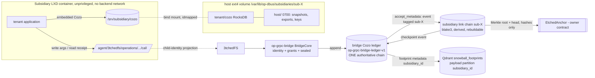
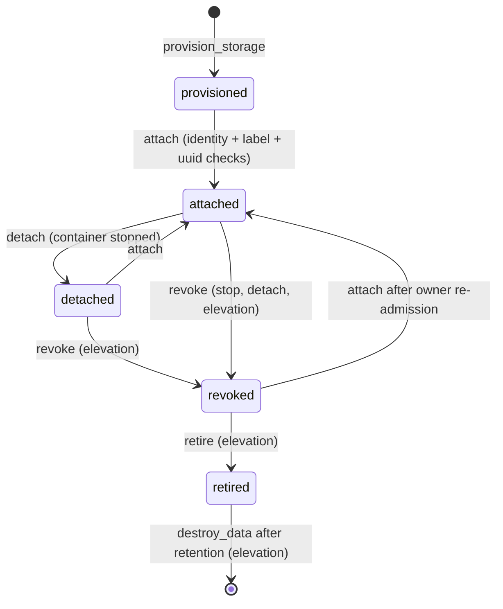

# Design — `subsidiary-activity-grouping`: all subsidiary activity grouped per subsidiary container

## Overview

A subsidiary is one child identity in one LXD container
(`provisioning-system-subsidiary` Req 8; `subsidiary-container`). This design
groups all of its activity under one `subsidiary_id` by:

1. a **registry** that mints the id and binds it to the child principal and the
   container (Req 1);
2. two optional, hashed **tag fields** on `ChainEvent`, plus a subsidiary
   reference on every receipt and audit-type record (Req 2);
3. a **derived per-subsidiary link chain** over the one authoritative bridge
   ledger, whose head and Merkle roots are what gets anchored (Req 3, 4);
4. a sealed **`subsidiary` plugin** that owns the lifecycle and the
   caller-scoped read surface, reached only through call files (Req 5–8, 10);
5. **one tenant Cozo DB per subsidiary** on its own host ext4 volume (Req 7);
6. a `subsidiary_id` **vector partition** in Qdrant payloads (Req 9).

Nothing here adds authority. Admission stays `identity ∧ grants ∧ sealed` in
the bridge (Req 11.3). The subsidiary id is always *resolved* from the
admitted principal, never *asserted* by a caller.

Labels: **Found** = read on `origin/dev` `879e7d7`. **New** = proposed by this
spec; nothing with that label exists today. **Assumed** = needs confirmation
(see Open Questions).



## Grounding: what exists today (Found)

| Area | Code | Relevant fact |
|---|---|---|
| Event shape | `op-state-store/src/event_chain.rs` `ChainEvent` | Hashed fields go through `CanonicalEventPayload`; `sealed_id_digest` was added as `Option` with `skip_serializing_if = "Option::is_none"` in both the struct and the canonical payload, so old hashes are unchanged. `user_id`, `conversation_id`, `action_origin` are **not** hashed. Hash is `md5` over canonical JSON (`compute_hash`). |
| In-memory chain | `EventChain` | One `Vec<ChainEvent>`, monotonic `event_id`, constant genesis `compute_hash_str("genesis")`, md5 Merkle `EventBatch`/`MerkleProof`, linear filters `events_for_plugin`, `events_touching_tag`. |
| Authoritative ledger | `op-grpc-bridge/src/core_persistence.rs` `PersistentCore` | One Cozo append ledger `op-grpc-bridge-ledger-v1` via `CozoGraphShuttle::append_session_event`; `walk_records` requires contiguous `seq`, `event_id = seq + 1`, `prev_hash` linkage, `event.verify()`, and `input_payload == {"record_digest": blake3(owner, action)}`. One `tip`, a `failure` latch, `recover_pending`. |
| Per-scope heads precedent | `PersistentCore::accept_metadata` | Already derives `heads: BTreeMap<(StateScope, plugin), ProjectionHead>` from the one ledger on every accepted record. |
| Scope | `op-grpc-bridge/src/core.rs` `StateScope` | `Public` or `Private { principal_id, session_id }`, "selected only by the admitted runtime, never from a caller's JSON body". |
| Record kinds | `LedgerAction` | `State`, `Attempt` (with `DelegationAttribution`), `Control` (`ExecutionRecord`), `Terminal`. |
| Receipts | `op-state-store/src/method_receipt.rs` `MethodExecutionReceipt`, built in `core_operations.rs` | `operation_id`, attempt/terminal `event_id`+`event_hash`, `plugin_id`, `method`, `result`. FUSE terminal receipts (`_3tched-fs/src/mounted.rs`) carry `plugin_id, method, subid, required_capability, side_effect, idempotent, result`; `op-mcp-door/src/fusecall.rs::terminal_receipt` checks those and ignores extra keys. |
| Execution | `op-execution-tracker` `ExecutionContext`, `DelegationAttribution`, `ExecutionRecord` | `deny_unknown_fields` on context and attribution. |
| Door | `op-mcp-door/src/audit.rs` `AuditRecord`; `grants.rs` `DurableGrants`, `EphemeralGrant`, `GrantStore`, `Ticket`, `TicketStore` | Records carry `principal_id`; JSONL to svlogd. |
| Grants | `op-grpc-bridge/src/grant_document.rs` | Exact principal keys, closed `GRANT_GROUPS`, no `*`. |
| Elevation | `op-plugins/src/state_plugins/elevation.rs`, bridge `task_elevation.rs` | `protected_actions()` list, polkit-style action ids, one-time tickets (`TICKET_TTL_SECONDS = 60`). |
| Footprints | `op-grpc-bridge/src/mutation_engine.rs::event_to_footprint` | Flat metadata keys (`actor_id`, `session_id`, `sealed_id_digest`, …) beside the lossless event. **Note:** `mutation_engine.rs` and `chain_vector_projector.rs` are not declared in `op-grpc-bridge/src/lib.rs` (HANDOFF 2026-11-17); the linked chain is `BridgeCore`. |
| Vectors | `op-cognitive/src/chain_vectors.rs` | Collection `snowball_footprints` (1024 dims); payload allow-list `actor_id, session_id, sealed_id_digest, capability_id, decision`; `search_session_events` filters `actor_id` + `session_id` from admission; `chain_links` feeds the Cozo `chain_vector_link` relation; `upsert_session_ledger` for sled ledgers. |
| Subids | `op-oscal-subid` | `<category>.<component-type>.<subject>.<verb>[.<facet>]{0,2}[@vN]`; categories `src prj sch mut obs evt exp`; types include `service`, `container`, `data`, `lxd`. |
| Cozo | `op-cozo-store` `CozoGraphShuttle` | `new_persistent_private` (0700 boundary), `ensure_distinct_from` (domain owners never share a handle). No backup/restore wrapper exists. |
| Container | `subsidiary-container` design | Labels `user.opdbus.*`, `opdbus-subsidiary` profile with `security.idmap.isolated=true`, backend channel bind `shift: true`. |

## Key decision: chain topology (Req 3)

Three options were evaluated against `event_chain.rs` and `core_persistence.rs`.

| Option | For | Against | Verdict |
|---|---|---|---|
| **A. Separate authoritative chain per subsidiary** (own `EventChain` / own Cozo ledger, own genesis) | Physical isolation; moves with the subsidiary | `PersistentCore` is a single append owner: one `tip`, contiguous `seq`, one `failure` latch, one `recover_pending`. N ledgers means N recovery paths and no atomic append for operations that touch both host and subsidiary (grant proposals, attach/detach, revoke). `EventChain` genesis is the constant `md5("genesis")`, so independent chains are indistinguishable at genesis and splice-able. Global order, `journal_events`, `verify_journal`, `heads` and the operations index all assume one ledger. A subsidiary-writable chain would also sit on a volume the container mounts. | Rejected |
| **B. Namespace only in the main chain** (tag + filter) | Smallest change; one authority | The only head is the global head: anchoring it ties every receipt to all other activity, and a holder's proof needs the whole chain's linkage. Not self-contained for export/move. | Rejected alone |
| **C. Namespace in the main chain + derived per-subsidiary link chain** | Keeps one authority (A's problems vanish); a per-subsidiary head and Merkle roots exist for anchoring (B's problem vanishes); derived exactly like `accept_metadata` derives `heads` today; rebuildable from `walk_records`; blake3 like `binding()` | One more index to keep consistent (checked on reopen, Req 3.4) | **Chosen** |

Rationale in one line: the ledger stays the single source of truth, and each
subsidiary gets a head that is a pure function of that ledger, committed back
into it by checkpoint events, and anchored with hashes only.

Hash function: link hashes, Merkle roots and anchor payloads use **blake3**
(**New**). The main chain keeps `md5` unchanged (changing it is out of scope);
each link commits to the md5 `event_hash` *and* the blake3 `record_digest`
already in `input_payload`, so the anchored value is not weaker than blake3
over the record. See Open Question 9.

## Components and Interfaces

### 1. Subsidiary registry (Req 1) — **New**

Cozo relations in the **bridge's** private Cozo DB (the one `PersistentCore`
opens with `new_persistent_private`), never in a tenant DB:

```
subsidiary { subsidiary_id: String =>
  principal_id: String, parent_session_id: String,
  lxd_instance: String, lxd_instance_uuid: String,
  volume_path: String, schema_bundle_sha256: String,
  state: String,            # provisioned|attached|detached|revoked|retired
  anchor_tag_key_ref: String, receipt_salt_key_ref: String,   # key file refs, never key bytes
  registered_event_id: Int, updated_event_id: Int }
subsidiary_by_principal { principal_id: String => subsidiary_id: String }
subsidiary_by_instance  { lxd_instance_uuid: String => subsidiary_id: String }
```

- Mint: `sub-<uuid v4>` (`uuid` is already a workspace dependency).
- Bindings come from the registration call's verified inputs: the child
  `principal_id` and `parent_session_id` from the child identity planned by
  `provisioning-system-subsidiary` step 10, and the instance name and
  `volatile.uuid` read with `lxd.get_instance` (**Found** operation). Label
  `user.opdbus.subsidiary_id` set with `lxd.update_instance` (etag flow, as
  `subsidiary-container`).
- Resolution: `SubsidiaryResolver::for_scope(&StateScope) -> Option<SubsidiaryRef>`,
  `Public → None`, `Private { principal_id, .. } → subsidiary_by_principal`.
  Called inside `PersistentCore::append` before the event hash is computed.
- Attach-time check (Req 1.5): label == registry id, `volatile.uuid` ==
  `lxd_instance_uuid`, attached sled `session_id` == child session. Any
  mismatch → no attach, denied event.
- Rebind (Req 1.6): `subsidiary.rebind_container` updates
  `lxd_instance(_uuid)` and records both UUIDs.

### 2. Tagging (Req 2)

**`ChainEvent` (op-state-store) — New fields**

```rust
#[serde(default, skip_serializing_if = "Option::is_none")]
pub subsidiary_id: Option<String>,
#[serde(default, skip_serializing_if = "Option::is_none")]
pub subsidiary_role: Option<SubsidiaryRole>,   // "actor" | "subject"
```

Added to `CanonicalEventPayload` with `skip_serializing_if = "Option::is_none"`
exactly like `sealed_id_digest`, so every existing event's canonical bytes and
hash are unchanged (Req 2.3, 11.1). `LegacyCanonicalEventPayload` is not
touched. Readers built before this change will fail `verify()` on tagged
events, so rollout is readers-first (see Error Handling).

**Where each record gets its tag**

| Record | Code | Tag source | Change |
|---|---|---|---|
| Ledger event (all `LedgerAction` kinds) | `PersistentCore::append` | `SubsidiaryResolver` on `owner`; `role = actor` | New lines before `event.compute_hash()` |
| Host-side lifecycle events | `subsidiary` plugin methods | registry entry of the target; `role = subject` | New |
| `lxd.*` calls on a registered instance | bridge, after resolving the target instance name through `subsidiary_by_instance` | `role = subject` | New; Open Question 13 |
| Method receipt | `MethodExecutionReceipt` in `core_operations.rs` | from attempt event | New optional `subsidiary: Option<SubsidiaryReceiptRef>` |
| Recovery record | `MethodReceiptRecovery` | same | New optional field |
| Execution | `ExecutionContext`, `DelegationAttribution` (op-execution-tracker) | resolver, executor and requestor sides | New optional `executor_subsidiary_id`, `requestor_subsidiary_id` (`deny_unknown_fields` ⇒ readers-first) |
| Door audit | `op-mcp-door` `AuditRecord` | principal → registry snapshot file (below) | New optional `subsidiary_id` |
| Ephemeral grant / ticket consumption | `GrantStore::consume`, `TicketStore::consume` audit lines | principal → registry snapshot | New optional `subsidiary_id` in the audit record of the consume |
| Footprint | `event_to_footprint` (unlinked today) | `event.subsidiary_id` | New metadata key; applies when the file is linked again |
| FUSE terminal receipt | `_3tched-fs` `mounted.rs` | from `MethodExecutionReceipt.subsidiary` | New optional key `subsidiary`; owned by the FUSE contract (Open Question 14) |

The door has no Cozo handle; it reads a root-owned, bridge-written
`/run/op-dbus/subsidiary-principals.json` (**New**: `{principal_id: subsidiary_id}`,
no other fields), re-read on mtime change like `DurableGrants`.

Fail closed (Req 2.5): if the resolver errors (registry unreadable), the
append fails with the existing "outcome unknown; do not retry" path — never an
untagged write.

### 3. Derived link chain, checkpoints and anchors (Req 3, 4) — **New**

Module `op-state-store/src/subsidiary_chain.rs` (pure types + hashing, no IO):

```rust
pub struct SubsidiaryLink {
    pub subsidiary_id: String,
    pub seq: u64,                    // 1-based, contiguous per subsidiary
    pub prev_link_hash: String,      // blake3 hex; seq 1 uses genesis(subsidiary_id)
    pub ledger_event_id: u64,
    pub ledger_event_hash: String,   // md5 hex from ChainEvent.event_hash
    pub record_digest: String,       // blake3 hex from input_payload.record_digest
    pub role: SubsidiaryRole,
    pub kind: String,                // "attempt"|"terminal"|"state"|"control"|"lifecycle"|"checkpoint"|"anchor"
    pub receipt_leaf: Option<String>,// blake3 hex, terminal links only
    pub link_hash: String,
}
genesis(sid)  = blake3("op-subsidiary-genesis@v1\0" || sid)
link_hash     = blake3(canonical_json(link without link_hash))
receipt_leaf  = blake3(salt || canonical_json(receipt without subsidiary.salt))
salt          = blake3::keyed_hash(receipt_salt_key[sid], ledger_event_hash)   // deterministic, rebuildable by the host only
anchor_tag    = blake3::keyed_hash(anchor_tag_key[sid], "op-subsidiary-anchor@v1")
merkle        = binary blake3 tree over link_hash (leaf = receipt_leaf when present),
                odd node promoted, same shape as EventBatch/MerkleProof but blake3
```

- **Index:** relation `subsidiary_link { subsidiary_id, seq => …link fields }`
  in the bridge Cozo DB, written in `accept_metadata` right after the ledger
  append succeeds (same place `heads` is updated). On `open`, `walk_records`
  rebuilds links in memory and compares with stored rows (Req 3.4): mismatch
  latches `failure` like any other ledger inconsistency.
- **Checkpoint** (Req 3.5): `subsidiary.checkpoint` appends a
  `LedgerAction::State` record (no publication) with
  `OperationType::Custom("subsidiary_checkpoint")`, tagged `subject`, whose
  bound action carries `{seq, link_hash}`. Cadence: on every anchor, on
  detach/revoke/retire, and on owner request.
- **Anchor payload** (Req 4.1–4.2), hashes and integers only:

```json
{ "format": "op-subsidiary/anchor@1",
  "anchor_tag": "<blake3 hex>", "batch_root": "<blake3 hex>",
  "first_seq": 101, "last_seq": 200,
  "head_link_hash": "<blake3 hex>", "prev_batch_root": "<blake3 hex | null>" }
```

  This is the full interface this spec asks of the owner's EtchedAnchor
  contract (**Assumed** field mapping; Open Question 2). Submission is out of
  scope (networking deferred; local chain). `subsidiary.record_anchor` takes
  the payload hash and an opaque owner-supplied `anchor_ref` (e.g. tx hash) and
  appends an `anchor` link.
- **Holder-only proofs** (Req 4.3–4.7): the salt is only in the receipt given
  to the caller and in owner exports; the anchored root reveals nothing. The
  offline verifier is a small bin `op-subsidiary-verify` (**New**, in
  `op-state-store` `src/bin/`) that recomputes leaf → root and compares with
  the anchor payload; no network, no backend.

### 4. `subsidiary` sealed plugin (Req 5–8, 10) — **New**

`op-plugins/src/state_plugins/subsidiary.rs`, sealed into the catalog like
every plugin, reached only through call files. Methods, capabilities and
subids (all **New**; capability form follows `cap.lxd.*@v1`):

| Method | Caller | Capability | Subid | Notes |
|---|---|---|---|---|
| `register` | owner | `cap.subsidiary.register@v1` | `mut.service.subsidiary.register@v1` | mint id, bindings, schema bundle digest, key files |
| `rebind_container` | owner | `cap.subsidiary.rebind_container@v1` | `mut.service.subsidiary.rebind@v1` | Req 1.6 |
| `provision_storage` | owner | `cap.subsidiary.provision_storage@v1` | `mut.data.subsidiary.provision@v1` | Req 7.1, 7.3 |
| `attach` / `detach` | owner | `cap.subsidiary.attach@v1` / `…detach@v1` | `mut.data.subsidiary.attach@v1` / `…detach@v1` | via `lxd.update_instance` disk device |
| `snapshot` | owner | `cap.subsidiary.snapshot@v1` | `mut.data.subsidiary.snapshot@v1` | Req 7.5 |
| `export_bundle` (move) | owner | `cap.subsidiary.export_bundle@v1` | `exp.data.subsidiary.bundle@v1` | Req 7.6 |
| `revoke` | owner + elevation | `cap.subsidiary.revoke@v1` | `mut.service.subsidiary.revoke@v1` | protected task `org.opdbus.v1.subsidiary.revoke` |
| `retire` / `destroy_data` | owner + elevation | `cap.subsidiary.retire@v1` / `…destroy_data@v1` | `mut.service.subsidiary.retire@v1` / `mut.data.subsidiary.destroy@v1` | protected tasks `org.opdbus.v1.subsidiary.retire`, `…destroy-data` |
| `checkpoint` | owner | `cap.subsidiary.checkpoint@v1` | `evt.service.subsidiary.checkpoint@v1` | Req 3.5 |
| `prepare_anchor` / `record_anchor` | owner | `cap.subsidiary.prepare_anchor@v1` / `…record_anchor@v1` | `exp.service.subsidiary.anchor@v1` / `evt.service.subsidiary.anchor@v1` | Req 4 |
| `get_identity` | self / owner | `cap.subsidiary.get_identity@v1` | `obs.service.subsidiary.identity@v1` | self = own id only |
| `get_head` | self / owner | `cap.subsidiary.get_head@v1` | `obs.service.subsidiary.head@v1` | |
| `list_activity` | self / owner | `cap.subsidiary.list_activity@v1` | `obs.service.subsidiary.activity@v1` | paged links |
| `rollup` | self / owner | `cap.subsidiary.rollup@v1` | `obs.service.subsidiary.rollup@v1` | Req 8.1 |
| `rollup_parent` | owner only | `cap.subsidiary.rollup_parent@v1` | `obs.service.subsidiary.rollup.parent@v1` | Req 8.2 |
| `export_receipts` | self / owner | `cap.subsidiary.export_receipts@v1` | `exp.service.subsidiary.receipts@v1` | Req 8.3–8.4 |
| `prove_receipt` | self / owner | `cap.subsidiary.prove_receipt@v1` | `obs.service.subsidiary.proof@v1` | Req 4.6 |
| `verify` | self / owner | `cap.subsidiary.verify@v1` | `obs.service.subsidiary.verify@v1` | Req 3.6 |

Scope rule (Req 6.2–6.3): read methods take an optional `subsidiary_id`
argument that is honoured only for the owner. For a subsidiary caller the
scope is its resolved id; a different id gets the same "not found" response as
a nonexistent one. Registry state is private-scope only (Req 6.4).

Elevation (Req 5.4, 10.1): the three destructive methods are added to
`elevation::protected_actions()` and enforced by the existing
`task_elevation` choke point; and `task_elevation` refuses any protected task
whose caller resolves to a subsidiary.

### 5. Grant scope (Req 5)

- Durable: the child principal's own entry in the grant document (**Found**
  contract). The script/plugin only writes grant-delta proposals in the
  existing `op-provisioning/grant-delta@1` format.
- Ceiling (**New**): `ceiling(sid) = caps(parent principal) − {shell, exec,
  admin, secret classes}` computed with the same classification
  `provisioning-system-subsidiary` step 11 uses, cached per grant-document
  mtime. Admission adds one check for subsidiary callers: `capability ∈
  ceiling`. This narrows, never widens, admission.
- Ephemeral grants and tickets: `GrantStore::find`/`consume` and
  `TicketStore::consume` refuse a subsidiary principal + capability outside the
  ceiling (door reads the ceiling from a bridge-written
  `/run/op-dbus/subsidiary-ceilings.json`, **New**).
- Revoke: `GrantStore::revoke` for each grant naming the principal; tickets
  for it are deleted unconsumed; grant-delta removing the durable entry.

### 6. FUSE view (Req 6)

The view is the child identity's existing projection (`subsidiary-container`
Req 4; **Assumed** to be grant-filtered by the shared FUSE toolset projection,
Open Question 3 there). This spec adds only the `subsidiary` plugin's read
operations to it. No routing, no introspection: the bridge never reads the
container's filesystem or tenant DB; the pre-generated schema bundle is
recorded by digest at registration and on change, and is otherwise opaque.

### 7. Tenant Cozo DB on host ext4 (Req 7)

Layout per subsidiary (**New**; backing device is Open Question 3):

```
/var/lib/op-dbus/subsidiaries/<sid>/          ext4 filesystem, one per subsidiary
  tenant/cozo/                                RocksDB dir; the only thing the container sees
  host/                                       root:root 0700, never mounted into the container
    keys/receipt-salt.key, keys/anchor-tag.key  0600, 32 random bytes each
    snapshots/<stamp>.tar.zst  + .blake3
    exports/<stamp>/                          op-subsidiary/receipts@1 + bundle manifest
```

- Device on the instance: `tenant-cozo: {type: disk, source:
  /var/lib/op-dbus/subsidiaries/<sid>/tenant/cozo, path: /srv/subsidiary/cozo,
  shift: true}` through `lxd.update_instance` (**Found** operation). `shift:
  true` uses an idmapped mount: on the host `tenant/cozo` stays owned by
  root (parent `tenant/` 0700), and inside the container it appears owned by
  the container's root, with no other unprivileged user able to reach it
  (Req 7.3).
  Fallback when idmapped mounts are unavailable: `chown` `tenant/cozo` to
  `volatile.idmap.base` (read via `lxd.get_instance`). Open Question 4.
- This adds one device to the `subsidiary-container` Req 5.5 allow-list
  (root, overlay, NIC, backend channel). That spec must be amended to allow
  `tenant-cozo` (Open Question 12).
- The host never opens the tenant DB while attached (RocksDB `LOCK`; Req 6.5).
- State machine (Req 7.4):



- Snapshot (Req 7.5): only in `detached`/`revoked` (container not holding the
  DB). Archive `tenant/cozo` as-is, blake3 + size into a `lifecycle` event.
  A live snapshot needs block-level snapshots (Open Question 3).
- Move (Req 7.6): bundle = last snapshot + receipt export + registry record
  (public fields only, key refs not keys unless owner asks) + manifest with
  blake3 of each file; manifest digest into a ledger event.

### 8. Rollups and export (Req 8)

Rollups are Cozo queries over `subsidiary_link` joined to the ledger rows by
`ledger_event_id` (plugin, method, decision from the event; outcome from
`Terminal.status`). Bounded to 1000 groups / 1000 links per page with an
opaque cursor = last `seq`. `rollup_parent` groups by `parent_session_id`.

Export `op-subsidiary/receipts@1`:

```json
{ "format": "op-subsidiary/receipts@1", "subsidiary_id": "sub-…",
  "window": {"first_seq": 1, "last_seq": 200},
  "links": [ … ], "receipts": [ {MethodExecutionReceipt + subsidiary ref incl. salt} ],
  "proofs": [ {"seq": 7, "siblings": [["<hash>", true], …], "batch_root": "…"} ],
  "checkpoints": [ … ], "anchors": [ {"payload": {…}, "anchor_ref": "…"} ] }
```

Exports contain the ledger events' hashes, not their payloads; bridge ledger
events already carry only `{"record_digest"}` as `input_payload`.

### 9. Vector partitioning (Req 9)

- `chain_vectors.rs` upsert: add `("subsidiary_id", "data.metadata.subsidiary_id")`
  to the allow-listed payload keys and to `chain_links`; `LedgerPoint` gains
  `subsidiary_id: Option<String>` for `upsert_session_ledger`.
- `ensure_collection` also creates a keyword payload index on `subsidiary_id`
  (Qdrant tenant index where the server version supports it).
- `search_session_events` gains `subsidiary_id: Option<&str>` from admission:
  `Some` ⇒ `must: match subsidiary_id`; `None` for a non-owner caller ⇒
  `must: is_empty(subsidiary_id)`, which excludes every subsidiary point
  (Req 9.4); the owner may pass any filter or none.
- Retire: delete points by filter; a retired-id set (from the registry) is
  passed to `reindex_from_chain` and `ingest_received`, which skip those
  points (Req 9.5).
- Same rule for the 9 voyage-4 code collections only if they ever receive
  subsidiary points (today they do not).

### 10. Teardown and retention (Req 10)

`revoke` → `retire` → `destroy_data`, each elevated. Retire requires stopped
container and both devices detached (checked via `lxd.get_instance`).
Retention default: tenant data kept 90 days after retire (**Assumed**, Open
Question 8); ledger, links, checkpoints, anchors kept forever.

### 11. Integration with existing 3tched (Req 11)

- Additive only: optional fields with `skip_serializing_if`, new relations,
  new plugin, new bin. No change to `StateScope`, `LedgerRecord`,
  `LedgerAction`, `binding()`, `LegacyCanonicalEventPayload`, md5 hashing.
- No new admission path; the ceiling check only narrows.
- After retirement, the owner still sees everything through the main ledger
  (`journal_events`, `verify_journal`) because it was always authoritative.
- `mutation_engine.rs` / `chain_vector_projector.rs` are unlinked today; their
  changes are specified but take effect only when relinked (Open Question 10).

## Data Models (summary)

- `ChainEvent.subsidiary_id: Option<String>`, `ChainEvent.subsidiary_role: Option<SubsidiaryRole>` (**New**, hashed when present).
- `SubsidiaryRole = actor | subject` (**New**).
- `SubsidiaryReceiptRef { subsidiary_id, seq, link_hash, receipt_leaf, salt: Option<String> }` (**New**; `salt` only to the holder/owner).
- `SubsidiaryLink`, anchor payload, export bundle: above (**New**).
- Cozo relations `subsidiary`, `subsidiary_by_principal`, `subsidiary_by_instance`, `subsidiary_link`, `subsidiary_anchor` (**New**) in the bridge DB.
- Label `user.opdbus.subsidiary_id` (**New**) beside the existing `user.opdbus.mode=subsidiary`, `parent_session_id`, `admission`.

## Error Handling

- Fail closed everywhere: unresolvable tag, registry/label mismatch, link
  rebuild mismatch, ceiling violation → refuse, record a denied event where a
  ledger write is possible, never write untagged.
- Ledger append uncertainty keeps the existing semantics: "outcome unknown;
  do not retry", `failure` latch, reopen for recovery.
- Lifecycle steps stop at the first error and never delete what was created
  (same rule as the provisioning specs). An uncertain `lxd.*` call is recorded
  and not retried.
- Rollout order (because tagged events fail `verify()` on old readers and
  `deny_unknown_fields` types reject new keys): ship readers (op-state-store,
  op-execution-tracker, door) before any writer sets a tag; no tag is written
  until the registry holds at least one subsidiary.
- No secret is ever printed; key files are referenced by path, never read into
  output; exports include salts only for the holder/owner.

## Security

- STRIDE: spoofing — id resolved from the admitted principal, label + UUID +
  session checks at attach; tampering — tags inside the hash, links rebuilt
  and compared on open, tenant DB cannot reach the ledger; repudiation — every
  lifecycle step is a tagged ledger event; information disclosure — anchors
  are hashes only, salts holder-only, cross-subsidiary reads answer "not
  found", vectors partitioned; denial of service — bounded pages; elevation —
  ceiling check, no protected tasks for subsidiaries, destructive lifecycle
  steps elevated.
- The tenant DB is container-writable by design; it is data, not evidence.
  Evidence lives only in the bridge ledger and its derived index.

## Testing Strategy

- `op-state-store`: unit tests that untagged events hash byte-identically to
  fixtures from `879e7d7`; tagged events change the hash; link chain, genesis
  per id, Merkle proof round-trip, salted leaf.
- `op-grpc-bridge`: ledger tests in the style of `core_persistence.rs` tests:
  tagged append, rebuild equals stored, tampered link latches failure, public
  scope never tagged, resolver failure refuses append.
- `op-plugins` `subsidiary`: scope rule, owner-only methods, elevation
  required, cross-subsidiary "not found", subids valid (`is_valid_subid`).
- `op-mcp-door`: audit/grant/ticket tagging from the principals file, ceiling
  refusal.
- `op-cognitive`: payload carries `subsidiary_id`; filters built per caller
  type; retired ids skipped.
- Provisioning bats with the fake `lxd` operation tree: disk device payload,
  `shift: true`, label set, no `lxc`/`lxd` invoked.
- Offline verifier golden test: receipt + proof + anchor payload → ok; one
  flipped byte → fail.

## Open Questions (for Jeremy)

1. **Anchor tag.** Blinded per-subsidiary tag (keyed blake3, recommended) or the plain `subsidiary_id` on-chain? Blinded keeps even the number of subsidiaries and their cadence unlinkable.
2. **EtchedAnchor interface.** Confirm the field names/types the contract takes (`anchor_tag`, `batch_root`, `first_seq`, `last_seq`, `head_link_hash`, `prev_batch_root`), the anchor cadence (every N links, time-based, or on demand), and who submits the transaction while networking is deferred (host-side submitter to the local chain?).
3. **ext4 volume backing.** Loop image file (where, given pools are off-limits) or an LVM LV? Live snapshots without stopping the container need block snapshots (LVM thin); otherwise snapshots need `detached`.
4. **Idmap.** OK to use LXD `shift: true` idmapped mounts on ext4 (kernel support confirmed?) with `chown` to `volatile.idmap.base` only as fallback?
5. **Host-only directory.** Keep `host/` (keys, snapshots, exports) on the same ext4 volume so it moves as a unit, or keep keys in `/etc/op-dbus/secrets` and only data on the volume?
6. **Elevation for subsidiaries.** Refuse every protected task for subsidiary principals (proposed), or allow a named subset?
7. **Grant group.** Add a `$SUBSIDIARY` group to the closed `GRANT_GROUPS` (bridge and door), or keep per-principal entries only (proposed)?
8. **Retention.** Tenant data after retirement: 90 days (proposed)? Exports and snapshots the same?
9. **Hashing.** Main chain stays md5; links/anchors use blake3 and commit to the blake3 `record_digest`. Acceptable, or schedule a separate main-chain hash migration?
10. **Unlinked sources.** Tag `mutation_engine.rs` footprints and `chain_vector_projector.rs` now (spec'd, inert until relinked) or leave them until they are relinked?
11. **Tenant DB activity.** Writes inside the tenant Cozo DB never pass the bridge; this spec commits them only as snapshot digests. Enough, or do you want periodic in-place digests (needs a quiesce point)?
12. **subsidiary-container amendment.** Add the `tenant-cozo` disk device to its Req 5.5 allow-list, and record there that the NIC is deferred (container may run with no NIC).
13. **`lxd.*` subject tagging.** Tag owner `lxd.*` calls whose target instance resolves to a subsidiary as `subject` (proposed), or only the `subsidiary` plugin's own lifecycle events?
14. **FUSE receipt field.** Carrying `subsidiary` in the `_3tched-fs` terminal receipt is a change to the shared FUSE contract: within that contract, or a new one?
