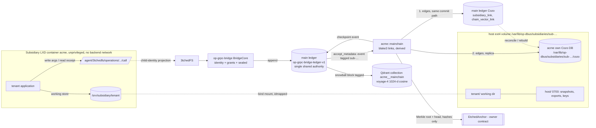
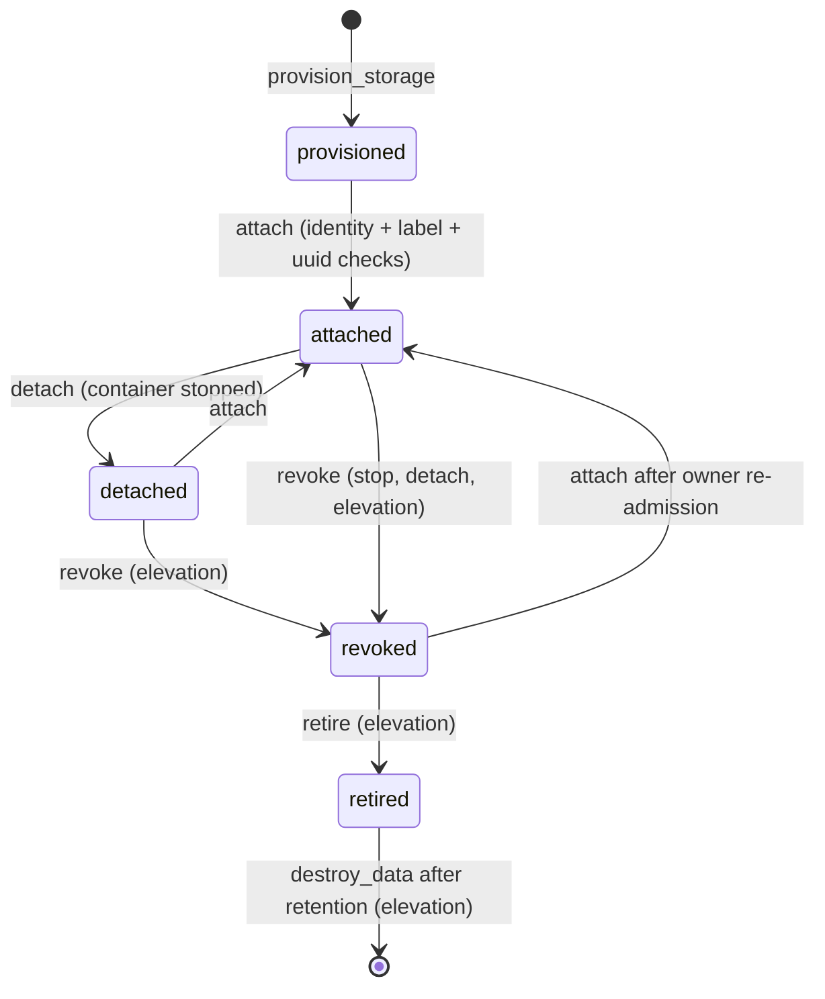

# Design — `subsidiary-activity-grouping`: all subsidiary activity grouped per subsidiary container

> **Storage decision (2026-11-20).** The host-owned `cozo/` on each subsidiary
> volume holds a typed footprint vector relation and an HNSW index. This
> supersedes the Qdrant collection design below. Use the registry's verified
> chain identity `<subsidiary>::mainchain` and its verified storage binding
> for routing. On receive, persist the
> vector, its local edges, and its indexing progress in the subsidiary database.
> Store main-ledger lineage separately. Retained Btrfs vectors and timing
> records are the source for rebuilding a lost index. Scoped searches open only
> the database selected by admission.

## Overview

A subsidiary is one child identity in one LXD container
(`provisioning-system-subsidiary` Req 8; `subsidiary-container`). This design
groups all of its activity under one `subsidiary_id` and one chain id
`<subsidiary_name>::mainchain` by:

1. a **registry** that mints the id, holds the immutable name, and binds both to
   the child principal and the container (Req 1);
2. two optional, hashed **tag fields** on `ChainEvent`, plus a subsidiary
   reference on every receipt and audit-type record (Req 2);
3. a **derived per-subsidiary chain `<name>::mainchain`** over the single
   shared main ledger, whose head and Merkle roots are what gets anchored
   (Req 3, 4);
4. a sealed **`subsidiary` plugin** that owns the lifecycle and the
   caller-scoped read surface, reached only through call files (Req 5–8, 10);
5. **each subsidiary's own Cozo/RocksDB** on its own host ext4 volume (Req 7);
6. **one Qdrant collection per subsidiary chain**, `<name>__mainchain`,
   voyage-4, 1024-d cosine (Req 9);
7. **dual-written Cozo edges**: main Cozo first (authoritative), then
   the subsidiary's own Cozo DB as a rebuildable replica (Req 12);
8. **chain edges** in a new `subsidiary_chain_edge` relation, written in the
   same pass as the Qdrant upsert (Req 13);
9. a **topology graph** per subsidiary, built on the existing `system_graph`
   snapshots, holding a full inventory of the container and the host side it
   depends on, with owner, change authority and domain on every node, and
   drift against the sealed release (Req 14–17);
10. an **allowed resources list** per subsidiary: a typed, extensible
   allowlist of consumables (agent, persona, workflow, notebook, chat_mode,
   ui_generator, tool, model, skill), never infrastructure, stored as data
   and enforced only by the existing grant/capability gate (Req 18).

Nothing here adds authority. Admission stays `identity ∧ grants ∧ sealed` in
the bridge (Req 11.3). The subsidiary id is always *resolved* from the
admitted principal, never *asserted* by a caller.

Labels: **Found** = read on `origin/dev` `879e7d7`. **New** = proposed by this
spec; nothing with that label exists today. **Assumed** = needs confirmation
(see Open Questions).



## Grounding: what exists today (Found)

| Area | Code | Relevant fact |
|---|---|---|
| Event shape | `op-state-store/src/event_chain.rs` `ChainEvent` | Hashed fields go through `CanonicalEventPayload`; `sealed_id_digest` was added as `Option` with `skip_serializing_if = "Option::is_none"` in both the struct and the canonical payload, so old hashes are unchanged. `user_id`, `conversation_id`, `action_origin` are **not** hashed. Hash is `md5` over canonical JSON (`compute_hash`). |
| In-memory chain | `EventChain` | One `Vec<ChainEvent>`, monotonic `event_id`, constant genesis `compute_hash_str("genesis")`, md5 Merkle `EventBatch`/`MerkleProof`, linear filters `events_for_plugin`, `events_touching_tag`. |
| Authoritative ledger | `op-grpc-bridge/src/core_persistence.rs` `PersistentCore` | One Cozo append ledger `op-grpc-bridge-ledger-v1` via `CozoGraphShuttle::append_session_event`; `walk_records` requires contiguous `seq`, `event_id = seq + 1`, `prev_hash` linkage, `event.verify()`, and `input_payload == {"record_digest": blake3(owner, action)}`. One `tip`, a `failure` latch, `recover_pending`. |
| Per-scope heads precedent | `PersistentCore::accept_metadata` | Already derives `heads: BTreeMap<(StateScope, plugin), ProjectionHead>` from the one ledger on every accepted record. |
| Scope | `op-grpc-bridge/src/core.rs` `StateScope` | `Public` or `Private { principal_id, session_id }`, "selected only by the admitted runtime, never from a caller's JSON body". |
| Record kinds | `LedgerAction` | `State`, `Attempt` (with `DelegationAttribution`), `Control` (`ExecutionRecord`), `Terminal`. |
| Receipts | `op-state-store/src/method_receipt.rs` `MethodExecutionReceipt`, built in `core_operations.rs` | `operation_id`, attempt/terminal `event_id`+`event_hash`, `plugin_id`, `method`, `result`. FUSE terminal receipts (`_3tched-fs/src/mounted.rs`) carry `plugin_id, method, subid, required_capability, side_effect, idempotent, result`; `op-mcp-door/src/fusecall.rs::terminal_receipt` checks those and ignores extra keys. |
| Execution | `op-execution-tracker` `ExecutionContext`, `DelegationAttribution`, `ExecutionRecord` | `deny_unknown_fields` on context and attribution. |
| Door | `op-mcp-door/src/audit.rs` `AuditRecord`; `grants.rs` `DurableGrants`, `EphemeralGrant`, `GrantStore`, `Ticket`, `TicketStore` | Records carry `principal_id`; JSONL to svlogd. |
| Grants | `op-grpc-bridge/src/grant_document.rs` | Exact principal keys, closed `GRANT_GROUPS`, no `*`. |
| Elevation | `op-plugins/src/state_plugins/elevation.rs`, bridge `task_elevation.rs` | `protected_actions()` list, polkit-style action ids, one-time tickets (`TICKET_TTL_SECONDS = 60`). |
| Footprints | `op-grpc-bridge/src/mutation_engine.rs::event_to_footprint` | Flat metadata keys (`actor_id`, `session_id`, `sealed_id_digest`, …) beside the lossless event. **Note:** `mutation_engine.rs` and `chain_vector_projector.rs` are not declared in `op-grpc-bridge/src/lib.rs` (HANDOFF 2026-11-17); the linked chain is `BridgeCore`. |
| Vectors | `op-cognitive/src/chain_vectors.rs` | One `ChainVectorIndex` = one `collection` (`OPDBUS_QDRANT_SNOWBALL_COLLECTION`, default `snowball_footprints`), `DEFAULT_DIMS = 1024`, `ensure_collection` creates `Distance::Cosine` idempotently and tolerates "already exists"; Voyage (`voyage-4` family, Matryoshka, `fit_dims`). Origin embeds into the chain `vectors/` subvolume only; the replica upserts after `btrfs receive` (`ingest_received`, watermark file `.vector-index-block`, `missing_from_index` gap probe); point id = uuid v5 of `block:<n>`. Payload allow-list `actor_id, session_id, sealed_id_digest, capability_id, decision`; `search_session_events` filters `actor_id` + `session_id` from admission; `chain_links` feeds `CozoGraphShuttle::replace_chain_vector_links` (relation `chain_vector_link { point_id, kind => value }`, `op-cozo-store/src/lib.rs`), written before the point is upserted ("a visible point suppresses gap retries"); `upsert_session_ledger` (sled ledgers, `runtime_sled_ledger.rs`) also writes `chain_vector_link` rows with a `collection` kind. |
| Subids | `op-oscal-subid` | `<category>.<component-type>.<subject>.<verb>[.<facet>]{0,2}[@vN]`; categories `src prj sch mut obs evt exp`; types include `service`, `container`, `data`, `lxd`. |
| Graph relations | `op-cozo-store/src/lib.rs` `graph_node`, `graph_edge { src, rel, dst => props }` (`store_edge`, `query_edges_from`); `system_graph.rs` `system_graph_state/nodes/edges { namespace, … }`, `GraphSnapshot`, `replace_system_graph`, `traverse_system_graph`, `GraphProvenanceKind::{Source, PreparedRelease, ObservedRuntime}` | Namespaced, revisioned, digest-receipted snapshots with bounded fixed queries. `ObservedRuntime` has no producer today. |
| Inventory | `op-cozo-store/src/bin/inventory/mod.rs` (`system_graph_inventory`) | Offline, prepared-release only ("never opens a live service"): file nodes with owner uid/gid/mode, `runit_service`, `sealed_plugin`, `unresolved_path`; relations `contains`, `depends_on`, `starts`, `references_path`, `configured_by`, `runs_bin`, `sealed_in`; secrets as protected, not read. No packages, ELF linkage or live state. |
| Cozo | `op-cozo-store` `CozoGraphShuttle` | `new_persistent_private` (0700 boundary), `ensure_distinct_from` (domain owners never share a handle). No backup/restore wrapper exists. |
| Container | `subsidiary-container` design | Labels `user.opdbus.*`, `opdbus-subsidiary` profile with `security.idmap.isolated=true`, backend channel bind `shift: true`. |

## Key decision: chain topology (Req 3) — owner-confirmed

Owner decision (2026-11-19): keep the single shared main ledger; no
per-subsidiary authoritative ledger. Each subsidiary's derived chain is named
`<subsidiary_name>::mainchain`. Three options were evaluated against `event_chain.rs` and `core_persistence.rs`.

| Option | For | Against | Verdict |
|---|---|---|---|
| **A. Separate authoritative chain per subsidiary** (own `EventChain` / own Cozo ledger, own genesis) | Physical isolation; moves with the subsidiary | `PersistentCore` is a single append owner: one `tip`, contiguous `seq`, one `failure` latch, one `recover_pending`. N ledgers means N recovery paths and no atomic append for operations that touch both host and subsidiary (grant proposals, attach/detach, revoke). `EventChain` genesis is the constant `md5("genesis")`, so independent chains are indistinguishable at genesis and splice-able. Global order, `journal_events`, `verify_journal`, `heads` and the operations index all assume one ledger. A subsidiary-writable chain would also sit on a volume the container mounts. | Rejected |
| **B. Namespace only in the main chain** (tag + filter) | Smallest change; one authority | The only head is the global head: anchoring it ties every receipt to all other activity, and a holder's proof needs the whole chain's linkage. Not self-contained for export/move. | Rejected alone |
| **C. Namespace in the main chain + derived per-subsidiary chain `<name>::mainchain`** | Keeps one authority (A's problems vanish); a per-subsidiary head and Merkle roots exist for anchoring (B's problem vanishes); derived exactly like `accept_metadata` derives `heads` today; rebuildable from `walk_records`; blake3 like `binding()` | One more index to keep consistent (checked on reopen, Req 3.4) | **Chosen** |

Rationale in one line: the ledger stays the single source of truth, and each
subsidiary gets a head that is a pure function of that ledger, committed back
into it by checkpoint events, and anchored with hashes only.

Hash function: link hashes, Merkle roots and anchor payloads use **blake3**
(**New**). The main chain keeps `md5` unchanged (changing it is out of scope);
each link commits to the md5 `event_hash` *and* the blake3 `record_digest`
already in `input_payload`, so the anchored value is not weaker than blake3
over the record. See Open Question 9.

## Components and Interfaces

### 1. Subsidiary registry (Req 1) — **New**

Cozo relations in the **bridge's** private Cozo DB (the one `PersistentCore`
opens with `new_persistent_private`, i.e. the main ledger Cozo). The registry
is never replicated into a subsidiary's own Cozo DB or `tenant/`:

```
subsidiary { subsidiary_id: String =>
  subsidiary_name: String,  # immutable, unique forever
  chain_id: String,         # "<subsidiary_name>::mainchain"
  qdrant_collection: String,# "<subsidiary_name>__mainchain"
  collection_state: String, # pending|ready|read_only|deleted
  replica_path: String,     # <volume>/cozo
  principal_id: String, parent_session_id: String,
  lxd_instance: String, lxd_instance_uuid: String,
  volume_path: String, schema_bundle_sha256: String,
  state: String,            # provisioned|attached|detached|revoked|retired
  anchor_tag_key_ref: String, receipt_salt_key_ref: String,   # key file refs, never key bytes
  registered_event_id: Int, updated_event_id: Int }
subsidiary_by_name      { subsidiary_name: String => subsidiary_id: String }   # never deleted
subsidiary_by_principal { principal_id: String => subsidiary_id: String }
subsidiary_by_instance  { lxd_instance_uuid: String => subsidiary_id: String }
```

- Mint: `sub-<uuid v4>` (`uuid` is already a workspace dependency).
- **Name rules (Req 1.8–1.11):** `subsidiary_name` is given by the owner at
  `register`, matches `^[a-z][a-z0-9-]{1,30}[a-z0-9]$` (3–32 chars, lowercase
  letters, digits, single hyphens; no `_`, no `:`, no `--`), and is not one of
  `main mainchain host owner public system root snowball`. It is unique across
  all subsidiaries ever registered (`subsidiary_by_name` rows survive
  retirement and destruction), and immutable: there is no rename method. The
  name and `sub-<uuid>` map 1:1 both ways. `subsidiary_id` stays the internal
  key for tags, relations and paths; the name is used only for the chain id and
  what is derived from it.
- **Derivations** from `chain_id = "<subsidiary_name>::mainchain"` only:
  genesis, Qdrant collection name (`::` → `__`), anchor tag. Because names
  never contain `_` or `:`, the collection name maps back to exactly one chain
  id.
- Bindings come from the registration call's verified inputs: the child
  `principal_id` and `parent_session_id` from the child identity planned by
  `provisioning-system-subsidiary` step 10, and the instance name and
  `volatile.uuid` read with `lxd.get_instance` (**Found** operation). Label
  `user.opdbus.subsidiary_id` set with `lxd.update_instance` (etag flow, as
  `subsidiary-container`).
- Resolution: `SubsidiaryResolver::for_scope(&StateScope) -> Option<SubsidiaryRef>`,
  `Public → None`, `Private { principal_id, .. } → subsidiary_by_principal`.
  Called inside `PersistentCore::append` before the event hash is computed.
- Attach-time check (Req 1.5): label == registry id, `volatile.uuid` ==
  `lxd_instance_uuid`, attached sled `session_id` == child session. Any
  mismatch → no attach, denied event.
- Rebind (Req 1.6): `subsidiary.rebind_container` updates
  `lxd_instance(_uuid)` and records both UUIDs.

### 2. Tagging (Req 2)

**`ChainEvent` (op-state-store) — New fields**

```rust
#[serde(default, skip_serializing_if = "Option::is_none")]
pub subsidiary_id: Option<String>,
#[serde(default, skip_serializing_if = "Option::is_none")]
pub subsidiary_role: Option<SubsidiaryRole>,   // "actor" | "subject"
```

Added to `CanonicalEventPayload` with `skip_serializing_if = "Option::is_none"`
exactly like `sealed_id_digest`, so every existing event's canonical bytes and
hash are unchanged (Req 2.3, 11.1). `LegacyCanonicalEventPayload` is not
touched. Readers built before this change will fail `verify()` on tagged
events, so rollout is readers-first (see Error Handling).

**Where each record gets its tag**

| Record | Code | Tag source | Change |
|---|---|---|---|
| Ledger event (all `LedgerAction` kinds) | `PersistentCore::append` | `SubsidiaryResolver` on `owner`; `role = actor` | New lines before `event.compute_hash()` |
| Host-side lifecycle events | `subsidiary` plugin methods | registry entry of the target; `role = subject` | New |
| `lxd.*` calls on a registered instance | bridge, after resolving the target instance name through `subsidiary_by_instance` | `role = subject` | New; Open Question 13 |
| Method receipt | `MethodExecutionReceipt` in `core_operations.rs` | from attempt event | New optional `subsidiary: Option<SubsidiaryReceiptRef>` |
| Recovery record | `MethodReceiptRecovery` | same | New optional field |
| Execution | `ExecutionContext`, `DelegationAttribution` (op-execution-tracker) | resolver, executor and requestor sides | New optional `executor_subsidiary_id`, `requestor_subsidiary_id` (`deny_unknown_fields` ⇒ readers-first) |
| Door audit | `op-mcp-door` `AuditRecord` | principal → registry snapshot file (below) | New optional `subsidiary_id` |
| Ephemeral grant / ticket consumption | `GrantStore::consume`, `TicketStore::consume` audit lines | principal → registry snapshot | New optional `subsidiary_id` in the audit record of the consume |
| Footprint | `event_to_footprint` (unlinked today) | `event.subsidiary_id` | New metadata key; applies when the file is linked again |
| FUSE terminal receipt | `_3tched-fs` `mounted.rs` | from `MethodExecutionReceipt.subsidiary` | New optional key `subsidiary`; owned by the FUSE contract (Open Question 14) |

The door has no Cozo handle; it reads a root-owned, bridge-written
`/run/op-dbus/subsidiary-principals.json` (**New**: `{principal_id: subsidiary_id}`,
no other fields), re-read on mtime change like `DurableGrants`.

Fail closed (Req 2.5): if the resolver errors (registry unreadable), the
append fails with the existing "outcome unknown; do not retry" path — never an
untagged write.

### 3. Derived link chain, checkpoints and anchors (Req 3, 4) — **New**

Module `op-state-store/src/subsidiary_chain.rs` (pure types + hashing, no IO):

```rust
pub struct SubsidiaryLink {
    pub chain_id: String,            // "<subsidiary_name>::mainchain"
    pub subsidiary_id: String,
    pub seq: u64,                    // 1-based, contiguous per subsidiary
    pub prev_link_hash: String,      // blake3 hex; seq 1 uses genesis(chain_id)
    pub ledger_event_id: u64,
    pub ledger_event_hash: String,   // md5 hex from ChainEvent.event_hash
    pub record_digest: String,       // blake3 hex from input_payload.record_digest
    pub role: SubsidiaryRole,
    pub kind: String,                // "attempt"|"terminal"|"state"|"control"|"lifecycle"|"checkpoint"|"anchor"
    pub receipt_leaf: Option<String>,// blake3 hex, terminal links only
    pub link_hash: String,
}
genesis(chain_id) = blake3("op-subsidiary-genesis@v1\0" || chain_id)
link_hash     = blake3(canonical_json(link without link_hash))
receipt_leaf  = blake3(salt || canonical_json(receipt without subsidiary.salt))
salt          = blake3::keyed_hash(receipt_salt_key[sid], ledger_event_hash)   // deterministic, rebuildable by the host only
anchor_tag    = blake3::keyed_hash(anchor_tag_key[sid], "op-subsidiary-anchor@v1\0" || chain_id)
merkle        = binary blake3 tree over link_hash (leaf = receipt_leaf when present),
                odd node promoted, same shape as EventBatch/MerkleProof but blake3
```

- **Index:** relation `subsidiary_link { chain_id, seq => …link fields }`
  in the main ledger Cozo DB, written in `accept_metadata` right after the
  ledger append succeeds (same place `heads` is updated), then replicated to
  the subsidiary's own Cozo DB (section 9b). On `open`, `walk_records`
  rebuilds links in memory and compares with stored rows (Req 3.4): mismatch
  latches `failure` like any other ledger inconsistency.
- **Checkpoint** (Req 3.5): `subsidiary.checkpoint` appends a
  `LedgerAction::State` record (no publication) with
  `OperationType::Custom("subsidiary_checkpoint")`, tagged `subject`, whose
  bound action carries `{seq, link_hash}`. Cadence: on every anchor, on
  detach/revoke/retire, and on owner request.
- **Anchor payload** (Req 4.1–4.2), hashes and integers only:

```json
{ "format": "op-subsidiary/anchor@1",
  "anchor_tag": "<blake3 hex>", "batch_root": "<blake3 hex>",
  "first_seq": 101, "last_seq": 200,
  "head_link_hash": "<blake3 hex>", "prev_batch_root": "<blake3 hex | null>" }
```

  This is the full interface this spec asks of the owner's EtchedAnchor
  contract (**Assumed** field mapping; Open Question 2). Submission is out of
  scope (networking deferred; local chain). `subsidiary.record_anchor` takes
  the payload hash and an opaque owner-supplied `anchor_ref` (e.g. tx hash) and
  appends an `anchor` link.
- **Holder-only proofs** (Req 4.3–4.7): the salt is only in the receipt given
  to the caller and in owner exports; the anchored root reveals nothing. The
  offline verifier is a small bin `op-subsidiary-verify` (**New**, in
  `op-state-store` `src/bin/`) that recomputes leaf → root and compares with
  the anchor payload; no network, no backend.

### 4. `subsidiary` sealed plugin (Req 5–8, 10) — **New**

`op-plugins/src/state_plugins/subsidiary.rs`, sealed into the catalog like
every plugin, reached only through call files. Methods, capabilities and
subids (all **New**; capability form follows `cap.lxd.*@v1`):

| Method | Caller | Capability | Subid | Notes |
|---|---|---|---|---|
| `register` | owner | `cap.subsidiary.register@v1` | `mut.service.subsidiary.register@v1` | name + mint id, chain id, bindings, schema bundle digest, key files, own Cozo DB, Qdrant collection |
| `rebind_container` | owner | `cap.subsidiary.rebind_container@v1` | `mut.service.subsidiary.rebind@v1` | Req 1.6 |
| `provision_storage` | owner | `cap.subsidiary.provision_storage@v1` | `mut.data.subsidiary.provision@v1` | Req 7.1, 7.3 |
| `attach` / `detach` | owner | `cap.subsidiary.attach@v1` / `…detach@v1` | `mut.data.subsidiary.attach@v1` / `…detach@v1` | via `lxd.update_instance` disk device |
| `snapshot` | owner | `cap.subsidiary.snapshot@v1` | `mut.data.subsidiary.snapshot@v1` | Req 7.5 |
| `export_bundle` (move) | owner | `cap.subsidiary.export_bundle@v1` | `exp.data.subsidiary.bundle@v1` | Req 7.6 |
| `revoke` | owner + elevation | `cap.subsidiary.revoke@v1` | `mut.service.subsidiary.revoke@v1` | protected task `org.opdbus.v1.subsidiary.revoke` |
| `retire` / `destroy_data` | owner + elevation | `cap.subsidiary.retire@v1` / `…destroy_data@v1` | `mut.service.subsidiary.retire@v1` / `mut.data.subsidiary.destroy@v1` | protected tasks `org.opdbus.v1.subsidiary.retire`, `…destroy-data` |
| `checkpoint` | owner | `cap.subsidiary.checkpoint@v1` | `evt.service.subsidiary.checkpoint@v1` | Req 3.5 |
| `prepare_anchor` / `record_anchor` | owner | `cap.subsidiary.prepare_anchor@v1` / `…record_anchor@v1` | `exp.service.subsidiary.anchor@v1` / `evt.service.subsidiary.anchor@v1` | Req 4 |
| `get_identity` | self / owner | `cap.subsidiary.get_identity@v1` | `obs.service.subsidiary.identity@v1` | self = own id only |
| `get_head` | self / owner | `cap.subsidiary.get_head@v1` | `obs.service.subsidiary.head@v1` | |
| `list_activity` | self / owner | `cap.subsidiary.list_activity@v1` | `obs.service.subsidiary.activity@v1` | paged links |
| `rollup` | self / owner | `cap.subsidiary.rollup@v1` | `obs.service.subsidiary.rollup@v1` | Req 8.1 |
| `rollup_parent` | owner only | `cap.subsidiary.rollup_parent@v1` | `obs.service.subsidiary.rollup.parent@v1` | Req 8.2 |
| `export_receipts` | self / owner | `cap.subsidiary.export_receipts@v1` | `exp.service.subsidiary.receipts@v1` | Req 8.3–8.4 |
| `prove_receipt` | self / owner | `cap.subsidiary.prove_receipt@v1` | `obs.service.subsidiary.proof@v1` | Req 4.6 |
| `verify` | self / owner | `cap.subsidiary.verify@v1` | `obs.service.subsidiary.verify@v1` | Req 3.6 |
| `reconcile_replica` | owner | `cap.subsidiary.reconcile_replica@v1` | `mut.data.subsidiary.reconcile@v1` | Req 12.5–12.6 (also run automatically) |
| `rebuild_replica` | owner | `cap.subsidiary.rebuild_replica@v1` | `mut.data.subsidiary.rebuild@v1` | Req 12.7, 12.9 |
| `topology_nodes` / `topology_edges` / `topology_traverse` / `topology_status` | self / owner | `cap.subsidiary.topology_read@v1` | `obs.service.subsidiary.topology@v1` | Req 14.5; wraps the fixed system-graph queries |
| `refresh_inventory` | owner | `cap.subsidiary.refresh_inventory@v1` | `obs.service.subsidiary.inventory.refresh@v1` | Req 15.6 |
| `drift` | owner | `cap.subsidiary.drift_read@v1` | `obs.service.subsidiary.drift@v1` | Req 17 |

Scope rule (Req 6.2–6.3): read methods take an optional `subsidiary_id` or
`subsidiary_name` argument that is honoured only for the owner. For a subsidiary caller the
scope is its resolved id; a different id gets the same "not found" response as
a nonexistent one. Registry state is private-scope only (Req 6.4).

Elevation (Req 5.4, 10.1): the three destructive methods are added to
`elevation::protected_actions()` and enforced by the existing
`task_elevation` choke point; and `task_elevation` refuses any protected task
whose caller resolves to a subsidiary.

### 5. Grant scope (Req 5)

- Durable: the child principal's own entry in the grant document (**Found**
  contract). The script/plugin only writes grant-delta proposals in the
  existing `op-provisioning/grant-delta@1` format.
- Ceiling (**New**): `ceiling(sid) = caps(parent principal) − {shell, exec,
  admin, secret classes}` computed with the same classification
  `provisioning-system-subsidiary` step 11 uses, cached per grant-document
  mtime. Admission adds one check for subsidiary callers: `capability ∈
  ceiling`. This narrows, never widens, admission.
- Ephemeral grants and tickets: `GrantStore::find`/`consume` and
  `TicketStore::consume` refuse a subsidiary principal + capability outside the
  ceiling (door reads the ceiling from a bridge-written
  `/run/op-dbus/subsidiary-ceilings.json`, **New**).
- Revoke: `GrantStore::revoke` for each grant naming the principal; tickets
  for it are deleted unconsumed; grant-delta removing the durable entry.

### 6. FUSE view (Req 6)

The view is the child identity's existing projection (`subsidiary-container`
Req 4; **Assumed** to be grant-filtered by the shared FUSE toolset projection,
Open Question 3 there). This spec adds only the `subsidiary` plugin's read
operations to it. No routing, no runtime introspection: the bridge never
executes anything in the container, never routes on its schemas and never
reads its `tenant/` working directory; the pre-generated schema bundle is
recorded by digest at registration and on change, and is otherwise opaque.
The only container inspection is the read-only, host-side inventory of its
storage (section 13, Req 15.4).

### 7. Each subsidiary's own Cozo/RocksDB on host ext4 (Req 7)

Layout per subsidiary (**New**; backing device is Open Question 3):

```
/var/lib/op-dbus/subsidiaries/<subsidiary_id>/   ext4 filesystem, one per subsidiary
  cozo/                                       the subsidiary's own Cozo DB (RocksDB);
                                              bridge is the only writer; replica of its edges (9b)
  tenant/                                     container working directory (RocksDB dirs the
                                              tenant application opens); the only thing mounted
  host/                                       root:root 0700, never mounted into the container
    keys/receipt-salt.key, keys/anchor-tag.key  0600, 32 random bytes each
    snapshots/<stamp>.tar.zst  + .blake3
    diverged/<stamp>/                         quarantined replica copies (Req 12.7)
    exports/<stamp>/                          op-subsidiary/receipts@1 + bundle manifest
```

- Why two RocksDB areas on one volume: RocksDB admits one writer process per
  directory (`LOCK`), and the dual-written edges (Req 12) are written by the
  bridge while the container runs. So the subsidiary's own Cozo DB (`cozo/`)
  is bridge-written and never mounted, and the container's application gets
  `tenant/` for its own RocksDB dirs. Both live on the subsidiary's volume and
  move, snapshot and revoke together. Open Question 11 asks whether you want
  this split or one DB that the container reaches only through call files.
- The bridge opens `cozo/` with `CozoGraphShuttle::new_persistent_private`
  (0700 boundary) as a separate handle per subsidiary; `ensure_distinct_from`
  is checked against the main ledger handle and every other subsidiary's
  handle, so no two domain owners share a DB.
- Device on the instance: `tenant: {type: disk, source:
  /var/lib/op-dbus/subsidiaries/<subsidiary_id>/tenant, path: /srv/subsidiary/tenant,
  shift: true}` through `lxd.update_instance` (**Found** operation). `shift:
  true` uses an idmapped mount: on the host `tenant/` stays owned by root
  (0700), and inside the container it appears owned by the container's root,
  with no other unprivileged user able to reach it (Req 7.3). Fallback when
  idmapped mounts are unavailable: `chown` `tenant/` to
  `volatile.idmap.base` (read via `lxd.get_instance`). Open Question 4.
- This adds one device to the `subsidiary-container` Req 5.5 allow-list
  (root, overlay, NIC, backend channel). That spec must be amended to allow
  `tenant` (Open Question 12).
- The host never opens `tenant/` while attached (Req 6.5).
- State machine (Req 7.4):



- Snapshot (Req 7.5): pause the replica writer for `cozo/` (the bridge owns
  it, so no container stop is needed for that part); include `tenant/` only
  in `detached`/`revoked`. Archive as-is, blake3 + size into a `lifecycle`
  event. A live `tenant/` snapshot needs block-level snapshots (Open
  Question 3).
- Move (Req 7.6): replica must be `current` (Req 12.8); bundle = last volume
  snapshot + receipt export + registry record (public fields only, key refs
  not keys unless the owner asks) + manifest with blake3 of each file;
  manifest digest into a ledger event.

### 8. Rollups and export (Req 8)

Rollups are Cozo queries over `subsidiary_link` in the **main ledger Cozo**
(authoritative, Req 12.2) joined to the ledger rows by `ledger_event_id`
(plugin, method, decision from the event; outcome from `Terminal.status`).
Bounded to 1000 groups / 1000 links per page with an opaque cursor = last
`seq`. `rollup_parent` groups by `parent_session_id`.

Export `op-subsidiary/receipts@1`:

```json
{ "format": "op-subsidiary/receipts@1", "chain_id": "acme::mainchain",
  "subsidiary_id": "sub-…",
  "window": {"first_seq": 1, "last_seq": 200},
  "links": [ … ], "receipts": [ {MethodExecutionReceipt + subsidiary ref incl. salt} ],
  "proofs": [ {"seq": 7, "siblings": [["<hash>", true], …], "batch_root": "…"} ],
  "checkpoints": [ … ], "anchors": [ {"payload": {…}, "anchor_ref": "…"} ] }
```

Exports contain the ledger events' hashes, not their payloads; bridge ledger
events already carry only `{"record_digest"}` as `input_payload`.

### 9. One Qdrant collection per subsidiary chain (Req 9)

Owner decision (2026-11-19): the chain ends up in Qdrant anyway, so each
subsidiary chain gets its own collection instead of a payload partition of
the shared one.

- **Name** (Req 9.1): `collection(chain_id) = chain_id.replace("::", "__")`,
  e.g. `acme::mainchain` → `acme__mainchain`. `__` is used because `:` is not
  a safe Qdrant collection-name character (**Assumed**: Qdrant stores
  collections as directories; Open Question 15). Names never contain `_`, so
  the mapping is reversible and cannot collide with `snowball_footprints` or
  the nine voyage-4 code collections; `register` still probes
  `collection_exists` and refuses a collision it does not own.
- **Parameters** (Req 9.2): identical to the shared index —
  `VectorParamsBuilder::new(1024, Distance::Cosine)`, voyage-4 embeddings,
  `fit_dims` to 1024. Point id = `ledger_point_id(event_hash)` (section 9c),
  same payload allow-list plus `subsidiary_id` and `chain_id` for provenance.
- **Creation** (Req 9.2): `register` calls a new
  `chain_vectors::ensure_subsidiary_collection(name)` that reuses the body of
  `ensure_collection` (idempotent, tolerant of "already exists"). If Qdrant is
  unreachable (it is not running on antix1 today), registration succeeds with
  `collection_state = pending`; ingest calls the same function before the
  first upsert and flips the state to `ready` with a tagged event.
- **Routing** (Req 9.3–9.4): `ChainVectorIndex` keeps one embedding pass over
  the one chain and one `.vector-index-block` watermark; per block it picks
  the target collection: `subsidiary_id` in `data.metadata` → that
  subsidiary's collection, else the shared collection. Origin/replica rules
  are unchanged: origin only attaches vectors to the chain `vectors/`
  subvolume; the replica upserts after `btrfs receive`; direct origin upsert
  stays the manual exception. `missing_from_index` probes each block in the
  collection it was routed to.
- **Cozo edges** (Req 12.1, 13): written in the same pass as the upsert, see
  section 9c.
- **Search** (Req 9.5–9.6): `search_session_events` gains a
  `collection` selected by the caller's admission — a subsidiary caller gets
  its own collection only and any argument is ignored; other callers get the
  shared collection; only the owner may pass a subsidiary name, resolved
  through `subsidiary_by_name`.
- **Sled ledgers**: `upsert_session_ledger` routes a subsidiary principal's
  points to its collection the same way.
- **Retire / retention / delete** (Req 9.7–9.8): `retire` sets
  `collection_state = read_only` (router drops new points for it, searches
  still work for the owner); `destroy_data` after retention calls
  `delete_collection` and records a tagged event with the last point count;
  `reindex_from_chain` and `ingest_received` skip blocks of retired
  subsidiaries; `subsidiary_by_name` keeps the name so the collection name is
  never reused.

### 9b. Dual-written Cozo edges (Req 12) — **New**

Edges = `subsidiary_link`, `subsidiary_anchor`, checkpoint rows,
`subsidiary_chain_edge` / `subsidiary_chain_point` rows (9c) and the
subsidiary's system-graph namespaces (section 12).

Consistency rule: **the main ledger Cozo is authoritative; the subsidiary's
own Cozo DB is a replica that is always rebuildable from the main ledger.**

| Step | Where | Failure handling |
|---|---|---|
| 1. Ledger append | `PersistentCore::append` → `append_session_event` | existing: "outcome unknown; do not retry", `failure` latch |
| 2. Main edges | `accept_metadata` (links) / `replace_chain_vector_links` (vector links) in the main ledger Cozo | existing latch: main ledger metadata failure is a bridge failure |
| 3. Replica edges | after 2 succeeds, `SubsidiaryReplica::apply(edges, seq)` — one Cozo transaction `:put` edges + `:put replica_meta { chain_id => applied_seq, head_link_hash }` | never fails the call (Req 12.4): mark `lagging`, remember `applied_seq` and an error code, one `replica_lag` event per episode |

- Idempotent keys (Req 12.3): `(chain_id, seq)` for links/checkpoints/anchors,
  `point_id` for vector links (same `rm`+`put` as `replace_chain_vector_links`).
  Re-applying an edge is a no-op.
- Replica states in the main registry: `current | lagging | diverged |
  rebuilding`, with `applied_seq`.
- Catch-up (Req 12.5): a per-subsidiary reconciler task re-applies from
  `applied_seq + 1` in order, back-off 1 s doubling to 5 min, until it reaches
  the main head, then `current` (tagged `replica_current` event).
- Open (Req 12.6): for each non-retired subsidiary, compare replica
  `replica_meta` and the last N links (and every link on owner request) with
  the main ledger Cozo; behind → `lagging` and catch up; equal → `current`.
- Divergence (Req 12.7): any replica edge that differs from the main edge with
  the same key, or a replica that fails to open/verify → `diverged`: stop
  writing, rebuild into `cozo.rebuild-<stamp>/` from the main ledger alone
  (walk `subsidiary_link` + `chain_vector_link` rows for the chain id), fsync,
  rename-swap, move the old directory to `host/diverged/<stamp>/`, record old
  and new blake3 digests in a tagged event.
- Gates (Req 12.8): `export_bundle`, `snapshot` for retirement and `retire`
  refuse unless `current`.
- Rebuild equivalence (Req 12.9): rebuild and incremental apply use the same
  edge encoder; a test asserts byte-equal relation dumps.
- The replica is never read for authority: rollups, proofs, `verify` and
  search routing use the main ledger Cozo. The replica exists so a
  subsidiary's volume is self-contained when moved or exported.

### 9c. Chain edges, written in the same pass as the Qdrant upsert (Req 13) — **New**

Nothing stores subsidiary chain edges today. Existing patterns it is modelled
on (**Found**): `graph_edge { src, rel, dst => props }` and
`store_edge` in `op-cozo-store/src/lib.rs`; `system_graph_edges { namespace,
src, relation, dst => evidence, attributes }` in `system_graph.rs` (namespace
as the first key, typed node ids, closed bounds); `chain_vector_link {
point_id, kind => value }` with `replace_chain_vector_links` (rm + put per
point, idempotent re-ingest); `ledger_point_id(event_hash)` = uuid v5 of
`ledger:<event_hash>` under `LEDGER_POINT_NAMESPACE`, and `LedgerPoint`
(`chain_vectors.rs` ~236–290).

**Relations** (identical schema in the main Cozo and in each subsidiary's
own Cozo DB):

```
:create subsidiary_chain_edge {
    chain_id: String,          # "<subsidiary_name>::mainchain"  (namespace-style first key)
    src: String,               # typed node id, always "event:<event_hash>" for chain edges
    relation: String,          # closed vocabulary below
    dst: String                # typed node id
    =>
    subsidiary_id: String,     # "sub-<uuid>"
    seq: Int,                  # subsidiary link seq of the event
    event_hash: String,        # ChainEvent.event_hash (md5 hex)
    ledger_event_id: Int,      # main ledger event id
    link_hash: String,         # blake3 link hash (section 3)
    point_id: String,          # ledger_point_id(event_hash), uuid
    collection: String,        # "<subsidiary_name>__mainchain"
    embedding_model: String,   # e.g. "voyage-4"
    evidence: String default "[]",   # JSON Vec<GraphEvidence>, as system_graph_edges
    props: String default "{}",      # JSON, as graph_edge
    written_at: Int            # unix seconds
}

:create subsidiary_chain_point {
    collection: String,
    point_id: String
    =>
    chain_id: String,
    seq: Int,
    event_hash: String,
    state: String,             # pending | indexed
    attempts: Int default 0,
    last_error: String default "",   # error code only, never payload text
    updated_at: Int
}
```

**Typed node ids and closed relation vocabulary** (Req 13.8), one row per
`(src, relation, dst)`; sources mirror today's `chain_links` kinds:

| relation | dst | from |
|---|---|---|
| `in_chain` | `chain:<name>::mainchain` | registry |
| `follows` | `event:<prev event_hash in this chain>` | link chain |
| `recorded_as` | `ledger:<ledger_event_id>` | ledger |
| `vectorized_as` | `point:<collection>/<point_id>` | this pass |
| `acted_by` | `principal:<actor_id>` | `data.metadata.actor_id` |
| `in_session` | `session:<session_id>` | `data.metadata.session_id` |
| `sealed_identity` | `sealed_id:<sealed_id_digest>` | `data.metadata.sealed_id_digest` |
| `used_capability` | `capability:<capability_id>` | `data.metadata.capability_id` |
| `called` | `method:<plugin_id>.<method_name>` | event |
| `on_plugin` | `plugin:<plugin_id>` | `block.category` |
| `has_subid` | `subid:<subid>` | `chain_links` `subid` |
| `in_operation` | `operation:<operation_id>` | ledger `Attempt`/`Terminal` |
| `in_conversation` | `conversation:<conversation_id>` | `chain_links` |
| `in_turn` | `turn:<turn_id>` | `chain_links` |
| `input_digest` | `digest:<input_patch_hash>` | `chain_links` |
| `decided` | `decision:allow` / `decision:deny` | `data.metadata.decision` |

No argument, result or schema text is ever an edge value; only ids and hashes.

**Point id** (Req 13.2): `ledger_point_id(event_hash)` (**Found** function).
Subsidiary collections use it instead of the block-number id, so the id and
all edge keys are a pure function of the event and survive reindexing.
Blocks without a timing record stay on the shared-collection orphan path.

**One pass, in order** (Req 13.3), inside `ingest_received` /
`reindex_from_chain` / the manual origin path, per subsidiary block:

1. Build edges + point id. Main Cozo, **one transaction**: `rm` every
   `subsidiary_chain_edge` with `(chain_id, src = event:<hash>)`, `put` the new
   rows, `put subsidiary_chain_point { state: pending, attempts+1 }`, and the
   existing `replace_chain_vector_links(point_id, …)` rows (kept for
   compatibility, with `collection` and `chain_id` kinds). Same "links first"
   rule as today.
2. Qdrant `upsert_points(…).wait(true)` into `<name>__mainchain`.
3. Main Cozo: `subsidiary_chain_point.state = indexed`.
4. Subsidiary own Cozo DB, one transaction: the same rm/put of edges, the point
   row (`indexed`), and `replica_meta.applied_seq` (section 9b).
5. Advance `.vector-index-block` only past blocks whose step 3 succeeded.

Failures (Req 13.4–13.7): step 1 fails → nothing upserted, watermark held,
pass reports the block; step 2 fails → rows stay `pending`, watermark held,
next pass re-upserts the same id (idempotent); step 3 fails → next pass sees
`pending`, probes Qdrant (`missing_from_index` already does `GetPoints` by
id), present → `indexed` with no re-embedding; step 4 fails → replica
`lagging` (Req 12.4), never fails the pass; the reconciler re-applies from
the main Cozo rows. Rebuild of a replica copies `subsidiary_chain_edge` /
`subsidiary_chain_point` rows for the chain id from the main Cozo.

**Which "main Cozo".** The vector pass today opens `COGNITIVE_COZO_DB_PATH`
(`ingest_received`), not the bridge ledger DB. Chain edges therefore live in
that main-side Cozo next to `chain_vector_link`; they are derived from the
main ledger (authoritative) and rebuildable from it plus the chain. Whether
that path is the same file as the bridge DB, and whether the replica host is
antix1 (where the subsidiary volumes are), is Open Question 17. If the vector
pass runs where the subsidiary volume is not mounted, step 4 is skipped and
the replica is marked `lagging` for the host-side reconciler.

### 10. Teardown and retention (Req 10)

`revoke` → `retire` → `destroy_data`, each elevated. Retire requires stopped
container, the `tenant` and backend-channel devices detached (checked via
`lxd.get_instance`) and a `current` replica. Retention default: the volume
(own Cozo DB, `tenant/`, `host/`) and the Qdrant collection are kept 90 days
after retire (**Assumed**, Open Question 8), then deleted only on an owner
`destroy_data`; main ledger events, main ledger Cozo edges, checkpoints and
anchors are kept forever.

### 11. Integration with existing 3tched (Req 11)

- Additive only: optional fields with `skip_serializing_if`, new relations,
  new plugin, new bin, a collection-routing step in `ChainVectorIndex`. No
  change to `StateScope`, `LedgerRecord`, `LedgerAction`, `binding()`,
  `LegacyCanonicalEventPayload`, md5 hashing, or the shared collection's
  parameters.
- No new admission path; the ceiling check only narrows.
- After retirement, the owner still sees everything through the main ledger
  (`journal_events`, `verify_journal`) and the main ledger Cozo edges, because
  they were always authoritative.
- `mutation_engine.rs` / `chain_vector_projector.rs` are unlinked today; their
  changes are specified but take effect only when relinked (Open Question 10).

### 12. Topology graph per subsidiary (Req 14) — reuses `system_graph`

**Reused (Found):** `GraphSnapshot`, `GraphNode { id, kind, label,
attributes }`, `GraphEdge { src, relation, dst, evidence, attributes }`,
`GraphEvidence { source, locator, assertion: declared|observed|inferred }`,
`GraphProvenance` with `GraphProvenanceKind::ObservedRuntime` (defined, not
used by any producer today), `replace_system_graph(snapshot,
expected_revision)` (one checked transaction per namespace, revision + sha256
digest receipt), `system_graph_status`, `list_system_graphs`,
`query_system_graph_nodes/edges`, `traverse_system_graph` (bounded, fixed
queries, no caller CozoScript), `system_graph_snapshot_digest`, bounds
(`MAX_SYSTEM_GRAPH_NODES = 50_000`, `MAX_SYSTEM_GRAPH_EDGES = 200_000`,
`MAX_SYSTEM_GRAPH_NAMESPACES = 256`).

**New:** namespaces, node kinds, relations, attribute contract, collectors,
the replication of a namespace into a subsidiary's own Cozo DB.

Namespaces (all `ObservedRuntime` except `release:*`):

| Namespace | Contents | Where |
|---|---|---|
| `release:<id>` | prepared release graph from `system_graph_inventory --prepared` (**Found**) | main |
| `inventory:host` | host-side inventory (section 13) | main |
| `baseline:subsidiary:<name>` | container inventory at provisioning (frozen) | main, replicated |
| `topology:subsidiary:<name>` | topology + full container inventory + the host-inventory closure it depends on | main, replicated |
| `drift:host`, `drift:subsidiary:<name>` | drift results (section 15) | main (subsidiary one replicated) |

Main-authoritative rule: every namespace is written by `replace_system_graph`
in the main Cozo first; the subsidiary's own Cozo DB gets the same snapshot
written with the same expected revision, and its receipt (revision + digest)
must equal the main receipt, else `diverged` → copy from main (Req 12.7).
Cross-namespace use is by copying: `topology:` includes the host nodes it
depends on (dependency closure from `inventory:host`), so one
`traverse_system_graph` call covers the whole picture.

Topology node kinds (ids are typed strings):

```
subsidiary:<sub-uuid>                     chain:<name>::mainchain
lxd_instance:<instance_uuid>              chain_head:<name>::mainchain
principal:<child principal_id>            anchor:<batch_root>
session:<parent_session_id>               qdrant_collection:<name>__mainchain
grant:durable:<principal_id>              cozo_db:<volume>/cozo
grant:ephemeral:<grant_id>                volume:<sub-uuid>
ticket:<ticket_id>                        volume_dir:<absolute path>
capability:<capability_id>                fuse_mount:<host mountpoint>
protected_action:<polkit action id>       namespace_view:<principal_id>
operation:<plugin>.<method>               lxd_device:<instance_uuid>/<device>
```

Topology relations (new): `runs_in` (subsidiary→lxd_instance),
`bound_to` (lxd_instance→principal), `child_of` (principal→session),
`has_grant` (principal→grant), `grants` (grant→capability),
`elevates_via` (operation→protected_action), `has_device`
(lxd_instance→lxd_device), `mounts` (lxd_device→fuse_mount|volume_dir),
`projects` (fuse_mount→namespace_view), `exposes`
(namespace_view→operation), `requires` (operation→capability), `on_volume`
(volume_dir→volume), `stored_in` (cozo_db→volume_dir), `owns_db`
(subsidiary→cozo_db), `vectorized_into` (chain→qdrant_collection),
`has_chain` (subsidiary→chain), `at_head` (chain→chain_head), `anchored_by`
(chain_head→anchor), `replicates` (cozo_db→chain). Reused from the prepared
inventory: `contains`, `depends_on`, `starts`, `references_path`,
`configured_by`, `runs_bin`, `sealed_in`.

Head/anchor nodes carry `seq`, `link_hash`, `anchor_ref`; the topology is
refreshed on checkpoint and anchor, not on every link (per-link data is in
`subsidiary_chain_edge`).

Queries (fixed, through `subsidiary.topology_*` read methods; owner may name
any subsidiary, a subsidiary only its own): node page by kind; neighbours of
a node by relation and direction; bounded traversal from `subsidiary:<id>`
(e.g. "what does acme's view expose and which capabilities guard it":
`subsidiary → runs_in → bound_to → has_grant → grants`; "what does a config
change affect": incoming `configured_by`/`references_path` from a
`config:` node); status/receipt per namespace.

Capacity: 4 namespaces per subsidiary + host ones against the 256 cap means
at most ~60 subsidiaries; Open Question 19.

### 13. Full inventory: collectors (Req 15)

**Reused from `op-cozo-store/src/bin/inventory/mod.rs` (Found)**: the bounded
`Builder` (`node`, `walk`, `edge`, `evidence`, `attrs`), `hash_file`
(no-follow, metadata-stable SHA-256), `sensitive(path)` and the "protected
content not read" handling for secrets, the runit/shell static analysis
(`scan_text`, `scan_to_fixed_point`, `sv_starts`, `wait_dep`/`depends_on`/
`starts` edges, `log/run` handling), `collect_consumers` (config → consuming
service), the sealed catalog reader (`plugin-blobs/.manifest.json` →
`sealed_plugin` nodes, `sealed_in` edges), `merge_edges`, `atomic_write`.
These live in a bin-private module today; task 21 moves them unchanged into a
library module `op-cozo-store/src/inventory/` so the CLI and the new
collectors share one implementation (the CLI's output must stay byte-equal on
its golden test). The CLI's `release:`/`source:` namespace rules stay as is.

**New collectors** (each returns nodes + edges + limitations; all read-only,
bounded, never execute inside a container, never read `tenant/`, secrets by
path only):

| Collector | Source | Nodes / edges |
|---|---|---|
| registry | main Cozo registry + link head + anchors | subsidiary, chain, chain_head, anchor, qdrant_collection, cozo_db, volume |
| lxd | `lxd.get_instance` / `lxd.get_profile` via call files | lxd_instance, lxd_device, profile; `has_device`, `mounts`; idmap base |
| identity & grants | child sled metadata, grant document (capability names only), `GrantStore::list`, ticket dir listing | principal, session, grant, ticket, capability; `child_of`, `has_grant`, `grants` |
| FUSE view | host `/proc/self/mountinfo` for the child projection; the view's `operations/*/metadata.json` | fuse_mount, namespace_view, operation; `projects`, `exposes`, `requires`, `elevates_via` |
| volume | `statx` of the volume and its dirs | volume, volume_dir; `on_volume`, `stored_in` |
| packages | detected per inspected root (Req 15.8). dpkg (default; antix1 is Debian with apt/dpkg, no pacman — checked 2026-11-19): `var/lib/dpkg/status` (Package, Version, Architecture, Status, Depends/Pre-Depends, Provides), `var/lib/dpkg/info/<pkg>[:arch].list` (files), `.md5sums` (shipped file digests, used for drift), `.conffiles` (marks config nodes). pacman, only if `var/lib/pacman/local` exists (other seed images): `*/{desc,files}`. Neither → limitation | `package:<manager>:<name>@<version>` with `manager: dpkg|pacman`, `arch`; `package_depends_on` (alternatives kept as `depends_on_any` attribute), `installs` (package→file), `declares_conffile` (package→config) |
| binaries | ELF headers of executables in `bin`, `sbin`, `libexec`, release roots | `binary:<path>` (sha256, build-id); `links_library` (DT_NEEDED → `shared_library:<soname>` → resolved file); `provided_by` (file→package) |
| crates | `.dep-v0` cargo-auditable section if present, else the active release's `source:` graph `ext_crate` nodes mapped by binary name | `crate:<name>@<version>`; `built_from_crate`, `crate_depends_on` |
| runit | reused scanner on the container's and host's service dirs | `runit_service`; `log_service_of`, `starts`, `depends_on`, `runs_bin`, `consumes_config`, `uses_mount` |
| configs | reused scanner + `collect_consumers` on `/etc`, op-dbus config roots | `config:<path>` (sha256), `secret_ref:<path>` (no hash, no read); `configured_by`, `references_secret` |
| sealed catalog | live `OP_BLOB_CATALOG_DIR` manifest + blob digests | `sealed_plugin`, `sealed_blob`; `sealed_in`, `implements` (plugin→operation) |

Container storage paths (base rootfs, overlay volume) come from
`lxd.get_instance` / storage-volume info; reading them is read-only from the
host (**Assumed** path resolution; Open Question 18). Host-side scope =
everything a subsidiary depends on: bridge, 3tched-fs, door, LXD, runit,
catalog, grant documents, its volume; `inventory:host` holds the whole host
set, `topology:` the closure.

Refresh (Req 15.6): lifecycle events (Req 14.4) refresh `topology:` (registry,
lxd, grants, FUSE, volume collectors; packages/binaries/runit/configs only on
register, provision, attach, rebind and periodic); release activation or
catalog reseal refresh `inventory:host` and every `topology:`; periodic full
refresh every 6 h and light refresh every 1 h (configurable). A refresh that
loses the `expected_revision` race re-reads and retries once, then reports.

### 14. Owner and domain on every node (Req 16)

Every node's `attributes` carries (**New** attribute contract; data only):

```json
"owner": {
  "unix": {"uid": 0, "gid": 0, "user": "root", "group": "root", "mode": "0644"},  // null for non-file nodes
  "principal": {"kind": "host_owner|subsidiary_principal|service_account|none", "id": "…"}
},
"change_authority": {"kind": "capability|protected_action|release|grant_delta|owner_procedure",
                     "ref": "cap.subsidiary.attach@v1 | org.opdbus.v1.catalog.promote | release:<id> | …"},
"domain": "host" | "container",
"container": {"subsidiary_id": "sub-…", "subsidiary_name": "acme",
              "lxd_instance": "sub-…", "lxd_instance_uuid": "…"}   // only when domain = container
```

Resolution rules (proposed defaults; Open Question 20):

| Node | domain | principal | change_authority |
|---|---|---|---|
| host package / binary / config / runit service | host | `host_owner` (service user as `service_account:<user>` for running services) | `release:<active id>` |
| sealed plugin / blob | host | `host_owner` | `protected_action:org.opdbus.v1.catalog.promote` / `…catalog.retire` (**Found**) |
| grant document entry | host | `host_owner` | `grant_delta` (owner materializer) |
| ephemeral grant / ticket | host | `host_owner` (issuer recorded) | `owner_procedure` (`grant`/`ticket` CLI) |
| LXD instance / device / profile | host | `host_owner` | `cap.lxd.instances.update_instance@v1`, `cap.lxd.profiles.*` |
| FUSE mount / view | host | `host_owner` | `owner_procedure` (shared FUSE contract) |
| volume, `cozo/`, `host/`, Qdrant collection, chain, head, anchor | host | `host_owner` | `cap.subsidiary.*@v1` method that changes it |
| container base packages / binaries / services / configs | container | `host_owner` (read-only base) | `owner_procedure` (reprovision) |
| container overlay files | container | `subsidiary_principal:<principal_id>` | `owner_procedure` (overlay reset) |
| `tenant/` directory node (not its contents) | container | `subsidiary_principal:<principal_id>` | `cap.subsidiary.attach@v1` / `…revoke@v1` |
| child principal, subsidiary | host | `host_owner` | `cap.subsidiary.register@v1` |

Ownership edges (Req 16.4): `owned_by` (node→`principal:`/`host_owner`/
`service_account:`), `unix_owner` (node→`unix_user:<uid>`), `unix_group`
(node→`unix_group:<gid>`), `change_authorized_by` (node→`capability:`/
`protected_action:`/`release:`). Container uids are recorded raw and, when
an idmap is known, also as `host_uid` attribute.

### 15. Drift against the sealed release (Req 17)

Baselines: host → the active `release:<id>` namespace (prepared graph) plus
the live sealed catalog manifest; container → `baseline:subsidiary:<name>`
frozen at provisioning (after the `provisioned-<stamp>` snapshot). Matching
key: path (via the release graph's `release_target` mapping, **Found**), or
package name, or plugin name. Drift kinds: `missing`, `extra`,
`hash_mismatch`, `version_mismatch`, `owner_mismatch`, `mode_mismatch`,
`unsealed_plugin` (schema hash differs from the catalog). Output: a
`drift:*` namespace whose nodes are the observed items and whose edges are
`drifts_from` (observed→baseline id) with attributes `{kind, expected,
observed}`; counts and digest go into a ledger event. Data only: nothing is
blocked (Req 17.4).

### 16. Allowed resources per subsidiary (Req 18) — **New**

A typed allowlist of **consumables**: things a subsidiary uses, not things it
runs on. Each entry is `(kind, resource_id)`. The list is data; the only
enforcement is the existing bridge gate (`identity ∧ grants ∧ sealed`), fed
by grant-delta proposals the owner applies (Req 5, 11.3).

**Kinds, bound to existing concepts (Found unless marked):**

| kind | resource_id is | existing concept (path) | capabilities an entry needs | argument constraint |
|---|---|---|---|---|
| `agent` | agent type, e.g. `rust-pro` | `op-agents` `AgentDescriptor` / `AgentSpec` (`agent_catalog.rs`, `agent_registry.rs`); exposed by `state_plugins/cognitive_agents.rs` as `agent_<type>_<op>` methods | the agent's declared capability (`cognitive.agent.<type>` form from `cognitive_agents.rs`) | none (one capability per agent) |
| `persona` | persona id | `state_plugins/persona.rs` (`persona.read`, `persona.execute`) and cognitive personas in `cognitive.rs` | `persona.read`, `persona.execute` (never `persona.write`) | `persona_id` ∈ allowed ids (**New** constraint key, name to confirm, OQ 24) |
| `workflow` | `workflow_id` | `op-workflows` `WorkflowDefinition` (`flow.rs`); `state_plugins/workflows_plugin.rs` `StartWorkflowInput.workflow_id` | `workflows.read`, `workflows.write` (start/pause/resume) | `workflow_id` ∈ allowed ids |
| `notebook` | NotebookLM notebook id | `state_plugins/notebooklm.rs` (`notebook_id`, `selected_notebook_id`); `ChatMode::NotebookLm` ("the selected NotebookLM notebook is the partition", `project.rs`) | `notebooklm.read`, `notebooklm.invoke` (never `notebooklm.admin`) | `notebook_id` / `selected_notebook_id` ∈ allowed ids |
| `chat_mode` | one of `ChatMode` (`state_plugins/project.rs`): `personal`, `project`, `control_plane`, `accountability`, `notebook_lm`, `ui_render` (same set as `json_render_gallery.rs` `MODES`) | `chat_router.rs` (mode carried on chat requests; `GetOwnAgentRouteOutput.mode`) | `chat_router.chat` (+ `chat.context` where the mode reads memory) | `mode` ∈ allowed modes |
| `ui_generator` | json-render profile id (`ApplicationProfile` in `json_render_application.rs`, `CanvasProfile` in `json_render_canvas_profile.rs`) | `json_render_generation.rs`, `json_render_methods.rs`; chat surface `ChatMode::UiRender` ("rendering surface only: no memory is read or written") | `json_render.read`, `json_render.invoke` (never `json_render.promote`, `json_render.gallery` promotion) | `profile` ∈ allowed ids (constraint key per method, OQ 24) |
| `tool` | door tool key `<plugin>.<method>` or `toolset:<name>` | `op-mcp-door/src/toolsets.rs` (`op-mcp-door/toolsets@1`, `Toolset`), door catalog | the tool's `required_capability` from the sealed catalog; for a toolset, the union over its tools | none |
| `model` | model reference | `state_plugins/model_registry.rs`; `chat_router.rs` model assignments | `model_registry.read` (read side); selection rides on the chat call | `model` ∈ allowed refs |
| `skill` | skill name | `state_plugins/threetched.rs` `skills.*` methods | the capability of the skill read/run methods in the catalog (**Assumed**; edit/add are owner-only and never allowed) | `skill` ∈ allowed names |

"Only the personal UI generator mode" is expressed as entries
`chat_mode:ui_render` + `ui_generator:<personal profile id>` (and, if wanted,
`chat_mode:personal`), with no other `chat_mode` entry. Which exact profile
id is "the personal UI generator" is OQ 23.

**Extensibility.** Kinds are rows, not an enum in the gate:

```
:create subsidiary_resource_kind {
    kind: String                      # [a-z][a-z0-9_]{1,31}
    =>
    binding_plugin: String,           # sealed plugin that owns the resource
    capabilities: String,             # JSON: capability ids an entry needs; "{id}" placeholder allowed
    arg_keys: String default "[]",    # JSON: method argument names that select the resource
    id_source: String,                # catalog read used to validate ids, e.g. "workflows.query"
    excluded_capabilities: String default "[]",  # never granted through this kind
    description: String,
    added_event_id: Int
}
```

The nine kinds above are seeded rows. A new kind is added by the owner
(`subsidiary.add_resource_kind`, protected action) with a binding to an
existing sealed plugin; no code change in the gate.

**Infrastructure is never a kind (Req 18.3).** Refused at kind creation and
at entry creation: any binding plugin or capability in the infra set
`{lxd, incus, btrfs, fuse, _3tched-fs, storage, network, openflow, ovs,
dnsresolver, systemd/runit services, packagekit, provisioning, subsidiary,
grants, secrets}` plus any capability classified shell/exec/admin/secret by
the ceiling classifier (section 5), plus operations whose OSCAL component
type (`op-oscal-subid`) is `network`, `storage`, `hardware`,
`interconnection` or `physical`. The exact set is OQ 22.

**Entries:**

```
:create subsidiary_allowed_resource {
    subsidiary_id: String,
    kind: String,
    resource_id: String
    =>
    capabilities: String,         # JSON list resolved from the kind at entry time
    arg_constraint: String default "",  # JSON in the door ArgsConstraint shape, "" if none
    status: String,               # proposed | active | revoked
    grant_delta_ref: String,      # path of the grant-delta proposal that carries it
    added_event_id: Int,          # main ledger event ids
    updated_event_id: Int,
    note: String default ""
}
```

Stored in the main Cozo (bridge ledger DB, beside the registry), replicated to
the subsidiary's own Cozo DB under section 9b, every change a ledger event
tagged `subject` with the subsidiary (Req 18.7).

**From entries to grants (Req 18.5, 18.6).**

1. Validate: kind exists and is not infra; `resource_id` exists via the
   kind's `id_source` read; every capability ∈ `ceiling(sid)` (section 5);
   none in `excluded_capabilities`.
2. Compute the needed set for the principal: `caps = ∪ capabilities` of
   non-revoked entries; for each argument-selected kind, one
   `ArgsConstraint { properties: { <arg_key>: { enum: [ids…] } } }` per
   capability, merging ids of the same kind.
3. Write one `op-provisioning/grant-delta@1` proposal (add/remove) for the
   child principal. Entries are `proposed` until the materialized grant
   document carries them; then `active`. Nothing writes or materializes the
   grant document (Req 5.4 unchanged).
4. Enforcement at call time is the existing gate: no capability → refused.
   Argument constraints reuse the door's existing `ArgsConstraint` /
   `PropertyConstraint` (`op-mcp-door/src/grants.rs`: `const`, `enum`,
   `prefix`; `matches(args)`), today only on ephemeral grants. **New:** an
   optional `args` field on a durable grant entry with that same shape,
   evaluated by the same gate in bridge admission and door
   `DurableGrants`. Absent field = today's behaviour. This is a widening of
   the grant document schema, so it needs owner approval (OQ 25).
5. A workflow's steps call agents (`agent.operation` strings in
   `StartWorkflowInput.params.steps`); each step is admitted on its own
   capability, so a workflow entry alone does not unlock its agents. The
   plugin warns when an allowed workflow references an agent not on the
   list (**Assumed** that step execution is re-admitted per step; OQ 26).

**Topology (Req 18.8).** New node kinds `agent:<id>`, `persona:<id>`,
`workflow:<id>`, `notebook:<id>`, `chat_mode:<mode>`, `ui_generator:<id>`,
`tool:<key>`, `model:<ref>`, `skill:<name>` (generally `<kind>:<id>`), domain
`host`, owner `host_owner`, change authority `capability:
cap.subsidiary.allowed_resources@v1` (New, owner-only). Edges
`subsidiary:<sub-uuid> --allowed_<kind>--> <kind>:<id>` (e.g.
`allowed_agent`, `allowed_workflow`, `allowed_notebook`,
`allowed_chat_mode`, `allowed_ui_generator`, `allowed_tool`, `allowed_model`,
`allowed_skill`, `allowed_persona`) with attribute `status`, and
`<kind>:<id> --requires--> capability:<id>`, so the existing
`principal → has_grant → grant → grants → capability` path shows whether
each allowed resource is actually granted.

**Drift (Req 18.9).** `drift:subsidiary:<name>` gets kind
`allowlist_grant_mismatch`: capability or arg id needed by an active entry
but not materialized, or materialized for the principal but needed by no
entry. Data only.

**Plugin methods (`subsidiary`, New):** `list_resource_kinds`,
`list_allowed_resources` (owner; subsidiary caller sees only its own),
`propose_allowed_resources { add: [{kind, resource_id}], remove: [...] }`
(owner, writes the grant-delta proposal), `add_resource_kind` (owner,
protected action).

## Data Models (summary)

- `ChainEvent.subsidiary_id: Option<String>`, `ChainEvent.subsidiary_role: Option<SubsidiaryRole>` (**New**, hashed when present). The chain id is not on `ChainEvent`; it is looked up from the registry.
- `SubsidiaryRole = actor | subject` (**New**).
- `SubsidiaryName` newtype with the Req 1.8 validator; `ChainId` newtype = `"<name>::mainchain"` with `collection_name()` (**New**).
- `SubsidiaryReceiptRef { chain_id, subsidiary_id, seq, link_hash, receipt_leaf, salt: Option<String> }` (**New**; `salt` only to the holder/owner).
- `SubsidiaryLink`, anchor payload, export bundle: above (**New**).
- Main ledger Cozo relations (**New**): `subsidiary`, `subsidiary_by_name`, `subsidiary_by_principal`, `subsidiary_by_instance`, `subsidiary_link`, `subsidiary_anchor`, `subsidiary_replica { subsidiary_id => state, applied_seq, error_code, updated_at }`.
- Subsidiary own Cozo DB relations (**New**): `subsidiary_link`, `subsidiary_anchor`, `subsidiary_chain_edge`, `subsidiary_chain_point`, `chain_vector_link` (same schema as `op-cozo-store`), the system-graph relations for its own namespaces, `replica_meta { chain_id => applied_seq, head_link_hash }`.
- Main-side Cozo (**New**): `subsidiary_chain_edge`, `subsidiary_chain_point` (section 9c); namespaces `inventory:host`, `baseline:subsidiary:<name>`, `topology:subsidiary:<name>`, `drift:*` in the existing system-graph relations.
- Node attribute contract `owner`, `change_authority`, `domain`, `container` (section 14).
- Main Cozo (**New**): `subsidiary_resource_kind`, `subsidiary_allowed_resource` (section 16), replicated; topology `<kind>:<id>` nodes and `allowed_<kind>` edges.
- Durable grant entry optional `args` (door `ArgsConstraint` shape) (**New**, OQ 25).
- Label `user.opdbus.subsidiary_id` (**New**) beside the existing `user.opdbus.mode=subsidiary`, `parent_session_id`, `admission`.

## Error Handling

- Fail closed everywhere: unresolvable tag, registry/label mismatch, link
  rebuild mismatch, ceiling violation, invalid or taken name → refuse, record
  a denied event where a ledger write is possible, never write untagged.
- Ledger append uncertainty keeps the existing semantics: "outcome unknown;
  do not retry", `failure` latch, reopen for recovery.
- Replica write failures never fail a call; they follow 9b (lagging →
  catch-up; diverged → quarantine and rebuild).
- Qdrant unavailability never fails registration or a call; the collection
  stays `pending` and the vector backlog waits, as for the shared index today.
- Lifecycle steps stop at the first error and never delete what was created
  (same rule as the provisioning specs). An uncertain `lxd.*` call is recorded
  and not retried.
- Rollout order (because tagged events fail `verify()` on old readers and
  `deny_unknown_fields` types reject new keys): ship readers (op-state-store,
  op-execution-tracker, door) before any writer sets a tag; no tag is written
  until the registry holds at least one subsidiary.
- No secret is ever printed; key files are referenced by path, never read into
  output; exports include salts only for the holder/owner.

## Security

- STRIDE: spoofing — id resolved from the admitted principal, label + UUID +
  session checks at attach; tampering — tags inside the hash, links rebuilt
  and compared on open, replica checked against the main ledger and never
  trusted for authority, container cannot reach `cozo/`; repudiation — every
  lifecycle step is a tagged ledger event; information disclosure — anchors
  are hashes only (the name and chain id never go on-chain), salts
  holder-only, cross-subsidiary reads answer "not found", one Qdrant
  collection per subsidiary chosen from admission; denial of service —
  bounded pages, bounded reconciler back-off; elevation — ceiling check, no
  protected tasks for subsidiaries, destructive lifecycle steps elevated.
- Allowed resources add no authority path: the list only produces
  grant-delta proposals the owner applies; entries outside the ceiling or in
  the infra set are refused; the gate stays the single enforcement point.
- `tenant/` is container-writable by design; it is data, not evidence.
  Evidence lives only in the main ledger and its main Cozo edges.

## Testing Strategy

- `op-state-store`: unit tests that untagged events hash byte-identically to
  fixtures from `879e7d7`; tagged events change the hash; `SubsidiaryName`
  accepts/refuses per Req 1.8 (length, charset, `--`, reserved names);
  `ChainId` = `<name>::mainchain` and `collection_name()` round-trips; genesis
  per chain id, Merkle proof round-trip, salted leaf, anchor tag depends on
  chain id and key.
- `op-cozo-store`: name uniqueness survives retirement/destruction; replica
  `apply` is idempotent; rebuild and incremental apply give byte-equal dumps.
- `op-grpc-bridge`: ledger tests in the style of `core_persistence.rs` tests:
  tagged append, rebuild equals stored, tampered link latches failure, public
  scope never tagged, resolver failure refuses append; replica write failure
  leaves the call successful and marks `lagging`; reconciler reaches
  `current`; a tampered replica edge → `diverged`, rebuild, quarantine copy.
- `op-plugins` `subsidiary`: scope rule, owner-only methods, elevation
  required, cross-subsidiary "not found", subids valid (`is_valid_subid`),
  export/retire refused while the replica is not `current`.
- `op-mcp-door`: audit/grant/ticket tagging from the principals file, ceiling
  refusal.
- `op-cognitive`: per-block routing (tagged → `<name>__mainchain`, untagged →
  shared), collection created with 1024/cosine, `pending` → `ready`,
  subsidiary caller can only reach its own collection, retired collection
  read-only and skipped by reindex/ingest; tests use a fake Qdrant client.
- Provisioning bats with the fake `lxd` operation tree: `tenant` disk device
  payload, `shift: true`, label set, `cozo/` and `host/` never in a device,
  no `lxc`/`lxd` invoked.
- Chain edges (fake Qdrant + in-memory Cozo, fault injection at each of steps
  1–4 of 9c): edges and point row before upsert; no upsert when step 1 fails;
  watermark held on step 2 failure and re-upsert uses the same
  `ledger_point_id`; `pending` resolved to `indexed` from Qdrant without
  re-embedding; replica failure → `lagging` and the pass succeeds; unknown
  relation refused; re-ingest leaves byte-equal rows.
- Inventory library extraction: `system_graph_inventory --prepared` output is
  byte-equal before and after moving the shared code (golden).
- Allowed resources: kind seeding; infra kinds/entries refused; ceiling
  refusal; ids validated via `id_source`; grant-delta contents (capabilities
  + merged `enum` constraints) golden; durable `args` absent = unchanged
  admission, present = arguments outside the set refused by the gate;
  `chat_mode:ui_render` only → `mode: personal` refused; topology
  `allowed_*` edges; `allowlist_grant_mismatch` drift.
- Collectors on fixture trees: dpkg `status`/`info` → packages, versions,
  deps, conffiles, md5sums; pacman DB the same where present; no DB →
  limitation; ELF
  fixtures → DT_NEEDED edges and sha256; runit dirs → services, log services,
  `starts`/`depends_on`; configs → consumers; secret paths → `secret_ref`
  with no hash and no read (open of the file is asserted never to happen);
  every node has `owner`, `change_authority`, `domain` (and `container` when
  `domain = container`); ownership edges present; bounds produce
  limitations, not failure.
- Topology: snapshot passes `canonical` bounds; main and replica receipts
  equal; replica digest mismatch → rebuilt from main; lifecycle event →
  new revision and tagged ledger event; subsidiary caller limited to its
  namespace.
- Drift: fixture release vs observed tree yields each drift kind with
  expected/observed; nothing is blocked.
- Offline verifier golden test: receipt + proof + anchor payload → ok; one
  flipped byte → fail.

## Open Questions (for Jeremy)

Resolved by owner decisions of 2026-11-19 (recorded, no longer open):
chain topology — one shared main ledger, derived `<name>::mainchain` per
subsidiary; vectors — one Qdrant collection per subsidiary chain; Cozo edges —
dual-written, main ledger authoritative, subsidiary Cozo a rebuildable
replica; each subsidiary keeps its own Cozo/RocksDB on its ext4 volume. Revision 3: chain edges in the new `subsidiary_chain_edge` relation in the
same pass as the Qdrant upsert; topology graph with full inventory, owner,
change authority and domain on every node, and drift (data only).
Revision 4: allowed resources = typed extensible allowlist of consumables,
never infra, enforced only via the existing grant gate; dpkg package DB.

1. **Anchor tag.** The tag is derived from the chain id with a per-subsidiary key (blinded, proposed) so the name never appears on-chain. Or do you want the plain chain id `acme::mainchain` on-chain?
2. **EtchedAnchor interface.** Confirm the field names/types the contract takes (`anchor_tag`, `batch_root`, `first_seq`, `last_seq`, `head_link_hash`, `prev_batch_root`), the anchor cadence (every N links, time-based, or on demand), and who submits the transaction while networking is deferred (host-side submitter to the local chain?).
3. **ext4 volume backing.** Loop image file (where, given pools are off-limits) or an LVM LV? Live snapshots of `tenant/` without stopping the container need block snapshots (LVM thin); otherwise `tenant/` snapshots need `detached`.
4. **Idmap.** OK to use LXD `shift: true` idmapped mounts on ext4 (kernel support confirmed?) with `chown` to `volatile.idmap.base` only as fallback?
5. **Host-only directory.** Keep `host/` (keys, snapshots, exports) on the same ext4 volume so it moves as a unit, or keep keys in `/etc/op-dbus/secrets` and only data on the volume?
6. **Elevation for subsidiaries.** Refuse every protected task for subsidiary principals (proposed), or allow a named subset?
7. **Grant group.** Add a `$SUBSIDIARY` group to the closed `GRANT_GROUPS` (bridge and door), or keep per-principal entries only (proposed)?
8. **Retention.** Volume and Qdrant collection kept 90 days after retirement (proposed)? Exports and snapshots the same?
9. **Hashing.** Main chain stays md5; links/anchors use blake3 and commit to the blake3 `record_digest`. Acceptable, or schedule a separate main-chain hash migration?
10. **Unlinked sources.** Tag `mutation_engine.rs` footprints and route `chain_vector_projector.rs` now (spec'd, inert until relinked) or leave them until they are relinked?
11. **One DB or two areas on the volume.** RocksDB allows one writer per directory, and the bridge must write the replica edges while the container runs. Proposed: the subsidiary's own Cozo DB `cozo/` (bridge-written, never mounted) plus `tenant/` for the container's application. Alternative: a single Cozo DB that the bridge owns and the container reaches only through call files (no RocksDB mount at all). Which one? Writes inside `tenant/` never pass the bridge and are committed only as snapshot digests; is that enough?
12. **subsidiary-container amendment.** Add the `tenant` disk device to its Req 5.5 allow-list, and record there that the NIC is deferred (container may run with no NIC).
13. **`lxd.*` subject tagging.** Tag owner `lxd.*` calls whose target instance resolves to a subsidiary as `subject` (proposed), or only the `subsidiary` plugin's own lifecycle events?
14. **FUSE receipt field.** Carrying `subsidiary` in the `_3tched-fs` terminal receipt is a change to the shared FUSE contract: within that contract, or a new one?
15. **Collection name separator.** `acme::mainchain` → Qdrant collection `acme__mainchain` because `:` is not safe in collection names (assumed). OK, or a different mapping (e.g. `acme-mainchain`)?
16. **Name length and reserved list.** 3–32 chars `[a-z0-9-]`, reserved `main mainchain host owner public system root snowball`. Any other names to reserve?
17. **Main-side Cozo for chain edges.** The vector pass opens `COGNITIVE_COZO_DB_PATH`, not the bridge ledger DB. Keep chain edges there (next to `chain_vector_link`, proposed) or move them into the bridge DB? And does the vector/replica pass run on antix1 where the subsidiary volumes are mounted (otherwise every replica write goes through the reconciler)?
18. **Container storage paths for inventory.** OK for the host to read the container's read-only base and overlay volume (paths from `lxd.get_instance` / storage volume info) for the inventory, never `tenant/`? Package DB: antix1 is Debian (apt/dpkg; no pacman, checked 2026-11-19), so dpkg is the default collector; pacman is read only where `var/lib/pacman/local` exists. Which base image(s) will subsidiaries use (Debian/dpkg for all)?
19. **Namespace cap.** `MAX_SYSTEM_GRAPH_NAMESPACES = 256` and 4 namespaces per subsidiary allow about 60 subsidiaries. Raise the cap, or fold `baseline:`/`drift:` into `topology:`?
20. **Owner/authority defaults.** Confirm the resolution table in section 14 (especially: container base files owned by `host_owner`, overlay files by the subsidiary principal, host packages changed only by `release:<id>`).
21. **Crate dependencies.** Are deployed binaries built with `cargo auditable` (embedded `.dep-v0`)? If not, crate deps come from the release's `source:` graph `ext_crate` nodes, mapped by binary name.
22. **Infra set.** Confirm the plugins/capabilities that can never be an allowed resource (section 16 list). Is `chat_mode:control_plane` (and `accountability`) also never allowed for subsidiaries (proposed: yes, they are host-wide)?
23. **"Personal UI generator mode".** Is that `ChatMode::UiRender` with a specific json-render profile (which id: an `ApplicationProfile` or `CanvasProfile`?), or `ChatMode::Personal` with generation on? The spec models it as `chat_mode:ui_render` + `ui_generator:<id>`.
24. **Argument keys.** Confirm the argument names that select a resource per method (`workflow_id`, `notebook_id`/`selected_notebook_id`, `mode`, `model`, json-render profile key, persona id key, skill name key). Methods without a selecting argument can only be allowed or not as a whole.
25. **Durable `args` constraints.** Add an optional `args` (door `ArgsConstraint` shape) to durable grant entries, evaluated by the existing gate (proposed), or use only whole-capability grants (then workflow/notebook/mode/model cannot be narrowed to ids)?
26. **Workflow steps.** Is each workflow step re-admitted on its agent's capability (assumed), or does `workflows.write` run steps under the workflow's authority (then an allowed workflow implicitly allows its agents)?

