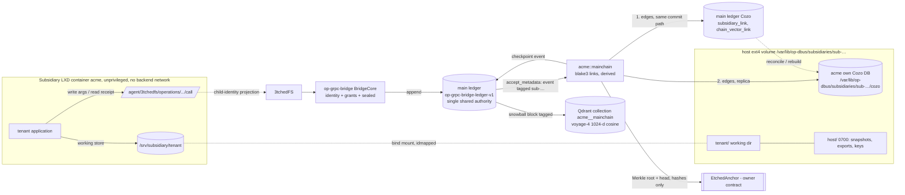
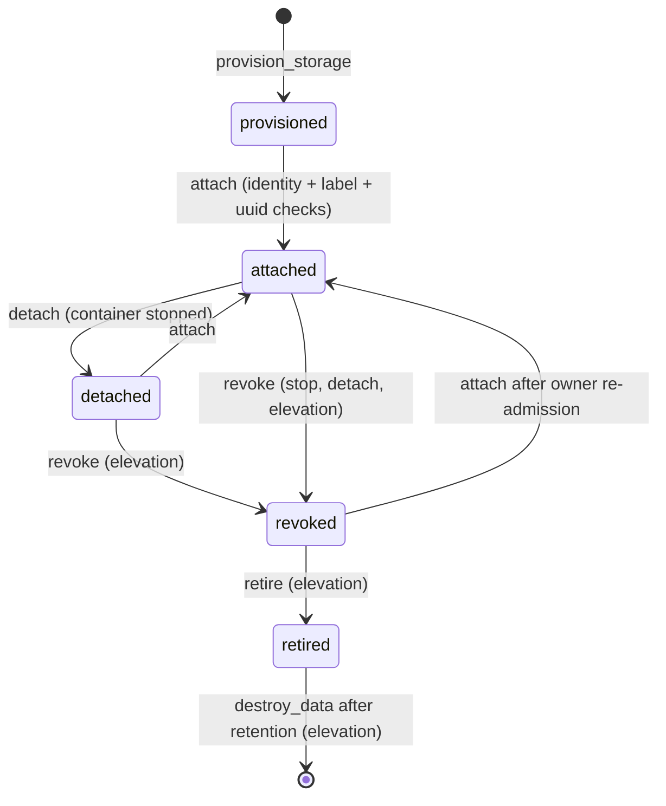

# Design — `subsidiary-activity-grouping`: all subsidiary activity grouped per subsidiary container

## Overview

A subsidiary is one child identity in one LXD container
(`provisioning-system-subsidiary` Req 8; `subsidiary-container`). This design
groups all of its activity under one `subsidiary_id` and one chain id
`<subsidiary_name>::mainchain` by:

1. a **registry** that mints the id, holds the immutable name, and binds both to
   the child principal and the container (Req 1);
2. two optional, hashed **tag fields** on `ChainEvent`, plus a subsidiary
   reference on every receipt and audit-type record (Req 2);
3. a **derived per-subsidiary chain `<name>::mainchain`** over the single
   shared main ledger, whose head and Merkle roots are what gets anchored
   (Req 3, 4);
4. a sealed **`subsidiary` plugin** that owns the lifecycle and the
   caller-scoped read surface, reached only through call files (Req 5–8, 10);
5. **each subsidiary's own Cozo/RocksDB** on its own host ext4 volume (Req 7);
6. **one Qdrant collection per subsidiary chain**, `<name>__mainchain`,
   voyage-4, 1024-d cosine (Req 9);
7. **dual-written Cozo edges**: main ledger Cozo first (authoritative), then
   the subsidiary's own Cozo DB as a rebuildable replica (Req 12).

Nothing here adds authority. Admission stays `identity ∧ grants ∧ sealed` in
the bridge (Req 11.3). The subsidiary id is always *resolved* from the
admitted principal, never *asserted* by a caller.

Labels: **Found** = read on `origin/dev` `879e7d7`. **New** = proposed by this
spec; nothing with that label exists today. **Assumed** = needs confirmation
(see Open Questions).



## Grounding: what exists today (Found)

| Area | Code | Relevant fact |
|---|---|---|
| Event shape | `op-state-store/src/event_chain.rs` `ChainEvent` | Hashed fields go through `CanonicalEventPayload`; `sealed_id_digest` was added as `Option` with `skip_serializing_if = "Option::is_none"` in both the struct and the canonical payload, so old hashes are unchanged. `user_id`, `conversation_id`, `action_origin` are **not** hashed. Hash is `md5` over canonical JSON (`compute_hash`). |
| In-memory chain | `EventChain` | One `Vec<ChainEvent>`, monotonic `event_id`, constant genesis `compute_hash_str("genesis")`, md5 Merkle `EventBatch`/`MerkleProof`, linear filters `events_for_plugin`, `events_touching_tag`. |
| Authoritative ledger | `op-grpc-bridge/src/core_persistence.rs` `PersistentCore` | One Cozo append ledger `op-grpc-bridge-ledger-v1` via `CozoGraphShuttle::append_session_event`; `walk_records` requires contiguous `seq`, `event_id = seq + 1`, `prev_hash` linkage, `event.verify()`, and `input_payload == {"record_digest": blake3(owner, action)}`. One `tip`, a `failure` latch, `recover_pending`. |
| Per-scope heads precedent | `PersistentCore::accept_metadata` | Already derives `heads: BTreeMap<(StateScope, plugin), ProjectionHead>` from the one ledger on every accepted record. |
| Scope | `op-grpc-bridge/src/core.rs` `StateScope` | `Public` or `Private { principal_id, session_id }`, "selected only by the admitted runtime, never from a caller's JSON body". |
| Record kinds | `LedgerAction` | `State`, `Attempt` (with `DelegationAttribution`), `Control` (`ExecutionRecord`), `Terminal`. |
| Receipts | `op-state-store/src/method_receipt.rs` `MethodExecutionReceipt`, built in `core_operations.rs` | `operation_id`, attempt/terminal `event_id`+`event_hash`, `plugin_id`, `method`, `result`. FUSE terminal receipts (`_3tched-fs/src/mounted.rs`) carry `plugin_id, method, subid, required_capability, side_effect, idempotent, result`; `op-mcp-door/src/fusecall.rs::terminal_receipt` checks those and ignores extra keys. |
| Execution | `op-execution-tracker` `ExecutionContext`, `DelegationAttribution`, `ExecutionRecord` | `deny_unknown_fields` on context and attribution. |
| Door | `op-mcp-door/src/audit.rs` `AuditRecord`; `grants.rs` `DurableGrants`, `EphemeralGrant`, `GrantStore`, `Ticket`, `TicketStore` | Records carry `principal_id`; JSONL to svlogd. |
| Grants | `op-grpc-bridge/src/grant_document.rs` | Exact principal keys, closed `GRANT_GROUPS`, no `*`. |
| Elevation | `op-plugins/src/state_plugins/elevation.rs`, bridge `task_elevation.rs` | `protected_actions()` list, polkit-style action ids, one-time tickets (`TICKET_TTL_SECONDS = 60`). |
| Footprints | `op-grpc-bridge/src/mutation_engine.rs::event_to_footprint` | Flat metadata keys (`actor_id`, `session_id`, `sealed_id_digest`, …) beside the lossless event. **Note:** `mutation_engine.rs` and `chain_vector_projector.rs` are not declared in `op-grpc-bridge/src/lib.rs` (HANDOFF 2026-11-17); the linked chain is `BridgeCore`. |
| Vectors | `op-cognitive/src/chain_vectors.rs` | One `ChainVectorIndex` = one `collection` (`OPDBUS_QDRANT_SNOWBALL_COLLECTION`, default `snowball_footprints`), `DEFAULT_DIMS = 1024`, `ensure_collection` creates `Distance::Cosine` idempotently and tolerates "already exists"; Voyage (`voyage-4` family, Matryoshka, `fit_dims`). Origin embeds into the chain `vectors/` subvolume only; the replica upserts after `btrfs receive` (`ingest_received`, watermark file `.vector-index-block`, `missing_from_index` gap probe); point id = uuid v5 of `block:<n>`. Payload allow-list `actor_id, session_id, sealed_id_digest, capability_id, decision`; `search_session_events` filters `actor_id` + `session_id` from admission; `chain_links` feeds `CozoGraphShuttle::replace_chain_vector_links` (relation `chain_vector_link { point_id, kind => value }`, `op-cozo-store/src/lib.rs`), written before the point is upserted ("a visible point suppresses gap retries"); `upsert_session_ledger` (sled ledgers, `runtime_sled_ledger.rs`) also writes `chain_vector_link` rows with a `collection` kind. |
| Subids | `op-oscal-subid` | `<category>.<component-type>.<subject>.<verb>[.<facet>]{0,2}[@vN]`; categories `src prj sch mut obs evt exp`; types include `service`, `container`, `data`, `lxd`. |
| Cozo | `op-cozo-store` `CozoGraphShuttle` | `new_persistent_private` (0700 boundary), `ensure_distinct_from` (domain owners never share a handle). No backup/restore wrapper exists. |
| Container | `subsidiary-container` design | Labels `user.opdbus.*`, `opdbus-subsidiary` profile with `security.idmap.isolated=true`, backend channel bind `shift: true`. |

## Key decision: chain topology (Req 3) — owner-confirmed

Owner decision (2026-11-19): keep the single shared main ledger; no
per-subsidiary authoritative ledger. Each subsidiary's derived chain is named
`<subsidiary_name>::mainchain`. Three options were evaluated against `event_chain.rs` and `core_persistence.rs`.

| Option | For | Against | Verdict |
|---|---|---|---|
| **A. Separate authoritative chain per subsidiary** (own `EventChain` / own Cozo ledger, own genesis) | Physical isolation; moves with the subsidiary | `PersistentCore` is a single append owner: one `tip`, contiguous `seq`, one `failure` latch, one `recover_pending`. N ledgers means N recovery paths and no atomic append for operations that touch both host and subsidiary (grant proposals, attach/detach, revoke). `EventChain` genesis is the constant `md5("genesis")`, so independent chains are indistinguishable at genesis and splice-able. Global order, `journal_events`, `verify_journal`, `heads` and the operations index all assume one ledger. A subsidiary-writable chain would also sit on a volume the container mounts. | Rejected |
| **B. Namespace only in the main chain** (tag + filter) | Smallest change; one authority | The only head is the global head: anchoring it ties every receipt to all other activity, and a holder's proof needs the whole chain's linkage. Not self-contained for export/move. | Rejected alone |
| **C. Namespace in the main chain + derived per-subsidiary chain `<name>::mainchain`** | Keeps one authority (A's problems vanish); a per-subsidiary head and Merkle roots exist for anchoring (B's problem vanishes); derived exactly like `accept_metadata` derives `heads` today; rebuildable from `walk_records`; blake3 like `binding()` | One more index to keep consistent (checked on reopen, Req 3.4) | **Chosen** |

Rationale in one line: the ledger stays the single source of truth, and each
subsidiary gets a head that is a pure function of that ledger, committed back
into it by checkpoint events, and anchored with hashes only.

Hash function: link hashes, Merkle roots and anchor payloads use **blake3**
(**New**). The main chain keeps `md5` unchanged (changing it is out of scope);
each link commits to the md5 `event_hash` *and* the blake3 `record_digest`
already in `input_payload`, so the anchored value is not weaker than blake3
over the record. See Open Question 9.

## Components and Interfaces

### 1. Subsidiary registry (Req 1) — **New**

Cozo relations in the **bridge's** private Cozo DB (the one `PersistentCore`
opens with `new_persistent_private`, i.e. the main ledger Cozo). The registry
is never replicated into a subsidiary's own Cozo DB or `tenant/`:

```
subsidiary { subsidiary_id: String =>
  subsidiary_name: String,  # immutable, unique forever
  chain_id: String,         # "<subsidiary_name>::mainchain"
  qdrant_collection: String,# "<subsidiary_name>__mainchain"
  collection_state: String, # pending|ready|read_only|deleted
  replica_path: String,     # <volume>/cozo
  principal_id: String, parent_session_id: String,
  lxd_instance: String, lxd_instance_uuid: String,
  volume_path: String, schema_bundle_sha256: String,
  state: String,            # provisioned|attached|detached|revoked|retired
  anchor_tag_key_ref: String, receipt_salt_key_ref: String,   # key file refs, never key bytes
  registered_event_id: Int, updated_event_id: Int }
subsidiary_by_name      { subsidiary_name: String => subsidiary_id: String }   # never deleted
subsidiary_by_principal { principal_id: String => subsidiary_id: String }
subsidiary_by_instance  { lxd_instance_uuid: String => subsidiary_id: String }
```

- Mint: `sub-<uuid v4>` (`uuid` is already a workspace dependency).
- **Name rules (Req 1.8–1.11):** `subsidiary_name` is given by the owner at
  `register`, matches `^[a-z][a-z0-9-]{1,30}[a-z0-9]$` (3–32 chars, lowercase
  letters, digits, single hyphens; no `_`, no `:`, no `--`), and is not one of
  `main mainchain host owner public system root snowball`. It is unique across
  all subsidiaries ever registered (`subsidiary_by_name` rows survive
  retirement and destruction), and immutable: there is no rename method. The
  name and `sub-<uuid>` map 1:1 both ways. `subsidiary_id` stays the internal
  key for tags, relations and paths; the name is used only for the chain id and
  what is derived from it.
- **Derivations** from `chain_id = "<subsidiary_name>::mainchain"` only:
  genesis, Qdrant collection name (`::` → `__`), anchor tag. Because names
  never contain `_` or `:`, the collection name maps back to exactly one chain
  id.
- Bindings come from the registration call's verified inputs: the child
  `principal_id` and `parent_session_id` from the child identity planned by
  `provisioning-system-subsidiary` step 10, and the instance name and
  `volatile.uuid` read with `lxd.get_instance` (**Found** operation). Label
  `user.opdbus.subsidiary_id` set with `lxd.update_instance` (etag flow, as
  `subsidiary-container`).
- Resolution: `SubsidiaryResolver::for_scope(&StateScope) -> Option<SubsidiaryRef>`,
  `Public → None`, `Private { principal_id, .. } → subsidiary_by_principal`.
  Called inside `PersistentCore::append` before the event hash is computed.
- Attach-time check (Req 1.5): label == registry id, `volatile.uuid` ==
  `lxd_instance_uuid`, attached sled `session_id` == child session. Any
  mismatch → no attach, denied event.
- Rebind (Req 1.6): `subsidiary.rebind_container` updates
  `lxd_instance(_uuid)` and records both UUIDs.

### 2. Tagging (Req 2)

**`ChainEvent` (op-state-store) — New fields**

```rust
#[serde(default, skip_serializing_if = "Option::is_none")]
pub subsidiary_id: Option<String>,
#[serde(default, skip_serializing_if = "Option::is_none")]
pub subsidiary_role: Option<SubsidiaryRole>,   // "actor" | "subject"
```

Added to `CanonicalEventPayload` with `skip_serializing_if = "Option::is_none"`
exactly like `sealed_id_digest`, so every existing event's canonical bytes and
hash are unchanged (Req 2.3, 11.1). `LegacyCanonicalEventPayload` is not
touched. Readers built before this change will fail `verify()` on tagged
events, so rollout is readers-first (see Error Handling).

**Where each record gets its tag**

| Record | Code | Tag source | Change |
|---|---|---|---|
| Ledger event (all `LedgerAction` kinds) | `PersistentCore::append` | `SubsidiaryResolver` on `owner`; `role = actor` | New lines before `event.compute_hash()` |
| Host-side lifecycle events | `subsidiary` plugin methods | registry entry of the target; `role = subject` | New |
| `lxd.*` calls on a registered instance | bridge, after resolving the target instance name through `subsidiary_by_instance` | `role = subject` | New; Open Question 13 |
| Method receipt | `MethodExecutionReceipt` in `core_operations.rs` | from attempt event | New optional `subsidiary: Option<SubsidiaryReceiptRef>` |
| Recovery record | `MethodReceiptRecovery` | same | New optional field |
| Execution | `ExecutionContext`, `DelegationAttribution` (op-execution-tracker) | resolver, executor and requestor sides | New optional `executor_subsidiary_id`, `requestor_subsidiary_id` (`deny_unknown_fields` ⇒ readers-first) |
| Door audit | `op-mcp-door` `AuditRecord` | principal → registry snapshot file (below) | New optional `subsidiary_id` |
| Ephemeral grant / ticket consumption | `GrantStore::consume`, `TicketStore::consume` audit lines | principal → registry snapshot | New optional `subsidiary_id` in the audit record of the consume |
| Footprint | `event_to_footprint` (unlinked today) | `event.subsidiary_id` | New metadata key; applies when the file is linked again |
| FUSE terminal receipt | `_3tched-fs` `mounted.rs` | from `MethodExecutionReceipt.subsidiary` | New optional key `subsidiary`; owned by the FUSE contract (Open Question 14) |

The door has no Cozo handle; it reads a root-owned, bridge-written
`/run/op-dbus/subsidiary-principals.json` (**New**: `{principal_id: subsidiary_id}`,
no other fields), re-read on mtime change like `DurableGrants`.

Fail closed (Req 2.5): if the resolver errors (registry unreadable), the
append fails with the existing "outcome unknown; do not retry" path — never an
untagged write.

### 3. Derived link chain, checkpoints and anchors (Req 3, 4) — **New**

Module `op-state-store/src/subsidiary_chain.rs` (pure types + hashing, no IO):

```rust
pub struct SubsidiaryLink {
    pub chain_id: String,            // "<subsidiary_name>::mainchain"
    pub subsidiary_id: String,
    pub seq: u64,                    // 1-based, contiguous per subsidiary
    pub prev_link_hash: String,      // blake3 hex; seq 1 uses genesis(chain_id)
    pub ledger_event_id: u64,
    pub ledger_event_hash: String,   // md5 hex from ChainEvent.event_hash
    pub record_digest: String,       // blake3 hex from input_payload.record_digest
    pub role: SubsidiaryRole,
    pub kind: String,                // "attempt"|"terminal"|"state"|"control"|"lifecycle"|"checkpoint"|"anchor"
    pub receipt_leaf: Option<String>,// blake3 hex, terminal links only
    pub link_hash: String,
}
genesis(chain_id) = blake3("op-subsidiary-genesis@v1\0" || chain_id)
link_hash     = blake3(canonical_json(link without link_hash))
receipt_leaf  = blake3(salt || canonical_json(receipt without subsidiary.salt))
salt          = blake3::keyed_hash(receipt_salt_key[sid], ledger_event_hash)   // deterministic, rebuildable by the host only
anchor_tag    = blake3::keyed_hash(anchor_tag_key[sid], "op-subsidiary-anchor@v1\0" || chain_id)
merkle        = binary blake3 tree over link_hash (leaf = receipt_leaf when present),
                odd node promoted, same shape as EventBatch/MerkleProof but blake3
```

- **Index:** relation `subsidiary_link { chain_id, seq => …link fields }`
  in the main ledger Cozo DB, written in `accept_metadata` right after the
  ledger append succeeds (same place `heads` is updated), then replicated to
  the subsidiary's own Cozo DB (section 9b). On `open`, `walk_records`
  rebuilds links in memory and compares with stored rows (Req 3.4): mismatch
  latches `failure` like any other ledger inconsistency.
- **Checkpoint** (Req 3.5): `subsidiary.checkpoint` appends a
  `LedgerAction::State` record (no publication) with
  `OperationType::Custom("subsidiary_checkpoint")`, tagged `subject`, whose
  bound action carries `{seq, link_hash}`. Cadence: on every anchor, on
  detach/revoke/retire, and on owner request.
- **Anchor payload** (Req 4.1–4.2), hashes and integers only:

```json
{ "format": "op-subsidiary/anchor@1",
  "anchor_tag": "<blake3 hex>", "batch_root": "<blake3 hex>",
  "first_seq": 101, "last_seq": 200,
  "head_link_hash": "<blake3 hex>", "prev_batch_root": "<blake3 hex | null>" }
```

  This is the full interface this spec asks of the owner's EtchedAnchor
  contract (**Assumed** field mapping; Open Question 2). Submission is out of
  scope (networking deferred; local chain). `subsidiary.record_anchor` takes
  the payload hash and an opaque owner-supplied `anchor_ref` (e.g. tx hash) and
  appends an `anchor` link.
- **Holder-only proofs** (Req 4.3–4.7): the salt is only in the receipt given
  to the caller and in owner exports; the anchored root reveals nothing. The
  offline verifier is a small bin `op-subsidiary-verify` (**New**, in
  `op-state-store` `src/bin/`) that recomputes leaf → root and compares with
  the anchor payload; no network, no backend.

### 4. `subsidiary` sealed plugin (Req 5–8, 10) — **New**

`op-plugins/src/state_plugins/subsidiary.rs`, sealed into the catalog like
every plugin, reached only through call files. Methods, capabilities and
subids (all **New**; capability form follows `cap.lxd.*@v1`):

| Method | Caller | Capability | Subid | Notes |
|---|---|---|---|---|
| `register` | owner | `cap.subsidiary.register@v1` | `mut.service.subsidiary.register@v1` | name + mint id, chain id, bindings, schema bundle digest, key files, own Cozo DB, Qdrant collection |
| `rebind_container` | owner | `cap.subsidiary.rebind_container@v1` | `mut.service.subsidiary.rebind@v1` | Req 1.6 |
| `provision_storage` | owner | `cap.subsidiary.provision_storage@v1` | `mut.data.subsidiary.provision@v1` | Req 7.1, 7.3 |
| `attach` / `detach` | owner | `cap.subsidiary.attach@v1` / `…detach@v1` | `mut.data.subsidiary.attach@v1` / `…detach@v1` | via `lxd.update_instance` disk device |
| `snapshot` | owner | `cap.subsidiary.snapshot@v1` | `mut.data.subsidiary.snapshot@v1` | Req 7.5 |
| `export_bundle` (move) | owner | `cap.subsidiary.export_bundle@v1` | `exp.data.subsidiary.bundle@v1` | Req 7.6 |
| `revoke` | owner + elevation | `cap.subsidiary.revoke@v1` | `mut.service.subsidiary.revoke@v1` | protected task `org.opdbus.v1.subsidiary.revoke` |
| `retire` / `destroy_data` | owner + elevation | `cap.subsidiary.retire@v1` / `…destroy_data@v1` | `mut.service.subsidiary.retire@v1` / `mut.data.subsidiary.destroy@v1` | protected tasks `org.opdbus.v1.subsidiary.retire`, `…destroy-data` |
| `checkpoint` | owner | `cap.subsidiary.checkpoint@v1` | `evt.service.subsidiary.checkpoint@v1` | Req 3.5 |
| `prepare_anchor` / `record_anchor` | owner | `cap.subsidiary.prepare_anchor@v1` / `…record_anchor@v1` | `exp.service.subsidiary.anchor@v1` / `evt.service.subsidiary.anchor@v1` | Req 4 |
| `get_identity` | self / owner | `cap.subsidiary.get_identity@v1` | `obs.service.subsidiary.identity@v1` | self = own id only |
| `get_head` | self / owner | `cap.subsidiary.get_head@v1` | `obs.service.subsidiary.head@v1` | |
| `list_activity` | self / owner | `cap.subsidiary.list_activity@v1` | `obs.service.subsidiary.activity@v1` | paged links |
| `rollup` | self / owner | `cap.subsidiary.rollup@v1` | `obs.service.subsidiary.rollup@v1` | Req 8.1 |
| `rollup_parent` | owner only | `cap.subsidiary.rollup_parent@v1` | `obs.service.subsidiary.rollup.parent@v1` | Req 8.2 |
| `export_receipts` | self / owner | `cap.subsidiary.export_receipts@v1` | `exp.service.subsidiary.receipts@v1` | Req 8.3–8.4 |
| `prove_receipt` | self / owner | `cap.subsidiary.prove_receipt@v1` | `obs.service.subsidiary.proof@v1` | Req 4.6 |
| `verify` | self / owner | `cap.subsidiary.verify@v1` | `obs.service.subsidiary.verify@v1` | Req 3.6 |
| `reconcile_replica` | owner | `cap.subsidiary.reconcile_replica@v1` | `mut.data.subsidiary.reconcile@v1` | Req 12.5–12.6 (also run automatically) |
| `rebuild_replica` | owner | `cap.subsidiary.rebuild_replica@v1` | `mut.data.subsidiary.rebuild@v1` | Req 12.7, 12.9 |

Scope rule (Req 6.2–6.3): read methods take an optional `subsidiary_id` or
`subsidiary_name` argument that is honoured only for the owner. For a subsidiary caller the
scope is its resolved id; a different id gets the same "not found" response as
a nonexistent one. Registry state is private-scope only (Req 6.4).

Elevation (Req 5.4, 10.1): the three destructive methods are added to
`elevation::protected_actions()` and enforced by the existing
`task_elevation` choke point; and `task_elevation` refuses any protected task
whose caller resolves to a subsidiary.

### 5. Grant scope (Req 5)

- Durable: the child principal's own entry in the grant document (**Found**
  contract). The script/plugin only writes grant-delta proposals in the
  existing `op-provisioning/grant-delta@1` format.
- Ceiling (**New**): `ceiling(sid) = caps(parent principal) − {shell, exec,
  admin, secret classes}` computed with the same classification
  `provisioning-system-subsidiary` step 11 uses, cached per grant-document
  mtime. Admission adds one check for subsidiary callers: `capability ∈
  ceiling`. This narrows, never widens, admission.
- Ephemeral grants and tickets: `GrantStore::find`/`consume` and
  `TicketStore::consume` refuse a subsidiary principal + capability outside the
  ceiling (door reads the ceiling from a bridge-written
  `/run/op-dbus/subsidiary-ceilings.json`, **New**).
- Revoke: `GrantStore::revoke` for each grant naming the principal; tickets
  for it are deleted unconsumed; grant-delta removing the durable entry.

### 6. FUSE view (Req 6)

The view is the child identity's existing projection (`subsidiary-container`
Req 4; **Assumed** to be grant-filtered by the shared FUSE toolset projection,
Open Question 3 there). This spec adds only the `subsidiary` plugin's read
operations to it. No routing, no introspection: the bridge never reads the
container's filesystem or its `tenant/` working directory; the pre-generated schema bundle is
recorded by digest at registration and on change, and is otherwise opaque.

### 7. Each subsidiary's own Cozo/RocksDB on host ext4 (Req 7)

Layout per subsidiary (**New**; backing device is Open Question 3):

```
/var/lib/op-dbus/subsidiaries/<subsidiary_id>/   ext4 filesystem, one per subsidiary
  cozo/                                       the subsidiary's own Cozo DB (RocksDB);
                                              bridge is the only writer; replica of its edges (9b)
  tenant/                                     container working directory (RocksDB dirs the
                                              tenant application opens); the only thing mounted
  host/                                       root:root 0700, never mounted into the container
    keys/receipt-salt.key, keys/anchor-tag.key  0600, 32 random bytes each
    snapshots/<stamp>.tar.zst  + .blake3
    diverged/<stamp>/                         quarantined replica copies (Req 12.7)
    exports/<stamp>/                          op-subsidiary/receipts@1 + bundle manifest
```

- Why two RocksDB areas on one volume: RocksDB admits one writer process per
  directory (`LOCK`), and the dual-written edges (Req 12) are written by the
  bridge while the container runs. So the subsidiary's own Cozo DB (`cozo/`)
  is bridge-written and never mounted, and the container's application gets
  `tenant/` for its own RocksDB dirs. Both live on the subsidiary's volume and
  move, snapshot and revoke together. Open Question 11 asks whether you want
  this split or one DB that the container reaches only through call files.
- The bridge opens `cozo/` with `CozoGraphShuttle::new_persistent_private`
  (0700 boundary) as a separate handle per subsidiary; `ensure_distinct_from`
  is checked against the main ledger handle and every other subsidiary's
  handle, so no two domain owners share a DB.
- Device on the instance: `tenant: {type: disk, source:
  /var/lib/op-dbus/subsidiaries/<subsidiary_id>/tenant, path: /srv/subsidiary/tenant,
  shift: true}` through `lxd.update_instance` (**Found** operation). `shift:
  true` uses an idmapped mount: on the host `tenant/` stays owned by root
  (0700), and inside the container it appears owned by the container's root,
  with no other unprivileged user able to reach it (Req 7.3). Fallback when
  idmapped mounts are unavailable: `chown` `tenant/` to
  `volatile.idmap.base` (read via `lxd.get_instance`). Open Question 4.
- This adds one device to the `subsidiary-container` Req 5.5 allow-list
  (root, overlay, NIC, backend channel). That spec must be amended to allow
  `tenant` (Open Question 12).
- The host never opens `tenant/` while attached (Req 6.5).
- State machine (Req 7.4):



- Snapshot (Req 7.5): pause the replica writer for `cozo/` (the bridge owns
  it, so no container stop is needed for that part); include `tenant/` only
  in `detached`/`revoked`. Archive as-is, blake3 + size into a `lifecycle`
  event. A live `tenant/` snapshot needs block-level snapshots (Open
  Question 3).
- Move (Req 7.6): replica must be `current` (Req 12.8); bundle = last volume
  snapshot + receipt export + registry record (public fields only, key refs
  not keys unless the owner asks) + manifest with blake3 of each file;
  manifest digest into a ledger event.

### 8. Rollups and export (Req 8)

Rollups are Cozo queries over `subsidiary_link` in the **main ledger Cozo**
(authoritative, Req 12.2) joined to the ledger rows by `ledger_event_id`
(plugin, method, decision from the event; outcome from `Terminal.status`).
Bounded to 1000 groups / 1000 links per page with an opaque cursor = last
`seq`. `rollup_parent` groups by `parent_session_id`.

Export `op-subsidiary/receipts@1`:

```json
{ "format": "op-subsidiary/receipts@1", "chain_id": "acme::mainchain",
  "subsidiary_id": "sub-…",
  "window": {"first_seq": 1, "last_seq": 200},
  "links": [ … ], "receipts": [ {MethodExecutionReceipt + subsidiary ref incl. salt} ],
  "proofs": [ {"seq": 7, "siblings": [["<hash>", true], …], "batch_root": "…"} ],
  "checkpoints": [ … ], "anchors": [ {"payload": {…}, "anchor_ref": "…"} ] }
```

Exports contain the ledger events' hashes, not their payloads; bridge ledger
events already carry only `{"record_digest"}` as `input_payload`.

### 9. One Qdrant collection per subsidiary chain (Req 9)

Owner decision (2026-11-19): the chain ends up in Qdrant anyway, so each
subsidiary chain gets its own collection instead of a payload partition of
the shared one.

- **Name** (Req 9.1): `collection(chain_id) = chain_id.replace("::", "__")`,
  e.g. `acme::mainchain` → `acme__mainchain`. `__` is used because `:` is not
  a safe Qdrant collection-name character (**Assumed**: Qdrant stores
  collections as directories; Open Question 15). Names never contain `_`, so
  the mapping is reversible and cannot collide with `snowball_footprints` or
  the nine voyage-4 code collections; `register` still probes
  `collection_exists` and refuses a collision it does not own.
- **Parameters** (Req 9.2): identical to the shared index —
  `VectorParamsBuilder::new(1024, Distance::Cosine)`, voyage-4 embeddings,
  `fit_dims` to 1024. Same point id (`uuid v5` of `block:<n>`), same payload
  allow-list plus `subsidiary_id` and `chain_id` for provenance.
- **Creation** (Req 9.2): `register` calls a new
  `chain_vectors::ensure_subsidiary_collection(name)` that reuses the body of
  `ensure_collection` (idempotent, tolerant of "already exists"). If Qdrant is
  unreachable (it is not running on antix1 today), registration succeeds with
  `collection_state = pending`; ingest calls the same function before the
  first upsert and flips the state to `ready` with a tagged event.
- **Routing** (Req 9.3–9.4): `ChainVectorIndex` keeps one embedding pass over
  the one chain and one `.vector-index-block` watermark; per block it picks
  the target collection: `subsidiary_id` in `data.metadata` → that
  subsidiary's collection, else the shared collection. Origin/replica rules
  are unchanged: origin only attaches vectors to the chain `vectors/`
  subvolume; the replica upserts after `btrfs receive`; direct origin upsert
  stays the manual exception. `missing_from_index` probes each block in the
  collection it was routed to.
- **Cozo links** (Req 12.1): `replace_chain_vector_links` rows for a
  subsidiary block gain `("collection", "<name>__mainchain")` and
  `("chain_id", …)` kinds (the sled-ledger path already writes a `collection`
  kind), and are dual-written (9b) before the point is upserted, keeping the
  existing "links first" ordering.
- **Search** (Req 9.5–9.6): `search_session_events` gains a
  `collection` selected by the caller's admission — a subsidiary caller gets
  its own collection only and any argument is ignored; other callers get the
  shared collection; only the owner may pass a subsidiary name, resolved
  through `subsidiary_by_name`.
- **Sled ledgers**: `upsert_session_ledger` routes a subsidiary principal's
  points to its collection the same way.
- **Retire / retention / delete** (Req 9.7–9.8): `retire` sets
  `collection_state = read_only` (router drops new points for it, searches
  still work for the owner); `destroy_data` after retention calls
  `delete_collection` and records a tagged event with the last point count;
  `reindex_from_chain` and `ingest_received` skip blocks of retired
  subsidiaries; `subsidiary_by_name` keeps the name so the collection name is
  never reused.

### 9b. Dual-written Cozo edges (Req 12) — **New**

Edges = `subsidiary_link`, `subsidiary_anchor`, checkpoint rows and
`chain_vector_link` rows of a subsidiary's blocks.

Consistency rule: **the main ledger Cozo is authoritative; the subsidiary's
own Cozo DB is a replica that is always rebuildable from the main ledger.**

| Step | Where | Failure handling |
|---|---|---|
| 1. Ledger append | `PersistentCore::append` → `append_session_event` | existing: "outcome unknown; do not retry", `failure` latch |
| 2. Main edges | `accept_metadata` (links) / `replace_chain_vector_links` (vector links) in the main ledger Cozo | existing latch: main ledger metadata failure is a bridge failure |
| 3. Replica edges | after 2 succeeds, `SubsidiaryReplica::apply(edges, seq)` — one Cozo transaction `:put` edges + `:put replica_meta { chain_id => applied_seq, head_link_hash }` | never fails the call (Req 12.4): mark `lagging`, remember `applied_seq` and an error code, one `replica_lag` event per episode |

- Idempotent keys (Req 12.3): `(chain_id, seq)` for links/checkpoints/anchors,
  `point_id` for vector links (same `rm`+`put` as `replace_chain_vector_links`).
  Re-applying an edge is a no-op.
- Replica states in the main registry: `current | lagging | diverged |
  rebuilding`, with `applied_seq`.
- Catch-up (Req 12.5): a per-subsidiary reconciler task re-applies from
  `applied_seq + 1` in order, back-off 1 s doubling to 5 min, until it reaches
  the main head, then `current` (tagged `replica_current` event).
- Open (Req 12.6): for each non-retired subsidiary, compare replica
  `replica_meta` and the last N links (and every link on owner request) with
  the main ledger Cozo; behind → `lagging` and catch up; equal → `current`.
- Divergence (Req 12.7): any replica edge that differs from the main edge with
  the same key, or a replica that fails to open/verify → `diverged`: stop
  writing, rebuild into `cozo.rebuild-<stamp>/` from the main ledger alone
  (walk `subsidiary_link` + `chain_vector_link` rows for the chain id), fsync,
  rename-swap, move the old directory to `host/diverged/<stamp>/`, record old
  and new blake3 digests in a tagged event.
- Gates (Req 12.8): `export_bundle`, `snapshot` for retirement and `retire`
  refuse unless `current`.
- Rebuild equivalence (Req 12.9): rebuild and incremental apply use the same
  edge encoder; a test asserts byte-equal relation dumps.
- The replica is never read for authority: rollups, proofs, `verify` and
  search routing use the main ledger Cozo. The replica exists so a
  subsidiary's volume is self-contained when moved or exported.

### 10. Teardown and retention (Req 10)

`revoke` → `retire` → `destroy_data`, each elevated. Retire requires stopped
container, the `tenant` and backend-channel devices detached (checked via
`lxd.get_instance`) and a `current` replica. Retention default: the volume
(own Cozo DB, `tenant/`, `host/`) and the Qdrant collection are kept 90 days
after retire (**Assumed**, Open Question 8), then deleted only on an owner
`destroy_data`; main ledger events, main ledger Cozo edges, checkpoints and
anchors are kept forever.

### 11. Integration with existing 3tched (Req 11)

- Additive only: optional fields with `skip_serializing_if`, new relations,
  new plugin, new bin, a collection-routing step in `ChainVectorIndex`. No
  change to `StateScope`, `LedgerRecord`, `LedgerAction`, `binding()`,
  `LegacyCanonicalEventPayload`, md5 hashing, or the shared collection's
  parameters.
- No new admission path; the ceiling check only narrows.
- After retirement, the owner still sees everything through the main ledger
  (`journal_events`, `verify_journal`) and the main ledger Cozo edges, because
  they were always authoritative.
- `mutation_engine.rs` / `chain_vector_projector.rs` are unlinked today; their
  changes are specified but take effect only when relinked (Open Question 10).

## Data Models (summary)

- `ChainEvent.subsidiary_id: Option<String>`, `ChainEvent.subsidiary_role: Option<SubsidiaryRole>` (**New**, hashed when present). The chain id is not on `ChainEvent`; it is looked up from the registry.
- `SubsidiaryRole = actor | subject` (**New**).
- `SubsidiaryName` newtype with the Req 1.8 validator; `ChainId` newtype = `"<name>::mainchain"` with `collection_name()` (**New**).
- `SubsidiaryReceiptRef { chain_id, subsidiary_id, seq, link_hash, receipt_leaf, salt: Option<String> }` (**New**; `salt` only to the holder/owner).
- `SubsidiaryLink`, anchor payload, export bundle: above (**New**).
- Main ledger Cozo relations (**New**): `subsidiary`, `subsidiary_by_name`, `subsidiary_by_principal`, `subsidiary_by_instance`, `subsidiary_link`, `subsidiary_anchor`, `subsidiary_replica { subsidiary_id => state, applied_seq, error_code, updated_at }`.
- Subsidiary own Cozo DB relations (**New**): `subsidiary_link`, `subsidiary_anchor`, `chain_vector_link` (same schema as `op-cozo-store`), `replica_meta { chain_id => applied_seq, head_link_hash }`.
- Label `user.opdbus.subsidiary_id` (**New**) beside the existing `user.opdbus.mode=subsidiary`, `parent_session_id`, `admission`.

## Error Handling

- Fail closed everywhere: unresolvable tag, registry/label mismatch, link
  rebuild mismatch, ceiling violation, invalid or taken name → refuse, record
  a denied event where a ledger write is possible, never write untagged.
- Ledger append uncertainty keeps the existing semantics: "outcome unknown;
  do not retry", `failure` latch, reopen for recovery.
- Replica write failures never fail a call; they follow 9b (lagging →
  catch-up; diverged → quarantine and rebuild).
- Qdrant unavailability never fails registration or a call; the collection
  stays `pending` and the vector backlog waits, as for the shared index today.
- Lifecycle steps stop at the first error and never delete what was created
  (same rule as the provisioning specs). An uncertain `lxd.*` call is recorded
  and not retried.
- Rollout order (because tagged events fail `verify()` on old readers and
  `deny_unknown_fields` types reject new keys): ship readers (op-state-store,
  op-execution-tracker, door) before any writer sets a tag; no tag is written
  until the registry holds at least one subsidiary.
- No secret is ever printed; key files are referenced by path, never read into
  output; exports include salts only for the holder/owner.

## Security

- STRIDE: spoofing — id resolved from the admitted principal, label + UUID +
  session checks at attach; tampering — tags inside the hash, links rebuilt
  and compared on open, replica checked against the main ledger and never
  trusted for authority, container cannot reach `cozo/`; repudiation — every
  lifecycle step is a tagged ledger event; information disclosure — anchors
  are hashes only (the name and chain id never go on-chain), salts
  holder-only, cross-subsidiary reads answer "not found", one Qdrant
  collection per subsidiary chosen from admission; denial of service —
  bounded pages, bounded reconciler back-off; elevation — ceiling check, no
  protected tasks for subsidiaries, destructive lifecycle steps elevated.
- `tenant/` is container-writable by design; it is data, not evidence.
  Evidence lives only in the main ledger and its main Cozo edges.

## Testing Strategy

- `op-state-store`: unit tests that untagged events hash byte-identically to
  fixtures from `879e7d7`; tagged events change the hash; `SubsidiaryName`
  accepts/refuses per Req 1.8 (length, charset, `--`, reserved names);
  `ChainId` = `<name>::mainchain` and `collection_name()` round-trips; genesis
  per chain id, Merkle proof round-trip, salted leaf, anchor tag depends on
  chain id and key.
- `op-cozo-store`: name uniqueness survives retirement/destruction; replica
  `apply` is idempotent; rebuild and incremental apply give byte-equal dumps.
- `op-grpc-bridge`: ledger tests in the style of `core_persistence.rs` tests:
  tagged append, rebuild equals stored, tampered link latches failure, public
  scope never tagged, resolver failure refuses append; replica write failure
  leaves the call successful and marks `lagging`; reconciler reaches
  `current`; a tampered replica edge → `diverged`, rebuild, quarantine copy.
- `op-plugins` `subsidiary`: scope rule, owner-only methods, elevation
  required, cross-subsidiary "not found", subids valid (`is_valid_subid`),
  export/retire refused while the replica is not `current`.
- `op-mcp-door`: audit/grant/ticket tagging from the principals file, ceiling
  refusal.
- `op-cognitive`: per-block routing (tagged → `<name>__mainchain`, untagged →
  shared), collection created with 1024/cosine, `pending` → `ready`,
  subsidiary caller can only reach its own collection, retired collection
  read-only and skipped by reindex/ingest; tests use a fake Qdrant client.
- Provisioning bats with the fake `lxd` operation tree: `tenant` disk device
  payload, `shift: true`, label set, `cozo/` and `host/` never in a device,
  no `lxc`/`lxd` invoked.
- Offline verifier golden test: receipt + proof + anchor payload → ok; one
  flipped byte → fail.

## Open Questions (for Jeremy)

Resolved by owner decisions of 2026-11-19 (recorded, no longer open):
chain topology — one shared main ledger, derived `<name>::mainchain` per
subsidiary; vectors — one Qdrant collection per subsidiary chain; Cozo edges —
dual-written, main ledger authoritative, subsidiary Cozo a rebuildable
replica; each subsidiary keeps its own Cozo/RocksDB on its ext4 volume.

1. **Anchor tag.** The tag is derived from the chain id with a per-subsidiary key (blinded, proposed) so the name never appears on-chain. Or do you want the plain chain id `acme::mainchain` on-chain?
2. **EtchedAnchor interface.** Confirm the field names/types the contract takes (`anchor_tag`, `batch_root`, `first_seq`, `last_seq`, `head_link_hash`, `prev_batch_root`), the anchor cadence (every N links, time-based, or on demand), and who submits the transaction while networking is deferred (host-side submitter to the local chain?).
3. **ext4 volume backing.** Loop image file (where, given pools are off-limits) or an LVM LV? Live snapshots of `tenant/` without stopping the container need block snapshots (LVM thin); otherwise `tenant/` snapshots need `detached`.
4. **Idmap.** OK to use LXD `shift: true` idmapped mounts on ext4 (kernel support confirmed?) with `chown` to `volatile.idmap.base` only as fallback?
5. **Host-only directory.** Keep `host/` (keys, snapshots, exports) on the same ext4 volume so it moves as a unit, or keep keys in `/etc/op-dbus/secrets` and only data on the volume?
6. **Elevation for subsidiaries.** Refuse every protected task for subsidiary principals (proposed), or allow a named subset?
7. **Grant group.** Add a `$SUBSIDIARY` group to the closed `GRANT_GROUPS` (bridge and door), or keep per-principal entries only (proposed)?
8. **Retention.** Volume and Qdrant collection kept 90 days after retirement (proposed)? Exports and snapshots the same?
9. **Hashing.** Main chain stays md5; links/anchors use blake3 and commit to the blake3 `record_digest`. Acceptable, or schedule a separate main-chain hash migration?
10. **Unlinked sources.** Tag `mutation_engine.rs` footprints and route `chain_vector_projector.rs` now (spec'd, inert until relinked) or leave them until they are relinked?
11. **One DB or two areas on the volume.** RocksDB allows one writer per directory, and the bridge must write the replica edges while the container runs. Proposed: the subsidiary's own Cozo DB `cozo/` (bridge-written, never mounted) plus `tenant/` for the container's application. Alternative: a single Cozo DB that the bridge owns and the container reaches only through call files (no RocksDB mount at all). Which one? Writes inside `tenant/` never pass the bridge and are committed only as snapshot digests; is that enough?
12. **subsidiary-container amendment.** Add the `tenant` disk device to its Req 5.5 allow-list, and record there that the NIC is deferred (container may run with no NIC).
13. **`lxd.*` subject tagging.** Tag owner `lxd.*` calls whose target instance resolves to a subsidiary as `subject` (proposed), or only the `subsidiary` plugin's own lifecycle events?
14. **FUSE receipt field.** Carrying `subsidiary` in the `_3tched-fs` terminal receipt is a change to the shared FUSE contract: within that contract, or a new one?
15. **Collection name separator.** `acme::mainchain` → Qdrant collection `acme__mainchain` because `:` is not safe in collection names (assumed). OK, or a different mapping (e.g. `acme-mainchain`)?
16. **Name length and reserved list.** 3–32 chars `[a-z0-9-]`, reserved `main mainchain host owner public system root snowball`. Any other names to reserve?
