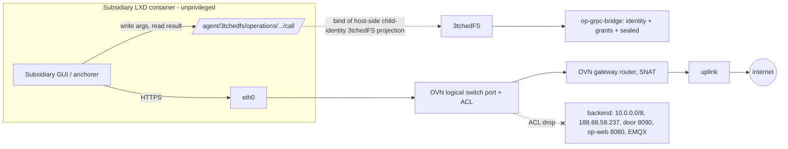

# Design — `subsidiary-container`: the Subsidiary container contract

## Overview

The Subsidiary container is an LXD instance on antix1, produced by the
`--subsidiary` mode of `deploy/provisioning/30-provision-container.sh`
(spec `provisioning-system-subsidiary`), then shaped by this contract. This
spec adds four things on top of that mode: an OVN edge port (Req 2), a backend
deny set (Req 3), a FUSE-only backend channel (Req 4), and hardening —
profile, read-only base + overlay, snapshot, runit logs (Req 5–8).

Labels: **Found** = read on `origin/dev` `009e035` or live (read-only) on
antix1. **Assumed** = to be confirmed (Open Questions).



The only line from the container to the backend is the call-file bind.
The NIC's only destination is the internet.

## Components and Interfaces

### LXD calls (Req 1)

All through `3tched-fs invoke --mount <M> [--confirm-side-effects] --args
<json> plugins/lxd/operations/<method>/call` (**Found**: same client as
`deploy/scripts/3tchedfs-invoke.sh`; 319 `lxd` operations are in the live
mount). Each payload is validated against the operation's live
`input.schema.json`; each capability is read from its live `metadata.json`.

| Step | Operation | Capability (**Found** in `lxd.rs`) |
|---|---|---|
| Edge network | `lxd.create_network` (`type: ovn`) / `lxd.get_network` | `cap.lxd.networks.create_network@v1`, `…get_network@v1` |
| Port ACL | `lxd.create_network_acl` / `lxd.get_network_acl` | `cap.lxd.network_acls.create_network_acl@v1` |
| Profile | `lxd.create_profile` / `lxd.get_profile` | `cap.lxd.profiles.create_profile@v1` |
| Overlay volume | `lxd.create_storage_pool_volume` | `cap.lxd.storage_volumes.create_storage_pool_volume@v1` |
| Devices, config, labels | `lxd.get_instance` (etag) → `lxd.update_instance` | `cap.lxd.instances.update_instance@v1` |
| Snapshot | `lxd.create_instance_snapshot`, `lxd.create_storage_pool_volume_snapshot` | `cap.lxd.instances.create_instance_snapshot@v1` |
| Rollback | `lxd.update_instance` with `restore: provisioned-<stamp>` (**Assumed**: LXD restores via PUT `restore`) | `…update_instance@v1` |
| Start/stop | `lxd.update_instance_state` | `cap.lxd.instances.update_instance_state@v1` |

The import itself (`lxd.create_instance_from_backup`) and the child identity
are `provisioning-system-subsidiary` steps 7–10, unchanged.

### Edge network (Req 2)

One LXD network, name `opdbus-edge`, `type: ovn`, on its own uplink
(**Assumed**, Open Question 2), with:

```
ipv4.address=10.250.0.1/24   ipv4.nat=true    ipv6.address=none
dns.nameservers=<public resolvers>           (never the backend DNS)
security.acls=opdbus-subsidiary-deny
security.acls.default.ingress.action=reject
security.acls.default.egress.action=allow
```

`10.250.0.0/24` is outside every backend range in `ovsbr0-persist.conf`
(**Found**: `10.0.0.1–3/32`, `10.200.0.0/24`) but **inside** `10.0.0.0/8`,
which the deny set covers; the ACL therefore explicitly allows only the
container's own subnet router (`10.250.0.1`, DHCP/ND only) before the
`10.0.0.0/8` drop. OVN programs `br-int`; `ovsbr0`, its OpenFlow rules and
the `ovs-port-hook` are not touched. No `create_network_forward`,
`create_network_load_balancer` or `create_network_peer` calls (Req 2.4).

NIC device on the instance (via `update_instance`):
`eth0: {type: nic, network: opdbus-edge}` — `nictype` absent (managed
network), no `ipv4.address` pin required.

### Backend deny set (Req 3)

OVN ACL `opdbus-subsidiary-deny`, egress rules, in order:

| # | Action | Destination | Why (**Found** source) |
|---|---|---|---|
| 1 | allow | `10.250.0.1/32` udp 67, icmp | own router, DHCP/ND only |
| 2 | drop | `10.0.0.0/8` | door `10.0.0.2`, decoy peer `10.0.0.1`, EMQX `10.0.0.3`, `ovsbr0` `10.200.0.0/24` (`ovsbr0-persist.conf`) |
| 3 | drop | `188.68.58.237/32`, `188.68.56.1/32` | host public address — door DNAT `:8090` (`door.nft`) — and its gateway |
| 4 | drop | `172.16.0.0/12`, `192.168.0.0/16`, `100.64.0.0/10`, `169.254.0.0/16`, `127.0.0.0/8` | other private, CGNAT/WARP, link-local, loopback |
| 5 | drop | `::/0` | IPv6 disabled on the edge network |
| — | default egress allow | internet | Req 2.3 |

Ports named for audit (all already covered by the address drops): bridge
`8090`, op-web `8080`, EMQX `1883/8883`.

Host firewall (defence in depth, Req 3.3): an nftables table
`opdbus_subsidiary` (separate from `opdbus_door`, which is not modified)
that drops packets whose source is the edge network's SNAT address or
`10.250.0.0/24` and whose destination is any host or backend address above.
**Assumed** that this table is delivered by an existing host-firewall path;
Open Question 4.

### Backend channel (Req 4)

`/agent/3tchedfs` inside the container is a `disk` device bound from the
host-side 3tchedFS projection for the **child** identity, `readonly: false`
(call files are written), `shift: true`. Only `operations/` is projected.
Not attached: `/dev/fuse`, `lungs`, the D-Bus session bus socket, `catalog`,
`decoy-trust`, `tunnel`, `opdbus-run` (Req 4.2). **Assumed**: a host-side
projection for one identity can be bound into an LXD container; this depends
on Wonder's shared FUSE contracts (`identity-bound-fuse-application-migration`)
and is Open Question 3. The bridge, not the container, decides every call
(Req 4.3, 4.5).

### Instance profile (Req 5)

LXD profile `opdbus-subsidiary` — the `provisioning-system-subsidiary` step 7
profile extended (refuse rather than edit if it exists and differs):

```
security.privileged=false         security.nesting=false
security.idmap.isolated=true      boot.autostart=false
security.syscalls.deny_default=true   security.syscalls.deny_compat=true
security.syscalls.intercept.{mknod,mount,bpf,setxattr,sysinfo}=false
security.guestapi=false
limits.cpu=2   limits.memory=2GiB   limits.memory.enforce=hard
limits.processes=512   (defaults; overridable per run)
raw.lxc:
  lxc.init.cmd = /sbin/runit-init
  lxc.mount.auto = proc:mixed sys:ro cgroup2:ro
  lxc.rootfs.options = ro
  lxc.cap.drop = sys_admin sys_module sys_rawio sys_ptrace sys_time sys_boot
                 net_admin net_raw mknod mac_admin mac_override audit_control
                 audit_write syslog setfcap sys_resource
```

Devices: `root` (pool), `overlay` (custom volume), `eth0` (edge), `3tchedfs`
(channel). Nothing else (Req 5.5).

### Overlay paths (Req 6)

Custom volume `subsidiary-<child>-overlay` mounted at `/overlay`; runit
stage 1 mounts overlayfs (upper/work on `/overlay`) over `/etc`, `/var`,
`/home`, `/srv` and `/opt/subsidiary`. **Assumed**: overlayfs in an
unprivileged user namespace on the XanMod kernel (≥ 5.11); fallback is plain
bind mounts of writable directories from `/overlay`. Reset = stop, restore
the volume's empty snapshot `base-empty`, start (Req 6.3).

### Snapshot (Req 7)

After `40-verify.sh` passes: `lxd.create_instance_snapshot {name:
provisioned-<stamp>, stateful: false, expires_at: null}` and
`lxd.create_storage_pool_volume_snapshot` for the overlay, same stamp. Both
listed in the provisioning receipt.

### runit (Req 8)

Subsidiary service list (in the container's own root): `subsidiary-ui`,
`subsidiary-anchorer`, `socklog`/`svlogd` logging. Each has `log/run`:
`exec svlogd -tt /var/log/<service>` (on the overlay). Every other seed
service gets a `down` file in the container's root, never the seed (same rule
as `--system`).

## Data Models

- Labels added: `user.opdbus.mode=subsidiary` (from the related spec),
  `user.opdbus.network=opdbus-edge`,
  `user.opdbus.acl_sha256=<sha256 of the ACL rules>`,
  `user.opdbus.provisioned_snapshot=provisioned-<stamp>`.
- Receipt: the related spec's receipt plus the network, ACL, profile,
  overlay volume, snapshot names and each `lxd.*` operation id.

## Error Handling

Fail closed, stop at the first error, never delete what was created. An
uncertain FUSE call is recorded and not retried. A missing `lxd` operation
is a reported gap, never a native fallback (Req 1.3). Start is refused when
the ACL hash label, the host-firewall table or the read-only root check
fails (Req 3.4, 6.4).

## Security

- STRIDE: spoofing — the container holds only the child identity, never the
  parent's (related spec Req 8); tampering — read-only base, ACL pinned by
  hash label; repudiation — `lxd.*` receipts plus the bridge audit;
  information disclosure — no backend route, no host sockets, no secrets in
  output; denial of service — CPU/memory/process limits; elevation —
  unprivileged, isolated idmap, dropped caps, no nesting, no `/dev/fuse`.
- The container adds no authority. `admit(a) ⇔ identity(a) ∧ grants(a) ∧
  sealed(a)` stays in the bridge.

## Testing Strategy

- bats in `deploy/provisioning/tests/` with the related spec's stubs; a fake
  `plugins/lxd/operations/` tree generated at test time from the live
  operation list.
- Cases: no `lxc`/`lxd` invoked; every planned call is a sealed `lxd`
  operation with its capability; exactly one NIC on `opdbus-edge`; ACL deny
  set complete and in order; no forbidden device; profile key set exact;
  overlay and snapshot steps present; every enabled service has `log/run`.
- Golden dry-run: `tests/golden/subsidiary-container.dry-run.txt`.
- `40-verify.sh` read-only checks for Req 2–8, including in-container probes
  (connect to each backend address fails, a public address succeeds).

## Open Questions (for Jeremy)

1. **LXD endpoint.** As in the related spec: no LXD daemon on antix1 today
   (only `/usr/bin/incus`), and the `lxd` operations have no configured
   endpoint. Install LXD on antix1 next to Incus, and who wires the client?
2. **OVN and its uplink.** OVN is not installed on antix1 (no `ovn-northd`
   / `ovn-controller` / `ovn-nbctl`). An LXD `ovn` network needs an uplink
   network with `ipv4.ovn.ranges`; it must not be `ovsbr0`. Which uplink
   (pub0-backed physical uplink, or an OVN gateway chassis on `br-int`
   only)? And should a new `ovn` plugin (sealed) own the NB/SB state, or is
   LXD's own OVN driver enough?
3. **Host-side child projection.** Binding one identity's 3tchedFS
   projection into an LXD container instead of `/dev/fuse` + `lungs` inside
   it: is this within Wonder's shared FUSE contracts, or does it need a new
   contract?
4. **Host firewall delivery.** Which existing path installs the
   `opdbus_subsidiary` nftables table (runit `ovsbr0-persist`-style, or the
   `openflow`/`nft` plugin)?
5. **SNAT address.** Egress SNATs to the host's public address unless a
   second public IPv4 is available. Is a second address wanted so the
   Subsidiary's egress is not attributable to the host?
