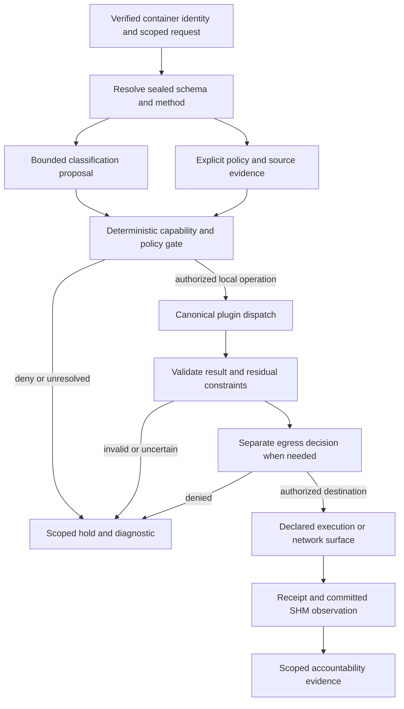

# Recovered schema/tag-based routing code

Gathered by Codex `/root` on 2026-11-01. Task: `schema-tag-routing-recovery-20261101`.

This is a source collection, not a new implementation or a deployment. It contains the recovered schema/tag-routing work, its present source, integration/supporting files, specifications, earlier UI scaffolding, and provenance. Existing shared files contain other contributors' work; their inclusion does not attribute every line to Codex.

## Dates and the Btrfs disaster

There are two relevant recovery periods. Original Btrfs repair was already underway on **October 9, 2026**. The later preservation/reinstall session was **October 13, 2026**: the VPS was in a forensic live environment, and the conversation explicitly discussed saving uncommitted tag-router work before reinstalling. These establish recovery dates, not a proven exact onset or root cause for every loss.

The routing implementation associated with that October 13 recovery was requested on **October 11 at 09:51:36 UTC**, authorized for implementation at **12:49:08 UTC**, and continued **October 12 at 02:19–03:37 UTC**. In America/New_York, the continuation was October 11 at 10:19–11:37 p.m. The original routing thread was `01a129ee-7859-7cd0-8733-2c1ce831d046`; task `schema-tagged-routing-20261011`, OD-06.

The eight-hour session description could not be verified from the available originals. A historical recovery assistant estimated two focused periods totaling approximately 3½ hours, while explicitly declining to certify exact active time. The broader routing-mention span was almost 18 hours and included pauses and other work. That estimate does not disprove other long sessions.

## What was implemented

- `schema_tag_registry.rs` and `_methods.rs`: tag identities/associations, stable-owner policy administration, protected-method markers, canonical mapping references and revision checks.
- `routing_decision.rs` and `_methods.rs`: typed private decision records, deterministic gate outcomes, shadow recording and recheck contracts. Tags do not grant capabilities.
- `routing_catalog.rs`: resolve exact plugin/method/schema references against a manifest-pinned sealed catalog and recheck after queues.
- `routing_dispatch.rs`, `routing_store.rs`, `routing_resources.rs`, `routing-limits.json`: admitted dispatch, private Cozo-backed documents, cancellation/recovery ownership and bounded resource reservations.
- `openflow_permit.rs`, `openflow_methods.rs`, controller integration: one-use attributed callbacks and last-moment caller/grant/schema admission for controller writes. This was not complete tag-to-packet enforcement.
- `oscal_field_classification.rs` and `_tests.rs`, shared OSCAL registry/dispatch changes: bounded schema-field assessment, inherited reviewed rules, privacy floors and candidate comparison.
- `.kiro/specs/schema-tagged-routing/`: requirements, design, phased tasks and explicit unfinished work.

The October 11–12 handoffs described a **shadow-only foundation**, not a complete deployed redaction/egress/router lifecycle. Live canonical mapping validation, complete tag-policy enforcement, reviewed field-rule authoring/first-seal publication, full producer preservation, actual redaction and exact-content egress remained outstanding. The historical October 12 GNU check was reported successful; that is not a fresh build/test result. No build, test, seal, deployment, grant or storage change was performed while collecting this file.

## Versions and reading order

1. **Current source:** backend commit `b77882b915590cbddd68d983535a4ab136c900a8`, captured before this collection. These files include later repairs and renames.
2. **Recovered checkpoint:** `7766577e7af741ea227ef1721167cd7dd3cc494f`, committed October 18. This is the earliest retained committed copy found for the new routing modules, not a claim that the work was originally authored October 18. Identical files are cross-referenced; differing historical files are included in full.
3. **Earlier UI foundation:** `3tched.com` commit `999651e6d1b9f653d8cf892c390ad1fe22ecfa39`, September 30, with local routing drafts/compliance/accountability scaffolding. Historical React files are archival evidence, not approval to reintroduce that stack into the current application.
4. **Changes and history:** a scoped patch from the October 11 committed base to the recovered checkpoint, a patch from the recovered checkpoint to current source, and the selected-path Git history. Checkpoint patches can include other work in shared integration files; they are not exclusively Codex patches or directly applicable to every checkout.

Complete files are included for recovery. This subset is not a standalone Cargo workspace; it retains dependencies on the surrounding repository. The late-October `hackathon/catalog-routing` prototype is separate later work and is not attributed to these pre-reinstall Codex sessions.

## Evidence and attribution

Repository handoffs: `HANDOFF.md` entries dated October 11 12:51, 13:10, 13:32, 13:51 and October 12 02:46/03:44 UTC. They name the new routing modules, OpenFlow integration, field classifier, file ownership and original uncommitted status. The September 30 foundation is documented in `reports/btrfs-cache-memory/20260930-implementation/SESSION-FINAL.md` and `routing/NOTES.md`, included below.

Native preservation archive:
`/home/jeremy/model-conversations-2026-10-15/codex/sessions/2026/10/13/rollout-2026-10-13T01-19-10-01a133b3-49ba-7a21-b25b-c91424a52ff6.jsonl.zst`.
Line numbers refer to decompressed JSONL:

- 674: October 13 06:18:26 UTC, forensic live environment/no normal server installed.
- 729: October 13 06:20:40 UTC, owner asks how long the tag router was worked on.
- 755: recovery tool output quotes original routing record 3115 at October 11 09:51:36 UTC and record 18364 at October 12 03:37:22 UTC.
- 770: recovery tool output quotes original record 3938, implementation authorized October 11 12:49:08 UTC.
- 762: recovery tool output quotes original record 16987, continuation request October 12 02:19:30 UTC.
- 782/818: historical duration estimate and its explicit uncertainty.

These are native records of the recovery session, but their quotations of the missing original October 11 root transcript are **secondary evidence**. The prose export also survives at `/home/jeremy/conversation-history-2026-10-15/codex.md`, around lines 101730–101765.

The earlier October 9 recovery thread is `01a12009-f007-7fd1-9bc0-dd203ee45f59`; native record 9 at 09:41:39 UTC requests Btrfs repair, and record 81 at 09:43:25 describes device removal/deletion during release preparation. This does not establish a complete forensic cause.

The October 13 receipts named `/home/jeremy/Recovery/conversation-audit-20261013/repository/op-dbus-git-and-working-changes.tar` and retained `root-sessions/`. That original backup path is absent on this host today. Therefore the collection uses retained Git objects, not an asserted byte-exact pre-loss working-tree restore. No original transcript, credential or raw private runtime dump is embedded here.

The identity mount paths `/run/mounts/3tchedFS` and `/run/mount/3tchedFS` were absent during collection. NotebookLM retrieval/sync was unavailable through that surface; no alternate identity or backend transport was used. Source and authorized local historical records provided the evidence.

## Source index

Each row records snapshot, commit, path, Git blob object, SHA-256, byte count and line count. Snapshot names identify versions; timestamps on recovery commits do not independently establish authorship time.

````````````````tsv
snapshot	commit	path	blob_oid	sha256	bytes	lines
recovered-20261018	7766577e7af741ea227ef1721167cd7dd3cc494f	.kiro/specs/schema-tagged-routing/requirements.md	7eebad0743c49480843503c4c48f179df43533f7	81862eea21170aa330ed2facd925212ae81d781257f616b88229980c21f52186	36310	567
recovered-20261018	7766577e7af741ea227ef1721167cd7dd3cc494f	.kiro/specs/schema-tagged-routing/design.md	9a46b7c1ecc5dc163d89ff95d3a8ca8a0342b238	5073275755cc7af9f2354032c18823c95e58b2b711d628459e92e1aead82fb55	66209	997
recovered-20261018	7766577e7af741ea227ef1721167cd7dd3cc494f	.kiro/specs/schema-tagged-routing/tasks.md	1db1bb5b191de0bf9f02336fbf8cf533a2281320	27e6d77e4a4db8339be90f88101abf2d38da5d201aa73bd2f91c53b8eca800cb	40752	667
recovered-20261018	7766577e7af741ea227ef1721167cd7dd3cc494f	crates/op-plugins/src/state_plugins/schema_tag_registry.rs	4f69f63c09aac4aa0f132bcf2e3ad474ae93337b	3405bdde390787bde5e396eb22dda95a85559a7946f933c537c3f6a17698d762	13198	378
recovered-20261018	7766577e7af741ea227ef1721167cd7dd3cc494f	crates/op-plugins/src/state_plugins/schema_tag_registry_methods.rs	2b6c4ec30cbd5445953a5efd0904889ad06c79fd	cc3e5d487f74fb1e63ca66b0225f9abe2d363d961e37392a1df8941ced1edfa0	30224	919
recovered-20261018	7766577e7af741ea227ef1721167cd7dd3cc494f	crates/op-plugins/src/state_plugins/routing_decision.rs	90a7c57b1505930ef419e40e67ca27aa314540a6	3bbe8abe1bd682d68cdfef1dc7cc852768b43c59ab4f58d79c3956d2d74f4fa7	27810	724
recovered-20261018	7766577e7af741ea227ef1721167cd7dd3cc494f	crates/op-plugins/src/state_plugins/routing_decision_methods.rs	e812847747040e18d7f013beb3b5e22e2248955a	0ebd3dfa1d9b55c5436cb89b6e917b1f1086c48c6e743c6fd9fc489ae44f855a	28475	790
recovered-20261018	7766577e7af741ea227ef1721167cd7dd3cc494f	crates/op-plugins/src/state_plugins/oscal_field_classification.rs	d53a24a410cdf79379141bd1a01d26886510e00f	e74d656fca835e54cd714f3d5a3510704477e78d615d51276844b7a51ba84dd2	44874	1237
recovered-20261018	7766577e7af741ea227ef1721167cd7dd3cc494f	crates/op-plugins/src/state_plugins/oscal_field_classification_tests.rs	2d1e00d971e4afae486501dc52af1e62b7a8267d	208be647cb809c168c41a142b31e02580655f88c34bbf172d2e55e7b600173f4	12336	346
recovered-20261018	7766577e7af741ea227ef1721167cd7dd3cc494f	crates/op-plugins/src/state_plugins/oscal_subid_registry.rs	5c6c8d987eb3fb6ca141fd9dcde3a068424cba28	75b439a609f65f4e13b3aa09aff1f7ade35c3aac30690dacd05c06003026aeb5	20851	605
recovered-20261018	7766577e7af741ea227ef1721167cd7dd3cc494f	crates/op-plugins/src/state_plugins/oscal_subid_registry_methods.rs	692a829fe7b9a389de2c780bb4bb91f744a4d664	fa9a6613fe4cb38e2470edfc7c28c6351250203112bafd4570f6fc109c8d45ce	50709	1449
recovered-20261018	7766577e7af741ea227ef1721167cd7dd3cc494f	crates/op-plugins/src/state_plugins/gemma_brain.rs	6d4990077aacee5d5482e37cd7f646300c862c4f	dfc294df178815662643e437522b826616ad81e9345cf01a6d836f7dde8c2ef6	11079	278
recovered-20261018	7766577e7af741ea227ef1721167cd7dd3cc494f	crates/op-plugins/src/state_plugins/gemma_brain_methods.rs	f1c50363dd28ec73e575a74f00ebbc3d9eeaab08	64778ed300d4affe2c6a92ebf9f8fc0a36310065cd34a11d55849e1263c2bf48	11062	369
recovered-20261018	7766577e7af741ea227ef1721167cd7dd3cc494f	crates/op-plugins/src/state_plugins/runtime_documents.rs	6d3cdfdab5539f951238d5d2391448fa7e223043	eaddddc37de952f8fb2092f41a385a23136669d845566484eb2fb94c2895fb3e	20911	539
recovered-20261018	7766577e7af741ea227ef1721167cd7dd3cc494f	crates/op-plugins/src/state_plugins/plugin_scaffold_helpers.rs	ab7aa387a231e9f649c349e6e535d1c8c990b35e	292c9ce3dad4503c9dda6b4fc499255957047fee176852c3280f30373c78d786	21864	550
recovered-20261018	7766577e7af741ea227ef1721167cd7dd3cc494f	crates/op-plugins/src/state_plugins/common/oscal.rs	1d3b54c4be8ed3c4e2b2d72252e32de64604037e	07bfb0f898439981a8472b032eb9897e599e5bea404f6c04aca7033591bcd0c6	10742	281
recovered-20261018	7766577e7af741ea227ef1721167cd7dd3cc494f	crates/op-plugins/src/state_plugins/mod.rs	19f36072f8bf5c587303a830139f2a162f34c630	ba780b4264f485a16834206120f68386401f9d3c6875a45a2a545c7b13dacbbe	5290	174
recovered-20261018	7766577e7af741ea227ef1721167cd7dd3cc494f	crates/op-plugins/src/state_plugins/openflow.rs	8502f1dbc4c9c81916308a3d740ba6377d5145e7	a1d1f3a0bbeb1ac117e0423afe68df897e0ef1d25bbc4130a33cd2ca853e90b1	64493	1719
recovered-20261018	7766577e7af741ea227ef1721167cd7dd3cc494f	crates/op-grpc-bridge/src/routing_catalog.rs	5b55c27cfcbf00bdaa69a7f5a1e4823e4b0dea47	73e9ce7a4c4f6f063771af9038c0946e2ca19d1c1d58dc9cb61a454abf85bfe1	3852	81
recovered-20261018	7766577e7af741ea227ef1721167cd7dd3cc494f	crates/op-grpc-bridge/src/routing_dispatch.rs	0f89f5c609bd628f2f6486075453afa817cf4d44	390005960f6c7265e207cdb12b284303a09cd7ecab670c113c1c2669cac0f8a4	33590	886
recovered-20261018	7766577e7af741ea227ef1721167cd7dd3cc494f	crates/op-grpc-bridge/src/routing_store.rs	b423d3cca6a1482b0155d9a27febb6b52257b643	5ae07a4baf3be2cf30c4b074d042aaac22ad848e5a9fa0faf0974a9454e6dc04	36398	607
recovered-20261018	7766577e7af741ea227ef1721167cd7dd3cc494f	crates/op-grpc-bridge/src/routing_resources.rs	401196c5a43e00712ca7cf28b06b31f0610126ae	5f93931f781512e03116c10297a644708c68af0a9241fae51f7673ba390e38e6	12011	223
recovered-20261018	7766577e7af741ea227ef1721167cd7dd3cc494f	crates/op-grpc-bridge/src/openflow_permit.rs	ffd922be3415b658a4f62061fa9352906c95824c	2af32897c390782bf9fee49cd919c086c5cbecbb803b22779e1915c5cb961772	11406	258
recovered-20261018	7766577e7af741ea227ef1721167cd7dd3cc494f	crates/op-grpc-bridge/src/openflow_methods.rs	9acd2c5976f9c23a3cb1b7f3274b58755055abb0	8b0c180ee94f3f15372365c07f3ee07356a140f35bc0954341a9532366aae0b0	16392	469
recovered-20261018	7766577e7af741ea227ef1721167cd7dd3cc494f	crates/op-grpc-bridge/src/oscal_dispatch.rs	a15cfd230eaa753ebfef23b58b3dee19f318ad5e	ae23c2c1b0f0f04a4b916fa52a784e3cd44e39da592e5d6270881bc2bd015ec8	4251	107
recovered-20261018	7766577e7af741ea227ef1721167cd7dd3cc494f	crates/op-grpc-bridge/src/gemma_brain_dispatch.rs	430c58b7ba31ff5b91ddb0fdc57a3a98cbcfa85d	605dfa180c2854a8bd600ee718ef66e64bff41918a8c30eff37a1b1d69d2c481	4655	125
recovered-20261018	7766577e7af741ea227ef1721167cd7dd3cc494f	crates/op-grpc-bridge/src/ui_workspace_dispatch.rs	3c434cc9ec286e470d92c56f9a8c2c080a661b7f	9af12ddff9d982cfc5b5c862aed34eae7ea2a767d792182198bcea045a9f5380	34681	960
recovered-20261018	7766577e7af741ea227ef1721167cd7dd3cc494f	crates/op-grpc-bridge/src/mutation_engine.rs	61e686385357d20ae1c8a85376a919c2fa14cbd0	55ba0519379ce49806c5fafc3c64d858a0bf34a314a875f7452a8c20e47959d4	337404	7955
recovered-20261018	7766577e7af741ea227ef1721167cd7dd3cc494f	crates/op-grpc-bridge/src/server.rs	94868a41e1825a72231a7ff84e3d9d095465b690	084ec6e21d643da3f7fb6773e2147396c2384f99bbedf70589fed3f5fab32004	66103	1563
recovered-20261018	7766577e7af741ea227ef1721167cd7dd3cc494f	crates/op-grpc-bridge/src/lib.rs	5895db9f372751a80ce3ff5e38806c1440eba9fd	2ec51c7a37b15247738793842b6124f005fbf0e0187c159508d3ba2b0b514a33	14407	398
recovered-20261018	7766577e7af741ea227ef1721167cd7dd3cc494f	crates/op-grpc-bridge/src/sealed_schema_reader.rs	03bb343d4a3ee70d659c16f9b275e8a6c051cee7	88d91a8b5cc3d68031f697d63e71ca5ed7bc038321a1ea0ca7ef232370a1f852	13893	369
recovered-20261018	7766577e7af741ea227ef1721167cd7dd3cc494f	crates/op-grpc-bridge/src/method_contract_admission.rs	9c6f2cef56a61ca36db8a4dd75b8b0a5a4c9a781	f8fb7f2bb849774ce5e88809911e48b4b1f3501273a1480e48589e867de57436	8891	231
recovered-20261018	7766577e7af741ea227ef1721167cd7dd3cc494f	crates/op-grpc-bridge/src/method_receipt_audit.rs	13e994791ddca5ec334d54b59b24aca632eb9531	f7fb6ce985372b00c56e120446d9ff2f7aa258ec42c96fab8587f4fed6f60c48	34738	873
recovered-20261018	7766577e7af741ea227ef1721167cd7dd3cc494f	crates/op-grpc-bridge/tests/oscal_dispatch.rs	2460e1dbb99606b8d3fe991e59d6cbe8313aaba3	4f7da2943b047331850c142d0b5eab95cf0e1ab9bca8df71bd91857e4a13c058	6186	199
recovered-20261018	7766577e7af741ea227ef1721167cd7dd3cc494f	crates/op-network/src/controller.rs	f57901d9e53d6b8788a279784e16ba1bafb8a4e7	c59fa97b3c42d3d01a66b2860386f9af36126d714bb32f8dde0fb651ed98acd9	58976	1415
recovered-20261018	7766577e7af741ea227ef1721167cd7dd3cc494f	crates/op-network/src/bin/op-of-controller.rs	aafee84e2be0b161f971576fa0d18b888796040e	5644d51dff1ddf2ad2a0f5cb4eb7baf1d0cf29faa78f8c3bf3fbe5fd508817db	12178	300
recovered-20261018	7766577e7af741ea227ef1721167cd7dd3cc494f	crates/op-core/src/private_document_publication.rs	550c31ad43089be74d1f0597a055d3932113d43e	d62806e89a501998f50ece8c0c5ccdacb16c44ecfcfc7e96833ec91451cad1bd	12519	321
recovered-20261018	7766577e7af741ea227ef1721167cd7dd3cc494f	crates/op-core/src/projection_shm.rs	79d20b069d08358514ffa23229f351a4f929b76b	057c88ac5f728626825e2493a7d3968cae0b28cebeb47504901d14cf787692a5	13674	340
recovered-20261018	7766577e7af741ea227ef1721167cd7dd3cc494f	crates/op-state-store/src/plugin_schema.rs	a36002cbad44698c824b30d21d9bb669281f044f	7c5bd6c0ef4f7de860aca6c2b002d015e42e62a4558ca58aca5b184d90ed766a	92880	2476
recovered-20261018	7766577e7af741ea227ef1721167cd7dd3cc494f	crates/op-state-store/src/schema_projection.rs	f2d4c57b6f24ac5cf737fc2eb691c497c25f3f93	04d54c20208a5dd6986103ac283186c371af3808c98429c7c748ec1666f9b657	15818	460
recovered-20261018	7766577e7af741ea227ef1721167cd7dd3cc494f	deploy/config/routing-limits.json	3df5ec7ff7e5c83369229c4658f6057a79346c78	dad9a6dd98cadb0aa73d0a658cde14d401f92894bbbc2a96ec8b840e9fd33dfb	466	20
recovered-20261018	7766577e7af741ea227ef1721167cd7dd3cc494f	docs/schema-tagged-routing-whitepaper.md	bd692c0db87dbea611b3ad862b1031729b778e5b	17fe9d2bd54a626bcf25366876234a254ce6b48d67e33757c48f660a3605e0f1	15580	140
recovered-20261018	7766577e7af741ea227ef1721167cd7dd3cc494f	reports/btrfs-cache-memory/20260930-implementation/routing/NOTES.md	c7106652fc93a40bee0b81450aa098f7414bc144	fbeb37dddf412407e4762465ad5d2199e41ffee8ef9155375812bc5e1ffc4ef0	5916	35
recovered-20261018	7766577e7af741ea227ef1721167cd7dd3cc494f	reports/btrfs-cache-memory/20260930-implementation/SESSION-FINAL.md	b7fe608246295629b44ba3b87f076b00add8d023	261c424c4cd6f2364127b1319b70c7c3d5142121e61cab2f4aabc9e5cc2fab36	2222	34
recovered-20261018	7766577e7af741ea227ef1721167cd7dd3cc494f	reports/btrfs-cache-memory/20260930-implementation/identity-workspace-ui/RESULTS.md	68bd666a84ff46c996079d14df983ada4a3336db	df428a1903e55282a6ab5d59d5dee2ef5e675ed317a93ad46147529121a070c9	4081	17
current-20261101	b77882b915590cbddd68d983535a4ab136c900a8	.kiro/specs/schema-tagged-routing/requirements.md	7eebad0743c49480843503c4c48f179df43533f7	81862eea21170aa330ed2facd925212ae81d781257f616b88229980c21f52186	36310	567
current-20261101	b77882b915590cbddd68d983535a4ab136c900a8	.kiro/specs/schema-tagged-routing/design.md	9a46b7c1ecc5dc163d89ff95d3a8ca8a0342b238	5073275755cc7af9f2354032c18823c95e58b2b711d628459e92e1aead82fb55	66209	997
current-20261101	b77882b915590cbddd68d983535a4ab136c900a8	.kiro/specs/schema-tagged-routing/tasks.md	1db1bb5b191de0bf9f02336fbf8cf533a2281320	27e6d77e4a4db8339be90f88101abf2d38da5d201aa73bd2f91c53b8eca800cb	40752	667
current-20261101	b77882b915590cbddd68d983535a4ab136c900a8	crates/op-plugins/src/state_plugins/schema_tag_registry.rs	4f69f63c09aac4aa0f132bcf2e3ad474ae93337b	3405bdde390787bde5e396eb22dda95a85559a7946f933c537c3f6a17698d762	13198	378
current-20261101	b77882b915590cbddd68d983535a4ab136c900a8	crates/op-plugins/src/state_plugins/schema_tag_registry_methods.rs	2b6c4ec30cbd5445953a5efd0904889ad06c79fd	cc3e5d487f74fb1e63ca66b0225f9abe2d363d961e37392a1df8941ced1edfa0	30224	919
current-20261101	b77882b915590cbddd68d983535a4ab136c900a8	crates/op-plugins/src/state_plugins/routing_decision.rs	73c25e06e7707bb86536f4b16c50fb5fed2d3a96	b789f779d7430322b47b7eb3f585c8e15f131742a9a6df9e6fa61c72f0a6b9cf	27826	724
current-20261101	b77882b915590cbddd68d983535a4ab136c900a8	crates/op-plugins/src/state_plugins/routing_decision_methods.rs	e812847747040e18d7f013beb3b5e22e2248955a	0ebd3dfa1d9b55c5436cb89b6e917b1f1086c48c6e743c6fd9fc489ae44f855a	28475	790
current-20261101	b77882b915590cbddd68d983535a4ab136c900a8	crates/op-plugins/src/state_plugins/oscal_field_classification.rs	d53a24a410cdf79379141bd1a01d26886510e00f	e74d656fca835e54cd714f3d5a3510704477e78d615d51276844b7a51ba84dd2	44874	1237
current-20261101	b77882b915590cbddd68d983535a4ab136c900a8	crates/op-plugins/src/state_plugins/oscal_field_classification_tests.rs	2d1e00d971e4afae486501dc52af1e62b7a8267d	208be647cb809c168c41a142b31e02580655f88c34bbf172d2e55e7b600173f4	12336	346
current-20261101	b77882b915590cbddd68d983535a4ab136c900a8	crates/op-plugins/src/state_plugins/oscal_subid_registry.rs	5c6c8d987eb3fb6ca141fd9dcde3a068424cba28	75b439a609f65f4e13b3aa09aff1f7ade35c3aac30690dacd05c06003026aeb5	20851	605
current-20261101	b77882b915590cbddd68d983535a4ab136c900a8	crates/op-plugins/src/state_plugins/oscal_subid_registry_methods.rs	692a829fe7b9a389de2c780bb4bb91f744a4d664	fa9a6613fe4cb38e2470edfc7c28c6351250203112bafd4570f6fc109c8d45ce	50709	1449
current-20261101	b77882b915590cbddd68d983535a4ab136c900a8	crates/op-plugins/src/state_plugins/gemma_brain.rs	33a62eaabbce57d01dae4a567e4fbd025733e5fe	dfd312841a23ced16812534dea9ca05185809aff927dc6409f4673cea9a7e147	10644	271
current-20261101	b77882b915590cbddd68d983535a4ab136c900a8	crates/op-plugins/src/state_plugins/gemma_brain_methods.rs	f1c50363dd28ec73e575a74f00ebbc3d9eeaab08	64778ed300d4affe2c6a92ebf9f8fc0a36310065cd34a11d55849e1263c2bf48	11062	369
current-20261101	b77882b915590cbddd68d983535a4ab136c900a8	crates/op-plugins/src/state_plugins/runtime_documents.rs	6d3cdfdab5539f951238d5d2391448fa7e223043	eaddddc37de952f8fb2092f41a385a23136669d845566484eb2fb94c2895fb3e	20911	539
current-20261101	b77882b915590cbddd68d983535a4ab136c900a8	crates/op-plugins/src/state_plugins/plugin_scaffold_helpers.rs	1813e94134e7babe70bedba6fb98fa040d706da3	77827d737ed58249a7548c85ce38ee356e23404a1ebcdc959544a4565ca274bb	21862	550
current-20261101	b77882b915590cbddd68d983535a4ab136c900a8	crates/op-plugins/src/state_plugins/common/oscal.rs	1d3b54c4be8ed3c4e2b2d72252e32de64604037e	07bfb0f898439981a8472b032eb9897e599e5bea404f6c04aca7033591bcd0c6	10742	281
current-20261101	b77882b915590cbddd68d983535a4ab136c900a8	crates/op-plugins/src/state_plugins/mod.rs	0b4b2c475d71e89e225a720e92f29ace63e20e8f	9b8e916bc531c6ba19b84b6f1fa944c290e1f0389f3fc813a4cf8849ea87a73a	5201	171
current-20261101	b77882b915590cbddd68d983535a4ab136c900a8	crates/op-plugins/src/state_plugins/openflow.rs	59f942a995d8bbc7bee1189151315c7014dfe200	f3d66a8e01fb18abf7d6e66f89de5cd54fde70ade80c3adcb84a2a0782641c6b	64491	1719
current-20261101	b77882b915590cbddd68d983535a4ab136c900a8	crates/op-grpc-bridge/src/routing_catalog.rs	5b55c27cfcbf00bdaa69a7f5a1e4823e4b0dea47	73e9ce7a4c4f6f063771af9038c0946e2ca19d1c1d58dc9cb61a454abf85bfe1	3852	81
current-20261101	b77882b915590cbddd68d983535a4ab136c900a8	crates/op-grpc-bridge/src/routing_dispatch.rs	7f2acc9fd1992f0acf953cfb8965d3831ef48044	5b4c253b028a39d9aed6c93d9d342ea679dc7a6999a13ae75027f956d322cc79	33588	886
current-20261101	b77882b915590cbddd68d983535a4ab136c900a8	crates/op-grpc-bridge/src/routing_store.rs	b423d3cca6a1482b0155d9a27febb6b52257b643	5ae07a4baf3be2cf30c4b074d042aaac22ad848e5a9fa0faf0974a9454e6dc04	36398	607
current-20261101	b77882b915590cbddd68d983535a4ab136c900a8	crates/op-grpc-bridge/src/routing_resources.rs	401196c5a43e00712ca7cf28b06b31f0610126ae	5f93931f781512e03116c10297a644708c68af0a9241fae51f7673ba390e38e6	12011	223
current-20261101	b77882b915590cbddd68d983535a4ab136c900a8	crates/op-grpc-bridge/src/openflow_permit.rs	ffd922be3415b658a4f62061fa9352906c95824c	2af32897c390782bf9fee49cd919c086c5cbecbb803b22779e1915c5cb961772	11406	258
current-20261101	b77882b915590cbddd68d983535a4ab136c900a8	crates/op-grpc-bridge/src/openflow_methods.rs	9acd2c5976f9c23a3cb1b7f3274b58755055abb0	8b0c180ee94f3f15372365c07f3ee07356a140f35bc0954341a9532366aae0b0	16392	469
current-20261101	b77882b915590cbddd68d983535a4ab136c900a8	crates/op-grpc-bridge/src/oscal_dispatch.rs	a15cfd230eaa753ebfef23b58b3dee19f318ad5e	ae23c2c1b0f0f04a4b916fa52a784e3cd44e39da592e5d6270881bc2bd015ec8	4251	107
current-20261101	b77882b915590cbddd68d983535a4ab136c900a8	crates/op-grpc-bridge/src/ui_workspace_dispatch.rs	3fe668c0ed79469b01a6e652d28bb37a29b835c3	97ccad2f880a8b52153c028ccaf23a89c618417ac88195f74c34a177e7b873a4	34680	960
current-20261101	b77882b915590cbddd68d983535a4ab136c900a8	crates/op-grpc-bridge/src/mutation_engine.rs	ba49b33ba0ba1368f86b3d7c094049244ff5b997	406704f8a90f832ce64cc6db85cd21eca3017b5410617666190ef4c43a536b39	336755	7951
current-20261101	b77882b915590cbddd68d983535a4ab136c900a8	crates/op-grpc-bridge/src/server.rs	bd74d294aaa34d4930ae77a224dc3a7ddeb6dbd7	aeecec9881bf351db13f0b3025b62631386e241421ce0f3fca909a8c6aec74b9	66075	1563
current-20261101	b77882b915590cbddd68d983535a4ab136c900a8	crates/op-grpc-bridge/src/lib.rs	a4803e8467c4d803419ef87d248ef46dbf8c29c1	3c1be876c5a060d4d143f60fe0c2df44f3e593f5fad74d6b371fcae297f4fa9a	14442	399
current-20261101	b77882b915590cbddd68d983535a4ab136c900a8	crates/op-grpc-bridge/src/sealed_schema_reader.rs	03bb343d4a3ee70d659c16f9b275e8a6c051cee7	88d91a8b5cc3d68031f697d63e71ca5ed7bc038321a1ea0ca7ef232370a1f852	13893	369
current-20261101	b77882b915590cbddd68d983535a4ab136c900a8	crates/op-grpc-bridge/src/method_contract_admission.rs	9c6f2cef56a61ca36db8a4dd75b8b0a5a4c9a781	f8fb7f2bb849774ce5e88809911e48b4b1f3501273a1480e48589e867de57436	8891	231
current-20261101	b77882b915590cbddd68d983535a4ab136c900a8	crates/op-grpc-bridge/src/method_receipt_audit.rs	c633345be874f173d8b9dd4993a961fbcb4718d0	37e8e4662f0c1de80023dde158fab6ed706f82e4d3205fb1a8219701660dd51a	37670	932
current-20261101	b77882b915590cbddd68d983535a4ab136c900a8	crates/op-grpc-bridge/tests/oscal_dispatch.rs	2460e1dbb99606b8d3fe991e59d6cbe8313aaba3	4f7da2943b047331850c142d0b5eab95cf0e1ab9bca8df71bd91857e4a13c058	6186	199
current-20261101	b77882b915590cbddd68d983535a4ab136c900a8	crates/op-network/src/controller.rs	f57901d9e53d6b8788a279784e16ba1bafb8a4e7	c59fa97b3c42d3d01a66b2860386f9af36126d714bb32f8dde0fb651ed98acd9	58976	1415
current-20261101	b77882b915590cbddd68d983535a4ab136c900a8	crates/op-network/src/bin/op-of-controller.rs	aafee84e2be0b161f971576fa0d18b888796040e	5644d51dff1ddf2ad2a0f5cb4eb7baf1d0cf29faa78f8c3bf3fbe5fd508817db	12178	300
current-20261101	b77882b915590cbddd68d983535a4ab136c900a8	crates/op-core/src/private_document_publication.rs	550c31ad43089be74d1f0597a055d3932113d43e	d62806e89a501998f50ece8c0c5ccdacb16c44ecfcfc7e96833ec91451cad1bd	12519	321
current-20261101	b77882b915590cbddd68d983535a4ab136c900a8	crates/op-core/src/projection_shm.rs	79d20b069d08358514ffa23229f351a4f929b76b	057c88ac5f728626825e2493a7d3968cae0b28cebeb47504901d14cf787692a5	13674	340
current-20261101	b77882b915590cbddd68d983535a4ab136c900a8	crates/op-state-store/src/plugin_schema.rs	a36002cbad44698c824b30d21d9bb669281f044f	7c5bd6c0ef4f7de860aca6c2b002d015e42e62a4558ca58aca5b184d90ed766a	92880	2476
current-20261101	b77882b915590cbddd68d983535a4ab136c900a8	crates/op-state-store/src/schema_projection.rs	f2d4c57b6f24ac5cf737fc2eb691c497c25f3f93	04d54c20208a5dd6986103ac283186c371af3808c98429c7c748ec1666f9b657	15818	460
current-20261101	b77882b915590cbddd68d983535a4ab136c900a8	deploy/config/routing-limits.json	3df5ec7ff7e5c83369229c4658f6057a79346c78	dad9a6dd98cadb0aa73d0a658cde14d401f92894bbbc2a96ec8b840e9fd33dfb	466	20
current-20261101	b77882b915590cbddd68d983535a4ab136c900a8	docs/schema-tagged-routing-whitepaper.md	bd692c0db87dbea611b3ad862b1031729b778e5b	17fe9d2bd54a626bcf25366876234a254ce6b48d67e33757c48f660a3605e0f1	15580	140
current-20261101	b77882b915590cbddd68d983535a4ab136c900a8	reports/btrfs-cache-memory/20260930-implementation/routing/NOTES.md	c7106652fc93a40bee0b81450aa098f7414bc144	fbeb37dddf412407e4762465ad5d2199e41ffee8ef9155375812bc5e1ffc4ef0	5916	35
current-20261101	b77882b915590cbddd68d983535a4ab136c900a8	reports/btrfs-cache-memory/20260930-implementation/SESSION-FINAL.md	b7fe608246295629b44ba3b87f076b00add8d023	261c424c4cd6f2364127b1319b70c7c3d5142121e61cab2f4aabc9e5cc2fab36	2222	34
current-20261101	b77882b915590cbddd68d983535a4ab136c900a8	reports/btrfs-cache-memory/20260930-implementation/identity-workspace-ui/RESULTS.md	68bd666a84ff46c996079d14df983ada4a3336db	df428a1903e55282a6ab5d59d5dee2ef5e675ed317a93ad46147529121a070c9	4081	17
foundation-ui-20260930	999651e6d1b9f653d8cf892c390ad1fe22ecfa39	src/workbench/AccountabilityEvidence.tsx	3f48da8bee92ed84a84dcf1afd4454e3190498e8	34dd69420cd1a3369aa56d04cb395c14d30d9ed7e0b6096503d51819e1ad87c8	3006	57
foundation-ui-20260930	999651e6d1b9f653d8cf892c390ad1fe22ecfa39	src/workbench/CompliancePanel.tsx	6ebc6dbc6102e9051f75e92e94fdc2e2b216ab49	c0837d44426409a8bad78515daee668f2309e1380ba7a937a9f1228eba927ce7	3000	41
foundation-ui-20260930	999651e6d1b9f653d8cf892c390ad1fe22ecfa39	src/workbench/Workbench.test.tsx	766cca9b3e827a276d23c2e76fd440c6b13d60db	b5fb1f0321aff6075217291be8de9935f668518b4417e558bf873ac66e487804	9690	160
foundation-ui-20260930	999651e6d1b9f653d8cf892c390ad1fe22ecfa39	src/workbench/WorkbenchControls.tsx	9ce09261b24f4d1230f326d671af9f1a1fca4f1a	e28d3b055b793ca1fdf7bc60510e3da7d981be16fe47e99a4a48b224ad0eff65	1192	20
foundation-ui-20260930	999651e6d1b9f653d8cf892c390ad1fe22ecfa39	src/workbench/WorkbenchNavigation.tsx	34177332732d0338797408eb052cb9cda4e0946a	b2efeb33c2295eb78796ca18ea7e916f9011b423d4896d0de362c4f235de435f	1064	23
foundation-ui-20260930	999651e6d1b9f653d8cf892c390ad1fe22ecfa39	src/workbench/WorkbenchPanels.tsx	8343fbfcccaa6b64c0b8b02ebf4482b642e51f08	208c094bed1433adcb15f6ef5f96a43a6cb4b91d814f1dc08f1c8e933ecc527d	3293	52
foundation-ui-20260930	999651e6d1b9f653d8cf892c390ad1fe22ecfa39	src/workbench/WorkbenchProvider.tsx	6ee8a4593f5a097d86dfb4e63b69c766f3a543cc	5fb84c2b07bc32e363ac2fb8568bfa762be0087930661a41404e3f7e43bd6026	1477	36
foundation-ui-20260930	999651e6d1b9f653d8cf892c390ad1fe22ecfa39	src/workbench/__fixtures__/compliance-ac2.json	a7533d96159050486d961e762eb310f6ddbbc977	ce9b91d4f0c7fbfc6158be4498777d05ecff1fbb9b7d7d55585f0fe3de5bceba	4095	109
foundation-ui-20260930	999651e6d1b9f653d8cf892c390ad1fe22ecfa39	src/workbench/compliance-contract.test.ts	16c52fc676bdad911a45424955f56fe856b34f29	1966ef2cbd1e6cfe9d624b5493bb83edcce5456235604d5fb0f6ab8f5f7dfcdc	3178	56
foundation-ui-20260930	999651e6d1b9f653d8cf892c390ad1fe22ecfa39	src/workbench/compliance-contract.ts	7a886063f222af2d90caa5126ff894cf3b46a371	0e365e053a73d76216a1764b710dad16c0f8c0b67eb9ced803841a9b77340190	4586	133
foundation-ui-20260930	999651e6d1b9f653d8cf892c390ad1fe22ecfa39	src/workbench/workbench.css	8816a71b04e3930f3b6456d1254aebabb03f132d	169b616dee6dae3388360e5f07a68a949ee7b9c8ef2086d9bc2b4130bbce5e02	6195	151
````````````````

### Paths absent from a version
````````````````tsv
snapshot	commit	path	status
current-20261101	b77882b915590cbddd68d983535a4ab136c900a8	crates/op-grpc-bridge/src/gemma_brain_dispatch.rs	absent-at-revision
````````````````


## current-20261101


### odbus-verified / .kiro/specs/schema-tagged-routing/requirements.md

<!-- BEGIN SOURCE current-20261101/odbus-verified/.kiro/specs/schema-tagged-routing/requirements.md -->
````````````````markdown
# Schema-tagged routing — requirements (first pass)

Status: **draft / proposal**. This document turns
`docs/schema-tagged-routing-whitepaper.md` (concept draft, 2026-09-30) into
numbered, testable requirements. It describes a *proposed* planning and
accountability layer over existing OP-DBUS contracts. Nothing here claims a
deployed policy engine, an installed local classifier, a new capability grant,
or active network enforcement.

Related: OD-100 (model selection), OD-108 (threetched lookup surface / catalog
model authority), OD-91/OD-93 (private digests, catalog fields, pre-dispatch
`evaluate_mutation`), OD-62 (EMQX knowledge delivery). Canonical task board is
`WISHLIST.md`; this spec does **not** replace it. Promote any actionable item
here into `WISHLIST.md` as an `OD-##` and link it back.

The whitepaper's September observations were re-verified against current source
on this branch; see `design.md` §1 for the file/line map and the few
corrections (lungs socket location/path, `ChatMode` location, xray
restart/trace retirement). Where this spec says "existing," it means verified in
current source; where it says "proposed," no such method/field exists yet.

2026-10-12 field-contract review: three read-only batches of five plugins inform
R1.1–R1.8 and design §2c. These are source findings, not completed field
migrations or proof of effective runtime coverage. The owner requests that
workers report concrete cases to the contract owner before applying shared
classification rules across more plugins.

---

## Vocabulary (one meaning per term)

- **PluginSchema** — the single typed input/output/state contract a plugin
  owns (`crates/op-state-store/src/plugin_schema.rs`). opblob seals it; D-Bus,
  gRPC, MCP and 3tchedFS shapes derive from the sealed blob. There is no
  parallel schema source.
- **Schema tag** — a string in `PluginSchema.tags` (`plugin_schema.rs:301`).
  Today the only runtime meaning is `"immutable"`. A tag is **not** an OSCAL
  subid, **not** a Gemma taxonomy entry, and **not** a capability grant.
- **OSCAL subid** — an operational-taxonomy key bound to a method/field
  (`PluginSchema.subids`), resolvable through the `oscal_subid_registry` plugin.
- **Taxonomy entry** — a `GemmaTag {id,label,description,keywords,perspectives}`
  in the revisioned `GemmaTaxonomy` used by the deterministic `gemma_brain`
  keyword classifier. Not a model; substring matching only.
- **Capability grant** — a capability id held by a principal in durable
  `/etc/opdbus/capability-grants.json`, enforced per RPC by the interceptor /
  MutationEngine.
- **Verified identity** — principal + container + session + permitted project
  scope, supplied by identity validation (interceptor / lungs kernel-auth),
  **never** derived from model output.
- **Classification proposal** — a draft `{tag, taxonomy_revision,
  classifier_version, uncertainty}` suggestion. Advisory input to the gate,
  never a decision.
- **Deterministic gate** — the proposed non-model decision step that checks
  verified identity, resolved method contract, explicit policy revision and
  available grants, and emits an explicit allow / deny / unresolved outcome.
- **Transform decision** — a decision to run a bounded local transformation
  (e.g. redaction) on scoped content.
- **Residual-disclosure validation** — deterministic checks on a transform's
  output for leftover identifying material. A model's redaction claim is not
  this check.
- **Egress authorization** — a separate decision authorizing content to cross
  a boundary to a destination/provider route. Distinct from the transform
  decision and from residual validation.
- **Evidence source** — a retrieval surface (recent events, operation
  receipts, authoritative SHM state, NotebookLM history, compliance mappings,
  compliance vector scope). Each carries its own identity, access scope and
  provenance.
- **Operation receipt** — a `MethodExecutionReceipt`
  (`crates/op-state-store/src/method_receipt.rs:54`) locating an admitted
  operation by `operation_id` plus audit-chain event ids/hashes. Evidence, not
  a state store.
- **Compliance generation** — the maintained `compliance-index` graph
  generation hash (`38cdcec0…` is a September capture, not live state). Vector scope and mappings are
  pinned to a generation; mixed generations are rejected.
- **Decision record** — the proposed planning/accountability record that
  correlates verified identity, operation reference, classification proposal,
  policy/evidence and execution record for one request.
- **Shadow mode** — a dry-run comparison of proposals against deterministic
  outcomes that changes no grant, provider selection, flow or proxy rule.

---

## R1 · The plugin is the only schema; tags are metadata, not policy

- WHEN any schema-tagged-routing method, input, output, capability, subid, tag
  or state field is defined THEN it is defined inside an owning plugin's
  `PluginSchema` under `crates/op-plugins/src/state_plugins/` via
  `plugin_scaffold_helpers.rs`, never in a repo-level or plugin `schemas/`
  directory and never as a new gRPC proto service package.
- WHEN a schema tag is read THEN it is treated as an annotation with no
  behavioral meaning until the deterministic gate explicitly implements and
  tests that meaning. A label alone MUST NOT establish authorization, execution
  locality, processing requirement, or compliance.
- Acceptance: a review shows every new field in a sealed `PluginSchema`; a
  negative test shows a tag value (including an undeclared one) does not change
  any capability check, route selection, flow, or proxy rule.
- Acceptance: schema tags, OSCAL subids, taxonomy entries and capability grants
  are represented as four distinct objects; no code path converts one into
  another.
- Owner clarification (2026-10-11): OSCAL metadata belongs to its shared
  `oscal_subid_registry` plugin and is inherited by every plugin so it can
  evolve centrally. Routing MUST resolve those shared bindings and applicable
  metadata, preserving their catalog identity and annotation revision. It MUST
  NOT create another OSCAL authority or require copied annotations in each
  plugin. Missing local field attributes alone do not establish missing
  effective coverage; evaluate the resolved inherited view.
- Owner requirement (2026-10-11): every field MUST acquire an effective
  classification when its schema is created or imported, resolved from the
  shared OSCAL authority. Inheritance satisfies this only when the declared
  rule explicitly covers that field or subtree. Cover method inputs, results
  and state, including nested objects, array items and opaque containers;
  neither a schema-level ID alone nor absence of an annotation implies a
  classification. Validate coverage during creation/import and before sealing;
  unresolved classifications fail validation rather than defaulting to public.
  Preserve the classification source and revision without introducing a
  second taxonomy or guessing upstream argument types.
- Acceptance: adding an uncovered field fails classification validation;
  adding a field covered by an explicit inherited rule resolves to that rule
  with provenance. Nested/array coverage is checked, conflicting or stale
  bindings fail, and changing the shared rule invalidates an outdated resolved
  classification. Existing schemas require a coverage assessment before this
  gate is activated; document gaps without claiming them classified.

- **R1.1 — Root identity.** Classification targets MUST distinguish plugin
  state, each method input, each method result, and each declared signal
  payload. Preserve the canonical method map key separately from its transport
  name. Reusing a DTO under multiple roots MUST NOT copy an exposure decision
  between those roots implicitly. Pin the source schema and shared-rule
  revision for every resolution. Schema examples/defaults and captured
  help/config evidence require separate document-metadata targets; assess
  them before disclosure or exclude them. A state allowlist does not authorize
  exposing omitted values through `PluginSchema.example`.
  Bind the actual result DTO/projection: a summary and its full record are
  distinct. Promotion from a private candidate to a shared catalog MUST
  re-evaluate the copied content at that disclosure boundary; render validation
  or an approved summary does not clear the full candidate or its prompt.
- **R1.2 — Coverage selectors.** Bindings MUST distinguish a schema-document
  pointer from a typed payload selector. Support nested properties, array
  items, map keys separately from map values, local references, nullable
  types, and union branches. Inheritance requires explicit exact/subtree
  scope; a value rule does not classify dynamic map keys. Ambiguous branches,
  conflicting rules, unsupported constructs and stale references cannot
  select a permissive result. An empty collection or absent optional field
  does not prove coverage of its possible values.
- **R1.3 — Existing protection.** Resolution MUST preserve `x-secret` and
  `x-opdbus-private` protections and existing public-state allowlists. A shared
  rule cannot silently widen those projections. Descriptions (including
  `[PII]`), names such as `public_key`, read-only/immutable markers, exact-JSON
  fidelity markers, hashes and subids alone confer no privacy classification.
  Acceptance: the same DTO can remain private in one root and explicitly
  projected in another without either exposure leaking across roots.
- **R1.4 — Opaque and delegated values.** Arbitrary JSON and free-form text
  MUST remain opaque unless a supported contract identifies their structure.
  An explicit restrictive whole-value rule may cover an opaque boundary for
  hold/removal; it MUST NOT claim its interior fields were inspected or permit
  unclassified bytes or keys to pass through. A wrapper such as
  `elevation.authorize.args` may use a target method's schema only after the
  backend resolves that exact target and validates the wrapped value against
  it. Missing or changed targets hold; resolution grants no target capability.
- **R1.5 — Before the first seal.** The shared OSCAL owner MUST support review
  against a producer-prepared candidate schema before the subject field has
  sealed membership. Draft bindings confer no runtime existence or authority.
  Validate against the exact candidate and reviewed rule revision, then bind
  the accepted result to the sealer's final manifest. A candidate change or
  rule change requires revalidation; no self-referential schema hash or second
  captured-schema authority may be introduced. Existing `register`, which
  requires an already sealed subid, is not this authoring path.
  The authority's initial classification contract requires a bounded,
  owner-reviewed bootstrap seed with exact candidate, rule and producer
  provenance, delivered through supported release preparation. Its trust
  cannot depend on calling that contract before its first seal. Subsequent
  revisions use the same admitted authority; bootstrap is not a recovery
  fallback, grant bypass or exemption from coverage of the owner itself.
- **R1.6 — Preservation through conversion/import.** Effective classification
  and protective annotations MUST survive source generation, ordinary or exact
  schema adaptation, and sealing. Loss/change of an existing producer
  protection or a changed root/selector invalidates its assessment. Absence of
  a local protection marker alone establishes neither failed effective
  coverage nor publicness: resolve the applicable shared OSCAL rules. For
  binary-discovered methods, retain the pinned binary/discovery provenance and
  command identity; use config-schema provenance only where that document
  actually supplies the contract. CLI help/arity/choices do not establish
  semantic types, privacy classes, or read-only execution.
- **R1.7 — Bounded and honest assessment.** Coverage traversal MUST be bounded
  by configurable schema bytes, roots, nodes, reference depth/expansions,
  branches, bindings and report entries. Report exhausted/unsupported work
  explicitly, never as complete coverage. Review schema shape and protection
  metadata without copying runtime values, credentials, defaults, examples or
  concrete dynamic keys into reports/prompts. Include the shared classification
  authority itself in the assessment; it has no blanket exemption.
- **R1.8 — Batch feedback and migration.** Audit existing plugins in batches
  of five to ten. Each report MUST identify roots, source references,
  conversion behavior, effective rules verified (or unavailable), opaque
  boundaries, conflicts and proposed contract changes. The contract owner
  reconciles the findings before migrating the next batch. Keep source audit,
  proposed classification, implemented binding, verified coverage and deployed
  enforcement separate. No batch report activates the new sealing gate.
- Acceptance (R1.1–R1.8): fixtures cover reused DTOs across roots; optional and
  union branches; arrays and sensitive map keys; restrictive opaque values;
  a wrapper target mismatch; protection lost by an adapter; an uncovered field
  before its first seal; a changed binary without classification metadata;
  inherited coverage without local markers; private state duplicated into a
  schema example; full records versus summaries; private-to-catalog promotion;
  invalid/replayed bootstrap seeds; stale rules; and exhausted traversal.
  Each failure holds or rejects
  validation without relaxing existing projections. Explicit restrictive
  opaque coverage remains labelled as such, not as a complete interior census.

## R2 · Identity is verified, never modelled

- WHEN any decision record is created THEN its verified-identity fields come
  from the interceptor-anchored session or the lungs kernel-authenticated
  binding (`LungsV1.Bind` / `BindCurrentContainer`), never from classifier or
  model output.
- WHEN a model proposes a classification, plan, destination or identity label
  THEN that output is untrusted gate input and MUST NOT widen principal,
  session, project scope, or grants.
- Acceptance: a decision-record fixture carrying a model-proposed `principal`
  is rejected or the field is ignored in favor of the verified session; a test
  proves identity-bound 3tchedFS admission is unchanged.
- Acceptance: model output containing instructions ("ignore policy", "you are
  authorized") is retained as data and never alters the gate outcome.

## R3 · Models propose; deterministic checks decide

- WHEN an operation or any subsequent disclosure is permitted or denied THEN
  the decision is made by the deterministic gate against verified identity, the
  resolved sealed method contract, explicit policy revision and available
  grants — not by a model's confidence or claim.
- WHEN classification is unknown, low-confidence, or unavailable THEN the gate
  treats the input under its most restrictive applicable constraint; absence of
  a classification MUST NOT relax a constraint.
- WHEN the gate decides policy THEN it is expressed/evaluated at the same
  pre-dispatch layer as the existing canonical compliance check
  (`evaluate_mutation`), so a **direct** call to a protected method encounters
  identical enforcement; a recorded "allow" MUST NOT become reusable
  authorization (it carries no credential or capability). Deny wins over allow;
  a method flagged as policy-required with no applicable rule is `unresolved`
  (fail closed), never implicit allow.
- WHEN the policy store errors, is uninitialized, or is otherwise unavailable
  for a policy-required method THEN the gate yields a typed hold/deny
  (`unresolved`), explicitly NOT inheriting the existing evaluator's
  allow-on-query-error / skip-when-uninitialized behavior
  (`crates/op-cozo-store/src/lib.rs:767`).
- WHEN a protected operation (local effect or egress) is about to dispatch
  after any queue wait THEN identity, grants, contract hash and policy revision
  are re-verified immediately before dispatch; a revision bump, grant
  revocation, stale hash or policy-store unavailability at that moment aborts to
  `unresolved`/`hold`.
- Acceptance: for a fixed fixture set, gate outcomes are reproducible and
  independent of classifier availability; a disabled classifier yields the same
  deny/unresolved outcomes as a present one that returns low confidence; the
  same operation issued via the gate path and via a direct call yields
  identical admission outcomes; a policy-store failure on a policy-required
  method yields `unresolved` (not allow); a policy change enqueued during a
  queue wait is reflected by the pre-dispatch recheck.

## R4 · Execution uses existing admitted plugin methods only

- WHEN the gate authorizes a local operation THEN execution goes through the
  canonical D-Bus / MutationEngine path to an already-admitted plugin method;
  no new control plane, no `Command::new` subprocess, no direct state write.
- WHEN authoritative state changes THEN MutationEngine commits it to SHM before
  change notifications; a receipt is produced as evidence and is not treated as
  a second state authority.
- Acceptance: the slice invokes only methods that exist in the sealed catalog
  (verified by name); a test proves a receipt is written to the receipt store,
  not to canonical state, and that SHM commit precedes the returned output.

## R5 · Workflow 1 — local transform before possible cloud use

Transformation, residual-disclosure validation, and egress authorization are
three separate decisions.

The first visual demo prioritizes structured redaction using a schema overlay
derived from the exact sealed source `PluginSchema` plus an explicit,
machine-readable privacy policy. This is a demonstrator priority after its
identity, schema, policy, and bounded-work prerequisites; it does not activate
egress or reduce the accountability (R6) and compliance retrieval (R7)
workflows. Resolve the field's OSCAL identity and applicable inherited metadata
through the shared OSCAL plugin; neither the identifier string nor a count of
local attributes establishes its effective privacy classification. The current runtime recognizes `x-secret` and
`x-opdbus-private` schema extensions (`crates/op-state-store/src/schema_projection.rs:36-47`);
`[PII]` in a description is not a runtime privacy flag. The legacy
`privacy_index` name heuristics are not an authoritative transform. Unknown,
unclassified, or stale schema paths hold rather than being cleared by default.
Free-text residual validation remains a separate check and is not proved by a
structured overlay.

- R5.1 WHEN sensitive input is submitted for transformation THEN the system
  first resolves the input owner, container/session/project scope and the
  actual transform method contract, and verifies execution locality from the
  verified runtime — a provider or model name MUST NOT be accepted as proof of
  local execution.
- R5.2 WHEN no supported local transform method exists THEN the capability is
  presented as *unavailable*; the system MUST NOT fabricate a redactor method
  or route the content outward as a substitute.
- R5.3 WHEN a transform runs THEN it is admitted under a bounded reservation
  (input/output byte caps, time, concurrency) using only necessary scoped
  content, and emits transformed output plus findings and unresolved spans.
- R5.4 WHEN a transform completes THEN residual-disclosure validation runs
  deterministic detectors and consistency checks over the output; a model's
  redaction claim MUST NOT substitute for this check, and confidence MUST NOT
  be recorded as proof of anonymity.
- R5.5 WHEN disclosure to a destination is considered THEN egress is authorized
  separately against destination, actual provider route, purpose, policy
  revision and current grants; a successful transform or valid JSON MUST NOT
  grant egress. The approval binds to an **immutable** `validated_content_ref`
  (the exact transformed payload that passed residual validation) plus the
  transform receipt, validation evidence, and route/policy revisions; the
  sending operation MUST verify the bytes it is about to send against that
  validated artifact and re-verify identity/grants/route immediately before
  dispatch after any queue wait.
- Acceptance (R5.5): payload substitution after approval blocks the send; a
  route change after approval blocks the send; a revoked grant after approval
  blocks the send; sending bytes that do not match `validated_content_ref`
  fails closed.
- R5.6 WHEN a transform or egress is denied or unresolved THEN the content stays
  local with an explanation; there MUST be no automatic promotion to an
  `anonymous`/cleared label and no cloud fallback.
- R5.7 WHEN correlation is recorded THEN it uses bounded identifiers,
  revisions and protected references; originals, removed tokens and sensitive
  detector snippets MUST NOT be logged by default, and hash visibility is scoped
  because hashes reveal equality.
- R5.8 WHEN a structured redaction overlay is rendered THEN its paths and
  classifications MUST be derived from the exact sealed source schema,
  resolved shared OSCAL metadata, and an explicit machine privacy policy, with
  source schema/catalog identity, annotation revision and policy revision
  pinned in the result. Schema descriptions, field names, unresolved OSCAL IDs, classifier proposals,
  or historical catalogs alone MUST NOT grant public clearance. Unknown,
  unclassified, and stale paths hold for review; there is no automatic
  pass-through. The renderer MUST hydrate values locally from an authorized
  fixture or source after applying the overlay, and MUST NOT send private
  originals to a model, prompt history, or gallery. Real execution results
  MUST retain the admitted backend receipt; the UI MUST NOT act as a second
  policy evaluator or fabricate evidence. Fictional fixture results MUST be
  visibly identified as fixtures.
- Acceptance: a defensible result states only "the specified transform
  completed; listed checks passed; stated residual risks remain; the separately
  evaluated destination was permitted/denied." Negative tests: redaction-claim
  without validation fails to authorize egress; absent transform method stays
  unavailable; denied egress leaves content local. For the structured demo,
  tests pin the sealed schema hash, prove unknown/stale paths hold, prove
  private originals are absent from model input/history/gallery, and keep
  free-text residual validation independently required.

## R6 · Workflow 2 — accountability against independent evidence

- R6.1 WHEN a conversational claim is checked THEN the system retrieves recent
  events, operation receipts and authoritative SHM state through independently
  authorized evidence queries — each query independently authorizes the
  **verified caller** against its own access scope, time window and provenance;
  adjacent panels MUST NOT merge identities or histories. (Independent evidence
  does not require a second identity; it requires an independent authorization
  check of the same verified caller.)
- R6.2 WHEN evidence is correlated THEN request, acceptance, SHM publication,
  native readback, failure and cancellation are distinguished; a conversation
  passage MUST NOT be treated as a native receipt, and semantic similarity MUST
  NOT be treated as proof of execution or authorization.
- R6.3 WHEN NotebookLM or other memory history is used THEN it is accessed only
  through verified named access, preserving owner, conversation id,
  capture/retrieval time and revision; conversation provenance is kept distinct
  from current SHM, grants and compliance authority.
- R6.4 WHEN an evidence source is unavailable THEN it is reported as a gap /
  unavailable; a missing event MUST NOT be rendered as a confirmed negative or
  a confirmed positive.
- Acceptance: a claim with no matching receipt reports "no receipt found," not
  "did not happen"; an evidence panel labels each item's source identity and
  retrieval time; a test proves the recent-event query and the chat session
  each independently authorize the verified caller (not that they use different
  identities).

## R7 · Workflow 3 — source-backed policy/compliance retrieval

- R7.1 WHEN compliance evidence is retrieved THEN it comes from the maintained
  canonical OSCAL mappings in Qdrant and their maintained `compliance-index`
  provenance/scope contracts (mappings + active-generation vector scope),
  preserving mapping direction, framework versions, ASVS lifecycle relations,
  unresolved references and graph generation; the system MUST NOT build a
  parallel compliance graph.
- R7.1a WHEN a routing policy references an OSCAL mapping THEN the backend
  resolves its canonical identifier, direction, source hash and active
  generation through the admitted evidence surface. The tag registry stores
  references to this authority, never caller-authored claims that a mapping
  resolved. Missing or unverifiable mappings hold the protected operation.
- R7.2 WHEN a retrieval scope is empty THEN zero results are returned; an empty
  `allowed_groups` means `qdrant_filter: null` and the system MUST NOT issue an
  unfiltered Qdrant query. The `scope`/`route`/`mappings` contracts return
  eligibility and relationships, **not** vector-search results; the actual
  vector search is a separate bounded admitted operation that uses exactly the
  returned filter and validates each result's group/context membership against
  the active generation.
- R7.2a WHEN a `route` is returned THEN it is treated as depth-bounded even when
  `truncated` is false; `scope` exposes no truncation indicator, so a consumer
  MUST carry an explicit completeness limitation rather than claim completeness.
- R7.3 WHEN captures or results of different graph generations are present THEN
  the system rejects the mixed set rather than merging it, and labels truncated
  routes as incomplete.
- R7.4 WHEN compliance evidence is displayed THEN mapping direction and
  endpoint resolution status (resolved / unresolved / historical) are preserved
  per edge with source + sha256 evidence; a mapping MUST NOT be presented as
  equivalence, enforcement, or execution authority.
- R7.5 WHEN no sealed bridge method yet exposes these contracts THEN live
  integration is shown as *unavailable*, and only captured review fixtures are
  displayed, marked as captures.
- Acceptance: an empty-scope tag yields zero results and issues no query; a
  mixed-generation fixture fails; a reversed traversal stays labelled
  `reverse:maps_to`; a historical ASVS edge stays historical; nearest-neighbor
  documents do not authorize any operation.

## R8 · Required OVS/OpenFlow routing with separate admission and forwarding

- WHEN an application-level decision is made THEN it is kept distinct from
  OpenFlow (packet matches/actions), OVSDB (bridge/port/interface config) and
  Xray (proxy routing) ownership.
- WHEN an authorized routing decision requires forwarding THEN it uses the
  existing OVS OpenFlow controller through an explicit admitted adapter and
  verified controller readback; a schema tag, model role, or saved
  draft MUST NOT be accepted as a network argument and MUST NOT install a flow
  or change proxy state.
- The reserved OpenFlow controller endpoint on the OVS bridge carries control
  traffic; it does not by itself identify the request's dataplane traffic.
  Controller mutations require authenticated operation attribution and an
  authoritative identity-to-traffic binding. Missing bindings hold forwarding.
- OVS/OpenFlow integration is required for this feature. Lungs owns local
  identity-bound admission; OVS owns packet forwarding. Xray is not the routing
  controller for this feature. Existing controller denial of unattributed
  mutations must remain enforced until attributed admission is implemented.
- WHEN a threetched-backed capability is used THEN supported commands/flags are
  discovered from the pinned binary and its sealed contract; the system MUST
  NOT invent commands, argument types, provider lists, or parallel schemas.
- WHEN routing/model roles are assigned THEN they are model-agnostic and actual
  execution locality is verified; a provider name alone MUST NOT establish
  locality.
- Acceptance: a test proves no schema-tag/model-intent reaches
  `openflow.*`/`ovsdb.*`/`xray.*` inputs; `SetOvsRoutingModel` records an
  assignment and installs no flow; a threetched method absent from the binary's
  discovered surface is reported unavailable rather than fabricated.

## R9 · Provenance and label origin

- WHEN any label is recorded THEN its origin is retained (declaration, user
  selection, keyword match, model proposal, or validated transform) and travels
  with the label.
- WHEN an operation reference is recorded THEN it preserves exact plugin id,
  method key, transport name, schema hash/version, catalog identity, OSCAL
  subid, taxonomy revision, policy revision and source references; a schema hash
  (contract bytes), catalog hash (membership) and taxonomy revision are distinct
  and updating one MUST NOT silently update another.
- WHEN an association can no longer be resolved THEN it is marked stale/visibly
  provisional rather than dropped or silently repaired.
- Acceptance: a decision-record fixture round-trips all identity fields; a stale
  schema hash renders the association as stale; a user-selected tag and a
  keyword-matched tag are distinguishable in the record.

## R10 · Failure outcomes (no silent broadening)

- WHEN any stage fails — unknown tag, stale catalog identity, denied capability,
  unavailable evidence, invalid model output, capacity exhaustion, cancellation,
  or an uncertain execution outcome — THEN the result is an explicit scoped hold
  / diagnostic.
- No failure may (a) broaden identity or scope, (b) disclose content through a
  cloud fallback, or (c) retry an operation whose effects are unknown without
  reconciliation and idempotency rules.
- WHEN raw content would be logged on failure THEN it is suppressed; only the
  diagnostic and minimal protected references needed for review are retained.
- Acceptance: fault-injection tests for each failure class show an explicit
  outcome with no grant/scope change, no outward disclosure, and no blind
  retry; an uncertain native outcome triggers reconciliation, not re-dispatch.

## R11 · Resource ownership and limits

- WHEN inputs are copied THEN a bounded admission reservation is acquired first;
  payload size, taxonomy size, result count, queue depth, active calls and
  receipt/record retention are each independently limited.
- WHEN limits are defined THEN each has a concrete configurable default and a
  named owner, covering at minimum: per-principal and global input/output
  bytes; per-principal and global queue depth; concurrent active work;
  evidence fan-out (max sources/queries per accountability check); pagination
  page size and max page; retained decision-record count; and record expiry.
  Defaults ship in config (owner-scoped), not hard-coded per call site.
- WHEN capacity is exhausted THEN backpressure is visible as a capacity/timeout
  status; a busy local worker MUST NOT trigger a boundary-crossing (cloud)
  fallback.
- Acceptance: each limit has a documented default + owner; exceeding each limit
  returns a typed capacity/timeout outcome; a saturated local transform worker
  yields "capacity" status, not an egress.

## R12 · Cancellation and deadlines

- WHEN a stage is given work THEN it has an owned deadline and cancellation
  owner; on cancellation, queued reservations are released during cleanup and
  effects are reconciled rather than blindly retried. Permits, buffers and locks
  for running work are retained through cleanup; a completed effect or
  disclosure is recorded, not reversed.
- WHEN a native effect outcome is uncertain THEN the uncertain outcome is
  persisted immediately and reconciliation runs afterward within bounded
  attempts; readback may remain unavailable, leaving the outcome `uncertain`
  (it never silently becomes `succeeded`).
- Acceptance (R12), by case:
  - *Queued cancellation* (no effect started): the reservation is released and
    nothing is dispatched or disclosed.
  - *Running cleanup* (effect in flight, outcome not yet known): permits,
    buffers and locks are retained through cleanup; the outcome is recorded as
    `uncertain` and reconciliation is scheduled.
  - *Completed before cancellation* (effect/disclosure already done): the
    completed effect/disclosure is recorded, not reversed; cancellation does not
    claim it was prevented.
  - *Unavailable readback*: the outcome remains `uncertain` after bounded
    reconciliation attempts; it never silently becomes `succeeded`, and the
    unknown-effect operation is not blindly retried.

## R13 · Audit and durable-evidence policy

- WHEN an operation requires durable audit evidence THEN missing audit capacity
  is detected before dispatch (fail closed), not after the effect.
- WHEN a decision is recorded THEN it links request, admitted operation,
  receipt (`operation_id` + event ids/hashes) and committed SHM observation,
  with input/result masking for sensitive fields.
- WHEN a process/container (re)activates THEN private decision-record reads stay
  disabled until its private projection is reconstructed/reconciled from
  validated, owner-scoped durable storage and committed. Recovery MUST NOT
  replay the original mutation or its effects. Volatile SHM markers MUST NOT be
  trusted across a reboot, and an empty pending marker alone MUST NOT enable
  reads without the durable reconciliation pass.
- Acceptance: with audit capacity unavailable, a durable-audit-required
  operation is refused before dispatch; a completed operation's decision record
  resolves to its receipt and the committed state it produced. Separate tests
  cover process restart with a retained pending marker and cold boot with
  durable rows retained but empty SHM; both keep private reads blocked until
  validated publication commits, preserve owner scope, and replay no effects.
  An unproven durable outcome keeps reads blocked.

## R14 · Phasing without scope reduction

- WHEN the feature is delivered THEN it begins as a bounded shadow-mode /
  evidence slice, prioritizes a redaction-first visual demo only after its
  identity/schema/policy/bounds prerequisites, and reaches all three workflows
  (R5–R7); the demo is not a substitute for the complete workflows and does
  not activate live egress. The plan MUST NOT silently reduce the feature to a
  demonstration or discard the transform, accountability, or compliance
  workflow.
- Acceptance: `tasks.md` maps every workflow (R5–R7) to later phases with
  verification and links the redaction-first demo to R5.8 without treating it
  as egress authorization; the first slice asserts "no grant/provider/flow/proxy
  change during a dry run."

---

## Non-goals (explicit)

- NG1 · No deployed policy engine, installed local classifier, new capability
  grant, or active network enforcement in this spec's scope.
- NG2 · No new schema authority: no repo-level `schemas/` dir, no parallel JSON
  contract, no second captured-schema source. Captures remain fixtures.
- NG3 · No automatic `anonymous`/cleared promotion from a transform; no cloud
  fallback on local saturation or failure.
- NG4 · No direct tag/role/draft-driven network changes. Required OVS/OpenFlow
  forwarding uses admitted exact typed operations, authoritative traffic
  binding and readback; it does not transfer controller ownership to Xray.
- NG5 · No invented threetched commands, argument types, provider lists, or
  parallel schemas; discovery is from the pinned binary + sealed contract.
- NG6 · No new SSE/streaming control plane; reads ride committed SHM via the
  single shared lungs socket / 3tchedFS mirror (consistent with OD-108).
- NG7 · This spec does not replace `WISHLIST.md`, does not seal blobs, does not
  deploy, and does not modify identity, grants, seeds, or services.
- NG8 · No model/provider identity is treated as proof of execution locality.

````````````````
<!-- END SOURCE -->

### odbus-verified / .kiro/specs/schema-tagged-routing/design.md

<!-- BEGIN SOURCE current-20261101/odbus-verified/.kiro/specs/schema-tagged-routing/design.md -->
````````````````markdown
# Schema-tagged routing — design (first pass)

Status: **draft / proposal**. Maps current implementation to proposed design.
Companion to `requirements.md` and `tasks.md`. Where a symbol is cited it was
verified in current source on branch `feat/schema-tagged-routing` (forked from
`feat/od-108-native-lookup`, HEAD `aaa5f32`, dirty tree preserved). Proposed
items are marked **(proposed)** against that review baseline. Implementation
has since started; this inventory is not deployment evidence. See the shared
HANDOFF entry for the implemented, unbuilt first slice and remaining gaps.

Terminology: the autonomous router binary is `threetched` (lowercase); the
`native`/`zeroclaw` names are retired branding. The OP-DBUS plugin that fronts
it is `tched_router`.

Owner clarification, 2026-10-11: OVS forwarding under the existing OpenFlow
controller is required. Lungs supplies identity-bound admission, while the
controller requires authenticated operation attribution and a verified
identity-to-traffic binding. Xray is not the controller for this feature.
Canonical OSCAL mappings in Qdrant are required policy inputs; the new tag
registry references their identifiers, direction, generation and provenance
rather than defining a second mapping authority. Live canonical Qdrant mapping
discovery remains unverified. The earlier empty Incus inventory was superseded
by the authorized 2026-10-11 inspection: the container existed, but its daemon
was crash-looping on a restored WAL. That observation is also historical;
neither it nor the owner's recovery report proves today's collection contents.
See the dated OD-06 entries in `HANDOFF.md` before any further live discovery.

Implementation sequencing: the owner requested builds at the end unless needed
to continue development, and test execution after deployment. Author fixtures
during implementation and retain unrun checks explicitly; do not treat this
sequencing exception as passing validation or authorization to activate the
network.

---

## 1. Current implementation map (verified)

Re-verification of the whitepaper's 2026-09-30 observations against current
source. "CONFIRMED" = still true; "CHANGED" = corrected below.

### 1.1 Schema and tags — CONFIRMED

- `PluginSchema` owns typed method argument/result/state, required capability,
  side effect and subid: `crates/op-state-store/src/plugin_schema.rs`
  (`subids` map ~`:271`, `tags: Vec<String>` `:301`).
- `tags` has exactly one runtime meaning today: an `"immutable"` check in
  `to_json_schema()` (~`:650`). It is distinct from `subids` (OSCAL) and from
  the Gemma keyword taxonomy.
- The five schemas the whitepaper cites (`gemma_brain`, `tched_router`,
  `openflow`, `ovsdb_bridge`, `xray`) all leave `tags` empty — they build via
  `schemars_adapter::plugin_schema_from_json(...)`, which defaults `tags` to an
  empty vec.
- **Correction (not in the whitepaper):** the newly registered `threetched`
  plugin (`crates/op-plugins/src/state_plugins/threetched.rs`, untracked on this
  branch) **does** declare tags: `schema.tags = vec!["threetched", "binary",
  "immutable"]` (`:111`). So "no declared schema tags" is too broad — at least
  one sealed plugin already sets tags, and these existing tags are discovery
  provenance, not policy. A *policy-bearing declared-tag picker* is empty today;
  the design must coexist with these existing provenance tags and not overload
  their meaning.
- Sealed blob is the plugin: `/dev/shm/opdbus/plugin-blobs/<id>.<hash16>.blob`;
  opblob (`crates/op-blob/`) is the only writer. gRPC/MCP/3tchedFS shapes derive
  from it (see `.agents/skills/grpc-expert/SKILL.md`).
- Owner clarification (2026-10-11): the shared OSCAL plugin owns the extensible
  metadata inherited by every plugin. The integration must consume that
  effective shared view instead of demanding repeated local annotations.
  Current source has `oscal_subid_registry` lookup/resolve/export/register,
  sealed-catalog binding discovery, and revisioned review annotations
  (`oscal_subid_registry_methods.rs`, `oscal_dispatch.rs`). The shared
  `derive_schema_subid` helper and schemars adapter derive schema identity.
  A local field-attribute census does not verify inheritance or effective
  coverage. Reviewed field export/projection paths still use explicit schema
  annotations; the registry's current annotations carry control references,
  not a direct PII flag. The OSCAL-to-privacy field-selection consumer has not
  been found in those paths. Verify that integration rather than inferring
  it from local attribute counts or from the registry's existence alone.

### 1.2 Classification (gemma_brain) — CONFIRMED

- Types: `GemmaTaxonomy {revision, tags: BTreeMap<String,GemmaTag>}` and
  `GemmaTag {id,label,description,keywords,perspectives}` —
  `crates/op-plugins/src/state_plugins/gemma_brain_methods.rs:14-30`.
- `fn matches()` (`gemma_brain_methods.rs:197-237`) lowercases input and does
  `contains(keyword)`, scores by match count, sorts by score then tag id,
  truncates to `limit`. **Deterministic substring matching, not a model call.**
- Bounds: input `1..=65536` bytes; `MAX_TAGS = 256`; keywords `1..=64`; result
  `1..=64` (`:10-12`, `validate_*`).
- Capabilities (`gemma_brain.rs` schema): `classify` / `analyze_intent` /
  `register_tag` → `gemma.invoke`; `list_tags` / `list_perspectives` →
  `gemma.read`.
- `gemma_brain.route` is a **facade** over `tched_router.ResolveRoute`:
  `crates/op-grpc-bridge/src/gemma_brain_dispatch.rs` (`TARGET_PLUGIN =
  "tched_router"`, `TARGET_METHOD = "ResolveRoute"`, `:16-17`). It rechecks the
  outer `route` grant and the nested exact grant
  `cap.software.3tched-router.route.resolve@v1` (`:56-80`, test `:112-120`).
- Dead config: `GemmaRouting {subid_classification, tag_routing,
  xray_config_path}` (`gemma_brain.rs:35-50`) has no business-logic callers.
  **A tag→OpenFlow/Xray router does not exist.**

### 1.3 Routing (tched_router) — CONFIRMED

- `ResolveRouteInput {hint: String}` `#[serde(deny_unknown_fields)]`
  (`crates/op-plugins/src/state_plugins/tched_router.rs:439-445`);
  `ResolveRouteOutput {route: ModelRoute}` (`:778-784`). Handler
  `resolve_route` (`:2531-2547`) matches `route.hint == hint || route.model ==
  hint` exactly, else `RouteNotDeclared`. It does **not** accept a schema tag,
  provider/model candidate pair, or execution role.
- `SetOvsRoutingModel {model_id}` → `{ovs_routing}` (`:840-848`), decl `:1999`
  with capability `cap.software.3tched-router.model-assignments.ovs-routing.set@v1`
  and subid `mut.service.3tched-router.model-assignments.ovs-routing.set@v1`;
  handler `set_role_model_handler` (`:2642-2674`) records the assignment and
  emits `ModelRoleChanged` — **installs no flows.**
- `tched_router.Chat` is declared (`:1949-1956`) but executed by the bridge
  runtime, not the sync dispatcher (dispatch test skips it `:2918-2921`); the
  bridge forwards the prompt via `dispatch_chat_method`
  (`crates/op-grpc-bridge/src/chat_service.rs:125-145`); `ChatOutput`
  records the selected upstream `provider`/`model` (`:788-803`).

### 1.4 OSCAL subid registry — CONFIRMED

- `crates/op-plugins/src/state_plugins/oscal_subid_registry.rs` (schema) +
  `oscal_subid_registry_methods.rs` (types). `resolve` / `lookup` /
  `list_by_category` / `export` → `oscal.read`; `register` → `oscal.invoke`
  (`:412-457`; methods `READ_CAPABILITY`/`WRITE_CAPABILITY` `:21-22`).
- `SubidBinding {plugin_id, schema_hash, schema_version, kind: BindingKind,
  schema_key, transport_name: Option<String>}` (`methods.rs:208-219`);
  `BindingKind = Method | Signal | SchemaAnnotation`.
- Configured compiler input: `deploy/config/subid-registry.json` (distinct from
  the runtime annotation document; not auto-synchronized).

### 1.5 Network execution ownership — CONFIRMED (xray correction)

- OpenFlow: `add_flow`/`modify_flow`/`delete_flow` require `openflow.write`;
  the **sync** plugin dispatcher refuses them
  (`crates/op-plugins/src/state_plugins/openflow.rs:1671` — "must use the
  canonical compare/exchange bridge adapter"). They run in the bridge via
  `openflow_methods::dispatch_openflow_flow_method[_on]`
  (`crates/op-grpc-bridge/src/mutation_engine.rs:4762-4769`) using exact
  `FlowEntry` members and a native compare/exchange
  (`CasRequest {bridge, desired, expected, delete, operation}`) that requires a
  `verified == true` readback (`openflow_methods.rs:128-131`).
- OVSDB: `list_dbs`/`get_schema`/`monitor`/`monitor_cond` → `ovsdb.read`;
  writes → `ovsdb.write` (`ovsdb_bridge.rs:473-521`). Monitor is constrained to
  non-secret topology tables/columns.
- Xray: `get_stats` → `xray.read`; `add_user`/`remove_user`/`add_inbound` →
  `xray.write` (`xray.rs:307-348`). **Correction:** `restart` and the trace ops
  are **retired/not declared** (comment `xray.rs:316-318`; test asserts absence
  `:459-464`); the "unavailable" response is only a defensive arm in the bridge
  dispatcher (`mutation_engine.rs:6956-6957`).
- **No schema tag or model intent is accepted as a network argument on any of
  these surfaces.**

### 1.6 Receipts and MutationEngine — CONFIRMED

- `MethodExecutionReceipt {success, operation_id, outcome, event_id,
  event_hash, terminal_event_id, terminal_event_hash, plugin_id, method,
  result}` (`crates/op-state-store/src/method_receipt.rs:54-66`). Caller-private
  recovery via `GetMethodReceiptInput {operation_id}` + `MethodReceiptRecovery`
  (`:27-51`). The receipt is an audit locator carrying the plugin's own
  `result`; it is separate from state storage.
- Commit-before-notify: the OpenFlow mutation path
  (`mutation_engine.rs:4737-4797`) performs the native CAS, derives
  `openflow_methods::projection_change`, then `commit_state_update(...)` to SHM;
  only after a successful SHM commit does it return `receipt.output`
  (failure → "SHM publication failed; reconcile the exact member before retry").
  The privacy_routes arm (`:4807+`) documents the same ordering invariant.
- `OpenFlowMethodReceipt {output, before: Option<FlowEntry>, after:
  Option<FlowEntry>, bridge}` (`openflow_methods.rs:18-26`); CAS records
  `before`/`after`/`verified:true`/`observed_at_unix` (`:148-167`);
  `FlowObservation {flow, installed}` written under
  `.../observed_flows/{bridge}/{sha256 flow identity}` (`:34-57`).

### 1.7 Lungs / 3tchedFS — CHANGED (corrections)

- Transport socket lives in the bridge, **not** in `threetched-fs`:
  `crates/op-grpc-bridge/src/lungs_socket.rs`, zbus interface
  `org.opdbus.v1.LungsV1` on `LungsBootstrap` (`:436`), methods
  `bind(session_id)` (`:438`) and `bind_current_container()` (`:446`).
- **Socket path correction:** `DEFAULT_LUNGS_SOCKET =
  "/run/opdbus/lungs/lungs.sock"` (`:27`) — a nested `lungs/` dir, not
  `/run/opdbus/lungs.sock`. Object path `/org/opdbus/v1/lungs` (`:28`). One
  shared kernel-authenticated socket; host root uses `Bind(session_id)`, guests
  use `BindCurrentContainer()`.
- FUSE surface in `crates/threetched-fs/src/namespace.rs`: each method exposes a
  **single `call` file** (`NodeKind::CallFile {plugin_id, method}` `:1026-1037`),
  not separate `call`/`result`/`error` files. A method directory's leaves are
  `["call", "input.schema.json", "metadata.json"]` for a method with no return
  contract, and additionally `"output.schema.json"` when the method has an
  output schema (`namespace.rs:282-302`, `:817-833`; the fixed three-leaf list
  at `:1474` is the no-output case). Mount meta file `.3tchedfs.json`, format
  `"3tchedfs/1"`. `MountIdentity = HostSession{session} | GuestKernel | Unbound`.
  Default mount `/opt/run-mounts/3tched` (env `LUNGS_MOUNT`).
- These are **sealed public projections**: reading a plugin's files through the
  FUSE/3tchedFS surface exposes the sealed schema and public committed state. It
  is **not** a private read channel — private, caller-scoped decision records
  (§5) require their own admitted read methods, not a raw FUSE file read.
- `respond_to_user` is an op-chat forced-execution tool
  (`crates/op-chat/src/forced_execution.rs:200`), **not** a lungs subid.
- `ThreetchedSurface` (`crates/threetched-fs/src/threetched-surface.rs`)
  enumerates method ids discovered from the pinned binary — not a fixed list.
  This is the discovery contract R8 depends on. The registered `threetched`
  plugin (`crates/op-plugins/src/state_plugins/threetched.rs`) owns these
  binary-discovered CLI methods as one sealed contract, **alongside**
  `tched_router` (which owns `ResolveRoute`/`SetOvsRoutingModel`/`Chat`). Both
  front the same `threetched` binary; they are distinct typed plugins.

### 1.8 Modes — CONFIRMED (location correction)

- `ChatMode` is defined in
  `crates/op-plugins/src/state_plugins/project.rs:17-29` (not op-chat /
  op-grpc-bridge): `Personal`(default), `Project`, `ControlPlane`,
  `Accountability`, `NotebookLm`, `UiRender`; `UiRender` has no memory
  (`has_memory()` `:31`). Mode→agent in
  `crates/op-grpc-bridge/src/chat_mode_routing.rs:31-33`.

### 1.9 Compliance material (maintained package + Qdrant)

**Provenance caveat:** the package commit, path, generation and counts below are
**September 2026 capture evidence** (`reports/compliance-scaffold/20260930-discovery/`,
captured 2026-09-30), not freshly verified live state. Treat every value here as
a dated capture to be re-read at integration time (see U6); do not cite it as
today's live generation.

- Maintained package `/srv/git/repos-bulk/compliance-index` (HEAD
  `c651f896`, *as captured 2026-09-30*), read-only CLI
  `python -m compliance_index {mappings|route|scope}` under exclusive
  `.state/writer.lock`. **Not** a sealed bridge method yet.
- Captured contracts: `reports/compliance-scaffold/20260930-discovery/`
  (`contracts.md`, `registry.json`, `policy-route.json`, `ac2-route.json`,
  `ac2-scope.json`). `mappings`: 3,047 assertions / 557 historical / 1,738
  unresolved; generation `38cdcec0…`; kinds `covered_by`/`maps_to`/
  `merged_into`/`renumbered_to`/`split_into` (all *captured* values).
- **Contract shapes (none performs vector search):**
  - `mappings` → `{generation, changed, schema_version, retrieval_policy,
    assertions, historical_assertions, unresolved_targets, kinds, sources,
    contract}`.
  - `route TAG --depth D --limit L` → `{generation, tag, retrieval_policy?,
    nodes, paths, truncated}`. Depth bound `0..8`, limit `1..10_000`. An unknown
    tag returns empty nodes/paths with `truncated:false`. `paths` is the
    traversal's discovery tree, **not all graph edges** — even a `truncated:
    false` route is still **depth-bounded** and cannot claim completeness
    (`contracts.md:33`).
  - `scope --tag TAG` → `{generation, collection, allowed_groups,
    qdrant_filter}`. It returns **eligible groups + a filter, not search
    results**. Empty `allowed_groups` → `qdrant_filter: null` → zero eligible
    results (never an unfiltered query). The scope CLI internally routes at
    depth 4 / limit 10,000 and **exposes no truncation indicator**
    (`contracts.md:41`), so a consumer must carry an explicit completeness
    limitation rather than assume the scope is complete.
- The actual vector search is a **separate, not-yet-admitted operation** the
  consumer must perform against `collection` using exactly the returned
  `qdrant_filter`, then validate that each returned point's group/context
  membership matches the active generation (`embedding.py:244`, payload shape
  `embedding.py:192`). This search step does not exist as a sealed method today.
- Vector scope: collection `compliance_context_v1`; source corpus references
  `qdrant://compliance_general/<uuid>`.
- Qdrant endpoint `10.200.0.2:6334` reached via UDS relay
  (`/run/ghostbridge/qdrant/grpc.sock`; `deploy/runit/uds-qdrant-grpc/run`).
  This is the "tons of compliance material in Qdrant" the owner referenced; the
  design **retrieves** from it through the maintained package's
  active-generation scope + a bounded validated search, and never rebuilds or
  unfiltered-queries it.
- Captured sealed contracts for routing/UI scaffolding:
  `reports/btrfs-cache-memory/20260930-implementation/routing/` (`NOTES.md`
  plus `*-sealed-contract.json`).

### 1.10 Implementation status and remaining gaps (2026-10-12 source review)

The original baseline had no gate, decision store or shadow surface. Source
work now exists in `routing_decision`, `schema_tag_registry` and the bridge's
`routing_{catalog,dispatch,store,resources}` modules. It includes a shadow
evaluator, private durable records, catalog resolution and resource accounting.
The controller attribution work is also present in source. The shared OSCAL
assessment slice described below is now implemented in source; the GNU compile
check of `op-plugins` and `op-grpc-bridge` passed. This OD-06 work remains untested, unsealed and undeployed;
it is not evidence of enforcement.

- Canonical pre-dispatch tag-policy enforcement and final policy-revision
  rechecks remain to be completed and verified; shadow records authorize no
  effects. Local audit-byte accounting does not prove durable audit capacity.
- Shared OSCAL field/subtree assessment now has typed source contracts and a
  bounded resolver (§2c). Reviewed rule publication/bootstrap, raw producer
  preservation, creation/import/seal enforcement and live coverage remain open.
- No admitted local redaction/transform method; no residual-disclosure validator.
- No sealed redaction method was found. The upstream memory redactor is
  internal to the executable and is not an admitted plugin method; its
  availability, inputs, and guarantees are therefore not assumed here.
- No sealed bridge method exposing the compliance mappings/route/scope
  contracts (live integration unavailable).
- No completed redaction/accountability evidence UI for this feature or exact
  validated-content egress path.
- No verified operation-to-packet binding for shared provider connections;
  controller attribution alone cannot identify one request's traffic.

---

## 2. Proposed plugin ownership (all **proposed**)

Each new surface is one plugin owning one `PluginSchema`, sealed by opblob,
registered via `inventory::submit!{PluginReg::new(...)}`, scaffolded with
`plugin_scaffold_helpers.rs`. No repo-level `schemas/` dir; no new proto service.

| Concern | Proposed plugin id | Owns | Reuses (existing) |
|---|---|---|---|
| Tag declaration + semantics | `schema_tag_registry` **(proposed)** | declared tags, tag→semantics descriptors, versioned vocabulary | `PluginSchema.tags`, `oscal_subid_registry` for subid linkage |
| Field/subtree classification | `oscal_subid_registry` **(existing owner; extension proposed)** | reviewed classification references, scoped inheritance rules, coverage and provenance | existing subid bindings, exact plugin-owned schema roots |
| Decision gate + records | `routing_decision` **(proposed)** | decision records, gate outcomes, shadow-mode comparisons, receipt correlation index | `MethodExecutionReceipt`, MutationEngine commit, `capability-grants` |
| Local transform (redaction) | `content_transform` **(proposed, later phase)** | bounded transform methods, findings, residual-validation results | lungs admission, bounded reservations |
| Compliance read bridge | `compliance_evidence` **(proposed, later phase)** | sealed read methods over the maintained package (mappings/route/scope) | maintained `compliance-index`, `compliance_context_v1` scope |

Classification proposals stay in `gemma_brain`; authoritative field
classification belongs to the shared OSCAL owner. Route resolution stays in
`tched_router`; network stays in
`openflow`/`ovsdb_bridge`/`xray`; identity stays in the interceptor + lungs.

### 2b. Redaction-first structured visual demo (proposed)

The first visual demo uses the existing `/srv/git/3tched.com` SvelteKit,
Svelte 5, Vite, and `@json-render/svelte` application. Its existing
`ui_render` prompt mode and `compileChatCanvas` data-hydration flow remain the
rendering path; this spec adds neither a fixed page nor another schema
authority. The mode skips memory retrieval, but still uses the ordinarily
selected provider or fallback and therefore provides no privacy or locality
guarantee by itself. Safe demo choices are fictional sample content, or a
content-free model-authored template followed by local hydration from already
authorized data. Private originals must not enter model prompts, prompt
history, or gallery storage.

For structured values, a proposed overlay is computed from the exact sealed
source `PluginSchema` (pinned by hash/version), applicable OSCAL metadata
resolved through the shared plugin (catalog identity and annotation revision),
and an explicit machine-readable privacy policy pinned by revision. The runtime's current schema projection
recognizes `x-secret` and `x-opdbus-private`
(`crates/op-state-store/src/schema_projection.rs:36-47`); `[PII]` in a
description is not a runtime flag. Resolve OSCAL identities to their applicable
inherited metadata rather than inferring classification from the identifier
string. Historical local-annotation instructions and field counts in
`docs/schema-from-structs.md` and `docs/subid-projection-catalog.md` do not
establish effective inherited coverage. The owner's shared-plugin correction
supersedes using those counts as evidence of an unfinished migration. The legacy
`privacy_index` uses name heuristics and is not an authoritative masking
transform. Unknown, unclassified, or stale paths hold; no field is automatically
cleared for public use. A structured overlay does not validate free text, so
residual checks remain a distinct requirement.

Field selection is intended to be automatic: walk the payload under its exact
schema, resolve applicable inherited OSCAL metadata and canonical control
mappings, then apply the explicit privacy policy to select paths/actions.
Record the classification source and revisions with each selected field.
Registry schema pointers must be resolved into payload paths, including nested
objects and array items; they are not interchangeable. This consumer remains
to be implemented. Do not infer a privacy class from field names or an OSCAL
string, and hold unresolved bindings. No live PII mapping has been verified
while the owner is restoring Qdrant.

Owner requirement: classify every field at schema creation/import, through the
shared OSCAL authority. Explicit inherited rules may cover a field/subtree;
an identifier alone is not coverage. Schema validation and the sealing boundary
must reject unresolved classifications, including nested inputs/results/state
and array items, with source/revision evidence retained. This gate is proposed,
not currently enforced. Assess existing effective coverage before activation.
The implementation must support authoring new bindings before their first
seal; current registry register only annotates already sealed IDs, so calling
it for a not-yet-sealed field would create a lifecycle dependency error.
Preserve one shared authority when resolving this authoring/sealing lifecycle.

No sealed redaction method was discovered, and the upstream executable's
internal memory redactor is not exposed as an admitted method. Fictional
fixture rendering can develop the presentation, explicitly labelled as such.
Real transform results must come from an admitted backend method and retain
their receipt; the UI is not a second policy evaluator and cannot author
execution evidence. The owner's schema-overlay direction guides the structured
implementation; exposing an upstream binary method remains an alternative
only if required by the actual transform contract. Runtime redaction remains
unavailable until that implementation is sealed and admitted. Neither the UI
nor the transform alone authorizes content egress. This demo priority follows
identity, exact-schema, policy, and bounded
execution prerequisites; it does not defer or remove Workflow 2 (R6), Workflow
3 (R7), OpenFlow admission, residual validation, or exact-content egress gates.

The current source uses two plugins, `schema_tag_registry` and
`routing_decision`, separating reviewed routing policy from per-request
records. Keep that implementation choice; field classification extends the
shared OSCAL owner and does not create a third routing-policy authority.

### 2c. Shared field-classification contract (source slice; R1.1–R1.8)

This contract is informed by Luna's four five-plugin source audits on
2026-10-12, reviewed by Codex root. **Twenty plugins audited; zero fields migrated
in this pass.** The mounted OSCAL live-state read returned EIO, so these reports
do not establish effective deployed inheritance or classify every field.

Source update, 2026-10-12: `oscal_field_classification.rs` now defines candidate
and sealed pins, separate payload/metadata roots, typed selectors, reviewed
class/rule references and bounded assessment outcomes. The existing OSCAL
plugin's 2.1.0 source declares read-only `assess_fields(plugin_id)` with
`cap.standard.oscal.field-classification.read@v1`; no caller rules, classes,
schema bytes or purported success enter that operation. The bridge selects the
subject and admitted method from one pinned catalog and validates its input and
result. The service reads an optional field-rule section of OSCAL's existing
private annotation document and rechecks both document revision and catalog.
Absence reports unavailable; corruption fails. Neither path initializes rules.

This is a bounded assessment foundation, not completion of T0.2b–d. Candidate
evaluation is a pure producer-side API with no runtime membership or verified
producer receipt. The release seed, review/CAS publication, producer raw-schema
comparison, delegated target resolution, payload-time branch validation and
enforcement are not wired. Metadata is conservatively one opaque document
boundary; there is no finer metadata walker or catalog-disclosure filtering
yet. `source_preservation_verified` and `grants_disclosure` are always false.
The protection-loss helper compares two assessable PluginSchema representations
only; it cannot recover markers lost before either input. Unsupported constructs
(including conditional schemas and pattern properties) and exhausted limits
cannot report complete coverage. Public projection and existing admission stay
independent. The new capability is declared, not granted or deployed.

Luna reviewed the slice; root corrected exact map-key opt-in, incrementally
bounded report/evidence serialization, counted ancestry work and stale/unmatched
rule diagnostics. Scoped rustfmt and the GNU check of `op-plugins` and
`op-grpc-bridge` passed (receipt `/var/tmp/odbus-field-contract-final-check.4JNYXO/`); all
authored regression fixtures remain unrun under the owner's post-deployment
test sequencing. No migration, reseal or activation follows from this source.

`PublicComplianceAnnotation` currently contains revision and control/statement
references (`oscal_subid_registry_methods.rs:223`); it has no field-coverage or
privacy-class relation. `SubidBinding.schema_key` is a method map key or a
schema-document pointer (`:208`), not a payload selector. Extend that same
owner. Classification references must resolve to its reviewed vocabulary;
neither the routing registry nor a worker invents a parallel set of classes.
Canonical control mappings remain separately provenance-checked under R7.

#### 2c.1 Targets, rules and assessment results

Roles below describe the full intended contract. The source slice above exposes
only sealed assessment; the rest remain authoring/integration obligations.
All runtime inputs/results derive from the owning `PluginSchema`.

| Contract part | Required content and meaning |
|---|---|
| Target root | Plugin id plus `state`, `method_input`, `method_result`, or `signal_payload`; canonical method key or declared signal name where applicable. Bind the actual DTO/branch and result projection (full record versus summary). Resolve transport names separately. |
| Document-metadata target | A separate schema-document selector for examples/defaults or captured help/config evidence. It is not a payload root and has no implicit payload-path mapping. Pin it to the same source document; disclosure requires reviewed coverage or omission. |
| Source pin | Candidate producer identity/digest for authoring, or sealer-issued schema hash/version and manifest catalog identity at runtime. These are distinct variants; a candidate is never a runtime catalog entry. |
| Selector | Schema-root-relative JSON pointer for provenance plus typed payload steps: named property, each array item, each map key, each map value. Carry reference/union-branch provenance separately from payload steps. |
| Inheritance rule | Reviewed class reference, rule id/revision, target selector, explicit exact/subtree coverage and whether that scope includes dynamic keys. A map-value rule cannot cover keys implicitly. |
| Resolution | Effective class reference and contributing rule/protection sources, with outcome `resolved`, `restricted_opaque`, `uncovered`, `conflict`, `stale`, or `unsupported`. Missing authority is unavailable, not an empty successful rule set. |
| Assessment | Source and shared-rule pins, assessed roots, bounded findings, traversal completeness, opaque boundaries and limits hit. Separate declared-boundary coverage from inspection of interior values. |

The backend derives resolutions; caller-supplied classes or successful coverage
claims are advisory only. Preserve each root's context when a DTO is reused.
Do not flatten state, method results and signal payloads into a single exposure
decision. Effective disclosure is constrained by both the existing projection
and the reviewed privacy policy; field classification alone grants no read,
mutation, provider route or egress permission.

A lifecycle transition that copies data into another exposure scope is a new
evaluation point. For example, `json_render` gallery promotion must evaluate
the actual candidate spec and destination catalog entry; a validated Canvas
or disclosed summary cannot authorize copying the candidate's prompt or full
record. Free-form fields such as a catalog retirement reason still require
coverage. Retain source/destination roots and policy revisions for the copy.

`x-secret` and `x-opdbus-private` remain protective floors with their existing
projection semantics. Public-state path allowlists remain separate, explicit
limits. A field omitted from public state cannot become public because another
root exposes a similar DTO. `readOnly`, immutable state, exact-JSON opt-in,
subids, descriptions and hash-shaped values do not lower those protections.

#### 2c.2 Traversal, opaque data and imported contracts

- Resolve local `$ref`/`$defs` within the producer's exact schema, retaining
  reference-site protection. Do not fetch remote schemas. Bound cycles,
  expansions, branch counts, nodes and output entries; an unsupported or
  exhausted traversal cannot yield a complete assessment.
- Walk all declared alternatives for schema coverage, including nullable
  branches and additional properties. At payload time validate branch matches;
  combine applicable protections conservatively. A conflicting or ambiguous
  union never picks the first permissive branch. Empty arrays/maps and absent
  optional values do not excuse missing schema coverage.
- Treat dynamic keys as values requiring their own coverage. Reports use
  selector templates, not concrete keys, because identities or document names
  can be stored in map keys. Do not emit runtime data, defaults, examples or
  credential material while collecting schema evidence.
- Opaque JSON and free-form strings have no inferred interior schema. A
  reviewed rule protecting the whole boundary may satisfy boundary coverage
  as `restricted_opaque`, with only hold/removal permitted until a supported
  finer contract exists. The report must retain that interior classification
  is unknown. A Canvas validated for rendering is not cleared for disclosure.
- Delegated envelopes such as `elevation.authorize.args` require a declared
  relationship to the target plugin/method. The backend resolves and validates
  that target under the exact schema/catalog pin, combines wrapper and target
  protections, and rechecks it before use. A target mismatch or missing binding
  holds the envelope; no target invocation or capability grant is implied.
- Imported methods retain the binary digest, discovery producer/provenance,
  command identity and the actual schema source. For `threetched`, CLI-help
  option arity/choices and its `{stdout, stderr, exit}` return envelope are the
  current contract. A separately captured config schema does not define those
  method arguments. Missing privacy annotations remain unresolved, and generic
  output strings remain opaque. Do not invent flag types or interpret help
  text as execution or privacy policy.
- Schema metadata is also a disclosure surface. Review captured help/config
  evidence and examples as document-metadata targets, separately from state
  values. Exclude unassessed metadata from rendered/disclosed catalog outputs
  and model context; do not feed it into the payload overlay. In particular,
  `threetched` stores captured state including opaque `surface` in
  `PluginSchema.example`, while its public-state allowlist omits that field.
  That example must not provide an alternate disclosure path; immutable
  descriptors do not authorize exposure.
  Runtime-only credentials outside `PluginSchema` stay with their secret-store
  owner; do not fabricate schema pointers for nonexistent fields.

#### 2c.3 Candidate review, preservation and activation

The initial classification authority needs an explicit trust starting point.
Prepare one owner-reviewed bootstrap seed using the shared owner's typed
rules, bound to the exact initial OSCAL candidate, producer provenance and
rule/vocabulary revision. Its scope enumerates the owner and any required
bootstrap dependencies, with their reviewed coverage; it is not a blanket
public rule. Supply it through the existing release-preparation/sealer path,
not through a method that is still unsealed. Keep candidate digests outside
self-hashed schema content. Persist the accepted initialization provenance
with the same authority so later changes use its normal admission/revision
checks. A mismatched or replayed seed is rejected; missing durable authority
during recovery holds rather than re-enabling bootstrap. This creates neither
a second schema source nor a grant exception.

1. Obtain the candidate from the owning Rust schema producer or the verified
   binary importer. The shared OSCAL owner reviews bindings against that
   candidate's roots without requiring the subject subid to exist in a sealed
   catalog. Use the same authority and revision store; drafts are not a second
   schema source and confer no runtime membership.
2. Pin the producer's candidate identity and the reviewed shared-rule revision
   outside the candidate's self-hashed content. Validate shape, coverage and
   protective metadata before and after ordinary/exact schema adaptation.
   Source-to-adapter loss is a failure, even if a method using the same DTO
   happens to preserve its annotations. An absent local marker is different:
   resolve its effective inherited rules rather than declaring coverage
   missing or public merely from the absence.
3. At sealing, revalidate the actual producer output and reviewed revision;
   bind the accepted assessment to the sealer's final manifest. A changed
   candidate or rule requires revalidation. Consumers use manifest pins; they
   do not re-hash schema contents or consult drafts for plugin existence.
4. Runtime resolution uses the exact sealed roots and current authorized
   shared-rule revision. A stale cached resolution holds. Activation first
   requires assessment and reviewed migration of the affected existing
   schemas, including `oscal_subid_registry` itself. No universal public
   fallback or blanket exemption for the classification owner is allowed.

Existing runtime `register` requires a sealed subid and therefore cannot be
reused unchanged for step 1. Define candidate review in the shared owner's
typed contract before adding importer/sealer enforcement. Reports and review
drafts can proceed while live state is unavailable; publishing reviewed rules,
validating live effective coverage and activating enforcement require the
admitted authority. This spec revision performs none of those live actions.

#### 2c.4 Source evidence feeding the contract

Paths in this table are under `crates/op-plugins/src/state_plugins/` unless
specified. References identify audited source shapes, not successful runtime
coverage. Traverse reachable DTO modules when implementing the full census.

| Batch / plugin | Evidence and implication |
|---|---|
| 1 / `elevation` | `elevation.rs:160` wraps plugin/method plus opaque args; password has `x-secret`. Resolve the target contract without losing the wrapper's protection. |
| 1 / `ctl_plane_chatbot` | `ctl_plane_chatbot.rs:245` episodes and `:446` knowledge pushes contain identity fields, reused DTOs and opaque content; some text has explicit private flags while other descriptions only say `[PII]`. Exact state fields preserve nested schemas; neither names nor prose fill coverage gaps. |
| 1 / `chat_response` | `chat_response.rs:63` response union and `:227` content are private; Canvas is an opaque map. Preserve whole-content protection and distinguish method, state and signal roots. |
| 1 / `notebooklm` | `notebooklm.rs`, `notebooklm/outputs.rs`, `notebooklm/provider_outputs.rs` expose method DTOs with opaque recipients, citations, transcripts and references. Follow cross-module roots; absence of local privacy markers does not prove public or inherited classification. |
| 1 / `project` | `project.rs:202` explicitly limits public state to availability; method DTOs include member/invitation scope and document content. That state projection does not classify method results. |
| 2 / `openflow` | `openflow.rs:108` flow entries contain arbitrary match maps and action variants; exact-JSON opt-in preserves shape. Neither that marker nor reserved OSCAL tag comments classifies network strings or map keys. |
| 2 / `ovsdb_bridge` | `ovsdb_bridge.rs:22` transaction/monitor DTOs and `:215` state include opaque values and maps; `:662` explicitly allowlists public topology paths. Preserve the allowlist and caller-scoped monitor boundaries. |
| 2 / `qdrant` | `qdrant.rs:145` methods include raw point/result JSON and vectors; nested state also contains opaque config/telemetry. Point IDs/payloads need actual schema authority, not a guessed field layout or collection-name heuristic. |
| 2 / `keypair` | `keypair.rs:35`/`:104` state/result inventory has public keys, fingerprints and names; no private-key field is declared. Review exposure without inventing private-key or runtime socket fields. |
| 2 / `threetched` | `threetched.rs:104` seals discovered methods and restricts public state; `crates/threetched-fs/src/threetched-surface.rs:433` supplies CLI inputs and the generic output envelope. Retain binary provenance; help does not supply missing semantic classification. |
| 3 / `oscal_subid_registry` | `oscal_subid_registry_methods.rs:63` resolves pinned sealed documents; `:221` defines compliance annotations and `:445` requires existing sealed membership for registration. Cover the authority's own schema and initial trust seed without a self-dependent first-seal method. |
| 3 / `schema_tag_registry` | `schema_tag_registry_methods.rs:352` marks registry state private; tag/policy method DTOs separately return records (`:97`, `:312`, `:419`). State protection and canonical mapping references do not supply those results' field classification. |
| 3 / `routing_decision` | `routing_decision_methods.rs:177` marks state private; `:237`/`:282` expose decision records through admitted method results. Preserve their independent identity, policy and execution-evidence coverage. |
| 3 / `model_registry` | `model_registry.rs:45` places the model-visible guide in schema description; `:703`/`:785` define selected provider/model output projections. Root-owned provider configuration is a separate contract (`:151`), not the full method output. Credential references are not credential values; bounded provider error text is not automatically safe. |
| 3 / `json_render` | `json_render_gallery.rs:124`/`:144` distinguish full private candidates and summaries; `:191`/`:215` distinguish full catalog entries and summaries. Promotion crosses exposure scopes. Authoring docs, returned specs/schema strings and prompt text also require the correct payload or metadata scope (`json_render.rs:467`/`:562`). |
| 4 / `btrfs` | `btrfs_plugin.rs:207` state and typed methods at `:896` expose filesystem/device paths and structured subvolume, scrub, balance and usage results. Ordinary string/number types do not establish publicness; paths need reviewed classification. The unrelated withdrawn five-subvolume cap is owned by OD-119. |
| 4 / `cozo` | `cozo.rs:172`, input DTOs at `:32`, and `cozo_methods.rs:37` include query/trigger text, arbitrary parameter maps, relation-keyed import/export and rows with arbitrary JSON cells. Classify dynamic keys separately from values and full records separately from summaries; query text is an opaque boundary. |
| 4 / `memory` | `memory_plugin.rs:11` and DTOs at `:104` include arbitrary config/value data; update results can return `previous_value` (`:193`). Principal/session scope and the credential guard (`memory_methods.rs:504`) do not classify all stored content or full/previous-value results. |
| 4 / `mcp` | `mcp.rs:195` state uses imported exact config schema (`:225`) with dynamic server/environment maps and optional tool groups. `get_config` and `configure_server` reuse the `tched_router` declarations; `configure_tool_groups` is a local DTO. Preserve the imported state provenance and delegated method roots rather than treating full configuration as a summary. |
| 4 / `cognitive_mcp` | `cognitive_mcp.rs:1099` state and `CodeIndexInput` at `:772` expose code content/collection selection; `code_index` (`:1238`) is a method, not a separate plugin. Generic tool JSON, schema documents, retrieved memory and search/context content require their own roots; result counters and existing subids do not cover those payloads. |

No local signal declaration was found in the fourth batch. That source observation
does not prove absence of inherited protection or complete runtime coverage.

The conversion boundary is concrete: `schemars_adapter.rs:258` constructs a
finite `FieldSchema`, while `:156` has an explicit exact-schema path.
`plugin_scaffold_helpers.rs:335` serializes method inputs/results directly.
Tests must compare effective protection across these paths, rather than count
attributes in Rust and assume the sealed result retained them.

---

## 2a. Policy contract and enforcement point (proposed)

The gate is a *planning/record* layer; it is **not** a new authorization
boundary. Authorization stays where it already is: the canonical admission path
in MutationEngine. This section pins how the two relate.

### 2a.1 Where enforcement actually happens (existing)

The real pre-dispatch checks, in order, inside the canonical path
(`crates/op-grpc-bridge/src/mutation_engine.rs`):
1. method-contract admission + argument validation
   (`validate_admitted_arguments`, ~`:3548`);
2. integer normalization and args-schema build;
3. **compliance deny check** — `cognitive_mcp().cozo_shuttle()
   .evaluate_mutation(plugin_id, method)` (~`:3568`): fail-closed only when the
   cognitive Cozo store has `Deny` rows; a no-op otherwise;
4. per-RPC capability-grant enforcement (interceptor / grants).

**The gate joins at step 3's layer, not around it.** Any schema-tag policy the
gate decides is expressed as, or evaluated alongside, `evaluate_mutation` so a
**direct** call to a protected method hits the identical enforcement. A
`routing_decision` record of "authorized_local" is a *log of a decision*, never
a token a later call can present to skip steps 1–4. There is no "allow cache."

**Correction — the existing evaluator is permissive on failure.** Two gaps mean
step 3 cannot be relied on as fail-closed as written:
- `evaluate_mutation` returns `allow: true` when the Cozo query itself fails
  (`crates/op-cozo-store/src/lib.rs:767`, `Err(error) => PolicyVerdict { allow:
  true, reason: "compliance query failed: …" }`);
- the check is skipped entirely when the cognitive store is uninitialized
  (`if let Ok(mcp) = self.cognitive_mcp().await { … }`).
Therefore, for a method the gate marks **policy-required**, the gate MUST NOT
inherit this allow-on-error behavior: a policy-store query error, an
uninitialized store, or a missing applicable rule yields a typed **hold/deny**
(`unresolved`), not an allow. Allow-on-error remains acceptable only for methods
that are *not* policy-required (the gate adds nothing there).

### 2a.1a Final recheck for all protected operations (not only egress)

The immediate-before-dispatch recheck (identity, grants, contract hash,
policy/`rule_revision`, and — for egress — the exact validated bytes) applies to
**every** protected operation, including purely local effects, not just egress.
Approval obtained before a queue wait is re-verified immediately before the
admitted dispatch; any revision bump, grant revocation, stale schema/catalog
hash, or policy-store unavailability at that moment aborts to
`unresolved`/`hold`. Egress additionally rechecks the immutable
`validated_content_ref` (§3.2).

### 2a.2 Supported rule types (proposed, minimal first)

| Rule type | Shape | Decision |
|---|---|---|
| `deny_method` | `{plugin_id, method_key, reason}` | hard deny at admission (mirrors existing `evaluate_mutation` Deny rows) |
| `tag_constraint` | `{tag, constraint, applies_to: [subid|method_key]}` | gate maps tag→constraint (e.g. `requires_residual_validation_before_egress`); evaluated deterministically |
| `egress_rule` | `{destination_class, allowed_provider_routes, required_policy_revision}` | egress authorization input (Workflow 1) |

Each rule is **data** until the deterministic gate implements and tests its
meaning (R1). No rule type infers a network effect (R8).

### 2a.3 Ownership, revisions, conflict, missing-policy

- **Ownership:** `deny_method`/`tag_constraint` rules are owner-authored policy,
  revisioned by `rule_revision`; tag→method associations live in
  `schema_tag_registry` with `expected_revision`; the compliance Deny rows
  remain owned by the cognitive Cozo store (unchanged). The gate **reads** all
  three; it authors none of them implicitly.
- **Revisions:** every decision record pins the `rule_revision`,
  `taxonomy_revision`, schema/catalog hashes and `compliance_generation` it
  evaluated against. A revision change invalidates reuse (there is no reuse).
- **Conflict resolution:** deny wins. Order = explicit `deny_method` /
  compliance Deny → `tag_constraint` unsatisfied → missing required grant →
  otherwise allow. Any `unresolved` input (unknown tag, stale hash, missing
  policy where one is required) yields `unresolved`/`hold`, never allow.
- **Missing-policy behavior:** for a method flagged as requiring policy,
  absence of an applicable rule is `unresolved` (fail closed), not implicit
  allow. For a method not flagged, absence of a `tag_constraint` leaves the
  existing admission checks (steps 1–4) as the sole authority — the gate adds
  nothing and removes nothing.

### 2a.4 Non-bypassability (test obligations)

- A direct `PluginService/CallMethod` to a protected method encounters steps
  1–4 regardless of whether a `routing_decision` record exists.
- A recorded "authorized_local" cannot be replayed to authorize a later call;
  the record carries no credential and no capability.
- Fixture: issue the operation twice — once via the gate path, once directly —
  and assert identical admission outcomes.

### 2a.5 Policy administration (ownership, CRUD, marker source)

Policy must be administrable, or "missing policy" is indistinguishable from "not
a protected method." **(proposed)**

- **Owning plugin:** `schema_tag_registry` owns tag→method associations,
  `tag_constraint` rules and the proposed `deny_method` rules. Its admitted,
  revision-checked methods administer these rules (T1.1b). Existing compliance
  `Deny` rows remain a separate veto owned by the cognitive Cozo store;
  `store_compliance_rule` is its internal unversioned DB helper, not the
  administration surface for the proposed rules. The gate evaluates both at
  the canonical pre-dispatch layer. `egress_rule` ownership is U2 (owner decision).
- **Methods (proposed):** `author_policy` / `get_policy` / `update_policy` /
  `revoke_policy` on the owning plugin, each a typed method with its own
  capability (author/update/revoke are `invoke`/mutation; get is `read`), under
  the private durable publisher. Each mutation takes `expected_revision`
  (optimistic concurrency) and persists the new `rule_revision`.
- **Persistence:** durable in the owning plugin's private CozoDB; revisioned;
  no second authority.
- **"Method requires policy" marker:** comes from an explicit declared marker
  (a declared schema tag such as `policy.required`, or an entry in the owning
  plugin's policy-required set), **never** inferred from the presence/absence of
  a rule. Absence of a rule for a marked method = `unresolved` (fail closed).
  Only a successful lookup confirming marker absence leaves the method
  unprotected by this layer; a failed or unavailable marker lookup produces
  `hold`. The existing admission checks still apply in every case.
- **Phasing:** Phase 0 uses **fixed fixtures** for the policy-required set and
  rules (no live administration); live administration is a later task
  (`T1.1b`) depending on the registry plugin.

### 2a.6 Which decision fields the backend authors (anti-forgery)

Callers submit **proposals only**; the backend authors the trusted fields. This
extends the identity protection (R2) to outcomes and evidence.

| Field | Author | Rule |
|---|---|---|
| `verified_identity` | backend | from session/lungs; a caller-supplied value is ignored |
| `classification_proposal` | caller (advisory) | retained as data; never a decision |
| `operation_ref` | backend | resolved from the sealed catalog (T0.2); a caller-supplied ref is re-resolved, not trusted |
| `policy` / revisions | backend | the revisions the gate actually evaluated |
| `gate_outcome` | backend | computed by the deterministic evaluator; a caller-supplied outcome is rejected |
| `execution_ref` (receipt/event/observed_state) | backend | validated for **ownership** — the receipt's `operation_id`/event ids must belong to this caller's operation; a wrong-owner receipt is rejected |
| `egress.validated_content_ref` + evidence | backend | bound to the exact validated artifact (§3.2) |

Test obligations: a forged `gate_outcome` in a submitted proposal is rejected;
a decision referencing another principal's receipt (`execution_ref`) is
rejected as wrong-owner.

---

## 3. Proposed typed contracts (illustrative, **proposed**)

Derived from Rust DTOs via schemars; shown as JSON shape for review. These are
not final method signatures.

### 3.1 Tag descriptor (`schema_tag_registry`)

```jsonc
// register_tag_semantics (oscal-style review mutation; its own capability)
{
  "tag": "sensitive.pii",                 // declared vocabulary member
  "expected_revision": 7,                 // optimistic concurrency
  "semantics": {
    "constraint": "requires_residual_validation_before_egress",
    "default_disposition": "local_only"
  },
  "linked_subids": ["mut.content.redact@v1"],   // optional subid linkage
  "source_refs": [{"source": "...", "sha256": "..."}]
}
```

Tag **semantics are data** until the gate implements and tests them (R1).

### 3.2 Decision record (`routing_decision`)

```jsonc
{
  "decision_id": "…",
  "verified_identity": {                   // from session/lungs, never model
    "principal_id": "…", "session_id": "…",
    "container": "…", "project_scope": "…"
  },
  "operation_ref": {                       // resolved from sealed catalog
    "plugin_id": "…", "method_key": "…", "transport_name": "…",
    "schema_hash": "…", "schema_version": "…", "catalog_hash": "…",
    "subid": "…"
  },
  "classification_proposal": {             // advisory; label origin retained
    "tag": "…", "origin": "keyword_match|model_proposal|user_selection|declaration",
    "taxonomy_revision": 12, "classifier_version": "…", "uncertainty": 0.0
  },
  "policy": {"rule_revision": "…", "source_refs": [{"source":"…","sha256":"…"}],
             "compliance_generation": "38cdcec0…"},
  "gate_outcome": "authorized_local|denied|unresolved|hold",
  "execution_ref": {                       // filled only after dispatch
    "operation_id": "…", "event_id": "…", "event_hash": "…",
    "terminal_event_id": "…", "observed_state_ref": "…", "outcome": "…"
  },
  "egress": {                              // Workflow 1 only; bound to exact content
    "decision": "n/a|permitted|denied|unresolved",
    "destination": "…", "provider_route": "…",
    "validated_content_ref": "…",          // protected IMMUTABLE ref to the exact
                                           // transformed payload that passed validation
    "transform_receipt_ref": "…",          // operation_id of the transform
    "validation_evidence_ref": "…",        // residual-validation result id (checks that passed)
    "route_revision": "…", "policy_revision": "…"
  },
  "shadow_mode": true
}
```

Correlation (R13): `execution_ref.operation_id` + event ids/hashes resolve to
the existing `MethodExecutionReceipt`; `observed_state_ref` points at the
committed SHM path the operation produced (e.g. OpenFlow
`observed_flows/{bridge}/{sha256}`), never into the receipt store.

**Egress binds to exact content (R5.5/R5.7).** The egress decision names a
destination *and* a protected immutable `validated_content_ref` — the precise
transformed payload that passed residual validation — plus the transform and
validation evidence refs and the route/policy revisions in force. The content
ref is content-addressed (immutable); it is not a mutable pointer that could be
swapped after approval.

**Recheck immediately before dispatch.** Approval obtained before a queue wait
is not sufficient. Immediately before the egress dispatch, the system re-reads
and re-verifies: current verified identity, current grants, the method/route
contract (schema/catalog hash), the destination/provider route, and that the
`validated_content_ref` still equals the payload about to be sent. Any mismatch
(payload substitution, route change, grant revocation, revision bump) aborts to
`unresolved`/`hold` and discloses nothing. Test obligations: payload
substitution after approval, route change after approval, and grant revocation
after approval each block dispatch.

---

## 4. Decision flow (proposed)

Mirrors the whitepaper pipeline; stages marked undeployed are gated behind
later phases. Model output is untrusted gate input throughout (R2/R3).

```
Verified identity + scoped request
  → resolve sealed schema + method (operation_ref)
  → bounded classification proposal (gemma_brain, advisory)   ─┐
  → explicit policy + source evidence (compliance_evidence)   ─┤
  → deterministic gate (identity + contract + policy + grants) ┘
       ├─ deny / unresolved → scoped hold + diagnostic (R10)
       └─ authorized local → canonical plugin dispatch (MutationEngine)
             → validate result + residual constraints (R5.4)
             → separate egress decision when needed (R5.5)
                   ├─ denied → scoped hold (stays local)
                   └─ permitted → declared execution/network surface (R8)
             → receipt + committed SHM observation (R4/R6)
             → scoped accountability evidence (R6)
```

### 4.1 State transitions (decision record)

`draft → classified → gated{authorized_local|denied|unresolved|hold}`
→ (if authorized) `dispatched → observed{succeeded|failed|uncertain}`
→ (if egress) `egress_pending → egress{permitted|denied}` → `recorded`.

Terminal `denied`/`unresolved`/`hold` never transition to a more permissive
state.

**Record uncertainty first, then reconcile (R12).** `uncertain` is persisted
**immediately** as the observed outcome — the record is not held open waiting
for a successful readback. Reconciliation runs afterward within bounded
attempts/time; readback may stay unavailable, in which case the outcome remains
`uncertain` (it never silently flips to `succeeded`). An `uncertain`
unknown-effect operation is **not** blindly retried.

**Cancellation cannot undo completed effects or disclosure.** If an effect or a
disclosure already completed, cancellation records it, not reverses it. Running
work keeps its admission permit, buffers and locks **through** cleanup so a
cancel cannot strand a half-released reservation; release happens in cleanup,
not mid-effect.

**Historical observations need durable evidence, not a mutable path.** A
recorded past outcome references the receipt (`operation_id` + event
ids/hashes) and the generation/revision in force at the time; a bare mutable
SHM path cannot prove past state (SHM is overwritten). `observed_state_ref` is
therefore paired with the immutable event-chain reference that witnessed it.

---

## 5. Storage (proposed)

- Decision records and shadow-mode comparisons: owner-scoped private CozoDB
  (project convention — no SQLite; `op-cozo-store`). **Authoritative writer:**
  `routing_decision` through the private durable publisher
  `PrivateProjectionDirectory::commit_document_durable[_with_decision]`
  (`crates/op-core/src/private_document_publication.rs:71`), **not**
  `commit_state_update`. `commit_state_update` uses the shared plugin
  projection and its audit digests do **not** provide namespace isolation; the
  private publisher gives per-plugin private namespace isolation with the
  required ordering: **durable storage → private SHM projection →
  notification**, run inside a cancellation-owned blocking worker.
- **Intermediate-failure recovery:** once the durable callback starts, any
  error/panic retains the pending gate; recovery reads
  `PrivateProjectionDirectory::pending_document()` for its metadata and uses
  `recover_document_with_decision` for that exact plugin/operation to load the
  authoritative durable document. The original durable-write callback may
  return `Abort` only when its domain owner proves no durable effect was
  submitted. Post-durable contract checks use the `RetainPending`
  decision (keeps the completed receipt while leaving the pending gate intact).
  `routing_decision` is a distinct plugin id (never `identity_sled`, which the
  publisher refuses — it uses its own paired projection).
- **Recovery on activation:** private reads stay disabled until the projection
  is reconstructed/reconciled from validated, owner-scoped **durable storage**.
  Follow the two branches in `chatbot_episode_state.rs:505–519`: if a pending
  marker survives, call `recover_document_with_decision` with its exact plugin
  and operation ID; if no marker survives, call
  `commit_document_durable_with_decision` with a fresh publication ID and a
  callback that reconstructs the document from its durable owner. This is
  projection publication only; it MUST NOT replay the original mutation or its
  effects. `recover_document` requires an existing manifest and matching
  pending operation (`private_document_publication.rs:205–214`), so it cannot
  restore an empty SHM namespace by itself. A missing marker is not evidence of
  a clean durable outcome. Unknown outcomes keep reads blocked and publication
  pending; only a committed publication enables reads and notification. Test
  retained-marker process restart and empty-SHM cold boot separately (T0.1c).
- **Reading private records is not a raw FUSE file read.** The FUSE/3tchedFS
  surface exposes sealed public projections (§1.7). Private, caller-scoped
  decision records require **explicit admitted read methods** on
  `routing_decision` (`list_decisions`/`get_decision`, read capability,
  principal/session-scoped against the private projection), or a separately
  specified private-projection task if a FUSE view is ever wanted. Do not assume
  the public mirror exposes them.
- Quarantine / scoped hold: owner-scoped hold with bounded retention; stores
  only diagnostic + minimal protected references, never raw content (R10).
- Receipts: unchanged — existing `MethodExecutionReceipt` store; the decision
  record carries only the locator.
- Tag vocabulary: sealed into `schema_tag_registry`'s `PluginSchema`/state;
  versioned by `expected_revision`.
- Compliance: no local copy; reads go to the maintained package + its
  active-generation Qdrant scope. The repo stores only review fixtures under
  `reports/compliance-scaffold/`.

Public reads ride committed SHM through the single shared lungs socket /
3tchedFS mirror (NG6, consistent with OD-108's "no SSE/streaming" direction);
private decision-record reads go through the admitted read methods above.

---

## 6. Integration points (existing surfaces to reuse)

- Identity: interceptor anchoring (`crates/op-grpc-bridge/src/interceptor.rs`),
  lungs `LungsV1.Bind` (`lungs_socket.rs`).
- Dispatch/commit: `MutationEngine` (`mutation_engine.rs`), commit-before-notify.
- Classification: `gemma_brain` `classify`/`analyze_intent` (advisory only).
- Route resolution: `tched_router.ResolveRoute` (unchanged signature).
- Subid linkage: `oscal_subid_registry` `resolve`/`lookup`.
- Compliance: maintained `compliance-index` package CLI contracts; captured
  shapes in `reports/compliance-scaffold/20260930-discovery/contracts.md`.
- UI: json-render typed surface (see `.agents/skills/json-render/SKILL.md`),
  rendering captures-vs-live and label origin; drafts invoke no mutations.
- threetched discovery: `ThreetchedSurface` for any threetched-backed command.

---

## 7. Defined behavior for edge cases (R10 detail)

| Condition | Behavior |
|---|---|
| Unknown / undeclared tag | Treated as data; gate applies most-restrictive applicable constraint; record marks tag `origin` and `provisional=true`. No capability/route/flow effect. |
| Stale contract (schema/catalog hash mismatch) | Association rendered `stale`; gate refuses to act on the stale reference; no silent re-pin. |
| Denied capability | Explicit deny recorded with principal, exact missing capability, error; no alternate identity/transport; no grant broadening. |
| Unavailable evidence (receipt/event/compliance/NotebookLM) | Reported as gap/unavailable; never rendered as confirmed negative or positive; empty compliance scope → zero results, no query. |
| Invalid model output | Rejected as gate input; retained as data; gate outcome unchanged; no raw-content logging. |
| Capacity exhaustion | Typed capacity/timeout status (backpressure visible); no cloud fallback from local saturation. |
| Cancellation | Permits/buffers/locks retained through cleanup; queued reservation released in cleanup; completed effects/disclosures are recorded, not reversed; nothing new disclosed. |
| Uncertain execution outcome | `uncertain` persisted immediately; reconcile by readback within bounded attempts (readback may stay unavailable → stays `uncertain`); **no blind retry** of unknown-effect operations. |

Three invariants hold across every row: no failure broadens identity/scope; no
failure discloses content via cloud fallback; no failure retries an
unknown-effect operation without reconciliation + idempotency.

---

## 8. Assumptions and unresolved decisions

- **A1 (assumption):** `routing_decision` can read committed SHM for evidence
  without a new streaming plane, consistent with OD-108's no-SSE direction.
- **A2 (assumption):** the maintained `compliance-index` package remains the
  compliance authority; a future sealed `compliance_evidence` read method wraps
  it rather than importing its graph.
- **A3 (assumption):** `gemma_brain` keyword classification is the only
  classifier for the first phases; any local model proposal is a later,
  separately measured addition and remains advisory.
- **A4 (implemented source choice):** separate tag registry and decision
  plugins (§2). Shared field classification extends `oscal_subid_registry`;
  it does not create another taxonomy authority.
- **U2 (unresolved, owner):** where egress authorization for Workflow 1 is
  owned — a method on `routing_decision`, or a dedicated egress plugin — and
  what the authoritative destination/provider-route catalog is.
- **U3 (unresolved, owner):** whether tag semantics may ever reference OSCAL
  subids as *constraints* or must stay purely descriptive (affects R1 blast
  radius).
- **U4 (unresolved, owner):** the first concrete declared tag vocabulary and
  which workflow seeds it.
- **U5 (implementation decision):** resolve the bounded backend contract for
  the owner's structured schema-overlay direction. Preserve plugin-owned
  schema authority and discovered contracts for any upstream-backed method
  (R8/NG5). No exposed binary redactor has been found; fixture rendering does
  not supply that capability. Report runtime redaction as unavailable until
  the actual backend implementation is sealed and admitted.
- **U6 (open from source):** the `compliance_general` corpus and
  `compliance_context_v1` scope were captured 2026-09-30; the live generation
  must be re-read at integration time (generations may have advanced).

Proposed contracts are distinct from the unverified source implementation in
§1.10 and from deployed capabilities. Source references establish code shapes,
not live state or completed enforcement.

````````````````
<!-- END SOURCE -->

### odbus-verified / .kiro/specs/schema-tagged-routing/tasks.md

<!-- BEGIN SOURCE current-20261101/odbus-verified/.kiro/specs/schema-tagged-routing/tasks.md -->
````````````````markdown
# Schema-tagged routing — tasks (first pass)

Status: **draft / proposal**. Dependency-ordered implementation plan for
`requirements.md` + `design.md`. `WISHLIST.md` remains the canonical task board;
when a task here is picked up, promote it to an `OD-##` there and link back.
This document authorizes no build, test, seal, or deployment by itself.

Conventions:
- **R-refs** map each task to requirement IDs.
- Phases keep **implementation**, **validation**, **sealing**, and
  **activation** distinct — a build is not a seal, a seal is not a deployment
  (per `AGENTS.md`). Sealing/activation tasks are owner-gated and never bundled
  into an implementation task.
- "Verify" means a meaningful check (typed test, negative test, or readback),
  not "it compiled."
- All Cargo work is delegated per `AGENTS.md` (`scripts/cargo-dispatch.md`).
- Owner sequencing for this work: build at the end unless development needs
  it sooner; execute tests after deployment. Author the verification fixtures
  below during implementation and record them as unrun. This exception does
  not turn an unrun check into a pass or authorize network activation.

2026-10-12 progress: Luna has returned four read-only batches of five plugin
audits (design §2c.4). Root incorporated the cases into R1.1–R1.8 and §2c.
No fields were migrated by those audits. Shared classification contracts,
their implementation and effective live coverage remain separate deliverables.

Source implementation now covers the T0.2b/T0.2c assessment foundation:
`oscal_field_classification.rs`, pure candidate evaluation and the shared
owner's read-only `assess_fields`. Source declarations are version 2.1.0; they
are not sealed, granted or deployed. Bounded traversal/reporting and service
revision/pin checks are implemented; regression fixtures are authored but
unrun. Scoped formatting and GNU compilation of `op-plugins` and `op-grpc-bridge`
passed; existing unrelated warnings remain. Neither task
is complete: reviewed authoring/first-seal initialization, raw producer
preservation, delegated payload binding and creation/seal integration remain
open. Metadata is held as one opaque document boundary in this slice. See
design §2c for exact implementation limits.

Legend: 🟢 shadow-safe (no grant/flow/proxy change) · 🔒 owner-gated
(seal/activate) · ⛔ depends-on.

---

## Phase 0 — Boundary, minimal gate, honest UI (first vertical slice) 🟢

Goal: a typed boundary that shows evidence and drafts, persists caller-scoped
shadow decisions through an admitted writer, evaluates a minimal deterministic
gate, and changes nothing else. After its identity, schema, policy, and bounded
work prerequisites, prioritize the redaction-first structured visual demo
(R5.8); this priority neither activates egress nor removes either other
workflow (R6/R7).

Internal consistency: shadow decisions are **persisted** (not read-only), so
Phase 0 includes an admitted caller-scoped write method (T0.1b) and a minimal
deterministic evaluator (T0.3a). The alternative — keeping shadow results as
disposable in-memory fixtures with no persistence — is called out in T0.4 as an
explicit owner choice.

- **T0.0 — Concrete limits + audit-reservation config (prerequisite)** 🟢
  - R-refs: R11, R13. ⛔ none.
  - Component: owner-scoped config defaults + a bounded-reservation helper
    reused by all later stages (bytes per-principal/global, queue depth, active
    work, evidence fan-out, pagination page/max, retained-record count,
    expiry); a durable-audit-reservation primitive acquired **before** dispatch.
  - Deliverable: documented default + named owner for each limit; a
    reservation API that fails closed when audit capacity is unavailable.
  - Verify: exceeding each limit returns a typed capacity/timeout; an operation
    flagged durable-audit-required is refused before dispatch when audit
    capacity is unavailable. **Must land before any persistent shadow run.**

- **T0.1 — Decision-record DTO + private store (`routing_decision` skeleton)**
  - R-refs: R1, R2, R9. ⛔ T0.0.
  - Component: `crates/op-plugins/src/state_plugins/routing_decision.rs`
    (proposed), schemars DTOs per design §3.2; private CozoDB store
    (`op-cozo-store`).
  - Deliverable: sealed-shape `PluginSchema` with caller-scoped **read** methods
    (`list_decisions`, `get_decision`, read capability, principal/session-
    scoped). Record round-trips all identity + operation_ref + label-origin
    fields.
  - Verify: unit test round-trips a record; negative test shows a model-proposed
    `principal` is ignored in favor of the verified session; test proves no
    capability/route effect from any `tag` value; a read as a different
    principal returns nothing (scope isolation).

- **T0.1b — Admitted caller-scoped record writer**
  - R-refs: R1, R2, R4, R13. ⛔ T0.1, T0.2, T0.3a.
  - Component: a `record_decision` mutation on `routing_decision` (its own write
    capability) that writes a shadow decision via the private durable publisher
    `PrivateProjectionDirectory::commit_document_durable[_with_decision]`
    (`crates/op-core/src/private_document_publication.rs:71`) — **not**
    `commit_state_update` (whose shared projection + audit digests give no
    namespace isolation). Ordering: durable storage → private SHM → notification,
    in a cancellation-owned blocking worker; intermediate failure retains the
    pending gate. Inspect its metadata through `pending_document()` and recover
    the exact plugin/operation through `recover_document_with_decision`.
  - Input contract (anti-forgery, R2 extended): the caller submits
    **proposals only** (`classification_proposal`, a candidate operation request,
    `shadow_mode`). The backend authors the trusted fields —
    `verified_identity` (from session/lungs), `operation_ref` (re-resolved via
    T0.2, not trusted from the caller), `gate_outcome` (computed by the
    evaluator), `policy`/revisions, and any `execution_ref` — and validates
    **receipt ownership** (the referenced `operation_id`/event ids must belong
    to this caller's operation). A caller-supplied `gate_outcome` or
    `verified_identity` is rejected/ignored.
  - Deliverable: the only path that persists a decision record; carries no
    credential and grants nothing.
  - Verify: write-then-read round-trip under one principal; a second principal
    cannot read it; the record is committed to the **private** projection (not
    the shared plugin projection and not the receipt store), SHM commit precedes
    notification; a forged `gate_outcome` in the proposal is rejected; a
    decision referencing another principal's receipt is rejected as wrong-owner;
    an intermediate-failure fixture uses the pending operation's metadata to
    recover its authoritative durable document without substituting a different
    operation.

- **T0.1c — Reboot recovery / reconciliation before private reads**
  - R-refs: R4, R13, R10. ⛔ T0.1b.
  - Component: an activation-time recovery step that reconstructs/reconciles
    `routing_decision`'s private projection from validated, owner-scoped
    **durable storage** before read methods are enabled. Follow
    `crates/op-grpc-bridge/src/chatbot_episode_state.rs:505–519`: a surviving
    pending marker selects `recover_document_with_decision` with its exact
    plugin/operation ID; an absent marker selects
    `commit_document_durable_with_decision` with a fresh publication ID. Both
    callbacks load/reconcile the authoritative durable document; neither
    replays the original mutation or its effects. The recovery helper requires
    a surviving manifest and exact pending operation
    (`crates/op-core/src/private_document_publication.rs:205–214`).
  - Deliverable: private reads and notification wait for committed publication;
    an unproven durable outcome keeps reads blocked and publication pending.
  - Verify: separate disposable fixtures for (a) **process restart** after a
    mid-publish failure with the pending marker retained and (b) **cold boot**
    with durable rows retained but an empty SHM namespace. The first recovers
    the exact pending operation; the second publishes a validated durable
    reconstruction under a fresh publication ID. Both keep private reads
    blocked until commit, preserve owner scope, and execute no original effect.
    An unknown durable outcome in either fixture leaves reads blocked;
    `pending_document() == None` alone never enables reads.

- **T0.2 — Operation-reference resolver (read-only)**
  - R-refs: R9, R1. ⛔ T0.1.
  - Component: resolver that maps a request to `{plugin_id, method_key,
    transport_name, schema_hash, schema_version, catalog_hash, subid}` from the
    sealed catalog, reusing `oscal_subid_registry.resolve`/`lookup`.
  - Deliverable: resolver returns a fully-pinned `operation_ref` or a `stale`
    marker on hash mismatch.
  - Verify: test with a current hash resolves; test with a mutated hash yields
    `stale`, not a silent re-pin.

- **T0.2a — Field evidence batches and contract feedback** 🟢
  - R-refs: R1.1–R1.4, R1.6–R1.8, R9. ⛔ none for source review.
  - Component: workers audit five to ten plugins at a time and return findings
    to the shared-contract owner. Include state, input, result and declared
    signal roots, reachable DTO modules, selectors, protection flags,
    projection allowlists, separate document-metadata targets,
    conversion/import paths and unresolved boundaries.
  - Deliverable: source-pinned evidence and proposed contract corrections,
    recorded in this spec and the shared handoff. Effective inherited coverage
    must be resolved through the shared OSCAL authority or explicitly reported
    unavailable. No field-name/public-by-absence classification, runtime values,
    secret examples, or guessed upstream argument types.
  - Verify: contract review accounts for each batch's concrete counterexample;
    source-audited, proposed, migrated, verified and deployed counts remain
    distinct. Initial batches: elevation, ctl_plane_chatbot, chat_response,
    notebooklm, project; then openflow, ovsdb_bridge, qdrant, keypair,
    threetched; then oscal_subid_registry, schema_tag_registry,
    routing_decision, model_registry, json_render. Fifteen source audits,
    zero field migrations; live effective inheritance remains unverified.

- **T0.2b — Shared OSCAL field contract and candidate authoring** 🟢
  - R-refs: R1.1–R1.8, R2, R9. ⛔ T0.2a (initial reviewed batch).
  - Component: extend `oscal_subid_registry` with the typed contract in design
    §2c: distinct roots/source pins, schema pointers and payload selectors,
    exact/subtree/key coverage, reviewed class references and bounded
    assessment outcomes. Classification remains separate from routing tags,
    projection policy, transform actions and egress authorization.
  - Deliverable: candidate review before the subject field's first seal,
    owned by the same shared authority. Existing `register` cannot provide
    this because it requires sealed membership. Drafts grant no membership,
    and caller-authored resolution claims are never trusted. Define the
    source/rule revalidation lifecycle without a self-referential schema hash.
    Include a bounded, owner-reviewed initial authority seed through supported
    release preparation, pinned to its candidate/rules/producer provenance;
    do not call the unsealed authoring method to establish its own trust.
  - Verify: candidate without a sealed subid can be assessed but not resolved
    as a runtime plugin; changed candidate/rule pins invalidate its assessment;
    stale or wrong-owner review cannot publish a rule. No duplicated taxonomy
    or new repository-level schema files. A mismatched/replayed bootstrap seed
    fails; loss of the durable authority during recovery cannot enable a fresh
    bootstrap or exempt the owner's own fields from coverage.

- **T0.2c — Bounded classification resolver and preservation checks** 🟢
  - R-refs: R1.1–R1.7, R5.8, R9–R12. ⛔ T0.0, T0.2, T0.2b.
  - Component: one shared resolver over the exact source roots and reviewed
    OSCAL rules; explicit property/item/map-key/map-value selectors; bounded
    local references and alternatives; whole-value protection for opaque data;
    exact target binding for delegated arguments. Preserve source and rule
    provenance and existing projection restrictions.
  - Deliverable: backend-derived field selection and coverage results reused
    by schema validation and the structured overlay. The UI consumes results;
    it does not implement another resolver. Pure fixtures can support T0.3
    while live inherited coverage is unavailable, clearly labelled as fixtures.
  - Verify: reused DTO under different roots; array/optional/union coverage;
    map keys distinct from values; reference-site private flags; restrictive
    opaque boundary without claiming interior inspection; delegated target
    mismatch; finite-adapter protection loss versus exact/direct method
    schemas; binary provenance change; missing rules and exhausted traversal.
    Include inherited coverage without local markers, and private state
    duplicated into `PluginSchema.example`: unassessed metadata is excluded
    from catalog disclosure/model context and never enters the payload overlay.
    Negative cases reject/hold without broadening a projection or leaking raw
    values; valid inherited coverage resolves with its source and revision.
    Full versus summary DTOs and gallery promotion must evaluate actual copied
    fields under source/destination roots; a summary's coverage or a Canvas
    render-validation result cannot clear a full private record or its prompt.

- **T0.2d — Creation/import/seal coverage integration** 🟢→🔒
  - R-refs: R1.5–R1.8, R9, R10. ⛔ T0.2b, T0.2c.
  - Component: run the shared resolver against producer candidates before and
    after adaptation and at sealing; bind accepted assessments to the final
    sealer manifest. Assessment only during initial migration; enforcing
    rejection requires the reviewed affected-surface migration in T4.1a.
  - Deliverable: missing/conflicting/stale coverage and protection loss are
    validation failures once activated. Include the classification owner's own
    schema; no exemption or default-to-public bootstrap. Binary imports retain
    actual command/schema provenance without semantic argument inference.
  - Verify: new field before first seal; rule change during preparation;
    adapter drops a private extension; importer changes a command; final
    manifest does not match the assessed candidate. Failure cannot publish a
    successful assessment or silently enable runtime authority.

- **T0.3 — Honest UI panel (captures vs live; label origin)**
  - R-refs: R1.1–R1.7, R5.8, R7.4, R7.5, R9, R10, R14.
    ⛔ T0.0, T0.1, T0.2, T0.2c, T0.3a.
  - Component: redaction-first, local-data demo in the existing
    `/srv/git/3tched.com` SvelteKit/Svelte 5/Vite `@json-render/svelte`
    application, through its existing `ui_render` prompt and
    `compileChatCanvas` hydration flow. Render decision records, compliance
    **captures** from `reports/compliance-scaffold/20260930-discovery/`, and
    unavailable live integration. A schema overlay must derive from the exact
    sealed source schema, shared OSCAL inheritance and explicit machine privacy policy; values hydrate
    locally after masking. Use fictional content or a content-free model
    template; do not send private originals to prompts, history, or gallery.
    `ui_render` skips memory but ordinary provider/fallback selection means it
    does not prove local/private inference. No new fixed page or schema source.
  - Deliverable: panel preserves mapping direction, endpoint resolution status,
    generation, truncation; shows label origin; marks captures as captures;
    demonstrates the schema-derived structured overlay and holds unknown,
    unclassified, or stale paths; drafts invoke no mutations. This is a visual
    demonstration, not proof of a deployed redactor or permission to send data.
    Fictional fixtures are labelled; real results retain backend receipts and
    do not use a second UI-owned policy evaluator.
    Use T0.2c's shared resolver; the fixture demo does not depend on the later
    live transform in T4.1 or activation of the coverage gate in T4.1a.
  - Verify: UI validation rejects mixed generations; empty scope renders zero
    results and issues no query; a reversed traversal stays
    `reverse:maps_to`; a historical ASVS edge stays historical; a non-truncated
    route is still labelled depth-bounded (not "complete"); the overlay pins
    the sealed schema hash/version; a fixture proves private originals are
    absent from model input/history/gallery; free-text residual validation
    remains separately required (R5.4).

- **T0.3a — Minimal deterministic evaluator**
  - R-refs: R3, R2, R10. ⛔ T0.2.
  - Component: the Phase-0 subset of the gate (full gate is T1.2): a pure,
    model-free function over `{verified_identity, operation_ref,
    classification_proposal, policy?}` → `authorized_local | denied |
    unresolved | hold`. Phase 0 supports `deny_method` + missing-policy →
    `unresolved`; `tag_constraint` evaluation arrives with T1.2. The
    policy-required set and rules are **fixed fixtures** in Phase 0 (no live
    administration; see T1.1b); the "requires policy" marker is explicit, never
    inferred from rule presence.
  - Deliverable: deterministic outcome usable by T0.4 without the full tag
    semantics; a policy-store error on a policy-required method yields
    `unresolved` (does not inherit the existing allow-on-error behavior).
  - Verify: same inputs → same outcome regardless of classifier availability;
    unknown tag / stale hash → `unresolved`/`hold`, never allow; simulated
    policy-store failure on a policy-required fixture → `unresolved`.

- **T0.4 — Shadow-mode comparison (dry run)**
  - R-refs: R3, R14, R11. ⛔ T0.1b, T0.2, T0.3a.
  - Component: `routing_decision` dry-run path that records a classification
    proposal (`gemma_brain.classify`, advisory) + the T0.3a deterministic
    *would-be* outcome, persisted via T0.1b with `shadow_mode=true`.
  - Deliverable: for a bounded fixture set, paired (proposal, deterministic
    outcome) records; false-negative / ambiguity / latency / memory / cost
    metrics.
  - Owner choice: if persistence is not wanted yet, T0.4 may instead emit
    **disposable in-memory fixtures** and skip T0.1b — but then shadow results
    are not durable evidence. Default recommendation: persist via T0.1b.
  - Verify: assertion that **no** grant, provider selection, flow, or proxy rule
    changes during a dry run; model output containing bypass instructions stays
    data and does not alter the outcome.

- **T0.5 — Phase-0 focused validation** 🟢
  - R-refs: all Phase-0. ⛔ T0.0–T0.4.
  - Deliverable: **focused** checks on the new/changed crates
    (`cargo fmt -p … -- --check`, `cargo clippy -p op-plugins -p op-grpc-bridge
    … -- -D warnings`, targeted `cargo test -p …`). This is NOT the full
    workspace `/verify`; name it as focused and distinct.
  - Verify: delegated Cargo run (per `scripts/cargo-dispatch.md`); results +
    any pre-existing workspace failures reported explicitly in the `OD-##` row.

- **T0.5b — Full workspace `/verify` (explicit, separate)** 🟢
  - R-refs: all Phase-0. ⛔ T0.5.
  - Deliverable: the workspace-wide `/verify` gate (`cargo fmt --all --check` +
    `cargo clippy --workspace --all-targets --all-features -D warnings` +
    `cargo test --workspace --all-targets --all-features`), run only when the
    owner wants the full gate. Report existing unrelated failures explicitly
    rather than folding them into this slice's result (AGENTS.md: CI does not
    gate test/clippy).

- **T0.6 — Phase-0 preparation + seal + activation (owner-gated)** 🔒
  - R-refs: R1, R4. ⛔ T0.5b.
  - Note: `opblob seal-shm` reseals the **live** catalog and sweeps plugin IDs
    absent from the build — it is not a per-plugin seal. Do each step
    separately, each owner-approved:
    1. isolated `seal-plugins` preparation into a release catalog
       (`OP_PERSISTED_CATALOG_SOURCE`), using the service schema-shaping env;
    2. catalog-difference review (confirm only the new plugin IDs added, none
       swept) with a recoverable copy kept;
    3. golden preparation (`build-golden.sh`, validate-and-copy, no reseal);
    4. snapshot creation + `btrfs send/receive` + received-release activation
       per `docs/src/getting-started/local-release-activation.md`.
  - Verify: live/persisted catalog hashes match after restart; new read/write
    methods callable; catalog diff shows no unintended sweeps. **Not** bundled
    with T0.5/T0.5b.

---

## Phase 1 — Deterministic gate + tag semantics 🟢→🔒

Goal: a real gate object and a first declared tag vocabulary; still no transform
or network effect.

- **T1.1 — `schema_tag_registry` plugin (declared vocabulary + semantics)**
  - R-refs: R1, R9. ⛔ T0.6.
  - Component: `crates/op-plugins/src/state_plugins/schema_tag_registry.rs`
    (proposed). Tag descriptors with `expected_revision`, optional subid
    linkage, source refs.
  - Deliverable: read methods (`list_tags`, `get_tag`) + a review mutation
    (`register_tag_semantics`, its own capability, `oscal`-style). Semantics are
    data (no behavioral meaning yet).
  - Verify: register/read round-trip; a tag with no gate implementation has no
    runtime effect (negative test).

- **T1.1b — Live policy administration (author/read/update/revoke)**
  - R-refs: R1, R9, R3. ⛔ T1.1.
  - Component: `author_policy`/`get_policy`/`update_policy`/`revoke_policy` on
    the owning plugin. Ownership: `schema_tag_registry` owns **both**
    `tag_constraint` + tag→method associations **and** the proposed
    `deny_method` rules — authored through its admitted, `expected_revision`-
    checked, durably-persisted methods, **not** the internal unversioned
    `store_compliance_rule` DB helper (which stays an implementation detail of
    the cognitive Cozo store and is not the admitted administration surface).
    The gate still evaluates `deny_method` at the same pre-dispatch layer as the
    existing compliance check. `egress_rule` ownership = design U2.
  - Deliverable: live replacement for Phase-0 fixed fixtures; revision checks
    enforced; the explicit "requires policy" marker is read from its declared
    source, and **failure to read the marker produces `hold`** (never a silent
    "unprotected" interpretation).
  - Verify: author→read→update(revision bump)→revoke round-trip for both
    `deny_method` and `tag_constraint`; a stale `expected_revision` is rejected;
    a marked method with revoked policy yields `unresolved`, not allow; a
    marker-read failure yields `hold`; an unmarked method is unaffected.

- **T1.2 — Deterministic gate (full)**
  - R-refs: R3, R2, R10. ⛔ T0.3a, T1.1.
    Pure/shadow evaluation may use fixed captured fixtures. Live policy
    authorization additionally requires T5.2; fixtures never authorize effects.
  - Component: extends the T0.3a evaluator with `tag_constraint` evaluation;
    gate function in `routing_decision` taking `{verified_identity,
    operation_ref, classification_proposal, policy, grants}` → explicit
    `authorized_local | denied | unresolved | hold`. Expresses/evaluates policy
    at the same layer as the existing pre-dispatch compliance check
    (`cognitive_mcp().cozo_shuttle().evaluate_mutation(plugin_id, method)`,
    `mutation_engine.rs:~3568`), so a **direct** call to a protected method hits
    identical enforcement (design §2a).
  - Deliverable: pure, model-free decision; most-restrictive-on-unknown; deny
    wins; grant check reuses `capability-grants` evaluation; a recorded "allow"
    is not reusable authorization. Implements the immediate-before-dispatch
    recheck (R3) for **local** protected operations: re-verify identity, grants,
    schema/catalog hash, and policy revision after any queue wait, aborting to
    `unresolved`/`hold` on change. (Egress's content-byte recheck is T4.4.)
  - Verify: reproducibility test (same inputs → same outcome regardless of
    classifier availability); each failure class (unknown tag, stale hash,
    denied capability, missing-required-policy) yields its explicit outcome with
    no scope change; **non-bypass fixture** — same operation via the gate path
    and via a direct `CallMethod` yields identical admission outcomes;
    **local-operation recheck fixtures** — a policy change, a revoked grant, a
    stale contract hash, and an unavailable policy store each injected during a
    queue wait abort the local dispatch to `unresolved`/`hold`.

- **T1.3 — Receipt correlation index**
  - R-refs: R4, R6.2, R13. ⛔ T0.1.
  - Component: correlation linking `operation_id` + event ids/hashes
    (`MethodExecutionReceipt`) and `observed_state_ref` to a decision record.
  - Deliverable: given a completed admitted operation, the decision record
    resolves to its receipt and the committed SHM observation.
  - Verify: test proves the index points at the receipt store and the committed
    state path, never writing state into the receipt store.

- **T1.4 — Phase-1 validation / seal / activation** 🔒
  - R-refs: Phase-1. ⛔ T1.1–T1.3 and T5.2 for live policy enforcement.
    Distinct validate → seal → activate steps,
    each owner-gated, as in T0.5/T0.6.

---

## Phase 2 — Workflow 2: accountability against independent evidence 🟢→🔒

- **T2.1 — Independent recent-event / receipt / state evidence sources**
  - R-refs: R6.1, R6.2, R6.4. ⛔ T1.3.
  - Component: evidence adapters that query recent events, receipts and
    authoritative SHM; each query **independently authorizes the verified
    caller** against its own access scope and provenance (not a second
    identity); distinguish request / acceptance / SHM publication / native
    readback / failure / cancellation.
  - Deliverable: evidence panel entries each tagged with source identity and
    retrieval time; missing evidence shown as gap.
  - Verify: a claim with no matching receipt reports "no receipt found" (not
    "did not happen"); the recent-event query and the chat session each
    independently authorize the verified caller.

- **T2.2 — NotebookLM / memory provenance access**
  - R-refs: R6.3. ⛔ T2.1.
  - Component: verified named access preserving owner, conversation id,
    capture/retrieval time, revision; kept distinct from SHM/grants/compliance.
  - Verify: unavailable source stays unavailable; provenance fields preserved;
    semantic similarity is not rendered as proof of execution.

- **T2.3 — Phase-2 validation / seal / activation** 🔒 ⛔ T2.1–T2.2.

---

## Phase 3 — Workflow 3: source-backed compliance retrieval 🟢→🔒

- **T3.1 — Sealed `compliance_evidence` read methods (mappings/route/scope)**
  - R-refs: R7.1, R7.2, R7.3, R7.4, R7.5. ⛔ T0.3.
  - Component: `crates/op-plugins/src/state_plugins/compliance_evidence.rs`
    (proposed) wrapping the maintained `compliance-index` package contracts.
    These three contracts **do not perform vector search**: `mappings` returns
    assertions; `route` returns a depth-bounded `{nodes, paths, truncated}`
    discovery tree; `scope` returns `{generation, collection, allowed_groups,
    qdrant_filter}` (eligible groups + filter only). Re-read the live generation
    at integration time (design U6).
  - Deliverable: read methods preserving direction, versions, unresolved refs,
    generation; empty `allowed_groups` → `qdrant_filter: null` → zero results,
    no query; mixed generations rejected; a non-truncated `route` still labelled
    depth-bounded; `scope` carries an explicit completeness limitation because
    it exposes no truncation indicator (`contracts.md:41`).
  - Verify: empty-scope tag issues no Qdrant query; mixed-generation fixture
    fails; a non-truncated route is not presented as complete; mapping shown as
    evidence, not equivalence/enforcement.

- **T3.1b — Admitted bounded compliance vector search + membership validation**
  - R-refs: R7.1, R7.2, R7.3, R11. ⛔ T3.1.
  - Component: the actual search step `scope` does not do — a bounded admitted
    operation that queries the verified live `collection` using exactly
    the `qdrant_filter` returned by `scope`, over its supported Qdrant transport,
    then validates that each returned
    point's group/context-hash and document membership match the active
    generation (`embedding.py:244`, payload shape `embedding.py:192`).
    `compliance_context_v1` and `/run/ghostbridge/qdrant/grpc.sock` are captured
    historical inputs, pending verification after container restoration.
  - Deliverable: bounded (result-count/time) search; rejects any point whose
    membership/generation does not match; never issues an unfiltered query.
  - Verify: a `null` filter path performs no query; a point from a different
    generation or non-member group is rejected; nearest-neighbor documents
    authorize nothing.

- **T3.2 — Phase-3 validation / seal / activation** 🔒 ⛔ T3.1, T3.1b.

---

## Phase 4 — Workflow 1: local transform + residual validation + egress 🟢→🔒

The structured visual demo in T0.3 is the first demonstration priority after
its prerequisites. This phase delivers the complete transform, residual
validation, and separately authorized egress workflow; priority does not waive
the T5 controller/Qdrant prerequisites or grant live-egress activation.

- **T4.1 — Transform method discovery / definition**
  - R-refs: R1.1–R1.7, R5.1, R5.2, R5.8, R8, R9, R14, NG5.
    ⛔ T1.2, T0.3, T0.2c, T0.2d.
  - Component: determine whether a local transform (redaction) is a
    threetched-discovered method (`ThreetchedSurface`), an admitted upstream
    binary method, or a plugin-owned structured overlay (design U5). The
    overlay must use the exact sealed schema, resolved shared OSCAL metadata
    and explicit machine privacy policy. Trace the shared registry/helper path
    before assessing coverage; missing local field annotations are insufficient
    evidence. Pin catalog identity and annotation revision, without introducing
    a second OSCAL authority or copying its metadata into each plugin.
    Reuse T0.2c's backend field selection and T0.2d's candidate/sealing
    validation; do not create a second resolver inside the transform or UI.
    Retain per-field reasons and revisions, distinguish restricted opaque
    boundaries from inspected interiors, and hold unresolved bindings.
    Registry availability alone does not prove effective coverage.
    Resolve execution locality from the verified runtime. The existing
    `ui_render` path is not locality proof: it skips memory but selects the
    ordinary provider/fallback. Demo inputs are fictional or model templates
    without private originals, followed by local data hydration.
  - Deliverable: a transform contract backed by a real, discovered/declared
    method, with unknown/stale paths holding, or an explicit *unavailable*
    runtime-transform capability while the local-only visual overlay is
    demonstrated. No egress authorization is implied.
  - Verify: absent runtime method stays unavailable (no fabrication); provider
    name rejected as locality proof; exact source schema hash/version is
    recorded; private originals are absent from model prompts/history/gallery;
    unknown and stale paths hold; free-text residual validation remains a
    separate T4.3 check.
    Shared classification and first-seal fixtures belong to T0.2b–T0.2d;
    integration proves the transform uses their results without relaxing them.

- **T4.1a — Reviewed field migration, five to ten plugins per batch** 🟢→🔒
  - R-refs: R1.1–R1.8, R5.8, R9, R10. ⛔ T0.2a–T0.2d.
  - Component: apply reviewed shared bindings to the audited schema roots,
    with explicit plugin file ownership where protection-preserving producer
    changes are necessary. Workers report unresolved cases to the contract
    owner before broadening a rule or moving to the next migration batch.
  - Deliverable: effective coverage report under exact candidate/sealed pins,
    shared-rule revision and existing projection policy. Preserve restrictive
    opaque boundaries. Missing live authority remains an unverified gap, not
    a source-only pass. Assess `oscal_subid_registry` itself before activation.
  - Verify: compare producer, adapted and sealed roots; no lost secret/private
    flag; keys and values both covered; stale rules rejected. Enforce coverage
    only for the reviewed activation scope after its checks and recoverable
    catalog preparation. Enforcement activation belongs to T4.6; this task
    prepares migration evidence and does not itself enable the gate. Report
    migrated/verified/deployed counts separately.

- **T4.2 — Bounded transform execution**
  - R-refs: R5.3, R11, R12. ⛔ T4.1.
  - Component: admit under bounded reservation (byte/time/concurrency caps);
    emit transformed output + findings + unresolved spans; preserve originals
    only under owner retention.
  - Verify: limit-exceed returns typed capacity/timeout; cancellation follows
    the four R12 cases — queued cancellation releases the reservation; running
    cleanup retains permits/buffers/locks through cleanup and records
    `uncertain`; a transform completed before cancellation is recorded, not
    reversed; unavailable readback leaves the outcome `uncertain` without blind
    retry.

- **T4.3 — Residual-disclosure validator**
  - R-refs: R5.4, R10. ⛔ T4.2.
  - Component: deterministic detectors + consistency checks over transform
    output; records removal categories + unknown risks without exposing secrets.
  - Verify: a model redaction claim without validation does not pass; confidence
    is never recorded as proof of anonymity.

- **T4.4 — Separate egress authorization (bound to exact content)**
  - R-refs: R5.5, R5.6, R5.7, R10, U2. ⛔ T4.3, T1.2, T5.1, T5.2.
  - Component: egress decision against destination, actual provider route,
    purpose, policy revision, grants (owner decides owning plugin — design U2).
    The approval binds an **immutable** `validated_content_ref` (the exact
    payload that passed T4.3) plus `transform_receipt_ref`,
    `validation_evidence_ref`, `route_revision`, `policy_revision`. Immediately
    before dispatch (after any queue wait) it re-verifies identity, grants,
    route/contract hash, policy revision, and that the bytes to send equal
    `validated_content_ref`.
  - Deliverable: a sending path that refuses to transmit bytes not matching the
    validated artifact; no `anonymous` auto-promotion; no cloud fallback.
  - Verify: successful transform / valid JSON does not grant egress; denied or
    unresolved egress keeps content local with explanation; **payload
    substitution** after approval blocks the send; **route change** after
    approval blocks the send; **grant revocation** after approval blocks the
    send; sending bytes != `validated_content_ref` fails closed.

- **T4.5 — Correlation + masked audit for Workflow 1**
  - R-refs: R5.7, R13. ⛔ T4.4.
  - Component: correlate transform receipt + egress outcome with bounded
    identifiers; mask sensitive fields; scope hash visibility.
  - Verify: originals/removed tokens/detector snippets absent from logs by
    default; durable-audit-required egress refused when audit capacity is
    unavailable (fail closed, pre-dispatch).

- **T4.6 — Phase-4 validation / seal / activation** 🔒 ⛔ T4.1–T4.5, T4.1a, T5.1–T5.2. Activate
  only a narrowly reviewed scenario after receipt correlation, cancellation,
  residual checks and observability are demonstrated.

---

## Phase 5 — Required OVS/OpenFlow integration (activation owner-scoped) 🔒

These task identifiers are retained for traceability. Their prerequisites must
land before live policy/egress activation; this section is not a later optional
network phase.

- **T5.1 — Explicit admitted OVS/OpenFlow adapter (required)**
  - R-refs: R8, NG4. ⛔ T1.2 source evaluator and T5.2.
    Prerequisite of T4.4/T4.6, not dependent on completed egress activation.
  - Component: translate an *authorized application decision* into an existing
    admitted controller method (`openflow`, with `ovsdb_bridge` topology reads) via its exact typed
    members + verified readback; owner-scoped native comparison.
  - Verify: no schema-tag/model-intent reaches a network input; partial
    completion is not treated as a cross-system transaction; readback confirms
    the exact member.
  - Preserve the controller's denial of unattributed mutations. Carry verified
    principal/session and the exact admitted operation to the controller's
    final queue boundary; recheck seal, grants and policy there. A bus UID or
    caller-supplied identity label is insufficient.
  - Resolve an authoritative identity-to-packet binding before installing a
    flow. The reserved controller endpoint is not a dataplane selector. Missing
    attachment/selector evidence holds the operation; never invent VLAN or
    register allocations. Xray is not this feature's controller.

- **T5.2 — Canonical Qdrant mapping prerequisites (required)**
  - R-refs: R7.1a, R8, R9. Depends on T3.1/T3.1b; required by policy admission
    and T5.1, not an optional follow-up.
  - Resolve existing canonical mapping identifiers with their direction,
    generation and source hashes through the admitted compliance evidence
    surface. Use `oscal_subid_registry` to link the exact sealed operation;
    its bindings/annotations do not verify external mapping provenance.
    Persist references only. Reject caller
    supplied resolution claims, mixed generations and unscoped search.
  - Verify live collection/payload contracts before writing an adapter. The
    September captures are provenance evidence, not live endpoint/schema proof.

---

## Cross-cutting tasks

- **TX.1 — Fault-injection suite** (R10, R11, R12): one negative test per
  failure class proving no identity broadening, no cloud disclosure, no blind
  retry. Cancellation is tested as four distinct cases — queued cancellation,
  running cleanup, completed-before-cancellation, and unavailable readback —
  each with its own assertion (per R12). Policy-store failure on a
  policy-required method is tested to yield `unresolved`, not allow. Runs each
  phase.
- **TX.2 — Provenance round-trip** (R9): every decision record preserves and
  distinguishes schema hash vs catalog hash vs taxonomy revision vs policy
  revision; stale associations stay stale.
- **TX.3 — WISHLIST promotion** (R14): open the `OD-##` rows and link this spec;
  record phase status there, not in a new TODO doc.

---

## Dependency summary

```
Phase 0 (T0.0→T0.1→T0.2→T0.3a→T0.3/T0.1b→T0.1c→T0.4→T0.5→T0.5b→🔒T0.6)
   ├→ Phase 1 source/shadow (T1.1→T1.1b, T1.2, T1.3)
   │     ├→ Phase 2 (T2.1→T2.2→🔒T2.3)
   │     └→ Local transform (T4.1→T4.2→T4.3)
   └→ Phase 3 (T3.1→T3.1b→🔒T3.2) → T5.2 canonical live mappings
T1.1–T1.3 + T5.2 → 🔒T1.4 live policy enforcement
T1.2 + T5.2 → T5.1 attributed controller + verified traffic binding
T4.3 + T1.2 + T5.1 + T5.2 → T4.4→T4.5→🔒T4.6 live egress
TX.1–TX.3 run across all phases.
```

Field-contract prerequisites run alongside the initial gate work:
`T0.2a (batch reports) → T0.2b (shared contract) → T0.2c (resolver) → T0.3
(fixture demo)`. T0.2c also depends on T0.0/T0.2. Creation/import/seal
integration is `T0.2b/T0.2c → T0.2d`; reviewed migration is
`T0.2a–T0.2d → T4.1a`. Both `T0.2c` and `T0.2d` also precede `T4.1`,
alongside its `T0.3` and `T1.2` prerequisites. This removes the earlier implicit dependency on T4.1
for the demo's field resolver. Runtime transform and egress remain later,
separately verified work; source review does not activate either.

The first vertical slice is **Phase 0** (concrete limits/audit prerequisite +
bounded shadow-mode decisions persisted through an admitted caller-scoped
writer + a minimal deterministic evaluator + honest evidence UI). T0.3
prioritizes a redaction-first structured visual demo only after its prerequisites
and without live egress activation. Later work still delivers all three full
workflows (R5/R6/R7); none is dropped to a demonstration (R14, NG-section of
requirements).

````````````````
<!-- END SOURCE -->

### odbus-verified / crates/op-plugins/src/state_plugins/schema_tag_registry.rs

<!-- BEGIN SOURCE current-20261101/odbus-verified/crates/op-plugins/src/state_plugins/schema_tag_registry.rs -->
````````````````rust
//! Reviewed schema-tag metadata and owner-scoped policy contracts.
//!
//! Persistence and verified-owner injection are provided by MutationEngine;
//! this module declares the sealed API and pure domain invariants only.

use anyhow::{Result, bail};
use async_trait::async_trait;
use op_state::{ApplyResult, Checkpoint, DiffMetadata, PluginCapabilities, StateDiff, StatePlugin};
use op_state_store::{CapabilityDecl, PluginSchema, SideEffect};
use simd_json::OwnedValue as Value;
use std::sync::Arc;

use super::plugin_scaffold_helpers::method_decl_from_schemars_with_output;
use super::schema_tag_registry_methods::*;

const NAME: &str = "schema_tag_registry";
const READ_CAP: &str = "cap.governance.schema-tag-registry.read@v1";
const REGISTER_TAG_CAP: &str = "cap.governance.schema-tag-registry.tag.register@v1";
const SET_MARKER_CAP: &str = "cap.governance.schema-tag-registry.marker.set@v1";
const AUTHOR_POLICY_CAP: &str = "cap.governance.schema-tag-registry.policy.author@v1";
const UPDATE_POLICY_CAP: &str = "cap.governance.schema-tag-registry.policy.update@v1";
const REVOKE_POLICY_CAP: &str = "cap.governance.schema-tag-registry.policy.revoke@v1";

pub struct SchemaTagRegistryPlugin;

#[async_trait]
impl StatePlugin for SchemaTagRegistryPlugin {
    fn name(&self) -> &str {
        NAME
    }
    fn version(&self) -> &str {
        "1.0.0"
    }
    fn schema(&self) -> Option<PluginSchema> {
        Some(schema_tag_registry_schema())
    }
    async fn calculate_diff(&self, _: &Value, _: &Value) -> Result<StateDiff> {
        bail!("schema_tag_registry state changes use admitted methods")
    }
    async fn apply_state(&self, _: &StateDiff) -> Result<ApplyResult> {
        bail!("schema_tag_registry state changes use admitted methods")
    }
    async fn verify_state(&self, _: &Value) -> Result<bool> {
        Ok(false)
    }
    async fn create_checkpoint(&self) -> Result<Checkpoint> {
        bail!("schema_tag_registry has no generic checkpoint surface")
    }
    async fn rollback(&self, _: &Checkpoint) -> Result<()> {
        bail!("schema_tag_registry has no generic rollback surface")
    }
    fn capabilities(&self) -> PluginCapabilities {
        PluginCapabilities {
            supports_rollback: false,
            supports_checkpoints: false,
            supports_verification: false,
            atomic_operations: false,
        }
    }
}

fn add_method<I: schemars::JsonSchema, O: schemars::JsonSchema>(
    schema: &mut PluginSchema,
    name: &str,
    effect: SideEffect,
    capability: &str,
    subid: &str,
) {
    let idempotent = effect == SideEffect::Read;
    schema.methods.insert(
        name.to_owned(),
        method_decl_from_schemars_with_output::<I, O>(name, effect, idempotent, capability, subid),
    );
}

pub fn schema_tag_registry_schema() -> PluginSchema {
    let state_contract = serde_json::to_value(schemars::schema_for!(RegistryState))
        .expect("schema tag registry state schema serializes");
    let mut schema = super::schemars_adapter::plugin_schema_from_json(
        NAME,
        "1.0.0",
        "Owner-scoped reviewed schema-tag semantics, canonical mapping references, and revisioned policy rules",
        &state_contract,
    );
    schema.category = "governance".into();
    schema.capabilities.insert(
        READ_CAP.into(),
        CapabilityDecl {
            id: READ_CAP.into(),
            description: "Read owner-scoped tag and policy records".into(),
        },
    );
    for (id, description) in [
        (
            REGISTER_TAG_CAP,
            "Register reviewed tag semantics and associations",
        ),
        (
            SET_MARKER_CAP,
            "Set a protected-method policy marker after sealed-catalog resolution",
        ),
        (AUTHOR_POLICY_CAP, "Author an owner-scoped policy"),
        (UPDATE_POLICY_CAP, "Revise an owner-scoped policy"),
        (REVOKE_POLICY_CAP, "Revoke an owner-scoped policy"),
    ] {
        schema.capabilities.insert(
            id.into(),
            CapabilityDecl {
                id: id.into(),
                description: description.into(),
            },
        );
    }
    add_method::<ListTagsInput, ListTagsOutput>(
        &mut schema,
        "list_tags",
        SideEffect::Read,
        READ_CAP,
        "obs.software.schema-tag-registry.list-tags@v1",
    );
    add_method::<TagIdInput, GetTagOutput>(
        &mut schema,
        "get_tag",
        SideEffect::Read,
        READ_CAP,
        "obs.software.schema-tag-registry.get-tag@v1",
    );
    add_method::<RegisterTagInput, RegisterTagOutput>(
        &mut schema,
        "register_tag_semantics",
        SideEffect::Mutation,
        REGISTER_TAG_CAP,
        "mut.software.schema-tag-registry.register-tag-semantics@v1",
    );
    add_method::<ProtectedMethodMarkerKeyInput, GetProtectedMethodMarkerOutput>(
        &mut schema,
        "get_protected_method_marker",
        SideEffect::Read,
        READ_CAP,
        "obs.software.schema-tag-registry.get-protected-marker@v1",
    );
    add_method::<SetProtectedMethodMarkerInput, ProtectedMethodMarkerMutationOutput>(
        &mut schema,
        "set_protected_method_marker",
        SideEffect::Mutation,
        SET_MARKER_CAP,
        "mut.software.schema-tag-registry.set-protected-marker@v1",
    );
    add_method::<ListPoliciesInput, ListPoliciesOutput>(
        &mut schema,
        "list_policies",
        SideEffect::Read,
        READ_CAP,
        "obs.software.schema-tag-registry.list-policies@v1",
    );
    add_method::<PolicyIdInput, GetPolicyOutput>(
        &mut schema,
        "get_policy",
        SideEffect::Read,
        READ_CAP,
        "obs.software.schema-tag-registry.get-policy@v1",
    );
    add_method::<AuthorPolicyInput, PolicyMutationOutput>(
        &mut schema,
        "author_policy",
        SideEffect::Mutation,
        AUTHOR_POLICY_CAP,
        "mut.software.schema-tag-registry.author-policy@v1",
    );
    add_method::<UpdatePolicyInput, PolicyMutationOutput>(
        &mut schema,
        "update_policy",
        SideEffect::Mutation,
        UPDATE_POLICY_CAP,
        "mut.software.schema-tag-registry.update-policy@v1",
    );
    add_method::<RevokePolicyInput, PolicyMutationOutput>(
        &mut schema,
        "revoke_policy",
        SideEffect::Mutation,
        REVOKE_POLICY_CAP,
        "mut.software.schema-tag-registry.revoke-policy@v1",
    );
    schema
}

inventory::submit! {
    crate::default_registry::PluginReg::new(NAME, |_ctx| Arc::new(SchemaTagRegistryPlugin))
}

#[cfg(test)]
mod tests {
    use super::*;
    use crate::state_plugins::schema_tag_registry_methods::{
        CanonicalMappingRef, CanonicalMappingRequest, PolicyRule, TagDisposition,
    };

    fn mapping(resolved: bool) -> CanonicalMappingRef {
        CanonicalMappingRef {
            mapping_id: "mapping-1".into(),
            subid: "mut.network.openflow.flow.add@v2".into(),
            generation: "gen-a".into(),
            source: "OSCAL mapping dataset".into(),
            source_ref: "qdrant://compliance_general/item-1".into(),
            source_sha256: "a".repeat(64),
            direction: "maps_to".into(),
            resolved,
        }
    }

    fn mapping_request() -> CanonicalMappingRequest {
        CanonicalMappingRequest {
            mapping_id: "mapping-1".into(),
            subid: "mut.network.openflow.flow.add@v2".into(),
            direction: "maps_to".into(),
        }
    }

    #[test]
    fn tag_schema_is_closed_and_policy_methods_have_capability_closure() {
        let schema = schema_tag_registry_schema();
        assert!(!schema.methods.is_empty());
        assert!(schema.validate_capability_closure().ok());
        assert!(schema.fields.contains_key("revision"));
        assert!(schema.fields.contains_key("tags"));
        assert!(schema.fields.contains_key("policies"));
        assert!(schema.fields.contains_key("protected_methods"));
        assert!(
            schema.public_state.paths.is_empty(),
            "registry policy state must remain private"
        );
    }

    #[test]
    fn mapping_is_provenance_reference_not_copied_taxonomy() {
        let mut policy = PolicyRecord {
            owner_id: "owner-a".into(),
            policy_id: "deny-flow".into(),
            revision: 1,
            active: true,
            revocation_reason: None,
            rule: PolicyRule::TagConstraint {
                tag_id: 7,
                disposition: TagDisposition::LocalOnly,
            },
            canonical_mappings: vec![mapping(false)],
        };
        assert!(policy.validate().is_ok());
        assert_eq!(policy.canonical_mappings[0].generation, "gen-a");
        assert!(!policy.canonical_mappings[0].resolved);
        // Resolution failure is retained as evidence; the gate, not this DTO,
        // turns it into hold/unresolved.
        policy.canonical_mappings[0].resolved = true;
        assert!(policy.validate().is_ok());
    }

    #[test]
    fn policy_mutations_are_owner_scoped_revisioned_and_retain_revocation_reason() {
        let mut records = Vec::new();
        let created = author_policy(
            &mut records,
            "owner-a",
            AuthorPolicyInput {
                policy_id: "tag-policy".into(),
                expected_revision: 0,
                rule: PolicyRule::TagConstraint {
                    tag_id: 7,
                    disposition: TagDisposition::LocalOnly,
                },
                canonical_mappings: vec![mapping_request()],
            },
            vec![mapping(true)],
        )
        .unwrap();
        assert_eq!(created.revision, 1);
        let update = UpdatePolicyInput {
            policy_id: "tag-policy".into(),
            expected_revision: 1,
            rule: PolicyRule::TagConstraint {
                tag_id: 7,
                disposition: TagDisposition::RequiresResidualValidation,
            },
            canonical_mappings: vec![mapping_request()],
        };
        assert!(
            apply_policy_update(&mut records, "owner-b", update.clone(), vec![mapping(true)])
                .is_err()
        );
        let updated =
            apply_policy_update(&mut records, "owner-a", update, vec![mapping(true)]).unwrap();
        assert_eq!(updated.revision, 2);
        let revoked = revoke_policy(
            &mut records,
            "owner-a",
            "tag-policy",
            2,
            "superseded by review",
        )
        .unwrap();
        assert!(!revoked.active);
        assert_eq!(revoked.revision, 3);
        assert_eq!(
            revoked.revocation_reason.as_deref(),
            Some("superseded by review")
        );
        assert!(revoke_policy(&mut records, "owner-a", "tag-policy", 3, "again").is_err());
    }

    #[test]
    fn tag_registration_uses_expected_revision_and_server_authored_revision() {
        let mut tags = Vec::new();
        let proposed = RegisterTagInput {
            tag_id: 7,
            name: "local-only".into(),
            description: "must remain local".into(),
            default_disposition: Some(TagDisposition::LocalOnly),
            associations: vec![],
            expected_revision: 0,
            openflow_binding: None,
        };
        let created = apply_tag_registration(&mut tags, proposed.clone(), vec![], None).unwrap();
        assert_eq!(created.revision, 1);
        assert!(apply_tag_registration(&mut tags, proposed.clone(), vec![], None).is_err());
        let updated = apply_tag_registration(
            &mut tags,
            RegisterTagInput {
                expected_revision: 1,
                ..proposed
            },
            vec![],
            None,
        )
        .unwrap();
        assert_eq!(updated.revision, 2);
    }

    #[test]
    fn marker_mutation_pins_sealed_method_and_revisions() {
        let mut markers = Vec::new();
        let input = SetProtectedMethodMarkerInput {
            marker: ProtectedMethodMarkerRequest {
                plugin_id: "openflow".into(),
                method_key: "add_flow".into(),
                schema_hash: "schema-a".into(),
                requires_policy: true,
            },
            expected_revision: 0,
        };
        let marker = apply_protected_method_marker(
            &mut markers,
            input.clone(),
            "openflow",
            "add_flow",
            "schema-a",
        )
        .unwrap();
        assert_eq!(marker.revision, 1);
        assert!(
            apply_protected_method_marker(&mut markers, input, "openflow", "add_flow", "schema-b")
                .is_err()
        );
        let update = SetProtectedMethodMarkerInput {
            marker: ProtectedMethodMarkerRequest {
                plugin_id: "openflow".into(),
                method_key: "add_flow".into(),
                schema_hash: "schema-a".into(),
                requires_policy: false,
            },
            expected_revision: 1,
        };
        assert_eq!(
            apply_protected_method_marker(&mut markers, update, "openflow", "add_flow", "schema-a")
                .unwrap()
                .revision,
            2
        );
    }
}

````````````````
<!-- END SOURCE -->

### odbus-verified / crates/op-plugins/src/state_plugins/schema_tag_registry_methods.rs

<!-- BEGIN SOURCE current-20261101/odbus-verified/crates/op-plugins/src/state_plugins/schema_tag_registry_methods.rs -->
````````````````rust
//! Typed, owner-scoped schema-tag and routing-policy contracts.

use anyhow::{Result, ensure};
use schemars::JsonSchema;
use serde::{Deserialize, Serialize};

pub const MAX_ID_BYTES: usize = 192;
pub const MAX_TEXT_BYTES: usize = 512;
pub const MAX_PAGE_SIZE: u16 = 100;

pub fn validate_text(value: &str, field: &str, max: usize) -> Result<()> {
    ensure!(!value.is_empty(), "{field} is empty");
    ensure!(value.len() <= max, "{field} exceeds {max} bytes");
    ensure!(
        !value.chars().any(char::is_control),
        "{field} contains control characters"
    );
    Ok(())
}

/// Reference to a network binding owned by the sealed `openflow` PluginSchema.
/// It identifies the contract and revision, but deliberately carries no FlowEntry
/// and selects no VLAN/register encoding.
#[derive(Debug, Clone, Serialize, Deserialize, JsonSchema, PartialEq, Eq)]
#[serde(deny_unknown_fields)]
pub struct OpenFlowBindingRef {
    pub binding_id: String,
    pub revision: u64,
    pub plugin_id: String,
    pub method_key: String,
    pub schema_hash: String,
    /// Numeric registry tag identity; interpretation belongs to OpenFlow.
    pub network_tag_id: u32,
}

impl OpenFlowBindingRef {
    pub fn validate(&self) -> Result<()> {
        validate_text(&self.binding_id, "binding_id", MAX_ID_BYTES)?;
        ensure!(self.revision > 0, "binding revision must be positive");
        ensure!(
            self.plugin_id == "openflow",
            "network binding must reference openflow"
        );
        ensure!(
            matches!(
                self.method_key.as_str(),
                "add_flow" | "modify_flow" | "delete_flow"
            ),
            "unsupported OpenFlow binding method"
        );
        validate_text(&self.schema_hash, "schema_hash", MAX_ID_BYTES)?;
        ensure!(self.network_tag_id > 0, "network_tag_id must be positive");
        Ok(())
    }
}

/// Public binding request. The admitted resolver supplies the contract
/// revision, plugin method, and schema hash before persistence.
#[derive(Debug, Clone, Serialize, Deserialize, JsonSchema, PartialEq, Eq)]
#[serde(deny_unknown_fields)]
pub struct OpenFlowBindingRequest {
    pub binding_id: String,
    pub network_tag_id: u32,
}

impl OpenFlowBindingRequest {
    pub fn validate(&self) -> Result<()> {
        validate_text(&self.binding_id, "binding_id", MAX_ID_BYTES)?;
        ensure!(self.network_tag_id > 0, "network_tag_id must be positive");
        Ok(())
    }
}

#[derive(Debug, Clone, Serialize, Deserialize, JsonSchema, PartialEq, Eq)]
#[serde(deny_unknown_fields)]
pub struct SchemaTagAssociation {
    pub plugin_id: String,
    pub method_key: String,
    pub schema_hash: String,
    pub tag_id: u32,
}

#[derive(Debug, Clone, Serialize, Deserialize, JsonSchema, PartialEq, Eq)]
#[serde(deny_unknown_fields)]
pub struct SchemaTagAssociationRequest {
    pub plugin_id: String,
    pub method_key: String,
}

impl SchemaTagAssociationRequest {
    pub fn validate(&self) -> Result<()> {
        validate_text(&self.plugin_id, "association plugin_id", MAX_ID_BYTES)?;
        validate_text(&self.method_key, "association method_key", MAX_ID_BYTES)
    }
}

impl SchemaTagAssociation {
    pub fn validate(&self) -> Result<()> {
        validate_text(&self.plugin_id, "association plugin_id", MAX_ID_BYTES)?;
        validate_text(&self.method_key, "association method_key", MAX_ID_BYTES)?;
        validate_text(&self.schema_hash, "association schema_hash", MAX_ID_BYTES)?;
        ensure!(self.tag_id > 0, "association tag_id must be positive");
        Ok(())
    }
}

#[derive(Debug, Clone, Serialize, Deserialize, JsonSchema, PartialEq, Eq)]
#[serde(deny_unknown_fields)]
pub struct TagDescriptor {
    pub tag_id: u32,
    pub name: String,
    pub description: String,
    pub default_disposition: Option<TagDisposition>,
    pub revision: u64,
    pub associations: Vec<SchemaTagAssociation>,
    pub openflow_binding: Option<OpenFlowBindingRef>,
}

#[derive(Debug, Clone, Serialize, Deserialize, JsonSchema, PartialEq, Eq)]
#[serde(deny_unknown_fields)]
pub struct ResolvedTagRef {
    pub tag_id: u32,
    pub revision: u64,
    pub name: String,
}

impl ResolvedTagRef {
    pub fn validate(&self) -> Result<()> {
        ensure!(
            self.tag_id > 0 && self.revision > 0,
            "resolved tag id/revision must be positive"
        );
        validate_text(&self.name, "resolved tag name", MAX_ID_BYTES)
    }
}

impl TagDescriptor {
    pub fn validate(&self) -> Result<()> {
        ensure!(self.tag_id > 0, "tag_id must be positive");
        validate_text(&self.name, "tag name", MAX_ID_BYTES)?;
        validate_text(&self.description, "tag description", MAX_TEXT_BYTES)?;
        ensure!(self.revision > 0, "tag revision must be positive");
        ensure!(
            self.associations.len() <= 256,
            "too many schema-tag associations"
        );
        let mut seen_associations = std::collections::BTreeSet::new();
        for association in &self.associations {
            association.validate()?;
            ensure!(
                association.tag_id == self.tag_id,
                "association tag_id mismatch"
            );
            ensure!(
                seen_associations.insert((
                    association.plugin_id.as_str(),
                    association.method_key.as_str(),
                    association.schema_hash.as_str()
                )),
                "duplicate schema-tag association"
            );
        }
        if let Some(binding) = &self.openflow_binding {
            binding.validate()?;
            ensure!(
                binding.network_tag_id == self.tag_id,
                "OpenFlow binding tag_id mismatch"
            );
        }
        Ok(())
    }
}

#[derive(Debug, Clone, Serialize, Deserialize, JsonSchema, PartialEq, Eq)]
#[serde(deny_unknown_fields)]
pub struct ProtectedMethodMarker {
    pub plugin_id: String,
    pub method_key: String,
    pub schema_hash: String,
    pub requires_policy: bool,
    pub revision: u64,
}

#[derive(Debug, Clone, Serialize, Deserialize, JsonSchema, PartialEq, Eq)]
#[serde(deny_unknown_fields)]
pub struct ProtectedMethodMarkerRequest {
    pub plugin_id: String,
    pub method_key: String,
    pub schema_hash: String,
    pub requires_policy: bool,
}

#[derive(Debug, Clone, Serialize, Deserialize, JsonSchema)]
#[serde(deny_unknown_fields)]
pub struct SetProtectedMethodMarkerInput {
    pub marker: ProtectedMethodMarkerRequest,
    pub expected_revision: u64,
}

#[derive(Debug, Clone, Serialize, Deserialize, JsonSchema)]
#[serde(deny_unknown_fields)]
pub struct ProtectedMethodMarkerKeyInput {
    pub plugin_id: String,
    pub method_key: String,
    pub schema_hash: String,
}

#[derive(Debug, Clone, Serialize, Deserialize, JsonSchema)]
#[serde(deny_unknown_fields)]
pub struct GetProtectedMethodMarkerOutput {
    pub marker: Option<ProtectedMethodMarker>,
}

#[derive(Debug, Clone, Serialize, Deserialize, JsonSchema)]
#[serde(deny_unknown_fields)]
pub struct ProtectedMethodMarkerMutationOutput {
    pub marker: ProtectedMethodMarker,
}

/// Provenance pointer into the maintained canonical OSCAL/Qdrant mappings.
/// This is a reference, never a copied mapping row or a second graph authority.
#[derive(Debug, Clone, Serialize, Deserialize, JsonSchema, PartialEq, Eq)]
#[serde(deny_unknown_fields)]
pub struct CanonicalMappingRef {
    pub mapping_id: String,
    pub subid: String,
    pub generation: String,
    pub source: String,
    pub source_ref: String,
    pub source_sha256: String,
    pub direction: String,
    pub resolved: bool,
}

/// Untrusted policy-author request. The admitted resolver must fetch this ID
/// and construct `CanonicalMappingRef`; clients cannot assert provenance or
/// resolution status.
#[derive(Debug, Clone, Serialize, Deserialize, JsonSchema, PartialEq, Eq)]
#[serde(deny_unknown_fields)]
pub struct CanonicalMappingRequest {
    pub mapping_id: String,
    pub subid: String,
    pub direction: String,
}

impl CanonicalMappingRequest {
    pub fn validate(&self) -> Result<()> {
        validate_text(&self.mapping_id, "mapping_id", MAX_ID_BYTES)?;
        validate_text(&self.subid, "mapping subid", MAX_ID_BYTES)?;
        ensure!(
            matches!(
                self.direction.as_str(),
                "maps_to"
                    | "covered_by"
                    | "merged_into"
                    | "renumbered_to"
                    | "split_into"
                    | "reverse:maps_to"
                    | "reverse:covered_by"
            ),
            "unsupported canonical mapping direction"
        );
        Ok(())
    }
}

impl CanonicalMappingRef {
    pub fn validate(&self) -> Result<()> {
        validate_text(&self.mapping_id, "mapping_id", MAX_ID_BYTES)?;
        validate_text(&self.subid, "mapping subid", MAX_ID_BYTES)?;
        validate_text(&self.generation, "mapping generation", MAX_ID_BYTES)?;
        validate_text(&self.source, "mapping source", MAX_ID_BYTES)?;
        validate_text(&self.source_ref, "mapping source_ref", MAX_ID_BYTES)?;
        ensure!(
            self.source_sha256.len() == 64
                && self.source_sha256.bytes().all(|b| b.is_ascii_hexdigit()),
            "mapping source_sha256 must be 64 hexadecimal characters"
        );
        ensure!(
            matches!(
                self.direction.as_str(),
                "maps_to"
                    | "covered_by"
                    | "merged_into"
                    | "renumbered_to"
                    | "split_into"
                    | "reverse:maps_to"
                    | "reverse:covered_by"
            ),
            "unsupported canonical mapping direction"
        );
        Ok(())
    }
}

impl ProtectedMethodMarker {
    pub fn validate(&self) -> Result<()> {
        validate_text(&self.plugin_id, "marker plugin_id", MAX_ID_BYTES)?;
        validate_text(&self.method_key, "marker method_key", MAX_ID_BYTES)?;
        validate_text(&self.schema_hash, "marker schema_hash", MAX_ID_BYTES)?;
        ensure!(self.revision > 0, "marker revision must be positive");
        Ok(())
    }
}

impl ProtectedMethodMarkerRequest {
    pub fn validate(&self) -> Result<()> {
        validate_text(&self.plugin_id, "marker plugin_id", MAX_ID_BYTES)?;
        validate_text(&self.method_key, "marker method_key", MAX_ID_BYTES)?;
        validate_text(&self.schema_hash, "marker schema_hash", MAX_ID_BYTES)
    }
}

pub fn apply_protected_method_marker(
    markers: &mut Vec<ProtectedMethodMarker>,
    input: SetProtectedMethodMarkerInput,
    resolved_plugin_id: &str,
    resolved_method_key: &str,
    resolved_schema_hash: &str,
) -> Result<ProtectedMethodMarker> {
    input.marker.validate()?;
    ensure!(
        input.marker.plugin_id == resolved_plugin_id
            && input.marker.method_key == resolved_method_key
            && input.marker.schema_hash == resolved_schema_hash,
        "protected-method marker does not match sealed-catalog resolution"
    );
    let existing = markers.iter().position(|marker| {
        marker.plugin_id == input.marker.plugin_id && marker.method_key == input.marker.method_key
    });
    let revision = if let Some(index) = existing {
        ensure!(
            markers[index].revision == input.expected_revision,
            "stale expected_revision"
        );
        ensure!(
            input.expected_revision > 0,
            "existing marker update requires a positive expected_revision"
        );
        markers[index]
            .revision
            .checked_add(1)
            .ok_or_else(|| anyhow::anyhow!("marker revision exhausted"))?
    } else {
        ensure!(
            input.expected_revision == 0,
            "new marker expected_revision must be zero"
        );
        1
    };
    let marker = ProtectedMethodMarker {
        plugin_id: input.marker.plugin_id,
        method_key: input.marker.method_key,
        schema_hash: input.marker.schema_hash,
        requires_policy: input.marker.requires_policy,
        revision,
    };
    marker.validate()?;
    if let Some(index) = existing {
        markers[index] = marker.clone();
    } else {
        markers.push(marker.clone());
    }
    Ok(marker)
}

#[derive(Debug, Clone, Serialize, Deserialize, JsonSchema, PartialEq, Eq)]
#[serde(rename_all = "snake_case", tag = "kind", deny_unknown_fields)]
pub enum PolicyRule {
    DenyMethod {
        plugin_id: String,
        method_key: String,
        reason: String,
    },
    TagConstraint {
        tag_id: u32,
        disposition: TagDisposition,
    },
    EgressRule {
        destination_class: String,
        allowed_provider_routes: Vec<String>,
        required_policy_revision: u64,
    },
}

#[derive(Debug, Clone, Copy, Serialize, Deserialize, JsonSchema, PartialEq, Eq)]
#[serde(rename_all = "snake_case")]
pub enum TagDisposition {
    LocalOnly,
    RequiresResidualValidation,
}

impl PolicyRule {
    pub fn validate(&self) -> Result<()> {
        match self {
            Self::DenyMethod {
                plugin_id,
                method_key,
                reason,
            } => {
                validate_text(plugin_id, "policy plugin_id", MAX_ID_BYTES)?;
                validate_text(method_key, "policy method_key", MAX_ID_BYTES)?;
                validate_text(reason, "policy reason", MAX_TEXT_BYTES)
            }
            Self::TagConstraint { tag_id, .. } => {
                ensure!(*tag_id > 0, "policy tag_id must be positive");
                Ok(())
            }
            Self::EgressRule {
                destination_class,
                allowed_provider_routes,
                required_policy_revision,
            } => {
                validate_text(destination_class, "destination_class", MAX_ID_BYTES)?;
                ensure!(
                    !allowed_provider_routes.is_empty() && allowed_provider_routes.len() <= 64,
                    "provider route count is out of bounds"
                );
                for route in allowed_provider_routes {
                    validate_text(route, "provider route", MAX_ID_BYTES)?;
                }
                ensure!(
                    *required_policy_revision > 0,
                    "required policy revision must be positive"
                );
                Ok(())
            }
        }
    }
}

#[derive(Debug, Clone, Serialize, Deserialize, JsonSchema, PartialEq, Eq)]
#[serde(deny_unknown_fields)]
pub struct PolicyRecord {
    pub owner_id: String,
    pub policy_id: String,
    pub revision: u64,
    pub active: bool,
    pub revocation_reason: Option<String>,
    pub rule: PolicyRule,
    pub canonical_mappings: Vec<CanonicalMappingRef>,
}

impl PolicyRecord {
    pub fn validate(&self) -> Result<()> {
        validate_text(&self.owner_id, "owner_id", MAX_ID_BYTES)?;
        validate_text(&self.policy_id, "policy_id", MAX_ID_BYTES)?;
        ensure!(self.revision > 0, "policy revision must be positive");
        self.rule.validate()?;
        if let Some(reason) = &self.revocation_reason {
            validate_text(reason, "revocation_reason", MAX_TEXT_BYTES)?;
        }
        ensure!(
            self.active == self.revocation_reason.is_none(),
            "active/revocation_reason state is inconsistent"
        );
        ensure!(
            self.canonical_mappings.len() <= 64,
            "too many canonical mapping references"
        );
        for mapping in &self.canonical_mappings {
            mapping.validate()?;
        }
        ensure!(
            self.canonical_mappings.first().is_none_or(|first| self
                .canonical_mappings
                .iter()
                .all(|item| item.generation == first.generation)),
            "canonical mapping references mix Qdrant generations"
        );
        Ok(())
    }
}

#[derive(Debug, Clone, Serialize, Deserialize, JsonSchema, PartialEq, Eq)]
#[serde(deny_unknown_fields)]
pub struct PolicySnapshot {
    pub owner_id: String,
    pub rule_revision: u64,
    pub marker: Option<ProtectedMethodMarker>,
    pub records: Vec<PolicyRecord>,
}

/// Exact private document committed by `schema_tag_registry` publication.
#[derive(Debug, Clone, Serialize, Deserialize, JsonSchema, PartialEq, Eq)]
#[serde(deny_unknown_fields)]
pub struct RegistryState {
    #[schemars(extend("readOnly" = true, "x-opdbus-private" = true))]
    pub revision: u64,
    #[schemars(extend("readOnly" = true, "x-opdbus-private" = true))]
    pub tags: Vec<TagDescriptor>,
    #[schemars(extend("readOnly" = true, "x-opdbus-private" = true))]
    pub policies: Vec<PolicyRecord>,
    #[schemars(extend("readOnly" = true, "x-opdbus-private" = true))]
    pub protected_methods: Vec<ProtectedMethodMarker>,
}

impl RegistryState {
    pub fn validate(&self) -> Result<()> {
        ensure!(self.tags.len() <= 10_000, "registry exceeds tag bound");
        ensure!(
            self.policies.len() <= 10_000,
            "registry exceeds policy bound"
        );
        ensure!(
            self.protected_methods.len() <= 10_000,
            "registry exceeds protected-method bound"
        );
        let mut tag_ids = std::collections::BTreeSet::new();
        let mut tag_names = std::collections::BTreeSet::new();
        for tag in &self.tags {
            tag.validate()?;
            ensure!(tag_ids.insert(tag.tag_id), "duplicate tag_id");
            ensure!(tag_names.insert(tag.name.as_str()), "duplicate tag name");
        }
        let mut policy_ids = std::collections::BTreeSet::new();
        for policy in &self.policies {
            policy.validate()?;
            ensure!(
                policy_ids.insert((policy.owner_id.as_str(), policy.policy_id.as_str())),
                "duplicate owner/policy id"
            );
        }
        let mut marker_keys = std::collections::BTreeSet::new();
        for marker in &self.protected_methods {
            marker.validate()?;
            ensure!(
                marker_keys.insert((marker.plugin_id.as_str(), marker.method_key.as_str())),
                "duplicate protected-method marker"
            );
        }
        let max_revision = self
            .tags
            .iter()
            .map(|tag| tag.revision)
            .chain(self.policies.iter().map(|policy| policy.revision))
            .chain(self.protected_methods.iter().map(|marker| marker.revision))
            .max()
            .unwrap_or(0);
        ensure!(
            self.revision >= max_revision,
            "registry revision is behind a contained record"
        );
        Ok(())
    }

    pub fn validate_for_owner(&self, owner_id: &str) -> Result<()> {
        validate_text(owner_id, "owner_id", MAX_ID_BYTES)?;
        self.validate()?;
        ensure!(
            self.policies
                .iter()
                .all(|policy| policy.owner_id == owner_id),
            "registry state contains a policy for another owner"
        );
        Ok(())
    }
}

#[derive(Debug, Clone, Serialize, Deserialize, JsonSchema)]
#[serde(deny_unknown_fields)]
pub struct ListTagsInput {
    #[schemars(range(min = 1, max = 100))]
    pub limit: u16,
    pub cursor: Option<String>,
}

#[derive(Debug, Clone, Serialize, Deserialize, JsonSchema)]
#[serde(deny_unknown_fields)]
pub struct TagIdInput {
    pub tag_id: u32,
}

impl TagIdInput {
    pub fn validate(&self) -> Result<()> {
        ensure!(self.tag_id > 0, "tag_id must be positive");
        Ok(())
    }
}

#[derive(Debug, Clone, Serialize, Deserialize, JsonSchema)]
#[serde(deny_unknown_fields)]
pub struct ListTagsOutput {
    pub tags: Vec<TagDescriptor>,
    pub next_cursor: Option<String>,
}

impl ListTagsInput {
    pub fn validate(&self) -> Result<()> {
        ensure!(
            (1..=MAX_PAGE_SIZE).contains(&self.limit),
            "limit is out of bounds"
        );
        if let Some(cursor) = &self.cursor {
            validate_text(cursor, "cursor", MAX_ID_BYTES)?;
        }
        Ok(())
    }
}

#[derive(Debug, Clone, Serialize, Deserialize, JsonSchema)]
#[serde(deny_unknown_fields)]
pub struct GetTagOutput {
    pub tag: Option<TagDescriptor>,
}

#[derive(Debug, Clone, Serialize, Deserialize, JsonSchema)]
#[serde(deny_unknown_fields)]
pub struct RegisterTagInput {
    pub tag_id: u32,
    pub name: String,
    pub description: String,
    pub default_disposition: Option<TagDisposition>,
    pub associations: Vec<SchemaTagAssociationRequest>,
    pub expected_revision: u64,
    pub openflow_binding: Option<OpenFlowBindingRequest>,
}

#[derive(Debug, Clone, Serialize, Deserialize, JsonSchema)]
#[serde(deny_unknown_fields)]
pub struct PolicyIdInput {
    pub policy_id: String,
}

impl PolicyIdInput {
    pub fn validate(&self) -> Result<()> {
        validate_text(&self.policy_id, "policy_id", MAX_ID_BYTES)
    }
}

#[derive(Debug, Clone, Serialize, Deserialize, JsonSchema)]
#[serde(deny_unknown_fields)]
pub struct ListPoliciesInput {
    #[schemars(range(min = 1, max = 100))]
    pub limit: u16,
    pub cursor: Option<String>,
}

#[derive(Debug, Clone, Serialize, Deserialize, JsonSchema)]
#[serde(deny_unknown_fields)]
pub struct ListPoliciesOutput {
    pub policies: Vec<PolicyRecord>,
    pub next_cursor: Option<String>,
}

impl ListPoliciesInput {
    pub fn validate(&self) -> Result<()> {
        ensure!(
            (1..=MAX_PAGE_SIZE).contains(&self.limit),
            "limit is out of bounds"
        );
        if let Some(cursor) = &self.cursor {
            validate_text(cursor, "cursor", MAX_ID_BYTES)?;
        }
        Ok(())
    }
}

#[derive(Debug, Clone, Serialize, Deserialize, JsonSchema)]
#[serde(deny_unknown_fields)]
pub struct GetPolicyOutput {
    pub policy: Option<PolicyRecord>,
}

#[derive(Debug, Clone, Serialize, Deserialize, JsonSchema)]
#[serde(deny_unknown_fields)]
pub struct AuthorPolicyInput {
    pub policy_id: String,
    pub expected_revision: u64,
    pub rule: PolicyRule,
    pub canonical_mappings: Vec<CanonicalMappingRequest>,
}

#[derive(Debug, Clone, Serialize, Deserialize, JsonSchema)]
#[serde(deny_unknown_fields)]
pub struct UpdatePolicyInput {
    pub policy_id: String,
    pub expected_revision: u64,
    pub rule: PolicyRule,
    pub canonical_mappings: Vec<CanonicalMappingRequest>,
}

#[derive(Debug, Clone, Serialize, Deserialize, JsonSchema)]
#[serde(deny_unknown_fields)]
pub struct RevokePolicyInput {
    pub policy_id: String,
    pub expected_revision: u64,
    pub reason: String,
}

#[derive(Debug, Clone, Serialize, Deserialize, JsonSchema)]
#[serde(deny_unknown_fields)]
pub struct PolicyMutationOutput {
    pub policy: PolicyRecord,
    pub rule_revision: u64,
}

#[derive(Debug, Clone, Serialize, Deserialize, JsonSchema)]
#[serde(deny_unknown_fields)]
pub struct RegisterTagOutput {
    pub tag: TagDescriptor,
    pub registry_revision: u64,
}

pub fn apply_tag_registration(
    tags: &mut Vec<TagDescriptor>,
    input: RegisterTagInput,
    resolved_associations: Vec<SchemaTagAssociation>,
    resolved_binding: Option<OpenFlowBindingRef>,
) -> Result<TagDescriptor> {
    ensure!(input.tag_id > 0, "tag_id must be positive");
    ensure!(
        input.associations.len() <= 256 && resolved_associations.len() <= 256,
        "too many schema-tag associations"
    );
    for association in &input.associations {
        association.validate()?;
    }
    for association in &resolved_associations {
        association.validate()?;
        ensure!(
            association.tag_id == input.tag_id,
            "association tag_id mismatch"
        );
    }
    ensure!(
        input.associations.len() == resolved_associations.len(),
        "resolved association count does not match request"
    );
    for request in &input.associations {
        ensure!(
            resolved_associations
                .iter()
                .any(|association| association.plugin_id == request.plugin_id
                    && association.method_key == request.method_key),
            "resolved association does not match sealed schema request"
        );
    }
    let existing_revision = tags
        .iter()
        .find(|tag| tag.tag_id == input.tag_id)
        .map(|tag| tag.revision);
    if let Some(current_revision) = existing_revision {
        ensure!(
            current_revision == input.expected_revision,
            "stale expected_revision"
        );
        ensure!(
            input.expected_revision > 0,
            "existing tag update requires a positive expected_revision"
        );
    } else {
        ensure!(
            input.expected_revision == 0,
            "new tag expected_revision must be zero"
        );
    }
    match (&input.openflow_binding, &resolved_binding) {
        (None, None) => {}
        (Some(request), Some(binding)) => {
            request.validate()?;
            binding.validate()?;
            ensure!(
                request.binding_id == binding.binding_id
                    && request.network_tag_id == binding.network_tag_id
                    && binding.network_tag_id == input.tag_id,
                "resolved OpenFlow binding does not match request/tag"
            );
        }
        _ => anyhow::bail!("OpenFlow binding resolver result does not match request"),
    }
    let proposed = TagDescriptor {
        tag_id: input.tag_id,
        name: input.name,
        description: input.description,
        default_disposition: input.default_disposition,
        revision: existing_revision
            .unwrap_or(0)
            .checked_add(1)
            .ok_or_else(|| anyhow::anyhow!("tag revision exhausted"))?,
        associations: resolved_associations,
        openflow_binding: resolved_binding,
    };
    proposed.validate()?;
    if let Some(current) = tags.iter_mut().find(|tag| tag.tag_id == proposed.tag_id) {
        *current = proposed.clone();
    } else {
        tags.push(proposed.clone());
    }
    Ok(proposed)
}

/// Pure expected-revision update helper for the plugin's owner-scoped store.
pub fn apply_policy_update(
    records: &mut Vec<PolicyRecord>,
    owner_id: &str,
    input: UpdatePolicyInput,
    resolved_mappings: Vec<CanonicalMappingRef>,
) -> Result<PolicyRecord> {
    validate_text(owner_id, "owner_id", MAX_ID_BYTES)?;
    validate_text(&input.policy_id, "policy_id", MAX_ID_BYTES)?;
    validate_mapping_resolution(&input.canonical_mappings, &resolved_mappings)?;
    let current = records
        .iter_mut()
        .find(|record| record.owner_id == owner_id && record.policy_id == input.policy_id)
        .ok_or_else(|| anyhow::anyhow!("policy not found for owner"))?;
    ensure!(current.active, "revoked policy cannot be updated");
    ensure!(
        current.revision == input.expected_revision,
        "stale expected_revision"
    );
    input.rule.validate()?;
    current.revision = current
        .revision
        .checked_add(1)
        .ok_or_else(|| anyhow::anyhow!("policy revision exhausted"))?;
    current.rule = input.rule;
    current.canonical_mappings = resolved_mappings;
    Ok(current.clone())
}

pub fn author_policy(
    records: &mut Vec<PolicyRecord>,
    owner_id: &str,
    input: AuthorPolicyInput,
    resolved_mappings: Vec<CanonicalMappingRef>,
) -> Result<PolicyRecord> {
    validate_text(owner_id, "owner_id", MAX_ID_BYTES)?;
    validate_text(&input.policy_id, "policy_id", MAX_ID_BYTES)?;
    ensure!(
        input.expected_revision == 0,
        "new policy expected_revision must be zero"
    );
    ensure!(
        !records
            .iter()
            .any(|record| record.owner_id == owner_id && record.policy_id == input.policy_id),
        "policy already exists for owner"
    );
    input.rule.validate()?;
    validate_mapping_resolution(&input.canonical_mappings, &resolved_mappings)?;
    let record = PolicyRecord {
        owner_id: owner_id.to_owned(),
        policy_id: input.policy_id,
        revision: 1,
        active: true,
        revocation_reason: None,
        rule: input.rule,
        canonical_mappings: resolved_mappings,
    };
    record.validate()?;
    records.push(record.clone());
    Ok(record)
}

fn validate_mapping_resolution(
    requests: &[CanonicalMappingRequest],
    resolved: &[CanonicalMappingRef],
) -> Result<()> {
    ensure!(
        requests.len() <= 64 && resolved.len() <= 64,
        "too many canonical mapping references"
    );
    for request in requests {
        request.validate()?;
    }
    for mapping in resolved {
        mapping.validate()?;
    }
    ensure!(
        requests.len() == resolved.len(),
        "resolved Qdrant mapping count does not match policy request"
    );
    for request in requests {
        ensure!(
            resolved
                .iter()
                .any(|mapping| mapping.mapping_id == request.mapping_id
                    && mapping.subid == request.subid
                    && mapping.direction == request.direction),
            "resolved Qdrant mapping does not match requested reference"
        );
    }
    ensure!(
        resolved.first().is_none_or(|first| resolved
            .iter()
            .all(|item| item.generation == first.generation)),
        "resolved Qdrant mappings mix generations"
    );
    Ok(())
}

pub fn revoke_policy(
    records: &mut [PolicyRecord],
    owner_id: &str,
    policy_id: &str,
    expected_revision: u64,
    reason: &str,
) -> Result<PolicyRecord> {
    validate_text(owner_id, "owner_id", MAX_ID_BYTES)?;
    validate_text(policy_id, "policy_id", MAX_ID_BYTES)?;
    validate_text(reason, "revocation reason", MAX_TEXT_BYTES)?;
    let current = records
        .iter_mut()
        .find(|record| record.owner_id == owner_id && record.policy_id == policy_id)
        .ok_or_else(|| anyhow::anyhow!("policy not found for owner"))?;
    ensure!(current.active, "policy is already revoked");
    ensure!(
        current.revision == expected_revision,
        "stale expected_revision"
    );
    current.revision = current
        .revision
        .checked_add(1)
        .ok_or_else(|| anyhow::anyhow!("policy revision exhausted"))?;
    current.active = false;
    current.revocation_reason = Some(reason.to_owned());
    Ok(current.clone())
}

````````````````
<!-- END SOURCE -->

### odbus-verified / crates/op-plugins/src/state_plugins/routing_decision.rs

<!-- BEGIN SOURCE current-20261101/odbus-verified/crates/op-plugins/src/state_plugins/routing_decision.rs -->
````````````````rust
//! Owner-scoped decision records and pure deterministic gate contracts.
//!
//! The bridge supplies the verified caller, sealed-catalog resolution, policy
//! snapshot and canonical persistence; this plugin declares that API and does
//! not create an alternate dispatch or state-write path.

use anyhow::{Result, bail, ensure};
use async_trait::async_trait;
use op_state::{ApplyResult, Checkpoint, PluginCapabilities, StateDiff, StatePlugin};
use op_state_store::{CapabilityDecl, PluginSchema, SideEffect};
use simd_json::OwnedValue as Value;
use std::sync::Arc;

use super::plugin_scaffold_helpers::method_decl_from_schemars_with_output;
use super::routing_decision_methods::*;
use super::schema_tag_registry_methods::PolicyRule;

const NAME: &str = "routing_decision";
const READ_CAP: &str = "cap.governance.routing-decision.read@v1";
const WRITE_CAP: &str = "cap.governance.routing-decision.record@v1";

pub struct RoutingDecisionPlugin;

#[async_trait]
impl StatePlugin for RoutingDecisionPlugin {
    fn name(&self) -> &str {
        NAME
    }
    fn version(&self) -> &str {
        "1.0.0"
    }
    fn schema(&self) -> Option<PluginSchema> {
        Some(routing_decision_schema())
    }
    async fn calculate_diff(&self, _: &Value, _: &Value) -> Result<StateDiff> {
        bail!("routing decisions use the private admitted publisher")
    }
    async fn apply_state(&self, _: &StateDiff) -> Result<ApplyResult> {
        bail!("routing decisions use the private admitted publisher")
    }
    async fn verify_state(&self, _: &Value) -> Result<bool> {
        Ok(false)
    }
    async fn create_checkpoint(&self) -> Result<Checkpoint> {
        bail!("routing_decision has no generic checkpoint surface")
    }
    async fn rollback(&self, _: &Checkpoint) -> Result<()> {
        bail!("routing_decision has no generic rollback surface")
    }
    fn capabilities(&self) -> PluginCapabilities {
        PluginCapabilities {
            supports_rollback: false,
            supports_checkpoints: false,
            supports_verification: false,
            atomic_operations: false,
        }
    }
}

fn add_method<I: schemars::JsonSchema, O: schemars::JsonSchema>(
    schema: &mut PluginSchema,
    name: &str,
    effect: SideEffect,
    capability: &str,
    subid: &str,
) {
    let idempotent = effect == SideEffect::Read;
    schema.methods.insert(
        name.to_owned(),
        method_decl_from_schemars_with_output::<I, O>(name, effect, idempotent, capability, subid),
    );
}

pub fn routing_decision_schema() -> PluginSchema {
    let state_contract = serde_json::to_value(schemars::schema_for!(DecisionState))
        .expect("routing decision state schema serializes");
    let mut schema = super::schemars_adapter::plugin_schema_from_json(
        NAME,
        "1.0.0",
        "Verified-caller scoped shadow decisions and deterministic policy evaluation",
        &state_contract,
    );
    schema.category = "governance".into();
    schema.capabilities.insert(
        READ_CAP.into(),
        CapabilityDecl {
            id: READ_CAP.into(),
            description: "Read decision records within the verified owner scope".into(),
        },
    );
    schema.capabilities.insert(
        WRITE_CAP.into(),
        CapabilityDecl {
            id: WRITE_CAP.into(),
            description: "Record proposal-only shadow decisions within the verified owner scope"
                .into(),
        },
    );
    add_method::<ListDecisionsInput, ListDecisionsOutput>(
        &mut schema,
        "list_decisions",
        SideEffect::Read,
        READ_CAP,
        "obs.software.routing-decision.list@v1",
    );
    add_method::<DecisionIdInput, GetDecisionOutput>(
        &mut schema,
        "get_decision",
        SideEffect::Read,
        READ_CAP,
        "obs.software.routing-decision.get@v1",
    );
    add_method::<RecordDecisionInput, RecordDecisionOutput>(
        &mut schema,
        "record_shadow_decision",
        SideEffect::Mutation,
        WRITE_CAP,
        "mut.software.routing-decision.record-shadow@v1",
    );
    schema
}

/// Build the trusted decision envelope from server-resolved inputs. Candidate
/// strings, identity, policy, outcome and execution evidence are never trusted
/// from `RecordDecisionInput`.
pub fn build_shadow_record(
    decision_id: String,
    proposal: RecordDecisionInput,
    caller: VerifiedCaller,
    operation: ResolvedOperationRef,
    gate_input: GateInput,
    openflow_binding: Option<super::schema_tag_registry_methods::OpenFlowBindingRef>,
) -> Result<DecisionRecord> {
    proposal.validate()?;
    caller.validate()?;
    operation.validate()?;
    ensure!(
        proposal.candidate.plugin_id == operation.plugin_id,
        "candidate plugin does not match resolved operation"
    );
    ensure!(
        proposal.candidate.method_key == operation.method_key,
        "candidate method does not match resolved operation"
    );
    ensure!(
        proposal.candidate.schema_hash == operation.schema_hash,
        "candidate schema hash is stale"
    );
    ensure!(
        gate_input.caller == caller && gate_input.operation == operation,
        "gate context does not match trusted record context"
    );
    ensure!(
        gate_input.classification == proposal.classification_proposal,
        "gate classification does not match recorded proposal"
    );
    if let Some(binding) = &openflow_binding {
        binding.validate()?;
        ensure!(
            operation.plugin_id == binding.plugin_id
                && operation.method_key == binding.method_key
                && operation.schema_hash == binding.schema_hash,
            "OpenFlow binding does not match resolved operation"
        );
        if let Some(tag_id) = gate_input.resolved_tag.as_ref().map(|tag| tag.tag_id) {
            ensure!(
                tag_id == binding.network_tag_id,
                "OpenFlow binding does not match resolved network tag"
            );
        }
    }
    let mut gate_result = evaluate_gate(&gate_input);
    let mut canonical_mappings: Vec<super::schema_tag_registry_methods::CanonicalMappingRef> =
        if gate_result.outcome == GateOutcome::Denied {
            // A decisive capability/method/tag denial does not need to carry
            // mapping evidence from unrelated active policy rows.
            Vec::new()
        } else {
            gate_input
                .policy_snapshot
                .as_ref()
                .map(|snapshot| {
                    snapshot
                        .records
                        .iter()
                        .filter(|record| {
                            record.active
                                && match &record.rule {
                                    PolicyRule::DenyMethod {
                                        plugin_id,
                                        method_key,
                                        ..
                                    } => {
                                        plugin_id == &operation.plugin_id
                                            && method_key == &operation.method_key
                                    }
                                    PolicyRule::TagConstraint { tag_id, .. } => {
                                        gate_input.resolved_tag.as_ref().map(|tag| tag.tag_id)
                                            == Some(*tag_id)
                                    }
                                    PolicyRule::EgressRule { .. } => {
                                        gate_input.requested_effect == RequestedEffect::Egress
                                    }
                                }
                        })
                        .flat_map(|record| {
                            record
                                .canonical_mappings
                                .iter()
                                .filter(|mapping| mapping.subid == operation.subid)
                                .cloned()
                        })
                        .collect()
                })
                .unwrap_or_default()
        };
    if canonical_mappings.len() > 64 {
        gate_result = GateResult {
            outcome: GateOutcome::Hold,
            rule_revision: gate_result.rule_revision,
            diagnostic: Some(GateDiagnostic {
                code: "canonical_mapping_capacity".into(),
                detail: "applicable mapping evidence exceeds the decision bound".into(),
            }),
        };
        canonical_mappings.clear();
    }
    let mapping_generation = canonical_mappings
        .first()
        .map(|mapping| mapping.generation.as_str());
    if gate_result.outcome != GateOutcome::Denied
        && mapping_generation.is_some_and(|generation| {
            canonical_mappings
                .iter()
                .any(|mapping| mapping.generation.as_str() != generation)
        })
    {
        gate_result = GateResult {
            outcome: GateOutcome::Hold,
            rule_revision: gate_result.rule_revision,
            diagnostic: Some(GateDiagnostic {
                code: "canonical_mapping_generation_mismatch".into(),
                detail: "decision evidence spans different Qdrant generations".into(),
            }),
        };
        canonical_mappings.clear();
    }
    let record = DecisionRecord {
        decision_id,
        verified_identity: caller,
        operation_ref: operation,
        classification_proposal: proposal.classification_proposal,
        classification_origin_verified: false,
        resolved_tag: gate_input.resolved_tag,
        policy_owner_id: gate_input
            .policy_snapshot
            .as_ref()
            .map(|snapshot| snapshot.owner_id.clone()),
        policy_revision: gate_result.rule_revision,
        canonical_mappings,
        gate_result,
        openflow_binding,
        execution_ref: None,
        shadow_mode: true,
    };
    record.validate()?;
    Ok(record)
}

inventory::submit! {
    crate::default_registry::PluginReg::new(NAME, |_ctx| Arc::new(RoutingDecisionPlugin))
}

#[cfg(test)]
mod tests {
    use super::*;
    use crate::state_plugins::schema_tag_registry_methods::{
        CanonicalMappingRef, PolicyRecord, PolicyRule, PolicySnapshot, ProtectedMethodMarker,
        ResolvedTagRef, SchemaTagAssociation, TagDisposition,
    };
    use std::collections::BTreeSet;

    fn base() -> GateInput {
        GateInput {
            caller: VerifiedCaller {
                principal_id: "principal-a".into(),
                session_id: "session-a".into(),
                owner_id: "owner-a".into(),
                container: None,
                project_scope: None,
                capabilities: BTreeSet::from(["cap.network.openflow.write@v2".into()]),
            },
            policy_owner_id: "registry-owner".into(),
            operation: ResolvedOperationRef {
                plugin_id: "openflow".into(),
                method_key: "add_flow".into(),
                transport_name: "AddFlow".into(),
                schema_hash: "schema-abc".into(),
                schema_version: "2.0.0".into(),
                catalog_hash: "catalog-abc".into(),
                subid: "mut.network.openflow.flow.add@v2".into(),
                required_capability: Some("cap.network.openflow.write@v2".into()),
            },
            classification: None,
            current_taxonomy_revision: Some(1),
            resolved_tag: None,
            tag_associations: vec![],
            policy_snapshot: Some(PolicySnapshot {
                owner_id: "registry-owner".into(),
                rule_revision: 1,
                marker: Some(ProtectedMethodMarker {
                    plugin_id: "openflow".into(),
                    method_key: "add_flow".into(),
                    schema_hash: "schema-abc".into(),
                    requires_policy: true,
                    revision: 1,
                }),
                records: Vec::new(),
            }),
            policy_read_succeeded: true,
            marker_lookup_succeeded: true,
            requested_effect: RequestedEffect::Local,
            residual_validation_passed: false,
            destination_class: None,
            provider_route: None,
        }
    }

    #[test]
    fn missing_or_unreadable_marker_holds() {
        let mut input = base();
        input.policy_read_succeeded = false;
        assert_eq!(evaluate_gate(&input).outcome, GateOutcome::Hold);
        input.policy_read_succeeded = true;
        input.policy_snapshot.as_mut().unwrap().marker = None;
        input.marker_lookup_succeeded = false;
        assert_eq!(evaluate_gate(&input).outcome, GateOutcome::Hold);
    }

    #[test]
    fn successful_lookup_confirming_no_marker_leaves_existing_admission_as_authority() {
        let mut input = base();
        input.policy_snapshot.as_mut().unwrap().marker = None;
        assert_eq!(evaluate_gate(&input).outcome, GateOutcome::AuthorizedLocal);
    }

    #[test]
    fn required_marker_without_applicable_policy_is_unresolved() {
        assert_eq!(evaluate_gate(&base()).outcome, GateOutcome::Unresolved);
    }

    #[test]
    fn denied_capability_and_method_deny_are_deterministic() {
        let mut input = base();
        input.caller.capabilities.clear();
        assert_eq!(evaluate_gate(&input).outcome, GateOutcome::Denied);
        input
            .caller
            .capabilities
            .insert("cap.network.openflow.write@v2".into());
        input.classification = Some(ClassificationProposal {
            tag: Some("local-only".into()),
            asserted_origin: ClassificationOrigin::UserSelection,
            taxonomy_revision: Some(1),
            classifier_version: None,
            uncertainty: None,
        });
        input.resolved_tag = Some(ResolvedTagRef {
            tag_id: 7,
            revision: 1,
            name: "local-only".into(),
        });
        input.tag_associations.push(SchemaTagAssociation {
            plugin_id: "openflow".into(),
            method_key: "add_flow".into(),
            schema_hash: "schema-abc".into(),
            tag_id: 7,
        });
        input
            .policy_snapshot
            .as_mut()
            .unwrap()
            .records
            .push(PolicyRecord {
                owner_id: "registry-owner".into(),
                policy_id: "unresolved-tag".into(),
                revision: 1,
                active: true,
                revocation_reason: None,
                rule: PolicyRule::TagConstraint {
                    tag_id: 7,
                    disposition: TagDisposition::LocalOnly,
                },
                canonical_mappings: vec![CanonicalMappingRef {
                    mapping_id: "mapping-unresolved".into(),
                    subid: "mut.network.openflow.flow.add@v2".into(),
                    generation: "qdrant-gen-old".into(),
                    source: "OSCAL canonical dataset".into(),
                    source_ref: "qdrant://oscal/unresolved".into(),
                    source_sha256: "b".repeat(64),
                    direction: "maps_to".into(),
                    resolved: false,
                }],
            });
        input
            .policy_snapshot
            .as_mut()
            .unwrap()
            .records
            .push(PolicyRecord {
                owner_id: "registry-owner".into(),
                policy_id: "deny-add".into(),
                revision: 1,
                active: true,
                revocation_reason: None,
                rule: PolicyRule::DenyMethod {
                    plugin_id: "openflow".into(),
                    method_key: "add_flow".into(),
                    reason: "review required".into(),
                },
                canonical_mappings: vec![CanonicalMappingRef {
                    mapping_id: "mapping-a".into(),
                    subid: "mut.network.openflow.flow.add@v2".into(),
                    generation: "qdrant-gen-a".into(),
                    source: "OSCAL canonical dataset".into(),
                    source_ref: "qdrant://oscal/item-a".into(),
                    source_sha256: "a".repeat(64),
                    direction: "maps_to".into(),
                    resolved: true,
                }],
            });
        assert_eq!(evaluate_gate(&input).outcome, GateOutcome::Denied);
    }

    #[test]
    fn unresolved_qdrant_reference_and_missing_egress_rule_fail_closed() {
        let mut input = base();
        input.classification = Some(ClassificationProposal {
            tag: Some("local-only".into()),
            asserted_origin: ClassificationOrigin::UserSelection,
            taxonomy_revision: Some(1),
            classifier_version: None,
            uncertainty: None,
        });
        input.resolved_tag = Some(ResolvedTagRef {
            tag_id: 7,
            revision: 1,
            name: "local-only".into(),
        });
        input.tag_associations.push(SchemaTagAssociation {
            plugin_id: "openflow".into(),
            method_key: "add_flow".into(),
            schema_hash: "schema-abc".into(),
            tag_id: 7,
        });
        input
            .policy_snapshot
            .as_mut()
            .unwrap()
            .records
            .push(PolicyRecord {
                owner_id: "registry-owner".into(),
                policy_id: "deny-add".into(),
                revision: 1,
                active: true,
                revocation_reason: None,
                rule: PolicyRule::TagConstraint {
                    tag_id: 7,
                    disposition: TagDisposition::LocalOnly,
                },
                canonical_mappings: vec![CanonicalMappingRef {
                    mapping_id: "mapping-a".into(),
                    subid: "mut.network.openflow.flow.add@v2".into(),
                    generation: "qdrant-gen-a".into(),
                    source: "OSCAL canonical dataset".into(),
                    source_ref: "qdrant://oscal/item-a".into(),
                    source_sha256: "a".repeat(64),
                    direction: "maps_to".into(),
                    resolved: false,
                }],
            });
        assert_eq!(evaluate_gate(&input).outcome, GateOutcome::Hold);

        let mut egress = base();
        egress.requested_effect = RequestedEffect::Egress;
        assert_eq!(evaluate_gate(&egress).outcome, GateOutcome::Unresolved);
    }

    #[test]
    fn mixed_generations_across_applicable_policies_hold_without_publishing_mapping_evidence() {
        let mut input = base();
        input.classification = Some(ClassificationProposal {
            tag: Some("local-only".into()),
            asserted_origin: ClassificationOrigin::UserSelection,
            taxonomy_revision: Some(1),
            classifier_version: None,
            uncertainty: None,
        });
        input.resolved_tag = Some(ResolvedTagRef {
            tag_id: 7,
            revision: 1,
            name: "local-only".into(),
        });
        input.tag_associations.push(SchemaTagAssociation {
            plugin_id: "openflow".into(),
            method_key: "add_flow".into(),
            schema_hash: "schema-abc".into(),
            tag_id: 7,
        });
        for (policy_id, generation) in [
            ("local-a", "qdrant-generation-a"),
            ("local-b", "qdrant-generation-b"),
        ] {
            input
                .policy_snapshot
                .as_mut()
                .unwrap()
                .records
                .push(PolicyRecord {
                    owner_id: "registry-owner".into(),
                    policy_id: policy_id.into(),
                    revision: 1,
                    active: true,
                    revocation_reason: None,
                    rule: PolicyRule::TagConstraint {
                        tag_id: 7,
                        disposition: TagDisposition::LocalOnly,
                    },
                    canonical_mappings: vec![CanonicalMappingRef {
                        mapping_id: format!("mapping-{policy_id}"),
                        subid: "mut.network.openflow.flow.add@v2".into(),
                        generation: generation.into(),
                        source: "OSCAL canonical dataset".into(),
                        source_ref: format!("qdrant://oscal/{policy_id}"),
                        source_sha256: "a".repeat(64),
                        direction: "maps_to".into(),
                        resolved: true,
                    }],
                });
        }
        let proposal = RecordDecisionInput {
            candidate: CandidateOperation {
                plugin_id: "openflow".into(),
                method_key: "add_flow".into(),
                schema_hash: "schema-abc".into(),
            },
            classification_proposal: input.classification.clone(),
            shadow_mode: true,
        };
        let record = build_shadow_record(
            "decision-mixed-generation".into(),
            proposal,
            input.caller.clone(),
            input.operation.clone(),
            input,
            None,
        )
        .unwrap();
        assert_eq!(record.gate_result.outcome, GateOutcome::Hold);
        assert_eq!(
            record.gate_result.diagnostic.as_ref().unwrap().code,
            "canonical_mapping_generation_mismatch"
        );
        assert!(record.canonical_mappings.is_empty());
    }

    #[test]
    fn egress_requires_explicit_route_bound_rule_and_revision() {
        let mut input = base();
        input.requested_effect = RequestedEffect::Egress;
        input.destination_class = Some("public-web".into());
        input.provider_route = Some("provider-a".into());
        input
            .policy_snapshot
            .as_mut()
            .unwrap()
            .records
            .push(PolicyRecord {
                owner_id: "registry-owner".into(),
                policy_id: "egress-web".into(),
                revision: 1,
                active: true,
                revocation_reason: None,
                rule: PolicyRule::EgressRule {
                    destination_class: "public-web".into(),
                    allowed_provider_routes: vec!["provider-a".into()],
                    required_policy_revision: 1,
                },
                canonical_mappings: vec![CanonicalMappingRef {
                    mapping_id: "mapping-a".into(),
                    subid: "mut.network.openflow.flow.add@v2".into(),
                    generation: "qdrant-gen-a".into(),
                    source: "OSCAL canonical dataset".into(),
                    source_ref: "qdrant://oscal/item-a".into(),
                    source_sha256: "a".repeat(64),
                    direction: "maps_to".into(),
                    resolved: true,
                }],
            });
        assert_eq!(evaluate_gate(&input).outcome, GateOutcome::AuthorizedEgress);
        input.provider_route = Some("provider-b".into());
        assert_eq!(evaluate_gate(&input).outcome, GateOutcome::Denied);
    }

    #[test]
    fn proposal_cannot_author_identity_or_gate_outcome() {
        let forged = serde_json::from_value::<RecordDecisionInput>(serde_json::json!({
            "candidate":{"plugin_id":"openflow","method_key":"add_flow","schema_hash":"schema-abc"},
            "classification_proposal":null,"shadow_mode":true,"verified_identity":{"principal_id":"forged"},"gate_outcome":"authorized_local"
        }));
        assert!(forged.is_err());
        let proposal: RecordDecisionInput = serde_json::from_value(serde_json::json!({
            "candidate":{"plugin_id":"openflow","method_key":"add_flow","schema_hash":"schema-abc"},
            "classification_proposal":{"tag":"asserted-label","asserted_origin":"model_proposal","taxonomy_revision":1,"classifier_version":"caller-claimed-model","uncertainty":0.1},"shadow_mode":true
        })).unwrap();
        let mut input = base();
        input
            .policy_snapshot
            .as_mut()
            .unwrap()
            .marker
            .as_mut()
            .unwrap()
            .requires_policy = false;
        input.classification = proposal.classification_proposal.clone();
        input.resolved_tag = Some(ResolvedTagRef {
            tag_id: 9,
            revision: 1,
            name: "asserted-label".into(),
        });
        input.tag_associations.push(SchemaTagAssociation {
            plugin_id: "openflow".into(),
            method_key: "add_flow".into(),
            schema_hash: "schema-abc".into(),
            tag_id: 9,
        });
        let record = build_shadow_record(
            "decision-a".into(),
            proposal,
            input.caller.clone(),
            input.operation.clone(),
            input,
            None,
        )
        .unwrap();
        assert_eq!(record.verified_identity.principal_id, "principal-a");
        assert_eq!(record.gate_result.outcome, GateOutcome::AuthorizedLocal);
        assert!(!record.classification_origin_verified);
        assert_eq!(
            record
                .classification_proposal
                .as_ref()
                .unwrap()
                .asserted_origin,
            ClassificationOrigin::ModelProposal
        );
    }

    #[test]
    fn caller_asserted_classification_origin_and_stale_taxonomy_never_become_verified_evidence() {
        let mut input = base();
        input.classification = Some(ClassificationProposal {
            tag: Some("local-only".into()),
            asserted_origin: ClassificationOrigin::ModelProposal,
            taxonomy_revision: Some(1),
            classifier_version: Some("caller-claimed-model".into()),
            uncertainty: Some(0.1),
        });
        input.current_taxonomy_revision = Some(2);
        let stale = evaluate_gate(&input);
        assert_eq!(stale.outcome, GateOutcome::Unresolved);
        assert_eq!(
            stale.diagnostic.as_ref().unwrap().code,
            "taxonomy_revision_stale"
        );
        input.current_taxonomy_revision = None;
        let unavailable = evaluate_gate(&input);
        assert_eq!(unavailable.outcome, GateOutcome::Unresolved);
        assert_eq!(
            unavailable.diagnostic.as_ref().unwrap().code,
            "taxonomy_unavailable"
        );
        input.current_taxonomy_revision = Some(1);
        let unresolved_tag = evaluate_gate(&input);
        assert_eq!(unresolved_tag.outcome, GateOutcome::Unresolved);
        assert_eq!(
            unresolved_tag.diagnostic.as_ref().unwrap().code,
            "classification_tag_unresolved"
        );
    }

    #[test]
    fn schema_exposes_only_typed_admitted_methods() {
        let schema = routing_decision_schema();
        assert!(schema.validate_capability_closure().ok());
        assert_eq!(
            schema
                .methods
                .get("record_shadow_decision")
                .unwrap()
                .side_effect,
            SideEffect::Mutation
        );
        assert!(schema.fields.contains_key("revision"));
        assert!(schema.fields.contains_key("records"));
        assert!(
            schema.public_state.paths.is_empty(),
            "private decision records must not enter shared state projection"
        );
    }

    #[test]
    fn recheck_rejects_policy_revision_change_after_queueing() {
        let previous = base();
        let mut current = previous.clone();
        current.policy_snapshot.as_mut().unwrap().rule_revision += 1;
        let result = recheck_before_dispatch(&previous, &current);
        assert_eq!(result.outcome, GateOutcome::Hold);
        assert_eq!(
            result.diagnostic.as_ref().unwrap().code,
            "policy_revision_changed"
        );
    }
}

````````````````
<!-- END SOURCE -->

### odbus-verified / crates/op-plugins/src/state_plugins/routing_decision_methods.rs

<!-- BEGIN SOURCE current-20261101/odbus-verified/crates/op-plugins/src/state_plugins/routing_decision_methods.rs -->
````````````````rust
//! Typed proposal, gate, and owner-scoped decision-record contracts.

use anyhow::{Result, ensure};
use schemars::JsonSchema;
use serde::{Deserialize, Serialize};
use std::collections::BTreeSet;

use super::schema_tag_registry_methods::{
    CanonicalMappingRef, MAX_ID_BYTES, MAX_PAGE_SIZE, MAX_TEXT_BYTES, OpenFlowBindingRef,
    PolicyRecord, PolicyRule, PolicySnapshot, ResolvedTagRef, SchemaTagAssociation, TagDisposition,
    validate_text,
};

#[derive(Debug, Clone, Serialize, Deserialize, JsonSchema, PartialEq, Eq)]
#[serde(deny_unknown_fields)]
pub struct CandidateOperation {
    pub plugin_id: String,
    pub method_key: String,
    pub schema_hash: String,
}

impl CandidateOperation {
    pub fn validate(&self) -> Result<()> {
        validate_text(&self.plugin_id, "candidate plugin_id", MAX_ID_BYTES)?;
        validate_text(&self.method_key, "candidate method_key", MAX_ID_BYTES)?;
        validate_text(&self.schema_hash, "candidate schema_hash", MAX_ID_BYTES)
    }
}

#[derive(Debug, Clone, Serialize, Deserialize, JsonSchema, PartialEq)]
#[serde(deny_unknown_fields)]
pub struct ClassificationProposal {
    pub tag: Option<String>,
    /// Caller-asserted provenance; not backend-verified origin evidence.
    pub asserted_origin: ClassificationOrigin,
    pub taxonomy_revision: Option<u64>,
    pub classifier_version: Option<String>,
    pub uncertainty: Option<f64>,
}

#[derive(Debug, Clone, Copy, Serialize, Deserialize, JsonSchema, PartialEq, Eq)]
#[serde(rename_all = "snake_case")]
pub enum ClassificationOrigin {
    Declaration,
    UserSelection,
    KeywordMatch,
    ModelProposal,
}

impl ClassificationProposal {
    pub fn validate(&self) -> Result<()> {
        if let Some(tag) = &self.tag {
            validate_text(tag, "classification tag", MAX_ID_BYTES)?;
        }
        if let Some(version) = &self.classifier_version {
            validate_text(version, "classifier_version", MAX_ID_BYTES)?;
        }
        if let Some(value) = self.uncertainty {
            ensure!(
                value.is_finite() && (0.0..=1.0).contains(&value),
                "uncertainty must be finite and between zero and one"
            );
        }
        ensure!(
            self.tag.is_some(),
            "classification proposal must contain a tag label"
        );
        Ok(())
    }
}

/// Backend-authenticated identity. Never accepted in a public proposal DTO.
#[derive(Debug, Clone, Serialize, Deserialize, JsonSchema, PartialEq, Eq)]
#[serde(deny_unknown_fields)]
pub struct VerifiedCaller {
    pub principal_id: String,
    pub session_id: String,
    pub owner_id: String,
    pub container: Option<String>,
    pub project_scope: Option<String>,
    pub capabilities: BTreeSet<String>,
}

impl VerifiedCaller {
    pub fn validate(&self) -> Result<()> {
        validate_text(&self.principal_id, "principal_id", MAX_ID_BYTES)?;
        validate_text(&self.session_id, "session_id", MAX_ID_BYTES)?;
        validate_text(&self.owner_id, "owner_id", MAX_ID_BYTES)?;
        if let Some(value) = &self.container {
            validate_text(value, "container", MAX_ID_BYTES)?;
        }
        if let Some(value) = &self.project_scope {
            validate_text(value, "project_scope", MAX_ID_BYTES)?;
        }
        ensure!(
            self.capabilities.len() <= 256,
            "too many verified capabilities"
        );
        for capability in &self.capabilities {
            validate_text(capability, "verified capability", MAX_ID_BYTES)?;
        }
        Ok(())
    }
}

#[derive(Debug, Clone, Serialize, Deserialize, JsonSchema, PartialEq, Eq)]
#[serde(deny_unknown_fields)]
pub struct ResolvedOperationRef {
    pub plugin_id: String,
    pub method_key: String,
    pub transport_name: String,
    pub schema_hash: String,
    pub schema_version: String,
    pub catalog_hash: String,
    pub subid: String,
    pub required_capability: Option<String>,
}

impl ResolvedOperationRef {
    pub fn validate(&self) -> Result<()> {
        for (name, value) in [
            ("plugin_id", &self.plugin_id),
            ("method_key", &self.method_key),
            ("transport_name", &self.transport_name),
            ("schema_hash", &self.schema_hash),
            ("schema_version", &self.schema_version),
            ("catalog_hash", &self.catalog_hash),
            ("subid", &self.subid),
        ] {
            validate_text(value, name, MAX_ID_BYTES)?;
        }
        if let Some(capability) = &self.required_capability {
            validate_text(capability, "required_capability", MAX_ID_BYTES)?;
        }
        Ok(())
    }
}

#[derive(Debug, Clone, Copy, Serialize, Deserialize, JsonSchema, PartialEq, Eq)]
#[serde(rename_all = "snake_case")]
pub enum RequestedEffect {
    Local,
    Egress,
}

#[derive(Debug, Clone, Copy, Serialize, Deserialize, JsonSchema, PartialEq, Eq)]
#[serde(rename_all = "snake_case")]
pub enum GateOutcome {
    AuthorizedLocal,
    AuthorizedEgress,
    Denied,
    Unresolved,
    Hold,
}

#[derive(Debug, Clone, Serialize, Deserialize, JsonSchema, PartialEq, Eq)]
#[serde(deny_unknown_fields)]
pub struct GateDiagnostic {
    pub code: String,
    pub detail: String,
}

#[derive(Debug, Clone, Serialize, Deserialize, JsonSchema, PartialEq, Eq)]
#[serde(deny_unknown_fields)]
pub struct GateResult {
    pub outcome: GateOutcome,
    pub rule_revision: Option<u64>,
    pub diagnostic: Option<GateDiagnostic>,
}

#[derive(Debug, Clone, Serialize, Deserialize, JsonSchema, PartialEq)]
#[serde(deny_unknown_fields)]
pub struct GateInput {
    pub caller: VerifiedCaller,
    /// Stable policy namespace selected by the backend, not derived from the
    /// caller's principal/session scope.
    pub policy_owner_id: String,
    pub operation: ResolvedOperationRef,
    pub classification: Option<ClassificationProposal>,
    /// Taxonomy revision read by the backend for this evaluation.
    pub current_taxonomy_revision: Option<u64>,
    /// Tag identity fetched from the reviewed registry, never from the caller's
    /// classification proposal.
    pub resolved_tag: Option<ResolvedTagRef>,
    /// Registry-resolved tag links for this exact sealed operation.
    pub tag_associations: Vec<SchemaTagAssociation>,
    /// `None` means the marker/policy source could not be read. It is not
    /// interpreted as an unprotected operation.
    pub policy_snapshot: Option<PolicySnapshot>,
    pub policy_read_succeeded: bool,
    pub marker_lookup_succeeded: bool,
    pub requested_effect: RequestedEffect,
    pub residual_validation_passed: bool,
    pub destination_class: Option<String>,
    pub provider_route: Option<String>,
}

#[derive(Debug, Clone, Serialize, Deserialize, JsonSchema, PartialEq, Eq)]
#[serde(deny_unknown_fields)]
pub struct ExecutionReference {
    pub operation_id: String,
    pub event_id: String,
    pub event_hash: String,
    pub terminal_event_id: Option<String>,
    pub terminal_event_hash: Option<String>,
    pub observed_state_ref: Option<String>,
    pub outcome: Option<String>,
}

#[derive(Debug, Clone, Serialize, Deserialize, JsonSchema, PartialEq)]
#[serde(deny_unknown_fields)]
pub struct DecisionRecord {
    pub decision_id: String,
    pub verified_identity: VerifiedCaller,
    pub operation_ref: ResolvedOperationRef,
    pub classification_proposal: Option<ClassificationProposal>,
    /// True only when a backend independently verified the proposal's origin.
    /// The first slice has no such verifier and always stores false.
    pub classification_origin_verified: bool,
    pub resolved_tag: Option<ResolvedTagRef>,
    pub policy_owner_id: Option<String>,
    pub policy_revision: Option<u64>,
    pub canonical_mappings: Vec<CanonicalMappingRef>,
    pub gate_result: GateResult,
    pub openflow_binding: Option<OpenFlowBindingRef>,
    pub execution_ref: Option<ExecutionReference>,
    pub shadow_mode: bool,
}

/// The exact private document committed by `routing_decision` publication.
#[derive(Debug, Clone, Serialize, Deserialize, JsonSchema, PartialEq)]
#[serde(deny_unknown_fields)]
pub struct DecisionState {
    #[schemars(extend("readOnly" = true, "x-opdbus-private" = true))]
    pub revision: u64,
    #[schemars(extend("readOnly" = true, "x-opdbus-private" = true))]
    pub records: Vec<DecisionRecord>,
}

impl DecisionState {
    pub fn validate(&self) -> Result<()> {
        ensure!(
            self.records.len() <= 10_000,
            "decision state exceeds retained-record bound"
        );
        ensure!(
            self.records.is_empty() || self.revision > 0,
            "nonempty decision state requires a positive revision"
        );
        let mut ids = BTreeSet::new();
        for record in &self.records {
            record.validate()?;
            ensure!(
                ids.insert(record.decision_id.as_str()),
                "duplicate decision_id"
            );
        }
        Ok(())
    }

    pub fn validate_for_owner(&self, owner_id: &str) -> Result<()> {
        validate_text(owner_id, "owner_id", MAX_ID_BYTES)?;
        self.validate()?;
        ensure!(
            self.records
                .iter()
                .all(|record| record.verified_identity.owner_id == owner_id),
            "decision state contains a record for another owner"
        );
        Ok(())
    }
}

impl DecisionRecord {
    pub fn validate(&self) -> Result<()> {
        validate_text(&self.decision_id, "decision_id", MAX_ID_BYTES)?;
        self.verified_identity.validate()?;
        self.operation_ref.validate()?;
        if let Some(proposal) = &self.classification_proposal {
            proposal.validate()?;
        }
        ensure!(
            !self.classification_origin_verified,
            "classification origin has no backend verifier in this slice"
        );
        if let Some(tag) = &self.resolved_tag {
            tag.validate()?;
        }
        if let Some(owner_id) = &self.policy_owner_id {
            validate_text(owner_id, "policy_owner_id", MAX_ID_BYTES)?;
        }
        ensure!(
            self.canonical_mappings.len() <= 64,
            "too many canonical mappings"
        );
        for mapping in &self.canonical_mappings {
            mapping.validate()?;
        }
        if let Some(binding) = &self.openflow_binding {
            binding.validate()?;
        }
        if let Some(diagnostic) = &self.gate_result.diagnostic {
            validate_text(&diagnostic.code, "gate diagnostic code", MAX_ID_BYTES)?;
            validate_text(&diagnostic.detail, "gate diagnostic detail", MAX_TEXT_BYTES)?;
        }
        if let Some(reference) = &self.execution_ref {
            validate_text(&reference.operation_id, "operation_id", MAX_ID_BYTES)?;
            validate_text(&reference.event_id, "event_id", MAX_ID_BYTES)?;
            validate_text(&reference.event_hash, "event_hash", MAX_ID_BYTES)?;
            if let Some(id) = &reference.terminal_event_id {
                validate_text(id, "terminal_event_id", MAX_ID_BYTES)?;
            }
            if let Some(hash) = &reference.terminal_event_hash {
                validate_text(hash, "terminal_event_hash", MAX_ID_BYTES)?;
            }
            if let Some(state_ref) = &reference.observed_state_ref {
                validate_text(state_ref, "observed_state_ref", MAX_ID_BYTES)?;
            }
            if let Some(outcome) = &reference.outcome {
                validate_text(outcome, "execution outcome", MAX_ID_BYTES)?;
            }
        }
        Ok(())
    }
}

/// Public proposal has no principal, operation_ref, policy, outcome, receipt,
/// or network mutation fields. Those are resolved/authored by the backend.
#[derive(Debug, Clone, Serialize, Deserialize, JsonSchema)]
#[serde(deny_unknown_fields)]
pub struct RecordDecisionInput {
    pub candidate: CandidateOperation,
    pub classification_proposal: Option<ClassificationProposal>,
    #[serde(default = "default_shadow_mode")]
    pub shadow_mode: bool,
}
fn default_shadow_mode() -> bool {
    true
}

impl RecordDecisionInput {
    pub fn validate(&self) -> Result<()> {
        self.candidate.validate()?;
        if let Some(classification) = &self.classification_proposal {
            classification.validate()?;
        }
        ensure!(
            self.shadow_mode,
            "only shadow-mode decision recording is implemented"
        );
        Ok(())
    }
}

#[derive(Debug, Clone, Serialize, Deserialize, JsonSchema)]
#[serde(deny_unknown_fields)]
pub struct RecordDecisionOutput {
    pub decision: DecisionRecord,
}

#[derive(Debug, Clone, Serialize, Deserialize, JsonSchema)]
#[serde(deny_unknown_fields)]
pub struct ListDecisionsInput {
    #[schemars(range(min = 1, max = 100))]
    pub limit: u16,
    pub cursor: Option<String>,
}

impl ListDecisionsInput {
    pub fn validate(&self) -> Result<()> {
        ensure!(
            (1..=MAX_PAGE_SIZE).contains(&self.limit),
            "limit is out of bounds"
        );
        if let Some(cursor) = &self.cursor {
            validate_text(cursor, "cursor", MAX_ID_BYTES)?;
        }
        Ok(())
    }
}

#[derive(Debug, Clone, Serialize, Deserialize, JsonSchema)]
#[serde(deny_unknown_fields)]
pub struct DecisionIdInput {
    pub decision_id: String,
}

impl DecisionIdInput {
    pub fn validate(&self) -> Result<()> {
        validate_text(&self.decision_id, "decision_id", MAX_ID_BYTES)
    }
}

#[derive(Debug, Clone, Serialize, Deserialize, JsonSchema)]
#[serde(deny_unknown_fields)]
pub struct ListDecisionsOutput {
    pub decisions: Vec<DecisionRecord>,
    pub next_cursor: Option<String>,
}

#[derive(Debug, Clone, Serialize, Deserialize, JsonSchema)]
#[serde(deny_unknown_fields)]
pub struct GetDecisionOutput {
    pub decision: Option<DecisionRecord>,
}

#[derive(Debug, Clone, Serialize, Deserialize, JsonSchema)]
#[serde(deny_unknown_fields)]
pub struct RecheckInput {
    pub previous: GateInput,
    pub current: GateInput,
}

#[derive(Debug, Clone, Serialize, Deserialize, JsonSchema)]
#[serde(deny_unknown_fields)]
pub struct RecheckOutput {
    pub result: GateResult,
}

/// Pure deterministic policy evaluation. Missing marker/policy evidence is a
/// hold; unresolved canonical references can never become an allow.
pub fn evaluate_gate(input: &GateInput) -> GateResult {
    let known_revision = input
        .policy_snapshot
        .as_ref()
        .map(|snapshot| snapshot.rule_revision)
        .filter(|revision| *revision > 0);
    let unresolved = |code: &str, detail: &str| GateResult {
        outcome: GateOutcome::Unresolved,
        rule_revision: known_revision,
        diagnostic: Some(GateDiagnostic {
            code: code.into(),
            detail: detail.into(),
        }),
    };
    let hold = |code: &str, detail: &str| GateResult {
        outcome: GateOutcome::Hold,
        rule_revision: known_revision,
        diagnostic: Some(GateDiagnostic {
            code: code.into(),
            detail: detail.into(),
        }),
    };
    if input.caller.validate().is_err()
        || input.operation.validate().is_err()
        || validate_text(&input.policy_owner_id, "policy_owner_id", MAX_ID_BYTES).is_err()
    {
        return hold(
            "invalid_context",
            "verified caller, policy owner, or resolved operation is malformed",
        );
    }
    if let Some(proposal) = &input.classification {
        if proposal.validate().is_err() {
            return unresolved(
                "invalid_classification",
                "classification proposal failed validation",
            );
        }
        let Some(current) = input
            .current_taxonomy_revision
            .filter(|revision| *revision > 0)
        else {
            return unresolved(
                "taxonomy_unavailable",
                "current taxonomy revision is unavailable",
            );
        };
        if proposal.taxonomy_revision != Some(current) {
            return unresolved(
                "taxonomy_revision_stale",
                "classification proposal does not pin the current taxonomy revision",
            );
        }
    }
    if !input.policy_read_succeeded {
        return hold(
            "policy_unavailable",
            "policy or protected-method marker could not be read",
        );
    }
    if !input.marker_lookup_succeeded {
        return hold(
            "marker_lookup_unavailable",
            "protected-method marker lookup did not complete",
        );
    }
    let Some(snapshot) = &input.policy_snapshot else {
        return hold("policy_unavailable", "policy snapshot is absent");
    };
    if snapshot.owner_id != input.policy_owner_id {
        return hold(
            "owner_mismatch",
            "policy snapshot is outside the configured policy-owner scope",
        );
    }
    if let Some(marker) = &snapshot.marker {
        if marker.validate().is_err()
            || marker.plugin_id != input.operation.plugin_id
            || marker.method_key != input.operation.method_key
            || marker.schema_hash != input.operation.schema_hash
        {
            return hold(
                "marker_mismatch",
                "protected-method marker does not match the resolved operation",
            );
        }
    }
    if let Some(required) = &input.operation.required_capability {
        if !input.caller.capabilities.contains(required) {
            return GateResult {
                outcome: GateOutcome::Denied,
                rule_revision: Some(snapshot.rule_revision),
                diagnostic: Some(GateDiagnostic {
                    code: "capability_denied".into(),
                    detail: "verified caller lacks the operation capability".into(),
                }),
            };
        }
    }
    if snapshot.rule_revision == 0 {
        return unresolved("policy_revision_unknown", "policy revision is missing");
    }
    if snapshot.records.len() > 256 {
        return hold(
            "policy_snapshot_oversized",
            "policy snapshot exceeds its bound",
        );
    }
    let mut seen_policy_ids = BTreeSet::new();
    for record in &snapshot.records {
        if record.validate().is_err() {
            return hold("policy_record_invalid", "policy record failed validation");
        }
        if record.owner_id != input.policy_owner_id {
            return hold(
                "owner_mismatch",
                "policy record is outside the configured policy-owner scope",
            );
        }
        if !seen_policy_ids.insert(record.policy_id.as_str()) {
            return hold(
                "policy_snapshot_duplicate",
                "policy snapshot contains duplicate policy identifiers",
            );
        }
    }
    for association in &input.tag_associations {
        if association.validate().is_err()
            || association.plugin_id != input.operation.plugin_id
            || association.method_key != input.operation.method_key
            || association.schema_hash != input.operation.schema_hash
        {
            return hold(
                "tag_association_mismatch",
                "tag association does not match the resolved sealed operation",
            );
        }
    }
    if let Some(tag) = &input.resolved_tag {
        if tag.validate().is_err() {
            return hold(
                "resolved_tag_invalid",
                "resolved tag failed registry validation",
            );
        }
        if !input
            .tag_associations
            .iter()
            .any(|association| association.tag_id == tag.tag_id)
        {
            return hold(
                "resolved_tag_unassociated",
                "resolved tag is not associated with the sealed operation",
            );
        }
        if input
            .classification
            .as_ref()
            .and_then(|proposal| proposal.tag.as_deref())
            .is_some_and(|proposed| proposed != tag.name)
        {
            return hold(
                "classification_resolution_mismatch",
                "resolved registry tag does not match the proposed label",
            );
        }
    }
    if input.classification.is_some() && input.resolved_tag.is_none() {
        return unresolved(
            "classification_tag_unresolved",
            "proposed classifier tag has no registry-resolved identity",
        );
    }
    // Explicit method denial wins before unresolved mappings on other rules.
    if snapshot.records.iter().any(|record| record.active && matches!(&record.rule,
        PolicyRule::DenyMethod { plugin_id, method_key, .. } if plugin_id == &input.operation.plugin_id && method_key == &input.operation.method_key)) {
        return GateResult { outcome: GateOutcome::Denied, rule_revision: Some(snapshot.rule_revision), diagnostic: Some(GateDiagnostic { code: "method_denied".into(), detail: "owner policy denies this operation".into() }) };
    }
    let mut applicable = Vec::new();
    for record in snapshot.records.iter().filter(|record| record.active) {
        let applies = match &record.rule {
            PolicyRule::DenyMethod { .. } => false,
            PolicyRule::TagConstraint { tag_id, .. } => {
                if !input
                    .tag_associations
                    .iter()
                    .any(|association| association.tag_id == *tag_id)
                {
                    false
                } else if input.classification.is_none() || input.resolved_tag.is_none() {
                    return hold(
                        "classification_unresolved",
                        "tag policy cannot be evaluated without a resolved numeric tag id",
                    );
                } else if input.resolved_tag.as_ref().map(|tag| tag.tag_id) != Some(*tag_id) {
                    false
                } else {
                    true
                }
            }
            PolicyRule::EgressRule { .. } => {
                input.requested_effect == RequestedEffect::Egress
                    && record
                        .canonical_mappings
                        .iter()
                        .any(|mapping| mapping.subid == input.operation.subid)
            }
        };
        if !applies {
            continue;
        }
        let matching_mappings = record
            .canonical_mappings
            .iter()
            .filter(|mapping| mapping.subid == input.operation.subid)
            .collect::<Vec<_>>();
        if matching_mappings.is_empty() {
            return unresolved(
                "canonical_mapping_missing",
                "applicable policy has no Qdrant mapping reference for the resolved method subid",
            );
        }
        if matching_mappings.iter().any(|mapping| !mapping.resolved) {
            return hold(
                "canonical_mapping_unresolved",
                "applicable policy references an unresolved canonical Qdrant mapping",
            );
        }
        applicable.push(record);
    }
    let mut mapping_generation: Option<&str> = None;
    for record in &applicable {
        for mapping in record
            .canonical_mappings
            .iter()
            .filter(|mapping| mapping.subid == input.operation.subid)
        {
            if mapping_generation
                .is_some_and(|generation| generation != mapping.generation.as_str())
            {
                return hold(
                    "canonical_mapping_generation_mismatch",
                    "applicable policies resolve through different Qdrant mapping generations",
                );
            }
            mapping_generation.get_or_insert(mapping.generation.as_str());
        }
    }
    if snapshot
        .marker
        .as_ref()
        .is_some_and(|marker| marker.requires_policy)
        && applicable.is_empty()
    {
        return unresolved(
            "applicable_policy_missing",
            "protected method has no applicable owner policy",
        );
    }
    let mut egress_permitted = false;
    for record in applicable {
        match &record.rule {
            PolicyRule::DenyMethod { .. } => {
                unreachable!("matching deny rules return before mapping checks")
            }
            PolicyRule::TagConstraint { disposition, .. } => {
                let violates = match disposition {
                    TagDisposition::LocalOnly => input.requested_effect == RequestedEffect::Egress,
                    TagDisposition::RequiresResidualValidation => {
                        input.requested_effect == RequestedEffect::Egress
                            && !input.residual_validation_passed
                    }
                };
                if violates {
                    return GateResult {
                        outcome: GateOutcome::Denied,
                        rule_revision: Some(snapshot.rule_revision),
                        diagnostic: Some(GateDiagnostic {
                            code: "tag_constraint".into(),
                            detail: "requested effect violates the registered tag constraint"
                                .into(),
                        }),
                    };
                }
            }
            PolicyRule::EgressRule {
                destination_class,
                allowed_provider_routes,
                required_policy_revision,
            } => {
                if input.destination_class.as_deref() != Some(destination_class.as_str())
                    || input
                        .provider_route
                        .as_ref()
                        .map_or(true, |route| !allowed_provider_routes.contains(route))
                    || *required_policy_revision != snapshot.rule_revision
                {
                    return GateResult {
                        outcome: GateOutcome::Denied,
                        rule_revision: Some(snapshot.rule_revision),
                        diagnostic: Some(GateDiagnostic {
                            code: "egress_policy_denied".into(),
                            detail: "destination, route, or policy revision is not permitted"
                                .into(),
                        }),
                    };
                }
                egress_permitted = true;
            }
        }
    }
    if input.requested_effect == RequestedEffect::Egress && !egress_permitted {
        return hold(
            "egress_policy_missing",
            "egress requires an applicable owner policy rule",
        );
    }
    GateResult {
        outcome: match input.requested_effect {
            RequestedEffect::Local => GateOutcome::AuthorizedLocal,
            RequestedEffect::Egress => GateOutcome::AuthorizedEgress,
        },
        rule_revision: Some(snapshot.rule_revision),
        diagnostic: None,
    }
}

/// Re-evaluate from current verified context; stale approvals are never reused.
pub fn recheck_before_dispatch(previous: &GateInput, current: &GateInput) -> GateResult {
    if previous.caller != current.caller || previous.operation != current.operation {
        return GateResult {
            outcome: GateOutcome::Hold,
            rule_revision: None,
            diagnostic: Some(GateDiagnostic {
                code: "context_changed".into(),
                detail: "caller or operation changed while queued".into(),
            }),
        };
    }
    let previous_revision = previous.policy_snapshot.as_ref().map(|snapshot| {
        (
            snapshot.owner_id.as_str(),
            snapshot.rule_revision,
            snapshot.marker.as_ref().map(|marker| marker.revision),
        )
    });
    let current_revision = current.policy_snapshot.as_ref().map(|snapshot| {
        (
            snapshot.owner_id.as_str(),
            snapshot.rule_revision,
            snapshot.marker.as_ref().map(|marker| marker.revision),
        )
    });
    if previous_revision != current_revision {
        return GateResult {
            outcome: GateOutcome::Hold,
            rule_revision: current
                .policy_snapshot
                .as_ref()
                .map(|snapshot| snapshot.rule_revision)
                .filter(|revision| *revision > 0),
            diagnostic: Some(GateDiagnostic {
                code: "policy_revision_changed".into(),
                detail: "policy or protected-method marker revision changed while queued".into(),
            }),
        };
    }
    evaluate_gate(current)
}

````````````````
<!-- END SOURCE -->

### odbus-verified / crates/op-plugins/src/state_plugins/oscal_field_classification.rs

<!-- BEGIN SOURCE current-20261101/odbus-verified/crates/op-plugins/src/state_plugins/oscal_field_classification.rs -->
````````````````rust
//! Shared OSCAL field assessment. This module consumes schema contracts, never
//! runtime values. It neither publishes schemas/rules nor grants disclosure.
//!
//! A candidate pin is producer evidence, not sealed membership. Runtime callers
//! must obtain sealed pins from the manifest reader and rules from OSCAL's
//! private document. Missing authority is deliberately different from no rules.
use std::collections::{BTreeMap, BTreeSet};

use anyhow::{Result, ensure};
use schemars::JsonSchema;
use serde::{Deserialize, Serialize};
use serde_json::Value;

pub const ASSESS_CAPABILITY: &str = "cap.standard.oscal.field-classification.read@v1";
const MAX_BYTES: usize = 8 * 1024 * 1024;
const MAX_NODES: usize = 8_192;
const MAX_ROOTS: usize = 512;
const MAX_DEPTH: usize = 64;
const MAX_REFS: usize = 512;
const MAX_BRANCHES: usize = 1_024;
const MAX_RULES: usize = 4_096;
const MAX_RULE_CHECKS: usize = 1_048_576;
const MAX_REPORT_BYTES: usize = 4 * 1024 * 1024;
const MAX_POINTER: usize = 2_048;

#[derive(Debug, Clone, Serialize, Deserialize, JsonSchema, PartialEq, Eq)]
#[serde(deny_unknown_fields)]
pub struct AssessFieldsInput {
    /// Exact plugin id; the backend selects its current sealed source and rules.
    #[schemars(length(min = 1, max = 256))]
    pub plugin_id: String,
}

#[derive(Debug, Clone, Serialize, Deserialize, JsonSchema, PartialEq, Eq)]
#[serde(deny_unknown_fields)]
pub struct FieldSourcePin {
    pub plugin_id: String,
    pub schema_version: String,
    pub source: FieldSource,
}

#[derive(Debug, Clone, Serialize, Deserialize, JsonSchema, PartialEq, Eq)]
#[serde(tag = "kind", rename_all = "snake_case", deny_unknown_fields)]
pub enum FieldSource {
    Candidate {
        candidate_digest: String,
        producer_id: String,
        /// Pins the producing source/binary and discovery procedure together.
        producer_digest: String,
    },
    Sealed {
        catalog_hash: String,
        schema_hash: String,
    },
}

#[derive(Debug, Clone, Serialize, Deserialize, JsonSchema, PartialEq, Eq, PartialOrd, Ord)]
#[serde(tag = "kind", rename_all = "snake_case", deny_unknown_fields)]
pub enum FieldRoot {
    State,
    MethodInput {
        method_key: String,
    },
    MethodResult {
        method_key: String,
    },
    SignalPayload {
        signal_name: String,
    },
    /// The schema document's annotations, never a runtime payload selector.
    DocumentMetadata,
}

#[derive(Debug, Clone, Serialize, Deserialize, JsonSchema, PartialEq, Eq, PartialOrd, Ord)]
#[serde(tag = "kind", rename_all = "snake_case", deny_unknown_fields)]
pub enum PayloadStep {
    Property { name: String },
    EachItem,
    EachMapKey,
    EachMapValue,
}

/// Enforcement floors, not a second privacy taxonomy. Class identifiers and
/// their meaning come only from the reviewed shared OSCAL vocabulary.
#[derive(
    Debug, Clone, Copy, Serialize, Deserialize, JsonSchema, PartialEq, Eq, PartialOrd, Ord,
)]
#[serde(rename_all = "snake_case")]
pub enum ProtectionFloor {
    None,
    Private,
    Secret,
}

#[derive(Debug, Clone, Serialize, Deserialize, JsonSchema, PartialEq, Eq)]
#[serde(deny_unknown_fields)]
pub struct FieldClass {
    pub id: String,
    pub revision: u64,
    pub minimum_protection: ProtectionFloor,
}

#[derive(Debug, Clone, Copy, Serialize, Deserialize, JsonSchema, PartialEq, Eq)]
#[serde(rename_all = "snake_case")]
pub enum FieldRuleScope {
    Exact,
    Subtree,
}

#[derive(Debug, Clone, Serialize, Deserialize, JsonSchema, PartialEq, Eq)]
#[serde(deny_unknown_fields)]
pub struct FieldRule {
    pub id: String,
    pub revision: u64,
    pub source: FieldSourcePin,
    pub root: FieldRoot,
    /// Pointer within the selected exact root, NOT a runtime data path.
    pub schema_pointer: String,
    /// None for metadata. Empty means the whole payload root.
    pub selector: Option<Vec<PayloadStep>>,
    pub scope: FieldRuleScope,
    pub include_map_keys: bool,
    pub class_id: String,
}

/// Owner-private domain data, not another schema source. No runtime method in
/// this slice can create it. Authoring/initialization must use reviewed CAS and
/// a separately implemented release seed; an absent store never bootstraps.
#[derive(Debug, Clone, Serialize, Deserialize, JsonSchema, PartialEq, Eq)]
#[serde(deny_unknown_fields)]
pub struct ReviewedFieldRules {
    pub revision: u64,
    pub vocabulary_revision: u64,
    pub classes: Vec<FieldClass>,
    pub rules: Vec<FieldRule>,
}

#[derive(Debug, Clone, Copy, Serialize, Deserialize, JsonSchema, PartialEq, Eq)]
#[serde(rename_all = "snake_case")]
pub enum FieldResolution {
    Resolved,
    RestrictedOpaque,
    Uncovered,
    Conflict,
    Stale,
    Unsupported,
}

#[derive(Debug, Clone, Serialize, Deserialize, JsonSchema, PartialEq, Eq)]
#[serde(deny_unknown_fields)]
pub struct RuleEvidence {
    pub rule_id: String,
    pub rule_revision: u64,
    pub class_id: String,
    pub class_revision: u64,
}

#[derive(Debug, Clone, Serialize, Deserialize, JsonSchema, PartialEq, Eq)]
#[serde(deny_unknown_fields)]
pub struct FieldFinding {
    pub root: FieldRoot,
    pub schema_pointer: String,
    pub selector: Option<Vec<PayloadStep>>,
    /// Local reference and alternative pointers only; no defaults/examples.
    pub reference_chain: Vec<String>,
    pub branch_chain: Vec<String>,
    pub protection_floor: ProtectionFloor,
    pub resolution: FieldResolution,
    pub rules: Vec<RuleEvidence>,
    pub opaque_interior: bool,
}

#[derive(Debug, Clone, Copy, Serialize, Deserialize, JsonSchema, PartialEq, Eq)]
#[serde(rename_all = "snake_case")]
pub enum AssessmentLimit {
    Nodes,
    Roots,
    Depth,
    References,
    Branches,
    Pointer,
    RuleChecks,
    ReportBytes,
}

#[derive(Debug, Clone, Serialize, Deserialize, JsonSchema, PartialEq, Eq)]
#[serde(tag = "status", rename_all = "snake_case", deny_unknown_fields)]
pub enum FieldAuthority {
    Unavailable,
    Reviewed {
        document_revision: u64,
        rule_revision: u64,
        vocabulary_revision: u64,
    },
}

#[derive(Debug, Clone, Copy, Serialize, Deserialize, JsonSchema, PartialEq, Eq)]
#[serde(rename_all = "snake_case")]
pub enum FieldRuleIssueKind {
    StaleSource,
    UnmatchedAnchor,
}

#[derive(Debug, Clone, Serialize, Deserialize, JsonSchema, PartialEq, Eq)]
#[serde(deny_unknown_fields)]
pub struct FieldRuleIssue {
    pub rule_id: String,
    pub rule_revision: u64,
    pub kind: FieldRuleIssueKind,
}

#[derive(Debug, Clone, Serialize, Deserialize, JsonSchema, PartialEq, Eq)]
#[serde(deny_unknown_fields)]
pub struct FieldAssessment {
    pub source: FieldSourcePin,
    pub authority: FieldAuthority,
    pub roots: Vec<FieldRoot>,
    pub findings: Vec<FieldFinding>,
    pub rule_issues: Vec<FieldRuleIssue>,
    pub limits_hit: Vec<AssessmentLimit>,
    pub traversal_complete: bool,
    pub boundary_coverage_complete: bool,
    /// False for free-form strings/JSON even when their boundary is protected.
    pub interior_inspection_complete: bool,
    /// The supplied representation alone cannot attest producer-to-adapter or
    /// release preservation. That integration needs both exact source inputs.
    #[schemars(extend("const" = false))]
    pub source_preservation_verified: bool,
    /// Existing public-state projection still applies independently. This
    /// report is never a disclosure permit, including when all fields resolve.
    #[schemars(extend("const" = false))]
    pub grants_disclosure: bool,
}

/// Count JSON output without allocating a serialized copy. A failing writer
/// stops serialization at the bound, including escaping and punctuation.
fn encoded_size<T: Serialize>(value: &T, maximum: usize) -> Option<usize> {
    struct Counter {
        used: usize,
        maximum: usize,
    }
    impl std::io::Write for Counter {
        fn write(&mut self, bytes: &[u8]) -> std::io::Result<usize> {
            if bytes.len() > self.maximum.saturating_sub(self.used) {
                return Err(std::io::Error::other("field report exceeds bound"));
            }
            self.used += bytes.len();
            Ok(bytes.len())
        }
        fn flush(&mut self) -> std::io::Result<()> {
            Ok(())
        }
    }
    let mut counter = Counter { used: 0, maximum };
    serde_json::to_writer(&mut counter, value).ok()?;
    Some(counter.used)
}

fn valid_id(value: &str) -> bool {
    !value.is_empty()
        && value.len() <= 256
        && value
            .bytes()
            .all(|b| b.is_ascii_alphanumeric() || b"_.:-@/".contains(&b))
}

fn valid_hash(value: &str) -> bool {
    value.len() == 64 && value.bytes().all(|b| b.is_ascii_hexdigit())
}

fn validate_pin(pin: &FieldSourcePin) -> Result<()> {
    ensure!(
        valid_id(&pin.plugin_id) && valid_id(&pin.schema_version),
        "invalid field source identity"
    );
    let valid = match &pin.source {
        FieldSource::Candidate {
            candidate_digest,
            producer_id,
            producer_digest,
        } => valid_hash(candidate_digest) && valid_id(producer_id) && valid_hash(producer_digest),
        FieldSource::Sealed {
            catalog_hash,
            schema_hash,
        } => valid_hash(catalog_hash) && valid_hash(schema_hash),
    };
    ensure!(valid, "invalid field source pin");
    Ok(())
}

impl ReviewedFieldRules {
    pub fn validate(&self) -> Result<()> {
        ensure!(
            self.revision > 0 && self.vocabulary_revision > 0,
            "invalid field authority revision"
        );
        ensure!(
            self.classes.len() <= MAX_RULES && self.rules.len() <= MAX_RULES,
            "field authority exceeds bounds"
        );
        let mut classes = BTreeSet::new();
        for class in &self.classes {
            ensure!(
                valid_id(&class.id) && class.revision > 0 && classes.insert(&class.id),
                "invalid field class"
            );
        }
        let mut ids = BTreeSet::new();
        for rule in &self.rules {
            validate_pin(&rule.source)?;
            ensure!(
                valid_id(&rule.id) && rule.revision > 0 && ids.insert(&rule.id),
                "invalid field rule"
            );
            ensure!(
                classes.contains(&rule.class_id),
                "field rule class is absent from reviewed vocabulary"
            );
            ensure!(
                valid_pointer(&rule.schema_pointer),
                "invalid field schema pointer"
            );
            ensure!(
                (rule.root == FieldRoot::DocumentMetadata) == rule.selector.is_none(),
                "metadata and payload selectors must remain distinct"
            );
            if let Some(selector) = &rule.selector {
                ensure!(selector.len() <= MAX_DEPTH, "field selector exceeds bounds");
                for step in selector {
                    if let PayloadStep::Property { name } = step {
                        ensure!(name.len() <= 256, "field selector property exceeds bounds");
                    }
                }
            }
        }
        Ok(())
    }
}

fn valid_pointer(pointer: &str) -> bool {
    if pointer.len() > MAX_POINTER || (!pointer.is_empty() && !pointer.starts_with('/')) {
        return false;
    }
    let mut chars = pointer.chars();
    while let Some(c) = chars.next() {
        if c == '~' && !matches!(chars.next(), Some('0' | '1')) {
            return false;
        }
    }
    true
}

fn escape(part: &str) -> String {
    part.replace('~', "~0").replace('/', "~1")
}

#[derive(Clone)]
struct Position {
    root: FieldRoot,
    pointer: String,
    selector: Option<Vec<PayloadStep>>,
    refs: Vec<String>,
    branches: Vec<String>,
    ancestors: Vec<usize>,
    floor: ProtectionFloor,
    depth: usize,
}

impl Position {
    fn root(root: FieldRoot) -> Self {
        let selector = (root != FieldRoot::DocumentMetadata).then(Vec::new);
        Self {
            root,
            pointer: String::new(),
            selector,
            refs: vec![],
            branches: vec![],
            ancestors: vec![],
            floor: ProtectionFloor::None,
            depth: 0,
        }
    }

    fn child(&self, suffix: &str, step: Option<PayloadStep>, parent: usize) -> Self {
        let mut next = self.clone();
        next.pointer.push_str(suffix);
        if let (Some(selector), Some(step)) = (&mut next.selector, step) {
            selector.push(step);
        }
        next.ancestors.push(parent);
        next.depth += 1;
        next
    }
}

struct Boundary {
    finding: FieldFinding,
    ancestors: Vec<usize>,
    unsupported: bool,
}

#[derive(Default)]
struct Walker {
    boundaries: Vec<Boundary>,
    roots: Vec<FieldRoot>,
    limits: Vec<AssessmentLimit>,
    refs: usize,
    branches: usize,
    report_bytes: usize,
    rule_issues: Vec<FieldRuleIssue>,
}

impl Walker {
    fn limit(&mut self, limit: AssessmentLimit) {
        if !self.limits.contains(&limit) {
            self.limits.push(limit);
        }
    }

    fn add(&mut self, pos: &Position, opaque: bool, unsupported: bool) -> Option<usize> {
        if !self.limits.is_empty() {
            return None;
        }
        if pos.depth > MAX_DEPTH {
            self.limit(AssessmentLimit::Depth);
            return None;
        }
        if pos.pointer.len() > MAX_POINTER
            || pos.selector.as_ref().is_some_and(|s| {
                s.iter()
                    .any(|v| matches!(v, PayloadStep::Property { name } if name.len() > 256))
            })
        {
            self.limit(AssessmentLimit::Pointer);
            return None;
        }
        if self.boundaries.len() >= MAX_NODES {
            self.limit(AssessmentLimit::Nodes);
            return None;
        }
        let finding = FieldFinding {
            root: pos.root.clone(),
            schema_pointer: pos.pointer.clone(),
            selector: pos.selector.clone(),
            reference_chain: pos.refs.clone(),
            branch_chain: pos.branches.clone(),
            protection_floor: pos.floor,
            resolution: FieldResolution::Uncovered,
            rules: vec![],
            opaque_interior: opaque,
        };
        let Some(bytes) =
            encoded_size(&finding, MAX_REPORT_BYTES.saturating_sub(self.report_bytes))
        else {
            self.limit(AssessmentLimit::ReportBytes);
            return None;
        };
        // Reserve changes to outcome strings/punctuation plus internal ancestry.
        let charge = bytes + 64 + pos.ancestors.len() * 8;
        if self.report_bytes.saturating_add(charge) > MAX_REPORT_BYTES {
            self.limit(AssessmentLimit::ReportBytes);
            return None;
        }
        self.report_bytes += charge;
        let index = self.boundaries.len();
        self.boundaries.push(Boundary {
            finding,
            ancestors: pos.ancestors.clone(),
            unsupported,
        });
        Some(index)
    }

    fn start(&mut self, root: FieldRoot) -> Option<Position> {
        if self.roots.len() >= MAX_ROOTS {
            self.limit(AssessmentLimit::Roots);
            return None;
        }
        if !self.limits.is_empty() {
            return None;
        }
        if self.report_bytes == 0 {
            self.report_bytes = 4_096;
        } // source, authority, flags, limits
        let Some(bytes) = encoded_size(
            &root,
            MAX_REPORT_BYTES.saturating_sub(self.report_bytes + 1),
        ) else {
            self.limit(AssessmentLimit::ReportBytes);
            return None;
        };
        self.report_bytes += bytes + 1;
        self.roots.push(root.clone());
        Some(Position::root(root))
    }

    fn protected(mut pos: Position, schema: &Value) -> Position {
        if schema.get("x-opdbus-private").and_then(Value::as_bool) == Some(true) {
            pos.floor = pos.floor.max(ProtectionFloor::Private);
        }
        if schema.get("x-secret").and_then(Value::as_bool) == Some(true) {
            pos.floor = ProtectionFloor::Secret;
        }
        pos
    }

    /// Full method/signal schemas and exact state fields. Every graph expansion
    /// has a depth/node bound. Only local JSON pointers are resolved.
    fn json_schema(&mut self, schema: &Value, document: &Value, base: &str, pos: Position) {
        let pos = Self::protected(pos, schema);
        let unsupported = schema.as_object().is_some_and(|o| {
            o.keys().any(|k| {
                matches!(
                    k.as_str(),
                    "$dynamicRef"
                        | "$recursiveRef"
                        | "$id"
                        | "if"
                        | "then"
                        | "else"
                        | "not"
                        | "dependentSchemas"
                        | "dependencies"
                        | "unevaluatedProperties"
                        | "unevaluatedItems"
                        | "patternProperties"
                        | "prefixItems"
                        | "additionalItems"
                        | "contains"
                )
            })
        });
        let Some(parent) = self.add(&pos, false, unsupported) else {
            return;
        };
        if schema == &Value::Bool(false) {
            return;
        }
        if schema == &Value::Bool(true) || schema.as_object().is_none() {
            self.boundaries[parent].finding.opaque_interior = true;
            if schema != &Value::Bool(true) {
                self.boundaries[parent].unsupported = true;
            }
            return;
        }
        if let Some(reference) = schema.get("$ref") {
            let reference = reference.as_str().unwrap_or("");
            if self.refs >= MAX_REFS {
                self.limit(AssessmentLimit::References);
                return;
            }
            self.refs += 1;
            let provenance = format!("{base}{reference}");
            if !reference.starts_with("#/")
                || !valid_pointer(&reference[1..])
                || pos.refs.contains(&provenance)
            {
                self.boundaries[parent].unsupported = true;
            } else if let Some(target) = document.pointer(&reference[1..]) {
                let mut next = pos.child("", None, parent);
                next.pointer = format!("{base}{}", &reference[1..]);
                next.refs.push(provenance);
                self.json_schema(target, document, base, next);
            } else {
                self.boundaries[parent].unsupported = true;
            }
        }
        let mut alternatives = false;
        for key in ["oneOf", "anyOf", "allOf"] {
            if let Some(branches) = schema.get(key) {
                alternatives = true;
                let Some(branches) = branches.as_array().filter(|b| !b.is_empty()) else {
                    self.boundaries[parent].unsupported = true;
                    continue;
                };
                for (index, branch) in branches.iter().enumerate() {
                    if self.branches >= MAX_BRANCHES {
                        self.limit(AssessmentLimit::Branches);
                        return;
                    }
                    self.branches += 1;
                    let mut next = pos.child(&format!("/{key}/{index}"), None, parent);
                    next.branches.push(next.pointer.clone());
                    self.json_schema(branch, document, base, next);
                    if !self.limits.is_empty() {
                        return;
                    }
                }
            }
        }
        // Type arrays (e.g. [string, null]) share one contract. Walk all their
        // structured possibilities; never select a permissive first branch.
        let types: Vec<&str> = match schema.get("type") {
            Some(Value::String(value)) => vec![value.as_str()],
            Some(Value::Array(values)) => values.iter().filter_map(Value::as_str).collect(),
            _ => vec![],
        };
        if schema.get("type").is_some_and(|t| match t {
            Value::String(_) => false,
            Value::Array(values) => values.is_empty() || values.iter().any(|v| !v.is_string()),
            _ => true,
        }) {
            self.boundaries[parent].unsupported = true;
        }
        if types.contains(&"object")
            || schema.get("properties").is_some()
            || schema.get("additionalProperties").is_some()
        {
            if let Some(properties) = schema.get("properties") {
                if let Some(properties) = properties.as_object() {
                    for (name, child) in properties {
                        let next = pos.child(
                            &format!("/properties/{}", escape(name)),
                            Some(PayloadStep::Property { name: name.clone() }),
                            parent,
                        );
                        self.json_schema(child, document, base, next);
                        if !self.limits.is_empty() {
                            return;
                        }
                    }
                } else {
                    self.boundaries[parent].unsupported = true;
                }
            }
            if schema.get("additionalProperties") != Some(&Value::Bool(false)) {
                let keys = pos.child(
                    if schema.get("propertyNames").is_some() {
                        "/propertyNames"
                    } else {
                        ""
                    },
                    Some(PayloadStep::EachMapKey),
                    parent,
                );
                self.json_schema(
                    schema.get("propertyNames").unwrap_or(&Value::Bool(true)),
                    document,
                    base,
                    keys,
                );
                let values = pos.child(
                    if schema.get("additionalProperties").is_some() {
                        "/additionalProperties"
                    } else {
                        ""
                    },
                    Some(PayloadStep::EachMapValue),
                    parent,
                );
                self.json_schema(
                    schema
                        .get("additionalProperties")
                        .unwrap_or(&Value::Bool(true)),
                    document,
                    base,
                    values,
                );
            }
        }
        if types.contains(&"array") || schema.get("items").is_some() {
            let next = pos.child(
                if schema.get("items").is_some() {
                    "/items"
                } else {
                    ""
                },
                Some(PayloadStep::EachItem),
                parent,
            );
            self.json_schema(
                schema.get("items").unwrap_or(&Value::Bool(true)),
                document,
                base,
                next,
            );
        }
        let constrained_literal = schema.get("enum").is_some() || schema.get("const").is_some();
        if let Some(values) = schema.get("enum") {
            match values.as_array() {
                Some(values) if !values.is_empty() => {
                    if values.iter().any(|v| v.is_object() || v.is_array()) {
                        self.boundaries[parent].finding.opaque_interior = true;
                    }
                }
                _ => self.boundaries[parent].unsupported = true,
            }
        }
        if schema
            .get("const")
            .is_some_and(|v| v.is_object() || v.is_array())
        {
            self.boundaries[parent].finding.opaque_interior = true;
        }
        if !constrained_literal
            && (types.contains(&"string")
                || (types.is_empty() && !alternatives && schema.get("$ref").is_none()))
        {
            self.boundaries[parent].finding.opaque_interior = true;
        }
        if types.iter().any(|t| {
            !matches!(
                *t,
                "object" | "array" | "string" | "integer" | "number" | "boolean" | "null"
            )
        }) {
            self.boundaries[parent].unsupported = true;
        }
    }

    /// Read the exact serialized FieldType. Re-exporting via to_json_schema
    /// would change provenance and may discard protective extensions.
    fn field_type(&mut self, value: &Value, pos: Position) {
        if let Some(schema) = value.get("json_schema") {
            let mut pos = pos;
            pos.pointer.push_str("/json_schema");
            // Exact state schemas are self-contained; their references are
            // local to this embedded document, not to the whole PluginSchema.
            let base = pos.pointer.clone();
            self.json_schema(schema, schema, &base, pos);
            return;
        }
        let opaque = matches!(value.as_str(), Some("any" | "string"));
        let Some(parent) = self.add(&pos, opaque, false) else {
            return;
        };
        match value {
            Value::String(kind)
                if matches!(
                    kind.as_str(),
                    "string" | "integer" | "float" | "boolean" | "any"
                ) => {}
            Value::Object(map) if map.len() == 1 => {
                if let Some(fields) = map.get("object").and_then(Value::as_object) {
                    self.fields(fields, &pos, parent, "/object");
                } else if let Some(item) = map.get("array") {
                    self.field_type(
                        item,
                        pos.child("/array", Some(PayloadStep::EachItem), parent),
                    );
                } else if let Some(item) = map.get("map") {
                    self.add(
                        &pos.child("/map", Some(PayloadStep::EachMapKey), parent),
                        true,
                        false,
                    );
                    self.field_type(
                        item,
                        pos.child("/map", Some(PayloadStep::EachMapValue), parent),
                    );
                } else if let Some(branches) = map.get("one_of").and_then(Value::as_array) {
                    if branches.is_empty() {
                        self.boundaries[parent].unsupported = true;
                    }
                    for (i, branch) in branches.iter().enumerate() {
                        if self.branches >= MAX_BRANCHES {
                            self.limit(AssessmentLimit::Branches);
                            return;
                        }
                        self.branches += 1;
                        let mut next = pos.child(&format!("/one_of/{i}"), None, parent);
                        next.branches.push(next.pointer.clone());
                        self.field_type(branch, next);
                        if !self.limits.is_empty() {
                            return;
                        }
                    }
                } else if !map.get("enum").is_some_and(Value::is_array) {
                    self.boundaries[parent].unsupported = true;
                }
            }
            _ => self.boundaries[parent].unsupported = true,
        }
    }

    fn fields(
        &mut self,
        fields: &serde_json::Map<String, Value>,
        pos: &Position,
        parent: usize,
        prefix: &str,
    ) {
        for (name, field) in fields {
            let next = Self::protected(
                pos.child(
                    &format!("{prefix}/{}/field_type", escape(name)),
                    Some(PayloadStep::Property { name: name.clone() }),
                    parent,
                ),
                field,
            );
            self.field_type(field.get("field_type").unwrap_or(&Value::Null), next);
            if !self.limits.is_empty() {
                return;
            }
        }
        // Finite FieldSchema objects do not close additional runtime members.
        // The existing public projection filters them, independently of this
        // assessment. Their unknown keys/values remain opaque boundaries.
        self.add(
            &pos.child("", Some(PayloadStep::EachMapKey), parent),
            true,
            false,
        );
        self.add(
            &pos.child("", Some(PayloadStep::EachMapValue), parent),
            true,
            false,
        );
    }

    /// Metadata remains one explicitly opaque document boundary in this first
    /// resolver. No traversal of examples/defaults/help, and no implied payload
    /// mapping. Finer metadata coverage requires its own supported contract.
    fn metadata(&mut self) {
        if let Some(pos) = self.start(FieldRoot::DocumentMetadata) {
            self.add(&pos, true, false);
        }
    }
}

/// Pure candidate evaluation for a trusted producer/release preparation. The
/// caller verifies the candidate/producer digests. This does not authenticate
/// that caller, persist review, issue a seal receipt, or add runtime membership.
pub fn assess_candidate(
    source: FieldSourcePin,
    schema_json: &str,
    reviewed: Option<(&ReviewedFieldRules, u64)>,
) -> Result<FieldAssessment> {
    ensure!(
        matches!(source.source, FieldSource::Candidate { .. }),
        "candidate source pin is required"
    );
    assess(source, schema_json, reviewed)
}

/// Runtime entry point; only the bridge's manifest reader supplies these bytes
/// and pins. Never expose schema_json, rules, or source pins as caller inputs.
pub fn assess_sealed(
    source: FieldSourcePin,
    schema_json: &str,
    reviewed: Option<(&ReviewedFieldRules, u64)>,
) -> Result<FieldAssessment> {
    ensure!(
        matches!(source.source, FieldSource::Sealed { .. }),
        "sealed source pin is required"
    );
    assess(source, schema_json, reviewed)
}

fn assess(
    source: FieldSourcePin,
    schema_json: &str,
    reviewed: Option<(&ReviewedFieldRules, u64)>,
) -> Result<FieldAssessment> {
    validate_pin(&source)?;
    ensure!(
        schema_json.len() <= MAX_BYTES,
        "field schema exceeds byte bound"
    );
    // serde's recursion limit stays enabled. Parse failures are redacted and
    // never become an apparently empty/complete schema.
    let schema: Value = serde_json::from_str(schema_json)
        .map_err(|_| anyhow::anyhow!("invalid field schema document"))?;
    ensure!(
        schema.get("name").and_then(Value::as_str) == Some(&source.plugin_id)
            && schema.get("version").and_then(Value::as_str) == Some(&source.schema_version),
        "field schema source identity mismatch"
    );
    let fields = schema
        .get("fields")
        .and_then(Value::as_object)
        .ok_or_else(|| anyhow::anyhow!("field schema state root is missing"))?;
    ensure!(
        schema.get("methods").is_none_or(Value::is_object),
        "invalid field methods root"
    );
    ensure!(
        schema.get("signals").is_none_or(Value::is_array),
        "invalid field signals root"
    );
    let authority = if let Some((rules, revision)) = reviewed {
        rules.validate()?;
        ensure!(revision > 0, "reviewed field document revision is required");
        FieldAuthority::Reviewed {
            document_revision: revision,
            rule_revision: rules.revision,
            vocabulary_revision: rules.vocabulary_revision,
        }
    } else {
        FieldAuthority::Unavailable
    };
    let mut walker = Walker::default();
    if let Some(pos) = walker.start(FieldRoot::State) {
        if let Some(parent) = walker.add(&pos, false, false) {
            walker.fields(fields, &pos, parent, "");
        }
    }
    if let Some(methods) = schema.get("methods").and_then(Value::as_object) {
        for (key, method) in methods {
            ensure!(
                !key.is_empty() && key.len() <= 256,
                "invalid field method key"
            );
            for (root, member) in [
                (
                    FieldRoot::MethodInput {
                        method_key: key.clone(),
                    },
                    "args",
                ),
                (
                    FieldRoot::MethodResult {
                        method_key: key.clone(),
                    },
                    "returns",
                ),
            ] {
                if let Some(pos) = walker.start(root) {
                    if let Some(value) = method.get(member).filter(|v| !v.is_null()) {
                        walker.json_schema(value, value, "", pos);
                    } else {
                        walker.add(&pos, true, true);
                    }
                }
            }
            if !walker.limits.is_empty() {
                break;
            }
        }
    }
    if let Some(signals) = schema.get("signals").and_then(Value::as_array) {
        let mut seen = BTreeSet::new();
        for signal in signals {
            let name = signal
                .get("name")
                .and_then(Value::as_str)
                .ok_or_else(|| anyhow::anyhow!("invalid field signal root"))?;
            ensure!(
                !name.is_empty() && name.len() <= 256 && seen.insert(name),
                "invalid or duplicate field signal root"
            );
            if let Some(pos) = walker.start(FieldRoot::SignalPayload {
                signal_name: name.to_owned(),
            }) {
                if let Some(value) = signal.get("payload").filter(|v| !v.is_null()) {
                    walker.json_schema(value, value, "", pos);
                } else {
                    walker.add(&pos, true, true);
                }
            }
            if !walker.limits.is_empty() {
                break;
            }
        }
    }
    walker.metadata();
    resolve(&mut walker, &source, reviewed.map(|(rules, _)| rules));
    let traversal_complete =
        walker.limits.is_empty() && !walker.boundaries.iter().any(|b| b.unsupported);
    let boundary_coverage_complete = reviewed.is_some()
        && traversal_complete
        && walker.rule_issues.is_empty()
        && walker.boundaries.iter().all(|b| {
            matches!(
                b.finding.resolution,
                FieldResolution::Resolved | FieldResolution::RestrictedOpaque
            )
        });
    let interior_inspection_complete =
        traversal_complete && walker.boundaries.iter().all(|b| !b.finding.opaque_interior);
    let mut output = FieldAssessment {
        source,
        authority,
        roots: walker.roots,
        findings: walker.boundaries.into_iter().map(|b| b.finding).collect(),
        rule_issues: walker.rule_issues,
        limits_hit: walker.limits,
        traversal_complete,
        boundary_coverage_complete,
        interior_inspection_complete,
        source_preservation_verified: false,
        grants_disclosure: false,
    };
    if encoded_size(&output, MAX_REPORT_BYTES).is_none() {
        // No truncated findings can masquerade as complete coverage. Do not
        // repeatedly serialize a huge report in an output-trimming loop.
        output.findings.clear();
        output.rule_issues.clear();
        output.limits_hit.push(AssessmentLimit::ReportBytes);
        output.traversal_complete = false;
        output.boundary_coverage_complete = false;
        output.interior_inspection_complete = false;
    }
    Ok(output)
}

fn resolve(walker: &mut Walker, source: &FieldSourcePin, reviewed: Option<&ReviewedFieldRules>) {
    let Some(reviewed) = reviewed else {
        for boundary in &mut walker.boundaries {
            if boundary.unsupported {
                boundary.finding.resolution = FieldResolution::Unsupported;
            }
        }
        return;
    };
    let classes: BTreeMap<_, _> = reviewed.classes.iter().map(|c| (&c.id, c)).collect();
    // Anchors are actual walked boundaries; a guessed pointer/selector never
    // gains subtree coverage. Ancestors retain reference and branch context.
    let mut anchors: Vec<(&FieldRule, BTreeSet<usize>)> = vec![];
    let mut checks = 0usize;
    for rule in reviewed
        .rules
        .iter()
        .filter(|r| r.source.plugin_id == source.plugin_id)
    {
        let mut indices = BTreeSet::new();
        for (index, boundary) in walker.boundaries.iter().enumerate() {
            checks += 1;
            if checks > MAX_RULE_CHECKS {
                walker.limit(AssessmentLimit::RuleChecks);
                return;
            }
            let finding = &boundary.finding;
            if finding.root == rule.root
                && finding.schema_pointer == rule.schema_pointer
                && finding.selector == rule.selector
            {
                indices.insert(index);
            }
        }
        let issue = if rule.source != *source {
            Some(FieldRuleIssueKind::StaleSource)
        } else if indices.is_empty() {
            Some(FieldRuleIssueKind::UnmatchedAnchor)
        } else {
            None
        };
        if let Some(kind) = issue {
            let issue = FieldRuleIssue {
                rule_id: rule.id.clone(),
                rule_revision: rule.revision,
                kind,
            };
            let Some(bytes) = encoded_size(
                &issue,
                MAX_REPORT_BYTES.saturating_sub(walker.report_bytes + 1),
            ) else {
                walker.limit(AssessmentLimit::ReportBytes);
                return;
            };
            walker.report_bytes += bytes + 1;
            walker.rule_issues.push(issue);
        }
        anchors.push((rule, indices));
    }
    for (index, boundary) in walker.boundaries.iter_mut().enumerate() {
        let mut applicable = BTreeSet::new();
        let mut stale = false;
        let original_floor = boundary.finding.protection_floor;
        for (rule, indices) in &anchors {
            // Set membership avoids a scan through every duplicate anchor.
            // Charge ancestry comparisons too (at most MAX_DEPTH per node).
            checks += (1 + boundary.ancestors.len()) * 16;
            if checks > MAX_RULE_CHECKS {
                walker.limits.push(AssessmentLimit::RuleChecks);
                return;
            }
            let exact = indices.contains(&index);
            if !exact
                && !(rule.scope == FieldRuleScope::Subtree
                    && boundary.ancestors.iter().any(|i| indices.contains(i)))
            {
                continue;
            }
            if !rule.include_map_keys
                && boundary.finding.selector.as_ref().is_some_and(|selector| {
                    selector
                        .iter()
                        .any(|step| matches!(step, PayloadStep::EachMapKey))
                })
            {
                continue;
            }
            if rule.source != *source {
                stale = true;
                continue;
            }
            let class = classes[&rule.class_id];
            let evidence = RuleEvidence {
                rule_id: rule.id.clone(),
                rule_revision: rule.revision,
                class_id: class.id.clone(),
                class_revision: class.revision,
            };
            let Some(evidence_bytes) = encoded_size(
                &evidence,
                MAX_REPORT_BYTES.saturating_sub(walker.report_bytes + 1),
            ) else {
                walker.limits.push(AssessmentLimit::ReportBytes);
                return;
            };
            walker.report_bytes += evidence_bytes + 1;
            applicable.insert(class.id.clone());
            boundary.finding.protection_floor = boundary
                .finding
                .protection_floor
                .max(class.minimum_protection);
            boundary.finding.rules.push(evidence);
        }
        boundary.finding.resolution = if boundary.unsupported {
            FieldResolution::Unsupported
        } else if stale {
            FieldResolution::Stale
        } else if applicable.len() > 1
            || boundary
                .finding
                .rules
                .iter()
                .any(|r| classes[&r.class_id].minimum_protection < original_floor)
        {
            FieldResolution::Conflict
        } else if applicable.is_empty() {
            FieldResolution::Uncovered
        } else if boundary.finding.opaque_interior {
            if boundary.finding.protection_floor > ProtectionFloor::None {
                FieldResolution::RestrictedOpaque
            } else {
                FieldResolution::Uncovered
            }
        } else {
            FieldResolution::Resolved
        };
    }
    // Alternatives may overlap at payload time. Keep the strongest floor and
    // report conflicting classes across the same selector; never pick a first
    // permissive branch. This is schema coverage, not payload validation.
    let mut alternatives = BTreeMap::<
        (FieldRoot, Option<Vec<PayloadStep>>),
        (ProtectionFloor, BTreeSet<String>),
    >::new();
    for boundary in &walker.boundaries {
        if boundary.finding.branch_chain.is_empty() {
            continue;
        }
        let group = alternatives
            .entry((
                boundary.finding.root.clone(),
                boundary.finding.selector.clone(),
            ))
            .or_insert((ProtectionFloor::None, BTreeSet::new()));
        group.0 = group.0.max(boundary.finding.protection_floor);
        group
            .1
            .extend(boundary.finding.rules.iter().map(|r| r.class_id.clone()));
    }
    for boundary in &mut walker.boundaries {
        if let Some((floor, classes)) = alternatives.get(&(
            boundary.finding.root.clone(),
            boundary.finding.selector.clone(),
        )) {
            boundary.finding.protection_floor = boundary.finding.protection_floor.max(*floor);
            if classes.len() > 1
                && matches!(
                    boundary.finding.resolution,
                    FieldResolution::Resolved | FieldResolution::RestrictedOpaque
                )
            {
                boundary.finding.resolution = FieldResolution::Conflict;
            }
        }
    }
}

#[derive(Debug, Clone, Serialize, Deserialize, JsonSchema, PartialEq, Eq)]
#[serde(deny_unknown_fields)]
pub struct ProtectionLoss {
    pub root: FieldRoot,
    pub selector: Option<Vec<PayloadStep>>,
    pub required_floor: ProtectionFloor,
}

/// Compare effective floors across two assessable PluginSchema representations.
/// Raw producer annotations lost before either input are outside this evidence.
/// Refuse incomplete or differently reviewed inputs. This is only a loss
/// detector, not the as-yet-unwired sealer gate or a public-projection review.
pub fn protection_losses(
    before: &FieldAssessment,
    after: &FieldAssessment,
) -> Result<Vec<ProtectionLoss>> {
    ensure!(
        before.source.plugin_id == after.source.plugin_id && before.authority == after.authority,
        "protection comparison requires the same subject and reviewed authority"
    );
    ensure!(
        before.traversal_complete && after.traversal_complete,
        "protection comparison requires complete traversal"
    );
    let mut required = BTreeMap::<(FieldRoot, Option<Vec<PayloadStep>>), ProtectionFloor>::new();
    let mut retained = BTreeMap::<(FieldRoot, Option<Vec<PayloadStep>>), ProtectionFloor>::new();
    for finding in &before.findings {
        let floor = required
            .entry((finding.root.clone(), finding.selector.clone()))
            .or_insert(ProtectionFloor::None);
        *floor = (*floor).max(finding.protection_floor);
    }
    for finding in &after.findings {
        // Be conservative across overlapping branches/reference sites: one
        // retained restrictive branch cannot hide a newly permissive branch.
        // An unresolved wrapper can therefore require further review even if
        // its referenced leaf still carries a protective marker.
        let floor = retained
            .entry((finding.root.clone(), finding.selector.clone()))
            .or_insert(finding.protection_floor);
        *floor = (*floor).min(finding.protection_floor);
    }
    Ok(required
        .into_iter()
        .filter_map(|((root, selector), floor)| {
            (floor > ProtectionFloor::None
                && retained
                    .get(&(root.clone(), selector.clone()))
                    .copied()
                    .unwrap_or(ProtectionFloor::None)
                    < floor)
                .then_some(ProtectionLoss {
                    root,
                    selector,
                    required_floor: floor,
                })
        })
        .collect())
}

#[cfg(test)]
#[path = "oscal_field_classification_tests.rs"]
mod tests;

````````````````
<!-- END SOURCE -->

### odbus-verified / crates/op-plugins/src/state_plugins/oscal_field_classification_tests.rs

<!-- BEGIN SOURCE current-20261101/odbus-verified/crates/op-plugins/src/state_plugins/oscal_field_classification_tests.rs -->
````````````````rust
//! Disposable source fixtures only. Owner deferred execution until deployment.
use super::*;
use serde_json::json;

fn pin() -> FieldSourcePin {
    FieldSourcePin {
        plugin_id: "fixture".into(),
        schema_version: "1.0.0".into(),
        source: FieldSource::Candidate {
            candidate_digest: "a".repeat(64),
            producer_id: "fixture-producer".into(),
            producer_digest: "b".repeat(64),
        },
    }
}

fn schema(args: Value) -> Value {
    json!({"name":"fixture","version":"1.0.0","fields":{},"methods":{
        "canonical_key":{"name":"TransportName","args":args,"returns":{"type":"integer"}}
    },"signals":[{"name":"Changed","payload":{"type":"integer"}}],
    "example":{"private-default-key":"must-not-appear"},"description":"private-doc-must-not-appear"})
}

fn input_root() -> FieldRoot {
    FieldRoot::MethodInput {
        method_key: "canonical_key".into(),
    }
}

fn rule(root: FieldRoot, class_id: &str, include_map_keys: bool) -> FieldRule {
    FieldRule {
        id: "fixture-rule".into(),
        revision: 1,
        source: pin(),
        selector: (root != FieldRoot::DocumentMetadata).then(Vec::new),
        root,
        schema_pointer: String::new(),
        scope: FieldRuleScope::Subtree,
        include_map_keys,
        class_id: class_id.into(),
    }
}

fn rules(bindings: Vec<FieldRule>) -> ReviewedFieldRules {
    ReviewedFieldRules {
        revision: 1,
        vocabulary_revision: 1,
        classes: vec![
            FieldClass {
                id: "reviewed-ordinary".into(),
                revision: 1,
                minimum_protection: ProtectionFloor::None,
            },
            FieldClass {
                id: "reviewed-private".into(),
                revision: 1,
                minimum_protection: ProtectionFloor::Private,
            },
            FieldClass {
                id: "reviewed-secret".into(),
                revision: 1,
                minimum_protection: ProtectionFloor::Secret,
            },
        ],
        rules: bindings,
    }
}

fn run(schema: Value, rules: Option<&ReviewedFieldRules>) -> FieldAssessment {
    assess_candidate(pin(), &schema.to_string(), rules.map(|r| (r, 1))).unwrap()
}

#[test]
fn absent_authority_does_not_bootstrap_or_leak_metadata() {
    let report = run(schema(json!({"type":"integer"})), None);
    assert_eq!(report.authority, FieldAuthority::Unavailable);
    assert!(report.traversal_complete);
    assert!(!report.boundary_coverage_complete);
    assert!(!report.interior_inspection_complete);
    assert!(!report.grants_disclosure);
    assert!(report.roots.contains(&FieldRoot::DocumentMetadata));
    let output = serde_json::to_string(&report).unwrap();
    assert!(!output.contains("must-not-appear"));
    assert!(!output.contains("private-default-key"));
}

#[test]
fn map_values_cannot_implicitly_classify_dynamic_keys() {
    let contract = schema(json!({"type":"object","additionalProperties":{"type":"integer"}}));
    let policy = rules(vec![rule(input_root(), "reviewed-private", false)]);
    let report = run(contract.clone(), Some(&policy));
    let keys = report
        .findings
        .iter()
        .find(|f| f.root == input_root() && f.selector == Some(vec![PayloadStep::EachMapKey]))
        .unwrap();
    assert_eq!(keys.resolution, FieldResolution::Uncovered);
    let values = report
        .findings
        .iter()
        .find(|f| f.root == input_root() && f.selector == Some(vec![PayloadStep::EachMapValue]))
        .unwrap();
    assert_eq!(values.resolution, FieldResolution::Resolved);
    let policy = rules(vec![rule(input_root(), "reviewed-private", true)]);
    let report = run(contract, Some(&policy));
    assert_eq!(
        report
            .findings
            .iter()
            .find(|f| f.root == input_root() && f.selector == Some(vec![PayloadStep::EachMapKey]))
            .unwrap()
            .resolution,
        FieldResolution::RestrictedOpaque
    );
}

#[test]
fn inherited_coverage_is_root_specific_and_keeps_canonical_method_keys() {
    let policy = rules(vec![rule(input_root(), "reviewed-private", true)]);
    let report = run(
        schema(json!({"type":"array","items":{"type":["integer","null"]}})),
        Some(&policy),
    );
    assert!(
        report
            .findings
            .iter()
            .filter(|f| f.root == input_root())
            .all(|f| f.resolution == FieldResolution::Resolved)
    );
    assert!(
        report
            .findings
            .iter()
            .filter(|f| f.root != input_root())
            .all(|f| f.resolution == FieldResolution::Uncovered)
    );
    assert!(
        !serde_json::to_string(&report)
            .unwrap()
            .contains("TransportName")
    );
}

#[test]
fn local_reference_carries_reference_site_protection_and_escaped_selector() {
    let contract = schema(json!({"type":"object","additionalProperties":false,
        "properties":{"a/b~c":{"$ref":"#/$defs/value","x-secret":true}},
        "$defs":{"value":{"type":"string"}}}));
    let policy = rules(vec![rule(input_root(), "reviewed-ordinary", true)]);
    let report = run(contract, Some(&policy));
    let reference = report
        .findings
        .iter()
        .find(|f| !f.reference_chain.is_empty())
        .unwrap();
    assert_eq!(reference.protection_floor, ProtectionFloor::Secret);
    assert_eq!(reference.resolution, FieldResolution::Conflict);
    assert_eq!(
        reference.selector,
        Some(vec![PayloadStep::Property {
            name: "a/b~c".into()
        }])
    );
    assert!(
        report
            .findings
            .iter()
            .any(|f| f.schema_pointer == "/properties/a~1b~0c")
    );
}

#[test]
fn stale_candidate_and_candidate_as_runtime_source_fail_closed() {
    let mut binding = rule(input_root(), "reviewed-private", true);
    binding.source.source = FieldSource::Candidate {
        candidate_digest: "c".repeat(64),
        producer_id: "fixture-producer".into(),
        producer_digest: "b".repeat(64),
    };
    let policy = rules(vec![binding]);
    let contract = schema(json!({"type":"integer"}));
    let report = run(contract.clone(), Some(&policy));
    assert_eq!(
        report
            .findings
            .iter()
            .find(|f| f.root == input_root())
            .unwrap()
            .resolution,
        FieldResolution::Stale
    );
    assert!(assess_sealed(pin(), &contract.to_string(), Some((&policy, 1))).is_err());
    let mut sealed = pin();
    sealed.source = FieldSource::Sealed {
        catalog_hash: "d".repeat(64),
        schema_hash: "e".repeat(64),
    };
    assert!(assess_candidate(sealed, &contract.to_string(), None).is_err());
}

#[test]
fn opaque_boundary_can_only_resolve_as_restricted_with_unknown_interior() {
    let policy = rules(vec![rule(input_root(), "reviewed-private", true)]);
    let report = run(schema(json!({})), Some(&policy));
    let root = report
        .findings
        .iter()
        .find(|f| f.root == input_root())
        .unwrap();
    assert_eq!(root.resolution, FieldResolution::RestrictedOpaque);
    assert!(root.opaque_interior);
    assert!(!report.interior_inspection_complete);
    let permissive = rules(vec![rule(input_root(), "reviewed-ordinary", true)]);
    assert_eq!(
        run(schema(json!({})), Some(&permissive))
            .findings
            .iter()
            .find(|f| f.root == input_root())
            .unwrap()
            .resolution,
        FieldResolution::Uncovered
    );
}

#[test]
fn unsupported_keywords_and_recursive_refs_never_report_complete() {
    let policy = rules(vec![rule(input_root(), "reviewed-secret", true)]);
    for contract in [
        json!({"type":"object","patternProperties":{"secret.*":{"type":"string"}}}),
        json!({"$ref":"#/$defs/loop","$defs":{"loop":{"$ref":"#/$defs/loop"}}}),
        json!({"$ref":"https://must-not-fetch.invalid/schema"}),
        json!({"type":17}),
        json!({"type":"array","items":17}),
        json!({"enum":[]}),
    ] {
        let report = run(schema(contract), Some(&policy));
        assert!(!report.traversal_complete);
        assert!(!report.boundary_coverage_complete);
        assert!(
            report
                .findings
                .iter()
                .any(|f| f.resolution == FieldResolution::Unsupported)
        );
    }
}

#[test]
fn broad_schema_hits_a_bounded_limit_without_complete_coverage() {
    let properties: serde_json::Map<String, Value> = (0..MAX_NODES + 1)
        .map(|i| (format!("field_{i}"), json!({"type":"integer"})))
        .collect();
    let report = run(
        schema(json!({"type":"object","properties":properties,"additionalProperties":false})),
        None,
    );
    assert!(!report.traversal_complete);
    assert!(!report.limits_hit.is_empty());
    assert!(report.findings.len() <= MAX_NODES);
    assert!(serde_json::to_vec(&report).unwrap().len() <= MAX_REPORT_BYTES);
}

#[test]
fn protection_loss_between_exact_and_finite_representations_is_detected() {
    let mut before = schema(json!({"type":"integer"}));
    before["fields"] =
        json!({"credential":{"field_type":{"json_schema":{"type":"string","x-secret":true}}}});
    let mut after = before.clone();
    after["fields"]["credential"]["field_type"] = json!("string");
    let before = run(before, None);
    let after = run(after, None);
    let losses = protection_losses(&before, &after).unwrap();
    assert!(losses.iter().any(|loss| loss.root == FieldRoot::State
        && loss.selector
            == Some(vec![PayloadStep::Property {
                name: "credential".into()
            }])
        && loss.required_floor == ProtectionFloor::Secret));
}

#[test]
fn conflicting_alternatives_do_not_select_a_permissive_first_branch() {
    let contract = schema(json!({"oneOf":[{"type":"integer"},{"type":"string"}]}));
    let mut one = rule(input_root(), "reviewed-ordinary", true);
    one.id = "ordinary-branch".into();
    one.schema_pointer = "/oneOf/0".into();
    let mut two = rule(input_root(), "reviewed-private", true);
    two.id = "private-branch".into();
    two.schema_pointer = "/oneOf/1".into();
    let policy = rules(vec![one, two]);
    let report = run(contract, Some(&policy));
    assert!(
        report
            .findings
            .iter()
            .filter(|f| f.root == input_root() && !f.branch_chain.is_empty())
            .all(|f| f.resolution == FieldResolution::Conflict)
    );
    assert!(!report.boundary_coverage_complete);
}

#[test]
fn assessment_contract_matches_actual_output_without_untyped_fields() {
    let report = run(schema(json!({"type":"integer"})), None);
    let contract = serde_json::to_value(schemars::schema_for!(FieldAssessment)).unwrap();
    let validator = jsonschema::Validator::new(&contract).unwrap();
    validator
        .validate(&serde_json::to_value(&report).unwrap())
        .unwrap();
    assert!(
        serde_json::from_value::<AssessFieldsInput>(json!({"plugin_id":"fixture","rules":[]}))
            .is_err()
    );
}

#[test]
fn exact_key_rule_requires_explicit_key_scope_and_stale_orphans_are_reported() {
    let contract = schema(json!({"type":"object","additionalProperties":{"type":"integer"}}));
    let mut key = rule(input_root(), "reviewed-private", false);
    key.scope = FieldRuleScope::Exact;
    key.selector = Some(vec![PayloadStep::EachMapKey]);
    let mut stale = rule(input_root(), "reviewed-private", true);
    stale.id = "old-field".into();
    stale.schema_pointer = "/properties/removed".into();
    stale.source.schema_version = "0.9.0".into();
    let report = run(contract, Some(&rules(vec![key, stale])));
    assert_eq!(
        report
            .findings
            .iter()
            .find(|f| f.root == input_root() && f.selector == Some(vec![PayloadStep::EachMapKey]))
            .unwrap()
            .resolution,
        FieldResolution::Uncovered
    );
    assert_eq!(report.rule_issues[0].kind, FieldRuleIssueKind::StaleSource);
    assert!(!report.boundary_coverage_complete);
}

#[test]
fn counting_writer_bounds_escaped_strings_without_allocating_the_report() {
    let value = "\n".repeat(1_000);
    assert_eq!(encoded_size(&value, 2_002), Some(2_002));
    assert_eq!(encoded_size(&value, 2_001), None);
}

````````````````
<!-- END SOURCE -->

### odbus-verified / crates/op-plugins/src/state_plugins/oscal_subid_registry.rs

<!-- BEGIN SOURCE current-20261101/odbus-verified/crates/op-plugins/src/state_plugins/oscal_subid_registry.rs -->
````````````````rust
//! OSCAL Subid Registry plugin — sealed subid discovery and review metadata.
//!
//! Every D-Bus object, plugin, schema, mutation, event, and tool carries two
//! identifiers: a `uuid` (machine identity) and a `subid` (human-readable
//! operational taxonomy key). Runtime membership comes only from the sealed
//! plugin catalog; this plugin can annotate an existing subid but cannot mint
//! one.
//!
//! Compliance refs live in metadata arrays — never inside the subid string itself.

use anyhow::{Result, bail};
use op_state::{ApplyResult, Checkpoint, PluginCapabilities, StateDiff, StatePlugin};
use op_state_store::PluginSchema;
use serde::{Deserialize, Serialize};
use simd_json::OwnedValue as Value;

use super::oscal_field_classification::{ASSESS_CAPABILITY, AssessFieldsInput, FieldAssessment};
use super::oscal_subid_registry_methods::{
    ExportInput, ExportOutput, ListByCategoryInput, ListByCategoryOutput, LookupInput,
    LookupOutput, RegisterInput, RegisterOutput, ResolveInput, ResolveOutput,
};

// ── Defaults for serde ───────────────────────────────────────────────────────

fn default_version() -> u32 {
    1
}

fn default_authority_rank() -> i64 {
    100
}

// ── Examples for schemars ────────────────────────────────────────────────────

fn example_uuid() -> String {
    "a1b2c3d4-e5f6-7890-abcd-ef0123456789".to_string()
}

fn example_subid() -> String {
    "mut.service.state-sync.apply-patch@v1".to_string()
}

fn example_category() -> OscalSubidCategory {
    OscalSubidCategory::Mut
}

fn example_component_type() -> OscalComponentType {
    OscalComponentType::Service
}

fn example_subject() -> String {
    "state-sync".to_string()
}

fn example_verb() -> String {
    "apply-patch".to_string()
}

fn example_facet() -> Option<String> {
    Some("rollback".to_string())
}

fn example_version() -> u32 {
    1
}

fn example_control_source() -> Option<String> {
    Some("https://csrc.nist.gov/projects/oscal".to_string())
}

fn example_control_refs() -> Vec<String> {
    vec!["AC-1".to_string(), "CM-3".to_string()]
}

fn example_statement_refs() -> Vec<String> {
    vec!["AC-1_smt.a".to_string()]
}

fn example_actor_id() -> Option<String> {
    Some("user:jeremy".to_string())
}

fn example_capability_id() -> Option<String> {
    Some("cap:state-write".to_string())
}

fn example_source_system() -> Option<String> {
    Some("ovsdb".to_string())
}

fn example_source_locator() -> Option<String> {
    Some("unix:/var/run/openvswitch/db.sock".to_string())
}

fn example_authority_rank() -> i64 {
    1
}

fn example_dbus_path() -> Option<String> {
    Some("/opdbus/v1/plugins/wireguard".to_string())
}

fn example_service_name() -> Option<String> {
    Some(op_core::config::OPDBUS_BUS_NAME.to_string())
}

fn example_source_subid() -> Option<String> {
    Some("src.network.ovsdb.monitor@v1".to_string())
}

fn example_schema_id() -> Option<String> {
    Some("wireguard".to_string())
}

fn example_consumer_surface() -> Option<OscalConsumerSurface> {
    Some(OscalConsumerSurface::McpTool)
}

fn example_tool_name() -> Option<String> {
    Some("cognitive_memory".to_string())
}

fn example_query_scope() -> Option<String> {
    Some("/opdbus/v1/plugins/*".to_string())
}

// ── Enums ────────────────────────────────────────────────────────────────────

/// Operational category. Determines which additional fields are required.
#[derive(Debug, Clone, Copy, Serialize, Deserialize, schemars::JsonSchema, PartialEq, Eq)]
#[serde(rename_all = "kebab-case")]
#[schemars(extend("x-oscal-subid" = "sch.standard.oscal-subid-registry.category@v1"))]
pub enum OscalSubidCategory {
    Src,
    Prj,
    Sch,
    Mut,
    Obs,
    Evt,
    Exp,
}

/// OSCAL component-type vocabulary. Reuse OSCAL nouns — do not invent new types.
#[derive(Debug, Clone, Copy, Serialize, Deserialize, schemars::JsonSchema, PartialEq, Eq)]
#[serde(rename_all = "kebab-case")]
#[schemars(extend("x-oscal-subid" = "sch.standard.oscal-subid-registry.component-type@v1"))]
pub enum OscalComponentType {
    ThisSystem,
    System,
    Interconnection,
    Software,
    Hardware,
    Service,
    Policy,
    Physical,
    ProcessProcedure,
    Plan,
    Guidance,
    Standard,
    Validation,
    Network,
}

/// Consumer-facing surface this artifact is rendered on.
#[derive(Debug, Clone, Copy, Serialize, Deserialize, schemars::JsonSchema, PartialEq, Eq)]
#[serde(rename_all = "kebab-case")]
#[schemars(extend("x-oscal-subid" = "sch.standard.oscal-subid-registry.consumer-surface@v1"))]
pub enum OscalConsumerSurface {
    McpTool,
    DbusMethod,
    GrpcMethod,
    UiField,
    UiPage,
    ApiEndpoint,
}

// ── Registry entry struct ────────────────────────────────────────────────────

/// Canonical shape of one OSCAL subid registry entry.
#[derive(Debug, Clone, Serialize, Deserialize, schemars::JsonSchema)]
#[schemars(extend(
    "x-oscal-subid" = "sch.standard.plugin.oscal-subid-registry.schema@v1"
))]
#[schemars(extend("x-oscal-category" = "standard"))]
pub struct OscalSubidRegistryEntry {
    /// Machine identity UUID (RFC 4122). Never replaced by subid.
    #[schemars(
        extend("readOnly" = true),
        extend("x-oscal-subid" = "obs.standard.oscal-subid-registry.uuid@v1"),
        example = example_uuid()
    )]
    pub uuid: String,

    /// Human-readable operational taxonomy key. Format: <category>.<component-type>.<subject>.<verb>\[.<facet>\]\[@vN\]. Immutable per subject.
    #[schemars(
        pattern(r"^(src|prj|sch|mut|obs|evt|exp)\.(this-system|system|interconnection|software|hardware|service|policy|physical|process-procedure|plan|guidance|standard|validation|network)\.[a-z0-9]+(?:-[a-z0-9]+)*\.[a-z0-9]+(?:-[a-z0-9]+)*(?:\.[a-z0-9]+(?:-[a-z0-9]+)*){0,2}(?:@v[1-9][0-9]*)?$"),
        extend("x-oscal-subid" = "sch.standard.oscal-subid-registry.subid@v1"),
        example = example_subid()
    )]
    pub subid: String,

    /// Operational category. Determines which additional fields are required.
    #[schemars(
        extend("x-oscal-subid" = "sch.standard.oscal-subid-registry.category@v1"),
        example = example_category()
    )]
    pub category: OscalSubidCategory,

    /// OSCAL component-type vocabulary. Reuse OSCAL nouns — do not invent new types.
    #[schemars(
        extend("x-oscal-subid" = "sch.standard.oscal-subid-registry.component-type@v1"),
        example = example_component_type()
    )]
    pub component_type: OscalComponentType,

    /// Stable noun identifying the artifact (e.g. state-sync, plugin-schema). Lowercase hyphenated.
    #[schemars(
        extend("x-oscal-subid" = "sch.standard.oscal-subid-registry.subject@v1"),
        example = example_subject()
    )]
    pub subject: String,

    /// Action performed on the subject (e.g. apply-patch, resolve, monitor). Lowercase hyphenated.
    #[schemars(
        extend("x-oscal-subid" = "sch.standard.oscal-subid-registry.verb@v1"),
        example = example_verb()
    )]
    pub verb: String,

    /// Optional additional qualifier (up to two segments). Lowercase hyphenated.
    #[schemars(
        extend("x-oscal-subid" = "sch.standard.oscal-subid-registry.facet@v1"),
        example = example_facet()
    )]
    pub facet: Option<String>,

    /// Schema version of this subid (the @vN suffix). Increment only when subject meaning changes materially.
    #[serde(default = "default_version")]
    #[schemars(
        range(min = 1),
        extend("x-oscal-subid" = "sch.standard.oscal-subid-registry.version@v1"),
        example = example_version()
    )]
    pub version: u32,

    /// URI of the OSCAL catalog or profile that provides the control baseline.
    #[schemars(
        extend("x-oscal-subid" = "sch.standard.oscal-subid-registry.control-source@v1"),
        example = example_control_source()
    )]
    pub control_source: Option<String>,

    /// OSCAL control IDs satisfied by this artifact. Compliance detail belongs here, not in the subid string.
    #[serde(default)]
    #[schemars(
        extend("x-oscal-subid" = "sch.standard.oscal-subid-registry.control-refs@v1"),
        example = example_control_refs()
    )]
    pub control_refs: Vec<String>,

    /// Optional fine-grained OSCAL statement-level references within the controls.
    #[serde(default)]
    #[schemars(
        extend("x-oscal-subid" = "sch.standard.oscal-subid-registry.statement-refs@v1"),
        example = example_statement_refs()
    )]
    pub statement_refs: Vec<String>,

    /// Required for mut.* entries. Identity of the actor that performed the mutation.
    #[schemars(
        extend("x-oscal-subid" = "mut.standard.oscal-subid-registry.actor-id@v1"),
        example = example_actor_id()
    )]
    pub actor_id: Option<String>,

    /// Required for mut.* entries. Capability that authorized the mutation.
    #[schemars(
        extend("x-oscal-subid" = "mut.standard.oscal-subid-registry.capability-id@v1"),
        example = example_capability_id()
    )]
    pub capability_id: Option<String>,

    /// Required for mut.* entries. Deduplication key for the mutation operation.
    #[schemars(
        extend("x-oscal-subid" = "mut.standard.oscal-subid-registry.idempotency-key@v1")
    )]
    pub idempotency_key: Option<String>,

    /// Required for evt.* entries. Unique identifier for this event in the audit chain.
    #[schemars(
        extend("readOnly" = true),
        extend("x-oscal-subid" = "evt.standard.oscal-subid-registry.event-id@v1")
    )]
    pub event_id: Option<String>,

    /// Required for evt.* entries. Content hash of the event for chain verification.
    #[schemars(
        extend("readOnly" = true),
        extend("x-oscal-subid" = "evt.standard.oscal-subid-registry.event-hash@v1")
    )]
    pub event_hash: Option<String>,

    /// Required for evt.* entries. Tags whose immutability is affected by this event.
    #[serde(default)]
    #[schemars(
        extend("readOnly" = true),
        extend("x-oscal-subid" = "evt.standard.oscal-subid-registry.tags-touched@v1")
    )]
    pub tags_touched: Vec<String>,

    /// Optional for evt.* entries. Merkle proof root for chain verification.
    #[schemars(
        extend("readOnly" = true),
        extend("x-oscal-subid" = "evt.standard.oscal-subid-registry.proof-root@v1")
    )]
    pub proof_root: Option<String>,

    /// Required for src.* entries. Name of the authoritative source system.
    #[schemars(
        extend("x-oscal-subid" = "src.standard.oscal-subid-registry.source-system@v1"),
        example = example_source_system()
    )]
    pub source_system: Option<String>,

    /// Required for src.* entries. Socket path, URL, or address of the source.
    #[schemars(
        extend("x-oscal-subid" = "src.standard.oscal-subid-registry.source-locator@v1"),
        example = example_source_locator()
    )]
    pub source_locator: Option<String>,

    /// Optional for src.* entries. Precedence when multiple sources provide the same subject (lower = higher authority).
    #[serde(default = "default_authority_rank")]
    #[schemars(
        extend("x-oscal-subid" = "src.standard.oscal-subid-registry.authority-rank@v1"),
        example = example_authority_rank()
    )]
    pub authority_rank: i64,

    /// Required for prj.* entries. D-Bus object path of the projected artifact.
    #[schemars(
        extend("x-oscal-subid" = "prj.standard.oscal-subid-registry.dbus-path@v1"),
        example = example_dbus_path()
    )]
    pub dbus_path: Option<String>,

    /// Required for prj.* entries. D-Bus service name hosting the object.
    #[schemars(
        extend("x-oscal-subid" = "prj.standard.oscal-subid-registry.service-name@v1"),
        example = example_service_name()
    )]
    pub service_name: Option<String>,

    /// Optional for prj.* entries. Subid of the src.* record this projection was derived from.
    #[schemars(
        extend("x-oscal-subid" = "prj.standard.oscal-subid-registry.source-subid@v1"),
        example = example_source_subid()
    )]
    pub source_subid: Option<String>,

    /// Required for sch.* entries. Canonical name of the schema.
    #[schemars(
        extend("x-oscal-subid" = "sch.standard.oscal-subid-registry.schema-id@v1"),
        example = example_schema_id()
    )]
    pub schema_id: Option<String>,

    /// Required for sch.* entries. Content hash of the schema at this version.
    #[schemars(
        extend("readOnly" = true),
        extend("x-oscal-subid" = "sch.standard.oscal-subid-registry.schema-hash@v1")
    )]
    pub schema_hash: Option<String>,

    /// Required for exp.* entries. The consumer-facing surface this artifact is rendered on.
    #[schemars(
        extend("x-oscal-subid" = "exp.standard.oscal-subid-registry.consumer-surface@v1"),
        example = example_consumer_surface()
    )]
    pub consumer_surface: Option<OscalConsumerSurface>,

    /// Required for exp.mcp-tool entries. The MCP tool name as registered.
    #[schemars(
        extend("x-oscal-subid" = "exp.standard.oscal-subid-registry.tool-name@v1"),
        example = example_tool_name()
    )]
    pub tool_name: Option<String>,

    /// Required for obs.* entries. D-Bus path pattern or scope expression for this observation.
    #[schemars(
        extend("x-oscal-subid" = "obs.standard.oscal-subid-registry.query-scope@v1"),
        example = example_query_scope()
    )]
    pub query_scope: Option<String>,
}

/// Derived `oscal_subid_registry` schema from the typed struct.
pub(crate) fn oscal_subid_registry_schema() -> PluginSchema {
    let root = serde_json::to_value(schemars::schema_for!(OscalSubidRegistryEntry))
        .expect("schemars schema serializes to JSON");
    let mut schema = super::schemars_adapter::plugin_schema_from_json(
        "oscal_subid_registry",
        "2.1.0",
        "Manifest-pinned OSCAL discovery and bounded field-classification assessment. Missing reviewed field authority is unavailable; assessments never grant disclosure or replace public-state policy.",
        &root,
    );

    // Add methods
    use super::plugin_scaffold_helpers::method_decl_from_schemars_with_output;
    use op_state_store::SideEffect;

    schema.methods.insert(
        "register".to_string(),
        method_decl_from_schemars_with_output::<RegisterInput, RegisterOutput>(
            "register",
            SideEffect::Mutation,
            false,
            "oscal.invoke",
            "mut.standard.oscal.subid.register@v2",
        ),
    );
    schema.methods.insert(
        "lookup".to_string(),
        method_decl_from_schemars_with_output::<LookupInput, LookupOutput>(
            "lookup",
            SideEffect::Read,
            true,
            "oscal.read",
            "obs.standard.oscal.subid.lookup@v2",
        ),
    );
    schema.methods.insert(
        "list_by_category".to_string(),
        method_decl_from_schemars_with_output::<ListByCategoryInput, ListByCategoryOutput>(
            "list_by_category",
            SideEffect::Read,
            true,
            "oscal.read",
            "obs.standard.oscal.category.list@v2",
        ),
    );
    schema.methods.insert(
        "resolve".to_string(),
        method_decl_from_schemars_with_output::<ResolveInput, ResolveOutput>(
            "resolve",
            SideEffect::Read,
            true,
            "oscal.read",
            "obs.standard.oscal.subid.resolve@v2",
        ),
    );
    schema.methods.insert(
        "export".to_string(),
        method_decl_from_schemars_with_output::<ExportInput, ExportOutput>(
            "export",
            SideEffect::Read,
            true,
            "oscal.read",
            "obs.standard.oscal.export@v2",
        ),
    );

    schema.methods.insert(
        "assess_fields".to_string(),
        method_decl_from_schemars_with_output::<AssessFieldsInput, FieldAssessment>(
            "assess_fields",
            SideEffect::Read,
            true,
            ASSESS_CAPABILITY,
            "obs.standard.oscal.fields.assess@v1",
        ),
    );
    schema.capabilities.insert(
        ASSESS_CAPABILITY.to_string(),
        op_state_store::CapabilityDecl {
            id: ASSESS_CAPABILITY.to_string(),
            description: "Assess exact sealed field roots using the current reviewed OSCAL authority. Returns schema selectors and protection evidence, never runtime values or a disclosure permit.".to_string(),
        },
    );

    schema.capabilities.insert(
        "oscal.invoke".to_string(),
        op_state_store::CapabilityDecl {
            id: "oscal.invoke".to_string(),
            description: "Grants: register.".to_string(),
        },
    );
    schema.capabilities.insert(
        "oscal.read".to_string(),
        op_state_store::CapabilityDecl {
            id: "oscal.read".to_string(),
            description: "Grants: lookup, list_by_category, resolve, export.".to_string(),
        },
    );

    schema
}

pub struct OscalSubidRegistryPlugin;

impl Default for OscalSubidRegistryPlugin {
    fn default() -> Self {
        Self::new()
    }
}

impl OscalSubidRegistryPlugin {
    pub fn new() -> Self {
        Self
    }
}

#[async_trait::async_trait]
impl StatePlugin for OscalSubidRegistryPlugin {
    fn name(&self) -> &str {
        "oscal_subid_registry"
    }

    fn version(&self) -> &str {
        "2.1.0"
    }

    fn is_available(&self) -> bool {
        true
    }

    fn schema(&self) -> Option<op_state_store::PluginSchema> {
        Some(oscal_subid_registry_schema())
    }

    async fn calculate_diff(&self, _current: &Value, _desired: &Value) -> Result<StateDiff> {
        bail!("oscal_subid_registry is method-driven; state diff is unsupported")
    }

    async fn apply_state(&self, _diff: &StateDiff) -> Result<ApplyResult> {
        bail!("oscal_subid_registry is method-driven; state apply is unsupported")
    }

    async fn verify_state(&self, _desired: &Value) -> Result<bool> {
        bail!("oscal_subid_registry is method-driven; state verification is unsupported")
    }

    async fn create_checkpoint(&self) -> Result<Checkpoint> {
        bail!("oscal_subid_registry does not support checkpoints")
    }

    async fn rollback(&self, _checkpoint: &Checkpoint) -> Result<()> {
        bail!("oscal_subid_registry does not support rollback")
    }

    fn capabilities(&self) -> PluginCapabilities {
        PluginCapabilities {
            supports_rollback: false,
            supports_checkpoints: false,
            supports_verification: false,
            atomic_operations: false,
        }
    }
}

// Self-registration: the plugin registry discovers this via inventory
// (single source of the catalog; no central dispatch list).
inventory::submit! {
    crate::default_registry::PluginReg::new("oscal_subid_registry", |_ctx| std::sync::Arc::new(OscalSubidRegistryPlugin::new()))
}

#[cfg(test)]
mod method_contract_tests {
    use super::*;

    #[test]
    fn retained_methods_have_typed_v2_contracts() {
        let schema = oscal_subid_registry_schema();
        assert_eq!(schema.version, "2.1.0");
        assert_eq!(schema.methods.len(), 6);
        for (name, capability) in [
            ("register", "oscal.invoke"),
            ("lookup", "oscal.read"),
            ("list_by_category", "oscal.read"),
            ("resolve", "oscal.read"),
            ("export", "oscal.read"),
        ] {
            let method = &schema.methods[name];
            assert_eq!(method.name, name);
            assert_eq!(method.required_capability.as_deref(), Some(capability));
            assert!(method.subid.ends_with("@v2"));
            let args = serde_json::to_value(&method.args).unwrap();
            assert_eq!(args["type"], "object");
            assert_ne!(args["properties"], serde_json::json!({}));
            assert!(method.returns.is_some());
        }
        let assessment = &schema.methods["assess_fields"];
        assert_eq!(
            assessment.required_capability.as_deref(),
            Some(ASSESS_CAPABILITY)
        );
        assert_eq!(assessment.side_effect, op_state_store::SideEffect::Read);
        assert!(assessment.returns.is_some());
        assert!(schema.validate_capability_closure().ok());
        let guarantees = OscalSubidRegistryPlugin.capabilities();
        assert!(!guarantees.supports_checkpoints);
        assert!(!guarantees.supports_rollback);
        assert!(!guarantees.supports_verification);
    }
}

````````````````
<!-- END SOURCE -->

### odbus-verified / crates/op-plugins/src/state_plugins/oscal_subid_registry_methods.rs

<!-- BEGIN SOURCE current-20261101/odbus-verified/crates/op-plugins/src/state_plugins/oscal_subid_registry_methods.rs -->
````````````````rust
//! Native methods for the sealed OSCAL subid index.
//!
//! Sealed plugin documents remain the only source of subid membership and
//! method references. Cozo stores review annotations for those existing
//! identifiers; it cannot add or redefine one.

use std::collections::{BTreeMap, BTreeSet};
use std::sync::Arc;

use anyhow::{Context, Result, bail, ensure};
use op_state_store::PluginSchema;
use schemars::JsonSchema;
use serde::{Deserialize, Serialize};
use serde_json::Value;

use super::common::oscal::validate_subid;
use super::oscal_field_classification::{
    ASSESS_CAPABILITY, FieldAssessment, FieldSource, FieldSourcePin, ReviewedFieldRules,
    assess_sealed,
};
use super::oscal_subid_registry::OscalSubidCategory;
use super::runtime_documents::RuntimeDocuments;

const DOCUMENT_ID: &str = "oscal_subid_registry.annotations.v1";
const READ_CAPABILITY: &str = "oscal.read";
const WRITE_CAPABILITY: &str = "oscal.invoke";
const DEFAULT_PAGE_SIZE: u16 = 50;
const MAX_PAGE_SIZE: u16 = 100;
const MAX_PLUGIN_COUNT: usize = 4_096;
const MAX_SUBID_COUNT: usize = 100_000;
const MAX_BINDINGS_PER_SUBID: usize = 32;
const MAX_SCHEMA_JSON_BYTES: usize = 8 * 1024 * 1024;
const MAX_CONTROL_REFS: usize = 64;
const MAX_REFERENCE_LEN: usize = 256;
const MAX_SCHEMA_REFERENCE_LEN: usize = 512;
const MAX_CONTROL_SOURCE_LEN: usize = 2_048;

#[derive(Debug, Clone)]
pub struct OscalInvocationContext {
    pub actor_id: String,
    pub capability_id: String,
}

/// Rechecks only the identity of the bridge-pinned catalog. It never loads a
/// schema or supplies membership, so it cannot become another registry. These
/// comparisons fail closed and narrow catalog-change races, but they are not
/// an atomic transaction spanning the sealer and the Cozo annotation store.
pub trait CatalogPinVerifier: Send + Sync {
    fn verify_current(&self, expected_catalog_hash: &str) -> Result<()>;
}

#[derive(Debug, Clone)]
pub struct SealedSchemaDocument {
    pub plugin_id: String,
    pub schema_hash: String,
    pub schema_json: String,
}

#[derive(Debug, Clone)]
pub struct SealedCatalogSnapshot {
    pub catalog_hash: String,
    entries: BTreeMap<String, RegistryEntry>,
    methods: BTreeMap<(String, String), SubidBinding>,
    plugins: BTreeSet<String>,
}

impl SealedCatalogSnapshot {
    /// Build a read model from exact schema bytes already pinned by the bridge.
    /// This function does no filesystem access and computes no catalog identity.
    pub fn from_documents(
        catalog_hash: String,
        documents: Vec<SealedSchemaDocument>,
    ) -> Result<Self> {
        validate_hash("catalog", &catalog_hash)?;
        ensure!(
            documents.len() <= MAX_PLUGIN_COUNT,
            "sealed catalog is too large"
        );
        let mut bindings = BTreeMap::<String, BTreeSet<SubidBinding>>::new();
        let mut methods = BTreeMap::new();
        let mut plugins = BTreeSet::new();

        for document in documents {
            validate_plugin_id(&document.plugin_id)?;
            validate_hash("schema", &document.schema_hash)?;
            ensure!(
                document.schema_json.len() <= MAX_SCHEMA_JSON_BYTES,
                "sealed schema document is too large"
            );
            ensure!(
                plugins.insert(document.plugin_id.clone()),
                "duplicate plugin in sealed snapshot"
            );
            let schema: PluginSchema = serde_json::from_str(&document.schema_json)
                .with_context(|| format!("invalid sealed schema for {}", document.plugin_id))?;
            ensure!(
                schema.name == document.plugin_id,
                "sealed schema/plugin identity mismatch"
            );
            ensure!(
                !schema.version.is_empty() && schema.version.len() <= MAX_REFERENCE_LEN,
                "invalid sealed schema version"
            );

            for (schema_key, subid) in &schema.subids {
                ensure!(
                    !schema_key.is_empty() && schema_key.len() <= MAX_SCHEMA_REFERENCE_LEN,
                    "invalid sealed schema subid key"
                );
                add_binding(
                    &mut bindings,
                    subid,
                    SubidBinding {
                        plugin_id: document.plugin_id.clone(),
                        schema_hash: document.schema_hash.clone(),
                        schema_version: schema.version.clone(),
                        kind: BindingKind::SchemaAnnotation,
                        schema_key: schema_key.clone(),
                        transport_name: None,
                    },
                )?;
            }
            for (schema_key, method) in &schema.methods {
                ensure!(
                    !schema_key.is_empty()
                        && schema_key.len() <= MAX_SCHEMA_REFERENCE_LEN
                        && !method.name.is_empty()
                        && method.name.len() <= MAX_SCHEMA_REFERENCE_LEN,
                    "invalid sealed method reference"
                );
                let binding = SubidBinding {
                    plugin_id: document.plugin_id.clone(),
                    schema_hash: document.schema_hash.clone(),
                    schema_version: schema.version.clone(),
                    kind: BindingKind::Method,
                    schema_key: schema_key.clone(),
                    transport_name: Some(method.name.clone()),
                };
                add_binding(&mut bindings, &method.subid, binding.clone())?;
                ensure!(
                    methods
                        .insert((document.plugin_id.clone(), schema_key.clone()), binding)
                        .is_none(),
                    "duplicate sealed method reference"
                );
            }
            for signal in &schema.signals {
                ensure!(
                    !signal.name.is_empty() && signal.name.len() <= MAX_SCHEMA_REFERENCE_LEN,
                    "invalid sealed signal reference"
                );
                add_binding(
                    &mut bindings,
                    &signal.subid,
                    SubidBinding {
                        plugin_id: document.plugin_id.clone(),
                        schema_hash: document.schema_hash.clone(),
                        schema_version: schema.version.clone(),
                        kind: BindingKind::Signal,
                        schema_key: signal.name.clone(),
                        transport_name: Some(signal.name.clone()),
                    },
                )?;
            }

            let exact: Value = serde_json::from_str(&document.schema_json)?;
            collect_extended_annotations(
                &exact,
                "",
                &document.plugin_id,
                &document.schema_hash,
                &schema.version,
                &mut bindings,
            )?;
            ensure!(
                bindings.len() <= MAX_SUBID_COUNT,
                "sealed subid index is too large"
            );
        }

        let entries = bindings
            .into_iter()
            .map(|(subid, bindings)| {
                ensure!(
                    bindings.len() <= MAX_BINDINGS_PER_SUBID,
                    "sealed subid has too many bindings"
                );
                Ok((
                    subid.clone(),
                    RegistryEntry::new(subid, bindings.into_iter().collect())?,
                ))
            })
            .collect::<Result<_>>()?;
        Ok(Self {
            catalog_hash,
            entries,
            methods,
            plugins,
        })
    }
}

#[derive(Debug, Clone, Serialize, Deserialize, JsonSchema, PartialEq, Eq, PartialOrd, Ord)]
#[serde(rename_all = "snake_case")]
pub enum BindingKind {
    Method,
    Signal,
    SchemaAnnotation,
}

#[derive(Debug, Clone, Serialize, Deserialize, JsonSchema, PartialEq, Eq, PartialOrd, Ord)]
#[serde(deny_unknown_fields)]
pub struct SubidBinding {
    pub plugin_id: String,
    pub schema_hash: String,
    pub schema_version: String,
    pub kind: BindingKind,
    /// Canonical PluginSchema map key or an exact JSON pointer for an embedded
    /// x-oscal-subid annotation.
    pub schema_key: String,
    /// MethodDecl.name for method bindings. It may differ from schema_key.
    pub transport_name: Option<String>,
}

#[derive(Debug, Clone, Serialize, Deserialize, JsonSchema, PartialEq, Eq)]
#[serde(deny_unknown_fields)]
pub struct PublicComplianceAnnotation {
    pub revision: u64,
    pub control_source: Option<String>,
    pub control_refs: Vec<String>,
    pub statement_refs: Vec<String>,
}

#[derive(Debug, Clone, Serialize, Deserialize, JsonSchema, PartialEq, Eq)]
#[serde(deny_unknown_fields)]
pub struct RegistryEntry {
    pub subid: String,
    pub category: String,
    pub component_type: String,
    pub subject: String,
    pub verb: String,
    pub facets: Vec<String>,
    pub version: u32,
    pub bindings: Vec<SubidBinding>,
    pub annotation: Option<PublicComplianceAnnotation>,
}

impl RegistryEntry {
    fn new(subid: String, bindings: Vec<SubidBinding>) -> Result<Self> {
        validate_bounded_subid(&subid)?;
        let (body, version) = match subid.rsplit_once("@v") {
            Some((body, version)) => (body, version.parse::<u32>()?),
            None => (subid.as_str(), 1),
        };
        let segments = body.split('.').collect::<Vec<_>>();
        ensure!(
            (4..=6).contains(&segments.len()),
            "invalid subid segment count"
        );
        let category = segments[0].to_string();
        let component_type = segments[1].to_string();
        let subject = segments[2].to_string();
        let verb = segments[3].to_string();
        let facets = segments[4..]
            .iter()
            .map(|value| (*value).to_string())
            .collect();
        Ok(Self {
            subid,
            category,
            component_type,
            subject,
            verb,
            facets,
            version,
            bindings,
            annotation: None,
        })
    }
}

#[derive(Debug, Clone, Serialize, Deserialize, JsonSchema)]
#[serde(deny_unknown_fields)]
pub struct RegisterInput {
    pub subid: String,
    pub expected_revision: u64,
    pub control_source: Option<String>,
    #[serde(default)]
    pub control_refs: Vec<String>,
    #[serde(default)]
    pub statement_refs: Vec<String>,
}

#[derive(Debug, Clone, Serialize, JsonSchema)]
#[serde(deny_unknown_fields)]
pub struct RegisterOutput {
    pub subid: String,
    pub annotation_revision: u64,
    pub catalog_hash: String,
    pub binding_count: u16,
}

#[derive(Debug, Clone, Serialize, Deserialize, JsonSchema)]
#[serde(deny_unknown_fields)]
pub struct LookupInput {
    pub subid: String,
}

#[derive(Debug, Clone, Serialize, JsonSchema)]
#[serde(deny_unknown_fields)]
pub struct LookupOutput {
    pub catalog_hash: String,
    pub entry: Option<RegistryEntry>,
}

#[derive(Debug, Clone, Serialize, Deserialize, JsonSchema)]
#[serde(deny_unknown_fields)]
pub struct ListByCategoryInput {
    pub category: OscalSubidCategory,
    #[serde(default = "default_page_size")]
    #[schemars(range(min = 1, max = 100))]
    pub limit: u16,
    pub cursor: Option<String>,
    /// Required with cursor so a page cannot cross catalog generations.
    pub catalog_hash: Option<String>,
}

#[derive(Debug, Clone, Serialize, JsonSchema)]
#[serde(deny_unknown_fields)]
pub struct ListByCategoryOutput {
    pub catalog_hash: String,
    pub entries: Vec<RegistryEntry>,
    pub next_cursor: Option<String>,
}

#[derive(Debug, Clone, Serialize, Deserialize, JsonSchema)]
#[serde(deny_unknown_fields)]
pub struct ResolveInput {
    pub plugin_id: String,
    pub schema_method_key: String,
}

#[derive(Debug, Clone, Serialize, JsonSchema)]
#[serde(deny_unknown_fields)]
pub struct ResolveOutput {
    pub catalog_hash: String,
    pub binding: Option<SubidBinding>,
    pub subid: Option<String>,
}

#[derive(Debug, Clone, Serialize, Deserialize, JsonSchema)]
#[serde(deny_unknown_fields)]
pub struct ExportInput {
    pub plugin_id: Option<String>,
    pub category: Option<OscalSubidCategory>,
    #[serde(default = "default_page_size")]
    #[schemars(range(min = 1, max = 100))]
    pub limit: u16,
    pub cursor: Option<String>,
    /// Required with cursor so a page cannot cross catalog generations.
    pub catalog_hash: Option<String>,
}

#[derive(Debug, Clone, Serialize, JsonSchema)]
#[serde(deny_unknown_fields)]
pub struct ExportOutput {
    pub catalog_hash: String,
    pub entries: Vec<RegistryEntry>,
    pub next_cursor: Option<String>,
}

#[derive(Debug, Clone, Serialize, Deserialize, Default)]
#[serde(deny_unknown_fields)]
struct AnnotationDocument {
    annotations: BTreeMap<String, PrivateAnnotation>,
    // Optional for old documents, deliberately NOT a default/empty authority.
    // Initialization and review publication need the owner-reviewed release
    // seed/CAS lifecycle; reads and legacy register must never initialize it.
    #[serde(default, skip_serializing_if = "Option::is_none")]
    field_classification: Option<ReviewedFieldRules>,
}

#[derive(Debug, Clone, Serialize, Deserialize)]
#[serde(deny_unknown_fields)]
struct PrivateAnnotation {
    revision: u64,
    control_source: Option<String>,
    control_refs: Vec<String>,
    statement_refs: Vec<String>,
    reviewed_by: String,
    capability_id: String,
}

impl From<&PrivateAnnotation> for PublicComplianceAnnotation {
    fn from(value: &PrivateAnnotation) -> Self {
        Self {
            revision: value.revision,
            control_source: value.control_source.clone(),
            control_refs: value.control_refs.clone(),
            statement_refs: value.statement_refs.clone(),
        }
    }
}

pub struct OscalSubidRegistryMethods {
    documents: Arc<RuntimeDocuments>,
    catalog_pin: Arc<dyn CatalogPinVerifier>,
}

impl OscalSubidRegistryMethods {
    pub fn from_shared(
        documents: Arc<RuntimeDocuments>,
        catalog_pin: Arc<dyn CatalogPinVerifier>,
    ) -> Self {
        Self {
            documents,
            catalog_pin,
        }
    }

    pub async fn dispatch(
        &self,
        method: &str,
        args: &Value,
        context: &OscalInvocationContext,
        snapshot: &SealedCatalogSnapshot,
    ) -> Result<Value> {
        let output = match method {
            "register" => serde_json::to_value(
                self.register(serde_json::from_value(args.clone())?, context, snapshot)
                    .await?,
            )?,
            "lookup" => serde_json::to_value(
                self.lookup(serde_json::from_value(args.clone())?, context, snapshot)
                    .await?,
            )?,
            "list_by_category" => serde_json::to_value(
                self.list_by_category(serde_json::from_value(args.clone())?, context, snapshot)
                    .await?,
            )?,
            "resolve" => serde_json::to_value(
                self.resolve(serde_json::from_value(args.clone())?, context, snapshot)
                    .await?,
            )?,
            "export" => serde_json::to_value(
                self.export(serde_json::from_value(args.clone())?, context, snapshot)
                    .await?,
            )?,
            _ => bail!("unknown oscal_subid_registry method: {method}"),
        };
        Ok(output)
    }

    /// The bridge supplies source bytes/pins from the same manifest as method
    /// admission. No caller-provided schema, rules, revision, or classes enter
    /// this path. Reading is not initialization, including after data loss.
    pub async fn assess_fields(
        &self,
        context: &OscalInvocationContext,
        source: FieldSourcePin,
        schema_json: String,
    ) -> Result<FieldAssessment> {
        require_context(context, ASSESS_CAPABILITY)?;
        let FieldSource::Sealed { catalog_hash, .. } = &source.source else {
            bail!("runtime field assessment requires a sealed source");
        };
        let catalog_hash = catalog_hash.clone();
        self.catalog_pin.verify_current(&catalog_hash)?;
        let row = self.documents.read(DOCUMENT_ID).await?;
        let document_revision = row.as_ref().map_or(0, |row| row.revision);
        let document = parse_annotation_document(row.map(|row| row.document))
            .map_err(|_| anyhow::anyhow!("OSCAL field authority document is invalid"))?;
        let assessment = tokio::task::spawn_blocking(move || {
            assess_sealed(
                source,
                &schema_json,
                document
                    .field_classification
                    .as_ref()
                    .map(|rules| (rules, document_revision)),
            )
        })
        .await??;
        ensure!(
            self.documents
                .read(DOCUMENT_ID)
                .await?
                .as_ref()
                .map_or(0, |row| row.revision)
                == document_revision,
            "OSCAL field authority changed during assessment"
        );
        self.catalog_pin.verify_current(&catalog_hash)?;
        Ok(assessment)
    }

    pub async fn register(
        &self,
        input: RegisterInput,
        context: &OscalInvocationContext,
        snapshot: &SealedCatalogSnapshot,
    ) -> Result<RegisterOutput> {
        require_context(context, WRITE_CAPABILITY)?;
        validate_bounded_subid(&input.subid)?;
        let entry = snapshot
            .entries
            .get(&input.subid)
            .context("subid is absent from the sealed catalog")?;
        ensure!(
            entry.bindings.len() <= u16::MAX as usize,
            "subid binding count exceeds receipt capacity"
        );
        let binding_count = entry.bindings.len() as u16;
        let control_source = normalize_control_source(input.control_source)?;
        let control_refs = normalize_refs(input.control_refs, "control_refs")?;
        let statement_refs = normalize_refs(input.statement_refs, "statement_refs")?;
        self.catalog_pin.verify_current(&snapshot.catalog_hash)?;

        let subid = input.subid.clone();
        let actor = context.actor_id.clone();
        let capability = context.capability_id.clone();
        let expected_revision = input.expected_revision;
        ensure!(
            expected_revision <= i64::MAX as u64,
            "expected_revision is too large"
        );
        let catalog_pin = self.catalog_pin.clone();
        let catalog_hash = snapshot.catalog_hash.clone();
        let (_, revision) = self
            .documents
            .update_with_result(DOCUMENT_ID, move |old| {
                catalog_pin.verify_current(&catalog_hash)?;
                let mut document = parse_annotation_document(old)?;
                let current = document
                    .annotations
                    .get(&subid)
                    .map_or(0, |row| row.revision);
                ensure!(
                    current == expected_revision,
                    "annotation revision conflict: expected {expected_revision}, current {current}"
                );
                let revision = current
                    .checked_add(1)
                    .filter(|revision| *revision <= i64::MAX as u64)
                    .context("annotation revision exhausted")?;
                document.annotations.insert(
                    subid,
                    PrivateAnnotation {
                        revision,
                        control_source,
                        control_refs,
                        statement_refs,
                        reviewed_by: actor,
                        capability_id: capability,
                    },
                );
                ensure!(
                    document.annotations.len() <= MAX_SUBID_COUNT,
                    "durable OSCAL annotation document is too large"
                );
                Ok((serde_json::to_value(document)?, revision))
            })
            .await?;
        Ok(RegisterOutput {
            subid: input.subid,
            annotation_revision: revision,
            catalog_hash: snapshot.catalog_hash.clone(),
            binding_count,
        })
    }

    pub async fn lookup(
        &self,
        input: LookupInput,
        context: &OscalInvocationContext,
        snapshot: &SealedCatalogSnapshot,
    ) -> Result<LookupOutput> {
        require_context(context, READ_CAPABILITY)?;
        validate_bounded_subid(&input.subid)?;
        self.catalog_pin.verify_current(&snapshot.catalog_hash)?;
        let annotations = self.annotations().await?;
        let output = LookupOutput {
            catalog_hash: snapshot.catalog_hash.clone(),
            entry: snapshot
                .entries
                .get(&input.subid)
                .cloned()
                .map(|entry| merge_annotation(entry, &annotations)),
        };
        self.catalog_pin.verify_current(&snapshot.catalog_hash)?;
        Ok(output)
    }

    pub async fn list_by_category(
        &self,
        input: ListByCategoryInput,
        context: &OscalInvocationContext,
        snapshot: &SealedCatalogSnapshot,
    ) -> Result<ListByCategoryOutput> {
        require_context(context, READ_CAPABILITY)?;
        validate_page(
            input.limit,
            input.cursor.as_deref(),
            input.catalog_hash.as_deref(),
            &snapshot.catalog_hash,
        )?;
        self.catalog_pin.verify_current(&snapshot.catalog_hash)?;
        let category = category_name(input.category);
        let annotations = self.annotations().await?;
        let (entries, next_cursor) = page_entries(
            snapshot
                .entries
                .values()
                .filter(|entry| entry.category == category),
            input.cursor.as_deref(),
            input.limit,
            &annotations,
        );
        let output = ListByCategoryOutput {
            catalog_hash: snapshot.catalog_hash.clone(),
            entries,
            next_cursor,
        };
        self.catalog_pin.verify_current(&snapshot.catalog_hash)?;
        Ok(output)
    }

    pub async fn resolve(
        &self,
        input: ResolveInput,
        context: &OscalInvocationContext,
        snapshot: &SealedCatalogSnapshot,
    ) -> Result<ResolveOutput> {
        require_context(context, READ_CAPABILITY)?;
        validate_plugin_id(&input.plugin_id)?;
        ensure!(
            !input.schema_method_key.is_empty(),
            "schema_method_key is empty"
        );
        ensure!(
            input.schema_method_key.len() <= MAX_REFERENCE_LEN,
            "schema_method_key is too long"
        );
        ensure!(
            snapshot.plugins.contains(&input.plugin_id),
            "plugin is absent from the sealed catalog"
        );
        self.catalog_pin.verify_current(&snapshot.catalog_hash)?;
        let binding = snapshot
            .methods
            .get(&(input.plugin_id, input.schema_method_key))
            .cloned();
        let subid = binding.as_ref().and_then(|binding| {
            snapshot.entries.values().find_map(|entry| {
                entry
                    .bindings
                    .contains(binding)
                    .then(|| entry.subid.clone())
            })
        });
        let output = ResolveOutput {
            catalog_hash: snapshot.catalog_hash.clone(),
            binding,
            subid,
        };
        self.catalog_pin.verify_current(&snapshot.catalog_hash)?;
        Ok(output)
    }

    pub async fn export(
        &self,
        input: ExportInput,
        context: &OscalInvocationContext,
        snapshot: &SealedCatalogSnapshot,
    ) -> Result<ExportOutput> {
        require_context(context, READ_CAPABILITY)?;
        validate_page(
            input.limit,
            input.cursor.as_deref(),
            input.catalog_hash.as_deref(),
            &snapshot.catalog_hash,
        )?;
        if let Some(plugin_id) = input.plugin_id.as_deref() {
            validate_plugin_id(plugin_id)?;
            ensure!(
                snapshot.plugins.contains(plugin_id),
                "plugin is absent from the sealed catalog"
            );
        }
        let category = input.category.map(category_name);
        self.catalog_pin.verify_current(&snapshot.catalog_hash)?;
        let annotations = self.annotations().await?;
        let (entries, next_cursor) = page_entries(
            snapshot.entries.values().filter(|entry| {
                category
                    .as_ref()
                    .is_none_or(|category| &entry.category == category)
                    && input.plugin_id.as_ref().is_none_or(|plugin_id| {
                        entry
                            .bindings
                            .iter()
                            .any(|binding| &binding.plugin_id == plugin_id)
                    })
            }),
            input.cursor.as_deref(),
            input.limit,
            &annotations,
        );
        let output = ExportOutput {
            catalog_hash: snapshot.catalog_hash.clone(),
            entries,
            next_cursor,
        };
        self.catalog_pin.verify_current(&snapshot.catalog_hash)?;
        Ok(output)
    }

    async fn annotations(&self) -> Result<AnnotationDocument> {
        parse_annotation_document(
            self.documents
                .read(DOCUMENT_ID)
                .await?
                .map(|row| row.document),
        )
    }
}

fn default_page_size() -> u16 {
    DEFAULT_PAGE_SIZE
}

fn category_name(category: OscalSubidCategory) -> String {
    serde_json::to_value(category)
        .expect("OSCAL category serializes")
        .as_str()
        .expect("OSCAL category is a string")
        .to_string()
}

fn require_context(context: &OscalInvocationContext, capability: &str) -> Result<()> {
    ensure!(
        !context.actor_id.trim().is_empty(),
        "verified actor is required"
    );
    ensure!(
        context.capability_id == capability,
        "exact method capability is required"
    );
    Ok(())
}

fn validate_hash(kind: &str, hash: &str) -> Result<()> {
    ensure!(
        hash.len() == 64 && hash.bytes().all(|byte| byte.is_ascii_hexdigit()),
        "invalid {kind} hash"
    );
    Ok(())
}

fn validate_plugin_id(plugin_id: &str) -> Result<()> {
    ensure!(
        !plugin_id.is_empty()
            && plugin_id.len() <= MAX_REFERENCE_LEN
            && plugin_id
                .bytes()
                .all(|byte| byte.is_ascii_alphanumeric() || matches!(byte, b'_' | b'-' | b'.')),
        "invalid plugin id"
    );
    Ok(())
}

fn add_binding(
    bindings: &mut BTreeMap<String, BTreeSet<SubidBinding>>,
    subid: &str,
    binding: SubidBinding,
) -> Result<()> {
    validate_bounded_subid(subid)?;
    let rows = bindings.entry(subid.to_string()).or_default();
    rows.insert(binding);
    ensure!(
        rows.len() <= MAX_BINDINGS_PER_SUBID,
        "sealed subid has too many bindings"
    );
    Ok(())
}

fn collect_extended_annotations(
    value: &Value,
    pointer: &str,
    plugin_id: &str,
    schema_hash: &str,
    schema_version: &str,
    bindings: &mut BTreeMap<String, BTreeSet<SubidBinding>>,
) -> Result<()> {
    match value {
        Value::Object(object) => {
            for (key, nested) in object {
                let child = format!("{pointer}/{}", key.replace('~', "~0").replace('/', "~1"));
                ensure!(
                    child.len() <= MAX_SCHEMA_REFERENCE_LEN,
                    "sealed schema annotation path is too long"
                );
                if key == "x-oscal-subid" {
                    let subid = nested.as_str().context("x-oscal-subid must be a string")?;
                    add_binding(
                        bindings,
                        subid,
                        SubidBinding {
                            plugin_id: plugin_id.to_string(),
                            schema_hash: schema_hash.to_string(),
                            schema_version: schema_version.to_string(),
                            kind: BindingKind::SchemaAnnotation,
                            schema_key: child.clone(),
                            transport_name: None,
                        },
                    )?;
                }
                collect_extended_annotations(
                    nested,
                    &child,
                    plugin_id,
                    schema_hash,
                    schema_version,
                    bindings,
                )?;
            }
        }
        Value::Array(values) => {
            for (index, nested) in values.iter().enumerate() {
                collect_extended_annotations(
                    nested,
                    &format!("{pointer}/{index}"),
                    plugin_id,
                    schema_hash,
                    schema_version,
                    bindings,
                )?;
            }
        }
        _ => {}
    }
    Ok(())
}

fn normalize_control_source(value: Option<String>) -> Result<Option<String>> {
    value
        .map(|value| {
            let value = value.trim().to_string();
            ensure!(!value.is_empty(), "control_source is empty");
            ensure!(
                value.len() <= MAX_CONTROL_SOURCE_LEN,
                "control_source is too long"
            );
            ensure!(
                !value.chars().any(char::is_control),
                "control_source contains control characters"
            );
            Ok(value)
        })
        .transpose()
}

fn normalize_refs(values: Vec<String>, field: &str) -> Result<Vec<String>> {
    ensure!(
        values.len() <= MAX_CONTROL_REFS,
        "{field} has too many values"
    );
    let mut normalized = BTreeSet::new();
    for value in values {
        let value = value.trim().to_string();
        ensure!(!value.is_empty(), "{field} contains an empty value");
        ensure!(
            value.len() <= MAX_REFERENCE_LEN,
            "{field} value is too long"
        );
        ensure!(
            value.chars().all(|character| {
                character.is_ascii_alphanumeric()
                    || matches!(character, '-' | '_' | '.' | '(' | ')')
            }),
            "{field} contains invalid characters"
        );
        normalized.insert(value);
    }
    Ok(normalized.into_iter().collect())
}

fn validate_page(
    limit: u16,
    cursor: Option<&str>,
    expected_catalog_hash: Option<&str>,
    catalog_hash: &str,
) -> Result<()> {
    ensure!(
        (1..=MAX_PAGE_SIZE).contains(&limit),
        "limit must be between 1 and {MAX_PAGE_SIZE}"
    );
    if let Some(cursor) = cursor {
        validate_bounded_subid(cursor)?;
        ensure!(
            expected_catalog_hash == Some(catalog_hash),
            "cursor requires its exact catalog_hash"
        );
    } else if let Some(expected) = expected_catalog_hash {
        ensure!(
            expected == catalog_hash,
            "catalog_hash does not match current snapshot"
        );
    }
    Ok(())
}

fn page_entries<'a>(
    entries: impl Iterator<Item = &'a RegistryEntry>,
    cursor: Option<&str>,
    limit: u16,
    annotations: &AnnotationDocument,
) -> (Vec<RegistryEntry>, Option<String>) {
    let mut rows = entries
        .filter(|entry| cursor.is_none_or(|cursor| entry.subid.as_str() > cursor))
        .take(limit as usize + 1)
        .cloned()
        .collect::<Vec<_>>();
    let has_more = rows.len() > limit as usize;
    rows.truncate(limit as usize);
    let next_cursor = has_more.then(|| rows.last().expect("non-empty bounded page").subid.clone());
    let rows = rows
        .into_iter()
        .map(|entry| merge_annotation(entry, annotations))
        .collect();
    (rows, next_cursor)
}

fn merge_annotation(mut entry: RegistryEntry, annotations: &AnnotationDocument) -> RegistryEntry {
    entry.annotation = annotations.annotations.get(&entry.subid).map(Into::into);
    entry
}

fn parse_annotation_document(value: Option<Value>) -> Result<AnnotationDocument> {
    let document: AnnotationDocument = value
        .map(serde_json::from_value)
        .transpose()
        .context("invalid durable OSCAL annotation document")
        .map(Option::unwrap_or_default)?;
    ensure!(
        document.annotations.len() <= MAX_SUBID_COUNT,
        "durable OSCAL annotation document is too large"
    );
    for (subid, annotation) in &document.annotations {
        validate_bounded_subid(subid)?;
        ensure!(annotation.revision > 0, "annotation revision is invalid");
        ensure!(
            normalize_control_source(annotation.control_source.clone())?
                == annotation.control_source,
            "annotation control_source is not canonical"
        );
        ensure!(
            normalize_refs(annotation.control_refs.clone(), "control_refs")?
                == annotation.control_refs,
            "annotation control_refs are not canonical"
        );
        ensure!(
            normalize_refs(annotation.statement_refs.clone(), "statement_refs")?
                == annotation.statement_refs,
            "annotation statement_refs are not canonical"
        );
        ensure!(
            !annotation.reviewed_by.trim().is_empty()
                && annotation.capability_id == WRITE_CAPABILITY,
            "annotation private attribution is invalid"
        );
    }
    Ok(document)
}

fn validate_bounded_subid(subid: &str) -> Result<()> {
    ensure!(subid.len() <= MAX_REFERENCE_LEN, "subid is too long");
    validate_subid(subid).map_err(anyhow::Error::msg)
}

#[cfg(test)]
mod tests {
    use super::*;
    use crate::default_registry::DefaultPluginRegistry;
    use op_cozo_store::CozoGraphShuttle;
    use op_state_store::{MemoryStore, MethodDecl, SideEffect, SignalDecl};
    use serde_json::json;
    use std::sync::Mutex;
    use std::sync::atomic::{AtomicUsize, Ordering};

    struct Pin(Mutex<String>);

    impl CatalogPinVerifier for Pin {
        fn verify_current(&self, expected_catalog_hash: &str) -> Result<()> {
            ensure!(
                *self.0.lock().unwrap() == expected_catalog_hash,
                "sealed catalog changed"
            );
            Ok(())
        }
    }

    struct ChangesAfterFirstCheck(AtomicUsize);

    impl CatalogPinVerifier for ChangesAfterFirstCheck {
        fn verify_current(&self, _expected_catalog_hash: &str) -> Result<()> {
            ensure!(
                self.0.fetch_add(1, Ordering::SeqCst) == 0,
                "sealed catalog changed"
            );
            Ok(())
        }
    }

    fn method(name: &str, subid: &str, side_effect: SideEffect) -> MethodDecl {
        MethodDecl {
            name: name.to_string(),
            args: simd_json::json!({"type":"object","additionalProperties":false}),
            returns: None,
            side_effect,
            idempotent: true,
            required_capability: None,
            subid: subid.to_string(),
        }
    }

    fn snapshot() -> SealedCatalogSnapshot {
        let mut alpha = PluginSchema::builder("alpha")
            .string_field("status", false, "status")
            .subid("status", "obs.service.alpha.status@v1")
            .build();
        alpha.methods.insert(
            "canonical_key".into(),
            method(
                "TransportName",
                "obs.service.alpha.inspect@v1",
                SideEffect::Read,
            ),
        );
        alpha.signals.push(SignalDecl {
            name: "Changed".into(),
            payload: None,
            subid: "evt.service.alpha.changed@v1".into(),
        });
        let mut beta = PluginSchema::builder("beta").build();
        beta.methods.insert(
            "apply".into(),
            method("Apply", "mut.service.beta.apply@v1", SideEffect::Mutation),
        );
        let catalog = tempfile::tempdir().unwrap();
        let mut store = op_blob::BlobStore::open(catalog.path()).unwrap();
        store
            .write(&op_blob::blobify_plugin_schema("beta", beta))
            .unwrap();
        store
            .write(&op_blob::blobify_plugin_schema("alpha", alpha))
            .unwrap();
        let catalog_hash = store.catalog_hash();
        drop(store);
        let reopened = op_blob::BlobStore::open(catalog.path()).unwrap();
        let documents = reopened
            .plugin_object_blobs()
            .into_iter()
            .map(|blob| SealedSchemaDocument {
                plugin_id: blob.manifest.plugin_id,
                schema_hash: blob.manifest.schema_hash,
                schema_json: blob.schema_json,
            })
            .collect();
        SealedCatalogSnapshot::from_documents(catalog_hash, documents).unwrap()
    }

    #[tokio::test]
    async fn every_compiled_canonical_schema_builds_the_bounded_sealed_index() {
        let catalog = tempfile::tempdir().unwrap();
        let registry = DefaultPluginRegistry::new(Arc::new(MemoryStore::new()));
        let plugin_ids = DefaultPluginRegistry::available_plugins();
        assert!(!plugin_ids.is_empty());

        let mut store = op_blob::BlobStore::open(catalog.path()).unwrap();
        for plugin_id in &plugin_ids {
            let plugin = registry
                .load_plugin(plugin_id)
                .await
                .unwrap_or_else(|error| panic!("load compiled plugin {plugin_id}: {error}"));
            let schema = plugin
                .schema()
                .unwrap_or_else(|| panic!("compiled plugin {plugin_id} has no canonical schema"));
            store
                .write(&op_blob::blobify_plugin_schema(plugin_id, schema))
                .unwrap_or_else(|error| panic!("seal compiled plugin {plugin_id}: {error}"));
        }
        let catalog_hash = store.catalog_hash();
        drop(store);

        let reopened = op_blob::BlobStore::open(catalog.path()).unwrap();
        let blobs = reopened.plugin_object_blobs();
        assert_eq!(blobs.len(), plugin_ids.len());
        let documents = blobs
            .into_iter()
            .map(|blob| SealedSchemaDocument {
                plugin_id: blob.manifest.plugin_id,
                schema_hash: blob.manifest.schema_hash,
                schema_json: blob.schema_json,
            })
            .collect();
        let snapshot = SealedCatalogSnapshot::from_documents(catalog_hash, documents)
            .expect("every compiled schema must have valid bounded subids and bindings");
        assert_eq!(snapshot.plugins.len(), plugin_ids.len());
        assert!(!snapshot.entries.is_empty());
    }

    fn context(capability: &str) -> OscalInvocationContext {
        OscalInvocationContext {
            actor_id: "principal:test".into(),
            capability_id: capability.into(),
        }
    }

    fn service(path: std::path::PathBuf, hash: &str) -> (OscalSubidRegistryMethods, Arc<Pin>) {
        let store = Arc::new(RuntimeDocuments::new(
            CozoGraphShuttle::new_persistent(path).unwrap(),
        ));
        let pin = Arc::new(Pin(Mutex::new(hash.to_string())));
        (
            OscalSubidRegistryMethods::from_shared(store, pin.clone()),
            pin,
        )
    }

    #[tokio::test]
    async fn sealed_lookup_resolve_and_pages_preserve_canonical_method_keys() {
        let dir = tempfile::tempdir().unwrap();
        let snapshot = snapshot();
        let (service, _) = service(dir.path().join("cozo"), &snapshot.catalog_hash);
        let read = context(READ_CAPABILITY);
        let resolved = service
            .resolve(
                ResolveInput {
                    plugin_id: "alpha".into(),
                    schema_method_key: "canonical_key".into(),
                },
                &read,
                &snapshot,
            )
            .await
            .unwrap();
        let binding = resolved.binding.unwrap();
        assert_eq!(
            resolved.subid.as_deref(),
            Some("obs.service.alpha.inspect@v1")
        );
        assert_eq!(binding.schema_key, "canonical_key");
        assert_eq!(binding.transport_name.as_deref(), Some("TransportName"));

        let first = service
            .export(
                ExportInput {
                    plugin_id: None,
                    category: None,
                    limit: 2,
                    cursor: None,
                    catalog_hash: None,
                },
                &read,
                &snapshot,
            )
            .await
            .unwrap();
        assert_eq!(first.entries.len(), 2);
        assert!(first.entries[0].subid < first.entries[1].subid);
        let second = service
            .export(
                ExportInput {
                    plugin_id: None,
                    category: None,
                    limit: 2,
                    cursor: first.next_cursor,
                    catalog_hash: Some(first.catalog_hash),
                },
                &read,
                &snapshot,
            )
            .await
            .unwrap();
        assert_eq!(second.entries.len(), 2);
        assert!(second.next_cursor.is_none());

        let observations = service
            .list_by_category(
                ListByCategoryInput {
                    category: OscalSubidCategory::Obs,
                    limit: 10,
                    cursor: None,
                    catalog_hash: None,
                },
                &read,
                &snapshot,
            )
            .await
            .unwrap();
        assert_eq!(observations.entries.len(), 2);
        assert!(
            observations
                .entries
                .iter()
                .all(|entry| entry.category == "obs")
        );
    }

    #[tokio::test]
    async fn register_is_cas_scoped_to_existing_sealed_subids_and_survives_reopen() {
        let dir = tempfile::tempdir().unwrap();
        let path = dir.path().join("cozo");
        let snapshot = snapshot();
        let write = context(WRITE_CAPABILITY);
        let input = RegisterInput {
            subid: "obs.service.alpha.inspect@v1".into(),
            expected_revision: 0,
            control_source: Some("NIST SP 800-53".into()),
            control_refs: vec!["CM-3".into(), "AC-1".into(), "CM-3".into()],
            statement_refs: vec!["AC-1_smt.a".into()],
        };
        {
            let (service, _) = service(path.clone(), &snapshot.catalog_hash);
            let receipt = service
                .register(input.clone(), &write, &snapshot)
                .await
                .unwrap();
            assert_eq!(receipt.annotation_revision, 1);
            assert!(service.register(input, &write, &snapshot).await.is_err());
            assert!(
                service
                    .register(
                        RegisterInput {
                            subid: "obs.service.missing.lookup@v1".into(),
                            expected_revision: 0,
                            control_source: None,
                            control_refs: vec![],
                            statement_refs: vec![],
                        },
                        &write,
                        &snapshot,
                    )
                    .await
                    .is_err()
            );
        }
        let (service, _) = service(path, &snapshot.catalog_hash);
        let output = service
            .lookup(
                LookupInput {
                    subid: "obs.service.alpha.inspect@v1".into(),
                },
                &context(READ_CAPABILITY),
                &snapshot,
            )
            .await
            .unwrap();
        let value = serde_json::to_value(output).unwrap();
        assert_eq!(value["entry"]["annotation"]["revision"], 1);
        assert_eq!(
            value["entry"]["annotation"]["control_refs"],
            json!(["AC-1", "CM-3"])
        );
        let encoded = value.to_string();
        assert!(!encoded.contains("principal:test"));
        assert!(!encoded.contains(WRITE_CAPABILITY));
        assert!(!encoded.contains("reviewed_by"));
    }

    #[tokio::test]
    async fn changed_catalog_and_wrong_context_reject_before_durable_write() {
        let dir = tempfile::tempdir().unwrap();
        let snapshot = snapshot();
        let (service, pin) = service(dir.path().join("cozo"), &snapshot.catalog_hash);
        *pin.0.lock().unwrap() = "d".repeat(64);
        let input = RegisterInput {
            subid: "obs.service.alpha.inspect@v1".into(),
            expected_revision: 0,
            control_source: None,
            control_refs: vec![],
            statement_refs: vec![],
        };
        assert!(
            service
                .register(input, &context(WRITE_CAPABILITY), &snapshot)
                .await
                .is_err()
        );
        assert!(service.documents.read(DOCUMENT_ID).await.unwrap().is_none());
        assert!(
            service
                .lookup(
                    LookupInput {
                        subid: "obs.service.alpha.inspect@v1".into(),
                    },
                    &context(WRITE_CAPABILITY),
                    &snapshot,
                )
                .await
                .is_err()
        );
    }

    #[tokio::test]
    async fn read_fails_closed_when_catalog_changes_during_result_construction() {
        let dir = tempfile::tempdir().unwrap();
        let snapshot = snapshot();
        let pin = Arc::new(ChangesAfterFirstCheck(AtomicUsize::new(0)));
        let service = OscalSubidRegistryMethods::from_shared(
            Arc::new(RuntimeDocuments::new(
                CozoGraphShuttle::new_persistent(dir.path().join("cozo")).unwrap(),
            )),
            pin.clone(),
        );

        let error = service
            .lookup(
                LookupInput {
                    subid: "obs.service.alpha.inspect@v1".into(),
                },
                &context(READ_CAPABILITY),
                &snapshot,
            )
            .await
            .unwrap_err();
        assert!(error.to_string().contains("sealed catalog changed"));
        assert_eq!(pin.0.load(Ordering::SeqCst), 2);
    }

    fn field_fixture() -> (FieldSourcePin, String) {
        (
            FieldSourcePin {
                plugin_id: "fixture".into(),
                schema_version: "1.0.0".into(),
                source: FieldSource::Sealed {
                    catalog_hash: "a".repeat(64),
                    schema_hash: "b".repeat(64),
                },
            },
            json!({"name":"fixture","version":"1.0.0","fields":{},"methods":{},"signals":[]})
                .to_string(),
        )
    }

    #[tokio::test]
    async fn field_assessment_requires_exact_capability_and_never_initializes_authority() {
        let documents = Arc::new(RuntimeDocuments::new(
            CozoGraphShuttle::new_in_memory().unwrap(),
        ));
        let service = OscalSubidRegistryMethods::from_shared(
            documents.clone(),
            Arc::new(Pin(Mutex::new("a".repeat(64)))),
        );
        let (source, schema) = field_fixture();
        assert!(
            service
                .assess_fields(&context(READ_CAPABILITY), source.clone(), schema.clone())
                .await
                .is_err()
        );
        let assessment = service
            .assess_fields(&context(ASSESS_CAPABILITY), source, schema)
            .await
            .unwrap();
        assert_eq!(
            assessment.authority,
            super::super::oscal_field_classification::FieldAuthority::Unavailable
        );
        assert!(!assessment.boundary_coverage_complete);
        assert!(documents.read(DOCUMENT_ID).await.unwrap().is_none());
    }

    #[tokio::test]
    async fn field_assessment_rechecks_catalog_and_rejects_corrupt_authority() {
        let documents = Arc::new(RuntimeDocuments::new(
            CozoGraphShuttle::new_in_memory().unwrap(),
        ));
        let service = OscalSubidRegistryMethods::from_shared(
            documents.clone(),
            Arc::new(ChangesAfterFirstCheck(AtomicUsize::new(0))),
        );
        let (source, schema) = field_fixture();
        assert!(
            service
                .assess_fields(&context(ASSESS_CAPABILITY), source.clone(), schema.clone())
                .await
                .unwrap_err()
                .to_string()
                .contains("sealed catalog changed")
        );
        documents
            .update(DOCUMENT_ID, |_| {
                Ok(json!({"annotations":{},"field_classification":{"secret":"must-not-appear"}}))
            })
            .await
            .unwrap();
        let service = OscalSubidRegistryMethods::from_shared(
            documents,
            Arc::new(Pin(Mutex::new("a".repeat(64)))),
        );
        let error = service
            .assess_fields(&context(ASSESS_CAPABILITY), source, schema)
            .await
            .unwrap_err();
        assert_eq!(
            error.to_string(),
            "OSCAL field authority document is invalid"
        );
        assert!(!format!("{error:#}").contains("must-not-appear"));
    }

    #[test]
    fn subtree_annotations_are_distinct_bindings_and_invalid_subids_fail_closed() {
        let schema = PluginSchema::builder("nested").build();
        let mut value = serde_json::to_value(schema).unwrap();
        value["example"] = json!({
            "left": {"x-oscal-subid":"obs.service.nested.inspect@v1"},
            "right": {"x-oscal-subid":"obs.service.nested.inspect@v1"}
        });
        let snapshot = SealedCatalogSnapshot::from_documents(
            "e".repeat(64),
            vec![SealedSchemaDocument {
                plugin_id: "nested".into(),
                schema_hash: "f".repeat(64),
                schema_json: value.to_string(),
            }],
        )
        .unwrap();
        let entry = &snapshot.entries["obs.service.nested.inspect@v1"];
        assert_eq!(entry.bindings.len(), 2);
        assert_ne!(entry.bindings[0].schema_key, entry.bindings[1].schema_key);

        let mut invalid = value;
        invalid["example"]["bad"] = json!({"x-oscal-subid":"not-valid"});
        assert!(
            SealedCatalogSnapshot::from_documents(
                "e".repeat(64),
                vec![SealedSchemaDocument {
                    plugin_id: "nested".into(),
                    schema_hash: "f".repeat(64),
                    schema_json: invalid.to_string(),
                }],
            )
            .is_err()
        );
    }
}

````````````````
<!-- END SOURCE -->

### odbus-verified / crates/op-plugins/src/state_plugins/gemma_brain.rs

<!-- BEGIN SOURCE current-20261101/odbus-verified/crates/op-plugins/src/state_plugins/gemma_brain.rs -->
````````````````rust
//! Gemma brain — the umbrella cognitive plugin.
//!
//! Gemma does multiple things, so this is a "brain", not a "router": it owns the
//! tag-routing / subid-classification configuration, the four reasoning
//! perspectives, and the UI-spec gallery surface. It is the WHAT-to-decide
//! surface; its retained taxonomy and private UI workspace methods are local,
//! not inference wrappers. Model selection and inference belong to
//! [`super::chat_router`]; "gemma" is a brain brand, not a model binding.
//!
//! The MutationEngine owns the canonical private workspace methods and commits
//! their full state to owner-scoped SHM before streaming wakeups. The retained
//! legacy generator is not the authority for this plugin's existence or state.

#[path = "gemma_brain_methods.rs"]
pub mod methods;
#[path = "ui_workspace_methods.rs"]
pub mod workspace;

use anyhow::Result;
use async_trait::async_trait;
use op_state::{ApplyResult, Checkpoint, PluginCapabilities, StateDiff, StatePlugin};
use op_state_store::PluginSchema;
use serde::{Deserialize, Serialize};
use simd_json::OwnedValue as Value;

/// Tag-routing / subid-classification configuration owned by the brain.
#[derive(Debug, Clone, Default, Serialize, Deserialize, schemars::JsonSchema)]
#[schemars(extend("x-oscal-subid" = "sch.software.gemma-brain.routing.schema@v1"))]
pub struct GemmaRouting {
    /// Whether Gemma performs OSCAL subid classification.
    #[serde(default)]
    #[schemars(extend("x-oscal-subid" = "mut.service.gemma-brain.subid-classification@v1"))]
    pub subid_classification: bool,
    /// Whether Gemma performs xray/OpenFlow tag routing.
    #[serde(default)]
    #[schemars(extend("x-oscal-subid" = "mut.service.gemma-brain.tag-routing@v1"))]
    pub tag_routing: bool,
    /// xray config the routing decisions are written into.
    #[serde(default)]
    #[schemars(extend("x-oscal-subid" = "src.service.gemma-brain.xray-config@v1"))]
    pub xray_config_path: String,
}

/// UI-spec gallery surface (the artifact the lovable SPA renders).
#[derive(Debug, Clone, Default, Serialize, Deserialize, schemars::JsonSchema)]
#[schemars(extend("x-oscal-subid" = "sch.software.gemma-brain.gallery.schema@v1"))]
pub struct GemmaGallery {
    /// Tmpfs path of the gallery JSON (formerly produced by the retired `op-gemma` binary).
    #[serde(default)]
    #[schemars(extend("x-oscal-subid" = "exp.service.gemma-brain.gallery-path@v1"))]
    pub specs_path: String,
    /// Target number of specs the gallery is topped up to.
    #[serde(default)]
    #[schemars(extend("x-oscal-subid" = "mut.service.gemma-brain.target-count@v1"))]
    pub target_count: u32,
    /// Current number of specs present (observed live).
    #[serde(default)]
    #[schemars(extend("x-oscal-subid" = "obs.software.gemma-brain.spec-count@v1"))]
    pub spec_count: u32,
}

/// Top-level state for the Gemma brain.
#[derive(Debug, Clone, Default, Serialize, Deserialize, schemars::JsonSchema)]
#[schemars(extend("x-oscal-subid" = "sch.software.plugin.gemma-brain.schema@v1"))]
#[schemars(extend("x-oscal-category" = "llm"))]
pub struct GemmaBrainState {
    /// Committed private workspace revision; not public_state-authorized.
    #[serde(default, skip_serializing_if = "Option::is_none")]
    #[schemars(extend("x-oscal-subid" = "obs.service.gemma.ui-workspace.revision@v2"))]
    pub document_revision: Option<u64>,
    /// Stored json_render schema hash, not a recomputed/global catalog hash.
    #[serde(default, skip_serializing_if = "Option::is_none")]
    #[schemars(extend("x-oscal-subid" = "src.service.gemma.ui-renderer.schema-hash@v2"))]
    pub catalog_hash: Option<String>,
    #[serde(default, skip_serializing_if = "Option::is_none")]
    #[schemars(extend("x-oscal-subid" = "obs.service.gemma.ui-workspace.jobs@v2"))]
    pub jobs: Option<std::collections::BTreeMap<String, workspace::UiGenerationJob>>,
    #[serde(default, skip_serializing_if = "Option::is_none")]
    #[schemars(extend("x-oscal-subid" = "obs.service.gemma.ui-workspace.specs@v2"))]
    pub specs: Option<std::collections::BTreeMap<String, workspace::UiSpecRecord>>,
    /// Derived operational status (observed): `unavailable` (no gallery
    /// producer present), `empty`, `partial`, or `ready`.
    #[serde(default)]
    #[schemars(extend("x-oscal-subid" = "obs.software.gemma-brain.status@v1"))]
    pub status: String,
    /// The generic LLM plugin this brain consumes for inference. Not a model —
    /// the model is selected inside that plugin.
    #[serde(default)]
    #[schemars(extend("x-oscal-subid" = "mut.service.gemma-brain.llm-plugin@v1"))]
    pub llm_plugin: String,
    /// Enabled reasoning perspectives (the four axes).
    #[serde(default)]
    #[schemars(extend("x-oscal-subid" = "mut.service.gemma-brain.perspectives@v1"))]
    pub perspectives: Vec<String>,
    /// Registered model-agnostic routing tags in this private workspace.
    #[serde(default, skip_serializing_if = "Option::is_none")]
    pub tags: Option<std::collections::BTreeMap<String, methods::GemmaTag>>,
    /// Monotonic revision of the private tag taxonomy.
    #[serde(default, skip_serializing_if = "Option::is_none")]
    pub taxonomy_revision: Option<u64>,
    /// Routing / subid-classification configuration.
    #[serde(default)]
    #[schemars(extend("x-oscal-subid" = "mut.service.gemma-brain.routing@v1"))]
    pub routing: GemmaRouting,
    /// UI-spec gallery surface.
    #[serde(default)]
    #[schemars(extend("x-oscal-subid" = "sch.software.gemma-brain.gallery@v1"))]
    pub gallery: GemmaGallery,
}

pub struct GemmaBrainPlugin;

impl Default for GemmaBrainPlugin {
    fn default() -> Self {
        Self
    }
}

impl GemmaBrainPlugin {
    pub fn new() -> Self {
        Self
    }
}

#[async_trait]
impl StatePlugin for GemmaBrainPlugin {
    fn name(&self) -> &str {
        "gemma_brain"
    }

    fn version(&self) -> &str {
        "4.0.0"
    }

    fn schema(&self) -> Option<PluginSchema> {
        let mut schema = gemma_brain_schema();
        super::common::oscal::ensure_category_metadata_fields(&mut schema);
        Some(schema)
    }

    async fn calculate_diff(&self, _current: &Value, _desired: &Value) -> Result<StateDiff> {
        anyhow::bail!("Gemma reconciliation requires canonical owner-scoped method dispatch")
    }

    async fn apply_state(&self, _diff: &StateDiff) -> Result<ApplyResult> {
        anyhow::bail!("Gemma mutation requires canonical owner-scoped method dispatch")
    }

    async fn verify_state(&self, _desired: &Value) -> Result<bool> {
        anyhow::bail!("Gemma verification requires a committed owner-scoped projection")
    }

    async fn create_checkpoint(&self) -> Result<Checkpoint> {
        anyhow::bail!("Gemma has no generic checkpoint owner")
    }

    async fn rollback(&self, _checkpoint: &Checkpoint) -> Result<()> {
        anyhow::bail!("Gemma has no generic rollback owner")
    }

    fn capabilities(&self) -> PluginCapabilities {
        PluginCapabilities {
            supports_rollback: false,
            supports_checkpoints: false,
            supports_verification: false,
            atomic_operations: false,
        }
    }
}

/// Canonical `gemma_brain` schema derived from [`GemmaBrainState`] via schemars.
pub(crate) fn gemma_brain_schema() -> PluginSchema {
    let root = serde_json::to_value(schemars::schema_for!(GemmaBrainState))
        .expect("schemars schema serializes to JSON");
    let mut schema = super::schemars_adapter::plugin_schema_from_json(
        "gemma_brain",
        "4.0.0",
        "Gemma cognitive brain: local tag taxonomy, subid classification, reasoning perspectives, and private JSON-render UI workspace",
        &root,
    );

    // Add methods
    use super::plugin_scaffold_helpers::method_decl_from_schemars_with_output;
    use op_state_store::SideEffect;

    schema.methods.insert(
        "classify".to_string(),
        method_decl_from_schemars_with_output::<methods::ClassifyInput, methods::ClassifyOutput>(
            "classify",
            SideEffect::Read,
            true,
            "gemma.invoke",
            "mut.service.gemma.classify@v1",
        ),
    );
    schema.methods.insert(
        "list_perspectives".to_string(),
        method_decl_from_schemars_with_output::<
            methods::ListTaxonomyInput,
            methods::ListPerspectivesOutput,
        >(
            "list_perspectives",
            SideEffect::Read,
            true,
            "gemma.read",
            "obs.service.gemma.perspective.list@v1",
        ),
    );
    schema.methods.insert(
        "list_tags".to_string(),
        method_decl_from_schemars_with_output::<methods::ListTaxonomyInput, methods::ListTagsOutput>(
            "list_tags",
            SideEffect::Read,
            true,
            "gemma.read",
            "obs.service.gemma.tag.list@v1",
        ),
    );
    schema.methods.insert(
        "register_tag".to_string(),
        method_decl_from_schemars_with_output::<
            methods::RegisterTagInput,
            methods::RegisterTagOutput,
        >(
            "register_tag",
            SideEffect::Mutation,
            false,
            "gemma.invoke",
            "mut.service.gemma.tag.register@v1",
        ),
    );
    schema.methods.insert(
        "analyze_intent".to_string(),
        method_decl_from_schemars_with_output::<
            methods::AnalyzeIntentInput,
            methods::AnalyzeIntentOutput,
        >(
            "analyze_intent",
            SideEffect::Read,
            true,
            "gemma.invoke",
            "mut.service.gemma.intent.analyze@v1",
        ),
    );

    workspace::declare_methods(&mut schema);
    schema.dependencies = vec!["json_render".into()];

    schema.capabilities.insert(
        "gemma.invoke".to_string(),
        op_state_store::CapabilityDecl {
            id: "gemma.invoke".to_string(),
            description: "Grants: classify, register_tag, analyze_intent and canonical private UI workspace mutations/recovery.".to_string(),
        },
    );
    schema.capabilities.insert(
        "gemma.read".to_string(),
        op_state_store::CapabilityDecl {
            id: "gemma.read".to_string(),
            description: "Grants: list_perspectives, list_tags and canonical private UI workspace/spec/job reads.".to_string(),
        },
    );

    schema
}

// Self-registration: the plugin registry discovers this via inventory
// (single source of the catalog; no central dispatch list).
inventory::submit! {
    crate::default_registry::PluginReg::new("gemma_brain", |_ctx| std::sync::Arc::new(GemmaBrainPlugin::new()))
}

````````````````
<!-- END SOURCE -->

### odbus-verified / crates/op-plugins/src/state_plugins/gemma_brain_methods.rs

<!-- BEGIN SOURCE current-20261101/odbus-verified/crates/op-plugins/src/state_plugins/gemma_brain_methods.rs -->
````````````````rust
//! Model-agnostic intent taxonomy for the private Gemma workspace.

use std::collections::{BTreeMap, BTreeSet};

use anyhow::{Result, ensure};
use serde::{Deserialize, Serialize};

const MAX_TAGS: usize = 256;
const MAX_KEYWORDS: usize = 64;
const MAX_TEXT_BYTES: usize = 64 * 1024;

#[derive(Debug, Clone, Default, PartialEq, Serialize, Deserialize, schemars::JsonSchema)]
#[serde(deny_unknown_fields)]
pub struct GemmaTaxonomy {
    pub revision: u64,
    pub tags: BTreeMap<String, GemmaTag>,
}

#[derive(Debug, Clone, PartialEq, Serialize, Deserialize, schemars::JsonSchema)]
#[serde(deny_unknown_fields)]
pub struct GemmaTag {
    pub id: String,
    pub label: String,
    #[serde(default)]
    pub description: String,
    pub keywords: Vec<String>,
    #[serde(default)]
    pub perspectives: Vec<String>,
}

#[derive(Debug, Clone, Serialize, Deserialize, schemars::JsonSchema)]
#[serde(deny_unknown_fields)]
pub struct ClassifyInput {
    pub text: String,
    #[serde(default = "default_limit")]
    pub limit: u32,
}

#[derive(Debug, Clone, PartialEq, Serialize, Deserialize, schemars::JsonSchema)]
#[serde(deny_unknown_fields)]
pub struct TagMatch {
    pub tag_id: String,
    pub score: u32,
    pub matched_keywords: Vec<String>,
}

#[derive(Debug, Clone, PartialEq, Serialize, Deserialize, schemars::JsonSchema)]
#[serde(deny_unknown_fields)]
pub struct ClassifyOutput {
    pub taxonomy_revision: u64,
    pub classification: Option<String>,
    pub matches: Vec<TagMatch>,
}

#[derive(Debug, Clone, Serialize, Deserialize, schemars::JsonSchema)]
#[serde(deny_unknown_fields)]
pub struct ListTaxonomyInput {}

#[derive(Debug, Clone, PartialEq, Serialize, Deserialize, schemars::JsonSchema)]
#[serde(deny_unknown_fields)]
pub struct PerspectiveSummary {
    pub id: String,
    pub tag_count: u32,
}

#[derive(Debug, Clone, PartialEq, Serialize, Deserialize, schemars::JsonSchema)]
#[serde(deny_unknown_fields)]
pub struct ListPerspectivesOutput {
    pub taxonomy_revision: u64,
    pub perspectives: Vec<PerspectiveSummary>,
}

#[derive(Debug, Clone, PartialEq, Serialize, Deserialize, schemars::JsonSchema)]
#[serde(deny_unknown_fields)]
pub struct ListTagsOutput {
    pub taxonomy_revision: u64,
    pub tags: Vec<GemmaTag>,
}

#[derive(Debug, Clone, Serialize, Deserialize, schemars::JsonSchema)]
#[serde(deny_unknown_fields)]
pub struct RegisterTagInput {
    pub expected_taxonomy_revision: u64,
    pub tag: GemmaTag,
}

#[derive(Debug, Clone, PartialEq, Serialize, Deserialize, schemars::JsonSchema)]
#[serde(deny_unknown_fields)]
pub struct RegisterTagOutput {
    pub taxonomy_revision: u64,
    pub created: bool,
    pub tag: GemmaTag,
}

#[derive(Debug, Clone, Serialize, Deserialize, schemars::JsonSchema)]
#[serde(deny_unknown_fields)]
pub struct AnalyzeIntentInput {
    pub text: String,
    #[serde(default = "default_limit")]
    pub limit: u32,
}

#[derive(Debug, Clone, PartialEq, Serialize, Deserialize, schemars::JsonSchema)]
#[serde(deny_unknown_fields)]
pub struct AnalyzeIntentOutput {
    pub taxonomy_revision: u64,
    pub intent: Option<String>,
    pub matches: Vec<TagMatch>,
    pub perspectives: Vec<String>,
}

fn default_limit() -> u32 {
    8
}

fn valid_id(value: &str) -> bool {
    !value.is_empty()
        && value.len() <= 64
        && value.bytes().all(|byte| {
            byte.is_ascii_lowercase() || byte.is_ascii_digit() || matches!(byte, b'_' | b'-')
        })
}

pub fn validate_taxonomy(taxonomy: &GemmaTaxonomy) -> Result<()> {
    ensure!(
        taxonomy.tags.len() <= MAX_TAGS,
        "Gemma taxonomy exceeds tag capacity"
    );
    for (id, tag) in &taxonomy.tags {
        validate_tag(tag)?;
        ensure!(id == &tag.id, "Gemma taxonomy key differs from tag id");
    }
    Ok(())
}

pub fn validate_tag(tag: &GemmaTag) -> Result<()> {
    ensure!(valid_id(&tag.id), "Gemma tag id is invalid");
    ensure!(
        !tag.label.trim().is_empty() && tag.label.len() <= 128,
        "Gemma tag label is invalid"
    );
    ensure!(
        tag.description.len() <= 2048,
        "Gemma tag description is too large"
    );
    ensure!(
        !tag.keywords.is_empty() && tag.keywords.len() <= MAX_KEYWORDS,
        "Gemma tag requires 1..=64 keywords"
    );
    let mut keywords = BTreeSet::new();
    for keyword in &tag.keywords {
        ensure!(
            !keyword.trim().is_empty()
                && keyword.trim() == keyword
                && keyword.len() <= 128
                && !keyword.chars().any(char::is_control),
            "Gemma tag keyword is invalid"
        );
        ensure!(
            keywords.insert(keyword.to_lowercase()),
            "Gemma tag repeats a keyword"
        );
    }
    ensure!(
        tag.perspectives.len() <= 16,
        "Gemma tag has too many perspectives"
    );
    let mut perspectives = BTreeSet::new();
    for perspective in &tag.perspectives {
        ensure!(valid_id(perspective), "Gemma perspective id is invalid");
        ensure!(
            perspectives.insert(perspective),
            "Gemma tag repeats a perspective"
        );
    }
    Ok(())
}

pub fn register_tag(
    taxonomy: &mut GemmaTaxonomy,
    input: RegisterTagInput,
) -> Result<RegisterTagOutput> {
    validate_taxonomy(taxonomy)?;
    validate_tag(&input.tag)?;
    ensure!(
        taxonomy.revision == input.expected_taxonomy_revision,
        "stale Gemma taxonomy revision"
    );
    let created = !taxonomy.tags.contains_key(&input.tag.id);
    ensure!(
        !created || taxonomy.tags.len() < MAX_TAGS,
        "Gemma taxonomy tag capacity reached"
    );
    taxonomy.revision = taxonomy
        .revision
        .checked_add(1)
        .ok_or_else(|| anyhow::anyhow!("Gemma taxonomy revision overflow"))?;
    taxonomy
        .tags
        .insert(input.tag.id.clone(), input.tag.clone());
    Ok(RegisterTagOutput {
        taxonomy_revision: taxonomy.revision,
        created,
        tag: input.tag,
    })
}

pub fn list_tags(taxonomy: &GemmaTaxonomy) -> Result<ListTagsOutput> {
    validate_taxonomy(taxonomy)?;
    Ok(ListTagsOutput {
        taxonomy_revision: taxonomy.revision,
        tags: taxonomy.tags.values().cloned().collect(),
    })
}

pub fn list_perspectives(taxonomy: &GemmaTaxonomy) -> Result<ListPerspectivesOutput> {
    validate_taxonomy(taxonomy)?;
    let mut counts = BTreeMap::<String, u32>::new();
    for tag in taxonomy.tags.values() {
        for perspective in &tag.perspectives {
            *counts.entry(perspective.clone()).or_default() += 1;
        }
    }
    Ok(ListPerspectivesOutput {
        taxonomy_revision: taxonomy.revision,
        perspectives: counts
            .into_iter()
            .map(|(id, tag_count)| PerspectiveSummary { id, tag_count })
            .collect(),
    })
}

fn matches(taxonomy: &GemmaTaxonomy, text: &str, limit: u32) -> Result<Vec<TagMatch>> {
    validate_taxonomy(taxonomy)?;
    ensure!(
        !text.trim().is_empty() && text.len() <= MAX_TEXT_BYTES,
        "Gemma input text must be 1..=65536 bytes"
    );
    ensure!(
        (1..=64).contains(&limit),
        "Gemma result limit must be 1..=64"
    );
    let normalized = text.to_lowercase();
    let mut matches = taxonomy
        .tags
        .values()
        .filter_map(|tag| {
            let matched_keywords: Vec<_> = tag
                .keywords
                .iter()
                .filter(|keyword| normalized.contains(&keyword.to_lowercase()))
                .cloned()
                .collect();
            (!matched_keywords.is_empty()).then(|| TagMatch {
                tag_id: tag.id.clone(),
                score: u32::try_from(matched_keywords.len()).unwrap_or(u32::MAX),
                matched_keywords,
            })
        })
        .collect::<Vec<_>>();
    matches.sort_by(|left, right| {
        right
            .score
            .cmp(&left.score)
            .then_with(|| left.tag_id.cmp(&right.tag_id))
    });
    matches.truncate(limit as usize);
    Ok(matches)
}

pub fn classify(taxonomy: &GemmaTaxonomy, input: ClassifyInput) -> Result<ClassifyOutput> {
    let matches = matches(taxonomy, &input.text, input.limit)?;
    Ok(ClassifyOutput {
        taxonomy_revision: taxonomy.revision,
        classification: matches.first().map(|entry| entry.tag_id.clone()),
        matches,
    })
}

pub fn analyze_intent(
    taxonomy: &GemmaTaxonomy,
    input: AnalyzeIntentInput,
) -> Result<AnalyzeIntentOutput> {
    let matches = matches(taxonomy, &input.text, input.limit)?;
    let perspectives = matches
        .iter()
        .filter_map(|entry| taxonomy.tags.get(&entry.tag_id))
        .flat_map(|tag| tag.perspectives.iter().cloned())
        .collect::<BTreeSet<_>>()
        .into_iter()
        .collect();
    Ok(AnalyzeIntentOutput {
        taxonomy_revision: taxonomy.revision,
        intent: matches.first().map(|entry| entry.tag_id.clone()),
        matches,
        perspectives,
    })
}

#[cfg(test)]
mod tests {
    use super::*;

    fn tag(id: &str, keywords: &[&str], perspectives: &[&str]) -> GemmaTag {
        GemmaTag {
            id: id.into(),
            label: id.into(),
            description: String::new(),
            keywords: keywords.iter().map(|value| (*value).into()).collect(),
            perspectives: perspectives.iter().map(|value| (*value).into()).collect(),
        }
    }

    #[test]
    fn registered_taxonomy_drives_deterministic_classification_and_intent() {
        let mut taxonomy = GemmaTaxonomy::default();
        register_tag(
            &mut taxonomy,
            RegisterTagInput {
                expected_taxonomy_revision: 0,
                tag: tag("deploy", &["release", "deploy"], &["operational"]),
            },
        )
        .unwrap();
        register_tag(
            &mut taxonomy,
            RegisterTagInput {
                expected_taxonomy_revision: 1,
                tag: tag("review", &["review"], &["analytical"]),
            },
        )
        .unwrap();
        let result = classify(
            &taxonomy,
            ClassifyInput {
                text: "Review the release before deploy".into(),
                limit: 8,
            },
        )
        .unwrap();
        assert_eq!(result.classification.as_deref(), Some("deploy"));
        let intent = analyze_intent(
            &taxonomy,
            AnalyzeIntentInput {
                text: "review release".into(),
                limit: 8,
            },
        )
        .unwrap();
        assert_eq!(intent.perspectives, vec!["analytical", "operational"]);
    }

    #[test]
    fn invalid_or_stale_registration_never_mutates_taxonomy() {
        let mut taxonomy = GemmaTaxonomy::default();
        let before = taxonomy.clone();
        assert!(
            register_tag(
                &mut taxonomy,
                RegisterTagInput {
                    expected_taxonomy_revision: 1,
                    tag: tag("deploy", &["deploy"], &[]),
                },
            )
            .is_err()
        );
        assert_eq!(taxonomy, before);
    }
}

````````````````
<!-- END SOURCE -->

### odbus-verified / crates/op-plugins/src/state_plugins/runtime_documents.rs

<!-- BEGIN SOURCE current-20261101/odbus-verified/crates/op-plugins/src/state_plugins/runtime_documents.rs -->
````````````````rust
//! Durable values for configuration/registry plugins. Plugin contracts remain
//! in their owning Rust modules and sealed blobs; this store holds only their
//! mutable domain data, never schemas, grants or credentials.
use anyhow::Result;
use op_cozo_store::{
    CozoError, CozoGraphShuttle, RuntimeDocumentCommit, RuntimeDocumentRecord,
    RuntimeDocumentUncertainPhase,
};
use serde::{Deserialize, Serialize};
use serde_json::Value;
use std::sync::Arc;
use tokio::sync::{Mutex, OnceCell};

#[derive(Debug, Clone, PartialEq, Serialize, Deserialize)]
pub struct RuntimeDocument {
    pub revision: u64,
    pub document: Value,
}

impl From<RuntimeDocumentRecord> for RuntimeDocument {
    fn from(row: RuntimeDocumentRecord) -> Self {
        Self {
            revision: row.revision,
            document: row.document,
        }
    }
}

/// Downcastable failure after native commit submission. The candidate is not
/// a successful receipt and must not be blindly retried or published to SHM.
pub struct RuntimeDocumentUncertain {
    pub candidate: RuntimeDocument,
    pub phase: RuntimeDocumentUncertainPhase,
    pub cause: CozoError,
}

impl std::fmt::Display for RuntimeDocumentUncertain {
    fn fmt(&self, f: &mut std::fmt::Formatter<'_>) -> std::fmt::Result {
        // Domain documents can contain opaque private values. Never echo them
        // or a native diagnostic that might contain serialized values here.
        write!(
            f,
            "runtime_document_uncertain: revision {} has an uncertain {:?} outcome; reconcile before publication or retry",
            self.candidate.revision, self.phase
        )
    }
}
impl std::error::Error for RuntimeDocumentUncertain {
    fn source(&self) -> Option<&(dyn std::error::Error + 'static)> {
        // anyhow's alternate/debug formatting walks source chains. Native
        // diagnostics can contain query-bound values, so only trusted code
        // that explicitly inspects `cause` may access that detail.
        None
    }
}
impl std::fmt::Debug for RuntimeDocumentUncertain {
    fn fmt(&self, f: &mut std::fmt::Formatter<'_>) -> std::fmt::Result {
        f.debug_struct("RuntimeDocumentUncertain")
            .field("code", &"runtime_document_uncertain")
            .field("revision", &self.candidate.revision)
            .field("phase", &self.phase)
            .finish()
    }
}

/// A failure proven to occur before a durable commit was submitted.
pub struct RuntimeDocumentRejected {
    cause: anyhow::Error,
}

impl RuntimeDocumentRejected {
    pub(crate) fn new(cause: impl Into<anyhow::Error>) -> Self {
        Self {
            cause: cause.into(),
        }
    }

    pub fn into_cause(self) -> anyhow::Error {
        self.cause
    }
}

impl std::fmt::Display for RuntimeDocumentRejected {
    fn fmt(&self, f: &mut std::fmt::Formatter<'_>) -> std::fmt::Result {
        self.cause.fmt(f)
    }
}

impl std::fmt::Debug for RuntimeDocumentRejected {
    fn fmt(&self, f: &mut std::fmt::Formatter<'_>) -> std::fmt::Result {
        f.debug_struct("RuntimeDocumentRejected")
            .field("code", &"runtime_document_rejected")
            .finish()
    }
}

impl std::error::Error for RuntimeDocumentRejected {}

fn committed_result<R>(result: RuntimeDocumentCommit, receipt: R) -> Result<(RuntimeDocument, R)> {
    match result {
        RuntimeDocumentCommit::Committed(row) => Ok((row.into(), receipt)),
        RuntimeDocumentCommit::Uncertain {
            candidate,
            phase,
            error,
        } => Err(RuntimeDocumentUncertain {
            candidate: candidate.into(),
            phase,
            cause: error,
        }
        .into()),
    }
}

pub struct RuntimeDocuments {
    store: Arc<CozoGraphShuttle>,
    writer: Arc<Mutex<()>>,
}

impl RuntimeDocuments {
    pub fn new(store: CozoGraphShuttle) -> Self {
        Self::from_shared(Arc::new(store))
    }

    /// Build a runtime-document view over an existing process-owned Cozo
    /// handle. This keeps domain adapters and native database operations on the
    /// same database instance.
    pub fn from_shared(store: Arc<CozoGraphShuttle>) -> Self {
        Self {
            store,
            writer: Arc::new(Mutex::new(())),
        }
    }

    pub async fn read(&self, plugin_id: &str) -> Result<Option<RuntimeDocument>> {
        let store = self.store.clone();
        let id = plugin_id.to_string();
        tokio::task::spawn_blocking(move || {
            let result = Self::read_sync(&store, &id);
            // Release the captured native handle before Tokio publishes the
            // task result. A caller may drop its owner and reopen immediately.
            drop(store);
            result
        })
        .await?
    }

    fn read_sync(store: &CozoGraphShuttle, id: &str) -> Result<Option<RuntimeDocument>> {
        Ok(store.read_runtime_document(id)?.map(Into::into))
    }

    /// Explicit recovery of an uncertain operation: return the actual row
    /// only after a successful persistence barrier, without rerunning its
    /// domain closure or inventing an earlier operation's domain receipt.
    pub async fn read_durable(&self, plugin_id: &str) -> Result<Option<RuntimeDocument>> {
        let store = self.store.clone();
        let id = plugin_id.to_string();
        tokio::task::spawn_blocking(move || {
            let result = store.read_runtime_document_durable(&id);
            drop(store);
            Ok::<_, anyhow::Error>(result?.map(Into::into))
        })
        .await?
    }

    /// Serializes domain validation and durable write together. An error in
    /// the closure leaves the prior document unchanged; no RAM success fallback.
    pub async fn update<F>(&self, plugin_id: &str, change: F) -> Result<RuntimeDocument>
    where
        F: FnOnce(Option<Value>) -> Result<Value> + Send + 'static,
    {
        self.update_with_result(plugin_id, move |old| change(old).map(|value| (value, ())))
            .await
            .map(|(row, ())| row)
    }

    /// Return a domain receipt computed once for the exact CAS-committed row
    /// (for example whether a deleted key actually existed). Persistent stores
    /// complete their barrier before success. Conflicts never rerun the closure;
    /// commit/barrier uncertainty returns RuntimeDocumentUncertain, not success.
    pub async fn update_with_result<F, R>(
        &self,
        plugin_id: &str,
        change: F,
    ) -> Result<(RuntimeDocument, R)>
    where
        F: FnOnce(Option<Value>) -> Result<(Value, R)> + Send + 'static,
        R: Send + 'static,
    {
        self.update_with_result_checked(plugin_id, None, change)
            .await
    }

    /// Apply a domain transition only at this exact durable document revision.
    /// Revision zero means absent. The check occurs inside the same owned
    /// writer/native CAS path, before invoking the domain closure.
    pub async fn update_at_revision_with_result<F, R>(
        &self,
        plugin_id: &str,
        expected_revision: u64,
        change: F,
    ) -> Result<(RuntimeDocument, R)>
    where
        F: FnOnce(Option<Value>) -> Result<(Value, R)> + Send + 'static,
        R: Send + 'static,
    {
        self.update_with_result_checked(plugin_id, Some(expected_revision), change)
            .await
    }

    async fn update_with_result_checked<F, R>(
        &self,
        plugin_id: &str,
        expected_revision: Option<u64>,
        change: F,
    ) -> Result<(RuntimeDocument, R)>
    where
        F: FnOnce(Option<Value>) -> Result<(Value, R)> + Send + 'static,
        R: Send + 'static,
    {
        let guard = self.writer.clone().lock_owned().await;
        let store = self.store.clone();
        let id = plugin_id.to_string();
        // Keep ownership of the writer guard in the task. Dropping a caller's
        // future must not let another writer read before this commit finishes.
        tokio::task::spawn_blocking(move || {
            let _guard = guard;
            let result = (|| {
                let previous =
                    Self::read_sync(&store, &id).map_err(RuntimeDocumentRejected::new)?;
                if let Some(expected_revision) = expected_revision {
                    if previous.as_ref().map_or(0, |row| row.revision) != expected_revision {
                        return Err(RuntimeDocumentRejected::new(anyhow::anyhow!(
                            "runtime_document_revision_conflict"
                        ))
                        .into());
                    }
                }
                let expected = previous.as_ref().map(|row| RuntimeDocumentRecord {
                    revision: row.revision,
                    document: row.document.clone(),
                });
                let (document, receipt) = change(previous.map(|row| row.document))
                    .map_err(RuntimeDocumentRejected::new)?;
                let result = store
                    .compare_exchange_runtime_document(&id, expected.as_ref(), document)
                    .map_err(RuntimeDocumentRejected::new)?;
                committed_result(result, receipt)
            })();
            drop(store);
            result
        })
        .await?
    }
}

static DOCUMENTS: OnceCell<Arc<RuntimeDocuments>> = OnceCell::const_new();

async fn open_runtime_documents(path: std::path::PathBuf) -> Result<Arc<RuntimeDocuments>> {
    // The SAME configured process owner holds private mutable values. Upgrade
    // only its held root/data directories before opening Cozo; never open a
    // second default store or mutate generic Cozo constructor permissions.
    let store = tokio::task::spawn_blocking(move || CozoGraphShuttle::new_persistent_private(path))
        .await??;
    Ok(Arc::new(RuntimeDocuments::new(store)))
}

/// A single persistent handle owned by the bridge process. Tests inject their
/// own store instead of changing global environment or touching production data.
pub async fn runtime_documents() -> Result<Arc<RuntimeDocuments>> {
    DOCUMENTS
        .get_or_try_init(|| async {
            let path = std::env::var_os("OP_PLUGIN_RUNTIME_COZO_PATH")
                .map(std::path::PathBuf::from)
                .unwrap_or_else(|| "/var/lib/op-dbus/plugin-runtime-cozo".into());
            open_runtime_documents(path).await
        })
        .await
        .cloned()
}

#[cfg(test)]
mod tests {
    use super::*;

    #[tokio::test]
    async fn expected_revision_rejects_before_domain_closure_and_native_write() {
        let documents = RuntimeDocuments::new(CozoGraphShuttle::new_in_memory().unwrap());
        let (first, ()) = documents
            .update_at_revision_with_result("revision-fixture", 0, |_| {
                Ok((serde_json::json!({"value":1}), ()))
            })
            .await
            .unwrap();
        assert_eq!(first.revision, 1);
        let called = Arc::new(std::sync::atomic::AtomicBool::new(false));
        let flag = called.clone();
        let error = documents
            .update_at_revision_with_result("revision-fixture", 0, move |_| {
                flag.store(true, std::sync::atomic::Ordering::SeqCst);
                Ok((serde_json::json!({"value":2}), ()))
            })
            .await
            .unwrap_err();
        assert_eq!(error.to_string(), "runtime_document_revision_conflict");
        assert!(error.downcast_ref::<RuntimeDocumentRejected>().is_some());
        assert!(!called.load(std::sync::atomic::Ordering::SeqCst));
        let actual = documents.read("revision-fixture").await.unwrap().unwrap();
        assert_eq!(actual.revision, 1);
        assert_eq!(actual.document, serde_json::json!({"value":1}));
    }
    use anyhow::anyhow;
    use serde_json::json;

    #[tokio::test]
    async fn committed_documents_survive_reopen_and_failed_changes() {
        let dir = tempfile::tempdir().unwrap();
        let path = dir.path().join("runtime");
        {
            let store =
                RuntimeDocuments::new(CozoGraphShuttle::new_persistent(path.clone()).unwrap());
            let row = store
                .update("config", |_| Ok(json!({"configs":{"limit":3}})))
                .await
                .unwrap();
            assert_eq!(row.revision, 1);
            assert!(
                store
                    .update("config", |_| Err(anyhow!("invalid setting")))
                    .await
                    .is_err()
            );
            assert_eq!(
                store.read("config").await.unwrap().unwrap().document["configs"]["limit"],
                3
            );
            assert!(store.read("endpoint").await.unwrap().is_none());
            assert_eq!(
                Arc::strong_count(&store.store),
                1,
                "completed operations must release their native handles before returning"
            );
        }
        let store = RuntimeDocuments::new(CozoGraphShuttle::new_persistent(path).unwrap());
        let row = store.read("config").await.unwrap().unwrap();
        assert_eq!(row.revision, 1);
        assert_eq!(row.document, json!({"configs":{"limit":3}}));
    }

    #[tokio::test]
    async fn concurrent_updates_preserve_every_committed_change() {
        let store = Arc::new(RuntimeDocuments::new(
            CozoGraphShuttle::new_in_memory().unwrap(),
        ));
        let mut jobs = tokio::task::JoinSet::new();
        for _ in 0..16 {
            let store = store.clone();
            jobs.spawn(async move {
                store
                    .update("counter", |old| {
                        Ok(json!(old.and_then(|v| v.as_u64()).unwrap_or(0) + 1))
                    })
                    .await
            });
        }
        while let Some(job) = jobs.join_next().await {
            job.unwrap().unwrap();
        }
        let row = store.read("counter").await.unwrap().unwrap();
        assert_eq!(row.revision, 16);
        assert_eq!(row.document, 16);
    }

    #[tokio::test(flavor = "multi_thread")]
    async fn independent_wrappers_cannot_overwrite_the_same_revision_or_rerun_closures() {
        let cozo = Arc::new(CozoGraphShuttle::new_in_memory().unwrap());
        let first = Arc::new(RuntimeDocuments::from_shared(cozo.clone()));
        let second = Arc::new(RuntimeDocuments::from_shared(cozo));
        let both_read = Arc::new(std::sync::Barrier::new(2));
        let calls = Arc::new(std::sync::atomic::AtomicUsize::new(0));
        let mut jobs = tokio::task::JoinSet::new();
        for (store, value) in [(first.clone(), 1), (second, 2)] {
            let both_read = both_read.clone();
            let calls = calls.clone();
            jobs.spawn(async move {
                store
                    .update_with_result("page", move |old| {
                        assert!(old.is_none());
                        calls.fetch_add(1, std::sync::atomic::Ordering::SeqCst);
                        both_read.wait();
                        Ok((json!({"page":value}), value))
                    })
                    .await
            });
        }
        let mut successes = vec![];
        let mut conflicts = 0;
        while let Some(job) = jobs.join_next().await {
            match job.unwrap() {
                Ok(receipt) => successes.push(receipt),
                Err(error) => {
                    assert!(error.to_string().contains("compare-exchange conflict"));
                    conflicts += 1;
                }
            }
        }
        assert_eq!(conflicts, 1);
        assert_eq!(successes.len(), 1);
        let (row, receipt) = successes.pop().unwrap();
        assert_eq!(row.revision, 1);
        assert_eq!(row.document["page"], receipt);
        assert_eq!(first.read("page").await.unwrap(), Some(row));
        assert_eq!(calls.load(std::sync::atomic::Ordering::SeqCst), 2);
    }

    #[tokio::test(flavor = "multi_thread")]
    async fn cancelled_waiter_keeps_writer_owned_until_exact_receipt_is_committed() {
        let store = Arc::new(RuntimeDocuments::new(
            CozoGraphShuttle::new_in_memory().unwrap(),
        ));
        let writer = store.clone();
        let (entered_tx, entered) = tokio::sync::oneshot::channel();
        let (release, released) = std::sync::mpsc::channel();
        let first = tokio::spawn(async move {
            writer
                .update_with_result("page", move |_| {
                    entered_tx.send(()).unwrap();
                    released
                        .recv_timeout(std::time::Duration::from_secs(10))
                        .unwrap();
                    Ok((json!({"count":1}), "first"))
                })
                .await
        });
        entered.await.unwrap();
        first.abort();
        assert!(first.await.unwrap_err().is_cancelled());
        assert!(store.writer.try_lock().is_err());
        let second_store = store.clone();
        let second = tokio::spawn(async move {
            second_store
                .update_with_result("page", |old| {
                    let count = old.unwrap()["count"].as_u64().unwrap();
                    Ok((json!({"count":count+1}), "second"))
                })
                .await
        });
        release.send(()).unwrap();
        let (row, receipt) = second.await.unwrap().unwrap();
        assert_eq!(row.revision, 2);
        assert_eq!(row.document, json!({"count":2}));
        assert_eq!(receipt, "second");
        assert_eq!(store.read("page").await.unwrap(), Some(row));
    }

    #[test]
    fn uncertain_backend_receipt_cannot_become_successful_domain_result() {
        let candidate = RuntimeDocumentRecord {
            revision: 7,
            document: json!({"private":"candidate"}),
        };
        let error = committed_result(
            RuntimeDocumentCommit::Uncertain {
                candidate: candidate.clone(),
                phase: RuntimeDocumentUncertainPhase::Persistence,
                error: CozoError::Other("private-native-bound-value".into()),
            },
            "domain receipt",
        )
        .unwrap_err();
        let uncertain = error.downcast_ref::<RuntimeDocumentUncertain>().unwrap();
        assert_eq!(uncertain.candidate, candidate.into());
        assert_eq!(uncertain.phase, RuntimeDocumentUncertainPhase::Persistence);
        assert!(!error.to_string().contains("private"));
        assert!(!error.to_string().contains("domain receipt"));
        for rendered in [
            format!("{error:?}"),
            format!("{error:#}"),
            format!("{uncertain:?}"),
        ] {
            assert!(rendered.contains("runtime_document_uncertain"));
            assert!(!rendered.contains("private"));
            assert!(!rendered.contains("candidate"));
            assert!(!rendered.contains("domain receipt"));
        }
    }

    #[tokio::test]
    async fn durable_recovery_preserves_visible_revision_without_reexecuting_update() {
        let dir = tempfile::tempdir().unwrap();
        let store = RuntimeDocuments::new(
            CozoGraphShuttle::new_persistent(dir.path().join("runtime")).unwrap(),
        );
        let (written, receipt) = store
            .update_with_result("page", |_| Ok((json!({"title":"one"}), 19)))
            .await
            .unwrap();
        assert_eq!(receipt, 19);
        assert_eq!(store.read_durable("page").await.unwrap(), Some(written));
        assert!(store.read_durable("missing").await.unwrap().is_none());
    }

    #[tokio::test]
    async fn configured_owner_reopens_same_data_and_restricts_existing_public_directories() {
        use std::os::unix::fs::PermissionsExt;
        let dir = tempfile::tempdir().unwrap();
        let path = dir.path().join("configured-runtime-owner");
        let before;
        {
            let store =
                RuntimeDocuments::new(CozoGraphShuttle::new_persistent(path.clone()).unwrap());
            before = store
                .update("existing-config", |_| {
                    Ok(json!({"kept":"exact-existing-data"}))
                })
                .await
                .unwrap();
        }
        for directory in [&path, &path.join("data")] {
            std::fs::set_permissions(directory, std::fs::Permissions::from_mode(0o755)).unwrap();
        }
        let store = open_runtime_documents(path.clone()).await.unwrap();
        assert_eq!(
            store.read_durable("existing-config").await.unwrap(),
            Some(before)
        );
        for directory in [&path, &path.join("data")] {
            assert_eq!(
                std::fs::metadata(directory).unwrap().permissions().mode() & 0o7777,
                0o700
            );
        }
        store
            .update("private-ui", |_| Ok(json!({"private":"principal-state"})))
            .await
            .unwrap();
        assert_eq!(store.read("private-ui").await.unwrap().unwrap().revision, 1);
    }
}

````````````````
<!-- END SOURCE -->

### odbus-verified / crates/op-plugins/src/state_plugins/plugin_scaffold_helpers.rs

<!-- BEGIN SOURCE current-20261101/odbus-verified/crates/op-plugins/src/state_plugins/plugin_scaffold_helpers.rs -->
````````````````rust
//! Plugin scaffold helpers.
//!
//! THE PLUGIN IS THE SCHEMA. Every schema is defined in its own plugin file.
//! This module only provides shared helpers used by the ENTRY/EXIT scaffold:
//! projection seeds, method declarations, and legacy cross-plugin discovery.
//!
//! For the expected top-to-bottom plugin shape, start from
//! `plugin_scaffold.rs.template`. Do not add new plugin schema bodies here.

// ── Re-exports from plugin files ──────────────────────────────────────────────

pub(crate) use super::adc::adc_schema as adc_plugin_schema;
pub(crate) use super::agent_config::agent_config_schema as agent_config_plugin_schema;
pub(crate) use super::antigravity::antigravity_schema as antigravity_plugin_schema;
pub(crate) use super::antigravity_chat::antigravity_chat_schema as antigravity_chat_plugin_schema;
pub(crate) use super::btrfs_plugin::btrfs_schema as btrfs_plugin_schema;
pub(crate) use super::cognitive::cognitive_schema as cognitive_plugin_schema;
pub(crate) use super::cron::cron_schema as cron_plugin_schema;
pub(crate) use super::ctl_plane_chatbot::ctl_plane_chatbot_schema as ctl_plane_chatbot_plugin_schema;
pub(crate) use super::endpoint::endpoint_schema as endpoint_plugin_schema;
pub(crate) use super::fail2ban::fail2ban_schema as fail2ban_plugin_schema;
pub(crate) use super::gcloud_adc::gcloud_adc_schema as gcloud_adc_plugin_schema;
pub(crate) use super::hardware::hardware_schema as hardware_plugin_schema;
pub(crate) use super::human_principal::human_principal_schema as human_principal_plugin_schema;
pub(crate) use super::identity_sled::identity_sled_schema as identity_sled_plugin_schema;
pub(crate) use super::incus::incus_schema as incus_plugin_schema;
pub(crate) use super::json_render::json_render_schema as json_render_plugin_schema;
pub(crate) use super::keypair::keypair_schema as keypair_plugin_schema;
pub(crate) use super::mail_server::mail_server_schema as mail_server_plugin_schema;
pub(crate) use super::memory_plugin::memory_schema as memory_plugin_schema;
pub(crate) use super::net::net_schema as net_plugin_schema;
pub(crate) use super::oci::oci_schema;
pub(crate) use super::openflow::openflow_schema as openflow_plugin_schema;
pub(crate) use super::oscal_subid_registry::oscal_subid_registry_schema;
pub(crate) use super::ovsdb_bridge::ovsdb_bridge_schema as ovsdb_bridge_plugin_schema;
pub(crate) use super::proxy_server::proxy_server_schema as proxy_server_plugin_schema;
pub(crate) use super::rovs_commands::rovs_commands_schema as rovs_commands_plugin_schema;
pub(crate) use super::rtnetlink::rtnetlink_schema as rtnetlink_plugin_schema;
pub(crate) use super::schema_renderer::schema_renderer_schema as schema_renderer_plugin_schema;
pub(crate) use super::service::service_schema as service_plugin_schema;
pub(crate) use super::sessdecl::sess_decl_schema as sess_decl_plugin_schema;
pub(crate) use super::software::software_schema as software_plugin_schema;
pub(crate) use super::chat_router::chat_router_plugin_schema;
pub(crate) use super::unix_socket::unix_socket_schema_derived as unix_socket_plugin_schema;
pub(crate) use super::users::users_schema as users_plugin_schema;
pub(crate) use super::web_ui::web_ui_schema as web_ui_plugin_schema;
pub(crate) use super::wg_opdbus::wg_opdbus_schema;
pub(crate) use super::wgcf::wgcf_schema as wgcf_plugin_schema;
pub(crate) use super::wireguard::wireguard_schema as wireguard_plugin_schema;
pub(crate) use super::workflows_plugin::workflows_schema as workflows_plugin_schema;
pub(crate) use super::xray::xray_schema as xray_plugin_schema;

// Added missing schema re-exports
pub(crate) use super::config::config_plugin_schema;
pub(crate) use super::cozo::cozo_schema as cozo_plugin_schema;
pub(crate) use super::datastore::datastore_schema as datastore_plugin_schema;
pub(crate) use super::dnsresolver::dnsresolver_schema as dnsresolver_plugin_schema;
pub(crate) use super::gemma_brain::gemma_brain_schema as gemma_brain_plugin_schema;
pub(crate) use super::large_language_model::large_language_model_schema as large_language_model_plugin_schema;
pub(crate) use super::login1::login1_schema as login1_plugin_schema;
pub(crate) use super::mcp::mcp_schema as mcp_plugin_schema;
pub(crate) use super::notebooklm::notebooklm_schema as notebooklm_plugin_schema;
pub(crate) use super::snowball_plugin::snowball_schema as snowball_plugin_schema;
// pub(crate) use super::packagekit::packagekit_schema as packagekit_plugin_schema;
pub(crate) use super::persona::persona_schema as persona_plugin_schema;
pub(crate) use super::procfs::procfs_schema as procfs_plugin_schema;
pub(crate) use super::qdrant::qdrant_schema as qdrant_plugin_schema;
pub(crate) use super::shared_unix_socket::shared_unix_socket_schema as shared_unix_socket_plugin_schema;

// ── Shared utility functions (not schemas) ─────────────────────────────────────

use op_state_store::{FieldSchema, FieldType, MethodDecl, PluginSchema, SideEffect};
use serde::{Deserialize, Serialize};
use simd_json::{OwnedValue as Value, json};

/// Materialize a deterministic initial live state from a plugin schema.
///
/// This is the schema-side bootstrap for D-Bus projection creation. It never
/// queries a plugin backend and never invents data outside the contract:
/// field defaults win, then examples, then an empty value matching the field
/// type. The MutationEngine writes this once when no projection exists yet;
/// later mutations replace it through the normal `/dev/shm/opdbus/state`
/// write door.
pub(crate) fn materialize_state_from_schema(schema: &PluginSchema) -> Value {
    if let Some(example) = &schema.example {
        return example.clone();
    }

    let mut state = simd_json::value::owned::Object::new();
    let mut fields = schema.fields.iter().collect::<Vec<_>>();
    fields.sort_by_key(|(a, _)| *a);

    for (name, field) in fields {
        state.insert(name.clone(), materialize_field(field));
    }

    Value::Object(Box::new(state))
}

fn materialize_field(field: &FieldSchema) -> Value {
    if let Some(value) = &field.default {
        return value.clone();
    }
    if let Some(value) = &field.example {
        return value.clone();
    }

    materialize_field_type(&field.field_type)
}

fn materialize_field_type(field_type: &FieldType) -> Value {
    match field_type {
        FieldType::String => json!(""),
        FieldType::Integer => json!(0),
        FieldType::Float => json!(0.0),
        FieldType::Boolean => json!(false),
        FieldType::Array(_) => json!([]),
        FieldType::Object(fields) => {
            let mut object = simd_json::value::owned::Object::new();
            let mut fields = fields.iter().collect::<Vec<_>>();
            fields.sort_by_key(|(a, _)| *a);
            for (name, field) in fields {
                object.insert(name.clone(), materialize_field(field));
            }
            Value::Object(Box::new(object))
        }
        FieldType::Enum(values) => values
            .first()
            .map(|value| json!(value))
            .unwrap_or_else(|| json!(null)),
        FieldType::OneOf(types) => types
            .first()
            .map(materialize_field_type)
            .unwrap_or_else(|| json!(null)),
        FieldType::Map(_) => json!({}),
        FieldType::JsonSchema(_) | FieldType::Any => json!(null),
    }
}

/// Format a plugin's live state into a `PluginSchema`.
///
/// This is a *formatter*, not a schema authority — nothing here is indexed. The
/// plugin's live state (its `*State` struct) is the single source
/// of truth; field types are inferred from that state, so the schema can never
/// drift from what the plugin actually reports. To add a field, add it to the
/// plugin state — never hand-write a field definition.
pub(crate) fn schema_from_state(
    name: &str,
    category: &str,
    version: &str,
    description: &str,
    state: &Value,
) -> PluginSchema {
    use simd_json::prelude::*;

    let mut builder = PluginSchema::builder(name)
        .version(version)
        .category(category)
        .description(description);

    if let Some(obj) = state.as_object() {
        for (key, value) in obj.iter() {
            builder = builder.field(&key.to_string(), field_from_value(value));
        }
    }

    builder.example(state.clone()).build()
}

/// Infer a `FieldSchema` (type + example) from a live state value.
pub(crate) fn field_from_value(value: &Value) -> FieldSchema {
    FieldSchema {
        field_type: infer_field_type(value),
        required: false,
        description: String::new(),
        default: None,
        example: Some(value.clone()),
        constraints: Vec::new(),
        read_only: false,
        read_only_when: None,
    }
}

/// Infer a `FieldType` from a live state value, recursing into arrays/objects.
pub(crate) fn infer_field_type(value: &Value) -> FieldType {
    use simd_json::prelude::*;

    if value.is_null() {
        FieldType::Any
    } else if value.as_bool().is_some() {
        FieldType::Boolean
    } else if value.as_i64().is_some() || value.as_u64().is_some() {
        FieldType::Integer
    } else if value.as_f64().is_some() {
        FieldType::Float
    } else if value.as_str().is_some() {
        FieldType::String
    } else if let Some(arr) = value.as_array() {
        let inner = arr.first().map(infer_field_type).unwrap_or(FieldType::Any);
        FieldType::Array(Box::new(inner))
    } else if let Some(obj) = value.as_object() {
        let fields = obj
            .iter()
            .map(|(k, v)| (k.to_string(), field_from_value(v)))
            .collect();
        FieldType::Object(fields)
    } else {
        FieldType::Any
    }
}

pub(crate) fn any_field(required: bool, description: &str, default: Option<Value>) -> FieldSchema {
    FieldSchema {
        field_type: FieldType::Any,
        required,
        description: description.to_string(),
        default,
        example: None,
        constraints: Vec::new(),
        read_only: false,
        read_only_when: None,
    }
}

pub(crate) fn cap_method(
    name: &str,
    side_effect: SideEffect,
    idempotent: bool,
    required_capability: &str,
    subid: &str,
) -> MethodDecl {
    MethodDecl {
        name: name.to_string(),
        args: json!({"type": "object", "additionalProperties": true}),
        returns: Some(json!({"type": "object", "additionalProperties": true})),
        side_effect,
        idempotent,
        required_capability: Some(required_capability.to_string()),
        subid: subid.to_string(),
    }
}

use super::common::oscal::is_component_type;
use std::collections::HashMap;

/// Category used when a plugin declares nothing to infer one from.
const DEFAULT_CATEGORY: &str = "software";

/// Build the schema-level subid for a plugin.
///
/// Declared in one place so every plugin gets one without copy-pasting a
/// `#[schemars(extend("x-oscal-subid" = ...))]` attribute onto its state struct
/// — that duplication is why 20 of 65 plugins ended up with no schema subid at
/// all, while their methods (which route through the helpers here) always had
/// theirs.
///
/// `declared_category` is the plugin stating what it is, and always wins — it is
/// the one fact here that cannot be derived from anything else. Failing that,
/// the category is inferred from the plugin's own field subids, so a plugin
/// cannot contradict itself. Ties break lexicographically: this value feeds the
/// schema hash, so it must not depend on `HashMap` iteration order.
///
/// The subject segment is kebab-cased — `SUBID_CATEGORIES`' grammar allows no
/// underscores, so `agent_config` has to become `agent-config`.
pub fn derive_schema_subid(
    plugin_name: &str,
    declared_category: Option<&str>,
    declared: &HashMap<String, String>,
) -> String {
    let inferred = || {
        let mut counts: HashMap<&str, usize> = HashMap::new();
        for subid in declared.values() {
            if let Some(category) = subid.split('.').nth(1) {
                if is_component_type(category) {
                    *counts.entry(category).or_default() += 1;
                }
            }
        }

        let mut ranked: Vec<(&str, usize)> = counts.into_iter().collect();
        ranked.sort_by(|a, b| b.1.cmp(&a.1).then_with(|| a.0.cmp(b.0)));
        ranked
            .first()
            .map(|(c, _)| c.to_string())
            .unwrap_or_else(|| DEFAULT_CATEGORY.to_string())
    };

    // An unusable declared category is ignored rather than trusted: emitting it
    // would produce a subid that fails validation at the gate.
    let category = declared_category
        .filter(|c| is_component_type(c))
        .map(str::to_string)
        .unwrap_or_else(inferred);

    format!(
        "sch.{category}.plugin.{}.schema@v1",
        plugin_name.replace('_', "-")
    )
}

#[derive(Debug, Clone, serde::Serialize, serde::Deserialize, schemars::JsonSchema)]
pub struct EmptyInput {}

/// Create a MethodDecl from a schemars-typed input struct.
///
/// This is the canonical pattern for all plugins: define method inputs as
/// Rust structs with `#[derive(schemars::JsonSchema)]`, then use this function
/// to generate typed method declarations. The resulting schema drives D-Bus method
/// validation and gRPC proto generation.
///
/// For methods with typed outputs, use `method_decl_from_schemars_with_output`.
/// For methods with no meaningful return (just success/failure), use `AckOutput`.
#[deprecated(
    since = "0.2.0",
    note = "Use method_decl_from_schemars_with_output for typed returns"
)]
pub fn method_decl_from_schemars<Input: schemars::JsonSchema>(
    name: &str,
    side_effect: SideEffect,
    idempotent: bool,
    required_capability: &str,
    subid: &str,
) -> MethodDecl {
    method_decl_from_schemars_with_output::<Input, AckOutput>(
        name,
        side_effect,
        idempotent,
        required_capability,
        subid,
    )
}

/// Dual-generic helper that generates method declarations with typed input AND output schemas.
/// The returns schema is derived from `Output` via schemars - NO hardcoded `{"type": "object"}`.
pub fn method_decl_from_schemars_with_output<
    Input: schemars::JsonSchema,
    Output: schemars::JsonSchema,
>(
    name: &str,
    side_effect: SideEffect,
    idempotent: bool,
    required_capability: &str,
    subid: &str,
) -> MethodDecl {
    // Generate input schema
    let serde_input_schema = serde_json::to_value(schemars::schema_for!(Input)).unwrap();
    let input_bytes = serde_json::to_vec(&serde_input_schema).unwrap();
    let mut input_bytes = input_bytes;
    let args = simd_json::to_owned_value(&mut input_bytes).unwrap();

    // Generate output schema
    let serde_output_schema = serde_json::to_value(schemars::schema_for!(Output)).unwrap();
    let output_bytes = serde_json::to_vec(&serde_output_schema).unwrap();
    let mut output_bytes = output_bytes;
    let returns = simd_json::to_owned_value(&mut output_bytes).unwrap();

    MethodDecl {
        name: name.to_string(),
        args,
        returns: Some(returns),
        side_effect,
        idempotent,
        required_capability: Some(required_capability.to_string()),
        subid: subid.to_string(),
    }
}

/// Standard acknowledgment response for methods that only need success/failure.
#[derive(Debug, Clone, Serialize, Deserialize, schemars::JsonSchema)]
pub struct AckOutput {
    pub success: bool,
}

pub(crate) fn simple_schema(
    name: &str,
    description: &str,
    dependencies: &[&str],
    fields: Vec<(&str, FieldSchema)>,
) -> PluginSchema {
    let mut builder = PluginSchema::builder(name)
        .version("1.0.0")
        .description(description);
    for dep in dependencies {
        builder = builder.dependency(dep);
    }
    for (field_name, schema) in fields {
        builder = builder.field(field_name, schema);
    }
    builder.build()
}

#[cfg(test)]
mod tests {
    use super::*;
    use std::collections::HashMap;

    fn field(field_type: FieldType, default: Option<Value>, example: Option<Value>) -> FieldSchema {
        FieldSchema {
            field_type,
            required: false,
            description: String::new(),
            default,
            example,
            constraints: Vec::new(),
            read_only: false,
            read_only_when: None,
        }
    }

    #[test]
    fn materializes_seed_state_from_schema_defaults_examples_and_types() {
        let schema = PluginSchema::builder("example")
            .field(
                "enabled",
                field(FieldType::Boolean, Some(json!(true)), Some(json!(false))),
            )
            .field("label", field(FieldType::String, None, Some(json!("demo"))))
            .field(
                "mode",
                field(
                    FieldType::Enum(vec!["active".to_string(), "passive".to_string()]),
                    None,
                    None,
                ),
            )
            .field(
                "choice",
                field(
                    FieldType::OneOf(vec![FieldType::Integer, FieldType::String]),
                    None,
                    None,
                ),
            )
            .field(
                "nested",
                field(
                    FieldType::Object(HashMap::from([(
                        "count".to_string(),
                        field(FieldType::Integer, None, None),
                    )])),
                    None,
                    None,
                ),
            )
            .build();

        let state = materialize_state_from_schema(&schema);

        assert_eq!(state["enabled"], json!(true));
        assert_eq!(state["label"], json!("demo"));
        assert_eq!(state["mode"], json!("active"));
        assert_eq!(state["choice"], json!(0));
        assert_eq!(state["nested"]["count"], json!(0));
    }
}

#[cfg(test)]
mod derive_schema_subid_tests {
    use super::derive_schema_subid;
    use crate::state_plugins::common::oscal::validate_subid;
    use std::collections::HashMap;

    fn declared(pairs: &[(&str, &str)]) -> HashMap<String, String> {
        pairs
            .iter()
            .map(|(k, v)| (k.to_string(), v.to_string()))
            .collect()
    }

    #[test]
    fn takes_the_category_the_plugins_own_fields_use() {
        // procfs declares `service` on every field but `software` on its struct;
        // the fields are the plugin describing itself, so they win.
        let subids = declared(&[
            ("memory", "obs.service.procfs.memory.query@v2"),
            ("cpuinfo", "obs.service.procfs.cpuinfo.query@v1"),
        ]);
        let got = derive_schema_subid("procfs", None, &subids);
        assert_eq!(got, "sch.service.plugin.procfs.schema@v1");
        assert!(validate_subid(&got).is_ok(), "derived subid must validate");
    }

    #[test]
    fn kebab_cases_underscored_plugin_names() {
        // The grammar allows no underscores, so `agent_config` must not appear
        // verbatim or the result fails validation.
        let got = derive_schema_subid("agent_config", None, &declared(&[]));
        assert_eq!(got, "sch.software.plugin.agent-config.schema@v1");
        assert!(validate_subid(&got).is_ok());
    }

    #[test]
    fn accepts_internal_categories_not_just_oscal_ones() {
        let subids = declared(&[("subvolumes", "obs.storage.btrfs.subvolume.list@v1")]);
        let got = derive_schema_subid("btrfs", None, &subids);
        assert_eq!(got, "sch.storage.plugin.btrfs.schema@v1");
        assert!(validate_subid(&got).is_ok());
    }

    #[test]
    fn is_deterministic_because_the_result_feeds_the_schema_hash() {
        let subids = declared(&[
            ("a", "obs.service.x.a.query@v1"),
            ("b", "obs.network.x.b.query@v1"),
            ("c", "obs.network.x.c.query@v1"),
        ]);
        let first = derive_schema_subid("x", None, &subids);
        for _ in 0..50 {
            assert_eq!(derive_schema_subid("x", None, &subids), first);
        }
        assert_eq!(first, "sch.network.plugin.x.schema@v1");
    }
}

#[cfg(test)]
mod declared_category_tests {
    use super::derive_schema_subid;
    use crate::state_plugins::common::oscal::validate_subid;
    use std::collections::HashMap;

    #[test]
    fn a_declared_category_beats_inference() {
        // openflow's fields say nothing, but the plugin knows it is network.
        let got = derive_schema_subid("openflow", Some("network"), &HashMap::new());
        assert_eq!(got, "sch.network.plugin.openflow.schema@v1");
        assert!(validate_subid(&got).is_ok());
    }

    #[test]
    fn an_unusable_declared_category_is_ignored_not_emitted() {
        // Emitting an unknown category would fail the subid gate, so the
        // derivation must fall back rather than trust the declaration.
        for bogus in ["nonsense", "replace_me", ""] {
            let got = derive_schema_subid("x", Some(bogus), &HashMap::new());
            assert_eq!(got, "sch.software.plugin.x.schema@v1");
            assert!(validate_subid(&got).is_ok(), "{bogus} produced {got}");
        }
    }

    #[test]
    fn the_domain_terms_real_plugins_declare_are_usable() {
        // `llm` and `agents` are declared by live plugins. They are aliases, so
        // they survive into the subid verbatim and resolve to OSCAL elsewhere.
        for (category, plugin) in [("llm", "large-language-model"), ("agents", "agent-config")] {
            let got = derive_schema_subid(plugin, Some(category), &HashMap::new());
            assert_eq!(got, format!("sch.{category}.plugin.{plugin}.schema@v1"));
            assert!(validate_subid(&got).is_ok(), "{category} produced {got}");
        }
    }
}

````````````````
<!-- END SOURCE -->

### odbus-verified / crates/op-plugins/src/state_plugins/common/oscal.rs

<!-- BEGIN SOURCE current-20261101/odbus-verified/crates/op-plugins/src/state_plugins/common/oscal.rs -->
````````````````rust
//! OSCAL subid taxonomy helpers.
//!
//! Every artifact in the system carries a dual identifier: a stable `uuid` and a
//! human-readable `subid` operational taxonomy key. The format is mandated by
//! AGENTS.md §4a:
//!
//! `<category>.<component-type>.<subject>.<verb>[.<facet>][@vN]`

use regex::Regex;

/// The seven subid categories. First segment of every subid.
pub const SUBID_CATEGORIES: &[&str] = &["src", "prj", "sch", "mut", "obs", "evt", "exp"];

/// Component types drawn from the OSCAL standard vocabulary.
///
/// This list mirrors OSCAL. Do not extend it to fit a local need — adding a
/// type here is a claim about the standard. Put local types in
/// [`INTERNAL_COMPONENT_TYPES`] instead.
pub const OSCAL_COMPONENT_TYPES: &[&str] = &[
    "this-system",
    "system",
    "interconnection",
    "software",
    "hardware",
    "service",
    "policy",
    "physical",
    "process-procedure",
    "plan",
    "guidance",
    "standard",
    "validation",
    "network",
];

/// Categories local to this system, deliberately kept separate from the OSCAL
/// list so the standard vocabulary stays recognisable as the standard. Extend
/// this one freely — that is what it is for.
///
/// The internal/OSCAL split is an authoring concern, not a presentation one:
/// at the render boundary these alias to plain `category`, so a UI never has to
/// know which list a value came from.
///
/// Each entry below is already in use by a plugin that declares or derives it.
pub const INTERNAL_CATEGORIES: &[&str] = &[
    "agent",     // persona
    "container", // oci — `mut.container.oci.run@v1` and friends
    "data",      // cozo
    "privacy",   // privacy — `mut.privacy.data.mask@v1` and friends
    "security",  // fail2ban
    "storage",   // btrfs
];

/// Category aliases: a readable name a surface may declare, paired with the
/// OSCAL category it actually means.
///
/// `ui` is the worked example. OSCAL has no vocabulary for "this is a user
/// interface" — the nearest honest answer is `software` — but `software` says
/// nothing useful when a dashboard is grouping surfaces for a human. So a
/// plugin declares `ui`, the subid stays valid because the alias is accepted,
/// and anything emitting OSCAL resolves it back to `software` via
/// [`canonical_category`]. The readable name and the conformant one stay in
/// sync because neither is written down twice.
pub const CATEGORY_ALIASES: &[(&str, &str)] = &[
    ("ui", "software"),
    // Declared by `large_language_model`. A model integration is a service in
    // OSCAL terms; `llm` is what it is called everywhere else in this system.
    ("llm", "service"),
    // Declared by the agent plugins. Distinct from the internal `agent`
    // category, which `persona` uses for its own subids.
    ("agents", "software"),
];

/// Resolve a possibly-aliased category to the OSCAL category it means.
///
/// Non-aliased values pass through untouched, so this is safe to call on any
/// category — including internal ones, which have no OSCAL equivalent and are
/// deliberately returned as-is rather than forced into the standard vocabulary.
pub fn canonical_category(category: &str) -> &str {
    CATEGORY_ALIASES
        .iter()
        .find(|(alias, _)| *alias == category)
        .map(|(_, oscal)| *oscal)
        .unwrap_or(category)
}

/// Every accepted value for a subid's second segment: OSCAL, internal, and
/// aliases. Presented to consumers as simply the `category`.
pub fn component_types() -> impl Iterator<Item = &'static str> {
    OSCAL_COMPONENT_TYPES
        .iter()
        .chain(INTERNAL_CATEGORIES.iter())
        .copied()
        .chain(CATEGORY_ALIASES.iter().map(|(alias, _)| *alias))
}

/// Whether `candidate` is an accepted category from either vocabulary.
pub fn is_component_type(candidate: &str) -> bool {
    component_types().any(|t| t == candidate)
}

/// Regex validating an OSCAL subid.
///
/// Shared between the schemars adapter, the canonical subid registry schema,
/// and any runtime validation that wants a single source of truth for the
/// taxonomy format. Built from [`SUBID_CATEGORIES`], [`OSCAL_COMPONENT_TYPES`]
/// and [`INTERNAL_CATEGORIES`] so a vocabulary change cannot leave the regex
/// behind — adding a category is a one-line edit to one list.
pub fn subid_regex() -> &'static str {
    static PATTERN: std::sync::OnceLock<String> = std::sync::OnceLock::new();
    PATTERN.get_or_init(|| {
        let segment = r"[a-z0-9]+(?:-[a-z0-9]+)*";
        let types: Vec<&str> = component_types().collect();
        format!(
            r"^({})\.({})\.{segment}\.{segment}(?:\.{segment}){{0,2}}(?:@v[1-9][0-9]*)?$",
            SUBID_CATEGORIES.join("|"),
            types.join("|"),
        )
    })
}

/// Validate a subid string against the canonical regex.
pub fn validate_subid(subid: &str) -> Result<(), String> {
    static RE: std::sync::OnceLock<Regex> = std::sync::OnceLock::new();
    let re = RE.get_or_init(|| Regex::new(subid_regex()).expect("subid_regex is valid"));
    if re.is_match(subid) {
        Ok(())
    } else {
        Err(format!("subid does not match required pattern: {subid}"))
    }
}

/// Return the metadata fields that are required for a given subid category.
///
/// Per AGENTS.md §4a:
/// - `mut` requires `actor_id` and `capability_id`
/// - `evt` requires `event_id` or `event_hash`
/// - `src` requires `source_system` and `source_locator`
/// - all other categories have no additional required metadata fields
pub fn category_required_fields(category: &str) -> &'static [&'static str] {
    match category {
        "mut" => &["actor_id", "capability_id"],
        "evt" => &["event_id", "event_hash"],
        "src" => &["source_system", "source_locator"],
        _ => &[],
    }
}

/// Ensure a `PluginSchema` carries the metadata fields required by its subid categories.
///
/// This is a runtime/schema-build helper: if the schema declares any `mut.*`, `evt.*`, or
/// `src.*` subids, the corresponding accountability fields are added to `fields` when not
/// already present. Fields are added as optional strings so they do not change required-field
/// validation for existing plugin state.
pub fn ensure_category_metadata_fields(schema: &mut op_state_store::PluginSchema) {
    use std::collections::HashSet;

    let categories: HashSet<&str> = schema
        .subids
        .values()
        .filter_map(|subid| subid.split('.').next())
        .collect();

    let string_field = |description: &str| op_state_store::FieldSchema {
        field_type: op_state_store::FieldType::String,
        required: false,
        description: description.to_string(),
        default: None,
        example: None,
        constraints: vec![],
        read_only: false,
        read_only_when: None,
    };

    if categories.contains("mut") {
        schema
            .fields
            .entry("actor_id".to_string())
            .or_insert_with(|| string_field("Actor identifier for mutation accountability"));
        schema
            .fields
            .entry("capability_id".to_string())
            .or_insert_with(|| string_field("Capability identifier authorizing the mutation"));
    }

    if categories.contains("evt") {
        if !schema.fields.contains_key("event_id") && !schema.fields.contains_key("event_hash") {
            schema
                .fields
                .entry("event_id".to_string())
                .or_insert_with(|| string_field("Event identifier for audit-chain provenance"));
        }
    }

    if categories.contains("src") {
        schema
            .fields
            .entry("source_system".to_string())
            .or_insert_with(|| string_field("Source system for authoritative data ingress"));
        schema
            .fields
            .entry("source_locator".to_string())
            .or_insert_with(|| string_field("Source locator for authoritative data ingress"));
    }
}

#[cfg(test)]
mod tests {
    use super::*;

    #[test]
    fn valid_subids_pass() {
        assert!(validate_subid("src.network.ovsdb.monitor@v1").is_ok());
        assert!(validate_subid("prj.service.projected-object.publish@v1").is_ok());
        assert!(validate_subid("sch.standard.plugin-schema.resolve@v1").is_ok());
        assert!(validate_subid("mut.service.state-sync.apply-patch@v1").is_ok());
        assert!(validate_subid("obs.service.plugin-projection.query").is_ok());
        assert!(validate_subid("evt.service.audit-chain.emit@v2").is_ok());
        assert!(validate_subid("exp.service.plugin-projection.render").is_ok());
    }

    #[test]
    fn invalid_subids_fail() {
        assert!(validate_subid("bad.software.foo.bar").is_err());
        assert!(validate_subid("mut.software.foo").is_err());
        assert!(validate_subid("mut.invalid.foo.bar").is_err());
        assert!(validate_subid("mut.software.foo.bar@").is_err());
        assert!(validate_subid("mut.software.foo.bar@v0").is_err());
    }

    #[test]
    fn category_required_fields_match_agents_md() {
        assert_eq!(
            category_required_fields("mut"),
            &["actor_id", "capability_id"]
        );
        assert_eq!(category_required_fields("evt"), &["event_id", "event_hash"]);
        assert_eq!(
            category_required_fields("src"),
            &["source_system", "source_locator"]
        );
        assert!(category_required_fields("prj").is_empty());
        assert!(category_required_fields("sch").is_empty());
        assert!(category_required_fields("obs").is_empty());
        assert!(category_required_fields("exp").is_empty());
    }
}

#[cfg(test)]
mod category_alias_tests {
    use super::{CATEGORY_ALIASES, OSCAL_COMPONENT_TYPES, canonical_category, validate_subid};

    #[test]
    fn an_aliased_category_is_accepted_in_a_subid() {
        // A UI surface can say what it is without inventing an invalid subid.
        assert!(validate_subid("exp.ui.plugin.web-ui.render@v1").is_ok());
    }

    #[test]
    fn aliases_resolve_to_their_oscal_category() {
        assert_eq!(canonical_category("ui"), "software");
    }

    #[test]
    fn non_aliased_categories_pass_through_untouched() {
        assert_eq!(canonical_category("network"), "network");
        assert_eq!(canonical_category("storage"), "storage");
    }

    #[test]
    fn every_alias_resolves_to_a_real_oscal_category() {
        // Guards the alias table: a typo on the right-hand side would silently
        // produce non-conformant OSCAL output.
        for (alias, oscal) in CATEGORY_ALIASES {
            assert!(
                OSCAL_COMPONENT_TYPES.contains(oscal),
                "alias {alias} resolves to {oscal}, which is not an OSCAL category",
            );
        }
    }
}

````````````````
<!-- END SOURCE -->

### odbus-verified / crates/op-plugins/src/state_plugins/mod.rs

<!-- BEGIN SOURCE current-20261101/odbus-verified/crates/op-plugins/src/state_plugins/mod.rs -->
````````````````rust
//! State plugins - each manages a domain via native protocols.
//!
//! Each plugin implements the `StatePlugin` trait from `op-state` and
//! self-registers with the loader via `inventory::submit!` (see
//! `default_registry::PluginReg`) co-located with its own definition — there is
//! no central dispatch list.
//!
//! This module is just the module tree plus the public type re-exports. Adding a
//! plugin means adding its `pub mod` here and a `submit!` in that module; it does
//! NOT mean editing a catalog.

// ---------------------------------------------------------------------------
// Module tree (plugins + shared helpers). Keep alphabetical.
// ---------------------------------------------------------------------------
pub mod adc;
pub mod agent_config;
pub mod agent_triggers;
pub mod antigravity;
pub mod antigravity_chat;
pub mod btrfs_plugin;
pub mod chat_response;
pub mod chat_response_methods;
pub mod cognitive_agents;
pub mod cognitive;
pub mod common;
pub mod config;
pub mod cozo;
pub mod cron;
pub mod ctl_plane_chatbot;
pub mod ctl_plane_chatbot_methods;
pub mod datastore;
pub mod decoy_network;
pub mod dnsresolver;
pub mod elevation;
pub mod embedding_model;
pub mod emqx;
pub mod endpoint;
pub mod fail2ban;
pub mod fail2ban_methods;
pub mod freedesktop;
pub mod full_system;
pub mod gcloud_adc;
pub mod gemma_brain;
pub mod ghostbridge;
pub mod governance_taxonomy;
pub mod hardware;
pub mod human_principal;
pub mod identity_sled;
pub mod incus;
pub mod incus_device;
pub mod json_render;
pub mod keypair;
pub mod keyring;
pub mod large_language_model;
pub mod large_language_model_methods;
pub mod login1;
pub mod mail_server;
pub mod mcp;
pub mod memory_methods;
pub mod memory_plugin;
pub mod model_registry;
pub mod net;
pub mod notebooklm;
pub mod oci;
pub mod openflow;
pub mod openflow_obfuscation;
pub mod oscal_field_classification;
pub mod oscal_subid_registry;
pub mod oscal_subid_registry_methods;
pub mod ovsdb_bridge;
pub mod packagekit;
pub mod pcidecl;
pub mod persona;
pub(crate) mod plugin_scaffold_helpers;
pub mod privacy_routes;
pub mod procfs;
pub mod project;
pub mod proxy_server;
pub mod qdrant;
pub mod rovs_commands;
pub mod rtnetlink;
pub mod routing_decision;
pub mod routing_decision_methods;
pub mod runtime_documents;
pub mod schema_contract;
pub mod schema_renderer;
pub mod schema_renderer_methods;
pub mod schema_tag_registry;
pub mod schema_tag_registry_methods;
pub mod schemars_adapter;
pub mod service;
pub mod sessdecl;
pub mod shared_unix_socket;
pub mod shared_unix_socket_methods;
pub mod snowball_methods;
pub mod snowball_plugin;
pub mod software;
pub mod chat_router;
pub mod chat_router_contract;
pub mod chat_router_legacy_methods;
pub mod chat_router_paths;
pub mod threetched;
pub mod chat_fs;
pub mod chat_fs_contract;
pub mod unix_socket;
pub mod users;
pub mod web_ui;
pub mod web_ui_methods;
pub mod wg_opdbus;
pub mod wgcf;
pub mod wireguard;
pub mod workflows_plugin;
pub mod xray;
pub mod xray_config_types;

// ---------------------------------------------------------------------------
// Public type re-exports (consumed by `crate::prelude` and other crates).
// Plugins reached only through the loader/inventory do not need a re-export.
// Keep alphabetical by type.
// ---------------------------------------------------------------------------
pub use adc::AdcPlugin;
pub use agent_config::AgentConfigPlugin;
pub use antigravity::AntigravityPlugin;
pub use antigravity_chat::AntigravityChatPlugin;
pub use btrfs_plugin::BtrfsPlugin;
pub use chat_response::ChatResponsePlugin;
pub use cognitive::CognitivePlugin;
pub use config::ConfigPlugin;
pub use cozo::CozoPlugin;
pub use cron::CronPlugin;
pub use ctl_plane_chatbot::CtlPlaneChatbotPlugin;
pub use dnsresolver::DnsResolverPlugin;
pub use emqx::EmqxPlugin;
pub use endpoint::EndpointPlugin;
pub use fail2ban::Fail2banPlugin;
pub use freedesktop::FreeDesktopPlugin;
pub use full_system::FullSystemPlugin;
pub use gcloud_adc::GcloudAdcPlugin;
pub use hardware::HardwarePlugin;
pub use incus::IncusPlugin;
pub use json_render::JsonRenderPlugin;
pub use keypair::KeypairPlugin;
pub use keyring::KeyringPlugin;
pub use login1::Login1Plugin;
pub use mail_server::MailServerPlugin;
pub use mcp::McpStatePlugin;
pub use mcp::{ExecutionResult, ToolDefinition};
pub use memory_plugin::MemoryPlugin;
pub use net::NetStatePlugin;
pub use openflow::OpenFlowPlugin;
pub use openflow_obfuscation::OpenFlowObfuscationPlugin;
pub use ovsdb_bridge::OvsBridgePlugin;
pub use packagekit::PackageKitPlugin;
pub use pcidecl::PciDeclPlugin;
pub use procfs::ProcfsPlugin;
pub use proxy_server::ProxyServerPlugin;
pub use qdrant::QdrantPlugin;
pub use rovs_commands::RovsCommandsPlugin;
pub use rtnetlink::RtnetlinkPlugin;
pub use schema_renderer::SchemaRendererPlugin;
pub use service::ServicePlugin;
pub use sessdecl::SessDeclPlugin;
pub use shared_unix_socket::SharedUnixSocketPlugin;
pub use software::SoftwarePlugin;
pub use chat_router::ChatRouterPlugin;
pub use unix_socket::UnixSocketPlugin;
pub use users::UsersPlugin;
pub use web_ui::WebUiPlugin;
pub use wg_opdbus::WgOpdbusPlugin;
pub use wireguard::WireGuardPlugin;
pub use workflows_plugin::WorkflowsPlugin;

````````````````
<!-- END SOURCE -->

### odbus-verified / crates/op-plugins/src/state_plugins/openflow.rs

<!-- BEGIN SOURCE current-20261101/odbus-verified/crates/op-plugins/src/state_plugins/openflow.rs -->
````````````````rust
// OpenFlow Controller Plugin - Flow-based networking via shared ingress + privacy chain
// Manages OpenFlow flows for the GhostBridge privacy tunnel (gbr_wg → gbr_warp → gbr_xray)
// and the shared gRPC bridge ingress port. No per-container sock_* ports.

use anyhow::{Context, Result, anyhow};
use async_trait::async_trait;
use log;
use op_state::{
    ApplyResult, Checkpoint, DiffMetadata, PluginCapabilities, StateAction, StateDiff, StatePlugin,
};
use op_state_store::PluginSchema;
use schemars::JsonSchema;
use serde::{Deserialize, Serialize};
use simd_json::prelude::*;
use simd_json::{OwnedValue as Value, json};
use std::collections::{BTreeMap, HashMap};
use zbus::proxy;

/// Proxy for the OpenFlow controller's dynamic flow-mod interface.
///
/// Served by the `op-of-controller` binary (crates/op-network/src/bin/op-of-controller.rs),
/// backed by `op_network::OpenFlowControllerHandle`. Replaces the old
/// `org.opdbus.rovs.openflow` passthrough, which was served solely by the
/// deprecated, now-removed `op-openvswitch-daemon` and never correctly
/// translated most of this plugin's match fields/actions (see git history of
/// that daemon's `parse_json_flow`).
#[proxy(
    default_service = "org.opdbus.v1.plugins.openflow",
    default_path = "/org/opdbus/v1/plugins/openflow",
    interface = "org.opdbus.v1.plugins.openflow"
)]
trait OpenFlowController {
    async fn send_flow(&self, flow_json: &str) -> zbus::Result<String>;
    async fn delete_flow(&self, flow_json: &str) -> zbus::Result<String>;
    async fn dump_flows(&self) -> zbus::Result<Vec<String>>;
    async fn ensure_fallback_normal(&self, bridge: &str) -> zbus::Result<String>;
    async fn set_fail_mode(&self, bridge: &str, mode: &str) -> zbus::Result<String>;
    async fn del_controller(&self, bridge: &str) -> zbus::Result<String>;
    async fn set_controller(&self, bridge: &str, endpoint: &str) -> zbus::Result<String>;
    async fn get_datapath_health(&self, bridge: &str) -> zbus::Result<String>;
    async fn attach_controller_safe(&self, bridge: &str, endpoint: &str) -> zbus::Result<String>;
}

/// OpenFlow controller configuration - Policy-based, not interface-based
#[derive(Debug, Clone, Serialize, Deserialize, JsonSchema)]
#[schemars(extend("x-oscal-category" = "network"))]
pub struct OpenFlowConfig {
    /// Bridges managed by this controller
    pub bridges: Vec<BridgeFlowConfig>,

    /// Exact flow members confirmed by the native compare/exchange owner,
    /// keyed first by bridge and then by canonical flow identity. This is an
    /// observation tree; it never replaces the authored bridge configuration.
    #[serde(default)]
    #[schemars(extend("x-opdbus-exact-json-schema" = true))]
    pub observed_flows: BTreeMap<String, BTreeMap<String, FlowObservation>>,

    /// Controller endpoint (tcp:IP:PORT)
    #[serde(skip_serializing_if = "Option::is_none")]
    pub controller_endpoint: Option<String>,

    /// Legacy discovery toggle retained for compatibility.
    #[serde(default)]
    pub auto_discover_containers: bool,

    /// Enable security hardening flows (default: true)
    #[serde(default = "default_security_enabled")]
    pub enable_security_flows: bool,

    /// Traffic obfuscation level for privacy (0=none, 1=basic, 2=pattern-hiding, 3=advanced)
    /// Level 1: Basic security (drop invalid, rate limit)
    /// Level 2: Pattern hiding (timing randomization, packet padding, TTL rewriting)
    /// Level 3: Advanced obfuscation (traffic morphing, protocol mimicry, decoy traffic)
    #[serde(default = "default_obfuscation_level")]
    pub obfuscation_level: u8,
}

/// One native observation, including confirmed absence after deletion.
/// Retaining the selector distinguishes an observed removal from unknown state.
#[derive(Debug, Clone, Serialize, Deserialize, JsonSchema)]
pub struct FlowObservation {
    pub flow: FlowEntry,
    pub installed: bool,
}

fn default_security_enabled() -> bool {
    true
}

fn default_obfuscation_level() -> u8 {
    1 // Basic obfuscation enabled by default
}

/// Per-bridge flow configuration
#[derive(Debug, Clone, Serialize, Deserialize, JsonSchema)]
pub struct BridgeFlowConfig {
    /// Bridge name (e.g., "ovsbr0")
    pub name: String,

    /// OpenFlow flows for this bridge
    pub flows: Vec<FlowEntry>,

    /// Container socket ports (internal OVS ports for containerless networking)
    #[serde(skip_serializing_if = "Option::is_none")]
    pub socket_ports: Option<Vec<SocketPort>>,
}

/// OpenFlow flow entry
#[derive(Debug, Clone, Serialize, Deserialize, PartialEq, JsonSchema)]
#[serde(deny_unknown_fields)]
pub struct FlowEntry {
    /// Flow table number (0-254)
    pub table: u8,

    /// Flow priority (0-65535, higher = more specific)
    pub priority: u16,

    /// Match criteria (OpenFlow match fields).
    ///
    /// Reserved keys for future tag routing (OD-06); today's live path still
    /// uses `EnsureFallbackNormal` / `FlowAction::Normal` until the controller
    /// consumes them:
    /// - `oscal_subid` — sealed capability / classification subid
    /// - `identity_tag` — sealed identity or service tag
    /// - `service_tag` — named service route (distinct from Xray name→socket)
    #[schemars(extend("x-opdbus-exact-json-schema" = true))]
    pub match_fields: HashMap<String, String>,

    /// Actions to perform
    #[schemars(extend("x-opdbus-exact-json-schema" = true))]
    pub actions: Vec<FlowAction>,

    /// Cookie for flow identification
    #[serde(skip_serializing_if = "Option::is_none")]
    pub cookie: Option<u64>,

    /// Idle timeout in seconds (0 = permanent)
    #[serde(default)]
    pub idle_timeout: u16,

    /// Hard timeout in seconds (0 = permanent)
    #[serde(default)]
    pub hard_timeout: u16,
}

/// OpenFlow actions
#[derive(Debug, Clone, Serialize, Deserialize, PartialEq, schemars::JsonSchema)]
#[serde(tag = "type", rename_all = "snake_case")]
#[serde(deny_unknown_fields)]
pub enum FlowAction {
    /// Output to port
    Output { port: String },

    /// Load value into register
    LoadRegister { register: u8, value: u64 },

    /// Resubmit to another table
    Resubmit { table: u8 },

    /// Set field value
    SetField { field: String, value: String },

    /// Drop packet
    Drop,

    /// Send to normal L2 switching
    Normal,

    /// Send to controller
    Controller { max_len: Option<u16> },

    /// ARP responder (OVS-specific action chain)
    ArpResponder { mac: String, ip: String },
}

/// Socket port for privacy chain and shared ingress
///
/// TWO TYPES:
/// 1. Privacy sockets (predefined): gbr_wg, gbr_xray, gbr_warp
/// 2. Shared ingress sockets (one per bridge): ovsbr0-sock
#[derive(Debug, Clone, Serialize, Deserialize, JsonSchema)]
pub struct SocketPort {
    /// Port name:
    /// - Privacy: "gbr_wg", "gbr_xray", "gbr_warp" (predefined GhostBridge chain)
    /// - SharedIngress: "{bridge}-sock" (shared gRPC bridge ingress)
    pub name: String,

    /// Port type
    pub port_type: SocketPortType,

    /// OVS port number (assigned by OVS)
    #[serde(skip_serializing_if = "Option::is_none")]
    pub ofport: Option<u16>,
}

/// Type of socket port
#[derive(Debug, Clone, Serialize, Deserialize, PartialEq, JsonSchema)]
pub enum SocketPortType {
    /// Privacy tunnel sockets (gbr_wg, gbr_xray, gbr_warp) - predefined GhostBridge chain
    Privacy,
    /// Shared ingress port routing many privacy routes via tag/identity
    SharedIngress,
}

pub struct OpenFlowPlugin {
    /// OVSDB client routed through the `rovs_commands` plugin path over D-Bus.
    ovsdb_client: op_network::rovs_proxy::OvsdbDbusClient,
}

impl Default for OpenFlowPlugin {
    fn default() -> Self {
        Self::new()
    }
}

impl OpenFlowPlugin {
    pub fn new() -> Self {
        Self {
            ovsdb_client: op_network::rovs_proxy::OvsdbDbusClient::new(),
        }
    }

    /// Check if port is a privacy socket (gbr_wg, gbr_xray, gbr_warp)
    fn is_privacy_socket(port_name: &str) -> bool {
        port_name == "gbr_wg" || port_name == "gbr_xray" || port_name == "gbr_warp"
    }

    /// Get OpenFlow port number for a port name
    async fn get_port_ofport(&self, port_name: &str) -> Result<u16> {
        let operations = simd_json::json!([{
            "op": "select",
            "table": "Interface",
            "where": [["name", "==", port_name]],
            "columns": ["ofport"]
        }]);
        let response = self.ovsdb_client.transact_simd(operations).await?;
        let mut response = serde_json::to_vec(&response)?;
        let res: Value = simd_json::to_owned_value(&mut response)?;

        if let Some(rows) = res
            .as_array()
            .and_then(|a| a.get(0))
            .and_then(|r| r.get("rows"))
            .and_then(|r| r.as_array())
        {
            if let Some(first_row) = rows.first() {
                if let Some(ofport) = first_row.get("ofport").and_then(|o| o.as_i64()) {
                    return Ok(ofport as u16);
                }
            }
        }

        Err(anyhow!("Could not find ofport for {}", port_name))
    }

    async fn get_controller_proxy<'a>() -> Result<OpenFlowControllerProxy<'a>> {
        let conn = zbus::Connection::system()
            .await
            .context("Failed to connect to system bus")?;
        OpenFlowControllerProxy::new(&conn)
            .await
            .context("Failed to create OpenFlowControllerProxy")
    }

    fn is_managed_socket_port(port_name: &str) -> Option<SocketPortType> {
        if Self::is_privacy_socket(port_name) {
            Some(SocketPortType::Privacy)
        } else if port_name.ends_with("-sock") {
            Some(SocketPortType::SharedIngress)
        } else {
            None
        }
    }

    fn flow_resource_id(flow: &FlowEntry) -> String {
        if let Some(cookie) = flow.cookie {
            return format!("cookie-{cookie:016x}");
        }
        use std::collections::hash_map::DefaultHasher;
        use std::hash::{Hash, Hasher};

        let mut hasher = DefaultHasher::new();
        flow.table.hash(&mut hasher);
        flow.priority.hash(&mut hasher);
        let mut match_fields: Vec<_> = flow.match_fields.iter().collect();
        match_fields.sort_by(|a, b| a.0.cmp(b.0).then(a.1.cmp(b.1)));
        for (key, value) in match_fields {
            key.hash(&mut hasher);
            value.hash(&mut hasher);
        }
        for action in &flow.actions {
            format!("{action:?}").hash(&mut hasher);
        }
        format!("hash-{:016x}", hasher.finish())
    }

    async fn resolve_port_token(&self, token: &str) -> Result<String> {
        if token.parse::<u16>().is_ok() || token.eq_ignore_ascii_case("LOCAL") {
            return Ok(token.to_string());
        }
        Ok(self.get_port_ofport(token).await?.to_string())
    }

    async fn normalize_flow_for_bridge(
        &self,
        _bridge: &str,
        flow: &FlowEntry,
    ) -> Result<FlowEntry> {
        let mut normalized = flow.clone();
        if let Some(port_name) = normalized.match_fields.get("in_port").cloned() {
            normalized.match_fields.insert(
                "in_port".to_string(),
                self.resolve_port_token(&port_name).await?,
            );
        }

        let mut actions = Vec::with_capacity(normalized.actions.len());
        for action in &normalized.actions {
            let normalized_action = match action {
                FlowAction::Output { port } => FlowAction::Output {
                    port: self.resolve_port_token(port).await?,
                },
                _ => action.clone(),
            };
            actions.push(normalized_action);
        }
        normalized.actions = actions;
        Ok(normalized)
    }

    /// Install a flow via `op-of-controller`'s dynamic flow-mod interface.
    async fn install_flow(&self, bridge: &str, flow: &FlowEntry) -> Result<()> {
        let normalized = self.normalize_flow_for_bridge(bridge, flow).await?;
        let flow_json = serde_json::to_string(&normalized)?;
        let proxy = Self::get_controller_proxy().await?;
        proxy.send_flow(&flow_json).await.with_context(|| {
            format!(
                "send_flow failed for {} on {}",
                Self::flow_resource_id(&normalized),
                bridge
            )
        })?;
        Ok(())
    }

    /// Query flows `op-of-controller` has pushed (in-memory tracking on its
    /// side, not a live re-query of the switch's flow table).
    async fn query_flows(&self, _bridge: &str) -> Result<Vec<FlowEntry>> {
        let proxy = Self::get_controller_proxy().await?;
        let flow_strings = proxy.dump_flows().await.context("dump_flows failed")?;
        Ok(flow_strings
            .iter()
            .filter_map(|s| serde_json::from_str::<FlowEntry>(s).ok())
            .collect())
    }

    /// Delete a flow via `op-of-controller`'s dynamic flow-mod interface.
    async fn delete_flow(&self, bridge: &str, flow: &FlowEntry) -> Result<()> {
        let normalized = self.normalize_flow_for_bridge(bridge, flow).await?;
        let flow_json = serde_json::to_string(&normalized)?;
        let proxy = Self::get_controller_proxy().await?;
        proxy.delete_flow(&flow_json).await.with_context(|| {
            format!(
                "delete_flow failed for {} on {}",
                Self::flow_resource_id(&normalized),
                bridge
            )
        })?;
        Ok(())
    }

    /// Create OVS internal port for socket networking
    async fn create_socket_port(&self, bridge: &str, port: &SocketPort) -> Result<()> {
        log::info!(
            "Creating socket port {} on {} (type {:?})",
            port.name,
            bridge,
            port.port_type,
        );

        // Add internal port to OVS bridge
        self.ovsdb_client.add_port(bridge, &port.name).await?;

        // Set port type to internal
        self.ovsdb_client
            .set_interface_type(&port.name, "internal")
            .await?;

        Ok(())
    }

    /// Delete socket port
    async fn delete_socket_port(&self, bridge: &str, port_name: &str) -> Result<()> {
        log::info!("Deleting socket port {} from {}", port_name, bridge);

        // Use OVSDB transact to delete port
        let port_uuid = self.find_port_uuid(bridge, port_name).await?;
        let bridge_uuid = self.find_bridge_uuid_by_name(bridge).await?;

        let operations = simd_json::json!([
            {
                "op": "mutate",
                "table": "Bridge",
                "where": [["_uuid", "==", ["uuid", &bridge_uuid]]],
                "mutations": [
                    ["ports", "delete", ["uuid", &port_uuid]]
                ]
            },
            {
                "op": "delete",
                "table": "Port",
                "where": [["_uuid", "==", ["uuid", &port_uuid]]]
            }
        ]);

        self.ovsdb_client.transact_simd(operations).await?;
        Ok(())
    }

    /// Find port UUID by name on a bridge
    async fn find_port_uuid(&self, _bridge: &str, port_name: &str) -> Result<String> {
        let operations = simd_json::json!([{
            "op": "select",
            "table": "Port",
            "where": [["name", "==", port_name]],
            "columns": ["_uuid"]
        }]);

        let result = self.ovsdb_client.transact_simd(operations).await?;

        if let Some(rows) = result[0]["rows"].as_array() {
            if let Some(first_row) = rows.first() {
                if let Some(uuid_array) = first_row["_uuid"].as_array() {
                    if uuid_array.len() == 2 && uuid_array[0] == "uuid" {
                        return Ok(uuid_array[1].as_str().unwrap().to_string());
                    }
                }
            }
        }

        Err(anyhow::anyhow!("Port '{}' not found", port_name))
    }

    /// Find bridge UUID by name
    async fn find_bridge_uuid_by_name(&self, bridge_name: &str) -> Result<String> {
        let operations = simd_json::json!([{
            "op": "select",
            "table": "Bridge",
            "where": [["name", "==", bridge_name]],
            "columns": ["_uuid"]
        }]);

        let result = self.ovsdb_client.transact_simd(operations).await?;

        if let Some(rows) = result[0]["rows"].as_array() {
            if let Some(first_row) = rows.first() {
                if let Some(uuid_array) = first_row["_uuid"].as_array() {
                    if uuid_array.len() == 2 && uuid_array[0] == "uuid" {
                        return Ok(uuid_array[1].as_str().unwrap().to_string());
                    }
                }
            }
        }

        Err(anyhow::anyhow!("Bridge '{}' not found", bridge_name))
    }

    /// Compute SHA-256 hash of state
    fn compute_state_hash(&self, state: &Value) -> String {
        use sha2::{Digest, Sha256};
        let json_str = simd_json::to_string(state).unwrap_or_default();
        format!("{:x}", Sha256::digest(json_str.as_bytes()))
    }

    /// Generate default security flows to prevent dangerous edge packets
    /// These flows protect against: ARP spoofing, invalid TCP flags, malformed packets,
    /// packet storms, and other intrusion-like traffic
    #[allow(clippy::vec_init_then_push)]
    fn generate_security_flows(bridge_name: &str) -> Vec<FlowEntry> {
        let mut security_flows = Vec::new();

        // Table 0: Security filtering (highest priority before application flows)

        // 1. Drop invalid TCP flags (NULL scan, Xmas scan, FIN scan without established connection)
        security_flows.push(FlowEntry {
            table: 0,
            priority: 32000,
            match_fields: HashMap::from([
                ("tcp".to_string(), "".to_string()),
                ("tcp_flags".to_string(), "0x000".to_string()), // NULL scan
            ]),
            actions: vec![FlowAction::Drop],
            cookie: Some(0xDEAD0001),
            idle_timeout: 0,
            hard_timeout: 0,
        });

        security_flows.push(FlowEntry {
            table: 0,
            priority: 32000,
            match_fields: HashMap::from([
                ("tcp".to_string(), "".to_string()),
                ("tcp_flags".to_string(), "+fin+psh+urg".to_string()), // Xmas scan
            ]),
            actions: vec![FlowAction::Drop],
            cookie: Some(0xDEAD0002),
            idle_timeout: 0,
            hard_timeout: 0,
        });

        // 2. Drop fragmented packets (can be used for evasion)
        security_flows.push(FlowEntry {
            table: 0,
            priority: 31500,
            match_fields: HashMap::from([
                ("ip".to_string(), "".to_string()),
                ("ip_frag".to_string(), "yes".to_string()),
            ]),
            actions: vec![FlowAction::Drop],
            cookie: Some(0xDEAD0003),
            idle_timeout: 0,
            hard_timeout: 0,
        });

        // 3. Prevent ARP spoofing for common private networks (rate limit ARP)
        // Allow legitimate ARP but rate limit to prevent storms
        security_flows.push(FlowEntry {
            table: 0,
            priority: 31000,
            match_fields: HashMap::from([("arp".to_string(), "".to_string())]),
            actions: vec![
                FlowAction::Controller { max_len: Some(128) }, // Send to controller for inspection
            ],
            cookie: Some(0xDEAD0004),
            idle_timeout: 0,
            hard_timeout: 0,
        });

        // 4. Drop IPv6 Router Advertisements from untrusted sources (prevent MITM)
        security_flows.push(FlowEntry {
            table: 0,
            priority: 31500,
            match_fields: HashMap::from([
                ("icmp6".to_string(), "".to_string()),
                ("icmpv6_type".to_string(), "134".to_string()), // Router Advertisement
            ]),
            actions: vec![FlowAction::Drop],
            cookie: Some(0xDEAD0005),
            idle_timeout: 0,
            hard_timeout: 0,
        });

        // 5. Drop DHCP packets from non-server sources (prevent rogue DHCP)
        // Only allow DHCP responses from legitimate servers (port 67)
        security_flows.push(FlowEntry {
            table: 0,
            priority: 31000,
            match_fields: HashMap::from([
                ("udp".to_string(), "".to_string()),
                ("tp_src".to_string(), "67".to_string()),
                ("tp_dst".to_string(), "68".to_string()),
            ]),
            actions: vec![FlowAction::Normal], // Allow legitimate DHCP
            cookie: Some(0xDEAD0006),
            idle_timeout: 0,
            hard_timeout: 0,
        });

        // 6. Drop invalid source IP addresses (0.0.0.0, 127.0.0.0/8 except loopback, multicast as source)
        security_flows.push(FlowEntry {
            table: 0,
            priority: 32000,
            match_fields: HashMap::from([
                ("ip".to_string(), "".to_string()),
                ("nw_src".to_string(), "0.0.0.0".to_string()),
            ]),
            actions: vec![FlowAction::Drop],
            cookie: Some(0xDEAD0007),
            idle_timeout: 0,
            hard_timeout: 0,
        });

        security_flows.push(FlowEntry {
            table: 0,
            priority: 32000,
            match_fields: HashMap::from([
                ("ip".to_string(), "".to_string()),
                ("nw_src".to_string(), "224.0.0.0/4".to_string()), // Multicast as source
            ]),
            actions: vec![FlowAction::Drop],
            cookie: Some(0xDEAD0008),
            idle_timeout: 0,
            hard_timeout: 0,
        });

        // 7. Drop packets with broadcast source MAC (invalid)
        security_flows.push(FlowEntry {
            table: 0,
            priority: 32000,
            match_fields: HashMap::from([("dl_src".to_string(), "ff:ff:ff:ff:ff:ff".to_string())]),
            actions: vec![FlowAction::Drop],
            cookie: Some(0xDEAD0009),
            idle_timeout: 0,
            hard_timeout: 0,
        });

        // 8. Prevent MAC flooding attacks - limit MAC learning rate per port
        // This is enforced by limiting packet-in rate to controller
        // (Implementation note: Requires meter tables for rate limiting)

        // 9. Allow established connections (stateful inspection)
        // This requires connection tracking support in OVS
        security_flows.push(FlowEntry {
            table: 0,
            priority: 30000,
            match_fields: HashMap::from([
                ("ct_state".to_string(), "+est+trk".to_string()), // Established tracked connections
            ]),
            actions: vec![FlowAction::Normal],
            cookie: Some(0xDEAD000A),
            idle_timeout: 0,
            hard_timeout: 0,
        });

        // 10. Drop invalid connection states
        security_flows.push(FlowEntry {
            table: 0,
            priority: 31000,
            match_fields: HashMap::from([
                ("ct_state".to_string(), "+inv+trk".to_string()), // Invalid tracked state
            ]),
            actions: vec![FlowAction::Drop],
            cookie: Some(0xDEAD000B),
            idle_timeout: 0,
            hard_timeout: 0,
        });

        // ==== EGRESS FILTERING: Prevent dangerous packets from leaving your network ====
        // These prevent ISP security monitoring from flagging your traffic as malicious

        // 11. Drop outbound port scanning patterns (rapid SYN to multiple ports)
        // Note: This requires rate limiting, implemented via controller
        security_flows.push(FlowEntry {
            table: 0,
            priority: 30500,
            match_fields: HashMap::from([
                ("tcp".to_string(), "".to_string()),
                ("tcp_flags".to_string(), "+syn-ack".to_string()), // SYN without ACK
            ]),
            actions: vec![
                FlowAction::Controller { max_len: Some(64) }, // Rate limit via controller
            ],
            cookie: Some(0xDEAD000C),
            idle_timeout: 0,
            hard_timeout: 0,
        });

        // 12. Drop packets with TTL <= 1 going outbound (prevent traceroute leakage)
        security_flows.push(FlowEntry {
            table: 0,
            priority: 31500,
            match_fields: HashMap::from([
                ("ip".to_string(), "".to_string()),
                ("nw_ttl".to_string(), "0".to_string()),
            ]),
            actions: vec![FlowAction::Drop],
            cookie: Some(0xDEAD000D),
            idle_timeout: 0,
            hard_timeout: 0,
        });

        security_flows.push(FlowEntry {
            table: 0,
            priority: 31500,
            match_fields: HashMap::from([
                ("ip".to_string(), "".to_string()),
                ("nw_ttl".to_string(), "1".to_string()),
            ]),
            actions: vec![FlowAction::Drop],
            cookie: Some(0xDEAD000E),
            idle_timeout: 0,
            hard_timeout: 0,
        });

        // 13. Prevent LAND attacks (source IP == dest IP)
        // This prevents packets that trigger ISP anomaly detection
        security_flows.push(FlowEntry {
            table: 0,
            priority: 32000,
            match_fields: HashMap::from([
                ("ip".to_string(), "".to_string()),
                // Note: OpenFlow doesn't support nw_src==nw_dst directly
                // This would require flow table programming or controller logic
            ]),
            actions: vec![FlowAction::Drop],
            cookie: Some(0xDEAD000F),
            idle_timeout: 0,
            hard_timeout: 0,
        });

        // 14. Drop packets to reserved/unallocated IP ranges (prevent leaking test traffic)
        // 240.0.0.0/4 - Class E reserved
        security_flows.push(FlowEntry {
            table: 0,
            priority: 32000,
            match_fields: HashMap::from([
                ("ip".to_string(), "".to_string()),
                ("nw_dst".to_string(), "240.0.0.0/4".to_string()),
            ]),
            actions: vec![FlowAction::Drop],
            cookie: Some(0xDEAD0010),
            idle_timeout: 0,
            hard_timeout: 0,
        });

        // 15. Rate limit ICMP to prevent ping floods (ISP detection)
        security_flows.push(FlowEntry {
            table: 0,
            priority: 30000,
            match_fields: HashMap::from([("icmp".to_string(), "".to_string())]),
            actions: vec![
                FlowAction::Controller { max_len: Some(128) }, // Rate limit ICMP
            ],
            cookie: Some(0xDEAD0011),
            idle_timeout: 0,
            hard_timeout: 0,
        });

        // 16. Drop SYN floods (prevent outbound DDoS detection)
        // This requires connection rate tracking via controller

        // 17. Prevent UDP floods to common scan ports (53, 123, 161, etc.)
        let scan_ports = vec!["53", "123", "161", "389", "1900"];
        for (idx, port) in scan_ports.iter().enumerate() {
            security_flows.push(FlowEntry {
                table: 0,
                priority: 30500,
                match_fields: HashMap::from([
                    ("udp".to_string(), "".to_string()),
                    ("tp_dst".to_string(), port.to_string()),
                ]),
                actions: vec![
                    FlowAction::Controller { max_len: Some(64) }, // Rate limit
                ],
                cookie: Some(0xDEAD0012 + idx as u64),
                idle_timeout: 0,
                hard_timeout: 0,
            });
        }

        log::info!(
            "Generated {} security flows for bridge {} (includes egress filtering to prevent ISP detection)",
            security_flows.len(),
            bridge_name
        );

        security_flows
    }

    /// Generate Level 2 obfuscation flows: Pattern hiding
    /// Hides traffic patterns via timing randomization, packet padding, TTL normalization
    #[allow(clippy::vec_init_then_push)]
    fn generate_pattern_hiding_flows(bridge_name: &str) -> Vec<FlowEntry> {
        let mut obfuscation_flows = Vec::new();

        // Level 2.1: TTL Normalization (prevent fingerprinting via TTL analysis)
        // Rewrite all outbound packet TTLs to a standard value (64 or 128)
        obfuscation_flows.push(FlowEntry {
            table: 0,
            priority: 29000, // Lower than security (30000+), higher than normal
            match_fields: HashMap::from([("ip".to_string(), "".to_string())]),
            actions: vec![
                FlowAction::SetField {
                    field: "nw_ttl".to_string(),
                    value: "64".to_string(), // Standard Linux TTL
                },
                FlowAction::Normal,
            ],
            cookie: Some(0xCAFE0001),
            idle_timeout: 0,
            hard_timeout: 0,
        });

        // Level 2.2: Packet Size Normalization (prevent size-based fingerprinting)
        // This requires adding padding at application layer, OpenFlow can only mark
        obfuscation_flows.push(FlowEntry {
            table: 0,
            priority: 29000,
            match_fields: HashMap::from([("tcp".to_string(), "".to_string())]),
            actions: vec![
                FlowAction::LoadRegister {
                    register: 0,
                    value: 1,
                }, // Mark for padding
                FlowAction::Normal,
            ],
            cookie: Some(0xCAFE0002),
            idle_timeout: 0,
            hard_timeout: 0,
        });

        // Level 2.3: Flow Timing Randomization (prevent timing analysis)
        // Use idle_timeout with randomness to break timing patterns
        // Note: True timing randomization requires controller
        obfuscation_flows.push(FlowEntry {
            table: 0,
            priority: 29000,
            match_fields: HashMap::from([("udp".to_string(), "".to_string())]),
            actions: vec![
                FlowAction::LoadRegister {
                    register: 1,
                    value: 1,
                }, // Mark for timing control
                FlowAction::Normal,
            ],
            cookie: Some(0xCAFE0003),
            idle_timeout: 30, // Vary between flows for timing obfuscation
            hard_timeout: 0,
        });

        log::info!(
            "Generated {} Level 2 (pattern hiding) flows for bridge {}",
            obfuscation_flows.len(),
            bridge_name
        );

        obfuscation_flows
    }

    /// Generate Level 3 obfuscation flows: Advanced traffic morphing
    /// Makes tunnel traffic look like normal HTTPS/HTTP traffic via protocol mimicry
    #[allow(clippy::vec_init_then_push)]
    fn generate_advanced_obfuscation_flows(bridge_name: &str) -> Vec<FlowEntry> {
        let mut advanced_flows = Vec::new();

        // Level 3.1: Protocol Mimicry - Mark WireGuard traffic for morphing
        // Tag WireGuard UDP:51820 for transformation to look like DNS or HTTPS
        advanced_flows.push(FlowEntry {
            table: 0,
            priority: 28000,
            match_fields: HashMap::from([
                ("udp".to_string(), "".to_string()),
                ("tp_dst".to_string(), "51820".to_string()), // WireGuard
            ]),
            actions: vec![
                FlowAction::LoadRegister {
                    register: 2,
                    value: 0x51820,
                }, // Mark as WireGuard
                FlowAction::SetField {
                    field: "tp_dst".to_string(),
                    value: "443".to_string(), // Disguise as HTTPS
                },
                FlowAction::Normal,
            ],
            cookie: Some(0xBEEF0001),
            idle_timeout: 0,
            hard_timeout: 0,
        });

        // Level 3.2: Decoy Traffic Generation (requires controller)
        // Mark flows for decoy injection - controller adds random noise packets
        advanced_flows.push(FlowEntry {
            table: 0,
            priority: 28000,
            match_fields: HashMap::from([
                ("tcp".to_string(), "".to_string()),
                ("tcp_flags".to_string(), "+ack".to_string()), // Established TCP
            ]),
            actions: vec![
                FlowAction::LoadRegister {
                    register: 3,
                    value: 1,
                }, // Mark for decoy injection
                FlowAction::Normal,
            ],
            cookie: Some(0xBEEF0002),
            idle_timeout: 0,
            hard_timeout: 0,
        });

        // Level 3.3: Traffic Shaping to Mimic HTTPS Patterns
        // Use connection tracking to shape tunnel traffic to match HTTPS timing
        advanced_flows.push(FlowEntry {
            table: 0,
            priority: 28000,
            match_fields: HashMap::from([
                ("tcp".to_string(), "".to_string()),
                ("tp_dst".to_string(), "443".to_string()),
            ]),
            actions: vec![
                FlowAction::LoadRegister {
                    register: 4,
                    value: 443,
                }, // Mark as HTTPS-shaped
                FlowAction::Normal,
            ],
            cookie: Some(0xBEEF0003),
            idle_timeout: 0,
            hard_timeout: 0,
        });

        // Level 3.4: Fragment Size Randomization
        // Mark packets for fragmentation to hide true packet sizes
        // Actual fragmentation done by controller or kernel
        advanced_flows.push(FlowEntry {
            table: 0,
            priority: 28000,
            match_fields: HashMap::from([("ip".to_string(), "".to_string())]),
            actions: vec![
                FlowAction::LoadRegister {
                    register: 5,
                    value: 1400,
                }, // Target fragment size
                FlowAction::Normal,
            ],
            cookie: Some(0xBEEF0004),
            idle_timeout: 0,
            hard_timeout: 0,
        });

        log::info!(
            "Generated {} Level 3 (advanced obfuscation) flows for bridge {}",
            advanced_flows.len(),
            bridge_name
        );

        advanced_flows
    }
}

#[async_trait]
impl StatePlugin for OpenFlowPlugin {
    fn name(&self) -> &str {
        "openflow"
    }

    fn version(&self) -> &str {
        "2.0.0"
    }

    fn schema(&self) -> Option<op_state_store::PluginSchema> {
        Some(openflow_schema())
    }

    fn is_available(&self) -> bool {
        std::path::Path::new("/var/run/openvswitch/db.sock").exists()
    }

    fn unavailable_reason(&self) -> String {
        "OpenFlow requires /var/run/openvswitch/db.sock (OVSDB daemon)".to_string()
    }

    async fn calculate_diff(&self, current: &Value, desired: &Value) -> Result<StateDiff> {
        log::info!("Calculating OpenFlow diff with policy-based flow generation");

        let current_config: OpenFlowConfig = simd_json::serde::from_owned_value(current.clone())?;
        let mut desired_config: OpenFlowConfig =
            simd_json::serde::from_owned_value(desired.clone())?;

        // Inject security and obfuscation flows based on configuration
        if desired_config.enable_security_flows {
            log::info!(
                "Security hardening enabled (obfuscation level {}), injecting flows",
                desired_config.obfuscation_level
            );

            for bridge_config in &mut desired_config.bridges {
                let mut all_flows = Vec::new();
                let mut flow_count = 0;

                // Level 1: Basic security (always enabled if enable_security_flows=true)
                if desired_config.obfuscation_level >= 1 {
                    let security_flows = Self::generate_security_flows(&bridge_config.name);
                    flow_count += security_flows.len();
                    all_flows.extend(security_flows);
                }

                // Level 2: Pattern hiding (TTL normalization, packet padding, timing)
                if desired_config.obfuscation_level >= 2 {
                    let pattern_flows = Self::generate_pattern_hiding_flows(&bridge_config.name);
                    flow_count += pattern_flows.len();
                    all_flows.extend(pattern_flows);
                }

                // Level 3: Advanced obfuscation (protocol mimicry, decoy traffic, morphing)
                if desired_config.obfuscation_level >= 3 {
                    let advanced_flows =
                        Self::generate_advanced_obfuscation_flows(&bridge_config.name);
                    flow_count += advanced_flows.len();
                    all_flows.extend(advanced_flows);
                }

                // Prepend generated flows to user-defined flows (generated have higher priority)
                all_flows.extend(bridge_config.flows.clone());
                bridge_config.flows = all_flows;

                log::info!(
                    "Bridge {}: injected {} flows (Level {} obfuscation)",
                    bridge_config.name,
                    flow_count,
                    desired_config.obfuscation_level
                );
            }
        }

        let mut actions = Vec::new();

        // Compare bridges
        for desired_bridge in &desired_config.bridges {
            let current_bridge = current_config
                .bridges
                .iter()
                .find(|b| b.name == desired_bridge.name);

            if let Some(current_bridge) = current_bridge {
                // Compare flows
                for desired_flow in &desired_bridge.flows {
                    let normalized_desired = self
                        .normalize_flow_for_bridge(&desired_bridge.name, desired_flow)
                        .await?;
                    let flow_exists = current_bridge
                        .flows
                        .iter()
                        .any(|f| f == &normalized_desired);

                    if !flow_exists {
                        actions.push(StateAction::Create {
                            resource: format!(
                                "{}/flow/{}",
                                desired_bridge.name,
                                Self::flow_resource_id(&normalized_desired)
                            ),
                            config: simd_json::serde::to_owned_value(normalized_desired)?,
                        });
                    }
                }

                // Check for flows to delete
                for current_flow in &current_bridge.flows {
                    let mut flow_desired = false;
                    for desired_flow in &desired_bridge.flows {
                        let normalized_desired = self
                            .normalize_flow_for_bridge(&desired_bridge.name, desired_flow)
                            .await?;
                        if normalized_desired == *current_flow {
                            flow_desired = true;
                            break;
                        }
                    }

                    if !flow_desired {
                        actions.push(StateAction::Delete {
                            resource: format!(
                                "{}/flow/{}",
                                desired_bridge.name,
                                Self::flow_resource_id(current_flow)
                            ),
                        });
                    }
                }

                // Compare socket ports
                let desired_ports = desired_bridge.socket_ports.clone().unwrap_or_default();
                let current_ports = current_bridge.socket_ports.clone().unwrap_or_default();

                for desired_port in &desired_ports {
                    let port_exists = current_ports.iter().any(|p| p.name == desired_port.name);
                    if !port_exists {
                        actions.push(StateAction::Create {
                            resource: format!("{}/port/{}", desired_bridge.name, desired_port.name),
                            config: simd_json::serde::to_owned_value(desired_port)?,
                        });
                    }
                }

                for current_port in &current_ports {
                    let port_desired = desired_ports.iter().any(|p| p.name == current_port.name);
                    if !port_desired {
                        actions.push(StateAction::Delete {
                            resource: format!("{}/port/{}", desired_bridge.name, current_port.name),
                        });
                    }
                }
            } else {
                for desired_port in desired_bridge.socket_ports.clone().unwrap_or_default() {
                    actions.push(StateAction::Create {
                        resource: format!("{}/port/{}", desired_bridge.name, desired_port.name),
                        config: simd_json::serde::to_owned_value(desired_port)?,
                    });
                }

                for desired_flow in &desired_bridge.flows {
                    let normalized_desired = self
                        .normalize_flow_for_bridge(&desired_bridge.name, desired_flow)
                        .await?;
                    actions.push(StateAction::Create {
                        resource: format!(
                            "{}/flow/{}",
                            desired_bridge.name,
                            Self::flow_resource_id(&normalized_desired)
                        ),
                        config: simd_json::serde::to_owned_value(normalized_desired)?,
                    });
                }
            }
        }

        let current_state = simd_json::json!(null);
        let current_hash = self.compute_state_hash(&current_state);
        let desired_hash = self.compute_state_hash(&simd_json::serde::to_owned_value(desired)?);

        Ok(StateDiff {
            plugin: "openflow".to_string(),
            actions,
            metadata: DiffMetadata {
                timestamp: chrono::Utc::now().timestamp(),
                current_hash,
                desired_hash,
            },
        })
    }

    async fn apply_state(&self, diff: &StateDiff) -> Result<ApplyResult> {
        log::info!(
            "Applying OpenFlow state changes: {} actions",
            diff.actions.len()
        );

        let mut changes = Vec::new();
        let mut errors = Vec::new();
        let mut create_ports = Vec::new();
        let mut create_flows = Vec::new();
        let mut delete_flows = Vec::new();
        let mut delete_ports = Vec::new();
        let mut modify_actions = Vec::new();

        for action in &diff.actions {
            match action {
                StateAction::Create { resource, .. } if resource.contains("/port/") => {
                    create_ports.push(action);
                }
                StateAction::Create { resource, .. } if resource.contains("/flow/") => {
                    create_flows.push(action);
                }
                StateAction::Delete { resource } if resource.contains("/flow/") => {
                    delete_flows.push(action);
                }
                StateAction::Delete { resource } if resource.contains("/port/") => {
                    delete_ports.push(action);
                }
                StateAction::Modify { .. } => modify_actions.push(action),
                StateAction::NoOp { .. } => {}
                _ => {}
            }
        }

        for action in create_ports {
            if let StateAction::Create { resource, config } = action {
                let parts: Vec<&str> = resource.split('/').collect();
                let bridge = parts[0];
                let port: SocketPort = simd_json::serde::from_owned_value(config.clone())?;
                match self.create_socket_port(bridge, &port).await {
                    Ok(_) => changes.push(format!("Created socket port {}", port.name)),
                    Err(e) => errors.push(format!("Failed to create port {}: {}", port.name, e)),
                }
            }
        }

        for action in create_flows {
            if let StateAction::Create { resource, config } = action {
                let parts: Vec<&str> = resource.split('/').collect();
                let bridge = parts[0];
                let flow: FlowEntry = simd_json::serde::from_owned_value(config.clone())?;
                match self.install_flow(bridge, &flow).await {
                    Ok(_) => {
                        changes.push(format!("Installed flow {}", Self::flow_resource_id(&flow)))
                    }
                    Err(e) => errors.push(format!(
                        "Failed to install flow {} on {}: {}",
                        Self::flow_resource_id(&flow),
                        bridge,
                        e
                    )),
                }
            }
        }

        for action in delete_flows {
            if let StateAction::Delete { resource } = action {
                let parts: Vec<&str> = resource.split('/').collect();
                let bridge = parts[0];
                let flow_id = parts.get(2).copied().unwrap_or_default();
                match self.query_flows(bridge).await {
                    Ok(flows) => {
                        if let Some(flow) = flows
                            .into_iter()
                            .find(|flow| Self::flow_resource_id(flow) == flow_id)
                        {
                            match self.delete_flow(bridge, &flow).await {
                                Ok(_) => changes.push(format!("Deleted flow {}", flow_id)),
                                Err(e) => errors.push(format!(
                                    "Failed to delete flow {} on {}: {}",
                                    flow_id, bridge, e
                                )),
                            }
                        }
                    }
                    Err(e) => errors.push(format!(
                        "Failed to query current flows for {} before deleting {}: {}",
                        bridge, flow_id, e
                    )),
                }
            }
        }

        for action in delete_ports {
            if let StateAction::Delete { resource } = action {
                let parts: Vec<&str> = resource.split('/').collect();
                let bridge = parts[0];
                let port_name = parts[2];
                match self.delete_socket_port(bridge, port_name).await {
                    Ok(_) => changes.push(format!("Deleted socket port {}", port_name)),
                    Err(e) => errors.push(format!("Failed to delete port {}: {}", port_name, e)),
                }
            }
        }

        for action in modify_actions {
            if let StateAction::Modify {
                resource,
                changes: config,
            } = action
            {
                let parts: Vec<&str> = resource.split('/').collect();
                let bridge = parts[0];
                let flow: FlowEntry = simd_json::serde::from_owned_value(config.clone())?;
                let flow_id = Self::flow_resource_id(&flow);
                match self.query_flows(bridge).await {
                    Ok(flows) => {
                        if let Some(existing) = flows
                            .into_iter()
                            .find(|current| Self::flow_resource_id(current) == flow_id)
                        {
                            if let Err(e) = self.delete_flow(bridge, &existing).await {
                                errors.push(format!(
                                    "Failed to replace flow {} on {}: {}",
                                    flow_id, bridge, e
                                ));
                                continue;
                            }
                        }
                        match self.install_flow(bridge, &flow).await {
                            Ok(_) => changes.push(format!("Updated flow {}", flow_id)),
                            Err(e) => errors.push(format!(
                                "Failed to update flow {} on {}: {}",
                                flow_id, bridge, e
                            )),
                        }
                    }
                    Err(e) => errors.push(format!(
                        "Failed to query current flows for {} before updating {}: {}",
                        bridge, flow_id, e
                    )),
                }
            }
        }

        Ok(ApplyResult {
            success: errors.is_empty(),
            changes_applied: changes,
            errors,
            checkpoint: None,
        })
    }

    async fn verify_state(&self, _desired: &Value) -> Result<bool> {
        Ok(true)
    }

    async fn create_checkpoint(&self) -> Result<Checkpoint> {
        let current_state = simd_json::json!(null);

        Ok(Checkpoint {
            id: format!("openflow_{}", chrono::Utc::now().timestamp()),
            plugin: "openflow".to_string(),
            timestamp: chrono::Utc::now().timestamp(),
            state_snapshot: current_state,
            backend_checkpoint: None,
        })
    }

    async fn rollback(&self, checkpoint: &Checkpoint) -> Result<()> {
        log::info!(
            "Rolling back OpenFlow to checkpoint from {}",
            checkpoint.timestamp
        );

        let current = simd_json::json!(null);
        let diff = self
            .calculate_diff(&current, &checkpoint.state_snapshot)
            .await?;

        self.apply_state(&diff).await?;

        Ok(())
    }

    fn capabilities(&self) -> PluginCapabilities {
        PluginCapabilities {
            supports_rollback: true,
            supports_checkpoints: true,
            supports_verification: true,
            atomic_operations: false, // Flows installed one by one
        }
    }
}

pub(crate) fn openflow_schema() -> PluginSchema {
    let root = serde_json::to_value(schemars::schema_for!(OpenFlowConfig))
        .expect("schemars schema serializes to JSON");
    let mut schema = super::schemars_adapter::plugin_schema_from_json(
        "openflow",
        "2.0.0",
        "OpenFlow flow table management",
        &root,
    );
    schema.dependencies = vec!["net".to_string()];
    schema.example = Some(json!({
        "bridges": [
            {
                "name": "ovsbr0",
                "socket_ports": [
                    {
                        "name": "ovsbr0-sock",
                        "port_type": "SharedIngress"
                    }
                ],
                "flows": [
                    {
                        "table": 0,
                        "priority": 22000,
                        "match_fields": {"in_port": "ovsbr0-sock", "ip": "", "nw_src": "10.100.0.2"},
                        "actions": [{"type": "output", "port": "gbr_wg"}],
                        "cookie": 5787125521171081216u64,
                        "idle_timeout": 0,
                        "hard_timeout": 0
                    }
                ]
            }
        ],
        "auto_discover_containers": false,
        "enable_security_flows": false,
        "obfuscation_level": 0
    }));

    // Add D-Bus methods for OpenFlow - https://www.opennetworking.org/wp-content/uploads/2014/10/of_spec_1_0.pdf
    schema.methods.insert(
        "add_flow".to_string(),
        super::plugin_scaffold_helpers::method_decl_from_schemars_with_output::<
            AddFlowInput,
            FlowMutationOutput,
        >(
            "AddFlow",
            op_state_store::SideEffect::Mutation,
            false,
            "openflow.write",
            "mut.network.openflow.flow.add@v2",
        ),
    );
    schema.methods.insert(
        "delete_flow".to_string(),
        super::plugin_scaffold_helpers::method_decl_from_schemars_with_output::<
            DeleteFlowInput,
            FlowMutationOutput,
        >(
            "DeleteFlow",
            op_state_store::SideEffect::Mutation,
            false,
            "openflow.write",
            "mut.network.openflow.flow.delete@v2",
        ),
    );
    schema.methods.insert(
        "modify_flow".to_string(),
        super::plugin_scaffold_helpers::method_decl_from_schemars_with_output::<
            ModifyFlowInput,
            FlowMutationOutput,
        >(
            "ModifyFlow",
            op_state_store::SideEffect::Mutation,
            false,
            "openflow.write",
            "mut.network.openflow.flow.modify@v2",
        ),
    );

    schema.methods.insert(
        "ensure_fallback_normal".to_string(),
        super::plugin_scaffold_helpers::method_decl_from_schemars_with_output::<
            EnsureFallbackNormalInput,
            super::plugin_scaffold_helpers::AckOutput,
        >(
            "EnsureFallbackNormal",
            op_state_store::SideEffect::Mutation,
            false,
            "openflow.write",
            "mut.network.openflow.datapath.ensure-fallback-normal@v1",
        ),
    );
    schema.methods.insert(
        "set_fail_mode".to_string(),
        super::plugin_scaffold_helpers::method_decl_from_schemars_with_output::<
            SetFailModeInput,
            super::plugin_scaffold_helpers::AckOutput,
        >(
            "SetFailMode",
            op_state_store::SideEffect::Mutation,
            false,
            "openflow.write",
            "mut.network.openflow.datapath.set-fail-mode@v1",
        ),
    );
    schema.methods.insert(
        "del_controller".to_string(),
        super::plugin_scaffold_helpers::method_decl_from_schemars_with_output::<
            DelControllerInput,
            super::plugin_scaffold_helpers::AckOutput,
        >(
            "DelController",
            op_state_store::SideEffect::Mutation,
            false,
            "openflow.write",
            "mut.network.openflow.datapath.del-controller@v1",
        ),
    );
    schema.methods.insert(
        "set_controller".to_string(),
        super::plugin_scaffold_helpers::method_decl_from_schemars_with_output::<
            SetControllerInput,
            super::plugin_scaffold_helpers::AckOutput,
        >(
            "SetController",
            op_state_store::SideEffect::Mutation,
            false,
            "openflow.write",
            "mut.network.openflow.datapath.set-controller@v1",
        ),
    );
    schema.methods.insert(
        "get_datapath_health".to_string(),
        super::plugin_scaffold_helpers::method_decl_from_schemars_with_output::<
            GetDatapathHealthInput,
            DatapathHealthOutput,
        >(
            "GetDatapathHealth",
            op_state_store::SideEffect::Read,
            false,
            "openflow.read",
            "obs.network.openflow.datapath.get-health@v1",
        ),
    );
    schema.methods.insert(
        "attach_controller_safe".to_string(),
        super::plugin_scaffold_helpers::method_decl_from_schemars_with_output::<
            AttachControllerSafeInput,
            DatapathHealthOutput,
        >(
            "AttachControllerSafe",
            op_state_store::SideEffect::Mutation,
            false,
            "openflow.write",
            "mut.network.openflow.datapath.attach-controller-safe@v1",
        ),
    );

    schema.capabilities.insert(
        "openflow.read".to_string(),
        op_state_store::CapabilityDecl {
            id: "openflow.read".to_string(),
            description: "Grants: get_datapath_health.".to_string(),
        },
    );
    schema.capabilities.insert(
        "openflow.write".to_string(),
        op_state_store::CapabilityDecl {
            id: "openflow.write".to_string(),
            description:
                "Grants: add_flow, delete_flow, modify_flow, ensure_fallback_normal, set_fail_mode, del_controller, set_controller, attach_controller_safe."
                    .to_string(),
        },
    );

    schema
}

/// Input for EnsureFallbackNormal — cookied priority=0 actions=NORMAL.
#[derive(Debug, Clone, Serialize, Deserialize, schemars::JsonSchema)]
pub struct EnsureFallbackNormalInput {
    /// Bridge name (e.g. ovsbr0)
    pub bridge: String,
}

/// Input for SetFailMode.
#[derive(Debug, Clone, Serialize, Deserialize, schemars::JsonSchema)]
pub struct SetFailModeInput {
    /// Bridge name
    pub bridge: String,
    /// `standalone` or `secure`
    pub mode: String,
}

/// Input for DelController.
#[derive(Debug, Clone, Serialize, Deserialize, schemars::JsonSchema)]
pub struct DelControllerInput {
    /// Bridge name
    pub bridge: String,
}

/// Input for SetController (requires fallback first).
#[derive(Debug, Clone, Serialize, Deserialize, schemars::JsonSchema)]
pub struct SetControllerInput {
    /// Bridge name
    pub bridge: String,
    /// Controller endpoint supplied by the caller. No address is assumed.
    pub endpoint: String,
}

/// Input for GetDatapathHealth.
#[derive(Debug, Clone, Serialize, Deserialize, schemars::JsonSchema)]
pub struct GetDatapathHealthInput {
    /// Bridge name
    pub bridge: String,
}

/// Output for GetDatapathHealth / AttachControllerSafe.
#[derive(Debug, Clone, Serialize, Deserialize, schemars::JsonSchema)]
pub struct DatapathHealthOutput {
    pub bridge: String,
    pub fail_mode: String,
    pub controllers: Vec<String>,
    pub fallback_normal: bool,
    pub fallback_priority: u16,
    pub fallback_cookie: String,
    pub connection_mode: String,
    pub disable_in_band: bool,
}

/// Input for AttachControllerSafe (orchestrated attach + rollback).
#[derive(Debug, Clone, Serialize, Deserialize, schemars::JsonSchema)]
pub struct AttachControllerSafeInput {
    /// Bridge name
    pub bridge: String,
    /// Controller endpoint supplied by the caller. No address is assumed.
    pub endpoint: String,
}

#[derive(Debug, Clone, Serialize, Deserialize, schemars::JsonSchema)]
#[serde(deny_unknown_fields)]
pub struct AddFlowInput {
    pub bridge: String,
    /// Exact desired member. Add succeeds only when its live identity is absent.
    #[schemars(extend("x-opdbus-exact-json-schema" = true))]
    pub flow: FlowEntry,
}

#[derive(Debug, Clone, Serialize, Deserialize, schemars::JsonSchema)]
#[serde(deny_unknown_fields)]
pub struct DeleteFlowInput {
    pub bridge: String,
    /// Full expected live member. Wildcard deletion is not representable.
    #[schemars(extend("x-opdbus-exact-json-schema" = true))]
    pub expected: FlowEntry,
}

#[derive(Debug, Clone, Serialize, Deserialize, schemars::JsonSchema)]
#[serde(deny_unknown_fields)]
pub struct ModifyFlowInput {
    pub bridge: String,
    /// Full exact revision that must be live before replacement.
    #[schemars(extend("x-opdbus-exact-json-schema" = true))]
    pub expected: FlowEntry,
    /// Replacement with the same table, priority and match identity.
    #[schemars(extend("x-opdbus-exact-json-schema" = true))]
    pub replacement: FlowEntry,
}

#[derive(Debug, Clone, Serialize, Deserialize, schemars::JsonSchema)]
#[serde(rename_all = "snake_case")]
pub enum FlowMutationKind {
    Added,
    Deleted,
    Modified,
}

/// Barrier-confirmed live observation for one flow-table member.
#[derive(Debug, Clone, Serialize, Deserialize, schemars::JsonSchema)]
pub struct FlowMutationOutput {
    pub bridge: String,
    pub operation: FlowMutationKind,
    #[schemars(extend("x-opdbus-exact-json-schema" = true))]
    pub before: Option<FlowEntry>,
    #[schemars(extend("x-opdbus-exact-json-schema" = true))]
    pub after: Option<FlowEntry>,
    pub verified: bool,
    pub observed_at_unix: i64,
}

/// Dispatch an `openflow` schema method. Called from `op-grpc-bridge`'s
/// `MutationEngine::dispatch_method_call`. JSON args validated against
/// MethodDecl Input schemas before this runs.
pub async fn dispatch_openflow_method(
    method: &str,
    args: &serde_json::Value,
) -> Result<serde_json::Value> {
    match method {
        "ensure_fallback_normal" => {
            let input: EnsureFallbackNormalInput = serde_json::from_value(args.clone())
                .context("invalid EnsureFallbackNormal arguments")?;
            op_network::ensure_fallback_normal(&input.bridge).await?;
            Ok(serde_json::json!({ "success": true }))
        }
        "set_fail_mode" => {
            let input: SetFailModeInput =
                serde_json::from_value(args.clone()).context("invalid SetFailMode arguments")?;
            op_network::set_fail_mode(&input.bridge, &input.mode).await?;
            Ok(serde_json::json!({ "success": true }))
        }
        "del_controller" => {
            let input: DelControllerInput =
                serde_json::from_value(args.clone()).context("invalid DelController arguments")?;
            op_network::del_controller(&input.bridge).await?;
            Ok(serde_json::json!({ "success": true }))
        }
        "set_controller" => {
            let input: SetControllerInput =
                serde_json::from_value(args.clone()).context("invalid SetController arguments")?;
            op_network::set_controller(&input.bridge, &input.endpoint).await?;
            Ok(serde_json::json!({ "success": true }))
        }
        "get_datapath_health" => {
            let input: GetDatapathHealthInput = serde_json::from_value(args.clone())
                .context("invalid GetDatapathHealth arguments")?;
            let h = op_network::get_datapath_health(&input.bridge).await?;
            Ok(serde_json::to_value(DatapathHealthOutput {
                bridge: h.bridge,
                fail_mode: h.fail_mode,
                controllers: h.controllers,
                fallback_normal: h.fallback_normal,
                fallback_priority: h.fallback_priority,
                fallback_cookie: h.fallback_cookie,
                connection_mode: h.connection_mode,
                disable_in_band: h.disable_in_band,
            })?)
        }
        "attach_controller_safe" => {
            let input: AttachControllerSafeInput = serde_json::from_value(args.clone())
                .context("invalid AttachControllerSafe arguments")?;
            let h = op_network::attach_controller_safe(&input.bridge, &input.endpoint).await?;
            Ok(serde_json::to_value(DatapathHealthOutput {
                bridge: h.bridge,
                fail_mode: h.fail_mode,
                controllers: h.controllers,
                fallback_normal: h.fallback_normal,
                fallback_priority: h.fallback_priority,
                fallback_cookie: h.fallback_cookie,
                connection_mode: h.connection_mode,
                disable_in_band: h.disable_in_band,
            })?)
        }
        "add_flow" | "delete_flow" | "modify_flow" => Err(anyhow!(
            "openflow.{method} must use the canonical compare/exchange bridge adapter"
        )),
        other => Err(anyhow!("unknown openflow method: {}", other)),
    }
}

// Self-registration: the plugin registry discovers this via inventory
// (single source of the catalog; no central dispatch list).
inventory::submit! {
    crate::default_registry::PluginReg::new("openflow", |_ctx| std::sync::Arc::new(OpenFlowPlugin::new()))
}

#[cfg(test)]
mod od06_tag_match_prep_tests {
    use super::*;

    #[test]
    fn reserved_tag_match_keys_round_trip_in_flow_entry() {
        let flow = FlowEntry {
            table: 10,
            priority: 100,
            match_fields: HashMap::from([
                ("oscal_subid".into(), "obs.software.plugin.x@v1".into()),
                ("identity_tag".into(), "chatbot".into()),
                ("service_tag".into(), "chat_router".into()),
            ]),
            actions: vec![FlowAction::Normal],
            cookie: None,
            idle_timeout: 0,
            hard_timeout: 0,
        };
        let json = serde_json::to_value(&flow).unwrap();
        let back: FlowEntry = serde_json::from_value(json).unwrap();
        assert_eq!(
            back.match_fields.get("oscal_subid").map(String::as_str),
            Some("obs.software.plugin.x@v1")
        );
        assert_eq!(
            back.match_fields.get("identity_tag").map(String::as_str),
            Some("chatbot")
        );
        assert_eq!(
            back.match_fields.get("service_tag").map(String::as_str),
            Some("chat_router")
        );
        assert!(matches!(back.actions.as_slice(), [FlowAction::Normal]));
    }
}

````````````````
<!-- END SOURCE -->

### odbus-verified / crates/op-grpc-bridge/src/routing_catalog.rs

<!-- BEGIN SOURCE current-20261101/odbus-verified/crates/op-grpc-bridge/src/routing_catalog.rs -->
````````````````rust
//! Resolve routing proposals from one authoritative sealed catalog snapshot.
//! No registry membership, guessed method aliases, or caller-authored subids.

use anyhow::{Context, Result, ensure};
use op_plugins::state_plugins::{
    routing_decision_methods::{CandidateOperation, ResolvedOperationRef},
    schema_tag_registry_methods::{SchemaTagAssociation, SchemaTagAssociationRequest},
};

use crate::sealed_schema_reader::{
    ManifestPinnedCatalog, blob_catalog_dir_from_env, read_manifest_pinned_catalog,
};

pub(crate) fn resolve_in(
    catalog: &ManifestPinnedCatalog,
    plugin_id: &str,
    method_key: &str,
) -> Result<ResolvedOperationRef> {
    let pinned = catalog.plugins.get(plugin_id).context("routing target plugin is not sealed")?;
    let declaration = pinned.schema.methods.get(method_key)
        .context("routing target method key is not declared in its sealed plugin")?;
    crate::method_contract_admission::admit_compiled_state_contract(pinned, plugin_id)?;
    crate::method_contract_admission::admit_pinned_compiled_method(
        pinned, plugin_id, method_key, declaration.required_capability.as_deref(),
    )?;
    let operation = ResolvedOperationRef {
        plugin_id: plugin_id.to_owned(),
        method_key: method_key.to_owned(),
        transport_name: declaration.name.clone(),
        schema_hash: pinned.schema_hash.clone(),
        schema_version: pinned.schema.version.clone(),
        catalog_hash: catalog.catalog_hash.clone(),
        subid: declaration.subid.clone(),
        required_capability: declaration.required_capability.clone(),
    };
    operation.validate()?;
    Ok(operation)
}

pub(crate) async fn resolve_candidate(candidate: CandidateOperation) -> Result<ResolvedOperationRef> {
    candidate.validate()?;
    tokio::task::spawn_blocking(move || {
        let catalog = read_manifest_pinned_catalog(&blob_catalog_dir_from_env())?;
        let operation = resolve_in(&catalog, &candidate.plugin_id, &candidate.method_key)?;
        ensure!(operation.schema_hash == candidate.schema_hash, "routing candidate schema hash is stale");
        Ok(operation)
    }).await.context("routing catalog reader failed")?
}

pub(crate) async fn resolve_associations(
    requests: Vec<SchemaTagAssociationRequest>,
    tag_id: u32,
) -> Result<Vec<SchemaTagAssociation>> {
    ensure!(tag_id > 0 && requests.len() <= 256, "routing association request exceeds bounds");
    for request in &requests { request.validate()?; }
    tokio::task::spawn_blocking(move || {
        let catalog = read_manifest_pinned_catalog(&blob_catalog_dir_from_env())?;
        let mut keys = std::collections::BTreeSet::new();
        requests.into_iter().map(|request| {
            ensure!(keys.insert((request.plugin_id.clone(), request.method_key.clone())), "duplicate routing association");
            let operation = resolve_in(&catalog, &request.plugin_id, &request.method_key)?;
            Ok(SchemaTagAssociation {
                plugin_id: operation.plugin_id,
                method_key: operation.method_key,
                schema_hash: operation.schema_hash,
                tag_id,
            })
        }).collect()
    }).await.context("routing association reader failed")?
}

/// Final catalog check after a store/worker queue. Catalog identity is compared
/// independently from the target schema identity; neither is recomputed here.
pub(crate) async fn recheck(operation: ResolvedOperationRef) -> Result<()> {
    tokio::task::spawn_blocking(move || {
        let catalog = read_manifest_pinned_catalog(&blob_catalog_dir_from_env())?;
        let current = resolve_in(&catalog, &operation.plugin_id, &operation.method_key)?;
        ensure!(current == operation, "routing operation or catalog changed while queued");
        Ok(())
    }).await.context("routing catalog recheck failed")?
}

````````````````
<!-- END SOURCE -->

### odbus-verified / crates/op-grpc-bridge/src/routing_dispatch.rs

<!-- BEGIN SOURCE current-20261101/odbus-verified/crates/op-grpc-bridge/src/routing_dispatch.rs -->
````````````````rust
//! Admitted dispatch for private schema-tag and shadow-decision documents.
//!
//! This first slice records proposals only. It never installs forwarding,
//! claims an execution receipt, or treats a recorded allow as a credential.

use anyhow::{Context, Result, bail, ensure};
use op_plugins::state_plugins::{
    routing_decision::build_shadow_record, routing_decision_methods as decision,
    schema_tag_registry_methods as registry,
};
use op_state_store::PluginSchema;

use crate::{
    mutation_engine::MutationEngine,
    routing_resources::RoutingReservation,
    routing_store::{RegistryOwner, RoutingGuard, RoutingOwner, RoutingStore},
};

const DECISIONS: &str = "routing_decision";
const REGISTRY: &str = "schema_tag_registry";
const REGISTRY_OWNER_ENV: &str = "OP_ROUTING_POLICY_OWNER";

#[derive(Clone)]
struct CallContext {
    actor: String,
    capability: String,
    session: String,
    genesis: String,
    admitted: PluginSchema,
    engine: MutationEngine,
    plugin: &'static str,
    method: String,
    operation_id: String,
}

impl CallContext {
    fn final_admission(
        &self,
        operations: Vec<decision::ResolvedOperationRef>,
        associations: Vec<(
            u32,
            Vec<registry::SchemaTagAssociationRequest>,
            Vec<registry::SchemaTagAssociation>,
        )>,
    ) -> impl FnOnce() -> Result<()> + Send + 'static {
        let actor = self.actor.clone();
        let capability = self.capability.clone();
        let session = self.session.clone();
        let genesis = self.genesis.clone();
        let admitted = self.admitted.clone();
        let method = self.method.clone();
        let engine = self.engine.clone();
        let plugin = self.plugin;
        let runtime = tokio::runtime::Handle::current();
        move || {
            runtime.block_on(async move {
                let caller = crate::chat_router_admission::RouterCaller {
                    actor: actor.clone(),
                    capability: Some(capability),
                    session: Some(session),
                    genesis: Some(genesis),
                };
                crate::chat_router_admission::readmit_call(
                    &engine, &admitted, plugin, &method, &caller,
                )
                .await?;
                for operation in operations {
                    crate::routing_catalog::recheck(operation).await?;
                }
                for (tag_id, requests, expected) in associations {
                    let current =
                        crate::routing_catalog::resolve_associations(requests, tag_id).await?;
                    ensure!(
                        current == expected,
                        "sealed operation association changed while queued"
                    );
                }
                Ok(())
            })
        }
    }
}

/// Called only after the MutationEngine has validated the sealed method and
/// payload. `reservation` was acquired before parsing and is transferred into
/// the owned store task exactly once.
#[allow(clippy::too_many_arguments)]
pub(crate) async fn dispatch(
    engine: &MutationEngine,
    plugin: &str,
    method: &str,
    args: &serde_json::Value,
    actor: &str,
    capability: Option<&str>,
    session: Option<&str>,
    genesis: Option<&str>,
    admitted: &PluginSchema,
    operation_id: &str,
    reservation: RoutingAdmission,
) -> Result<serde_json::Value> {
    ensure!(
        plugin == DECISIONS || plugin == REGISTRY,
        "unsupported routing plugin"
    );
    let declaration = admitted
        .methods
        .get(method)
        .context("routing method is absent from admitted schema")?;
    let required = declaration
        .required_capability
        .as_deref()
        .context("routing method has no declared capability")?;
    ensure!(
        capability == Some(required),
        "exact routing capability is required"
    );
    let session =
        crate::project_dispatch::verified_session(engine, actor, session, genesis).await?;
    let genesis = genesis.context("routing requires the verified session genesis")?;
    let context = CallContext {
        actor: actor.to_owned(),
        capability: required.to_owned(),
        session: session.clone(),
        genesis: genesis.to_owned(),
        admitted: admitted.clone(),
        method: method.to_owned(),
        engine: engine.clone(),
        plugin: if plugin == DECISIONS {
            DECISIONS
        } else {
            REGISTRY
        },
        operation_id: operation_id.to_owned(),
    };
    let store = engine.routing_store()?.clone();
    let output = if plugin == DECISIONS {
        let owner = RoutingOwner::new(actor.to_owned(), session.clone(), genesis.to_owned())?;
        if method == "record_shadow_decision" {
            let input: decision::RecordDecisionInput = serde_json::from_value(args.clone())?;
            input.validate()?;
            let operation =
                crate::routing_catalog::resolve_candidate(input.candidate.clone()).await?;
            let policy_owner = reservation
                .registry_owner
                .clone()
                .context("stable registry owner was not reserved")?;
            // Lock ordering is registry then decisions. Store mutation keeps
            // both guards through cancellation cleanup and durable publication.
            let registry_guard = store
                .lock_registry_reserved(
                    policy_owner.clone(),
                    reservation
                        .registry
                        .context("registry reservation missing")?,
                )
                .await?;
            let (registry_state, registry_guard) = store
                .read_registry_retained(
                    registry_guard,
                    context.final_admission(vec![operation.clone()], vec![]),
                )
                .await?;
            let mut decision_guard = store
                .lock_decisions_reserved(
                    owner.clone(),
                    reservation
                        .decision
                        .context("decision reservation missing")?,
                )
                .await?;
            decision_guard.retain_registry(registry_guard)?;
            let prepared = PreparedShadow {
                input,
                operation,
                registry_state,
                policy_owner,
            };
            dispatch_decision(
                engine,
                &store,
                decision_guard,
                owner,
                Some(prepared),
                &context,
                args,
            )
            .await?
        } else {
            let guard = store
                .lock_decisions_reserved(
                    owner.clone(),
                    reservation
                        .decision
                        .context("decision reservation missing")?,
                )
                .await?;
            dispatch_decision(engine, &store, guard, owner, None, &context, args).await?
        }
    } else {
        let owner = reservation
            .registry_owner
            .context("stable registry owner was not reserved")?;
        dispatch_registry(
            &store,
            owner,
            reservation
                .registry
                .context("registry reservation missing")?,
            &context,
            args,
        )
        .await?
    };
    crate::method_contract_admission::validate_admitted_output(
        admitted
            .methods
            .get(method)
            .context("routing method disappeared from admitted schema")?,
        &output,
    )?;
    Ok(output)
}

struct PreparedShadow {
    input: decision::RecordDecisionInput,
    operation: decision::ResolvedOperationRef,
    registry_state: registry::RegistryState,
    policy_owner: RegistryOwner,
}

pub(crate) struct RoutingAdmission {
    pub decision: Option<RoutingReservation>,
    pub registry: Option<RoutingReservation>,
    pub registry_owner: Option<RegistryOwner>,
}

/// Reserve the owner-scoped work before the engine copies or parses method
/// arguments. The reservation moves with AdmittedMethodCall into its owned task.
pub(crate) async fn reserve_before_parse(
    engine: &MutationEngine,
    plugin: &str,
    method: &str,
    capability: Option<&str>,
    actor: &str,
    session: Option<&str>,
    genesis: Option<&str>,
) -> Result<Option<(PluginSchema, RoutingAdmission)>> {
    if plugin != DECISIONS && plugin != REGISTRY {
        return Ok(None);
    }
    let (_declaration, schema) =
        crate::method_contract_admission::admit_compiled_invocation(plugin, method, capability)?;
    let verified_session =
        crate::project_dispatch::verified_session(engine, actor, session, genesis).await?;
    let genesis = genesis.context("routing requires verified session genesis")?;
    let store = engine.routing_store()?.clone();
    let mut admission = RoutingAdmission {
        decision: None,
        registry: None,
        registry_owner: None,
    };
    if plugin == DECISIONS {
        let owner = RoutingOwner::new(actor.to_owned(), verified_session, genesis.to_owned())?;
        admission.decision = Some(store.reserve_decisions(&owner)?);
        if method == "record_shadow_decision" {
            let owner = registry_owner()?;
            admission.registry = Some(store.reserve_registry(&owner)?);
            admission.registry_owner = Some(owner);
        }
    } else {
        let owner = registry_owner()?;
        admission.registry = Some(store.reserve_registry(&owner)?);
        admission.registry_owner = Some(owner);
    }
    Ok(Some((schema, admission)))
}

fn registry_owner() -> Result<RegistryOwner> {
    let owner_id = std::env::var(REGISTRY_OWNER_ENV).with_context(|| {
        format!("{REGISTRY_OWNER_ENV} must select the stable policy-owner scope")
    })?;
    registry::validate_text(&owner_id, "stable policy owner", registry::MAX_ID_BYTES)?;
    Ok(RegistryOwner { owner_id })
}

async fn read_registry(
    store: &RoutingStore,
    owner: RegistryOwner,
    reservation: RoutingReservation,
    final_admission: impl FnOnce() -> Result<()> + Send + 'static,
) -> Result<registry::RegistryState> {
    let guard = store.lock_registry_reserved(owner, reservation).await?;
    store.read_registry(guard, final_admission).await
}

async fn dispatch_decision(
    engine: &MutationEngine,
    store: &RoutingStore,
    guard: RoutingGuard,
    owner: RoutingOwner,
    prepared_shadow: Option<PreparedShadow>,
    context: &CallContext,
    args: &serde_json::Value,
) -> Result<serde_json::Value> {
    match context.method.as_str() {
        "list_decisions" => {
            let input: decision::ListDecisionsInput = serde_json::from_value(args.clone())?;
            input.validate()?;
            let page_size = usize::from(input.limit).min(store.resources().limits().max_page_size);
            let state = store
                .read_decisions(guard, context.final_admission(vec![], vec![]))
                .await?;
            let (offset, revision) = page_cursor(input.cursor.as_deref(), state.revision)?;
            let end = offset.saturating_add(page_size).min(state.records.len());
            let records = if offset <= state.records.len() {
                state.records[offset..end].to_vec()
            } else {
                bail!("routing page cursor offset is invalid")
            };
            let next_cursor = (end < state.records.len()).then(|| format!("{}:{end}", revision));
            Ok(serde_json::to_value(decision::ListDecisionsOutput {
                decisions: records,
                next_cursor,
            })?)
        }
        "get_decision" => {
            let input: decision::DecisionIdInput = serde_json::from_value(args.clone())?;
            input.validate()?;
            let state = store
                .read_decisions(guard, context.final_admission(vec![], vec![]))
                .await?;
            let decision = state
                .records
                .into_iter()
                .find(|record| record.decision_id == input.decision_id);
            Ok(serde_json::to_value(decision::GetDecisionOutput {
                decision,
            })?)
        }
        "record_shadow_decision" => {
            let PreparedShadow {
                input,
                operation,
                registry_state,
                policy_owner,
            } = prepared_shadow.context("shadow decision was not prepared")?;
            let taxonomy = engine
                .projected_state::<op_plugins::state_plugins::gemma_brain::GemmaBrainState>(
                    "gemma_brain",
                )
                .await?;
            let current_taxonomy_revision = taxonomy.and_then(|state| state.taxonomy_revision);
            let marker = registry_state
                .protected_methods
                .iter()
                .find(|marker| {
                    marker.plugin_id == operation.plugin_id
                        && marker.method_key == operation.method_key
                })
                .cloned();
            let associations: Vec<_> = registry_state
                .tags
                .iter()
                .flat_map(|tag| tag.associations.iter().cloned())
                .filter(|association| {
                    association.plugin_id == operation.plugin_id
                        && association.method_key == operation.method_key
                        && association.schema_hash == operation.schema_hash
                })
                .collect();
            let resolved_tag = input
                .classification_proposal
                .as_ref()
                .and_then(|proposal| proposal.tag.as_ref())
                .and_then(|name| registry_state.tags.iter().find(|tag| &tag.name == name))
                .map(|tag| registry::ResolvedTagRef {
                    tag_id: tag.tag_id,
                    revision: tag.revision,
                    name: tag.name.clone(),
                });
            let policy_snapshot = registry::PolicySnapshot {
                owner_id: policy_owner.owner_id.clone(),
                rule_revision: registry_state.revision,
                marker,
                records: registry_state
                    .policies
                    .into_iter()
                    .filter(|policy| policy.owner_id == policy_owner.owner_id)
                    .collect(),
            };
            let gate_input = decision::GateInput {
                caller: decision::VerifiedCaller {
                    principal_id: owner.principal_id.clone(),
                    session_id: owner.session_id.clone(),
                    owner_id: owner.owner_id.clone(),
                    container: None,
                    project_scope: None,
                    capabilities: crate::interceptor::load_capability_grants(&owner.principal_id)
                        .into_iter()
                        .collect(),
                },
                policy_owner_id: policy_owner.owner_id,
                operation: operation.clone(),
                classification: input.classification_proposal.clone(),
                current_taxonomy_revision,
                resolved_tag,
                tag_associations: associations,
                policy_snapshot: Some(policy_snapshot),
                policy_read_succeeded: true,
                marker_lookup_succeeded: true,
                requested_effect: decision::RequestedEffect::Local,
                residual_validation_passed: false,
                destination_class: None,
                provider_route: None,
            };
            let target_capability = gate_input.operation.required_capability.clone();
            let decision_id = uuid::Uuid::now_v7().to_string();
            let record = build_shadow_record(
                decision_id,
                input,
                gate_input.caller.clone(),
                operation.clone(),
                gate_input,
                None,
            )?;
            let operation_id = context.operation_id.clone();
            let store_copy = store.clone();
            let caller_context = context.clone();
            let operation_admission = caller_context.final_admission(vec![operation], vec![]);
            let final_actor = context.actor.clone();
            let final_engine = engine.clone();
            let expected_taxonomy_revision = current_taxonomy_revision;
            let runtime = tokio::runtime::Handle::current();
            let mut operation_admission = Some(operation_admission);
            let final_admission = move || {
                (operation_admission
                    .take()
                    .context("routing operation admission already consumed")?)()?;
                if let Some(required) = target_capability.as_deref() {
                    ensure!(
                        crate::interceptor::load_capability_grants(&final_actor).contains(required),
                        "current target operation capability is required"
                    );
                }
                let latest = runtime.block_on(final_engine.projected_state::<op_plugins::state_plugins::gemma_brain::GemmaBrainState>("gemma_brain"))?
                    .and_then(|state| state.taxonomy_revision);
                ensure!(
                    latest == expected_taxonomy_revision,
                    "routing taxonomy revision changed while queued"
                );
                Ok(())
            };
            let record = store_copy
                .record_decision(guard, operation_id, record, final_admission)
                .await?;
            Ok(serde_json::to_value(decision::RecordDecisionOutput {
                decision: record,
            })?)
        }
        _ => bail!("unsupported routing_decision method"),
    }
}

async fn dispatch_registry(
    store: &RoutingStore,
    owner: RegistryOwner,
    reservation: RoutingReservation,
    context: &CallContext,
    args: &serde_json::Value,
) -> Result<serde_json::Value> {
    match context.method.as_str() {
        "list_tags" => {
            let input: registry::ListTagsInput = serde_json::from_value(args.clone())?;
            input.validate()?;
            let state = read_registry(
                store,
                owner,
                reservation,
                context.final_admission(vec![], vec![]),
            )
            .await?;
            let size = usize::from(input.limit).min(store.resources().limits().max_page_size);
            let (offset, revision) = page_cursor(input.cursor.as_deref(), state.revision)?;
            let end = offset.saturating_add(size).min(state.tags.len());
            let tags = if offset <= state.tags.len() {
                state.tags[offset..end].to_vec()
            } else {
                bail!("routing page cursor offset is invalid")
            };
            let next_cursor = (end < state.tags.len()).then(|| format!("{}:{end}", revision));
            Ok(serde_json::to_value(registry::ListTagsOutput {
                tags,
                next_cursor,
            })?)
        }
        "get_tag" => {
            let input: registry::TagIdInput = serde_json::from_value(args.clone())?;
            input.validate()?;
            let state = read_registry(
                store,
                owner,
                reservation,
                context.final_admission(vec![], vec![]),
            )
            .await?;
            Ok(serde_json::to_value(registry::GetTagOutput {
                tag: state
                    .tags
                    .into_iter()
                    .find(|tag| tag.tag_id == input.tag_id),
            })?)
        }
        "get_protected_method_marker" => {
            let input: registry::ProtectedMethodMarkerKeyInput =
                serde_json::from_value(args.clone())?;
            registry::validate_text(&input.plugin_id, "plugin_id", registry::MAX_ID_BYTES)?;
            registry::validate_text(&input.method_key, "method_key", registry::MAX_ID_BYTES)?;
            registry::validate_text(&input.schema_hash, "schema_hash", registry::MAX_ID_BYTES)?;
            let state = read_registry(
                store,
                owner,
                reservation,
                context.final_admission(vec![], vec![]),
            )
            .await?;
            Ok(serde_json::to_value(
                registry::GetProtectedMethodMarkerOutput {
                    marker: state.protected_methods.into_iter().find(|marker| {
                        marker.plugin_id == input.plugin_id
                            && marker.method_key == input.method_key
                            && marker.schema_hash == input.schema_hash
                    }),
                },
            )?)
        }
        "list_policies" => {
            let input: registry::ListPoliciesInput = serde_json::from_value(args.clone())?;
            input.validate()?;
            let state = read_registry(
                store,
                owner,
                reservation,
                context.final_admission(vec![], vec![]),
            )
            .await?;
            let size = usize::from(input.limit).min(store.resources().limits().max_page_size);
            let (offset, revision) = page_cursor(input.cursor.as_deref(), state.revision)?;
            let end = offset.saturating_add(size).min(state.policies.len());
            let policies = if offset <= state.policies.len() {
                state.policies[offset..end].to_vec()
            } else {
                bail!("routing page cursor offset is invalid")
            };
            let next_cursor = (end < state.policies.len()).then(|| format!("{}:{end}", revision));
            Ok(serde_json::to_value(registry::ListPoliciesOutput {
                policies,
                next_cursor,
            })?)
        }
        "get_policy" => {
            let input: registry::PolicyIdInput = serde_json::from_value(args.clone())?;
            input.validate()?;
            let state = read_registry(
                store,
                owner,
                reservation,
                context.final_admission(vec![], vec![]),
            )
            .await?;
            Ok(serde_json::to_value(registry::GetPolicyOutput {
                policy: state
                    .policies
                    .into_iter()
                    .find(|policy| policy.policy_id == input.policy_id),
            })?)
        }
        "register_tag_semantics" => {
            let input: registry::RegisterTagInput = serde_json::from_value(args.clone())?;
            ensure!(input.tag_id > 0, "tag_id must be positive");
            registry::validate_text(&input.name, "tag name", registry::MAX_ID_BYTES)?;
            registry::validate_text(
                &input.description,
                "tag description",
                registry::MAX_TEXT_BYTES,
            )?;
            ensure!(
                input.associations.len() <= store.resources().limits().max_evidence_fanout,
                "routing_evidence_capacity"
            );
            ensure!(
                input.openflow_binding.is_none(),
                "OpenFlow traffic binding is unavailable until an authoritative identity-to-traffic binding is configured"
            );
            let associations = crate::routing_catalog::resolve_associations(
                input.associations.clone(),
                input.tag_id,
            )
            .await?;
            let expected = associations.clone();
            let requests = input.associations.clone();
            let tag_id = input.tag_id;
            let association_check = vec![(tag_id, requests, expected)];
            mutate_registry(
                store,
                owner,
                reservation,
                context,
                association_check,
                vec![],
                move |state| {
                    let tag = registry::apply_tag_registration(
                        &mut state.tags,
                        input,
                        associations,
                        None,
                    )?;
                    Ok(serde_json::to_value(registry::RegisterTagOutput {
                        tag,
                        registry_revision: state.revision,
                    })?)
                },
            )
            .await
        }
        "set_protected_method_marker" => {
            let input: registry::SetProtectedMethodMarkerInput =
                serde_json::from_value(args.clone())?;
            input.marker.validate()?;
            let candidate = decision::CandidateOperation {
                plugin_id: input.marker.plugin_id.clone(),
                method_key: input.marker.method_key.clone(),
                schema_hash: input.marker.schema_hash.clone(),
            };
            let operation = crate::routing_catalog::resolve_candidate(candidate).await?;
            mutate_registry(
                store,
                owner,
                reservation,
                context,
                vec![],
                vec![operation.clone()],
                move |state| {
                    let marker = registry::apply_protected_method_marker(
                        &mut state.protected_methods,
                        input,
                        &operation.plugin_id,
                        &operation.method_key,
                        &operation.schema_hash,
                    )?;
                    Ok(serde_json::to_value(
                        registry::ProtectedMethodMarkerMutationOutput { marker },
                    )?)
                },
            )
            .await
        }
        "author_policy" => {
            let input: registry::AuthorPolicyInput = serde_json::from_value(args.clone())?;
            reject_unavailable_policy_evidence(&input.rule, &input.canonical_mappings)?;
            let operations = resolve_policy_rule(&input.rule).await?;
            let owner_id = owner.owner_id.clone();
            mutate_registry(
                store,
                owner,
                reservation,
                context,
                vec![],
                operations,
                move |state| {
                    validate_policy_tag(&input.rule, &state.tags)?;
                    let policy =
                        registry::author_policy(&mut state.policies, &owner_id, input, vec![])?;
                    Ok(serde_json::to_value(registry::PolicyMutationOutput {
                        policy,
                        rule_revision: state.revision,
                    })?)
                },
            )
            .await
        }
        "update_policy" => {
            let input: registry::UpdatePolicyInput = serde_json::from_value(args.clone())?;
            reject_unavailable_policy_evidence(&input.rule, &input.canonical_mappings)?;
            let operations = resolve_policy_rule(&input.rule).await?;
            let owner_id = owner.owner_id.clone();
            mutate_registry(
                store,
                owner,
                reservation,
                context,
                vec![],
                operations,
                move |state| {
                    validate_policy_tag(&input.rule, &state.tags)?;
                    let policy = registry::apply_policy_update(
                        &mut state.policies,
                        &owner_id,
                        input,
                        vec![],
                    )?;
                    Ok(serde_json::to_value(registry::PolicyMutationOutput {
                        policy,
                        rule_revision: state.revision,
                    })?)
                },
            )
            .await
        }
        "revoke_policy" => {
            let input: registry::RevokePolicyInput = serde_json::from_value(args.clone())?;
            registry::validate_text(&input.policy_id, "policy_id", registry::MAX_ID_BYTES)?;
            registry::validate_text(&input.reason, "revocation reason", registry::MAX_TEXT_BYTES)?;
            let policy_id = input.policy_id.clone();
            let expected_revision = input.expected_revision;
            let reason = input.reason.clone();
            let owner_id = owner.owner_id.clone();
            mutate_registry(
                store,
                owner,
                reservation,
                context,
                vec![],
                vec![],
                move |state| {
                    let policy = registry::revoke_policy(
                        &mut state.policies,
                        &owner_id,
                        &policy_id,
                        expected_revision,
                        &reason,
                    )?;
                    Ok(serde_json::to_value(registry::PolicyMutationOutput {
                        policy,
                        rule_revision: state.revision,
                    })?)
                },
            )
            .await
        }
        _ => bail!("unsupported schema_tag_registry method"),
    }
}

async fn mutate_registry<R, F>(
    store: &RoutingStore,
    owner: RegistryOwner,
    reservation: RoutingReservation,
    context: &CallContext,
    associations: Vec<(
        u32,
        Vec<registry::SchemaTagAssociationRequest>,
        Vec<registry::SchemaTagAssociation>,
    )>,
    operations: Vec<decision::ResolvedOperationRef>,
    change: F,
) -> Result<R>
where
    R: Send + 'static,
    F: FnOnce(&mut registry::RegistryState) -> Result<R> + Send + 'static,
{
    mutate_registry_with_operations(
        store,
        owner,
        reservation,
        context,
        associations,
        operations,
        change,
    )
    .await
}

async fn mutate_registry_with_operations<R, F>(
    store: &RoutingStore,
    owner: RegistryOwner,
    reservation: RoutingReservation,
    context: &CallContext,
    associations: Vec<(
        u32,
        Vec<registry::SchemaTagAssociationRequest>,
        Vec<registry::SchemaTagAssociation>,
    )>,
    operations: Vec<decision::ResolvedOperationRef>,
    change: F,
) -> Result<R>
where
    R: Send + 'static,
    F: FnOnce(&mut registry::RegistryState) -> Result<R> + Send + 'static,
{
    let guard = store.lock_registry_reserved(owner, reservation).await?;
    let mut final_admission = Some(context.final_admission(operations, associations));
    store
        .mutate_registry(
            guard,
            context.operation_id.clone(),
            move |state| change(state),
            move || {
                final_admission
                    .take()
                    .context("routing final admission was already consumed")?()
            },
        )
        .await
}

fn reject_unavailable_policy_evidence(
    rule: &registry::PolicyRule,
    mappings: &[registry::CanonicalMappingRequest],
) -> Result<()> {
    ensure!(
        mappings.is_empty(),
        "canonical Qdrant mapping resolution is unavailable; caller-authored references are rejected"
    );
    if matches!(rule, registry::PolicyRule::EgressRule { .. }) {
        bail!(
            "egress policy is unavailable without canonical OSCAL mapping resolution and content-bound egress evidence"
        );
    }
    rule.validate()
}

async fn resolve_policy_rule(
    rule: &registry::PolicyRule,
) -> Result<Vec<decision::ResolvedOperationRef>> {
    let registry::PolicyRule::DenyMethod {
        plugin_id,
        method_key,
        ..
    } = rule
    else {
        return Ok(Vec::new());
    };
    // Resolve the key through the maintained sealed-catalog resolver; the
    // arbitrary numeric tag is only an association envelope for that API.
    let mut associations = crate::routing_catalog::resolve_associations(
        vec![registry::SchemaTagAssociationRequest {
            plugin_id: plugin_id.clone(),
            method_key: method_key.clone(),
        }],
        1,
    )
    .await?;
    let association = associations
        .pop()
        .context("sealed policy method resolution returned no association")?;
    Ok(vec![
        crate::routing_catalog::resolve_candidate(decision::CandidateOperation {
            plugin_id: plugin_id.clone(),
            method_key: method_key.clone(),
            schema_hash: association.schema_hash,
        })
        .await?,
    ])
}

fn validate_policy_tag(
    rule: &registry::PolicyRule,
    tags: &[registry::TagDescriptor],
) -> Result<()> {
    if let registry::PolicyRule::TagConstraint { tag_id, .. } = rule {
        ensure!(
            tags.iter().any(|tag| tag.tag_id == *tag_id),
            "policy tag_id is not registered"
        );
    }
    Ok(())
}

fn page_cursor(cursor: Option<&str>, revision: u64) -> Result<(usize, u64)> {
    let Some(cursor) = cursor else {
        return Ok((0, revision));
    };
    let (revision_text, offset_text) = cursor.split_once(':').context("invalid routing cursor")?;
    let cursor_revision: u64 = revision_text
        .parse()
        .context("invalid routing cursor revision")?;
    let offset: usize = offset_text
        .parse()
        .context("invalid routing cursor offset")?;
    ensure!(
        format!("{cursor_revision}:{offset}") == cursor,
        "noncanonical routing cursor"
    );
    ensure!(cursor_revision == revision, "stale routing cursor revision");
    Ok((offset, cursor_revision))
}

````````````````
<!-- END SOURCE -->

### odbus-verified / crates/op-grpc-bridge/src/routing_store.rs

<!-- BEGIN SOURCE current-20261101/odbus-verified/crates/op-grpc-bridge/src/routing_store.rs -->
````````````````rust
//! Private routing documents over the existing durable Cozo owner.
//!
//! Integration must authenticate the scope and readmit the caller after
//! acquiring RoutingGuard. This module supplies neither identity nor grants.
//! Domain transitions are pure; uncertainty only permits durable readback,
//! never replay of a previous transition or of its external effects.
use std::{collections::BTreeMap, path::PathBuf, sync::{Arc, Mutex as StdMutex, atomic::{AtomicBool, Ordering}}};

use anyhow::{Context, Result, ensure};
use op_core::projection_shm::{PrivateDocumentCommit, PrivateDocumentPublication, PrivateProjectionDirectory};
use op_plugins::state_plugins::{
    routing_decision_methods::{DecisionRecord, DecisionState},
    runtime_documents::{RuntimeDocument, RuntimeDocumentRejected, RuntimeDocuments},
    schema_tag_registry_methods::{RegistryState, validate_text, MAX_ID_BYTES},
};
use serde::{Deserialize, Serialize};
use sha2::{Digest, Sha256};
use tokio::sync::{Mutex, OwnedMutexGuard, broadcast};

use crate::{method_contract_admission, routing_resources::{RoutingResources, RoutingReservation},
    sealed_schema_reader::{ManifestPinnedSchemaDocument, read_manifest_pinned_schema_document}};

const DECISIONS: &str = "routing_decision";
const REGISTRY: &str = "schema_tag_registry";
const FORMAT: u32 = 1;

/// Constructed only from the backend's verified caller. Genesis remains part
/// of storage isolation even though the public decision DTO has no such field.
#[derive(Clone, Debug, PartialEq, Eq, Serialize, Deserialize)]
#[serde(deny_unknown_fields)]
pub(crate) struct RoutingOwner {
    pub principal_id: String,
    pub session_id: String,
    pub session_genesis: String,
    pub owner_id: String,
}

impl RoutingOwner {
    pub fn new(principal_id: String, session_id: String, session_genesis: String) -> Result<Self> {
        for (field, value) in [("principal_id", &principal_id), ("session_id", &session_id), ("session_genesis", &session_genesis)] {
            validate_text(value, field, MAX_ID_BYTES)?;
        }
        let bytes = serde_json::to_vec(&("routing-owner-v1", &principal_id, &session_id, &session_genesis))?;
        Ok(Self { principal_id, session_id, session_genesis, owner_id: hex::encode(Sha256::digest(bytes)) })
    }
}

/// Explicit stable policy-owner scope configured by integration. Never derive
/// this from the session making an evaluation or administration request.
#[derive(Clone, Debug, PartialEq, Eq, Serialize, Deserialize)]
#[serde(deny_unknown_fields)]
pub(crate) struct RegistryOwner { pub owner_id: String }

#[derive(Clone, PartialEq, Eq, Serialize, Deserialize)]
#[serde(tag = "kind", content = "scope", rename_all = "snake_case", deny_unknown_fields)]
enum Owner { Decisions(RoutingOwner), Registry(RegistryOwner) }

impl Owner {
    fn validate(&self) -> Result<()> {
        match self {
            Self::Decisions(scope) => {
                for (field, value) in [("principal_id", &scope.principal_id), ("session_id", &scope.session_id),
                    ("session_genesis", &scope.session_genesis), ("owner_id", &scope.owner_id)] {
                    validate_text(value, field, MAX_ID_BYTES)?;
                }
            }
            Self::Registry(scope) => validate_text(&scope.owner_id, "registry owner_id", MAX_ID_BYTES)?,
        }
        Ok(())
    }
    fn plugin(&self) -> &'static str { match self { Self::Decisions(_) => DECISIONS, Self::Registry(_) => REGISTRY } }
    fn selector(&self) -> Result<String> {
        self.validate()?;
        let bytes = serde_json::to_vec(&("routing-private-v1", self))?;
        Ok(hex::encode(Sha256::digest(bytes)))
    }
    fn budget_selector(&self) -> Result<String> {
        self.validate()?;
        // Different sessions of one principal share a quota; changing logins
        // must not multiply the per-principal byte/job allowance.
        let bytes = match self {
            Self::Decisions(scope) => serde_json::to_vec(&("routing-principal-budget-v1", &scope.principal_id))?,
            Self::Registry(scope) => serde_json::to_vec(&("routing-registry-budget-v1", &scope.owner_id))?,
        };
        Ok(hex::encode(Sha256::digest(bytes)))
    }
    fn document_key(&self) -> Result<String> { Ok(format!("__routing_private_v1:{}:{}", self.plugin(), self.selector()?)) }
    fn empty(&self) -> StoredState {
        match self {
            Self::Decisions(_) => StoredState::Decisions(DecisionState { revision: 0, records: vec![] }),
            Self::Registry(_) => StoredState::Registry(RegistryState { revision: 0, tags: vec![], policies: vec![], protected_methods: vec![] }),
        }
    }
}

#[derive(Clone, Serialize, Deserialize)]
#[serde(tag = "kind", content = "state", rename_all = "snake_case", deny_unknown_fields)]
enum StoredState { Decisions(DecisionState), Registry(RegistryState) }

impl StoredState {
    fn revision(&self) -> u64 { match self { Self::Decisions(s) => s.revision, Self::Registry(s) => s.revision } }
    fn set_revision(&mut self, revision: u64) { match self { Self::Decisions(s) => s.revision = revision, Self::Registry(s) => s.revision = revision } }
    fn value(&self) -> Result<serde_json::Value> {
        Ok(match self { Self::Decisions(s) => serde_json::to_value(s)?, Self::Registry(s) => serde_json::to_value(s)? })
    }
    fn from_projection(owner: &Owner, bytes: &[u8]) -> Result<Self> {
        Ok(match owner { Owner::Decisions(_) => Self::Decisions(serde_json::from_slice(bytes)?),
            Owner::Registry(_) => Self::Registry(serde_json::from_slice(bytes)?) })
    }
}

#[derive(Serialize, Deserialize)]
#[serde(deny_unknown_fields)]
struct StoredDocument { format: u32, owner: Owner, state: StoredState }

struct OwnerSlot {
    operation: Arc<Mutex<()>>,
    activated: AtomicBool,
    wakes: broadcast::Sender<RoutingWake>,
}

#[derive(Clone, Debug)]
pub(crate) struct RoutingWake {
    pub plugin_id: &'static str,
    pub revision: u64,
    pub generation: u64,
    pub schema_hash: String,
}

struct Inner {
    documents: Arc<RuntimeDocuments>, root: PrivateProjectionDirectory, catalog: PathBuf,
    resources: Arc<RoutingResources>, owners: StdMutex<BTreeMap<String, Arc<OwnerSlot>>>,
}

#[derive(Clone)]
pub(crate) struct RoutingStore { inner: Arc<Inner> }

/// Hold this through final caller/capability/policy readmission, then transfer
/// it into exactly one store operation. Dropping it before that writes nothing.
pub(crate) struct RoutingGuard {
    store: Arc<Inner>, owner: Owner, selector: String, pin: Arc<ManifestPinnedSchemaDocument>,
    slot: Arc<OwnerSlot>, _operation: OwnedMutexGuard<()>, reservation: RoutingReservation,
    retained_registry: Option<Box<RoutingGuard>>,
}

impl RoutingGuard {
    /// Acquire/read registry first, then acquire the decision guard, and move
    /// registry exclusion here. Both survive cancellation of the caller's
    /// future until the decision publication worker finishes cleanup.
    pub fn retain_registry(&mut self, registry: RoutingGuard) -> Result<()> {
        ensure!(matches!(&self.owner, Owner::Decisions(_)) && matches!(&registry.owner, Owner::Registry(_))
            && Arc::ptr_eq(&self.store, &registry.store) && self.retained_registry.is_none()
            && registry.retained_registry.is_none(), "invalid retained routing policy guard");
        self.retained_registry = Some(Box::new(registry));
        Ok(())
    }
}

impl RoutingStore {
    pub fn new(documents: Arc<RuntimeDocuments>, root: PrivateProjectionDirectory,
        catalog: PathBuf, resources: Arc<RoutingResources>) -> Self {
        Self { inner: Arc::new(Inner { documents, root, catalog, resources, owners: StdMutex::new(BTreeMap::new()) }) }
    }
    pub fn resources(&self) -> &Arc<RoutingResources> { &self.inner.resources }

    pub async fn lock_decisions(&self, owner: RoutingOwner) -> Result<RoutingGuard> { self.lock(Owner::Decisions(owner)).await }
    pub async fn lock_registry(&self, owner: RegistryOwner) -> Result<RoutingGuard> { self.lock(Owner::Registry(owner)).await }

    /// Reserve before integration parses/copies an untrusted method payload.
    /// Use the returned token for lock_*_reserved, not a second reservation.
    pub fn reserve_decisions(&self, owner: &RoutingOwner) -> Result<RoutingReservation> { self.reserve(&Owner::Decisions(owner.clone())) }
    pub fn reserve_registry(&self, owner: &RegistryOwner) -> Result<RoutingReservation> { self.reserve(&Owner::Registry(owner.clone())) }
    pub async fn lock_decisions_reserved(&self, owner: RoutingOwner, reservation: RoutingReservation) -> Result<RoutingGuard> {
        self.lock_reserved(Owner::Decisions(owner), reservation).await
    }
    pub async fn lock_registry_reserved(&self, owner: RegistryOwner, reservation: RoutingReservation) -> Result<RoutingGuard> {
        self.lock_reserved(Owner::Registry(owner), reservation).await
    }

    fn reserve(&self, owner: &Owner) -> Result<RoutingReservation> {
        let limits = self.inner.resources.limits();
        self.inner.resources.reserve(&owner.budget_selector()?,
            limits.max_document_bytes.checked_mul(6).context("routing workspace overflow")?, self.inner.resources.audit_work_bytes())
    }

    async fn lock(&self, owner: Owner) -> Result<RoutingGuard> {
        let reservation = self.reserve(&owner)?;
        self.lock_reserved(owner, reservation).await
    }

    async fn lock_reserved(&self, owner: Owner, mut reservation: RoutingReservation) -> Result<RoutingGuard> {
        let selector = owner.selector()?;
        let limits = self.inner.resources.limits();
        reservation.require_owner(&self.inner.resources, &owner.budget_selector()?,
            limits.max_document_bytes.checked_mul(6).context("routing workspace overflow")?, self.inner.resources.audit_work_bytes())?;
        let slot = {
            let mut owners = self.inner.owners.lock().map_err(|_| anyhow::anyhow!("routing owner slots poisoned"))?;
            if let Some(slot) = owners.get(&selector) { slot.clone() } else {
                ensure!(owners.len() < limits.max_owners, "routing_owner_capacity");
                let (wakes, _) = broadcast::channel(32);
                let slot = Arc::new(OwnerSlot { operation: Arc::new(Mutex::new(())), activated: AtomicBool::new(false), wakes });
                owners.insert(selector.clone(), slot.clone()); slot
            }
        };
        let operation = tokio::time::timeout(std::time::Duration::from_millis(limits.queue_wait_ms), slot.operation.clone().lock_owned())
            .await.context("routing_queue_timeout")?;
        reservation.begin_work()?;
        let store = self.clone();
        let plugin = owner.plugin();
        let pin = tokio::task::spawn_blocking(move || store.pin(plugin)).await??;
        Ok(RoutingGuard { store: self.inner.clone(), owner, selector, pin: Arc::new(pin), slot, _operation: operation, reservation, retained_registry: None })
    }

    fn pin(&self, plugin: &str) -> Result<ManifestPinnedSchemaDocument> {
        let pin = read_manifest_pinned_schema_document(&self.inner.catalog, plugin)?;
        method_contract_admission::admit_compiled_state_contract(&pin, plugin)?;
        Ok(pin)
    }
    fn recheck(&self, guard: &RoutingGuard) -> Result<()> {
        ensure!(Arc::ptr_eq(&guard.store, &self.inner), "routing guard belongs to another store");
        self.recheck_pin(&guard.owner, &guard.pin)?;
        if let Some(registry) = &guard.retained_registry { self.recheck(registry)?; }
        Ok(())
    }
    fn recheck_pin(&self, owner: &Owner, expected: &ManifestPinnedSchemaDocument) -> Result<()> {
        let current = self.pin(owner.plugin())?;
        ensure!(current.schema_hash == expected.schema_hash && current.blob.schema_json == expected.blob.schema_json,
            "routing sealed contract changed while queued");
        Ok(())
    }

    fn validate(&self, owner: &Owner, state: &StoredState, pin: &ManifestPinnedSchemaDocument) -> Result<()> {
        let limits = self.inner.resources.limits();
        match (owner, state) {
            (Owner::Decisions(scope), StoredState::Decisions(state)) => {
                state.validate_for_owner(&scope.owner_id)?;
                ensure!(state.records.len() <= limits.max_records, "routing_record_capacity");
                for record in &state.records {
                    ensure!(record.verified_identity.principal_id == scope.principal_id
                        && record.verified_identity.session_id == scope.session_id, "routing decision crosses verified session scope");
                    ensure!(record.canonical_mappings.len() <= limits.max_evidence_fanout, "routing_evidence_capacity");
                }
            }
            (Owner::Registry(scope), StoredState::Registry(state)) => {
                state.validate_for_owner(&scope.owner_id)?;
                ensure!(state.tags.len() <= limits.max_tags && state.policies.len() <= limits.max_policies
                    && state.protected_methods.len() <= limits.max_markers, "routing_registry_capacity");
                for policy in &state.policies { ensure!(policy.canonical_mappings.len() <= limits.max_evidence_fanout, "routing_evidence_capacity"); }
            }
            _ => anyhow::bail!("routing document kind differs from owner"),
        }
        let value = state.value()?;
        let owned = simd_json::serde::to_owned_value(value)?;
        let result = pin.schema.validate(&owned);
        ensure!(result.valid && result.warnings.is_empty(), "routing private state differs from sealed contract");
        pin.schema.validate_exact_schema_fields(&owned).map_err(|_| anyhow::anyhow!("routing exact state contract invalid"))?;
        Ok(())
    }

    fn decode(&self, owner: &Owner, row: RuntimeDocument, pin: &ManifestPinnedSchemaDocument) -> Result<StoredState> {
        bounded_bytes(&row.document, self.inner.resources.limits().max_document_bytes)?;
        let doc: StoredDocument = serde_json::from_value(row.document)?;
        ensure!(doc.format == FORMAT && &doc.owner == owner && doc.state.revision() == row.revision,
            "routing durable document owner/revision mismatch");
        self.validate(owner, &doc.state, pin)?;
        Ok(doc.state)
    }

    fn prepare_bytes(&self, guard: &mut RoutingGuard, state: &StoredState, previous: Option<&[u8]>) -> Result<Vec<u8>> {
        self.validate(&guard.owner, state, &guard.pin)?;
        let bytes = bounded_bytes(&state.value()?, self.inner.resources.limits().max_document_bytes)?;
        if let Some(previous) = previous {
            let old = StoredState::from_projection(&guard.owner, previous)?;
            self.validate(&guard.owner, &old, &guard.pin)?;
            ensure!(state.revision() >= old.revision()
                && (state.revision() != old.revision() || bytes == previous), "routing projection revision regressed or changed without durable revision");
        }
        self.recheck(guard)?;
        guard.reservation.retain_document(&guard.selector, bytes.len())?;
        Ok(bytes)
    }

    fn directory(&self, guard: &RoutingGuard) -> Result<PrivateProjectionDirectory> {
        let directory = self.inner.root.prepare_child(&guard.selector)?;
        directory.ensure_distinct_from(std::path::Path::new(&op_core::projection_shm::shm_state_dir()))?;
        Ok(directory)
    }

    /// Rebuild from Cozo only. The exact pending ID is used when present;
    /// otherwise create a fresh publication ID for cold-boot reconstruction.
    fn activate(&self, guard: &mut RoutingGuard, runtime: &tokio::runtime::Handle) -> Result<()> {
        self.recheck(guard)?;
        let directory = self.directory(guard)?;
        let pending = directory.pending_document()?;
        if guard.slot.activated.load(Ordering::Acquire) && pending.is_none() { return Ok(()); }
        guard.slot.activated.store(false, Ordering::Release);
        let plugin = guard.owner.plugin();
        let key = guard.owner.document_key()?;
        let recover = |previous: Option<&[u8]>| -> Result<PrivateDocumentCommit<StoredState>> {
            let row = runtime.block_on(self.inner.documents.read_durable(&key))?;
            let state = match row { Some(row) => self.decode(&guard.owner, row, &guard.pin)?, None => guard.owner.empty() };
            let bytes = self.prepare_bytes(guard, &state, previous)?;
            Ok(PrivateDocumentCommit::Publish { current: Some(bytes), durable: state })
        };
        let publication = if let Some(pending) = pending {
            ensure!(pending.plugin_id == plugin, "routing pending publication owner mismatch");
            let mut recover = recover;
            directory.recover_document_with_decision(plugin, &pending.operation_id, || recover(None))?
        } else {
            directory.commit_document_durable_with_decision(plugin, &uuid::Uuid::new_v4().to_string(), recover)?
        };
        match publication {
            PrivateDocumentPublication::Committed { projection, durable } => {
                guard.slot.activated.store(true, Ordering::Release);
                self.wake(guard, durable.revision(), projection.generation);
                Ok(())
            }
            PrivateDocumentPublication::Pending { .. } => anyhow::bail!("routing_recovery_pending; do not replay the original mutation"),
        }
    }

    fn wake(&self, guard: &RoutingGuard, revision: u64, generation: u64) {
        let _ = guard.slot.wakes.send(RoutingWake { plugin_id: guard.owner.plugin(), revision, generation,
            schema_hash: guard.pin.schema_hash.clone() });
    }

    pub fn subscribe(&self, guard: &RoutingGuard) -> Result<broadcast::Receiver<RoutingWake>> {
        ensure!(Arc::ptr_eq(&guard.store, &self.inner), "routing guard belongs to another store");
        Ok(guard.slot.wakes.subscribe())
    }

    pub async fn read_decisions<A>(&self, guard: RoutingGuard, final_admission: A) -> Result<DecisionState>
    where A: FnOnce() -> Result<()> + Send + 'static {
        ensure!(matches!(&guard.owner, Owner::Decisions(_)), "decision read requires decision owner");
        match self.read(guard, final_admission).await? { StoredState::Decisions(state) => Ok(state), _ => unreachable!() }
    }
    pub async fn read_registry<A>(&self, guard: RoutingGuard, final_admission: A) -> Result<RegistryState>
    where A: FnOnce() -> Result<()> + Send + 'static {
        ensure!(matches!(&guard.owner, Owner::Registry(_)), "registry read requires registry owner");
        match self.read(guard, final_admission).await? { StoredState::Registry(state) => Ok(state), _ => unreachable!() }
    }

    /// Read committed policy while retaining its owner exclusion. Take this
    /// guard before starting a decision CAS; its final admission callback must
    /// use the retained revision and must not acquire another routing guard
    /// while the shared RuntimeDocuments writer is held.
    pub async fn read_registry_retained<A>(&self, guard: RoutingGuard, final_admission: A) -> Result<(RegistryState, RoutingGuard)>
    where A: FnOnce() -> Result<()> + Send + 'static {
        ensure!(matches!(&guard.owner, Owner::Registry(_)), "registry read requires registry owner");
        let (state, guard) = self.read_retained(guard, final_admission).await?;
        match state { StoredState::Registry(state) => Ok((state, guard)), _ => unreachable!() }
    }

    async fn read<A>(&self, guard: RoutingGuard, final_admission: A) -> Result<StoredState>
    where A: FnOnce() -> Result<()> + Send + 'static {
        self.read_retained(guard, final_admission).await.map(|(state, _guard)| state)
    }

    async fn read_retained<A>(&self, mut guard: RoutingGuard, final_admission: A) -> Result<(StoredState, RoutingGuard)>
    where A: FnOnce() -> Result<()> + Send + 'static {
        self.recheck(&guard)?;
        let store = self.clone(); let runtime = tokio::runtime::Handle::current();
        // The worker owns the lock and charges even when its caller disappears.
        tokio::spawn(async move {
            tokio::task::spawn_blocking(move || -> Result<(StoredState, RoutingGuard)> {
                store.activate(&mut guard, &runtime)?;
                let snapshot = store.directory(&guard)?.read_snapshot(&[guard.owner.plugin().to_owned()])?;
                let bytes = snapshot.states.get(guard.owner.plugin()).context("routing committed state missing")?;
                let state = StoredState::from_projection(&guard.owner, bytes)?;
                store.validate(&guard.owner, &state, &guard.pin)?;
                store.recheck(&guard)?;
                // Revalidate after reconstruction/read waits and before any
                // private rows leave the owned worker. Never reacquire this
                // same owner's operation guard in the callback.
                final_admission()?;
                Ok((state, guard))
            }).await.context("routing read worker failed")?
        }).await.context("routing read owner failed")?
    }

    pub async fn record_decision<A>(&self, guard: RoutingGuard, operation_id: String, record: DecisionRecord, final_admission: A) -> Result<DecisionRecord>
    where A: FnOnce() -> Result<()> + Send + 'static {
        record.validate()?;
        ensure!(matches!(&guard.owner, Owner::Decisions(_)), "decision mutation requires decision owner");
        self.mutate(guard, operation_id, move |state| {
            let StoredState::Decisions(state) = state else { anyhow::bail!("decision state required") };
            ensure!(!state.records.iter().any(|r| r.decision_id == record.decision_id), "decision_id already recorded");
            state.records.push(record.clone()); Ok(record)
        }, final_admission).await
    }

    /// `change` must be a pure, once-only domain transition. Resolved mapping,
    /// tag, and OpenFlow references must already have been server-authored.
    pub async fn mutate_registry<R, F, A>(&self, guard: RoutingGuard, operation_id: String, change: F, final_admission: A) -> Result<R>
    where R: Send + 'static, F: FnOnce(&mut RegistryState) -> Result<R> + Send + 'static,
        A: FnOnce() -> Result<()> + Send + 'static {
        ensure!(matches!(&guard.owner, Owner::Registry(_)), "registry mutation requires registry owner");
        self.mutate(guard, operation_id, move |state| {
            let StoredState::Registry(state) = state else { anyhow::bail!("registry state required") };
            change(state)
        }, final_admission).await
    }

    async fn mutate<R, F, A>(&self, mut guard: RoutingGuard, operation_id: String, change: F, final_admission: A) -> Result<R>
    where R: Send + 'static, F: FnOnce(&mut StoredState) -> Result<R> + Send + 'static,
        A: FnOnce() -> Result<()> + Send + 'static {
        ensure!(uuid::Uuid::parse_str(&operation_id)?.to_string() == operation_id, "noncanonical routing operation_id");
        self.recheck(&guard)?;
        let store = self.clone(); let runtime = tokio::runtime::Handle::current();
        tokio::spawn(async move {
            tokio::task::spawn_blocking(move || -> Result<R> {
                store.activate(&mut guard, &runtime)?;
                let directory = store.directory(&guard)?;
                let plugin = guard.owner.plugin(); let key = guard.owner.document_key()?;
                guard.slot.activated.store(false, Ordering::Release);
                let publication = directory.commit_document_durable_with_decision(plugin, &operation_id, |previous| {
                    store.recheck(&guard)?;
                    let owner = guard.owner.clone(); let pin = guard.pin.clone(); let worker = store.clone();
                    let registry_pin = guard.retained_registry.as_ref().map(|registry| (registry.owner.clone(), registry.pin.clone()));
                    let old = runtime.block_on(store.inner.documents.read_durable(&key))?;
                    let expected_revision = old.as_ref().map_or(0, |row| row.revision);
                    let next_revision = expected_revision.checked_add(1).context("routing revision exhausted")?;
                    let result = runtime.block_on(store.inner.documents.update_at_revision_with_result(&key, expected_revision, move |old| {
                        // RuntimeDocuments has acquired its shared writer and
                        // transferred it into this separate blocking worker.
                        // No native durable CAS has been submitted yet.
                        final_admission()?;
                        worker.recheck_pin(&owner, &pin)?;
                        if let Some((owner, pin)) = registry_pin { worker.recheck_pin(&owner, &pin)?; }
                        let mut state = match old { Some(document) => worker.decode(&owner, RuntimeDocument { revision: expected_revision, document }, &pin)?, None => owner.empty() };
                        state.set_revision(next_revision);
                        let receipt = change(&mut state)?;
                        ensure!(state.revision() == next_revision, "routing transition changed server-authored revision");
                        worker.validate(&owner, &state, &pin)?;
                        let document = serde_json::to_value(StoredDocument { format: FORMAT, owner, state })?;
                        bounded_bytes(&document, worker.inner.resources.limits().max_document_bytes)?;
                        Ok((document, receipt))
                    }));
                    let (row, receipt) = match result {
                        Ok(result) => result,
                        Err(error) => return match error.downcast::<RuntimeDocumentRejected>() {
                            Ok(rejected) => Ok(PrivateDocumentCommit::Abort { error: rejected.into_cause() }),
                            Err(error) => Err(error),
                        },
                    };
                    let prepared = store.decode(&guard.owner, row, &guard.pin)
                        .and_then(|state| store.prepare_bytes(&mut guard, &state, previous).map(|bytes| (state, bytes)));
                    Ok(match prepared {
                        Ok((state, bytes)) => PrivateDocumentCommit::Publish { current: Some(bytes), durable: (receipt, state.revision()) },
                        Err(_) => PrivateDocumentCommit::RetainPending { durable: (receipt, next_revision),
                            error: anyhow::anyhow!("routing durable commit requires private publication recovery") },
                    })
                })?;
                match publication {
                    PrivateDocumentPublication::Committed { projection, durable: (receipt, revision) } => {
                        guard.slot.activated.store(true, Ordering::Release);
                        store.wake(&guard, revision, projection.generation); Ok(receipt)
                    }
                    PrivateDocumentPublication::Pending { .. } => anyhow::bail!("routing_publication_pending; reconcile through admitted reads; do not retry automatically"),
                }
            }).await.context("routing mutation worker failed")?
        }).await.context("routing mutation owner failed")?
    }
}

/// Enforce the encoded payload ceiling while writing, before a large Vec is
/// allocated. The reservation also covers bounded copies made by native CAS.
fn bounded_bytes(value: &serde_json::Value, maximum: usize) -> Result<Vec<u8>> {
    struct Writer { bytes: Vec<u8>, maximum: usize }
    impl std::io::Write for Writer {
        fn write(&mut self, bytes: &[u8]) -> std::io::Result<usize> {
            let size = self.bytes.len().checked_add(bytes.len()).filter(|size| *size <= self.maximum)
                .ok_or_else(|| std::io::Error::other("routing_document_capacity"))?;
            self.bytes.try_reserve_exact(size - self.bytes.len()).map_err(std::io::Error::other)?;
            self.bytes.extend_from_slice(bytes); Ok(bytes.len())
        }
        fn flush(&mut self) -> std::io::Result<()> { Ok(()) }
    }
    let mut writer = Writer { bytes: Vec::new(), maximum };
    serde_json::to_writer(&mut writer, value)?; Ok(writer.bytes)
}

#[cfg(test)]
mod tests {
    use super::*;
    use op_plugins::state_plugins::schema_tag_registry_methods::TagDescriptor;
    #[test]
    fn scope_keys_preserve_tuple_boundaries_genesis_and_registry_authority() {
        let a = Owner::Decisions(RoutingOwner { principal_id: "ab".into(), session_id: "c".into(), session_genesis: "g1".into(), owner_id: "owner".into() });
        let b = Owner::Decisions(RoutingOwner { principal_id: "a".into(), session_id: "bc".into(), session_genesis: "g1".into(), owner_id: "owner".into() });
        let mut c = a.clone();
        if let Owner::Decisions(scope) = &mut c { scope.session_genesis = "g2".into(); }
        let registry = Owner::Registry(RegistryOwner { owner_id: "owner".into() });
        assert_ne!(a.document_key().unwrap(), b.document_key().unwrap());
        assert_ne!(a.document_key().unwrap(), c.document_key().unwrap());
        assert_ne!(a.selector().unwrap(), registry.selector().unwrap());
        assert_eq!(a.budget_selector().unwrap(), c.budget_selector().unwrap());
    }
    #[test]
    fn document_byte_limit_is_enforced_during_serialization() {
        let value = serde_json::json!({"opaque": "x".repeat(1024)});
        assert!(bounded_bytes(&value, 32).is_err());
        assert!(bounded_bytes(&value, 2048).is_ok());
    }

    #[tokio::test]
    async fn retained_pending_restart_and_empty_shm_boot_reconstruct_without_transition_replay() {
        let _shm = crate::human_principal_dispatch::tests::temp_shm_with_schemas(&[
            op_plugins::state_plugins::routing_decision::routing_decision_schema(),
            op_plugins::state_plugins::schema_tag_registry::schema_tag_registry_schema(),
        ]);
        let temporary = tempfile::tempdir().unwrap();
        let documents = Arc::new(RuntimeDocuments::new(op_cozo_store::CozoGraphShuttle::new_in_memory().unwrap()));
        let catalog = crate::sealed_schema_reader::blob_catalog_dir_from_env();
        let root = PrivateProjectionDirectory::prepare(&temporary.path().join("first-private")).unwrap();
        let store = RoutingStore::new(documents.clone(), root.clone(), catalog.clone(),
            RoutingResources::new(Default::default()).unwrap());
        let owner = RegistryOwner { owner_id: "configured-policy-owner".into() };
        let calls = Arc::new(std::sync::atomic::AtomicUsize::new(0));
        let transitions = calls.clone();
        let guard = store.lock_registry(owner.clone()).await.unwrap();
        let mut wakes = store.subscribe(&guard).unwrap();
        let revision = store.mutate_registry(guard, uuid::Uuid::new_v4().to_string(), move |state| {
            transitions.fetch_add(1, Ordering::AcqRel);
            state.tags.push(TagDescriptor { tag_id: 7, name: "private-tag".into(), description: "fixture".into(),
                default_disposition: None, revision: 1, associations: vec![], openflow_binding: None });
            Ok(state.revision)
        }, || Ok(())).await.unwrap();
        assert_eq!(revision, 1);
        while let Ok(wake) = wakes.try_recv() { assert_eq!(wake.plugin_id, REGISTRY); assert!(!wake.schema_hash.is_empty()); }

        // Process restart retains an exact pending operation. No domain
        // mutation is run by this artificial interrupted publication.
        let selector = Owner::Registry(owner.clone()).selector().unwrap();
        let child = root.prepare_child(&selector).unwrap();
        let operation = uuid::Uuid::new_v4().to_string();
        let pending: PrivateDocumentPublication<()> = child.commit_document_durable_with_decision(REGISTRY, &operation,
            |_| Err(anyhow::anyhow!("fixture interrupted publication"))).unwrap();
        assert!(matches!(pending, PrivateDocumentPublication::Pending { .. }));
        assert_eq!(child.pending_document().unwrap().unwrap().operation_id, operation);
        let restored = store.read_registry(store.lock_registry(owner.clone()).await.unwrap(), || Ok(())).await.unwrap();
        assert_eq!(restored.revision, 1); assert_eq!(restored.tags.len(), 1);
        assert!(child.pending_document().unwrap().is_none());
        assert_eq!(calls.load(Ordering::Acquire), 1);

        // Cold boot has durable rows but no manifest, marker or SHM document.
        let cold_root = PrivateProjectionDirectory::prepare(&temporary.path().join("cold-private")).unwrap();
        assert!(cold_root.open_child(&selector).unwrap().is_none());
        let cold = RoutingStore::new(documents, cold_root, catalog,
            RoutingResources::new(Default::default()).unwrap());
        let restored = cold.read_registry(cold.lock_registry(owner.clone()).await.unwrap(), || Ok(())).await.unwrap();
        assert_eq!(restored.revision, 1); assert_eq!(restored.tags[0].tag_id, 7);
        assert_eq!(calls.load(Ordering::Acquire), 1);

        // A failed pure transition aborts before native submission, retaining
        // the same committed revision instead of fabricating a successful row.
        let error = cold.mutate_registry(cold.lock_registry(owner.clone()).await.unwrap(),
            uuid::Uuid::new_v4().to_string(), |_state| -> Result<()> { anyhow::bail!("fixture rejected transition") }, || Ok(())).await;
        assert!(error.is_err());
        assert_eq!(cold.read_registry(cold.lock_registry(owner.clone()).await.unwrap(), || Ok(())).await.unwrap().revision, 1);

        let domain_calls = calls.clone();
        let denied = cold.mutate_registry(cold.lock_registry(owner.clone()).await.unwrap(), uuid::Uuid::new_v4().to_string(),
            move |_state| { domain_calls.fetch_add(1, Ordering::AcqRel); Ok(()) },
            || anyhow::bail!("fixture final admission revoked")).await;
        assert!(denied.is_err());
        assert_eq!(calls.load(Ordering::Acquire), 1);
        assert!(cold.read_registry(cold.lock_registry(owner.clone()).await.unwrap(),
            || anyhow::bail!("fixture private read revoked")).await.is_err());
        assert_eq!(cold.read_registry(cold.lock_registry(owner).await.unwrap(), || Ok(())).await.unwrap().revision, 1);
    }

    #[tokio::test]
    async fn cancelled_caller_cannot_release_an_in_progress_native_writer_owner() {
        let _shm = crate::human_principal_dispatch::tests::temp_shm_with_schemas(&[
            op_plugins::state_plugins::schema_tag_registry::schema_tag_registry_schema(),
        ]);
        let temporary = tempfile::tempdir().unwrap();
        let documents = Arc::new(RuntimeDocuments::new(op_cozo_store::CozoGraphShuttle::new_in_memory().unwrap()));
        let store = RoutingStore::new(documents,
            PrivateProjectionDirectory::prepare(&temporary.path().join("private")).unwrap(),
            crate::sealed_schema_reader::blob_catalog_dir_from_env(), RoutingResources::new(
                crate::routing_resources::RoutingLimits { queue_wait_ms: 10, ..Default::default() }).unwrap());
        let owner = RegistryOwner { owner_id: "configured-policy-owner".into() };
        let guard = store.lock_registry(owner.clone()).await.unwrap();
        let mut wakes = store.subscribe(&guard).unwrap();
        let (entered_tx, entered_rx) = std::sync::mpsc::sync_channel(1);
        let (release_tx, release_rx) = std::sync::mpsc::sync_channel(1);
        let worker_store = store.clone();
        let caller = tokio::spawn(async move {
            worker_store.mutate_registry(guard, uuid::Uuid::new_v4().to_string(), move |state| {
                entered_tx.send(()).unwrap();
                release_rx.recv_timeout(std::time::Duration::from_secs(2)).unwrap();
                Ok(state.revision)
            }, || Ok(())).await
        });
        tokio::task::spawn_blocking(move || entered_rx.recv_timeout(std::time::Duration::from_secs(2))).await.unwrap().unwrap();
        while wakes.try_recv().is_ok() {}
        caller.abort();
        assert!(store.lock_registry(owner.clone()).await.is_err(), "detached native owner must still hold exclusion");
        release_tx.send(()).unwrap();
        let wake = tokio::time::timeout(std::time::Duration::from_secs(2), wakes.recv()).await.unwrap().unwrap();
        assert_eq!(wake.revision, 1); assert!(wake.generation > 0);
        let state = store.read_registry(store.lock_registry(owner).await.unwrap(), || Ok(())).await.unwrap();
        assert_eq!(state.revision, 1);
    }
}

````````````````
<!-- END SOURCE -->

### odbus-verified / crates/op-grpc-bridge/src/routing_resources.rs

<!-- BEGIN SOURCE current-20261101/odbus-verified/crates/op-grpc-bridge/src/routing_resources.rs -->
````````````````rust
//! Routing-owner admission budgets. These account retained projection payloads
//! and in-flight work; they are not a disk-space probe or an audit sink.
use std::{collections::BTreeMap, sync::{Arc, Mutex}};

use anyhow::{Context, Result, ensure};

#[derive(Clone, Debug, serde::Serialize, serde::Deserialize)]
#[serde(deny_unknown_fields)]
pub(crate) struct RoutingLimits {
    pub global_active: usize,
    pub owner_active: usize,
    pub global_queued: usize,
    pub owner_queued: usize,
    pub global_bytes: usize,
    pub owner_bytes: usize,
    pub global_audit_bytes: usize,
    pub owner_audit_bytes: usize,
    pub max_owners: usize,
    pub max_document_bytes: usize,
    pub max_records: usize,
    pub max_tags: usize,
    pub max_policies: usize,
    pub max_markers: usize,
    pub max_page_size: usize,
    pub max_evidence_fanout: usize,
    pub queue_wait_ms: u64,
    /// None retains bounded authoritative history. Expiry requires a separate
    /// reviewed durable retention operation; this implementation refuses it.
    pub record_expiry_seconds: Option<u64>,
}

impl Default for RoutingLimits {
    fn default() -> Self {
        Self {
            global_active: 32, owner_active: 4,
            global_queued: 64, owner_queued: 8,
            global_bytes: 64 * 1024 * 1024, owner_bytes: 16 * 1024 * 1024,
            global_audit_bytes: 64 * 1024 * 1024, owner_audit_bytes: 16 * 1024 * 1024,
            max_owners: 256, max_document_bytes: 1024 * 1024,
            max_records: 256, max_tags: 256, max_policies: 256,
            max_markers: 1024, max_page_size: 100, max_evidence_fanout: 64,
            queue_wait_ms: 10_000, record_expiry_seconds: None,
        }
    }
}

#[derive(Default)]
struct Usage { active: usize, queued: usize, bytes: usize, audit: usize, retained: usize }
#[derive(Default)]
struct Accounting {
    active: usize, queued: usize, bytes: usize, audit: usize,
    owners: BTreeMap<String, Usage>, retained_documents: BTreeMap<(String, String), usize>,
}

pub(crate) struct RoutingResources {
    limits: RoutingLimits,
    accounting: Mutex<Accounting>,
}

impl RoutingResources {
    pub fn new(limits: RoutingLimits) -> Result<Arc<Self>> {
        ensure!(limits.global_active > 0 && limits.owner_active > 0 && limits.max_owners > 0
            && limits.global_queued > 0 && limits.owner_queued > 0,
            "routing resource counts must be positive");
        ensure!(limits.max_document_bytes > 0 && limits.max_records > 0
            && limits.max_tags > 0 && limits.max_policies > 0 && limits.max_markers > 0
            && limits.max_page_size > 0 && limits.max_page_size <= 100
            && limits.max_evidence_fanout > 0 && limits.max_evidence_fanout <= 64
            && limits.queue_wait_ms > 0, "invalid routing document limits");
        ensure!(limits.record_expiry_seconds.is_none(), "routing_record_expiry_unavailable; retain bounded durable history without automatic deletion");
        ensure!(limits.owner_active <= limits.global_active
            && limits.owner_queued <= limits.global_queued
            && limits.owner_bytes <= limits.global_bytes
            && limits.owner_audit_bytes <= limits.global_audit_bytes,
            "routing owner budget exceeds global budget");
        // Reserve for bounded input, native CAS copies, state validation and
        // publication bytes, in addition to the retained committed document.
        let work = limits.max_document_bytes.checked_mul(6).context("routing byte limit overflow")?;
        ensure!(work.checked_add(limits.max_document_bytes).is_some_and(|n| n <= limits.owner_bytes),
            "routing owner budget cannot hold one document transition");
        let audit = limits.max_document_bytes.checked_mul(2).and_then(|n| n.checked_add(AUDIT_WORK_BYTES))
            .context("routing audit limit overflow")?;
        ensure!(limits.owner_audit_bytes >= audit, "routing audit budget too small");
        Ok(Arc::new(Self { limits, accounting: Mutex::new(Accounting::default()) }))
    }

    pub fn limits(&self) -> &RoutingLimits { &self.limits }

    /// Input/result payload ceilings plus bounded linked audit metadata.
    pub fn audit_work_bytes(&self) -> usize {
        // Checked by new(); the immutable configuration cannot change later.
        self.limits.max_document_bytes * 2 + AUDIT_WORK_BYTES
    }

    /// Fail before queueing or persistence. All capacity is retained by the
    /// returned token until owned worker cleanup; no waiters escape this cap.
    pub fn reserve(self: &Arc<Self>, owner: &str, bytes: usize, audit: usize) -> Result<RoutingReservation> {
        ensure!(!owner.is_empty() && owner.len() <= 192, "invalid routing budget owner");
        let mut state = self.accounting.lock().map_err(|_| anyhow::anyhow!("routing budget poisoned"))?;
        let existing = state.owners.get(owner);
        ensure!(existing.is_some() || state.owners.len() < self.limits.max_owners, "routing_owner_capacity");
        let owner_queued = existing.map_or(0, |usage| usage.queued);
        let owner_bytes = existing.map_or(0, |usage| usage.bytes);
        let owner_audit = existing.map_or(0, |usage| usage.audit);
        let total_bytes = state.bytes.checked_add(bytes).context("routing byte overflow")?;
        let total_audit = state.audit.checked_add(audit).context("routing audit overflow")?;
        ensure!(state.queued < self.limits.global_queued && owner_queued < self.limits.owner_queued,
            "routing_queue_capacity");
        ensure!(total_bytes <= self.limits.global_bytes
            && owner_bytes.checked_add(bytes).is_some_and(|n| n <= self.limits.owner_bytes),
            "routing_byte_capacity");
        ensure!(total_audit <= self.limits.global_audit_bytes
            && owner_audit.checked_add(audit).is_some_and(|n| n <= self.limits.owner_audit_bytes),
            "routing_audit_capacity");
        state.queued += 1; state.bytes = total_bytes; state.audit = total_audit;
        let usage = state.owners.entry(owner.to_owned()).or_default();
        usage.queued += 1; usage.bytes += bytes; usage.audit += audit;
        Ok(RoutingReservation { resources: self.clone(), owner: owner.into(), bytes, audit, active: false })
    }
}

/// Extra work space for linked attempt/terminal metadata, in addition to the
/// bounded input/result payloads. Canonical MutationEngine
/// must still confirm its real durable audit sink before any backend effect.
pub(crate) const AUDIT_WORK_BYTES: usize = 32 * 1024;

pub(crate) struct RoutingReservation {
    resources: Arc<RoutingResources>, owner: String, bytes: usize, audit: usize, active: bool,
}

impl RoutingReservation {
    pub fn require_owner(&self, resources: &Arc<RoutingResources>, owner: &str, bytes: usize, audit: usize) -> Result<()> {
        ensure!(Arc::ptr_eq(&self.resources, resources) && self.owner == owner && !self.active
            && self.bytes >= bytes && self.audit >= audit, "routing input reservation differs from operation scope/bounds");
        Ok(())
    }

    pub fn begin_work(&mut self) -> Result<()> {
        ensure!(!self.active, "routing work already admitted");
        let mut state = self.resources.accounting.lock().map_err(|_| anyhow::anyhow!("routing budget poisoned"))?;
        let usage = state.owners.get(&self.owner).context("routing budget owner absent")?;
        ensure!(state.active < self.resources.limits.global_active && usage.active < self.resources.limits.owner_active,
            "routing_active_capacity");
        state.queued -= 1; state.active += 1;
        let usage = state.owners.get_mut(&self.owner).expect("active owner checked");
        usage.queued -= 1; usage.active += 1; self.active = true;
        Ok(())
    }

    /// Account a reconstructed/committed private projection separately from
    /// transient work. The retained charge survives token drop. It describes
    /// observed projections in this process, not all historical Cozo rows.
    /// Keep a high-water charge: a failed replacement can leave the previous
    /// bytes in SHM, so preparing a smaller candidate must not release them.
    pub fn retain_document(&mut self, document: &str, bytes: usize) -> Result<()> {
        ensure!(bytes <= self.resources.limits.max_document_bytes, "routing_document_capacity");
        ensure!(!document.is_empty() && document.len() <= 192, "invalid routing retained document key");
        let mut state = self.resources.accounting.lock().map_err(|_| anyhow::anyhow!("routing budget poisoned"))?;
        let key = (self.owner.clone(), document.to_owned());
        let previous = state.retained_documents.get(&key).copied().unwrap_or(0);
        let bytes = bytes.max(previous);
        ensure!(state.retained_documents.contains_key(&key) || state.retained_documents.len() < self.resources.limits.max_owners,
            "routing_retained_document_capacity");
        let usage = state.owners.get(&self.owner).context("routing budget owner absent")?;
        let global = state.bytes - previous;
        let owner = usage.bytes - previous;
        ensure!(global.checked_add(bytes).is_some_and(|n| n <= self.resources.limits.global_bytes)
            && owner.checked_add(bytes).is_some_and(|n| n <= self.resources.limits.owner_bytes),
            "routing_retained_capacity");
        state.bytes = global + bytes;
        let usage = state.owners.get_mut(&self.owner).expect("retained owner checked");
        usage.bytes = owner + bytes; usage.retained = usage.retained - previous + bytes;
        if bytes == 0 { state.retained_documents.remove(&key); } else { state.retained_documents.insert(key, bytes); }
        Ok(())
    }
}

impl Drop for RoutingReservation {
    fn drop(&mut self) {
        // Poisoning is fail-closed for admission; cleanup still releases owned
        // transient charges instead of leaking them after an unrelated panic.
        let mut state = self.resources.accounting.lock().unwrap_or_else(|p| p.into_inner());
        if self.active { state.active -= 1; } else { state.queued -= 1; }
        state.bytes -= self.bytes; state.audit -= self.audit;
        if let Some(usage) = state.owners.get_mut(&self.owner) {
            if self.active { usage.active -= 1; } else { usage.queued -= 1; }
            usage.bytes -= self.bytes; usage.audit -= self.audit;
            if usage.active == 0 && usage.queued == 0 && usage.retained == 0 { state.owners.remove(&self.owner); }
        }
    }
}

#[cfg(test)]
mod tests {
    use super::*;
    #[test]
    fn owner_admission_and_retained_bytes_survive_worker_token_lifetime() {
        let resources = RoutingResources::new(RoutingLimits { owner_active: 1, ..Default::default() }).unwrap();
        let mut first = resources.reserve("owner", 1024, AUDIT_WORK_BYTES).unwrap();
        first.begin_work().unwrap();
        let mut queued = resources.reserve("owner", 1, 1).unwrap();
        assert!(queued.begin_work().is_err()); drop(queued);
        first.retain_document("first-session", 512).unwrap();
        first.retain_document("second-session", 128).unwrap();
        drop(first);
        let state = resources.accounting.lock().unwrap();
        assert_eq!(state.active, 0); assert_eq!(state.bytes, 640); assert_eq!(state.audit, 0);
        drop(state);
        assert!(resources.reserve("owner", 1024, AUDIT_WORK_BYTES).is_ok());
    }
    #[test]
    fn rejected_budget_does_not_consume_an_owner_slot() {
        let resources = RoutingResources::new(RoutingLimits { max_owners: 1, ..Default::default() }).unwrap();
        assert!(resources.reserve("failed", usize::MAX, 0).is_err());
        assert!(resources.reserve("accepted", 1, 1).is_ok());
    }
    #[test]
    fn configurable_limits_round_trip_and_unsupported_expiry_fails_closed() {
        let mut limits: RoutingLimits = serde_json::from_value(serde_json::to_value(RoutingLimits::default()).unwrap()).unwrap();
        limits.record_expiry_seconds = Some(60);
        assert!(RoutingResources::new(limits).is_err());
    }
}

````````````````
<!-- END SOURCE -->

### odbus-verified / crates/op-grpc-bridge/src/openflow_permit.rs

<!-- BEGIN SOURCE current-20261101/odbus-verified/crates/op-grpc-bridge/src/openflow_permit.rs -->
````````````````rust
//! One-use operation admission on the existing system bus. Service ownership
//! authenticates the callback channel; the closure retains the actual caller.

use anyhow::{Context, Result, ensure};
use std::collections::HashMap;
use std::future::Future;
use std::pin::Pin;
use std::sync::{Arc, Mutex};
use std::sync::atomic::{AtomicBool, Ordering};
use std::time::{Duration, Instant};
use uuid::Uuid;
use zbus::{Connection, message::Header};

pub const BRIDGE_SERVICE: &str = "org.opdbus.v1.routing_admission";
pub const CONTROLLER_SERVICE: &str = "org.opdbus.v1.plugins.openflow";
pub const PERMIT_PATH: &str = "/org/opdbus/v1/routing_admission";
const PERMIT_LIMIT: usize = 128;
const TRANSCRIPT_LIMIT: usize = 65_536;
const PERMIT_LIFETIME: Duration = Duration::from_secs(45);

pub type FinalAdmission = Arc<
    dyn Fn() -> Pin<Box<dyn Future<Output = Result<()>> + Send>> + Send + Sync,
>;

#[derive(Clone, PartialEq, Eq)]
struct Transcript {
    bridge: String,
    desired: String,
    expected: String,
    delete: bool,
}

struct Entry {
    transcript: Transcript,
    controller: String,
    deadline: Instant,
    admit: FinalAdmission,
    cancelled: Arc<AtomicBool>,
}

#[derive(Clone)]
pub struct OpenFlowPermitAuthority {
    connection: Connection,
    permits: Arc<Mutex<HashMap<String, Entry>>>,
}

impl OpenFlowPermitAuthority {
    /// Retain the engine's system-bus connection. A conflicting owner prevents
    /// initialization rather than queuing this connection behind another owner.
    pub async fn new(connection: Connection) -> Result<Self> {
        let reply = connection.request_name_with_flags(
            BRIDGE_SERVICE,
            zbus::fdo::RequestNameFlags::DoNotQueue.into(),
        ).await.context("own OpenFlow bridge admission service")?;
        ensure!(matches!(reply,
            zbus::fdo::RequestNameReply::PrimaryOwner | zbus::fdo::RequestNameReply::AlreadyOwner),
            "OpenFlow bridge admission name is not owned");
        let authority = Self {
            connection,
            permits: Arc::new(Mutex::new(HashMap::new())),
        };
        authority.ensure_bridge_owner().await?;
        let registered = authority.connection.object_server().at(PERMIT_PATH, authority.clone()).await
            .context("register OpenFlow admission callback")?;
        ensure!(registered, "OpenFlow admission callback is already registered");
        Ok(authority)
    }

    pub fn connection(&self) -> &Connection {
        &self.connection
    }

    async fn ensure_bridge_owner(&self) -> Result<()> {
        let own = self.connection.unique_name().context("system bus has no unique sender")?;
        ensure!(owner(&self.connection, BRIDGE_SERVICE).await? == own.as_str(),
            "OpenFlow bridge admission owner changed");
        Ok(())
    }

    pub(crate) async fn issue(
        &self,
        bridge: &str,
        desired: &str,
        expected: &str,
        delete: bool,
        admit: FinalAdmission,
    ) -> Result<OperationPermit> {
        ensure!(bridge.len().saturating_add(desired.len()).saturating_add(expected.len()) <= TRANSCRIPT_LIMIT,
            "OpenFlow permit transcript exceeds its byte bound");
        self.ensure_bridge_owner().await?;
        let controller = owner(&self.connection, CONTROLLER_SERVICE).await?;
        let id = Uuid::new_v4().to_string();
        let cancelled = Arc::new(AtomicBool::new(false));
        let mut permits = self.permits.lock().map_err(|_| anyhow::anyhow!("OpenFlow permits poisoned"))?;
        reserve_slot(&mut permits, Instant::now())?;
        permits.insert(id.clone(), Entry {
            transcript: Transcript { bridge: bridge.into(), desired: desired.into(), expected: expected.into(), delete },
            controller: controller.clone(),
            deadline: Instant::now() + PERMIT_LIFETIME,
            admit,
            cancelled: cancelled.clone(),
        });
        Ok(OperationPermit { id, controller, permits: self.permits.clone(), cancelled })
    }

    async fn consume_inner(&self, sender: &str, id: &str, transcript: Transcript) -> Result<()> {
        ensure!(id.len() == 36, "invalid OpenFlow operation permit");
        self.ensure_bridge_owner().await?;
        let controller = owner(&self.connection, CONTROLLER_SERVICE).await?;
        ensure!(sender == controller, "OpenFlow callback is not the current controller owner");
        let entry = take_entry(&self.permits, sender, id, &transcript, Instant::now())?;
        ensure!(!entry.cancelled.load(Ordering::Acquire), "OpenFlow operation permit cancelled");
        self.ensure_bridge_owner().await?;
        ensure!(owner(&self.connection, CONTROLLER_SERVICE).await? == sender,
            "OpenFlow controller owner changed before final admission");
        // Final canonical admission is the last asynchronous authority check.
        // Both service names are held without allowing replacement.
        tokio::time::timeout_at(tokio::time::Instant::from_std(entry.deadline), (entry.admit)())
            .await.context("OpenFlow final admission expired")??;
        ensure!(entry.deadline > Instant::now(), "OpenFlow operation permit expired during admission");
        ensure!(!entry.cancelled.load(Ordering::Acquire), "OpenFlow operation permit cancelled during admission");
        Ok(())
    }
}

pub(crate) async fn owner(connection: &Connection, service: &str) -> Result<String> {
    let proxy = zbus::fdo::DBusProxy::new(connection).await?;
    Ok(tokio::time::timeout(Duration::from_secs(5), proxy.get_name_owner(service.try_into()?))
        .await.context("OpenFlow service owner lookup timed out")??.to_string())
}

pub(crate) struct OperationPermit {
    pub id: String,
    pub controller: String,
    permits: Arc<Mutex<HashMap<String, Entry>>>,
    cancelled: Arc<AtomicBool>,
}

impl Drop for OperationPermit {
    fn drop(&mut self) {
        self.cancelled.store(true, Ordering::Release);
        if let Ok(mut permits) = self.permits.lock() {
            permits.remove(&self.id);
        }
    }
}

fn take_entry(
    permits: &Mutex<HashMap<String, Entry>>,
    sender: &str,
    id: &str,
    transcript: &Transcript,
    now: Instant,
) -> Result<Entry> {
    let mut permits = permits.lock().map_err(|_| anyhow::anyhow!("OpenFlow permits poisoned"))?;
    let entry = permits.get(id).context("OpenFlow operation permit absent or already consumed")?;
    ensure!(entry.controller == sender, "OpenFlow controller owner changed since admission");
    ensure!(entry.deadline > now, "OpenFlow operation permit expired");
    ensure!(&entry.transcript == transcript, "OpenFlow operation permit transcript mismatch");
    // Removal precedes async admission: concurrent callbacks cannot use this
    // permit twice, including when final admission fails or is cancelled.
    Ok(permits.remove(id).expect("permit checked under the same lock"))
}

fn reserve_slot(permits: &mut HashMap<String, Entry>, now: Instant) -> Result<()> {
    permits.retain(|_, entry| entry.deadline > now);
    ensure!(permits.len() < PERMIT_LIMIT, "OpenFlow operation permit budget exhausted");
    Ok(())
}

#[zbus::interface(name = "org.opdbus.v1.RoutingAdmissionV1")]
impl OpenFlowPermitAuthority {
    async fn consume_flow_permit(
        &self,
        permit: String,
        bridge: String,
        desired_json: String,
        expected_json: String,
        delete: bool,
        #[zbus(header)] header: Header<'_>,
    ) -> zbus::fdo::Result<bool> {
        if bridge.len().saturating_add(desired_json.len()).saturating_add(expected_json.len()) > TRANSCRIPT_LIMIT {
            return Err(zbus::fdo::Error::InvalidArgs("OpenFlow callback transcript exceeds its byte bound".into()));
        }
        let sender = header.sender().ok_or_else(|| zbus::fdo::Error::AccessDenied("OpenFlow callback has no sender".into()))?;
        self.consume_inner(sender.as_str(), &permit, Transcript {
            bridge, desired: desired_json, expected: expected_json, delete,
        }).await.map(|()| true).map_err(|error| zbus::fdo::Error::AccessDenied(error.to_string()))
    }
}

#[cfg(test)]
mod tests {
    use super::*;

    fn transcript() -> Transcript {
        Transcript { bridge: "ovsbr0".into(), desired: "{\"priority\":100}".into(), expected: String::new(), delete: false }
    }

    fn entry(deadline: Instant) -> Entry {
        Entry {
            transcript: transcript(), controller: ":1.7".into(), deadline,
            admit: Arc::new(|| Box::pin(async { Ok(()) })),
            cancelled: Arc::new(AtomicBool::new(false)),
        }
    }

    #[test]
    fn exact_transcript_owner_expiry_and_replay_are_enforced() {
        let now = Instant::now();
        let permits = Mutex::new(HashMap::from([("permit".into(), entry(now + Duration::from_secs(1)))]));
        let mut changed = transcript();
        changed.delete = true;
        assert!(take_entry(&permits, ":1.7", "permit", &changed, now).is_err());
        assert!(take_entry(&permits, ":1.8", "permit", &transcript(), now).is_err());
        assert!(take_entry(&permits, ":1.7", "permit", &transcript(), now + Duration::from_secs(2)).is_err());
        assert!(take_entry(&permits, ":1.7", "permit", &transcript(), now).is_ok());
        assert!(take_entry(&permits, ":1.7", "permit", &transcript(), now).is_err());
    }

    #[test]
    fn dropping_worker_permit_cancels_consumed_admission_and_removes_pending_entry() {
        let value = entry(Instant::now() + Duration::from_secs(1));
        let cancelled = value.cancelled.clone();
        let permits = Arc::new(Mutex::new(HashMap::from([("permit".into(), value)])));
        let guard = OperationPermit { id: "permit".into(), controller: ":1.7".into(), permits: permits.clone(), cancelled: cancelled.clone() };
        let consumed = take_entry(&permits, ":1.7", "permit", &transcript(), Instant::now()).unwrap();
        drop(guard);
        assert!(consumed.cancelled.load(Ordering::Acquire));
        assert!(permits.lock().unwrap().is_empty());
        let pending = entry(Instant::now() + Duration::from_secs(1));
        let cancelled = pending.cancelled.clone();
        permits.lock().unwrap().insert("pending".into(), pending);
        drop(OperationPermit { id: "pending".into(), controller: ":1.7".into(), permits: permits.clone(), cancelled });
        assert!(permits.lock().unwrap().is_empty());
    }

    #[test]
    fn capacity_fails_fast_and_expired_slots_are_reclaimed() {
        let now = Instant::now();
        let mut permits: HashMap<String, Entry> = (0..PERMIT_LIMIT)
            .map(|index| (index.to_string(), entry(now + Duration::from_secs(1))))
            .collect();
        assert!(reserve_slot(&mut permits, now).is_err());
        assert!(reserve_slot(&mut permits, now + Duration::from_secs(2)).is_ok());
        assert!(permits.is_empty());
    }

    #[test]
    fn concurrent_callbacks_consume_exactly_once() {
        let permits = Arc::new(Mutex::new(HashMap::from([("permit".into(), entry(Instant::now() + Duration::from_secs(30)))])));
        let callbacks = (0..2).map(|_| {
            let permits = permits.clone();
            std::thread::spawn(move || take_entry(&permits, ":1.7", "permit", &transcript(), Instant::now()).is_ok())
        }).collect::<Vec<_>>();
        assert_eq!(callbacks.into_iter().map(|callback| callback.join().unwrap()).filter(|success| *success).count(), 1);
    }
}

````````````````
<!-- END SOURCE -->

### odbus-verified / crates/op-grpc-bridge/src/openflow_methods.rs

<!-- BEGIN SOURCE current-20261101/odbus-verified/crates/op-grpc-bridge/src/openflow_methods.rs -->
````````````````rust
//! Canonical exact compare-and-exchange adapter for OpenFlow flow members.

use anyhow::{Context, Result, ensure};
use op_plugins::state_plugins::openflow::{
    AddFlowInput, DeleteFlowInput, FlowAction, FlowEntry, FlowMutationKind, FlowMutationOutput,
    ModifyFlowInput,
};
use serde_json::Value;
use sha2::{Digest, Sha256};
use std::time::{Duration, SystemTime, UNIX_EPOCH};
use zbus::{Connection, Proxy};
use crate::openflow_permit::{FinalAdmission, OpenFlowPermitAuthority};

const SERVICE: &str = "org.opdbus.v1.plugins.openflow";
const PATH: &str = "/org/opdbus/v1/plugins/openflow";
const INTERFACE: &str = "org.opdbus.v1.plugins.openflow";
const CALL_TIMEOUT: Duration = Duration::from_secs(45);

#[derive(Debug, Clone)]
pub struct OpenFlowMethodReceipt {
    pub output: Value,
    /// Exact member known to be live immediately before the operation.
    pub before: Option<FlowEntry>,
    /// Exact member confirmed live after the operation; absent for delete.
    pub after: Option<FlowEntry>,
    pub bridge: String,
}

pub(crate) struct OpenFlowProjectionChange {
    pub object_path: String,
    pub change_type: crate::mutation_engine::ChangeType,
    pub before: Option<FlowEntry>,
    pub value: op_plugins::state_plugins::openflow::FlowObservation,
}

pub(crate) fn projection_change(
    receipt: &OpenFlowMethodReceipt,
) -> Result<OpenFlowProjectionChange> {
    let observed = receipt
        .after
        .as_ref()
        .or(receipt.before.as_ref())
        .context("OpenFlow receipt omitted both member revisions")?;
    let identity = canonical_flow_identity(observed);
    Ok(OpenFlowProjectionChange {
        object_path: format!(
            "{}/observed_flows/{}/{}",
            op_plugins::canonical::plugin_path("openflow"),
            receipt.bridge,
            identity
        ),
        change_type: crate::mutation_engine::ChangeType::ObjectAdded,
        before: receipt.before.clone(),
        value: op_plugins::state_plugins::openflow::FlowObservation {
            flow: observed.clone(),
            installed: receipt.after.is_some(),
        },
    })
}

fn canonical_flow_identity(flow: &FlowEntry) -> String {
    let mut digest = Sha256::new();
    digest.update([flow.table]);
    digest.update(flow.priority.to_be_bytes());
    let mut fields = flow.match_fields.iter().collect::<Vec<_>>();
    fields.sort_unstable();
    for (key, value) in fields {
        digest.update((key.len() as u64).to_be_bytes());
        digest.update(key.as_bytes());
        digest.update((value.len() as u64).to_be_bytes());
        digest.update(value.as_bytes());
    }
    hex::encode(digest.finalize())
}

struct CasRequest {
    bridge: String,
    desired: FlowEntry,
    expected: Option<FlowEntry>,
    delete: bool,
    operation: FlowMutationKind,
}

/// The original admitted call is retained by `final_admission`; it is checked
/// once more by the controller's authenticated callback at the effect boundary.
pub async fn dispatch_openflow_flow_method_attributed(
    authority: &OpenFlowPermitAuthority,
    method: &str,
    args: &Value,
    final_admission: FinalAdmission,
) -> Result<OpenFlowMethodReceipt> {
    tokio::time::timeout(CALL_TIMEOUT,
        dispatch_request(authority.connection(), method, args, Some((authority, final_admission))),
    ).await.context("OpenFlow attributed compare/exchange timed out; outcome requires reconciliation, no automatic retry")?
}

pub(crate) async fn dispatch_openflow_flow_method_on(
    connection: &Connection,
    method: &str,
    args: &Value,
) -> Result<OpenFlowMethodReceipt> {
    dispatch_request(connection, method, args, None).await
}

async fn dispatch_request(
    connection: &Connection,
    method: &str,
    args: &Value,
    attributed: Option<(&OpenFlowPermitAuthority, FinalAdmission)>,
) -> Result<OpenFlowMethodReceipt> {
    let request = cas_request(method, args)?;
    let desired_json = serde_json::to_string(&request.desired)?;
    let expected_json = request
        .expected
        .as_ref()
        .map(serde_json::to_string)
        .transpose()?
        .unwrap_or_default();
    let permit = if let Some((authority, admission)) = attributed {
        Some(authority.issue(&request.bridge, &desired_json, &expected_json, request.delete, admission).await?)
    } else { None };
    // Route to the pinned unique controller owner so a replacement cannot
    // receive a permit created for its predecessor.
    let destination = permit.as_ref().map_or(SERVICE, |permit| permit.controller.as_str());
    let proxy = Proxy::new(connection, destination, PATH, INTERFACE)
        .await
        .context("create OpenFlow controller D-Bus proxy")?;
    let response: String = if let Some(permit) = &permit {
        proxy.call("CompareExchangeFlowAttributed", &(
            permit.id.as_str(), request.bridge.as_str(), desired_json.as_str(),
            expected_json.as_str(), request.delete,
        )).await.context("OpenFlow attributed compare/exchange failed; no automatic retry")?
    } else { proxy
        .call(
            "CompareExchangeFlow",
            &(
                request.bridge.as_str(),
                desired_json.as_str(),
                expected_json.as_str(),
                request.delete,
            ),
        )
        .await
        .context("OpenFlow native compare/exchange failed")? };
    let native: Value = serde_json::from_str(&response)
        .context("OpenFlow owner returned malformed compare/exchange readback")?;
    ensure!(
        native.get("verified").and_then(Value::as_bool) == Some(true),
        "OpenFlow owner did not return a verified readback"
    );
    let expected_action = if request.delete { "delete" } else { "add" };
    ensure!(
        native.get("action").and_then(Value::as_str) == Some(expected_action),
        "OpenFlow owner returned the wrong operation"
    );
    let returned: FlowEntry = serde_json::from_value(
        native
            .get("flow")
            .cloned()
            .context("OpenFlow owner omitted the observed member")?,
    )?;
    ensure!(
        returned == request.desired,
        "OpenFlow owner observed a different member"
    );
    let (before, after) = if request.delete {
        (request.expected, None)
    } else {
        (request.expected, Some(request.desired))
    };
    let output = serde_json::to_value(FlowMutationOutput {
        bridge: request.bridge.clone(),
        operation: request.operation,
        before: before.clone(),
        after: after.clone(),
        verified: true,
        observed_at_unix: SystemTime::now()
            .duration_since(UNIX_EPOCH)
            .unwrap_or_default()
            .as_secs() as i64,
    })?;
    Ok(OpenFlowMethodReceipt {
        output,
        before,
        after,
        bridge: request.bridge,
    })
}

fn cas_request(method: &str, args: &Value) -> Result<CasRequest> {
    let request = match method {
        "add_flow" => {
            let input: AddFlowInput = serde_json::from_value(args.clone())?;
            CasRequest {
                bridge: input.bridge,
                desired: input.flow,
                expected: None,
                delete: false,
                operation: FlowMutationKind::Added,
            }
        }
        "delete_flow" => {
            let input: DeleteFlowInput = serde_json::from_value(args.clone())?;
            CasRequest {
                bridge: input.bridge,
                desired: input.expected.clone(),
                expected: Some(input.expected),
                delete: true,
                operation: FlowMutationKind::Deleted,
            }
        }
        "modify_flow" => {
            let input: ModifyFlowInput = serde_json::from_value(args.clone())?;
            ensure!(
                flow_identity(&input.expected) == flow_identity(&input.replacement),
                "modify_flow cannot change table, priority or match_fields"
            );
            CasRequest {
                bridge: input.bridge,
                desired: input.replacement,
                expected: Some(input.expected),
                delete: false,
                operation: FlowMutationKind::Modified,
            }
        }
        _ => anyhow::bail!("unknown OpenFlow member method: {method}"),
    };
    validate_bridge(&request.bridge)?;
    validate_flow(&request.desired)?;
    if let Some(expected) = &request.expected {
        validate_flow(expected)?;
    }
    Ok(request)
}

fn flow_identity(flow: &FlowEntry) -> (u8, u16, Vec<(&str, &str)>) {
    let mut fields = flow
        .match_fields
        .iter()
        .map(|(key, value)| (key.as_str(), value.as_str()))
        .collect::<Vec<_>>();
    fields.sort_unstable();
    (flow.table, flow.priority, fields)
}

fn validate_bridge(bridge: &str) -> Result<()> {
    ensure!(
        !bridge.is_empty()
            && bridge.len() <= 15
            && bridge
                .bytes()
                .all(|byte| byte.is_ascii_alphanumeric() || matches!(byte, b'_' | b'-' | b'.')),
        "invalid OpenFlow bridge name"
    );
    Ok(())
}

fn validate_flow(flow: &FlowEntry) -> Result<()> {
    ensure!(flow.table < u8::MAX, "OpenFlow table 255 is reserved");
    ensure!(
        flow.priority > 0,
        "priority 0 is reserved for the protected NORMAL fallback"
    );
    ensure!(!flow.actions.is_empty(), "flow actions must be explicit");
    ensure!(
        !flow
            .actions
            .iter()
            .any(|action| matches!(action, FlowAction::Drop))
            || (flow.actions.len() == 1 && matches!(flow.actions.first(), Some(FlowAction::Drop))),
        "drop must be the only flow action"
    );
    ensure!(
        flow.match_fields.iter().all(|(key, value)| {
            !key.is_empty()
                && key.len() <= 64
                && value.len() <= 256
                && !key.chars().any(char::is_control)
                && !value.chars().any(char::is_control)
        }),
        "invalid OpenFlow match field"
    );
    for action in &flow.actions {
        match action {
            FlowAction::Output { port } => ensure!(!port.is_empty(), "output port is empty"),
            FlowAction::SetField { field, value } => ensure!(
                !field.is_empty() && !value.is_empty(),
                "set_field requires field and value"
            ),
            FlowAction::ArpResponder { mac, ip } => {
                ensure!(mac.split(':').count() == 6, "invalid ARP responder MAC");
                ip.parse::<std::net::Ipv4Addr>()
                    .context("invalid ARP responder IPv4 address")?;
            }
            _ => {}
        }
    }
    Ok(())
}

#[cfg(test)]
mod tests {
    use super::*;
    use crate::{
        mutation_engine::ChangeType,
        state_tree_fold::{StateTreeFold, fold_plugin_state},
    };
    use simd_json::json as simd_json_value;
    use simd_json::prelude::*;
    use std::collections::HashMap;

    fn flow(actions: Vec<FlowAction>) -> FlowEntry {
        FlowEntry {
            table: 4,
            priority: 200,
            match_fields: HashMap::from([("in_port".into(), "uplink".into())]),
            actions,
            cookie: Some(42),
            idle_timeout: 0,
            hard_timeout: 0,
        }
    }

    #[test]
    fn three_methods_build_exact_compare_exchange_requests() {
        let before = flow(vec![FlowAction::Normal]);
        let after = flow(vec![FlowAction::Output {
            port: "LOCAL".into(),
        }]);
        let add = cas_request(
            "add_flow",
            &serde_json::json!({"bridge":"ovsbr0","flow":before.clone()}),
        )
        .unwrap();
        assert!(add.expected.is_none() && !add.delete);
        let delete = cas_request(
            "delete_flow",
            &serde_json::json!({"bridge":"ovsbr0","expected":before.clone()}),
        )
        .unwrap();
        assert_eq!(delete.expected.as_ref(), Some(&delete.desired));
        assert!(delete.delete);
        let modify = cas_request(
            "modify_flow",
            &serde_json::json!({"bridge":"ovsbr0","expected":before,"replacement":after}),
        )
        .unwrap();
        assert!(modify.expected.is_some() && !modify.delete);
    }

    #[test]
    fn wildcard_delete_identity_change_and_fallback_are_unrepresentable() {
        assert!(
            cas_request(
                "delete_flow",
                &serde_json::json!({"bridge":"ovsbr0","match_fields":{}})
            )
            .is_err()
        );
        let expected = flow(vec![FlowAction::Normal]);
        let mut changed = expected.clone();
        changed.priority += 1;
        assert!(
            cas_request(
                "modify_flow",
                &serde_json::json!({"bridge":"ovsbr0","expected":expected,"replacement":changed})
            )
            .is_err()
        );
        let mut fallback = flow(vec![FlowAction::Normal]);
        fallback.priority = 0;
        assert!(
            cas_request(
                "add_flow",
                &serde_json::json!({"bridge":"ovsbr0","flow":fallback})
            )
            .is_err()
        );
    }

    #[test]
    fn observed_member_fold_preserves_authored_config_and_unrelated_bridges() {
        let before = flow(vec![FlowAction::Normal]);
        let after = flow(vec![FlowAction::Output {
            port: "LOCAL".into(),
        }]);
        let add = projection_change(&OpenFlowMethodReceipt {
            output: Value::Null,
            before: None,
            after: Some(before.clone()),
            bridge: "ovsbr0".into(),
        })
        .unwrap();
        let initial = simd_json_value!({
            "bridges":[{"name":"configured","flows":[],"socket_ports":null}],
            "controller_endpoint":"tcp:127.0.0.1:6653",
            "auto_discover_containers":false,
            "enable_security_flows":true,
            "obfuscation_level":1,
            "observed_flows":{"other":{"keep":{"installed":true,"flow":{"table":1,"priority":1,"match_fields":{},"actions":[{"type":"normal"}],"idle_timeout":0,"hard_timeout":0}}}}
        });
        let StateTreeFold::Present(added) = fold_plugin_state(
            Some(&initial),
            "openflow",
            &add.object_path,
            add.change_type,
            None,
            &simd_json::serde::to_owned_value(add.value).unwrap(),
        )
        .unwrap() else {
            panic!("add must produce state")
        };
        assert_eq!(added["bridges"], initial["bridges"]);
        assert_eq!(
            added["observed_flows"]["other"],
            initial["observed_flows"]["other"]
        );

        let modify = projection_change(&OpenFlowMethodReceipt {
            output: Value::Null,
            before: Some(before),
            after: Some(after.clone()),
            bridge: "ovsbr0".into(),
        })
        .unwrap();
        assert_eq!(add.object_path, modify.object_path);
        let StateTreeFold::Present(modified) = fold_plugin_state(
            Some(&added),
            "openflow",
            &modify.object_path,
            ChangeType::ObjectAdded,
            None,
            &simd_json::serde::to_owned_value(modify.value).unwrap(),
        )
        .unwrap() else {
            panic!("modify must produce state")
        };
        let identity = canonical_flow_identity(&after);
        assert_eq!(
            modified["observed_flows"]["ovsbr0"][identity.as_str()]["flow"]["actions"][0]["type"],
            "output"
        );

        let delete = projection_change(&OpenFlowMethodReceipt {
            output: Value::Null,
            before: Some(after),
            after: None,
            bridge: "ovsbr0".into(),
        })
        .unwrap();
        let StateTreeFold::Present(deleted) = fold_plugin_state(
            Some(&modified),
            "openflow",
            &delete.object_path,
            delete.change_type,
            None,
            &simd_json::serde::to_owned_value(delete.value).unwrap(),
        )
        .unwrap() else {
            panic!("delete must retain the plugin state")
        };
        assert_eq!(
            deleted["observed_flows"]["ovsbr0"][identity.as_str()]["installed"],
            false
        );
        assert_eq!(deleted["bridges"], initial["bridges"]);
        assert!(deleted["observed_flows"]["other"]["keep"].is_object());
    }
}

````````````````
<!-- END SOURCE -->

### odbus-verified / crates/op-grpc-bridge/src/oscal_dispatch.rs

<!-- BEGIN SOURCE current-20261101/odbus-verified/crates/op-grpc-bridge/src/oscal_dispatch.rs -->
````````````````rust
//! OSCAL discovery consumes exact sealed schema documents. Durable review
//! annotations cannot create plugin membership or replace a method contract.
use std::{path::PathBuf, sync::Arc};

use anyhow::{Context, Result, ensure};
use op_plugins::state_plugins::oscal_field_classification::{
    AssessFieldsInput, FieldSource, FieldSourcePin,
};
use op_plugins::state_plugins::oscal_subid_registry_methods::{
    CatalogPinVerifier, OscalInvocationContext, OscalSubidRegistryMethods, SealedCatalogSnapshot,
    SealedSchemaDocument,
};

use crate::sealed_schema_reader::{blob_catalog_dir_from_env, read_manifest_pinned_catalog};

struct ManifestPin(PathBuf);

impl CatalogPinVerifier for ManifestPin {
    fn verify_current(&self, expected_catalog_hash: &str) -> Result<()> {
        let current = op_blob::catalog::ActiveReflectionCatalog::read_catalog_hash(&self.0)
            .context("sealed OSCAL catalog manifest is unavailable")?;
        ensure!(
            current == expected_catalog_hash,
            "sealed OSCAL catalog changed"
        );
        Ok(())
    }
}

pub(crate) async fn dispatch(
    method: &str,
    args: &serde_json::Value,
    actor_id: &str,
    capability_id: Option<&str>,
) -> Result<serde_json::Value> {
    ensure!(
        !actor_id.trim().is_empty(),
        "verified OSCAL actor is required"
    );
    let directory = blob_catalog_dir_from_env();
    let pin = Arc::new(ManifestPin(directory.clone()));
    let catalog =
        tokio::task::spawn_blocking(move || read_manifest_pinned_catalog(&directory)).await??;
    // Admission, target selection and result validation use this one pinned
    // catalog. This does not replace outer caller/grant admission or claim an
    // atomic transaction with the sealer or OSCAL's Cozo document.
    let declaration = crate::method_contract_admission::admit_pinned_compiled_method(
        catalog
            .plugins
            .get("oscal_subid_registry")
            .context("OSCAL is absent from the sealed catalog")?,
        "oscal_subid_registry",
        method,
        capability_id,
    )?;
    crate::method_contract_admission::validate_admitted_arguments(&declaration, args)?;
    pin.verify_current(&catalog.catalog_hash)?;
    let documents = op_plugins::state_plugins::runtime_documents::runtime_documents().await?;
    let context = OscalInvocationContext {
        actor_id: actor_id.to_owned(),
        capability_id: capability_id
            .context("OSCAL method requires its exact capability")?
            .to_owned(),
    };
    let methods = OscalSubidRegistryMethods::from_shared(documents, pin.clone());
    let catalog_hash = catalog.catalog_hash.clone();
    let output = if method == "assess_fields" {
        let input: AssessFieldsInput = serde_json::from_value(args.clone())?;
        let mut plugins = catalog.plugins;
        let document = plugins
            .remove(&input.plugin_id)
            .context("field subject is absent from the sealed catalog")?;
        let source = FieldSourcePin {
            plugin_id: input.plugin_id,
            schema_version: document.schema.version,
            source: FieldSource::Sealed {
                catalog_hash: catalog_hash.clone(),
                schema_hash: document.schema_hash,
            },
        };
        serde_json::to_value(
            methods
                .assess_fields(&context, source, document.blob.schema_json)
                .await?,
        )?
    } else {
        let snapshot = tokio::task::spawn_blocking(move || {
            SealedCatalogSnapshot::from_documents(
                catalog.catalog_hash,
                catalog
                    .plugins
                    .into_iter()
                    .map(|(plugin_id, document)| SealedSchemaDocument {
                        plugin_id,
                        schema_hash: document.schema_hash,
                        schema_json: document.blob.schema_json,
                    })
                    .collect(),
            )
        })
        .await??;
        methods.dispatch(method, args, &context, &snapshot).await?
    };
    crate::method_contract_admission::validate_admitted_output(&declaration, &output)?;
    pin.verify_current(&catalog_hash)?;
    Ok(output)
}

````````````````
<!-- END SOURCE -->

### odbus-verified / crates/op-grpc-bridge/src/ui_workspace_dispatch.rs

<!-- BEGIN SOURCE current-20261101/odbus-verified/crates/op-grpc-bridge/src/ui_workspace_dispatch.rs -->
````````````````rust
//! Principal/session-private UI workspace publication owned by MutationEngine.
//!
//! RuntimeDocuments is the durable domain owner. This module publishes its
//! exact complete receipt into the verified owner's private projection and
//! emits metadata-only wakes after the projection commit point.

use std::{
    collections::{HashMap, HashSet, VecDeque},
    path::{Path, PathBuf},
    sync::{
        Arc, Mutex as StdMutex, Weak,
        atomic::{AtomicBool, Ordering},
    },
};

#[cfg(test)]
use std::sync::atomic::AtomicUsize;

use anyhow::{Context, Result};
use op_core::projection_shm::{
    PrivateDocumentCommit, PrivateDocumentPublication, PrivateProjectionDirectory, ProjectionCommit,
};
use op_plugins::state_plugins::{
    gemma_brain::workspace::{
        UiAccessContext, UiOwnerKey, UiWorkspaceCommit, UiWorkspaceMethods, UiWorkspaceRecovery,
    },
    runtime_documents::{RuntimeDocumentRejected, RuntimeDocuments},
};
use op_state_store::PluginSchema;
use serde::{Deserialize, Serialize};
use serde_json::Value;
use tokio::sync::{Mutex, broadcast};

use crate::{
    interceptor::load_capability_grants,
    method_contract_admission,
    mutation_engine::MutationEngine,
    project_dispatch,
    sealed_schema_reader::{
        ManifestPinnedCatalog, ManifestPinnedSchemaDocument, read_manifest_pinned_catalog,
    },
    chat_router_admission::{FacadeOrigin, RouterCaller, readmit_call},
};

const PLUGIN: &str = "gemma_brain";
const RENDERER: &str = "json_render";
const READ_METHOD: &str = "get_ui_workspace";
pub(crate) const UI_WORKSPACE_READ_CAPABILITY: &str = "gemma.read";
const MAX_LIVE_OWNERS: usize = 4096;

pub(crate) const UI_WORKSPACE_METHODS: &[&str] = &[
    "get_ui_workspace",
    "get_ui_spec",
    "get_ui_job",
    "list_ui_specs",
    "create_ui_spec",
    "update_ui_spec",
    "handle_ui_event",
    "delete_ui_spec",
    "delete_ui_job",
    "rebind_ui_renderer",
    "recover_ui_workspace",
    "classify",
    "list_perspectives",
    "list_tags",
    "register_tag",
    "analyze_intent",
];

const READ_METHODS: &[&str] = &[
    "get_ui_workspace",
    "get_ui_spec",
    "get_ui_job",
    "list_ui_specs",
    "classify",
    "list_perspectives",
    "list_tags",
    "analyze_intent",
];

pub(crate) fn is_ui_workspace_method(method: &str) -> bool {
    UI_WORKSPACE_METHODS.contains(&method)
}

#[derive(Debug, Clone, PartialEq, Eq, Serialize, Deserialize)]
#[serde(deny_unknown_fields)]
pub(crate) struct UiWorkspaceWake {
    pub plugin_id: String,
    pub generation: u64,
    pub document_revision: u64,
    pub schema_hash: String,
}

struct OwnerSlot {
    operation: Arc<Mutex<()>>,
    wake: broadcast::Sender<UiWorkspaceWake>,
    activated: AtomicBool,
    #[cfg(test)]
    queued: AtomicUsize,
}

impl OwnerSlot {
    fn new() -> Self {
        let (wake, _) = broadcast::channel(32);
        Self {
            operation: Arc::new(Mutex::new(())),
            wake,
            activated: AtomicBool::new(false),
            #[cfg(test)]
            queued: AtomicUsize::new(0),
        }
    }
}

#[derive(Clone)]
pub(crate) struct UiWorkspacePublisher {
    private_root: PrivateProjectionDirectory,
    documents: Arc<RuntimeDocuments>,
    catalog_dir: PathBuf,
    owners: Arc<StdMutex<HashMap<String, Weak<OwnerSlot>>>>,
    activations: Arc<StdMutex<ActivationCache>>,
}

#[derive(Default)]
struct ActivationCache {
    active: HashSet<String>,
    order: VecDeque<String>,
}

impl ActivationCache {
    fn contains(&self, owner: &str) -> bool {
        self.active.contains(owner)
    }

    fn set(&mut self, owner: &str, active: bool) {
        self.order.retain(|candidate| candidate != owner);
        self.active.remove(owner);
        if !active {
            return;
        }
        while self.active.len() >= MAX_LIVE_OWNERS {
            if let Some(evicted) = self.order.pop_front() {
                self.active.remove(&evicted);
            }
        }
        self.active.insert(owner.to_owned());
        self.order.push_back(owner.to_owned());
    }
}

struct ContractPins {
    catalog_dir: PathBuf,
    catalog_hash: String,
    gemma_hash: String,
    gemma_json: String,
    gemma_schema: PluginSchema,
    renderer_hash: String,
    renderer_json: String,
}

impl ContractPins {
    fn from_catalog(catalog_dir: &Path, catalog: ManifestPinnedCatalog) -> Result<Self> {
        let catalog_hash = catalog.catalog_hash.clone();
        let gemma = catalog
            .plugins
            .get(PLUGIN)
            .context("gemma_brain is absent from the sealed catalog")?;
        let renderer = catalog
            .plugins
            .get(RENDERER)
            .context("json_render is absent from the sealed catalog")?;
        method_contract_admission::admit_compiled_state_contract(gemma, PLUGIN)?;
        method_contract_admission::admit_compiled_state_contract(renderer, RENDERER)?;
        method_contract_admission::admit_pinned_compiled_method(
            gemma,
            PLUGIN,
            READ_METHOD,
            Some(UI_WORKSPACE_READ_CAPABILITY),
        )?;
        validate_schema_contract(gemma, PLUGIN)?;
        validate_schema_contract(renderer, RENDERER)?;
        Ok(Self {
            catalog_dir: catalog_dir.to_owned(),
            catalog_hash,
            gemma_hash: gemma.schema_hash.clone(),
            gemma_json: gemma.blob.schema_json.clone(),
            gemma_schema: gemma.schema.clone(),
            renderer_hash: renderer.schema_hash.clone(),
            renderer_json: renderer.blob.schema_json.clone(),
        })
    }

    fn recheck(&self) -> Result<String> {
        let catalog = read_manifest_pinned_catalog(&self.catalog_dir)?;
        let current = Self::from_catalog(&self.catalog_dir, catalog)?;
        anyhow::ensure!(
            current.gemma_hash == self.gemma_hash
                && current.gemma_json == self.gemma_json
                && current.renderer_hash == self.renderer_hash
                && current.renderer_json == self.renderer_json,
            "UI workspace plugin or renderer seal changed; explicit recovery is required"
        );
        Ok(current.catalog_hash)
    }
}

fn validate_schema_contract(document: &ManifestPinnedSchemaDocument, plugin: &str) -> Result<()> {
    anyhow::ensure!(
        document.schema.name == plugin && document.blob.manifest.plugin_id == plugin,
        "pinned UI contract has the wrong plugin identity"
    );
    Ok(())
}

fn pin_contracts(catalog_dir: &Path, admitted: Option<&PluginSchema>) -> Result<ContractPins> {
    let pins = ContractPins::from_catalog(catalog_dir, read_manifest_pinned_catalog(catalog_dir)?)?;
    if let Some(admitted) = admitted {
        anyhow::ensure!(
            serde_json::to_value(&pins.gemma_schema)? == serde_json::to_value(admitted)?,
            "admitted gemma_brain schema differs from the current sealed plugin"
        );
    }
    Ok(pins)
}

fn validate_plugin_state(schema: &PluginSchema, state: &Value) -> Result<()> {
    let owned = simd_json::serde::to_owned_value(state.clone())?;
    let validation = schema.validate(&owned);
    anyhow::ensure!(
        validation.valid && validation.warnings.is_empty(),
        "UI workspace projection does not match the exact gemma_brain state contract"
    );
    schema
        .validate_exact_schema_fields(&owned)
        .map_err(|_| anyhow::anyhow!("UI workspace exact child contract validation failed"))?;
    // This strict domain decode validates map keys, revisions, provenance,
    // graph limits and every retained child without consulting Cozo.
    UiWorkspaceRecovery::from_plugin_state(state)?;
    Ok(())
}

fn decode_committed(bytes: &[u8], schema: &PluginSchema) -> Result<UiWorkspaceRecovery> {
    let state: Value = serde_json::from_slice(bytes)
        .context("committed private UI workspace is not valid JSON")?;
    validate_plugin_state(schema, &state)?;
    UiWorkspaceRecovery::from_plugin_state(&state)
}

fn compare_revision(previous: Option<&[u8]>, current: &[u8], schema: &PluginSchema) -> Result<()> {
    let candidate = decode_committed(current, schema)?;
    if let Some(previous) = previous {
        let prior = decode_committed(previous, schema)?;
        anyhow::ensure!(
            candidate.document_revision >= prior.document_revision,
            "UI workspace document revision regressed"
        );
        anyhow::ensure!(
            candidate.document_revision != prior.document_revision || current == previous,
            "UI workspace bytes changed without a document revision change"
        );
    }
    Ok(())
}

struct VerifiedOwner {
    access: UiAccessContext,
    key: UiOwnerKey,
}

async fn verify_owner(
    engine: &MutationEngine,
    actor: &str,
    session: Option<&str>,
    genesis: Option<&str>,
    capability: &str,
) -> Result<VerifiedOwner> {
    let session = project_dispatch::verified_session(engine, actor, session, genesis).await?;
    anyhow::ensure!(
        load_capability_grants(actor).contains(capability),
        "current UI workspace capability grant is required"
    );
    let access = UiAccessContext {
        principal_id: actor.to_owned(),
        session_id: session,
        session_genesis: Some(
            genesis
                .context("private Gemma workspace requires verified genesis")?
                .to_owned(),
        ),
    };
    let key = access.owner_key()?;
    Ok(VerifiedOwner { access, key })
}

impl UiWorkspacePublisher {
    pub(crate) fn new(
        private_root: PrivateProjectionDirectory,
        documents: Arc<RuntimeDocuments>,
        catalog_dir: PathBuf,
    ) -> Self {
        Self {
            private_root,
            documents,
            catalog_dir,
            owners: Arc::new(StdMutex::new(HashMap::new())),
            activations: Arc::new(StdMutex::new(ActivationCache::default())),
        }
    }

    fn is_activated(&self, selector: &str) -> Result<bool> {
        Ok(self
            .activations
            .lock()
            .map_err(|_| anyhow::anyhow!("UI workspace activation table is poisoned"))?
            .contains(selector))
    }

    fn mark_activated(&self, selector: &str, active: bool) -> Result<()> {
        self.activations
            .lock()
            .map_err(|_| anyhow::anyhow!("UI workspace activation table is poisoned"))?
            .set(selector, active);
        Ok(())
    }

    fn owner_slot(&self, key: &UiOwnerKey) -> Result<Arc<OwnerSlot>> {
        let selector = key.namespace_component();
        let mut owners = self
            .owners
            .lock()
            .map_err(|_| anyhow::anyhow!("UI workspace owner table is poisoned"))?;
        owners.retain(|_, owner| owner.strong_count() != 0);
        if let Some(owner) = owners.get(selector).and_then(Weak::upgrade) {
            return Ok(owner);
        }
        anyhow::ensure!(
            owners.len() < MAX_LIVE_OWNERS,
            "UI workspace live owner capacity reached"
        );
        let owner = Arc::new(OwnerSlot::new());
        owner
            .activated
            .store(self.is_activated(selector)?, Ordering::Release);
        owners.insert(selector.to_owned(), Arc::downgrade(&owner));
        Ok(owner)
    }

    #[cfg(test)]
    pub(crate) async fn lock_owner_for_test(
        &self,
        key: &UiOwnerKey,
    ) -> Result<UiWorkspaceTestGate> {
        let slot = self.owner_slot(key)?;
        let guard = slot.operation.clone().lock_owned().await;
        Ok(UiWorkspaceTestGate {
            slot,
            _guard: guard,
        })
    }

    fn methods(&self, pins: &ContractPins) -> Result<Arc<UiWorkspaceMethods>> {
        Ok(Arc::new(UiWorkspaceMethods::from_manifest_pinned_renderer(
            self.documents.clone(),
            Arc::<str>::from(pins.renderer_json.clone()),
            pins.renderer_hash.clone(),
        )?))
    }

    #[allow(clippy::too_many_arguments)]
    pub(crate) async fn dispatch(
        &self,
        engine: &MutationEngine,
        admitted: &PluginSchema,
        method: &str,
        args: &Value,
        actor: &str,
        session: Option<&str>,
        genesis: Option<&str>,
        operation_id: &str,
        facade_origin: Option<FacadeOrigin>,
    ) -> Result<Value> {
        anyhow::ensure!(is_ui_workspace_method(method), "not a UI workspace method");
        let declaration = admitted
            .methods
            .get(method)
            .context("admitted gemma_brain method is absent")?;
        let required_capability = declaration
            .required_capability
            .as_deref()
            .context("UI workspace method has no required capability")?;
        let owner = verify_owner(engine, actor, session, genesis, required_capability).await?;
        let pins = tokio::task::spawn_blocking({
            let admitted = admitted.clone();
            let catalog = self.catalog_dir.clone();
            move || pin_contracts(&catalog, Some(&admitted))
        })
        .await
        .context("UI workspace contract worker failed")??;
        let methods = self.methods(&pins)?;
        let slot = self.owner_slot(&owner.key)?;
        let caller = RouterCaller {
            actor: owner.access.principal_id.clone(),
            capability: Some(required_capability.to_owned()),
            session: Some(owner.access.session_id.clone()),
            genesis: owner.access.session_genesis.clone(),
        };

        if READ_METHODS.contains(&method) {
            anyhow::ensure!(
                slot.activated.load(Ordering::Acquire),
                "UI workspace activation is required"
            );
            let _guard = slot.operation.lock().await;
            readmit_workspace_call(engine, &pins, method, &caller, facade_origin.as_ref()).await?;
            return self
                .read_committed_locked(&owner.key, &pins, &methods, method, args)
                .await;
        }

        let recovery = method == "recover_ui_workspace";
        if !recovery && method != "register_tag" {
            anyhow::ensure!(
                slot.activated.load(Ordering::Acquire),
                "UI workspace activation is required"
            );
        }
        self.publish_owned_admitted(
            slot,
            owner,
            pins,
            methods,
            method.to_owned(),
            args.clone(),
            operation_id.to_owned(),
            recovery,
            Some(QueuedWorkspaceAdmission {
                engine: engine.clone(),
                caller,
                facade_origin,
            }),
        )
        .await
    }

    #[cfg(test)]
    #[allow(clippy::too_many_arguments)]
    async fn publish_owned(
        &self,
        slot: Arc<OwnerSlot>,
        owner: VerifiedOwner,
        pins: ContractPins,
        methods: Arc<UiWorkspaceMethods>,
        method: String,
        args: Value,
        operation_id: String,
        recovery: bool,
    ) -> Result<Value> {
        self.publish_owned_admitted(
            slot,
            owner,
            pins,
            methods,
            method,
            args,
            operation_id,
            recovery,
            None,
        )
        .await
    }

    #[allow(clippy::too_many_arguments)]
    async fn publish_owned_admitted(
        &self,
        slot: Arc<OwnerSlot>,
        owner: VerifiedOwner,
        pins: ContractPins,
        methods: Arc<UiWorkspaceMethods>,
        method: String,
        args: Value,
        operation_id: String,
        recovery: bool,
        admission: Option<QueuedWorkspaceAdmission>,
    ) -> Result<Value> {
        let root = self.private_root.clone();
        let owner_selector = owner.key.namespace_component().to_owned();
        let activation_selector = owner_selector.clone();
        let operation_lock = slot.operation.clone();
        let runtime = tokio::runtime::Handle::current();
        let wake_schema_hash = pins.gemma_hash.clone();
        let publisher = self.clone();
        let worker_slot = slot.clone();
        let worker = tokio::spawn(async move {
            // Keep serialization through activation and wake publication. The
            // owned task survives caller cancellation after native submission.
            #[cfg(test)]
            worker_slot.queued.fetch_add(1, Ordering::AcqRel);
            let _guard = operation_lock.lock_owned().await;
            #[cfg(test)]
            worker_slot.queued.fetch_sub(1, Ordering::AcqRel);
            if let Some(admission) = &admission {
                readmit_workspace_call(
                    &admission.engine,
                    &pins,
                    &method,
                    &admission.caller,
                    admission.facade_origin.as_ref(),
                )
                .await?;
            }
            let publication = tokio::task::spawn_blocking(move || -> Result<_> {
                let directory = root.prepare_child(&owner_selector)?;
                if recovery {
                    let pending = directory.pending_document()?;
                    let recover = |previous: Option<&[u8]>| -> Result<PrivateDocumentCommit<PublicationReceipt>> {
                        let recovered = runtime.block_on(methods.recover_snapshot(&owner.access))?;
                        let durable = PublicationReceipt::Recovery(recovered.clone());
                        let prepared = (|| -> Result<Option<Vec<u8>>> {
                            let state = recovered
                                .as_ref()
                                .map(UiWorkspaceRecovery::plugin_state)
                                .transpose()?;
                            if let Some(state) = &state {
                                validate_plugin_state(&pins.gemma_schema, state)?;
                            }
                            pins.recheck()?;
                            let bytes = state.as_ref().map(serde_json::to_vec).transpose()?;
                            if let Some(bytes) = &bytes {
                                compare_revision(previous, bytes, &pins.gemma_schema)?;
                            } else {
                                anyhow::ensure!(
                                    previous.is_none(),
                                    "durable UI workspace disappeared during activation"
                                );
                            }
                            Ok(bytes)
                        })();
                        Ok(match prepared {
                            Ok(current) => PrivateDocumentCommit::Publish { current, durable },
                            Err(_) => PrivateDocumentCommit::RetainPending {
                                durable,
                                error: anyhow::anyhow!(
                                    "UI workspace recovered row failed post-durable contract validation"
                                ),
                            },
                        })
                    };
                    if let Some(pending) = pending {
                        anyhow::ensure!(
                            pending.plugin_id == PLUGIN,
                            "private namespace pending owner mismatch"
                        );
                        directory.recover_document_with_decision(
                            PLUGIN,
                            &pending.operation_id,
                            || recover(None),
                        )
                    } else {
                        directory.commit_document_durable_with_decision(
                            PLUGIN,
                            &operation_id,
                            recover,
                        )
                    }
                } else {
                    let minted =
                        (method == "create_ui_spec").then(|| uuid::Uuid::new_v4().to_string());
                    directory.commit_document_durable_with_decision(
                        PLUGIN,
                        &operation_id,
                        |previous| {
                            let commit = match runtime.block_on(methods.dispatch_mutation(
                                &owner.access,
                                &method,
                                &args,
                                minted.as_deref(),
                            )) {
                                Ok(commit) => commit,
                                Err(error) => {
                                    return match error.downcast::<RuntimeDocumentRejected>() {
                                        Ok(rejected) => Ok(PrivateDocumentCommit::Abort {
                                            error: rejected.into_cause(),
                                        }),
                                        Err(error) => Err(error),
                                    };
                                }
                            };
                            let durable = PublicationReceipt::Mutation(Box::new(commit.clone()));
                            let prepared = (|| -> Result<Vec<u8>> {
                                let _ = commit.method_result()?;
                                let state = commit.plugin_state()?;
                                validate_plugin_state(&pins.gemma_schema, &state)?;
                                let bytes = serde_json::to_vec(&state)?;
                                compare_revision(previous, &bytes, &pins.gemma_schema)?;
                                pins.recheck()?;
                                Ok(bytes)
                            })();
                            Ok(match prepared {
                                Ok(bytes) => PrivateDocumentCommit::Publish {
                                    current: Some(bytes),
                                    durable,
                                },
                                Err(_) => PrivateDocumentCommit::RetainPending {
                                    durable,
                                    error: anyhow::anyhow!(
                                        "UI workspace commit failed post-durable contract validation"
                                    ),
                                },
                            })
                        },
                    )
                }
            })
            .await
            .context("UI workspace publication worker failed")??;

            match publication {
                PrivateDocumentPublication::Committed {
                    projection,
                    durable,
                } => {
                    worker_slot.activated.store(true, Ordering::Release);
                    publisher.mark_activated(&activation_selector, true)?;
                    match durable_receipt(durable, recovery)? {
                        DurableReceipt::Mutation(commit) => {
                            send_wake(
                                &worker_slot,
                                &projection,
                                commit.document_revision,
                                &wake_schema_hash,
                            );
                            commit.method_result()
                        }
                        DurableReceipt::Recovery(recovered) => {
                            if let Some(recovered) = &recovered {
                                send_wake(
                                    &worker_slot,
                                    &projection,
                                    recovered.document_revision,
                                    &wake_schema_hash,
                                );
                            }
                            Ok(serde_json::json!({"workspace": recovered}))
                        }
                    }
                }
                PrivateDocumentPublication::Pending {
                    operation_id,
                    durable,
                    error: _,
                } => {
                    worker_slot.activated.store(false, Ordering::Release);
                    publisher.mark_activated(&activation_selector, false)?;
                    let revision = durable.as_ref().and_then(PublicationReceipt::revision);
                    if let Some(revision) = revision {
                        anyhow::bail!(
                            "ui_workspace_committed_unpublished operation_id={operation_id} document_revision={revision}"
                        )
                    }
                    anyhow::bail!(
                        "ui_workspace_publication_pending operation_id={operation_id} document_revision=unknown"
                    )
                }
            }
        });
        worker
            .await
            .context("UI workspace publication owner failed")?
    }

    async fn read_committed_locked(
        &self,
        key: &UiOwnerKey,
        pins: &ContractPins,
        methods: &UiWorkspaceMethods,
        method: &str,
        args: &Value,
    ) -> Result<Value> {
        let Some(directory) = self.private_root.open_child(key.namespace_component())? else {
            anyhow::bail!("UI workspace activation is incomplete");
        };
        anyhow::ensure!(
            directory.pending_document()?.is_none(),
            "UI workspace publication is pending recovery"
        );
        let mut snapshot = directory.read_snapshot(&[PLUGIN.to_owned()])?;
        let recovery = snapshot
            .states
            .remove(PLUGIN)
            .map(|bytes| decode_committed(&bytes, &pins.gemma_schema))
            .transpose()?;
        pins.recheck()?;
        methods.dispatch_committed_read(method, args, recovery)
    }

    /// Subscribe before the initial private read. StateSync owns path filtering
    /// and frame diffs; this ticket grants access only to this verified owner.
    pub(crate) async fn subscribe_workspace(
        &self,
        engine: &MutationEngine,
        actor: &str,
        session: Option<&str>,
        genesis: Option<&str>,
        declared_capability: &str,
    ) -> Result<UiWorkspaceSubscription> {
        anyhow::ensure!(
            declared_capability == UI_WORKSPACE_READ_CAPABILITY,
            "private UI workspace subscription requires the exact gemma.read header"
        );
        let catalog = self.catalog_dir.clone();
        let pins = tokio::task::spawn_blocking(move || pin_contracts(&catalog, None))
            .await
            .context("UI workspace contract worker failed")??;
        anyhow::ensure!(
            pins.gemma_schema.methods[READ_METHOD]
                .required_capability
                .as_deref()
                == Some(UI_WORKSPACE_READ_CAPABILITY),
            "sealed workspace read capability changed"
        );
        let owner = verify_owner(
            engine,
            actor,
            session,
            genesis,
            UI_WORKSPACE_READ_CAPABILITY,
        )
        .await?;
        let slot = self.owner_slot(&owner.key)?;
        anyhow::ensure!(
            slot.activated.load(Ordering::Acquire),
            "UI workspace activation is required"
        );
        let receiver = slot.wake.subscribe();
        let _guard = slot.operation.lock().await;
        let initial = self.read_receipt_locked(&owner.key, &pins).await?;
        drop(_guard);
        Ok(UiWorkspaceSubscription {
            actor: owner.access.principal_id,
            session: owner.access.session_id,
            genesis: genesis.map(str::to_owned),
            owner_key: owner.key,
            slot,
            receiver,
            initial,
        })
    }

    async fn read_receipt_locked(
        &self,
        key: &UiOwnerKey,
        pins: &ContractPins,
    ) -> Result<CommittedUiWorkspace> {
        let directory = self
            .private_root
            .open_child(key.namespace_component())?
            .context("UI workspace activation is incomplete")?;
        anyhow::ensure!(
            directory.pending_document()?.is_none(),
            "UI workspace publication is pending recovery"
        );
        let snapshot = directory.read_snapshot(&[PLUGIN.to_owned()])?;
        let workspace = snapshot
            .states
            .get(PLUGIN)
            .map(|bytes| decode_committed(bytes, &pins.gemma_schema))
            .transpose()?;
        let catalog_hash = pins.recheck()?;
        Ok(CommittedUiWorkspace {
            generation: snapshot.generation,
            schema_hash: pins.gemma_hash.clone(),
            schema_json: pins.gemma_json.clone(),
            renderer_schema_hash: pins.renderer_hash.clone(),
            renderer_schema_json: pins.renderer_json.clone(),
            catalog_hash,
            workspace,
        })
    }

    pub(crate) async fn refresh_subscription(
        &self,
        engine: &MutationEngine,
        subscription: &UiWorkspaceSubscription,
    ) -> Result<CommittedUiWorkspace> {
        let _guard = subscription.slot.operation.lock().await;
        let (owner, pins) = self
            .revalidate_subscription_pins_locked(engine, subscription)
            .await?;
        self.read_receipt_locked(&owner.key, &pins).await
    }

    /// Revalidate a private ticket for heartbeat/pre-emission use without a
    /// projection read. This is authorization and seal checking, not polling.
    pub(crate) async fn revalidate_subscription(
        &self,
        engine: &MutationEngine,
        subscription: &UiWorkspaceSubscription,
    ) -> Result<()> {
        let _guard = subscription.slot.operation.lock().await;
        self.revalidate_subscription_pins_locked(engine, subscription)
            .await
            .map(|_| ())
    }

    async fn revalidate_subscription_pins_locked(
        &self,
        engine: &MutationEngine,
        subscription: &UiWorkspaceSubscription,
    ) -> Result<(VerifiedOwner, ContractPins)> {
        let owner = verify_owner(
            engine,
            &subscription.actor,
            Some(&subscription.session),
            subscription.genesis.as_deref(),
            UI_WORKSPACE_READ_CAPABILITY,
        )
        .await?;
        anyhow::ensure!(
            owner.key.namespace_component() == subscription.owner_key.namespace_component(),
            "UI workspace subscription owner changed"
        );
        anyhow::ensure!(
            subscription.slot.activated.load(Ordering::Acquire),
            "UI workspace activation is required"
        );
        let catalog = self.catalog_dir.clone();
        let pins = tokio::task::spawn_blocking(move || pin_contracts(&catalog, None))
            .await
            .context("UI workspace contract worker failed")??;
        anyhow::ensure!(
            pins.gemma_hash == subscription.initial.schema_hash
                && pins.gemma_json == subscription.initial.schema_json
                && pins.renderer_hash == subscription.initial.renderer_schema_hash
                && pins.renderer_json == subscription.initial.renderer_schema_json
                && pins.catalog_hash == subscription.initial.catalog_hash,
            "UI workspace subscription contract changed; resubscribe after explicit recovery"
        );
        Ok((owner, pins))
    }
}

#[cfg(test)]
pub(crate) struct UiWorkspaceTestGate {
    slot: Arc<OwnerSlot>,
    _guard: tokio::sync::OwnedMutexGuard<()>,
}

#[cfg(test)]
impl UiWorkspaceTestGate {
    pub(crate) async fn wait_until_queued(&self) {
        tokio::time::timeout(std::time::Duration::from_secs(5), async {
            while self.slot.queued.load(Ordering::Acquire) == 0 {
                tokio::task::yield_now().await;
            }
        })
        .await
        .expect("workspace operation reached its owner queue");
    }
}

struct QueuedWorkspaceAdmission {
    engine: MutationEngine,
    caller: RouterCaller,
    facade_origin: Option<FacadeOrigin>,
}

async fn readmit_workspace_call(
    engine: &MutationEngine,
    pins: &ContractPins,
    method: &str,
    caller: &RouterCaller,
    facade_origin: Option<&FacadeOrigin>,
) -> Result<()> {
    readmit_call(engine, &pins.gemma_schema, PLUGIN, method, caller).await?;
    if let Some(origin) = facade_origin {
        origin.validate_target(PLUGIN, method)?;
        origin.readmit(engine, caller).await?;
    }
    Ok(())
}

enum PublicationReceipt {
    Mutation(Box<UiWorkspaceCommit>),
    Recovery(Option<UiWorkspaceRecovery>),
}

impl PublicationReceipt {
    fn revision(&self) -> Option<u64> {
        match self {
            Self::Mutation(value) => Some(value.document_revision),
            Self::Recovery(value) => value.as_ref().map(|value| value.document_revision),
        }
    }
}

enum DurableReceipt {
    Mutation(Box<UiWorkspaceCommit>),
    Recovery(Option<UiWorkspaceRecovery>),
}

fn durable_receipt(receipt: PublicationReceipt, recovery: bool) -> Result<DurableReceipt> {
    match (receipt, recovery) {
        (PublicationReceipt::Mutation(value), false) => Ok(DurableReceipt::Mutation(value)),
        (PublicationReceipt::Recovery(value), true) => Ok(DurableReceipt::Recovery(value)),
        _ => anyhow::bail!("UI workspace publication receipt kind mismatch"),
    }
}

fn send_wake(
    slot: &OwnerSlot,
    projection: &ProjectionCommit,
    document_revision: u64,
    schema_hash: &str,
) {
    if projection.previous != projection.current {
        let _ = slot.wake.send(UiWorkspaceWake {
            plugin_id: PLUGIN.to_owned(),
            generation: projection.generation,
            document_revision,
            schema_hash: schema_hash.to_owned(),
        });
    }
}

#[derive(Debug, Clone)]
pub(crate) struct CommittedUiWorkspace {
    pub generation: u64,
    pub schema_hash: String,
    pub schema_json: String,
    pub renderer_schema_hash: String,
    pub renderer_schema_json: String,
    pub catalog_hash: String,
    pub workspace: Option<UiWorkspaceRecovery>,
}

impl CommittedUiWorkspace {
    /// Complete flat gemma_brain workspace state for private path selection.
    /// This is already owner-scoped and contract-validated; callers must not
    /// insert it into the generic public cache or broadcast channel.
    pub(crate) fn plugin_state(&self) -> Result<Option<Value>> {
        self.workspace
            .as_ref()
            .map(UiWorkspaceRecovery::plugin_state)
            .transpose()
    }
}

pub(crate) struct UiWorkspaceSubscription {
    actor: String,
    session: String,
    genesis: Option<String>,
    owner_key: UiOwnerKey,
    slot: Arc<OwnerSlot>,
    pub receiver: broadcast::Receiver<UiWorkspaceWake>,
    pub initial: CommittedUiWorkspace,
}

#[cfg(test)]
#[path = "ui_workspace_dispatch_tests.rs"]
mod tests;

````````````````
<!-- END SOURCE -->

### odbus-verified / crates/op-grpc-bridge/src/mutation_engine.rs

<!-- BEGIN SOURCE current-20261101/odbus-verified/crates/op-grpc-bridge/src/mutation_engine.rs -->
````````````````rust
//! Mutation Engine - The Authoritative Source for State and Schema DNA
//!
//! The Mutation Engine is the central coordinator that:
//! - Authoritatively routes all mutations (gRPC and D-Bus)
//! - Ensures all state changes are strictly recorded in the Event Chain (Audit Log)
//! - Broadcasts authoritative state changes to gRPC subscribers
//! - Directly manages authoritative RCP stores (OVSDB, NonNet, SQLite)

#[path = "identity_publication.rs"]
mod identity_publication;
#[path = "method_receipt_audit.rs"]
mod method_receipt_audit;
#[path = "owned_method_task.rs"]
mod owned_method_task;

#[cfg(test)]
#[path = "proxy_canonical_tests.rs"]
mod proxy_canonical_tests;

#[cfg(test)]
#[path = "antigravity_canonical_tests.rs"]
mod antigravity_canonical_tests;
#[cfg(test)]
#[path = "mail_canonical_tests.rs"]
mod mail_canonical_tests;
#[cfg(test)]
#[path = "obfuscation_canonical_tests.rs"]
mod obfuscation_canonical_tests;

use anyhow::Context as _;
use async_trait::async_trait;
use serde_json;
use simd_json::prelude::{ValueAsContainer, ValueAsScalar, ValueObjectAccess};
use std::collections::{HashMap, HashSet};
use std::sync::Arc;
use tokio::sync::{Mutex, OnceCell, RwLock, Semaphore, broadcast};
use zbus::zvariant::OwnedValue as ZOwnedValue;
use zbus::{Connection, Proxy};

use op_cognitive::CognitiveServer;
use op_llm::chat::ChatManager;
use op_network::rovs_proxy::OvsdbDbusClient;
use op_plugins::state_plugins::snowball_plugin::{
    AuditEventRecord, QueryEventsInput, QueryEventsOutput, VerifyChainInput, VerifyChainOutput,
};
use op_snowball::{OptimizedSnowball, PluginFootprint, SnapshotInterval, StreamingSnowball};
use op_state_store::{ChainEvent, Decision, EventChain, OperationType};

/// Default on-disk location of the streaming snowball that backs the durable
/// audit trail, when `$OPDBUS_SNOWBALL_PATH` is unset. Matches
/// `snowball_plugin::DEFAULT_BASE_PATH` so both read the same chain.
const DEFAULT_SNOWBALL_PATH: &str = "/var/lib/opdbus/snowball";
const DEFAULT_CACHE_PATH: &str = "/var/lib/opdbus/cache";

fn completed_effect_time(
    started_at: chrono::DateTime<chrono::Utc>,
    elapsed: std::time::Duration,
) -> chrono::DateTime<chrono::Utc> {
    let elapsed = chrono::Duration::from_std(elapsed).unwrap_or_default();
    started_at.checked_add_signed(elapsed).unwrap_or(started_at)
}

#[cfg(test)]
mod completed_effect_time_tests {
    use super::completed_effect_time;

    #[test]
    fn completion_time_is_derived_from_monotonic_elapsed_time() {
        let started = chrono::DateTime::parse_from_rfc3339("2026-09-14T12:00:00Z")
            .unwrap()
            .with_timezone(&chrono::Utc);
        assert_eq!(
            completed_effect_time(started, std::time::Duration::from_millis(1_250)),
            started + chrono::Duration::milliseconds(1_250)
        );
        assert_eq!(
            completed_effect_time(
                chrono::DateTime::<chrono::Utc>::MAX_UTC,
                std::time::Duration::from_secs(1)
            ),
            chrono::DateTime::<chrono::Utc>::MAX_UTC
        );
    }
}

/// A state change projected from the authoritative system bus
#[derive(Debug, Clone)]
pub struct StateChange {
    pub change_id: String,
    pub event_id: u64,
    pub plugin_id: String,
    pub object_path: String,
    pub change_type: ChangeType,
    pub member_name: Option<String>,
    pub old_value: Option<simd_json::OwnedValue>,
    pub new_value: simd_json::OwnedValue,
    pub tags_touched: Vec<String>,
    pub event_hash: String,
    pub timestamp: chrono::DateTime<chrono::Utc>,
    pub actor_id: String,
    pub source: ChangeSource,
}

#[derive(Debug, Clone, Copy, PartialEq, Eq)]
pub enum ChangeType {
    PropertySet,
    PropertyDelete,
    MethodCall,
    Signal,
    ObjectAdded,
    ObjectRemoved,
    SchemaMigration,
}

#[derive(Debug, Clone, Copy, PartialEq, Eq)]
pub enum ChangeSource {
    DBus,
    Grpc,
    Internal,
}

// This record is constructed only after the canonical compiled/sealed method
// and argument admission. It carries the exact previously verified identity
// metadata; it does not mint identity or grant a capability. Never derive Debug
// over its opaque request arguments.
struct AdmittedMethodCall {
    plugin_id: String,
    method: String,
    json_args: String,
    capability_id: Option<String>,
    actor_id: String,
    session_id: Option<String>,
    session_genesis: Option<String>,
    parsed_value: simd_json::OwnedValue,
    admitted_schema: op_state_store::PluginSchema,
    generation_origin: Option<crate::generation_admission::GenerationOrigin>,
    facade_origin: Option<crate::chat_router_admission::FacadeOrigin>,
    bound_oracle: Option<crate::oracle_assertion::BoundOracleProof>,
    change: StateChange,
    routing_admission: Option<crate::routing_dispatch::RoutingAdmission>,
}

fn ensure_own_route_context_unchanged(
    before: &op_plugins::state_plugins::project::ResolvedChatContext,
    after: &op_plugins::state_plugins::project::ResolvedChatContext,
) -> anyhow::Result<()> {
    anyhow::ensure!(
        serde_json::to_value(before)? == serde_json::to_value(after)?,
        "own route caller context changed during observation"
    );
    Ok(())
}

fn require_bound_oracle_grant(actor: &str, capability: Option<&str>) -> anyhow::Result<()> {
    let capability = capability.context("bound oracle method requires its declared capability")?;
    anyhow::ensure!(
        crate::interceptor::load_capability_grants(actor).contains(capability),
        "bound oracle method capability is no longer granted"
    );
    Ok(())
}

fn audit_method_arguments(
    plugin_id: &str,
    method: &str,
    json_args: &str,
    args_schema: Option<&serde_json::Value>,
) -> String {
    if plugin_id == "elevation" && method == "authorize_task" {
        // Even a digest of this request would let audit readers test password
        // guesses offline. Retain event attribution and the action result,
        // but neither the password nor any password-derived request hash.
        return serde_json::json!({ "arguments_redacted": true }).to_string();
    }
    // OD-91: when the sealed method args schema is available, drop `x-secret`
    // and replace `x-opdbus-private` leaves with blake3 digests. Fall back to
    // the plugin allowlist when the schema has no private markers (or is absent).
    if let Some(schema) = args_schema
        && let Ok(value) = serde_json::from_str::<serde_json::Value>(json_args)
    {
        let digested =
            op_state_store::schema_projection::commit_with_private_digests(schema, &value);
        let digested_str = digested.to_string();
        let value_str = value.to_string();
        if digested_str != value_str {
            return digested_str;
        }
    }
    let private = matches!(
        plugin_id,
        "project"
            | "incus"
            | "identity_sled"
            | "cognitive"
            | "workflows"
            | "persona"
            | "memory"
            | "cozo"
            | "sess_decl"
            | "notebooklm"
            | "cron"
            | "web_ui"
            | "ctl_plane_chatbot"
            | "chat_response"
            | "elevation"
            | "mail_server"
            | "wireguard"
            | "wg_opdbus"
            | "wgcf"
            | "antigravity"
            | "antigravity_chat"
            | "threetched"
            | "routing_decision"
            | "schema_tag_registry"
    ) || (plugin_id == "xray" && matches!(method, "add_user" | "add_inbound"))
        || (plugin_id == "chat_router"
            && (matches!(
                method,
                "Chat" | "PatchConfig" | "config_set" | "config_patch"
            ) || crate::generation_jobs_dispatch::is_generation_method(method)))
        || (plugin_id == "large_language_model" && method == "stream_generate")
        || (plugin_id == "embedding_model" && method == "embed")
        || (plugin_id == "mcp" && method == "configure_server")
        || (plugin_id == "gemma_brain"
            && crate::ui_workspace_dispatch::is_ui_workspace_method(method))
        || (plugin_id == "json_render"
            && crate::json_render_gallery_dispatch::is_gallery_method(method));
    if private {
        serde_json::json!({
            "arguments_redacted": true,
            "request_hash": blake3::hash(json_args.as_bytes()).to_hex().to_string()
        })
        .to_string()
    } else {
        json_args.to_string()
    }
}

// Clones are handles to the same engine: every mutable owner, lock and lazy
// service below is shared. Owned backend work can outlive its requesting RPC.
#[derive(Clone)]
pub struct MutationEngine {
    /// Authoritative Event Chain
    pub event_chain: Arc<RwLock<EventChain>>,
    /// Real-time change projection channel
    change_tx: broadcast::Sender<StateChange>,
    /// Exact appended audit events for EventChainService subscribers.
    chain_tx: broadcast::Sender<ChainEvent>,
    /// Working state mirror, updated only after an SHM commit.
    state_cache: Arc<RwLock<HashMap<String, simd_json::OwnedValue>>>,
    /// Keep local commit, mirror update and notification ordered, including
    /// when the requesting future is cancelled during filesystem work.
    state_publication: Arc<Mutex<()>>,
    identity_sled_store: Arc<OnceCell<crate::identity_sled_dispatch::IdentitySledStore>>,
    nextdns_bindings: Arc<OnceCell<crate::identity_nextdns::NextDnsBindings>>,
    /// Serialize native host observation and its commit so an earlier slow
    /// read cannot overwrite a later host snapshot.
    host_observation: Arc<Mutex<()>>,
    observers_started: Arc<std::sync::atomic::AtomicBool>,
    incus_observer_started: Arc<std::sync::atomic::AtomicBool>,
    cron_observer_started: Arc<std::sync::atomic::AtomicBool>,
    /// System D-Bus connection authority
    pub dbus_connection: Arc<OnceCell<Connection>>,
    /// Session bus connection for projection tree introspection
    session_bus: Arc<OnceCell<Connection>>,
    /// Session bus connection with registered PluginV1 interfaces for signal emission.
    /// Set after SchemaRouter registers objects (server.rs spawned task).
    signal_bus: Arc<OnceCell<Connection>>,
    /// Resource limiter for D-Bus operations
    #[allow(dead_code)]
    dbus_call_limiter: Arc<Semaphore>,

    /// Durable audit sink: the streaming snowball's `timing_subvol` holds one
    /// JSON record per event chain event, so the trail survives a restart. The
    /// optimized form also mirrors footprints into the NUMA-aware Btrfs cache;
    /// cache initialization is best-effort and never gates the timing trail.
    /// Empty until [`MutationEngine::init_audit_durability`] runs; a missing
    /// sink prevents admitted methods from executing; legacy non-method audit
    /// paths retain their existing best-effort persistence behavior.
    audit_sink: Arc<OnceCell<AuditSink>>,
    /// An uncertain durable append forbids further method effects until restart
    /// replays the actual timing trail. No speculative chain-head recovery.
    method_audit_uncertain: Arc<std::sync::atomic::AtomicBool>,
    method_journal_documents:
        Arc<OnceCell<Arc<op_plugins::state_plugins::runtime_documents::RuntimeDocuments>>>,
    /// Vectorize on mutation (OD-64): woken after every audit write.
    vector_projector: Arc<OnceCell<crate::chain_vector_projector::ChainVectorProjector>>,

    /// Authoritative RCP stores
    pub ovsdb: Arc<OvsdbDbusClient>,
    /// Forwarders from caller-selected native monitor sessions into protected
    /// SHM children, keyed by an opaque caller/monitor digest.
    ovsdb_monitor_tasks: Arc<Mutex<HashMap<String, tokio::task::JoinHandle<()>>>>,
    ovsdb_monitor_state: Arc<Mutex<()>>,
    /// Provider runtime used only after threetched resolves a schema-declared route.
    #[allow(dead_code)] // wired for chat dispatch; not yet called from dispatch loop
    chat_manager: Arc<ChatManager>,
    /// Lazily initialized cognitive runtime.  It is owned by the bridge and is
    /// reached only after a call has entered PluginService/MutationEngine; it
    /// never opens a second listener or becomes a parallel control plane.
    cognitive: Arc<OnceCell<Arc<CognitiveServer>>>,
    /// Knowledge pushes produced by the context engine, waiting to be
    /// consumed by the next chatbot turn or `specialist` call of that session.
    knowledge_inbox: crate::knowledge_inbox::KnowledgeInbox,
    chatbot_episode_cozo: Arc<OnceCell<Arc<op_cozo_store::CozoGraphShuttle>>>,
    /// The control plane's json_render UI gallery and active catalog owner:
    /// one system database, read and written only through grants.
    ui_gallery_cozo: Arc<OnceCell<Arc<op_cozo_store::CozoGraphShuttle>>>,
    /// The system-wide model registry: providers' refresh status and the
    /// models each one lists, one system database behind grants.
    model_registry_cozo: Arc<OnceCell<Arc<op_cozo_store::CozoGraphShuttle>>>,
    /// One-time sudo elevation tickets for protected tasks.
    task_elevation: Arc<crate::task_elevation::TaskElevation>,
    /// Private memory methods share one writer lock and the existing Cozo
    /// handle; request context determines their principal/session namespace.
    memory_methods: Arc<OnceCell<op_plugins::state_plugins::memory_methods::MemoryMethods>>,
    sess_decl_methods: Arc<OnceCell<op_plugins::state_plugins::sessdecl::SessDeclMethods>>,
    notebook_queries: Arc<crate::notebooklm_queries::NotebookQueries>,
    snowball_methods: Arc<OnceCell<op_plugins::state_plugins::snowball_methods::SnowballMethods>>,
    /// One process-shared durable/private publication owner. It has no global
    /// state cache or broadcast path.
    ui_workspace: Arc<OnceCell<Arc<crate::ui_workspace_dispatch::UiWorkspacePublisher>>>,
    /// Private routing registry and principal/session-scoped shadow decisions.
    routing_store: Arc<OnceCell<crate::routing_store::RoutingStore>>,
    chatbot_episodes: Arc<OnceCell<Arc<crate::chatbot_episode_state::EpisodePublisher>>>,
    /// Private principal-scoped chat_response conversations: their dedicated
    /// Cozo owner, private SHM publisher, and the bridge's turn registry.
    chat_response_cozo: Arc<OnceCell<Arc<op_cozo_store::CozoGraphShuttle>>>,
    chat_responses: Arc<OnceCell<Arc<crate::chat_response_state::ChatResponsePublisher>>>,
    chat_turns: Arc<crate::chat_response_turns::TurnRegistry>,
    generation_jobs: Arc<OnceCell<Arc<crate::generation_jobs_dispatch::GenerationPublisher>>>,
    /// Supplied by the serving bridge at startup; metadata registrations never
    /// choose or bind their own listener path.
    shared_socket_path: Arc<OnceCell<String>>,
    /// The same listener controller consumed by tonic, installed by the bridge.
    shared_listener: Arc<OnceCell<Arc<crate::shared_socket::SharedListenerController>>>,
    shared_listener_projection: Arc<tokio::sync::Mutex<()>>,
    proxy_methods: Arc<OnceCell<Arc<crate::proxy_methods::ProxyMethods>>>,
    proxy_projection: Arc<Mutex<()>>,
    obfuscation_methods: Arc<OnceCell<Arc<crate::obfuscation_methods::ObfuscationMethods>>>,
    obfuscation_projection: Arc<Mutex<()>>,
    openflow_projection: Arc<Mutex<()>>,
    /// One retained system-bus owner for controller final-admission callbacks.
    openflow_permit_authority: Arc<OnceCell<crate::openflow_permit::OpenFlowPermitAuthority>>,
    /// Isolated tests may supply a peer D-Bus connection to the canonical
    /// OpenFlow owner. Production leaves this empty and uses the system bus.
    openflow_method_connection: Arc<OnceCell<Connection>>,
    mcp_policy_owner: Arc<OnceCell<Arc<crate::mcp_policy::McpPolicyOwner>>>,
    antigravity_documents:
        Arc<OnceCell<Arc<op_plugins::state_plugins::runtime_documents::RuntimeDocuments>>>,
    antigravity_credentials: Arc<OnceCell<Arc<op_llm::antigravity::GoogleCredentialOwner>>>,
    antigravity_projection: Arc<Mutex<()>>,
    mail_projection: Arc<Mutex<()>>,
    decoy_network_projection: Arc<Mutex<()>>,
    /// Verified session identities, keyed by session_id. Projection of the
    /// session records for the mutation path — not a second store.
    sessions: Arc<RwLock<HashMap<String, SessionContext>>>,
    /// Last time a principal presented its own credential. Host-service calls
    /// do not update this. A disconnect that hangs leaves the stamp behind,
    /// and the unattended pass uses its age.
    principal_logins: Arc<RwLock<HashMap<String, i64>>>,
}

enum AuditSink {
    Optimized(Arc<OptimizedSnowball>),
    TimingOnly(Arc<StreamingSnowball>),
}

impl AuditSink {
    fn streaming_snowball(&self) -> Arc<StreamingSnowball> {
        match self {
            Self::Optimized(sink) => sink.snowball().clone(),
            Self::TimingOnly(sink) => sink.clone(),
        }
    }

    async fn add_footprint(&self, footprint: PluginFootprint) -> anyhow::Result<String> {
        match self {
            Self::Optimized(sink) => sink.add_footprint(footprint).await,
            Self::TimingOnly(sink) => sink.add_footprint(footprint).await,
        }
    }
}

impl std::fmt::Debug for MutationEngine {
    fn fmt(&self, f: &mut std::fmt::Formatter<'_>) -> std::fmt::Result {
        f.debug_struct("MutationEngine").finish()
    }
}

#[async_trait]
impl op_core::state_publisher::StatePublisher for MutationEngine {
    async fn publish_change(
        &self,
        plugin_id: String,
        path: String,
        change_type: op_core::state_publisher::ChangeType,
        property: Option<String>,
        old_value: Option<simd_json::OwnedValue>,
        new_value: simd_json::OwnedValue,
        tags: Vec<String>,
        source: String,
    ) -> anyhow::Result<()> {
        let internal_type = match change_type {
            op_core::state_publisher::ChangeType::PropertySet => ChangeType::PropertySet,
            op_core::state_publisher::ChangeType::Signal => ChangeType::Signal,
            op_core::state_publisher::ChangeType::Deleted if property.is_some() => {
                ChangeType::PropertyDelete
            }
            op_core::state_publisher::ChangeType::Deleted => ChangeType::ObjectRemoved,
        };

        self.process_authoritative_change(
            plugin_id,
            path,
            internal_type,
            property,
            old_value,
            new_value,
            tags,
            source,
            None,
            ChangeSource::Internal,
        )
        .await
        .map(|_| ())
        .map_err(|e| anyhow::anyhow!(e))
    }
}

/// Session genesis stamp used by identity_sled_dispatch.
#[derive(Debug, Clone, Default)]
pub struct GenesisStamp {
    pub session_id: String,
    pub wireguard_pubkey: String,
    pub genesis_hex: String,
    pub trace_id: String,
    /// Complete MutationEngine-authored SID1 envelope, embedded inline in the
    /// sled's `sealed_id` and forwarded unchanged by SID1-aware clients.
    pub sealed_id: String,
    pub arrival_timestamp: i64,
    pub chain_head_at_arrival: String,
    pub catalog_hash_at_arrival: String,
    pub head_timestamp_at_arrival: i64,
}

/// Verified session identity stamped on the mutation path.
#[derive(Debug, Clone, Default, PartialEq, Eq)]
pub struct SessionContext {
    pub genesis_hex: String,
    pub session_id: String,
    pub wireguard_pubkey: String,
    /// `blake3` hex of the sled's SID1 envelope; stamped on every mutation
    /// this session authors. Never the credential itself.
    pub sealed_id_digest: Option<String>,
}

/// Commitment to a SID1 envelope for audit records: the credential's blake3
/// digest, or `None` when the sled carries no sealed id.
pub fn sealed_id_digest(sealed_id: Option<&str>) -> Option<String> {
    sealed_id
        .filter(|s| !s.is_empty())
        .map(|s| blake3::hash(s.as_bytes()).to_hex().to_string())
}

const ANONYMOUS_ACTOR: &str = "anonymous";
const IDENTITY_PROJECTION_GROUP_ENV: &str = "OP_IDENTITY_PROJECTION_GROUP";

/// Remove possession material from any identity value that can leave the
/// MutationEngine through a generic state surface. The full value remains in
/// the authoritative cache and private credential projection only.
fn redact_identity_credentials(value: &mut simd_json::OwnedValue) {
    match value {
        simd_json::OwnedValue::Object(object) => {
            object.remove("sealed_id");
            for nested in object.values_mut() {
                redact_identity_credentials(nested);
            }
        }
        simd_json::OwnedValue::Array(values) => {
            for nested in values {
                redact_identity_credentials(nested);
            }
        }
        _ => {}
    }
}

fn contains_identity_credential_field(value: &simd_json::OwnedValue) -> bool {
    match value {
        simd_json::OwnedValue::Object(object) => {
            object.contains_key("sealed_id")
                || object.values().any(contains_identity_credential_field)
        }
        simd_json::OwnedValue::Array(values) => {
            values.iter().any(contains_identity_credential_field)
        }
        _ => false,
    }
}

fn restored_runtime_projection(
    plugin_id: &str,
    row: &op_plugins::state_plugins::runtime_documents::RuntimeDocument,
) -> anyhow::Result<simd_json::OwnedValue> {
    use op_plugins::state_plugins::{
        agent_config::AgentConfigState, config::ConfigStoreState, endpoint::EndpointState,
    };
    let document = row.document.clone();
    let projected = match plugin_id {
        "config" => {
            anyhow::ensure!(
                document
                    .get("configs")
                    .is_some_and(serde_json::Value::is_object),
                "invalid stored config document"
            );
            serde_json::to_value(serde_json::from_value::<ConfigStoreState>(document)?)?
        }
        "endpoint" => {
            anyhow::ensure!(
                document
                    .get("endpoints")
                    .is_some_and(serde_json::Value::is_array),
                "invalid stored endpoint document"
            );
            serde_json::to_value(serde_json::from_value::<EndpointState>(document)?)?
        }
        "agent_config" => {
            anyhow::ensure!(
                document
                    .get("agents")
                    .is_some_and(serde_json::Value::is_array),
                "invalid stored agent config document"
            );
            serde_json::to_value(serde_json::from_value::<AgentConfigState>(document)?)?
        }
        "embedding_model" => serde_json::to_value(
            op_plugins::state_plugins::embedding_model::restored_embedding_state(row)?,
        )?,
        "shared_unix_socket" => serde_json::to_value(
            op_plugins::state_plugins::shared_unix_socket_methods::restored_shared_registration_state(row.clone())?,
        )?,
        _ => anyhow::bail!("plugin has no public runtime-document projection"),
    };
    Ok(simd_json::serde::to_owned_value(projected)?)
}

impl MutationEngine {
    /// OD-93: fold durable active-catalog names into the observable json_render
    /// projection without depending on gallery dispatch internals.
    async fn enrich_json_render_catalog(
        &self,
        mut state: op_plugins::state_plugins::json_render::JsonRenderState,
    ) -> op_plugins::state_plugins::json_render::JsonRenderState {
        let Ok(gallery) = self.ui_gallery_cozo().await else {
            return state;
        };
        match gallery.list_ui_catalog(None, 64, false) {
            Ok(page) => {
                state.catalog_revision = page.revision;
                state.active_catalog_entry_names =
                    page.entries.into_iter().map(|entry| entry.name).collect();
            }
            Err(error) => {
                tracing::debug!(
                    error = %error,
                    "json_render active catalog projection skipped"
                );
            }
        }
        state
    }

    async fn json_render_methods_enriched(
        &self,
        schema: op_state_store::PluginSchema,
        documents: Arc<op_plugins::state_plugins::runtime_documents::RuntimeDocuments>,
    ) -> anyhow::Result<op_plugins::state_plugins::json_render::methods::JsonRenderMethods> {
        let defaults = op_plugins::projection_seed_state_from_schema(&schema);
        let snapshot: op_plugins::state_plugins::json_render::JsonRenderState =
            serde_json::from_value(serde_json::to_value(defaults)?)
                .context("invalid json_render state defaults in admitted plugin")?;
        let snapshot = self.enrich_json_render_catalog(snapshot).await;
        op_plugins::state_plugins::json_render::methods::JsonRenderMethods::new(
            snapshot, schema, documents,
        )
    }
}

pub(crate) fn public_plugin_value(
    plugin_id: &str,
    value: &simd_json::OwnedValue,
) -> simd_json::OwnedValue {
    let mut public = value.clone();
    if plugin_id == "identity_sled" {
        redact_identity_credentials(&mut public);
    }
    public
}

fn redact_identity_credentials_json(value: &mut serde_json::Value) {
    match value {
        serde_json::Value::Object(object) => {
            object.remove("sealed_id");
            for nested in object.values_mut() {
                redact_identity_credentials_json(nested);
            }
        }
        serde_json::Value::Array(values) => {
            for nested in values {
                redact_identity_credentials_json(nested);
            }
        }
        _ => {}
    }
}

/// The authenticated owner's get_identity reply is the credential handoff.
/// All generic/public state and every other identity in the reply stay redacted.
fn redact_identity_method_credentials(
    method: &str,
    verified_session: Option<&str>,
    value: &mut serde_json::Value,
) {
    let own_credential = verified_session
        .filter(|session| !session.is_empty() && method == "get_identity")
        .and_then(|session| {
            let identity = value.get("identity")?;
            (identity.get("session_id")?.as_str()? == session)
                .then(|| identity.get("sealed_id").filter(|v| v.is_string()).cloned())
                .flatten()
        });
    redact_identity_credentials_json(value);
    if let Some(credential) = own_credential
        && let Some(identity) = value.get_mut("identity").and_then(|v| v.as_object_mut())
    {
        identity.insert("sealed_id".to_owned(), credential);
    }
}

/// Generic state publication excludes credentials; identity has a typed durable owner.
fn write_plugin_projection(plugin_id: &str, json: &[u8]) -> anyhow::Result<()> {
    anyhow::ensure!(
        plugin_id != "identity_sled",
        "identity state requires its durable intent owner"
    );
    op_core::projection_shm::write_projection(plugin_id, json)
}

fn identity_projection_gid(state_dir: &str) -> anyhow::Result<nix::unistd::Gid> {
    let group_name =
        std::env::var(IDENTITY_PROJECTION_GROUP_ENV).unwrap_or_else(|_| "secrets".to_string());
    let group_gid = match nix::unistd::Group::from_name(&group_name)
        .map_err(|error| anyhow::anyhow!("resolve identity projection group: {error}"))?
    {
        Some(group) => group.gid,
        None if state_dir != op_core::projection_shm::SHM_STATE_DIR => {
            // Sandboxed test/dev projection roots are already private temp
            // directories and need not depend on a host-specific group.
            nix::unistd::Gid::current()
        }
        None => anyhow::bail!("identity projection group '{group_name}' does not exist"),
    };
    Ok(group_gid)
}

/// Seal the immutable session metadata once, in the same component that owns
/// genesis minting.  This helper does not touch Snowball footprints or event
/// hashes; the returned SID1 value is an identity projection only.
fn sealed_sealed_id(
    stamp: &GenesisStamp,
    schema_version: u32,
    expires_at: i64,
    nextdns: Option<op_identity::sealed_id::NextDnsContext>,
) -> anyhow::Result<String> {
    op_identity::sealed_id::SealedId {
        principal_id: op_identity::session::derive_principal_id(&stamp.wireguard_pubkey),
        principal_kind: "wireguard-principal".to_string(),
        session_id: stamp.session_id.clone(),
        wireguard_pubkey: stamp.wireguard_pubkey.clone(),
        session_genesis: stamp.genesis_hex.clone(),
        trace_id: stamp.trace_id.clone(),
        schema_version,
        issued_at: stamp.arrival_timestamp,
        expires_at,
        arrival_timestamp: stamp.arrival_timestamp,
        chain_head_at_arrival: stamp.chain_head_at_arrival.clone(),
        catalog_hash_at_arrival: stamp.catalog_hash_at_arrival.clone(),
        head_timestamp_at_arrival: stamp.head_timestamp_at_arrival,
        transport_scope: "dbus,grpc,mcp,mqtt".to_string(),
        nextdns,
    }
    .to_inline_ref()
    .map_err(|error| anyhow::anyhow!("seal session sealed ID: {error}"))
}

impl MutationEngine {
    pub(crate) fn install_mcp_policy_owner(
        &self,
        owner: Arc<crate::mcp_policy::McpPolicyOwner>,
    ) -> anyhow::Result<()> {
        if let Some(existing) = self.mcp_policy_owner.get() {
            anyhow::ensure!(
                Arc::ptr_eq(existing, &owner),
                "MCP gateway policy owner is already installed"
            );
            return Ok(());
        }
        self.mcp_policy_owner
            .set(owner)
            .map_err(|_| anyhow::anyhow!("MCP gateway policy owner installation raced"))
    }

    pub(crate) fn mcp_policy_owner(
        &self,
    ) -> anyhow::Result<Arc<crate::mcp_policy::McpPolicyOwner>> {
        self.mcp_policy_owner
            .get()
            .cloned()
            .context("MCP gateway has not installed its live policy owner")
    }

    pub(crate) async fn publish_mcp_toolsets(
        &self,
        output: &op_plugins::state_plugins::mcp::ConfigureToolGroupsOutput,
        expected_schema_hash: &str,
    ) -> anyhow::Result<()> {
        self.commit_state_update(
            StateChange {
                change_id: uuid::Uuid::new_v4().to_string(),
                event_id: 0,
                plugin_id: "mcp".into(),
                object_path: op_plugins::canonical::plugin_path("mcp"),
                change_type: ChangeType::PropertySet,
                member_name: Some("toolsets".into()),
                old_value: None,
                new_value: simd_json::serde::to_owned_value(output)?,
                tags_touched: Vec::new(),
                event_hash: String::new(),
                timestamp: chrono::Utc::now(),
                actor_id: "mcp_policy_owner".into(),
                source: ChangeSource::Internal,
            },
            Some(expected_schema_hash.to_owned()),
            false,
        )
        .await
        .map(|_| ())
    }

    /// Materialize the control-plane chatbot service identity at bridge startup.
    /// The public key is not a credential; it selects the already configured
    /// WireGuard account, while both derived IDs are checked against the
    /// release-owned expectations before the MutationEngine mints anything.
    pub async fn bootstrap_control_plane_chatbot_identity(
        &self,
    ) -> anyhow::Result<Option<SessionContext>> {
        let Ok(wireguard_pubkey) = std::env::var("OP_CONTROL_PLANE_CHATBOT_WIREGUARD_PUBKEY")
        else {
            return Ok(None);
        };
        let wireguard_pubkey = wireguard_pubkey.trim();
        if wireguard_pubkey.is_empty() {
            anyhow::bail!("OP_CONTROL_PLANE_CHATBOT_WIREGUARD_PUBKEY is empty");
        }
        let session_id = op_identity::session::derive_session_id(wireguard_pubkey);
        let principal_id = op_identity::session::derive_principal_id(wireguard_pubkey);
        if let Ok(expected) = std::env::var("OP_CONTROL_PLANE_CHATBOT_SESSION_ID")
            && expected.trim() != session_id
        {
            anyhow::bail!(
                "configured control-plane chatbot session_id does not match its WireGuard key"
            );
        }
        if let Ok(expected) = std::env::var("OP_CONTROL_PLANE_CHATBOT_PRINCIPAL_ID")
            && expected.trim() != principal_id
        {
            anyhow::bail!(
                "configured control-plane chatbot principal_id does not match its WireGuard key"
            );
        }
        if crate::identity_sled_dispatch::configured_identity_awaits_provision(self, &session_id)
            .await?
        {
            tracing::info!(%session_id, "configured chatbot awaits explicit container provisioning");
            return Ok(None);
        }
        match crate::human_principal_dispatch::resolve_key_for_assertion(wireguard_pubkey).await {
            Ok(Some(record)) if record.revoked_at != 0 => {
                anyhow::bail!("configured control-plane chatbot identity is revoked")
            }
            Ok(Some(record))
                if record.principal_id != principal_id
                    || record.human_pubkey != wireguard_pubkey =>
            {
                anyhow::bail!("configured control-plane chatbot registry binding changed")
            }
            Ok(Some(_)) => {}
            Ok(None) => {
                // This is a release-owned singleton identity, so its first
                // registration is itself a MutationEngine event. No direct
                // Cozo bootstrap or unaudited startup write is permitted.
                let args = simd_json::serde::to_owned_value(serde_json::json!({
                    "human_pubkey": wireguard_pubkey,
                    "display_alias": "control-plane-chatbot"
                }))?;
                self.mutate(
                    "human_principal".to_string(),
                    "/org/opdbus/v1/plugins/human_principal".to_string(),
                    ChangeType::MethodCall,
                    Some("register_key".to_string()),
                    args,
                    "op-grpc-bridge.bootstrap".to_string(),
                    Some("human_principal.write".to_string()),
                )
                .await?;
            }
            Err(error) => {
                anyhow::bail!("configured control-plane chatbot registry unavailable: {error:?}")
            }
        }
        if crate::identity_sled_dispatch::chatbot_awaits_explicit_reprovision(self, &session_id)
            .await?
        {
            tracing::info!(%session_id, "configured chatbot record was explicitly deleted; awaiting provisioning");
            return Ok(None);
        }
        self.mint_and_store_genesis(&session_id, wireguard_pubkey)
            .await?;
        crate::identity_sled_dispatch::set_session_actor_class(self, &session_id, "service")
            .await?;
        let context = self.session_context(&session_id).await.ok_or_else(|| {
            anyhow::anyhow!("configured control-plane chatbot identity was not cached after mint")
        })?;
        tracing::info!(
            %principal_id,
            %session_id,
            "control-plane chatbot identity sealed into its sled"
        );
        Ok(Some(context))
    }

    /// Materialize the operator-configured local human identity at startup.
    ///
    /// This is the same WireGuard-derived principal used by the human's other
    /// authenticated surfaces. It exists so local clients such as Codex can
    /// forward the MutationEngine-authored SID1 from that human sled; it does
    /// not create a Codex daemon or service principal.
    pub async fn bootstrap_configured_local_human_identity(
        &self,
    ) -> anyhow::Result<Option<SessionContext>> {
        let Ok(wireguard_pubkey) = std::env::var("OP_LOCAL_HUMAN_WIREGUARD_PUBKEY") else {
            return Ok(None);
        };
        let wireguard_pubkey = wireguard_pubkey.trim();
        if wireguard_pubkey.is_empty() {
            anyhow::bail!("OP_LOCAL_HUMAN_WIREGUARD_PUBKEY is empty");
        }
        let session_id = op_identity::session::derive_session_id(wireguard_pubkey);
        let principal_id = op_identity::session::derive_principal_id(wireguard_pubkey);
        if let Ok(expected) = std::env::var("OP_LOCAL_HUMAN_SESSION_ID")
            && expected.trim() != session_id
        {
            anyhow::bail!("configured local human session_id does not match its WireGuard key");
        }
        if let Ok(expected) = std::env::var("OP_LOCAL_HUMAN_PRINCIPAL_ID")
            && expected.trim() != principal_id
        {
            anyhow::bail!("configured local human principal_id does not match its WireGuard key");
        }
        let missing = crate::identity_sled_dispatch::configured_identity_awaits_provision(
            self, &session_id,
        ).await?;
        let initialize = std::env::var("OP_LOCAL_HUMAN_INITIALIZE_SESSION")
            .is_ok_and(|selected| selected.trim() == session_id);
        if missing && !initialize
        {
            tracing::info!(%session_id, "configured local human awaits explicit identity provisioning");
            return Ok(None);
        }
        match crate::human_principal_dispatch::resolve_key_for_assertion(wireguard_pubkey).await {
            Ok(Some(record)) if record.revoked_at != 0 => {
                anyhow::bail!("configured local human identity is revoked")
            }
            Ok(Some(record))
                if record.principal_id != principal_id
                    || record.human_pubkey != wireguard_pubkey =>
            {
                anyhow::bail!("configured local human registry binding changed")
            }
            Ok(Some(_)) => {}
            Ok(None) => {
                let display_alias = std::env::var("OP_LOCAL_HUMAN_DISPLAY_ALIAS")
                    .unwrap_or_else(|_| "local-human".to_string());
                let args = simd_json::serde::to_owned_value(serde_json::json!({
                    "human_pubkey": wireguard_pubkey,
                    "display_alias": display_alias
                }))?;
                self.mutate(
                    "human_principal".to_string(),
                    "/org/opdbus/v1/plugins/human_principal".to_string(),
                    ChangeType::MethodCall,
                    Some("register_key".to_string()),
                    args,
                    "op-grpc-bridge.bootstrap-local-human".to_string(),
                    Some("human_principal.write".to_string()),
                )
                .await?;
            }
            Err(error) => {
                anyhow::bail!("configured local human registry unavailable: {error:?}")
            }
        }
        if missing {
            crate::identity_sled_dispatch::initialize_configured_human(
                self, &session_id, wireguard_pubkey,
            ).await?;
        }
        self.mint_and_store_genesis(&session_id, wireguard_pubkey)
            .await?;
        crate::identity_sled_dispatch::set_session_actor_class(self, &session_id, "human").await?;
        let context = self.session_context(&session_id).await.ok_or_else(|| {
            anyhow::anyhow!("configured local human identity was not cached after mint")
        })?;
        tracing::info!(
            %principal_id,
            %session_id,
            "local human identity sealed into its sled"
        );
        Ok(Some(context))
    }

    pub async fn session_context(&self, session_id: &str) -> Option<SessionContext> {
        self.sessions.read().await.get(session_id).cloned()
    }

    /// Sessions the interceptor has anchored and not yet released.
    pub async fn connected_session_ids(&self) -> HashSet<String> {
        self.sessions.read().await.keys().cloned().collect()
    }

    pub async fn session_context_for_actor(&self, actor_id: &str) -> Option<SessionContext> {
        if actor_id.is_empty() || actor_id == ANONYMOUS_ACTOR {
            return None;
        }
        if let Some(context) = crate::external_mcp_session::scoped_context(actor_id) {
            return Some(context);
        }
        let record = crate::identity_sled_dispatch::session_record_for_actor(self, actor_id)
            .await
            .ok()?;
        let Some(record) = record else {
            return crate::external_mcp_session::context_for_actor(self, actor_id).await;
        };
        let genesis_hex = record.genesis.clone().filter(|g| !g.is_empty())?;
        let context = SessionContext {
            genesis_hex,
            session_id: record.session_id,
            wireguard_pubkey: record.wireguard_pubkey,
            sealed_id_digest: sealed_id_digest(record.sealed_id.as_deref()),
        };
        self.register_session_context(context.clone()).await;
        Some(context)
    }

    pub async fn ensure_session_context(&self, actor_id: &str) -> Option<SessionContext> {
        if actor_id.is_empty() || actor_id == ANONYMOUS_ACTOR {
            return None;
        }
        if let Some(found) = self.session_context_for_actor(actor_id).await {
            return Some(found);
        }
        let record = crate::identity_sled_dispatch::session_record_for_actor(self, actor_id)
            .await
            .ok()??;
        match self
            .mint_and_store_genesis(&record.session_id, &record.wireguard_pubkey)
            .await
        {
            Ok(_) => self.session_context(&record.session_id).await,
            Err(error) => {
                tracing::warn!(
                    %error,
                    session_id = %record.session_id,
                    "session arrival could not be anchored"
                );
                None
            }
        }
    }

    /// External human transport admission must not count as a container login.
    pub(crate) async fn register_external_mcp_context(&self, context: SessionContext) {
        self.sessions.write().await.insert(context.session_id.clone(), context);
    }

    pub(crate) async fn external_mcp_chain_head(&self) -> (String, i64) {
        let chain = self.event_chain.read().await;
        (chain.last_hash().to_string(),
         chain.events().last().map(|event| event.timestamp.timestamp()).unwrap_or(0))
    }

    pub async fn register_session_context(&self, context: SessionContext) {
        self.note_principal_login(&context.session_id).await;
        self.sessions
            .write()
            .await
            .insert(context.session_id.clone(), context);
    }

    pub async fn forget_session_context(&self, session_id: &str) {
        self.principal_logins.write().await.remove(session_id);
        self.sessions.write().await.remove(session_id);
    }

    /// Record that this principal presented its own credential just now.
    pub async fn note_principal_login(&self, session_id: &str) {
        if session_id.is_empty() {
            return;
        }
        self.principal_logins
            .write()
            .await
            .insert(session_id.to_string(), chrono::Utc::now().timestamp());
    }

    /// Sessions whose own credential was accepted inside `max_age_secs`.
    pub async fn logged_in_principal_sessions(&self, max_age_secs: i64) -> HashSet<String> {
        let now = chrono::Utc::now().timestamp();
        self.principal_logins
            .read()
            .await
            .iter()
            .filter(|(_, seen)| now.saturating_sub(**seen) < max_age_secs)
            .map(|(session_id, _)| session_id.clone())
            .collect()
    }

    /// Mint this session's genesis once at arrival (FR-1).
    pub async fn mint_and_store_genesis(
        &self,
        session_id: &str,
        wireguard_pubkey: &str,
    ) -> anyhow::Result<String> {
        if session_id.is_empty() {
            anyhow::bail!("session genesis requires a session_id");
        }
        anyhow::ensure!(
            !crate::identity_sled_dispatch::chatbot_awaits_explicit_reprovision(self, session_id)
                .await?,
            "explicitly deleted identity requires supported provisioning before minting"
        );
        let existing_record =
            crate::identity_sled_dispatch::stored_session(self, session_id).await?;
        if let Some(existing) = existing_record
            .as_ref()
            .filter(|record| record.is_anchored())
        {
            if existing.wireguard_pubkey != wireguard_pubkey {
                anyhow::bail!(
                    "session '{}' is already anchored to a different WireGuard identity",
                    session_id
                );
            }
            let existing_genesis = existing.genesis.clone().unwrap_or_default();
            let mut stamp = GenesisStamp {
                session_id: existing.session_id.clone(),
                wireguard_pubkey: existing.wireguard_pubkey.clone(),
                genesis_hex: existing_genesis.clone(),
                trace_id: existing.trace_id.clone(),
                sealed_id: String::new(),
                arrival_timestamp: existing.arrival_timestamp,
                chain_head_at_arrival: existing.chain_head_at_arrival.clone(),
                catalog_hash_at_arrival: existing.catalog_hash_at_arrival.clone(),
                head_timestamp_at_arrival: existing.head_timestamp_at_arrival,
            };
            stamp.sealed_id = match existing
                .sealed_id
                .as_deref()
                .filter(|sealed| !sealed.is_empty())
            {
                // Authored once: preserve the exact stored bytes. store_genesis
                // validates every claim and fails closed if they were altered.
                Some(sealed) => sealed.to_string(),
                // One-way migration for a legacy anchored record that predates
                // SID1. This is the only anchored-session sealing path.
                None => sealed_sealed_id(
                    &stamp,
                    existing.schema_version,
                    existing.expires_at.unwrap_or(0),
                    self.assigned_nextdns(&stamp.wireguard_pubkey),
                )?,
            };
            crate::identity_sled_dispatch::store_genesis(self, &stamp).await?;
            self.register_session_context(SessionContext {
                genesis_hex: existing_genesis.clone(),
                session_id: session_id.to_string(),
                wireguard_pubkey: wireguard_pubkey.to_string(),
                sealed_id_digest: sealed_id_digest(Some(&stamp.sealed_id)),
            })
            .await;
            return Ok(existing_genesis);
        }

        let stamp = self
            .mint_identity_genesis_stamp(
                session_id,
                wireguard_pubkey,
                existing_record
                    .as_ref()
                    .and_then(|record| record.expires_at)
                    .unwrap_or(0),
            )
            .await?;

        let stored = crate::identity_sled_dispatch::store_genesis(self, &stamp).await?;
        self.register_session_context(SessionContext {
            genesis_hex: stored.clone(),
            session_id: session_id.to_string(),
            wireguard_pubkey: wireguard_pubkey.to_string(),
            sealed_id_digest: sealed_id_digest(Some(&stamp.sealed_id)),
        })
        .await;
        self.record_session_arrival(session_id).await;
        Ok(stored)
    }

    async fn record_session_arrival(&self, session_id: &str) {
        let args = serde_json::json!({ "session_id": session_id }).to_string();
        let event = {
            let mut chain = self.event_chain.write().await;
            let event = chain
                .record_method_call(
                    session_id.to_string(),
                    "identity_sled".to_string(),
                    "session_arrival".to_string(),
                    Some("identity_sled.write".to_string()),
                    &args,
                )
                .clone();
            // Serialize timing persistence with every chain append, including
            // observations interleaved with an admitted method's two proofs.
            self.persist_audit_event(&event).await;
            event
        };
        let _ = self.chain_tx.send(event);
    }

    /// Create a new authoritative Mutation Engine
    pub fn new(event_chain: Arc<RwLock<EventChain>>, ovsdb: Arc<OvsdbDbusClient>) -> Self {
        let (change_tx, _) = broadcast::channel(1024);
        let (chain_tx, _) = broadcast::channel(1024);
        Self {
            event_chain,
            change_tx,
            chain_tx,
            state_cache: Arc::new(RwLock::new(HashMap::new())),
            state_publication: Arc::new(Mutex::new(())),
            identity_sled_store: Arc::new(OnceCell::new()),
            nextdns_bindings: Arc::new(OnceCell::new()),
            host_observation: Arc::new(Mutex::new(())),
            observers_started: Arc::new(std::sync::atomic::AtomicBool::new(false)),
            incus_observer_started: Arc::new(std::sync::atomic::AtomicBool::new(false)),
            cron_observer_started: Arc::new(std::sync::atomic::AtomicBool::new(false)),
            dbus_connection: Arc::new(OnceCell::new()),
            session_bus: Arc::new(OnceCell::new()),
            signal_bus: Arc::new(OnceCell::new()),
            dbus_call_limiter: Arc::new(Semaphore::new(32)),
            audit_sink: Arc::new(OnceCell::new()),
            method_audit_uncertain: Arc::new(std::sync::atomic::AtomicBool::new(false)),
            method_journal_documents: Arc::new(OnceCell::new()),
            ovsdb,
            ovsdb_monitor_tasks: Arc::new(Mutex::new(HashMap::new())),
            ovsdb_monitor_state: Arc::new(Mutex::new(())),
            chat_manager: Arc::new(ChatManager::new()),
            cognitive: Arc::new(OnceCell::new()),
            knowledge_inbox: crate::knowledge_inbox::KnowledgeInbox::default(),
            vector_projector: Arc::new(OnceCell::new()),
            chatbot_episode_cozo: Arc::new(OnceCell::new()),
            ui_gallery_cozo: Arc::new(OnceCell::new()),
            model_registry_cozo: Arc::new(OnceCell::new()),
            task_elevation: Arc::new(crate::task_elevation::TaskElevation::default()),
            memory_methods: Arc::new(OnceCell::new()),
            sess_decl_methods: Arc::new(OnceCell::new()),
            notebook_queries: Arc::new(crate::notebooklm_queries::NotebookQueries::default()),
            snowball_methods: Arc::new(OnceCell::new()),
            ui_workspace: Arc::new(OnceCell::new()),
            routing_store: Arc::new(OnceCell::new()),
            chatbot_episodes: Arc::new(OnceCell::new()),
            chat_response_cozo: Arc::new(OnceCell::new()),
            chat_responses: Arc::new(OnceCell::new()),
            chat_turns: Arc::new(crate::chat_response_turns::TurnRegistry::default()),
            generation_jobs: Arc::new(OnceCell::new()),
            shared_socket_path: Arc::new(OnceCell::new()),
            shared_listener: Arc::new(OnceCell::new()),
            shared_listener_projection: Arc::new(tokio::sync::Mutex::new(())),
            proxy_methods: Arc::new(OnceCell::new()),
            proxy_projection: Arc::new(Mutex::new(())),
            obfuscation_methods: Arc::new(OnceCell::new()),
            obfuscation_projection: Arc::new(Mutex::new(())),
            openflow_projection: Arc::new(Mutex::new(())),
            openflow_permit_authority: Arc::new(OnceCell::new()),
            openflow_method_connection: Arc::new(OnceCell::new()),
            mcp_policy_owner: Arc::new(OnceCell::new()),
            antigravity_documents: Arc::new(OnceCell::new()),
            antigravity_credentials: Arc::new(OnceCell::new()),
            antigravity_projection: Arc::new(Mutex::new(())),
            mail_projection: Arc::new(Mutex::new(())),
            decoy_network_projection: Arc::new(Mutex::new(())),
            sessions: Arc::new(RwLock::new(HashMap::new())),
            principal_logins: Arc::new(RwLock::new(HashMap::new())),
        }
    }

    pub fn chain_tx(&self) -> &broadcast::Sender<ChainEvent> {
        &self.chain_tx
    }

    #[cfg(test)]
    pub(crate) fn install_openflow_method_connection_for_test(
        &self,
        connection: Connection,
    ) -> anyhow::Result<()> {
        self.openflow_method_connection
            .set(connection)
            .map_err(|_| anyhow::anyhow!("OpenFlow method connection is already installed"))
    }

    pub fn configure_ui_workspace(
        &self,
        private_root: op_core::projection_shm::PrivateProjectionDirectory,
        documents: Arc<op_plugins::state_plugins::runtime_documents::RuntimeDocuments>,
        catalog_dir: std::path::PathBuf,
    ) -> anyhow::Result<()> {
        self.ui_workspace
            .set(Arc::new(
                crate::ui_workspace_dispatch::UiWorkspacePublisher::new(
                    private_root,
                    documents,
                    catalog_dir,
                ),
            ))
            .map_err(|_| anyhow::anyhow!("UI workspace owner is already configured"))
    }

    pub(crate) fn chat_manager(&self) -> &Arc<ChatManager> {
        &self.chat_manager
    }

    pub fn configure_chatbot_episode_projection(
        &self,
        root: op_core::projection_shm::PrivateProjectionDirectory,
        catalog: std::path::PathBuf,
    ) -> anyhow::Result<()> {
        self.chatbot_episodes
            .set(Arc::new(
                crate::chatbot_episode_state::EpisodePublisher::new(root, catalog),
            ))
            .map_err(|_| anyhow::anyhow!("chatbot episode projection is already configured"))
    }

    pub(crate) fn chatbot_episode_publisher(
        &self,
    ) -> anyhow::Result<&Arc<crate::chatbot_episode_state::EpisodePublisher>> {
        self.chatbot_episodes
            .get()
            .context("chatbot episode projection is not configured")
    }

    pub(crate) async fn ctl_plane_chatbot_episode_cozo(
        &self,
    ) -> anyhow::Result<Arc<op_cozo_store::CozoGraphShuttle>> {
        self.chatbot_episode_cozo
            .get_or_try_init(|| async {
                let path = std::env::var("CTL_PLANE_CHATBOT_EPISODE_DB_PATH")
                    .unwrap_or_else(|_| "/var/lib/op-dbus/chatbot-episodes.db".to_string());
                anyhow::ensure!(
                    !path.is_empty() && path != ":memory:" && path != "memory",
                    "chatbot episode store requires a durable path"
                );
                let general = self.cognitive.get().map(|server| server.cozo_shuttle());
                let conversations = std::env::var("CHAT_RESPONSE_DB_PATH")
                    .unwrap_or_else(|_| "/var/lib/op-dbus/chat-responses.db".to_string());
                let conversation_store = self.chat_response_cozo.get().cloned();
                tokio::task::spawn_blocking(move || {
                    crate::chatbot_episode_state::require_distinct_database_paths(&path)?;
                    crate::chatbot_episode_state::distinct_databases(
                        std::path::Path::new(&path),
                        std::path::Path::new(&conversations),
                    )?;
                    let store = op_cozo_store::CozoGraphShuttle::new_persistent_private(
                        std::path::PathBuf::from(path),
                    )?;
                    if let Some(general) = general {
                        store.ensure_distinct_from(&general)?;
                    }
                    if let Some(conversations) = conversation_store {
                        store.ensure_distinct_from(&conversations)?;
                    }
                    store.initialize_chatbot_episode_store()?;
                    Ok::<_, anyhow::Error>(Arc::new(store))
                })
                .await
                .context("chatbot episode store initialization worker failed")?
            })
            .await
            .cloned()
    }

    /// The json_render UI gallery owner. Its database is distinct from the
    /// generic cognitive database and the chatbot's episode database.
    pub(crate) async fn ui_gallery_cozo(
        &self,
    ) -> anyhow::Result<Arc<op_cozo_store::CozoGraphShuttle>> {
        self.ui_gallery_cozo
            .get_or_try_init(|| async {
                let path = std::env::var("UI_GALLERY_DB_PATH")
                    .unwrap_or_else(|_| "/var/lib/op-dbus/ui-gallery.db".to_string());
                anyhow::ensure!(
                    !path.is_empty() && path != ":memory:" && path != "memory",
                    "ui gallery store requires a durable path"
                );
                let episodes = std::env::var("CTL_PLANE_CHATBOT_EPISODE_DB_PATH")
                    .unwrap_or_else(|_| "/var/lib/op-dbus/chatbot-episodes.db".to_string());
                let conversations = std::env::var("CHAT_RESPONSE_DB_PATH")
                    .unwrap_or_else(|_| "/var/lib/op-dbus/chat-responses.db".to_string());
                let general = self.cognitive.get().map(|server| server.cozo_shuttle());
                let episode_store = self.chatbot_episode_cozo.get().cloned();
                let conversation_store = self.chat_response_cozo.get().cloned();
                tokio::task::spawn_blocking(move || {
                    crate::chatbot_episode_state::require_distinct_database_paths(&path)?;
                    crate::chatbot_episode_state::distinct_databases(
                        std::path::Path::new(&path),
                        std::path::Path::new(&episodes),
                    )?;
                    crate::chatbot_episode_state::distinct_databases(
                        std::path::Path::new(&path),
                        std::path::Path::new(&conversations),
                    )?;
                    let store = op_cozo_store::CozoGraphShuttle::new_persistent_private(
                        std::path::PathBuf::from(path),
                    )?;
                    if let Some(general) = general {
                        store.ensure_distinct_from(&general)?;
                    }
                    if let Some(episodes) = episode_store {
                        store.ensure_distinct_from(&episodes)?;
                    }
                    if let Some(conversations) = conversation_store {
                        store.ensure_distinct_from(&conversations)?;
                    }
                    store.initialize_ui_gallery_store()?;
                    Ok::<_, anyhow::Error>(Arc::new(store))
                })
                .await
                .context("ui gallery store initialization worker failed")?
            })
            .await
            .cloned()
    }

    /// The model registry owner. Its database is distinct from the generic
    /// cognitive database, the chatbot's episodes and the UI gallery.
    pub(crate) async fn model_registry_cozo(
        &self,
    ) -> anyhow::Result<Arc<op_cozo_store::CozoGraphShuttle>> {
        self.model_registry_cozo
            .get_or_try_init(|| async {
                let path = std::env::var("MODEL_REGISTRY_DB_PATH")
                    .unwrap_or_else(|_| "/var/lib/op-dbus/model-registry.db".to_string());
                anyhow::ensure!(
                    !path.is_empty() && path != ":memory:" && path != "memory",
                    "model registry store requires a durable path"
                );
                let episodes = std::env::var("CTL_PLANE_CHATBOT_EPISODE_DB_PATH")
                    .unwrap_or_else(|_| "/var/lib/op-dbus/chatbot-episodes.db".to_string());
                let gallery = std::env::var("UI_GALLERY_DB_PATH")
                    .unwrap_or_else(|_| "/var/lib/op-dbus/ui-gallery.db".to_string());
                let conversations = std::env::var("CHAT_RESPONSE_DB_PATH")
                    .unwrap_or_else(|_| "/var/lib/op-dbus/chat-responses.db".to_string());
                let others: Vec<Arc<op_cozo_store::CozoGraphShuttle>> = self
                    .cognitive
                    .get()
                    .map(|server| server.cozo_shuttle())
                    .into_iter()
                    .chain(self.chatbot_episode_cozo.get().cloned())
                    .chain(self.ui_gallery_cozo.get().cloned())
                    .chain(self.chat_response_cozo.get().cloned())
                    .collect();
                tokio::task::spawn_blocking(move || {
                    crate::chatbot_episode_state::require_distinct_database_paths(&path)?;
                    for other in [&episodes, &gallery, &conversations] {
                        crate::chatbot_episode_state::distinct_databases(
                            std::path::Path::new(&path),
                            std::path::Path::new(other),
                        )?;
                    }
                    let store = op_cozo_store::CozoGraphShuttle::new_persistent_private(
                        std::path::PathBuf::from(path),
                    )?;
                    for other in &others {
                        store.ensure_distinct_from(other)?;
                    }
                    store.initialize_model_registry_store()?;
                    Ok::<_, anyhow::Error>(Arc::new(store))
                })
                .await
                .context("model registry store initialization worker failed")?
            })
            .await
            .cloned()
    }

    pub fn configure_model_registry_store(
        &self,
        store: Arc<op_cozo_store::CozoGraphShuttle>,
    ) -> anyhow::Result<()> {
        store.initialize_model_registry_store()?;
        self.model_registry_cozo
            .set(store)
            .map_err(|_| anyhow::anyhow!("model registry Cozo owner is already configured"))
    }

    pub(crate) fn task_elevation(&self) -> &Arc<crate::task_elevation::TaskElevation> {
        &self.task_elevation
    }

    pub fn configure_ui_gallery_store(
        &self,
        store: Arc<op_cozo_store::CozoGraphShuttle>,
    ) -> anyhow::Result<()> {
        if let Some(general) = self.cognitive.get() {
            store.ensure_distinct_from(&general.cozo_shuttle())?;
        }
        if let Some(episodes) = self.chatbot_episode_cozo.get() {
            store.ensure_distinct_from(episodes)?;
        }
        if let Some(conversations) = self.chat_response_cozo.get() {
            store.ensure_distinct_from(conversations)?;
        }
        store.initialize_ui_gallery_store()?;
        self.ui_gallery_cozo
            .set(store)
            .map_err(|_| anyhow::anyhow!("ui gallery Cozo owner is already configured"))
    }

    pub fn configure_chatbot_episode_store(
        &self,
        store: Arc<op_cozo_store::CozoGraphShuttle>,
    ) -> anyhow::Result<()> {
        if let Some(general) = self.cognitive.get() {
            store.ensure_distinct_from(&general.cozo_shuttle())?;
        }
        if let Some(conversations) = self.chat_response_cozo.get() {
            store.ensure_distinct_from(conversations)?;
        }
        store.initialize_chatbot_episode_store()?;
        self.chatbot_episode_cozo
            .set(store)
            .map_err(|_| anyhow::anyhow!("chatbot episode Cozo owner is already configured"))
    }

    pub(crate) fn configure_routing_store(
        &self,
        documents: Arc<op_plugins::state_plugins::runtime_documents::RuntimeDocuments>,
        root: op_core::projection_shm::PrivateProjectionDirectory,
        catalog: std::path::PathBuf,
        resources: Arc<crate::routing_resources::RoutingResources>,
    ) -> anyhow::Result<()> {
        self.routing_store.set(crate::routing_store::RoutingStore::new(documents, root, catalog, resources))
            .map_err(|_| anyhow::anyhow!("routing store is already configured"))
    }

    pub(crate) fn routing_store(&self) -> anyhow::Result<&crate::routing_store::RoutingStore> {
        self.routing_store.get().context("routing store is not configured")
    }

    pub fn configure_chat_response_projection(
        &self,
        root: op_core::projection_shm::PrivateProjectionDirectory,
        catalog: std::path::PathBuf,
    ) -> anyhow::Result<()> {
        self.chat_responses
            .set(Arc::new(
                crate::chat_response_state::ChatResponsePublisher::new(root, catalog),
            ))
            .map_err(|_| anyhow::anyhow!("chat_response projection is already configured"))
    }

    pub(crate) fn chat_response_publisher(
        &self,
    ) -> anyhow::Result<&Arc<crate::chat_response_state::ChatResponsePublisher>> {
        self.chat_responses
            .get()
            .context("chat_response projection is not configured")
    }

    /// The private chat_response Cozo owner. Its database must be distinct
    /// from the generic cognitive database, the chatbot's episode database,
    /// the UI gallery and the model registry: conversations belong to the
    /// humans who asked.
    pub(crate) async fn chat_response_cozo(
        &self,
    ) -> anyhow::Result<Arc<op_cozo_store::CozoGraphShuttle>> {
        self.chat_response_cozo
            .get_or_try_init(|| async {
                let path = std::env::var("CHAT_RESPONSE_DB_PATH")
                    .unwrap_or_else(|_| "/var/lib/op-dbus/chat-responses.db".to_string());
                anyhow::ensure!(
                    !path.is_empty() && path != ":memory:" && path != "memory",
                    "chat_response store requires a durable path"
                );
                let episodes = std::env::var("CTL_PLANE_CHATBOT_EPISODE_DB_PATH")
                    .unwrap_or_else(|_| "/var/lib/op-dbus/chatbot-episodes.db".to_string());
                let gallery = std::env::var("UI_GALLERY_DB_PATH")
                    .unwrap_or_else(|_| "/var/lib/op-dbus/ui-gallery.db".to_string());
                let registry = std::env::var("MODEL_REGISTRY_DB_PATH")
                    .unwrap_or_else(|_| "/var/lib/op-dbus/model-registry.db".to_string());
                let general = self.cognitive.get().map(|server| server.cozo_shuttle());
                let others: Vec<Arc<op_cozo_store::CozoGraphShuttle>> = self
                    .chatbot_episode_cozo
                    .get()
                    .cloned()
                    .into_iter()
                    .chain(self.ui_gallery_cozo.get().cloned())
                    .chain(self.model_registry_cozo.get().cloned())
                    .collect();
                tokio::task::spawn_blocking(move || {
                    crate::chatbot_episode_state::require_distinct_database_paths(&path)?;
                    for other in [&episodes, &gallery, &registry] {
                        crate::chatbot_episode_state::distinct_databases(
                            std::path::Path::new(&path),
                            std::path::Path::new(other),
                        )?;
                    }
                    let store = op_cozo_store::CozoGraphShuttle::new_persistent_private(
                        std::path::PathBuf::from(path),
                    )?;
                    if let Some(general) = general {
                        store.ensure_distinct_from(&general)?;
                    }
                    for other in &others {
                        store.ensure_distinct_from(other)?;
                    }
                    store.initialize_chat_response_store()?;
                    Ok::<_, anyhow::Error>(Arc::new(store))
                })
                .await
                .context("chat_response store initialization worker failed")?
            })
            .await
            .cloned()
    }

    pub fn configure_chat_response_store(
        &self,
        store: Arc<op_cozo_store::CozoGraphShuttle>,
    ) -> anyhow::Result<()> {
        if let Some(general) = self.cognitive.get() {
            store.ensure_distinct_from(&general.cozo_shuttle())?;
        }
        if let Some(episodes) = self.chatbot_episode_cozo.get() {
            store.ensure_distinct_from(episodes)?;
        }
        if let Some(gallery) = self.ui_gallery_cozo.get() {
            store.ensure_distinct_from(gallery)?;
        }
        if let Some(registry) = self.model_registry_cozo.get() {
            store.ensure_distinct_from(registry)?;
        }
        store.initialize_chat_response_store()?;
        self.chat_response_cozo
            .set(store)
            .map_err(|_| anyhow::anyhow!("chat_response Cozo owner is already configured"))
    }

    pub(crate) fn chat_turns(&self) -> &Arc<crate::chat_response_turns::TurnRegistry> {
        &self.chat_turns
    }

    /// Record a verified human's message as the next turn of one of their
    /// conversations, then open the following turn for the agent principal
    /// that may answer it. Both sides land in the same conversation chain:
    /// the response's `prev_turn_hash` is the human turn's hash. Internal
    /// bridge API: the door's chat operation calls it, with its own admitted
    /// chat request as `request`; no transport or model can mint a turn.
    /// The answer is a `chat_response` write on the responder identity's
    /// 3tchedFS mount.
    pub(crate) async fn open_chat_turn(
        &self,
        owner: crate::chat_response_turns::TurnOwner,
        conversation_id: &str,
        message: String,
        request: crate::chat_response_dispatch::RequestEvent,
        responder_principal_id: &str,
    ) -> anyhow::Result<(
        op_plugins::state_plugins::chat_response::ChatTurn,
        crate::chat_response_turns::PendingTurn,
    )> {
        crate::project_dispatch::verified_session(
            self,
            &owner.principal_id,
            Some(&owner.session_id),
            Some(&owner.session_genesis),
        )
        .await
        .context("a chat turn requires the asking human's verified session")?;
        op_plugins::state_plugins::chat_response_methods::validate_uuid(
            "conversation_id",
            conversation_id,
        )?;
        anyhow::ensure!(
            crate::interceptor::load_capability_grants(responder_principal_id)
                .contains(op_plugins::state_plugins::chat_response::RESPOND_CAPABILITY),
            "the designated responder must hold chat_response.respond"
        );
        let store = self.chat_response_cozo().await?;
        let principal = owner.principal_id.clone();
        let conversation = conversation_id.to_string();
        let head = tokio::task::spawn_blocking(move || {
            store.get_chat_conversation(&principal, &conversation)
        })
        .await
        .context("chat_response conversation lookup worker failed")??
        .context("conversation does not exist in the asking principal's scope")?;
        // Reserve the answer's turn first: the registry allows one open turn
        // per conversation, so this also serializes the human message below,
        // and a refused reservation records nothing.
        let pending = self.chat_turns.open(
            owner.clone(),
            conversation_id,
            head.turn_count + 1,
            responder_principal_id,
        )?;

        // Notify the responder that a turn awaits their response (best-effort,
        // off the commit path). The responder can also poll list_pending_for_responder.
        {
            let wake = crate::responder_wake::chat_turn_wake(&pending, Some(&message));
            let responder = responder_principal_id.to_string();
            tokio::spawn(async move {
                crate::responder_wake::publish_responder_wake(wake, &responder).await;
            });
        }

        let human = match crate::chat_response_dispatch::commit_human_turn(
            self,
            &owner,
            conversation_id,
            message,
            request,
        )
        .await
        {
            Ok(human) if human.turn_index + 1 == pending.turn_index() => human,
            Ok(human) => {
                self.chat_turns.cancel(pending.turn_id());
                anyhow::bail!(
                    "human message landed at turn {} but the answer was reserved at {}",
                    human.turn_index,
                    pending.turn_index()
                );
            }
            Err(error) => {
                self.chat_turns.cancel(pending.turn_id());
                return Err(error);
            }
        };
        Ok((human, pending))
    }

    /// When this Chat names a conversation the asking human already started,
    /// record their message and open the answer turn for the control-plane
    /// chatbot. The reply stays that identity's `respond_to_user`,
    /// `request_clarification` or `cannot_perform` write. A correlation label
    /// that is not one of their conversations leaves this chat unchanged.
    async fn attach_chat_conversation_turn(
        &self,
        scope: &op_cozo_store::EpisodeScope,
        conversation_id: Option<&str>,
        message: &str,
        request: crate::chat_response_dispatch::RequestEvent,
    ) -> anyhow::Result<()> {
        if self.chat_responses.get().is_none() {
            return Ok(());
        }
        let Some(conversation_id) = conversation_id else {
            return Ok(());
        };
        if op_plugins::state_plugins::chat_response_methods::validate_uuid(
            "conversation_id",
            conversation_id,
        )
        .is_err()
        {
            return Ok(());
        }
        let store = self.chat_response_cozo().await?;
        let principal = scope.principal_id.clone();
        let conversation = conversation_id.to_string();
        let exists = tokio::task::spawn_blocking(move || {
            store.get_chat_conversation(&principal, &conversation)
        })
        .await
        .context("chat_response conversation lookup worker failed")??
        .is_some();
        if !exists {
            return Ok(());
        }
        let responder = std::env::var("OP_CONTROL_PLANE_CHATBOT_PRINCIPAL_ID")
            .ok()
            .map(|value| value.trim().to_string())
            .filter(|value| !value.is_empty())
            .context(
                "this conversation's answer turn needs OP_CONTROL_PLANE_CHATBOT_PRINCIPAL_ID",
            )?;
        anyhow::ensure!(
            !message.is_empty(),
            "a conversation turn requires the human message"
        );
        self.open_chat_turn(
            crate::chat_response_turns::TurnOwner {
                principal_id: scope.principal_id.clone(),
                session_id: scope.session_id.clone(),
                session_genesis: scope.session_genesis.clone(),
            },
            conversation_id,
            message.to_string(),
            request,
            &responder,
        )
        .await?;
        Ok(())
    }

    /// Admit and commit an episode in one step. The chat path admits before
    /// its native effect (it must not lose the receipt of a completed
    /// completion); an event-triggered run's actions are each admitted
    /// mutations of their own, so its record is admitted at the end — a
    /// sled revoked mid-run then refuses the record, not the fail-closed
    /// actions.
    pub(crate) async fn commit_chatbot_episode(
        &self,
        row: op_cozo_store::ScopedEpisodeRecord,
    ) -> anyhow::Result<op_cozo_store::EpisodeSnapshot> {
        let effect = self
            .chatbot_episode_publisher()?
            .admit_effect(self, row.scope.clone())
            .await?;
        self.commit_chatbot_episode_effect(effect, row).await
    }

    pub(crate) async fn commit_chatbot_episode_effect(
        &self,
        effect: crate::chatbot_episode_state::EpisodeEffect,
        row: op_cozo_store::ScopedEpisodeRecord,
    ) -> anyhow::Result<op_cozo_store::EpisodeSnapshot> {
        effect.require_scope(&row.scope)?;
        let episode: op_plugins::state_plugins::ctl_plane_chatbot::ReasoningEpisode =
            serde_json::from_value(row.episode.clone())?;
        op_plugins::state_plugins::ctl_plane_chatbot_methods::validate_episode(&episode)?;
        anyhow::ensure!(
            episode.episode_id == row.episode_id
                && episode.content_hash == row.content_hash
                && episode.principal_id == row.scope.principal_id
                && episode.on_behalf_of == row.scope.principal_id
                && episode.session_id == row.scope.session_id
                && episode.session_genesis == row.scope.session_genesis,
            "episode document differs from durable identity key"
        );
        let store = self.ctl_plane_chatbot_episode_cozo().await?;
        let announced = row.clone();
        let snapshot = self
            .chatbot_episode_publisher()?
            .commit_effect(effect, move || {
                store
                    .insert_scoped_episode_and_snapshot(
                        &row,
                        crate::chatbot_episode_state::SNAPSHOT_LIMIT,
                    )
                    .map_err(Into::into)
            })
            .await?;
        self.announce_chatbot_write("episode_committed", &announced.scope, &announced.episode)
            .await;
        Ok(snapshot)
    }

    /// Record a durable chatbot write as a chain event under the scope's
    /// principal, so the audit trail and the vector projection (OD-64) see
    /// the committed document through its declared signal schema. Best
    /// effort: the Cozo row and the private SHM document are already
    /// committed; a failed announcement is logged, never unwound.
    pub(crate) async fn announce_chatbot_write(
        &self,
        signal: &str,
        scope: &op_cozo_store::EpisodeScope,
        document: &serde_json::Value,
    ) {
        let value = match simd_json::serde::to_owned_value(document) {
            Ok(value) => value,
            Err(error) => {
                tracing::warn!(%error, signal, "chatbot write not announced");
                return;
            }
        };
        if let Err(error) = self
            .process_authoritative_change(
                crate::chatbot_episode_state::PLUGIN.to_string(),
                crate::state_stream::plugin_object_path(crate::chatbot_episode_state::PLUGIN),
                ChangeType::Signal,
                Some(signal.to_string()),
                None,
                value,
                vec!["state".into(), crate::chatbot_episode_state::PLUGIN.into()],
                scope.principal_id.clone(),
                None,
                ChangeSource::Internal,
            )
            .await
        {
            tracing::warn!(%error, signal, "chatbot write not announced");
        }
    }

    pub(crate) async fn commit_chatbot_episode_embedding(
        &self,
        effect: crate::chatbot_episode_state::EpisodeEffect,
        scope: op_cozo_store::EpisodeScope,
        id: String,
        hash: String,
        expected: Option<op_cozo_store::EpisodeEmbeddingRecord>,
        replacement: op_cozo_store::EpisodeEmbeddingRecord,
    ) -> anyhow::Result<op_cozo_store::EpisodeSnapshot> {
        effect.require_scope(&scope)?;
        let store = self.ctl_plane_chatbot_episode_cozo().await?;
        let owned_scope = scope.clone();
        self.chatbot_episode_publisher()?
            .commit_effect(effect, move || {
                store
                    .compare_exchange_episode_embedding(
                        &owned_scope,
                        &id,
                        &hash,
                        expected.as_ref(),
                        &replacement,
                        crate::chatbot_episode_state::SNAPSHOT_LIMIT,
                    )
                    .map_err(Into::into)
            })
            .await
    }

    pub(crate) fn ui_workspace(
        &self,
    ) -> anyhow::Result<&Arc<crate::ui_workspace_dispatch::UiWorkspacePublisher>> {
        self.ui_workspace
            .get()
            .context("UI workspace owner is not configured")
    }

    pub(crate) fn configure_generation_jobs(
        &self,
        private_root: op_core::projection_shm::PrivateProjectionDirectory,
        documents: Arc<op_plugins::state_plugins::runtime_documents::RuntimeDocuments>,
        catalog_dir: std::path::PathBuf,
        backend: Arc<dyn crate::generation_jobs_dispatch::GenerationBackend>,
    ) -> anyhow::Result<()> {
        self.generation_jobs
            .set(Arc::new(
                crate::generation_jobs_dispatch::GenerationPublisher::new(
                    private_root,
                    documents,
                    catalog_dir,
                    backend,
                ),
            ))
            .map_err(|_| anyhow::anyhow!("generation owner is already configured"))
    }

    pub(crate) fn generation_jobs(
        &self,
    ) -> anyhow::Result<&Arc<crate::generation_jobs_dispatch::GenerationPublisher>> {
        self.generation_jobs
            .get()
            .context("generation owner is not configured")
    }

    pub fn configure_shared_socket_path(&self, path: &std::path::Path) -> anyhow::Result<()> {
        anyhow::ensure!(path.is_absolute(), "shared socket path must be absolute");
        let path = path.to_str().context("shared socket path must be UTF-8")?;
        if let Some(configured) = self.shared_socket_path.get() {
            anyhow::ensure!(
                configured == path,
                "shared socket owner path cannot change after startup"
            );
            return Ok(());
        }
        self.shared_socket_path
            .set(path.to_owned())
            .map_err(|_| anyhow::anyhow!("shared socket owner path already configured"))
    }

    pub fn set_shared_listener(
        &self,
        listener: Arc<crate::shared_socket::SharedListenerController>,
    ) -> anyhow::Result<()> {
        self.configure_shared_socket_path(listener.path())?;
        if let Some(current) = self.shared_listener.get() {
            anyhow::ensure!(
                Arc::ptr_eq(current, &listener),
                "shared listener owner cannot change after startup"
            );
            return Ok(());
        }
        self.shared_listener
            .set(listener)
            .map_err(|_| anyhow::anyhow!("shared listener owner already installed"))
    }

    pub(crate) async fn publish_shared_listener_startup(&self) -> anyhow::Result<()> {
        let _guard = self.shared_listener_projection.lock().await;
        let catalog = crate::sealed_schema_reader::blob_catalog_dir_from_env();
        if !crate::sealed_schema_reader::manifest_plugins(&catalog)?.contains_key("unix_socket") {
            return Ok(());
        }
        crate::sealed_schema_reader::read_manifest_pinned_plugin_schema(&catalog, "unix_socket")?;
        let listener = self
            .shared_listener
            .get()
            .context("shared listener owner is not installed")?;
        self.publish_plugin_projection_state(
            "unix_socket",
            simd_json::serde::to_owned_value(listener.snapshot()?)?,
            ChangeType::PropertySet,
            true,
        )
        .await
    }

    /// Explicit ephemeral owner for isolated transport tests; production keeps
    /// its mandatory durable Cozo/vector initialization.
    #[cfg(test)]
    pub(crate) fn configure_cognitive_runtime_fixture(
        &self, runtime: Arc<CognitiveServer>,
    ) -> anyhow::Result<()> {
        self.cognitive
            .set(runtime)
            .map_err(|_| anyhow::anyhow!("cognitive fixture owner already configured"))
    }

    pub(crate) async fn cognitive(&self) -> anyhow::Result<&Arc<CognitiveServer>> {
        self.cognitive
            .get_or_try_init(|| async {
                let path = std::env::var("COGNITIVE_DB_PATH")
                    .unwrap_or_else(|_| "/var/lib/op-dbus/cognitive-memory.db".to_string());
                crate::chatbot_episode_state::require_distinct_database_paths(
                    &std::env::var("CTL_PLANE_CHATBOT_EPISODE_DB_PATH")
                        .unwrap_or_else(|_| "/var/lib/op-dbus/chatbot-episodes.db".to_string()),
                )?;
                let server = CognitiveServer::new_durable(&path)
                    .await
                    .map_err(|error| {
                        anyhow::anyhow!("durable cognitive runtime unavailable: {error}")
                    })?;
                if let Some(episodes) = self.chatbot_episode_cozo.get() {
                    episodes.ensure_distinct_from(&server.cozo_shuttle())?;
                }
                if let Some(conversations) = self.chat_response_cozo.get() {
                    conversations.ensure_distinct_from(&server.cozo_shuttle())?;
                }
                // The control-plane chatbot is the consumer of the context
                // engine's knowledge pushes: drain them into the per-session
                // inbox that the next turn / `specialist` call reads.
                self.knowledge_inbox
                    .consume(server.context_engine().subscribe_pushes());
                // ...and delivered to the UI: committed to the session's
                // private SHM document, then the EMQX doorbell rings.
                if let Some(engine) = crate::interceptor::engine_handle() {
                    crate::knowledge_delivery::spawn(
                        engine,
                        server.context_engine().subscribe_pushes(),
                    );
                }
                Ok(Arc::new(server))
            })
            .await
    }

    /// Drain the knowledge pushes waiting for `scope`, oldest first, as
    /// rendered context lines. Expired pushes are dropped.
    pub(crate) async fn take_pending_knowledge(&self, scope: &str) -> Vec<String> {
        self.knowledge_inbox.take(scope).await
    }

    /// Open the durable audit sink and rebuild the in-memory event chain from it.
    ///
    /// Called once at startup (before the gRPC/D-Bus surfaces accept traffic) so
    /// that a query issued immediately after a restart sees the pre-restart
    /// history. Idempotent: the sink is behind a `OnceCell`, and the rebuild is
    /// skipped when the chain already holds events.
    ///
    /// Returns the number of events replayed from disk. A sink that cannot be
    /// opened (no Btrfs, no permission, path absent) is not an error: the engine
    /// keeps recording to RAM and logs at `warn!`.
    ///
    /// OSCAL subid: `src.service.event-chain.rebuild@v1`
    pub async fn init_audit_durability(&self) -> usize {
        let base_path = std::env::var("OPDBUS_SNOWBALL_PATH")
            .unwrap_or_else(|_| DEFAULT_SNOWBALL_PATH.to_string());
        let cache_path =
            std::env::var("OP_DBUS_CACHE_DIR").unwrap_or_else(|_| DEFAULT_CACHE_PATH.to_string());
        self.init_audit_durability_with_cache_at(&base_path, &cache_path)
            .await
    }

    /// [`init_audit_durability`](Self::init_audit_durability) against an explicit
    /// chain path, bypassing `$OPDBUS_SNOWBALL_PATH`.
    pub async fn init_audit_durability_at(&self, base_path: &str) -> usize {
        let base = std::path::Path::new(base_path);
        let cache_name = format!(
            "{}-cache",
            base.file_name()
                .and_then(|name| name.to_str())
                .unwrap_or("snowball")
        );
        let cache_path = base
            .parent()
            .unwrap_or_else(|| std::path::Path::new("."))
            .join(cache_name);
        self.init_audit_durability_with_cache_at(base_path, &cache_path.to_string_lossy())
            .await
    }

    async fn init_audit_durability_with_cache_at(
        &self,
        base_path: &str,
        cache_path: &str,
    ) -> usize {
        if self.audit_sink.get().is_some() {
            return 0;
        }

        // The bridge owns durable audit appends, not Btrfs snapshot lifecycle.
        // Keep both sink paths append-only; snapshots belong to the storage owner.
        let chain_store = match OptimizedSnowball::new(
            base_path,
            cache_path,
            SnapshotInterval::Manual,
        )
        .await
        {
            Ok(chain) => {
                tracing::info!(
                    path = %base_path,
                    cache_path = %cache_path,
                    "durable audit timing, Btrfs cache, and NUMA topology initialized"
                );
                AuditSink::Optimized(Arc::new(chain))
            }
            Err(cache_error) => match StreamingSnowball::new_with_interval(
                base_path,
                SnapshotInterval::Manual,
            )
            .await
            {
                Ok(chain) => {
                    tracing::warn!(
                        error = %cache_error,
                        path = %base_path,
                        cache_path = %cache_path,
                        "NUMA-aware Btrfs cache unavailable; durable timing remains active"
                    );
                    AuditSink::TimingOnly(Arc::new(chain))
                }
                Err(error) => {
                    tracing::warn!(
                        %error,
                        path = %base_path,
                        "durable audit sink unavailable; event chain stays in memory only"
                    );
                    // A previously persisted trail is still replayable even
                    // when the current host cannot reopen its Btrfs sink.
                    return self
                        .rebuild_chain_from_disk(&std::path::Path::new(base_path).join("timing"))
                        .await;
                }
            },
        };

        let timing_dir = std::path::Path::new(base_path).join("timing");
        let replayed = self.rebuild_chain_from_disk(&timing_dir).await;
        let _ = self.audit_sink.set(chain_store);
        // The trail is durable; from here every block gets its vector.
        self.start_vector_projection();
        replayed
    }

    /// Replay persisted audit events from the `timing_subvol` into the chain.
    ///
    /// Records are sorted by their persisted `event_id` so hash linkage is
    /// restored in the original order. Malformed or non-audit files (the
    /// timing directory also holds footprints written by other producers) are
    /// skipped with a `warn!` rather than aborting the rebuild.
    async fn rebuild_chain_from_disk(&self, timing_dir: &std::path::Path) -> usize {
        {
            let chain = self.event_chain.read().await;
            if !chain.events().is_empty() {
                tracing::warn!(
                    events = chain.events().len(),
                    "event chain already populated; skipping disk rebuild"
                );
                return 0;
            }
        }

        let mut dir = match tokio::fs::read_dir(timing_dir).await {
            Ok(dir) => dir,
            Err(error) => {
                tracing::info!(
                    %error,
                    path = %timing_dir.display(),
                    "no audit trail on disk yet; starting with an empty chain"
                );
                return 0;
            }
        };

        let max_replay: usize = std::env::var("OPDBUS_AUDIT_REPLAY_LIMIT")
            .ok()
            .and_then(|s| s.parse().ok())
            .unwrap_or(10_000);

        let mut candidate_paths = Vec::new();
        while let Ok(Some(entry)) = dir.next_entry().await {
            let path = entry.path();
            if path.extension().and_then(|e| e.to_str()) != Some("json") {
                continue;
            }
            let block_num = path
                .file_name()
                .and_then(|n| n.to_str())
                .and_then(op_snowball::parse_block_number);
            candidate_paths.push((block_num, path));
        }

        candidate_paths.sort_by(|(a_num, a_path), (b_num, b_path)| match (a_num, b_num) {
            (Some(a), Some(b)) => a.cmp(b),
            (Some(_), None) => std::cmp::Ordering::Greater,
            (None, Some(_)) => std::cmp::Ordering::Less,
            (None, None) => a_path.cmp(b_path),
        });

        let total_candidates = candidate_paths.len();
        let target_paths = if total_candidates > max_replay {
            &candidate_paths[total_candidates - max_replay..]
        } else {
            &candidate_paths[..]
        };

        // (event_id, event_json) — sorted before replay so linkage is exact.
        let mut records: Vec<(u64, serde_json::Value)> = Vec::new();
        let mut skipped = 0usize;

        for (_, path) in target_paths {
            let bytes = match tokio::fs::read(path).await {
                Ok(bytes) => bytes,
                Err(error) => {
                    tracing::warn!(%error, path = %path.display(), "unreadable audit record");
                    skipped += 1;
                    continue;
                }
            };
            let value: serde_json::Value = match serde_json::from_slice(&bytes) {
                Ok(value) => value,
                Err(error) => {
                    tracing::warn!(%error, path = %path.display(), "malformed audit record");
                    skipped += 1;
                    continue;
                }
            };
            // Audit footprints store the lossless ChainEvent in `data.payload`.
            // Accept the older metadata envelope too, so trails written before
            // the optimized sink remain restart-compatible.
            let Some(event) = value
                .get("data")
                .and_then(|d| d.get("metadata"))
                .and_then(|m| m.get("audit_event"))
                .or_else(|| value.get("data").and_then(|d| d.get("payload")))
            else {
                continue;
            };
            // Replay the validated event itself.  The state-store accepts a
            // bare ChainEvent and this avoids coupling recovery to the outer
            // Snowball envelope shape.
            let event_value = event.clone();
            let Ok(event_record) = serde_json::from_value::<ChainEvent>(event_value.clone()) else {
                tracing::warn!(path = %path.display(), "audit record is not a complete ChainEvent");
                skipped += 1;
                continue;
            };
            records.push((event_record.event_id, event_value));
        }

        records.sort_by_key(|(event_id, _)| *event_id);

        let mut replayed = 0usize;
        {
            let mut chain = self.event_chain.write().await;
            for (event_id, value) in &records {
                match chain.replay_from_footprint(value) {
                    Ok(_) => replayed += 1,
                    Err(error) => {
                        tracing::warn!(%error, event_id, "audit record rejected during replay");
                        skipped += 1;
                    }
                }
            }
        }

        if replayed > 0 || skipped > 0 {
            tracing::info!(
                replayed,
                skipped,
                "event chain rebuilt from durable audit trail"
            );
        }
        replayed
    }

    /// Persist one chain event to the durable audit sink.
    ///
    /// Runs inline on the dispatch path (NFR-4: not deferred to a background
    /// task). A write failure is logged and swallowed — the event is already in
    /// the in-memory chain. A failure blocks subsequent method completion
    /// proofs until restart/replay; observations keep their existing API.
    ///
    /// OSCAL subid: `evt.service.event-chain.persist@v1`
    async fn persist_audit_event(&self, event: &ChainEvent) {
        let Some(sink) = self.audit_sink.get() else {
            self.method_audit_uncertain
                .store(true, std::sync::atomic::Ordering::Release);
            return;
        };
        match sink.add_footprint(event_to_footprint(event)).await {
            Ok(_) => {
                if let Some(projector) = self.vector_projector.get() {
                    projector.notify();
                }
            }
            Err(error) => {
                self.method_audit_uncertain
                    .store(true, std::sync::atomic::Ordering::Release);
                tracing::warn!(
                    %error,
                    event_id = event.event_id,
                    "audit durability write failed; event retained in memory only"
                );
            }
        }
    }

    /// Start vectorizing chain blocks as they land (OD-64). Idempotent.
    pub fn start_vector_projection(&self) {
        if self.vector_projector.get().is_some() {
            return;
        }
        let policy = Arc::new(crate::chain_vector_projector::SchemaProjectionPolicy::new(
            crate::sealed_schema_reader::blob_catalog_dir_from_env(),
        ));
        let _ =
            self.vector_projector
                .set(crate::chain_vector_projector::ChainVectorProjector::spawn(
                    policy,
                ));
    }

    /// Store the session bus connection used for `Updated` signal emission.
    /// Called from server.rs after SchemaRouter registers its interfaces.
    pub fn set_signal_bus(&self, conn: Connection) {
        let _ = self.signal_bus.set(conn);
    }

    /// Top-level keys of a whole-state value, for batch `Updated` payloads.
    fn state_keys_owned(value: &simd_json::OwnedValue) -> Option<Vec<String>> {
        value
            .as_object()
            .map(|obj| obj.keys().map(|k| k.to_string()).collect())
    }

    /// Emit the `Updated` signal on `org.opdbus.v1.PluginV1` for a given plugin.
    ///
    /// `key` is the mutated member when a single key changed; `keys` lists the
    /// top-level subtrees affected by a whole-state write. The payload always
    /// identifies what changed (`{"plugin","key"}` or `{"plugin","keys"}`) so
    /// subscribers can act on it without a follow-up query (REQ-1.5).
    ///
    /// Best-effort: if the signal bus is not yet available (early boot) or the
    /// interface is not registered for this plugin, the write still succeeds.
    /// The signal is for reactivity; SHM is the source of truth.
    async fn emit_updated_signal(
        &self,
        plugin_id: &str,
        key: Option<&str>,
        keys: Option<Vec<String>>,
    ) {
        Self::emit_updated_signal_with_bus(
            self.signal_bus.clone(),
            plugin_id.to_string(),
            key.map(str::to_string),
            keys,
        )
        .await;
    }

    async fn emit_updated_signal_with_bus(
        bus: Arc<OnceCell<Connection>>,
        plugin_id: String,
        key: Option<String>,
        keys: Option<Vec<String>>,
    ) {
        let conn = match bus.get() {
            Some(c) => c,
            None => {
                tracing::debug!(
                    plugin_id,
                    "signal_bus not yet available; skipping Updated signal"
                );
                return;
            }
        };
        let path = format!("/org/opdbus/v1/plugins/{plugin_id}");
        let iface_ref = match conn
            .object_server()
            .interface::<_, crate::schema_router::SchemaBackedInterface>(&*path)
            .await
        {
            Ok(r) => r,
            Err(_) => {
                tracing::debug!(
                    plugin_id,
                    "PluginV1 interface not registered at path; skipping signal"
                );
                return;
            }
        };
        let payload = match (key, keys) {
            (Some(k), _) => serde_json::json!({"plugin": plugin_id, "key": k}),
            (None, Some(ks)) => serde_json::json!({"plugin": plugin_id, "keys": ks}),
            (None, None) => serde_json::json!({"plugin": plugin_id}),
        }
        .to_string();
        if let Err(e) = crate::schema_router::SchemaBackedInterface::updated(
            iface_ref.signal_emitter(),
            &payload,
        )
        .await
        {
            tracing::debug!(plugin_id, error = %e, "Failed to emit Updated signal");
        }
    }

    /// Restore committed state for explicitly sealed plugins. Schema examples
    /// and field defaults describe a contract, not observed runtime state.
    /// Startup never creates, refreshes, or removes plugin blobs.
    pub async fn seed_missing_plugin_projections(&self) -> anyhow::Result<usize> {
        self.seed_plugin_projections_with_documents(None).await
    }

    /// Bootstrap with an injected durable document store. Used by embedders and
    /// isolated recovery tests; plugin presence still comes only from the blob
    /// manifest. Committed domain data supersedes stale or missing projections.
    pub async fn seed_plugin_projections_with_documents(
        &self,
        mut documents: Option<Arc<op_plugins::state_plugins::runtime_documents::RuntimeDocuments>>,
    ) -> anyhow::Result<usize> {
        let state_dir = op_core::projection_shm::shm_state_dir();
        let prepare_dir = state_dir.clone();
        tokio::task::spawn_blocking(move || {
            op_core::projection_shm::prepare_projection_directory_in(&prepare_dir)
        })
        .await??;
        let catalog = crate::sealed_schema_reader::blob_catalog_dir_from_env();
        let plugins = crate::sealed_schema_reader::manifest_plugins(&catalog)?;
        let mut seeded = 0usize;
        for plugin_id in plugins.keys() {
            // Identity recovery owns its durable rows and paired projections.
            if plugin_id == "identity_sled" {
                continue;
            }
            let schema = crate::sealed_schema_reader::read_manifest_pinned_plugin_schema(
                &catalog, plugin_id,
            )?;
            anyhow::ensure!(
                schema.name == *plugin_id,
                "sealed schema owner mismatch for {plugin_id}"
            );
            let read_id = plugin_id.clone();
            let read_dir = state_dir.clone();
            let public_projection = tokio::task::spawn_blocking(move || -> anyhow::Result<_> {
                if read_id != "identity_sled" {
                    op_core::projection_shm::restrict_projection_file_in(&read_dir, &read_id)?;
                }
                Ok(op_core::projection_shm::read_projection_snapshot_in(
                    &read_dir,
                    std::slice::from_ref(&read_id),
                )?
                .states
                .remove(&read_id))
            })
            .await??;
            if matches!(
                plugin_id.as_str(),
                "config"
                    | "endpoint"
                    | "agent_config"
                    | "embedding_model"
                    | "shared_unix_socket"
                    | "json_render"
            ) {
                let store = match documents.as_ref() {
                    Some(store) => store.clone(),
                    None => {
                        let store =
                            op_plugins::state_plugins::runtime_documents::runtime_documents()
                                .await?;
                        documents = Some(store.clone());
                        store
                    }
                };
                if let Some(row) = store.read(plugin_id).await? {
                    let state = if plugin_id == "json_render" {
                        let projected = self
                            .json_render_methods_enriched(schema.clone(), store.clone())
                            .await?
                            .projection_state()
                            .await?;
                        simd_json::serde::to_owned_value(projected)?
                    } else {
                        restored_runtime_projection(plugin_id, &row)?
                    };
                    let bytes = simd_json::to_vec(&state)?;
                    let changed = public_projection.as_deref() != Some(bytes.as_slice());
                    if changed {
                        write_plugin_projection(plugin_id, &bytes)?;
                        self.emit_updated_signal(plugin_id, None, Self::state_keys_owned(&state))
                            .await;
                        seeded += 1;
                    }
                    self.update_state_cache(plugin_id.clone(), state).await;
                    continue;
                }
            }
            let existing_projection = public_projection;
            if let Some(mut bytes) = existing_projection {
                match simd_json::to_owned_value(&mut bytes) {
                    Ok(projected_state) => {
                        self.update_state_cache(plugin_id.clone(), projected_state)
                            .await;
                    }
                    Err(error) => {
                        tracing::warn!(
                            plugin_id = %plugin_id,
                            %error,
                            "existing plugin projection is invalid JSON; leaving it authoritative but uncached"
                        );
                    }
                }
                continue;
            }

            // Presence belongs to the blob catalog. Without a committed
            // observation or durable owner document there is no runtime state
            // to publish yet; examples/defaults must not become fake telemetry.
        }

        tracing::info!(
            projections = seeded,
            "Restored committed state projections for sealed plugins"
        );
        Ok(seeded)
    }

    /// Authoritative D-Bus connection getter
    pub async fn dbus_connection(&self) -> anyhow::Result<Connection> {
        self.dbus_connection
            .get_or_try_init(|| async { Connection::system().await })
            .await
            .cloned()
            .map_err(|e| anyhow::anyhow!(e))
    }

    async fn openflow_permit_authority(
        &self,
    ) -> anyhow::Result<&crate::openflow_permit::OpenFlowPermitAuthority> {
        self.openflow_permit_authority
            .get_or_try_init(|| async {
                tokio::time::timeout(
                    std::time::Duration::from_secs(10),
                    async {
                        crate::openflow_permit::OpenFlowPermitAuthority::new(
                            self.dbus_connection().await?,
                        )
                        .await
                    },
                )
                .await
                .context("OpenFlow admission authority initialization timed out")?
            })
            .await
    }

    /// Get or create the session bus connection (for projection tree introspection)
    pub(crate) async fn session_bus(&self) -> anyhow::Result<Connection> {
        self.session_bus
            .get_or_try_init(|| async {
                let addr = std::env::var("DBUS_SESSION_BUS_ADDRESS")
                    .unwrap_or_else(|_| op_core::config::SESSION_BUS_ADDRESS.to_string());
                zbus::connection::Builder::address(addr.as_str())
                    .map_err(|e| anyhow::anyhow!("Builder::address: {}", e))?
                    .build()
                    .await
                    .map_err(|e| anyhow::anyhow!("Session bus connect: {}", e))
            })
            .await
            .cloned()
            .map_err(|e| anyhow::anyhow!(e))
    }

    fn compute_tags(&self, plugin_id: &str, object_path: &str) -> Vec<String> {
        let mut tags = Vec::new();
        if plugin_id == "net" || object_path.contains("/ovsdb/") {
            tags.push("network".to_string());
            tags.push("ovsdb".to_string());
        } else {
            tags.push("state".to_string());
            tags.push(plugin_id.to_string());
        }
        tags
    }

    /// Process a change that has already happened in an authoritative store.
    /// This records the change in the event chain and broadcasts it to gRPC.
    #[allow(clippy::too_many_arguments)]
    pub async fn process_authoritative_change(
        &self,
        plugin_id: String,
        object_path: String,
        change_type: ChangeType,
        member_name: Option<String>,
        old_value: Option<simd_json::OwnedValue>,
        new_value: simd_json::OwnedValue,
        tags: Vec<String>,
        actor_id: String,
        capability_id: Option<String>,
        source: ChangeSource,
    ) -> Result<StateChange, String> {
        self.process_authoritative_change_inner(
            plugin_id,
            object_path,
            change_type,
            member_name,
            old_value,
            new_value,
            tags,
            actor_id,
            capability_id,
            source,
            None,
        )
        .await
    }

    /// Publish a backend observation against the schema used to validate it.
    /// The commit worker checks this pin immediately before folding. Catalog
    /// resealing is separate from the SHM transaction and must be coordinated
    /// by release tooling; this is not a cross-catalog transaction guarantee.
    pub(crate) async fn process_observed_state(
        &self,
        plugin_id: &str,
        state: simd_json::OwnedValue,
        expected_schema_hash: String,
    ) -> Result<StateChange, String> {
        self.process_authoritative_change_inner(
            plugin_id.to_string(),
            op_plugins::canonical::plugin_path(plugin_id),
            ChangeType::PropertySet,
            None,
            None,
            state,
            Vec::new(),
            "backend-observer".to_string(),
            None,
            ChangeSource::Internal,
            Some(expected_schema_hash),
        )
        .await
    }

    /// Replace one root property while retaining every other committed field.
    /// Array-valued properties are not whole D-Bus child objects.
    pub(crate) async fn process_observed_property(
        &self,
        plugin_id: &str,
        member: &str,
        value: simd_json::OwnedValue,
        expected_schema_hash: String,
    ) -> Result<StateChange, String> {
        self.process_authoritative_change_inner(
            plugin_id.to_string(),
            op_plugins::canonical::plugin_path(plugin_id),
            ChangeType::PropertySet,
            Some(member.to_owned()),
            None,
            value,
            Vec::new(),
            "backend-observer".to_string(),
            None,
            ChangeSource::Internal,
            Some(expected_schema_hash),
        )
        .await
    }

    fn ovsdb_owner_scope(
        actor_id: &str,
        session_id: Option<&str>,
        session_genesis: Option<&str>,
    ) -> String {
        format!(
            "{actor_id}\0{}\0{}",
            session_id.unwrap_or_default(),
            session_genesis.unwrap_or_default()
        )
    }

    fn ovsdb_monitor_projection_key(owner: &str, monitor_id: &str) -> String {
        let mut material = String::with_capacity(owner.len() + monitor_id.len() + 1);
        material.push_str(owner);
        material.push('\0');
        material.push_str(monitor_id);
        blake3::hash(material.as_bytes()).to_hex()[..32].to_owned()
    }

    async fn publish_ovsdb_topology(&self, expected_schema_hash: &str) -> anyhow::Result<()> {
        let state = op_plugins::state_plugins::ovsdb_bridge::OvsBridgePlugin::new()
            .query_bridges()
            .await?;
        self.process_observed_property(
            "ovsdb_bridge",
            "bridges",
            simd_json::serde::to_owned_value(state.bridges)?,
            expected_schema_hash.to_owned(),
        )
        .await
        .map(|_| ())
        .map_err(anyhow::Error::msg)
    }

    async fn publish_ovsdb_monitor_snapshot(
        &self,
        projection_key: &str,
        snapshot: &op_network::rovs_proxy::monitor::ProtocolSnapshot,
        active: bool,
        error: Option<String>,
        expected_schema_hash: &str,
    ) -> anyhow::Result<()> {
        let state = op_plugins::state_plugins::ovsdb_bridge::OvsdbMonitorState {
            projection_key: projection_key.to_owned(),
            monitor_id: snapshot.monitor_id.clone(),
            method: snapshot.method.clone(),
            sequence: snapshot.sequence,
            active,
            error,
            tables: op_plugins::state_plugins::ovsdb_bridge::materialize_monitor_tables(
                &snapshot.tables,
            ),
        };
        self.publish_ovsdb_monitor_states(projection_key, Some(state), expected_schema_hash)
            .await
    }

    async fn publish_ovsdb_monitor_states(
        &self,
        projection_key: &str,
        replacement: Option<op_plugins::state_plugins::ovsdb_bridge::OvsdbMonitorState>,
        expected_schema_hash: &str,
    ) -> anyhow::Result<()> {
        let _state = self.ovsdb_monitor_state.lock().await;
        let mut monitors = match op_core::projection_shm::read_projection_bytes("ovsdb_bridge") {
            Some(bytes) => serde_json::from_slice::<serde_json::Value>(&bytes)?
                .get("monitors")
                .cloned()
                .map(serde_json::from_value)
                .transpose()?
                .unwrap_or_default(),
            None => Vec::new(),
        };
        monitors.retain(
            |monitor: &op_plugins::state_plugins::ovsdb_bridge::OvsdbMonitorState| {
                monitor.projection_key != projection_key
            },
        );
        if let Some(replacement) = replacement {
            monitors.push(replacement);
            monitors.sort_by(|left, right| left.projection_key.cmp(&right.projection_key));
        }
        self.process_observed_property(
            "ovsdb_bridge",
            "monitors",
            simd_json::serde::to_owned_value(monitors)?,
            expected_schema_hash.to_owned(),
        )
        .await
        .map(|_| ())
        .map_err(anyhow::Error::msg)
    }

    async fn start_ovsdb_protocol_monitor(
        &self,
        owner: &str,
        database: &str,
        monitor_id: &str,
        method: &str,
        requests: serde_json::Value,
        expected_schema_hash: &str,
    ) -> anyhow::Result<serde_json::Value> {
        let projection_key = Self::ovsdb_monitor_projection_key(owner, monitor_id);
        {
            let mut tasks = self.ovsdb_monitor_tasks.lock().await;
            tasks.retain(|_, task| !task.is_finished());
            anyhow::ensure!(
                !tasks.contains_key(&projection_key),
                "OVSDB monitor projection is still draining for this caller and ID"
            );
        }
        let start = self
            .ovsdb
            .start_protocol_monitor(owner, database, monitor_id, method, requests)
            .await?;
        // Establish the required root before adding a protected monitor child.
        // A filtered result never becomes the canonical topology authority.
        if let Err(error) = self.publish_ovsdb_topology(expected_schema_hash).await {
            let _ = self.ovsdb.cancel_monitor(owner, monitor_id).await;
            return Err(error.context("publish canonical OVSDB topology before monitor state"));
        }
        if let Err(error) = self
            .publish_ovsdb_monitor_snapshot(
                &projection_key,
                &start.initial,
                true,
                None,
                expected_schema_hash,
            )
            .await
        {
            let _ = self.ovsdb.cancel_monitor(owner, monitor_id).await;
            return Err(error.context("publish initial OVSDB monitor state"));
        }
        let output = serde_json::json!({
            "monitor_id": start.initial.monitor_id.clone(),
            "method": start.initial.method.clone(),
            "sequence": start.initial.sequence,
            "tables": op_plugins::state_plugins::ovsdb_bridge::materialize_monitor_tables(
                &start.initial.tables,
            ),
        });

        let mut receiver = start.receiver;
        receiver.borrow_and_update();
        let mut last_snapshot = start.initial.clone();
        let engine = self.clone();
        let task_key = projection_key.clone();
        let task_owner = owner.to_owned();
        let task_monitor_id = monitor_id.to_owned();
        let task_schema_hash = expected_schema_hash.to_owned();
        let handle = tokio::spawn(async move {
            loop {
                if receiver.changed().await.is_err() {
                    return;
                }
                let observation = receiver.borrow_and_update().clone();
                match observation {
                    op_network::rovs_proxy::monitor::ProtocolObservation::Snapshot(snapshot) => {
                        last_snapshot = snapshot.clone();
                        if let Err(error) = engine
                            .publish_ovsdb_monitor_snapshot(
                                &task_key,
                                &snapshot,
                                true,
                                None,
                                &task_schema_hash,
                            )
                            .await
                        {
                            tracing::warn!(%error, "OVSDB monitor SHM publication failed");
                            let _ = engine
                                .ovsdb
                                .cancel_monitor(&task_owner, &task_monitor_id)
                                .await;
                            return;
                        }
                    }
                    op_network::rovs_proxy::monitor::ProtocolObservation::Unavailable(reason) => {
                        let _ = engine
                            .publish_ovsdb_monitor_snapshot(
                                &task_key,
                                &last_snapshot,
                                false,
                                Some(reason.to_string()),
                                &task_schema_hash,
                            )
                            .await;
                        return;
                    }
                }
            }
        });
        let mut tasks = self.ovsdb_monitor_tasks.lock().await;
        anyhow::ensure!(
            tasks.insert(projection_key, handle).is_none(),
            "OVSDB monitor projection task already exists"
        );
        Ok(output)
    }

    async fn cancel_ovsdb_protocol_monitor(
        &self,
        owner: &str,
        monitor_id: &str,
        expected_schema_hash: &str,
    ) -> anyhow::Result<serde_json::Value> {
        self.ovsdb.cancel_monitor(owner, monitor_id).await?;
        let projection_key = Self::ovsdb_monitor_projection_key(owner, monitor_id);
        if let Some(handle) = self
            .ovsdb_monitor_tasks
            .lock()
            .await
            .remove(&projection_key)
        {
            handle
                .await
                .context("OVSDB monitor projection task failed")?;
        }
        self.publish_ovsdb_monitor_states(&projection_key, None, expected_schema_hash)
            .await?;
        Ok(serde_json::json!({"monitor_id": monitor_id, "canceled": true}))
    }

    pub(crate) async fn lock_host_observation(&self) -> tokio::sync::MutexGuard<'_, ()> {
        self.host_observation.lock().await
    }

    #[allow(clippy::too_many_arguments)]
    async fn process_authoritative_change_inner(
        &self,
        plugin_id: String,
        object_path: String,
        change_type: ChangeType,
        member_name: Option<String>,
        old_value: Option<simd_json::OwnedValue>,
        new_value: simd_json::OwnedValue,
        mut tags: Vec<String>,
        actor_id: String,
        capability_id: Option<String>,
        source: ChangeSource,
        mut expected_schema_hash: Option<String>,
    ) -> Result<StateChange, String> {
        if plugin_id == "identity_sled"
            && !matches!(change_type, ChangeType::MethodCall | ChangeType::Signal)
        {
            return Err("identity state requires its durable intent owner".into());
        }
        if tags.is_empty() {
            tags = self.compute_tags(&plugin_id, &object_path);
        }

        // State observation payloads obey the same sealed public policy as
        // notifications. Fold a descendant into a partial root before applying
        // the policy: a child's field names are not top-level policy paths.
        let public_old_value = old_value
            .as_ref()
            .map(|value| public_plugin_value(&plugin_id, value));
        let public_new_value = if matches!(change_type, ChangeType::MethodCall | ChangeType::Signal)
        {
            public_plugin_value(&plugin_id, &new_value)
        } else {
            let catalog_dir = crate::sealed_schema_reader::blob_catalog_dir_from_env();
            let plugin = plugin_id.clone();
            let path = object_path.clone();
            let member = member_name.clone();
            let value = new_value.clone();
            let expected = expected_schema_hash.clone();
            let (payload, pin) = tokio::task::spawn_blocking(move || -> anyhow::Result<_> {
                let document = crate::sealed_schema_reader::read_manifest_pinned_schema_document(
                    &catalog_dir,
                    &plugin,
                )?;
                if let Some(expected) = expected {
                    anyhow::ensure!(
                        document.schema_hash == expected,
                        "sealed observation schema changed before audit admission"
                    );
                }
                let partial = crate::state_tree_fold::fold_plugin_state(
                    None,
                    &plugin,
                    &path,
                    change_type,
                    member.as_deref(),
                    &value,
                )?;
                let public = match partial {
                    crate::state_tree_fold::StateTreeFold::Present(state) => document
                        .schema
                        .project_public_state(&public_plugin_value(&plugin, &state))?,
                    _ => None,
                };
                Ok((
                    public.unwrap_or(simd_json::json!(null)),
                    document.schema_hash,
                ))
            })
            .await
            .map_err(|error| error.to_string())?
            .map_err(|error| error.to_string())?;
            expected_schema_hash = Some(pin);
            payload
        };

        // Every recorded mutation carries the verified session identity of
        // its actor: the SID1-backed session id and its genesis, resolved from
        // the same projection the interceptor authenticated against. Owner
        // rule (2026-09-19): identity is transported in metadata and must be
        // embedded in every mutation's metadata, not only authenticated at the
        // door. Resolved before the chain lock so the lookup cannot hold it.
        let session_stamp = self
            .session_context_for_actor(&actor_id)
            .await
            .map(|context| {
                (
                    context.session_id,
                    context.genesis_hex,
                    context.sealed_id_digest,
                )
            });
        if session_stamp.is_none() && actor_id != ANONYMOUS_ACTOR {
            tracing::warn!(
                actor_id = %actor_id,
                plugin_id = %plugin_id,
                "mutation recorded without a resolvable session identity"
            );
        }

        let event = {
            let mut chain = self.event_chain.write().await;
            let op = match change_type {
                ChangeType::PropertySet => OperationType::PropertySet,
                ChangeType::ObjectRemoved => OperationType::Custom("delete".to_string()),
                _ => OperationType::EmitSignal,
            };
            let mut event = ChainEvent::new(
                chain.next_event_id(),
                chain.last_hash().to_string(),
                actor_id.clone(),
                plugin_id.clone(),
                "1.0.0".to_string(),
                op,
                object_path.clone(),
                tags.clone(),
                Decision::Allow,
                &public_new_value,
            );
            if let Some((session_id, session_genesis, sealed_id_digest)) = session_stamp {
                event.session_id = Some(session_id);
                event.session_genesis = Some(session_genesis);
                event.sealed_id_digest = sealed_id_digest;
            }
            if let Some(capability) = capability_id {
                event.capability_id = Some(capability);
            }
            // The member (signal or method name) is the event's operation; the
            // audit footprint and the vector projection key on it to find the
            // declaring schema (OD-64).
            if matches!(change_type, ChangeType::Signal | ChangeType::MethodCall) {
                event.method_name = member_name.clone();
            }
            // Hash covers the identity and capability fields set above.
            event.event_hash = event.compute_hash();
            let event = chain.append(event).clone();
            // Keep persistence ordered with the chain head. Otherwise a
            // method proof could overtake a not-yet-durable state event.
            self.persist_audit_event(&event).await;
            event
        };
        let _ = self.chain_tx.send(event.clone());

        let change = StateChange {
            change_id: uuid::Uuid::new_v4().to_string(),
            event_id: event.event_id,
            plugin_id,
            object_path,
            change_type,
            member_name,
            old_value: public_old_value,
            new_value,
            tags_touched: tags,
            event_hash: event.event_hash.clone(),
            timestamp: event.timestamp,
            actor_id,
            source,
        };

        self.commit_state_change_pinned(change, expected_schema_hash)
            .await
            .map_err(|error| error.to_string())
    }

    /// Start native observations once for this engine. The backend supplies
    /// events; no timer polls or synthetic schema state are used.
    pub async fn start(self: Arc<Self>) -> anyhow::Result<()> {
        if let Err(error) = crate::nlm_cli::touch_bin_ready_marker(&crate::nlm_cli::nlm_bin()) {
            tracing::warn!(%error, "could not update NotebookLM binary readiness marker");
        }
        if !self
            .incus_observer_started
            .swap(true, std::sync::atomic::Ordering::AcqRel)
        {
            let engine = self.clone();
            let started = self.incus_observer_started.clone();
            tokio::spawn(async move {
                if let Err(error) = crate::incus_observer::observe(engine).await {
                    tracing::warn!(%error, "Incus lifecycle observation unavailable; last committed state retained");
                }
                started.store(false, std::sync::atomic::Ordering::Release);
            });
        }
        if !self
            .cron_observer_started
            .swap(true, std::sync::atomic::Ordering::AcqRel)
        {
            let engine = self.clone();
            let started = self.cron_observer_started.clone();
            tokio::spawn(async move {
                if let Err(error) = crate::cron_observer::observe(engine).await {
                    tracing::warn!(%error, "native Cron event observation unavailable; last committed state retained");
                }
                // A later explicit start may retry after the observer exhausts
                // its finite disconnect budget; there is no timer restart.
                started.store(false, std::sync::atomic::Ordering::Release);
            });
        }
        if self
            .observers_started
            .swap(true, std::sync::atomic::Ordering::AcqRel)
        {
            return Ok(());
        }
        let engine = self.clone();
        let client = (*self.ovsdb).clone();
        let started = self.observers_started.clone();
        tokio::spawn(async move {
            if let Err(error) = crate::ovsdb_observer::observe(engine, client).await {
                tracing::warn!(%error, "OVS topology observation unavailable; last committed state retained");
            }
            // A later explicit start/reload may retry; there is no timer retry.
            started.store(false, std::sync::atomic::Ordering::Release);
        });
        Ok(())
    }

    /// Unified mutation entry point. Writes to authoritative RCP stores and
    /// triggers the event recording/broadcast pipeline.
    #[allow(clippy::too_many_arguments)]
    pub async fn mutate(
        &self,
        plugin_id: String,
        object_path: String,
        change_type: ChangeType,
        member_name: Option<String>,
        value: simd_json::OwnedValue,
        actor_id: String,
        capability_id: Option<String>,
    ) -> anyhow::Result<MutationResult> {
        anyhow::ensure!(
            change_type == ChangeType::MethodCall,
            "raw state writes are not backend mutations; use a schema-declared plugin method"
        );
        if change_type == ChangeType::MethodCall {
            let declaration = crate::method_contract_admission::admit_compiled_method(
                &plugin_id,
                member_name
                    .as_deref()
                    .context("method mutation requires a method name")?,
                capability_id.as_deref(),
            )?;
            let mut arguments = serde_json::to_value(&value)?;
            // Legacy identity callers may wrap the object in one positional
            // argument. This is the same normalization the identity adapters
            // below consume; no other plugin gains an argument alias.
            if matches!(plugin_id.as_str(), "identity_sled" | "human_principal")
                && let serde_json::Value::Array(items) = &arguments
            {
                anyhow::ensure!(
                    items.len() == 1,
                    "identity method requires one argument object"
                );
                arguments = items[0].clone();
            }
            crate::method_contract_admission::validate_admitted_arguments(
                &declaration,
                &arguments,
            )?;
        }
        let mut old_value = None;
        let mut authoritative_value = value.clone();
        let mut caller_result = None;
        // Empty falls back to compute_tags in process_authoritative_change;
        // the human_principal arm sets this to the method's subid so the
        // event carries it in tags_touched (VAL-CROSS-020).
        let mut event_tags: Vec<String> = Vec::new();

        // Identity is request/session scoped. An omitted actor never inherits a
        // process-wide identity from compatibility state.
        let actor_id = if actor_id.is_empty() {
            ANONYMOUS_ACTOR.to_string()
        } else {
            actor_id
        };
        let session_to_advance = self.session_context_for_actor(&actor_id).await;

        // 1. Write to authoritative RCP store
        if plugin_id == "net" || object_path.contains("/ovsdb/") {
            // OVSDB Authoritative Path
            if change_type == ChangeType::MethodCall {
                if let Some(method) = &member_name {
                    match method.as_str() {
                        "create_bridge" => {
                            if let Some(name) = value.as_str() {
                                self.ovsdb.create_bridge(name).await?;
                            }
                        }
                        "add_port" => {
                            if let Some(args) = value.as_array()
                                && args.len() >= 2
                                && let (Some(br), Some(port)) = (args[0].as_str(), args[1].as_str())
                            {
                                self.ovsdb.add_port(br, port).await?;
                            }
                        }
                        _ => {
                            // Fallback to generic D-Bus call if it's a known service
                            let _ = self
                                .call_dbus_method(
                                    &format!("org.opdbus.{}.v1", plugin_id),
                                    &object_path,
                                    "org.opdbus.OvsdbV1",
                                    method,
                                    vec![value.clone()],
                                    &actor_id,
                                    &capability_id,
                                )
                                .await?;
                        }
                    }
                }
            } else if change_type == ChangeType::PropertySet
                && let Some(prop) = &member_name
            {
                // Extract bridge name from path if possible
                // Path format: /org/opdbus/v1/ovsdb/Bridge/bridge_name
                let parts: Vec<&str> = object_path.split('/').collect();
                if parts.len() >= 6 && parts[4] == "Bridge" {
                    let br_name = parts[5].replace('_', "-");
                    if let Some(val_str) = value.as_str() {
                        self.ovsdb
                            .set_bridge_property(&br_name, prop, val_str)
                            .await?;
                    }
                }
            }
        } else if plugin_id == "unix_socket" && change_type == ChangeType::MethodCall {
            anyhow::bail!(
                "socket lifecycle requires the authenticated PluginV1 method path; service metadata is registered through shared_unix_socket.create_unix_socket"
            );
        } else if plugin_id == "identity_sled" && change_type == ChangeType::MethodCall {
            // PluginService.CallMethod wraps object arguments in a one-element
            // array. The identity dispatcher owns provisioning, durable Cozo
            // persistence, and the native Btrfs attach operation.
            if let Some(method) = &member_name {
                let mut args_json = serde_json::to_value(&value)?;
                if let serde_json::Value::Array(items) = &args_json {
                    args_json = items
                        .first()
                        .cloned()
                        .unwrap_or_else(|| serde_json::Value::Object(Default::default()));
                }
                // This compatibility entry has no verified transport session.
                // Credential refresh is accepted only by canonical dispatch.
                anyhow::ensure!(
                    method != "refresh_credential",
                    "credential refresh requires verified session metadata"
                );
                let domain = crate::identity_sled_dispatch::dispatch_identity_sled_method(
                    self, method, &args_json,
                )
                .await?;
                caller_result = Some(simd_json::serde::to_owned_value(&domain)?);
            }
        } else if plugin_id == "human_principal" && change_type == ChangeType::MethodCall {
            // PluginService.CallMethod wraps object arguments in a one-element
            // array (identity_sled convention above). The dispatcher owns Cozo
            // durability and registry policy; the authoritative present state
            // is re-read from Cozo after the mutation, and the event carries
            // the method's subid in tags_touched (VAL-CROSS-020).
            if let Some(method) = &member_name {
                let mut args_json = serde_json::to_value(&value)?;
                if let serde_json::Value::Array(items) = &args_json {
                    args_json = items
                        .first()
                        .cloned()
                        .unwrap_or_else(|| serde_json::Value::Object(Default::default()));
                }
                let domain = crate::human_principal_dispatch::dispatch_human_principal_method(
                    method, &args_json,
                )
                .await?;
                let state = crate::human_principal_dispatch::current_state().await;
                authoritative_value = simd_json::serde::to_owned_value(&state)?;
                self.publish_plugin_projection_state(
                    "human_principal",
                    authoritative_value.clone(),
                    ChangeType::PropertySet,
                    true,
                )
                .await?;
                caller_result = Some(simd_json::serde::to_owned_value(&domain)?);
                event_tags = crate::human_principal_dispatch::method_subid(method)
                    .into_iter()
                    .collect();
            }
        } else if plugin_id == "xray" && change_type == ChangeType::MethodCall {
            // PluginService.CallMethod wraps object arguments in a
            // one-element array, matching identity_sled's convention above.
            if let Some(method) = &member_name {
                let mut args_json = serde_json::to_value(&value)?;
                if let serde_json::Value::Array(items) = &args_json {
                    args_json = items
                        .first()
                        .cloned()
                        .unwrap_or_else(|| serde_json::Value::Object(Default::default()));
                }
                let result = dispatch_xray_method(method, &args_json).await?;
                caller_result = Some(simd_json::serde::to_owned_value(&result)?);
            }
        } else if plugin_id == "emqx" && change_type == ChangeType::MethodCall {
            // EMQX owns a typed standalone dispatcher. Keep the original
            // caller arguments as the canonical event payload and return the
            // domain result separately; lifecycle selection is intentionally
            // fixed inside the plugin and cannot be supplied by the caller.
            if let Some(method) = &member_name {
                let mut args_json = serde_json::to_value(&value)?;
                if let serde_json::Value::Array(items) = &args_json {
                    args_json = items
                        .first()
                        .cloned()
                        .unwrap_or_else(|| serde_json::Value::Object(Default::default()));
                }
                let result =
                    op_plugins::state_plugins::emqx::dispatch_emqx_method(method, &args_json)
                        .await?;
                caller_result = Some(simd_json::serde::to_owned_value(&result)?);
            }
        } else if plugin_id == "netmaker" && change_type == ChangeType::MethodCall {
            anyhow::bail!("plugin 'netmaker' is retired and cannot be invoked");
        } else {
            // NonNet / Generic Plugin Path
            if change_type == ChangeType::PropertySet {
                // Get old value for the footprint before update from cache
                old_value = self.get_state(&plugin_id).await.and_then(|v| {
                    if let Some(prop) = &member_name {
                        v.get(prop).cloned()
                    } else {
                        Some(v)
                    }
                });
            }
        }

        let raw_result = caller_result.unwrap_or_else(|| authoritative_value.clone());
        let public_result = public_plugin_value(&plugin_id, &raw_result);

        // 2. Record and broadcast change
        let change = self
            .process_authoritative_change(
                plugin_id.clone(),
                object_path,
                change_type,
                member_name,
                old_value,
                authoritative_value.clone(),
                event_tags, // Empty falls back to compute_tags in process_authoritative_change
                actor_id,
                capability_id,
                ChangeSource::Grpc,
            )
            .await
            .map_err(|e| anyhow::anyhow!(e))?;

        if let Some(session) = session_to_advance
            && (session.sealed_id_digest.is_some()
                || crate::external_mcp_session::lookup(&session.session_id).await?.is_none())
        {
            crate::identity_sled_dispatch::advance_mutation_index(
                self,
                &session.session_id,
                change.event_id,
            )
            .await.context("method completed but its identity mutation index could not be published; recovery may be required")?;
        }

        Ok(MutationResult {
            success: true,
            event_id: change.event_id,
            event_hash: change.event_hash,
            result: Some(public_result),
            error: None,
        })
    }

    /// Backward-compatible wrapper for gRPC Mutations.
    #[allow(clippy::too_many_arguments)]
    pub async fn process_grpc_mutation(
        &self,
        plugin_id: String,
        object_path: String,
        change_type: ChangeType,
        member_name: Option<String>,
        value: simd_json::OwnedValue,
        actor_id: String,
        capability_id: Option<String>,
    ) -> anyhow::Result<MutationResult> {
        self.mutate(
            plugin_id,
            object_path,
            change_type,
            member_name,
            value,
            actor_id,
            capability_id,
        )
        .await
    }

    /// Dispatch a method call from the schema-backed bridge interface.
    ///
    /// This is the real dispatch path for `SchemaBackedInterface::call`
    /// (Requirement 5). After method validation and capability enforcement
    /// at the bridge layer, the bridge calls this method with the verbatim
    /// `json_args` string from the caller.
    ///
    /// The method:
    /// 1. Records an immutable event in the event chain via
    ///    [`EventChain::record_method_call`] including `actor_id`,
    ///    `plugin_id`, `method_name`, `capability_id`, and a Blake3
    ///    bounded canonical `json_args` payload (Requirement 5.5 / VAL-DISPATCH-005).
    /// 2. The append occurs **before** the call returns success
    ///    (NFR-003 / VAL-NFR-003).
    /// 3. Broadcasts the change to subscribers.
    /// 4. Returns the result as a `serde_json::Value`.
    ///
    /// Errors are propagated to the caller as `zbus::fdo::Error::Failed`
    /// (D-Bus) or gRPC `Status::internal` (Requirement 5.3 /
    /// VAL-DISPATCH-003) by the calling bridge interface.
    pub async fn dispatch_method_call(
        &self,
        plugin_id: &str,
        method: &str,
        json_args: &str,
        capability_id: Option<&str>,
        actor_id: &str,
    ) -> anyhow::Result<serde_json::Value> {
        self.dispatch_method_call_with_identity(
            plugin_id,
            method,
            json_args,
            capability_id,
            actor_id,
            None,
            None,
        )
        .await
    }

    /// Dispatch with the verified session metadata attached to the canonical
    /// event payload. Session values are correlation fields only; `actor_id`
    /// is the exact stable principal used for authorization and audit identity.
    #[allow(clippy::too_many_arguments)]
    pub fn dispatch_method_call_with_identity<'a>(
        &'a self,
        plugin_id: &'a str,
        method: &'a str,
        json_args: &'a str,
        capability_id: Option<&'a str>,
        actor_id: &'a str,
        session_id: Option<&'a str>,
        session_genesis: Option<&'a str>,
    ) -> futures::future::BoxFuture<'a, anyhow::Result<serde_json::Value>> {
        self.dispatch_method_call_with_generation_origin(
            plugin_id,
            method,
            json_args,
            capability_id,
            actor_id,
            session_id,
            session_genesis,
            None,
        )
    }

    /// Caller-chosen correlation only; identity and grants still come solely
    /// from the receiver. Reusing an admitted ID cannot execute another effect.
    #[allow(clippy::too_many_arguments)]
    pub(crate) fn dispatch_method_call_with_operation_id<'a>(
        &'a self,
        plugin_id: &'a str,
        method: &'a str,
        json_args: &'a str,
        capability_id: Option<&'a str>,
        actor_id: &'a str,
        session_id: Option<&'a str>,
        session_genesis: Option<&'a str>,
        operation_id: &'a str,
    ) -> futures::future::BoxFuture<'a, anyhow::Result<serde_json::Value>> {
        self.dispatch_method_call_with_origins(
            plugin_id,
            method,
            json_args,
            capability_id,
            actor_id,
            session_id,
            session_genesis,
            None,
            None,
            None,
            Some(operation_id),
        )
    }

    /// Internal facade evidence is supplied only by the admitted LLM wrapper.
    /// It conveys no grant and does not bypass the same canonical admission.
    #[allow(clippy::too_many_arguments)]
    pub(crate) fn dispatch_method_call_with_generation_origin<'a>(
        &'a self,
        plugin_id: &'a str,
        method: &'a str,
        json_args: &'a str,
        capability_id: Option<&'a str>,
        actor_id: &'a str,
        session_id: Option<&'a str>,
        session_genesis: Option<&'a str>,
        generation_origin: Option<crate::generation_admission::GenerationOrigin>,
    ) -> futures::future::BoxFuture<'a, anyhow::Result<serde_json::Value>> {
        self.dispatch_method_call_with_origins(
            plugin_id,
            method,
            json_args,
            capability_id,
            actor_id,
            session_id,
            session_genesis,
            generation_origin,
            None,
            None,
            None,
        )
    }

    #[allow(clippy::too_many_arguments)]
    pub(crate) fn dispatch_method_call_with_facade_origin<'a>(
        &'a self,
        plugin_id: &'a str,
        method: &'a str,
        json_args: &'a str,
        capability_id: Option<&'a str>,
        actor_id: &'a str,
        session_id: Option<&'a str>,
        session_genesis: Option<&'a str>,
        origin: crate::chat_router_admission::FacadeOrigin,
    ) -> futures::future::BoxFuture<'a, anyhow::Result<serde_json::Value>> {
        self.dispatch_method_call_with_origins(
            plugin_id,
            method,
            json_args,
            capability_id,
            actor_id,
            session_id,
            session_genesis,
            None,
            Some(origin),
            None,
            None,
        )
    }

    /// Only the receiver can supply this typed proof; plugin arguments never
    /// select an actor or manufacture transport attribution.
    #[allow(clippy::too_many_arguments)]
    pub(crate) fn dispatch_method_call_with_bound_oracle<'a>(
        &'a self,
        plugin_id: &'a str,
        method: &'a str,
        json_args: &'a str,
        capability_id: Option<&'a str>,
        actor_id: &'a str,
        session_id: Option<&'a str>,
        session_genesis: Option<&'a str>,
        proof: Option<crate::oracle_assertion::BoundOracleProof>,
    ) -> futures::future::BoxFuture<'a, anyhow::Result<serde_json::Value>> {
        self.dispatch_method_call_with_origins(
            plugin_id,
            method,
            json_args,
            capability_id,
            actor_id,
            session_id,
            session_genesis,
            None,
            None,
            proof,
            None,
        )
    }

    #[allow(clippy::too_many_arguments)]
    fn dispatch_method_call_with_origins<'a>(
        &'a self,
        plugin_id: &'a str,
        method: &'a str,
        json_args: &'a str,
        capability_id: Option<&'a str>,
        actor_id: &'a str,
        session_id: Option<&'a str>,
        session_genesis: Option<&'a str>,
        generation_origin: Option<crate::generation_admission::GenerationOrigin>,
        facade_origin: Option<crate::chat_router_admission::FacadeOrigin>,
        bound_oracle: Option<crate::oracle_assertion::BoundOracleProof>,
        operation_id: Option<&'a str>,
    ) -> futures::future::BoxFuture<'a, anyhow::Result<serde_json::Value>> {
        // Explicit Send erasure breaks recursive facade/property dispatch's
        // future-type cycle while preserving all pre-task admission below.
        Box::pin(async move {
            if let Some(operation_id) = operation_id {
                let parsed = uuid::Uuid::parse_str(operation_id)?;
                anyhow::ensure!(
                    parsed.to_string() == operation_id,
                    "noncanonical operation id"
                );
            }
            anyhow::ensure!(
                json_args.len() <= op_state_store::method_receipt::MAX_METHOD_ARGUMENT_BYTES,
                "method arguments exceed 1 MiB"
            );
            if let Some(proof) = &bound_oracle {
                crate::interceptor::revalidate_bound_oracle(
                    self,
                    proof,
                    actor_id,
                    session_id,
                    session_genesis,
                    true,
                )
                .await?;
                require_bound_oracle_grant(actor_id, capability_id)?;
            }
            if let Some(origin) = &facade_origin {
                origin.validate_target(plugin_id, method)?;
            }
            // Test-only: ForceDispatchError triggers an error for VAL-DISPATCH-003 testing.
            // This allows tests to verify error propagation without using malformed JSON
            // (which would now be rejected by the arg-validation gate at the bridge layer).
            if method == "ForceDispatchError" {
                return Err(anyhow::anyhow!(
                    "dispatch error: method explicitly triggered failure"
                ));
            }

            // Routing owners consume bounded queue/byte/audit capacity before
            // an untrusted JSON buffer is copied or parsed. Keep both the
            // sealed method pin and reservation in the owned call task.
            let early_routing = crate::routing_dispatch::reserve_before_parse(
                self, plugin_id, method, capability_id, actor_id, session_id, session_genesis,
            ).await?;

            // Parse the verbatim json_args string. If parsing fails, propagate
            // the error — the bridge converts it to fdo::Error::Failed.
            let parsed_value: simd_json::OwnedValue = {
                let mut bytes = json_args.as_bytes().to_vec();
                simd_json::to_owned_value(&mut bytes).map_err(|e| {
                    anyhow::anyhow!("invalid json_args for method '{}': {}", method, e)
                })?
            };
            if plugin_id == "identity_sled" && contains_identity_credential_field(&parsed_value) {
                anyhow::bail!("sealed_id is MutationEngine-authored and cannot be supplied");
            }

            // Admit the sealed method before notarizing arguments so OD-91 can
            // digest `x-opdbus-private` fields from the method's args schema.
            let (declaration, admitted_schema, routing_admission) = match early_routing {
                Some((schema, admission)) => {
                    let declaration = schema.methods.get(method).cloned()
                        .context("routing method is absent from admitted schema")?;
                    // Reconstitute the existing pair shape while keeping the
                    // reservation available for transfer to AdmittedMethodCall.
                    (declaration, schema, Some(admission))
                }
                None => {
                    let (declaration, schema) = crate::method_contract_admission::admit_compiled_invocation(
                        plugin_id, method, capability_id,
                    )?;
                    (declaration, schema, None)
                }
            };
            anyhow::ensure!(declaration.returns.is_some(), "missing_result_contract");
            let return_contract = serde_json::to_value(
                declaration
                    .returns
                    .as_ref()
                    .expect("checked result contract"),
            )?;
            jsonschema::validator_for(&return_contract)
                .context("invalid admitted result contract")?;
            let mut canonical_args = serde_json::to_value(&parsed_value)?;
            crate::method_contract_admission::validate_admitted_arguments(
                &declaration,
                &canonical_args,
            )?;
            // Keep the exact admitted arguments used to issue a one-use
            // elevation. Consumption belongs to the owned task, after all
            // cancellable admission awaits and capacity acquisition.
            let elevation_arguments = canonical_args.clone();
            crate::schema_integer_arguments::normalize_declared_integers(
                &serde_json::to_value(&declaration.args)?,
                &mut canonical_args,
            )?;
            let json_args = serde_json::to_string(&canonical_args)?;
            let parsed_value = simd_json::serde::to_owned_value(canonical_args.clone())?;
            let args_schema: serde_json::Value = serde_json::to_value(&declaration.args)?;

            // Compliance graph deny rules (no-op when the cognitive Cozo store
            // is absent or has no Deny rows).
            if let Ok(mcp) = self.cognitive().await {
                let verdict = mcp.cozo_shuttle().evaluate_mutation(plugin_id, method);
                if !verdict.allow {
                    anyhow::bail!(
                        "compliance policy denied {}.{}: {}",
                        plugin_id,
                        method,
                        verdict.reason
                    );
                }
            }

            // Tenant data must not leak through the global chain/change streams.
            // Notarize digests / redaction, while dispatch still receives originals.
            let audit_json =
                audit_method_arguments(plugin_id, method, &json_args, Some(&args_schema));
            // Commitment to the authoring SID1 for the audit record: from the
            // anchored session when the caller named one, else from the actor's
            // own sled. Resolved before the chain lock is taken.
            let method_sealed_id_digest = match session_id {
                Some(sid) => self
                    .session_context(sid)
                    .await
                    .and_then(|context| context.sealed_id_digest),
                None => self
                    .session_context_for_actor(actor_id)
                    .await
                    .and_then(|context| context.sealed_id_digest),
            };
            let audit_value = simd_json::serde::to_owned_value(serde_json::from_str::<
                serde_json::Value,
            >(&audit_json)?)?;

            // The owner task encloses persistence too: dropping the caller while
            // the durable writer runs cannot leave a committed, untracked attempt.
            let change = StateChange {
                change_id: operation_id
                    .map(str::to_owned)
                    .unwrap_or_else(|| uuid::Uuid::new_v4().to_string()),
                event_id: 0,
                plugin_id: plugin_id.to_string(),
                object_path: format!("/org/opdbus/v1/plugins/{}", plugin_id),
                change_type: ChangeType::MethodCall,
                member_name: Some(method.to_string()),
                old_value: None,
                new_value: audit_value,
                tags_touched: vec![],
                event_hash: String::new(),
                timestamp: chrono::Utc::now(),
                actor_id: actor_id.to_string(),
                source: ChangeSource::DBus,
            };
            let operation = owned_method_task::OperationMetadata {
                operation_id: change.change_id.clone(),
                event_id: change.event_id,
                plugin_id: plugin_id.to_string(),
                method: method.to_string(),
            };
            let call = AdmittedMethodCall {
                plugin_id: plugin_id.to_string(),
                method: method.to_string(),
                json_args,
                capability_id: capability_id.map(str::to_owned),
                actor_id: actor_id.to_string(),
                session_id: session_id.map(str::to_owned),
                session_genesis: session_genesis.map(str::to_owned),
                parsed_value,
                admitted_schema,
                generation_origin,
                facade_origin,
                bound_oracle,
                change,
                routing_admission,
            };
            let engine = self.clone();
            let permit = self
                .dbus_call_limiter
                .clone()
                .try_acquire_owned()
                .map_err(|_| anyhow::anyhow!("admitted_method_capacity_exhausted"))?;
            // Transport identity/grants precede engine entry; compiled contract and
            // input admission above precede this spawn. Backend-specific identity
            // checks and independently admitted nested target calls stay intact.
            owned_method_task::spawn(operation, async move {
                let _permit = permit;
                engine.task_elevation.consume(
                    &call.actor_id,
                    call.session_id.as_deref(),
                    &call.plugin_id,
                    &call.method,
                    &elevation_arguments,
                )?;
                drop(elevation_arguments);
                let scoped_actor = call.actor_id.clone();
                let scoped_session = call.session_id.clone();
                let scoped_genesis = call.session_genesis.clone();
                crate::external_mcp_session::with_authoring_scope(
                    &engine, &scoped_actor, scoped_session.as_deref(), scoped_genesis.as_deref(),
                    // Keep the large audit future out of task-local wrapper frames.
                    Box::pin(engine.audit_and_dispatch_admitted(call, method_sealed_id_digest)),
                ).await?
            })
            .await
            .map_err(|_| anyhow::anyhow!("admitted_method_owner_failed"))?
        })
    }

    async fn dispatch_admitted_method(
        &self,
        call: AdmittedMethodCall,
    ) -> anyhow::Result<serde_json::Value> {
        let AdmittedMethodCall {
            plugin_id,
            method,
            json_args,
            capability_id,
            actor_id,
            session_id,
            session_genesis,
            parsed_value,
            admitted_schema,
            generation_origin,
            facade_origin,
            bound_oracle,
            change,
            routing_admission,
        } = call;
        let plugin_id = plugin_id.as_str();
        let method = method.as_str();
        let json_args = json_args.as_str();
        let capability_id = capability_id.as_deref();
        let actor_id = actor_id.as_str();
        let session_id = session_id.as_deref();
        let session_genesis = session_genesis.as_deref();
        if let Some(proof) = &bound_oracle {
            crate::interceptor::revalidate_bound_oracle(
                self,
                proof,
                actor_id,
                session_id,
                session_genesis,
                true,
            )
            .await?;
            require_bound_oracle_grant(actor_id, capability_id)?;
        }
        let mut method_result: serde_json::Value = match plugin_id {
            "routing_decision" | "schema_tag_registry" => {
                crate::routing_dispatch::dispatch(
                    self,
                    plugin_id,
                    method,
                    &serde_json::to_value(&parsed_value)?,
                    actor_id,
                    capability_id,
                    session_id,
                    session_genesis,
                    &admitted_schema,
                    &change.change_id,
                    routing_admission.context("routing owner reservation missing")?,
                ).await?
            }
            "mcp" => {
                crate::mcp_config_dispatch::dispatch(
                    self,
                    method,
                    &serde_json::to_value(&parsed_value)?,
                    actor_id,
                    session_id,
                    session_genesis,
                    &admitted_schema,
                )
                .await?
            }
            "elevation" => {
                crate::task_elevation::dispatch(
                    self,
                    method,
                    &serde_json::to_value(&parsed_value)?,
                    actor_id,
                    session_id,
                    session_genesis,
                )
                .await?
            }
            "model_registry" => {
                crate::model_registry_dispatch::dispatch(
                    self,
                    method,
                    &serde_json::to_value(&parsed_value)?,
                    actor_id,
                    session_id,
                    &admitted_schema,
                )
                .await?
            }
            "json_render" if crate::json_render_gallery_dispatch::is_gallery_method(method) => {
                let result = crate::json_render_gallery_dispatch::dispatch(
                    self,
                    method,
                    &serde_json::to_value(&parsed_value)?,
                    actor_id,
                    session_id,
                    session_genesis,
                    &admitted_schema,
                )
                .await?;
                // Refresh active-catalog names into observable plugin state after
                // gallery mutations so normal modes can subscribe (OD-93).
                if let Ok(documents) =
                    op_plugins::state_plugins::runtime_documents::runtime_documents().await
                    && let Ok(service) = self
                        .json_render_methods_enriched(admitted_schema.clone(), documents)
                        .await
                {
                    let enriched = service.projection_state().await?;
                    if let Err(error) = self
                        .publish_plugin_projection_state(
                            plugin_id,
                            simd_json::serde::to_owned_value(enriched)?,
                            ChangeType::PropertySet,
                            true,
                        )
                        .await
                    {
                        tracing::warn!(
                            error = %format!("{error:#}"),
                            "json_render catalog projection refresh failed after gallery method"
                        );
                    }
                }
                result
            }
            "json_render" => {
                static PROJECTION_LOCK: tokio::sync::Mutex<()> = tokio::sync::Mutex::const_new(());
                let _guard = PROJECTION_LOCK.lock().await;
                let store =
                    op_plugins::state_plugins::runtime_documents::runtime_documents().await?;
                let service = self
                    .json_render_methods_enriched(admitted_schema, store)
                    .await?;
                let result = service
                    .dispatch(method, &serde_json::to_value(&parsed_value)?)
                    .await?;
                if method == "set_config" {
                    let enriched = service.projection_state().await?;
                    self.publish_plugin_projection_state(
                        plugin_id,
                        simd_json::serde::to_owned_value(enriched)?,
                        ChangeType::PropertySet,
                        true,
                    ).await.context("json_render policy committed but projection publication failed; retry to reconcile")?;
                }
                result
            }
            "schema_renderer" => {
                crate::schema_renderer_dispatch::dispatch(
                    self,
                    method,
                    &serde_json::to_value(&parsed_value)?,
                    actor_id,
                    session_id,
                    session_genesis,
                    &admitted_schema,
                )
                .await?
            }
            "gemma_brain" if crate::ui_workspace_dispatch::is_ui_workspace_method(method) => {
                self.ui_workspace()?
                    .dispatch(
                        self,
                        &admitted_schema,
                        method,
                        &serde_json::to_value(&parsed_value)?,
                        actor_id,
                        session_id,
                        session_genesis,
                        &change.change_id,
                        facade_origin,
                    )
                    .await?
            }
            "rovs_commands" => {
                dispatch_rovs_commands_method(&self.ovsdb, method, &parsed_value).await?
            }
            "ovsdb_bridge" => {
                static OVSDB_PROJECTION_LOCK: tokio::sync::Mutex<()> =
                    tokio::sync::Mutex::const_new(());
                let _operation = OVSDB_PROJECTION_LOCK.lock().await;
                let caller = crate::chat_router_admission::RouterCaller {
                    actor: actor_id.into(),
                    capability: capability_id.map(str::to_owned),
                    session: session_id.map(str::to_owned),
                    genesis: session_genesis.map(str::to_owned),
                };
                let pinned = crate::chat_router_admission::readmit_call(
                    self,
                    &admitted_schema,
                    "ovsdb_bridge",
                    method,
                    &caller,
                )
                .await?;
                let owner = Self::ovsdb_owner_scope(actor_id, session_id, session_genesis);
                let result = match method {
                    "monitor" => {
                        let input: op_plugins::state_plugins::ovsdb_bridge::MonitorInput =
                            serde_json::from_value(serde_json::to_value(&parsed_value)?)?;
                        anyhow::ensure!(
                            input.db_name == "Open_vSwitch",
                            "unsupported OVSDB database"
                        );
                        self.start_ovsdb_protocol_monitor(
                            &owner,
                            &input.db_name,
                            &input.monitor_id,
                            "monitor",
                            serde_json::to_value(input.monitor_requests)?,
                            &pinned.schema_hash,
                        )
                        .await?
                    }
                    "monitor_cond" => {
                        let input: op_plugins::state_plugins::ovsdb_bridge::MonitorCondInput =
                            serde_json::from_value(serde_json::to_value(&parsed_value)?)?;
                        anyhow::ensure!(
                            input.db_name == "Open_vSwitch",
                            "unsupported OVSDB database"
                        );
                        self.start_ovsdb_protocol_monitor(
                            &owner,
                            &input.db_name,
                            &input.monitor_id,
                            "monitor_cond",
                            serde_json::to_value(input.monitor_cond_requests)?,
                            &pinned.schema_hash,
                        )
                        .await?
                    }
                    "cancel" => {
                        let input: op_plugins::state_plugins::ovsdb_bridge::CancelInput =
                            serde_json::from_value(serde_json::to_value(&parsed_value)?)?;
                        self.cancel_ovsdb_protocol_monitor(&owner, &input.id, &pinned.schema_hash)
                            .await?
                    }
                    _ => {
                        dispatch_ovsdb_bridge_method(&self.ovsdb, &owner, method, &parsed_value)
                            .await?
                    }
                };
                if matches!(
                    method,
                    "create_bridge" | "delete_bridge" | "add_port" | "remove_port" | "transact"
                ) {
                    self.publish_ovsdb_topology(&pinned.schema_hash).await.context(
                        "OVSDB operation completed but topology publication failed; reconcile before retry",
                    )?;
                }
                result
            }
            "xray" => {
                let args = serde_json::to_value(&parsed_value)?;
                dispatch_xray_method(method, &args).await?
            }
            "emqx" => {
                let args = serde_json::to_value(&parsed_value)?;
                op_plugins::state_plugins::emqx::dispatch_emqx_method(method, &args).await?
            }
            "workflows" => {
                let args = serde_json::to_value(&parsed_value)?;
                crate::workstack_runner::dispatch(
                    self,
                    method,
                    &args,
                    actor_id,
                    session_id,
                    session_genesis,
                )
                .await?
            }
            "identity_sled" => {
                let args = serde_json::to_value(&parsed_value)?;
                crate::identity_sled_dispatch::dispatch_identity_sled_method_for_verified_session(
                    self,
                    method,
                    &args,
                    actor_id,
                    session_id,
                    session_genesis,
                )
                .await?
            }
            "cron" => {
                crate::cron_dispatch::dispatch(
                    self,
                    method,
                    &serde_json::to_value(&parsed_value)?,
                    actor_id,
                    capability_id,
                    session_id,
                    session_genesis,
                    &admitted_schema,
                )
                .await?
            }
            "ctl_plane_chatbot" => {
                crate::ctl_plane_chatbot_dispatch::dispatch(
                    self,
                    method,
                    &serde_json::to_value(&parsed_value)?,
                    actor_id,
                    session_id,
                    session_genesis,
                    &admitted_schema,
                )
                .await?
            }
            "chat_response" => {
                crate::chat_response_dispatch::dispatch(
                    self,
                    method,
                    &serde_json::to_value(&parsed_value)?,
                    actor_id,
                    session_id,
                    session_genesis,
                    &admitted_schema,
                    crate::chat_response_dispatch::RequestEvent {
                        event_id: change.event_id,
                        event_hash: change.event_hash.clone(),
                    },
                )
                .await?
            }
            "human_principal" => {
                let args = serde_json::to_value(&parsed_value)?;
                let result =
                    crate::human_principal_dispatch::dispatch_human_principal_method(method, &args)
                        .await?;
                let state = crate::human_principal_dispatch::current_state().await;
                self.publish_plugin_projection_state(
                    plugin_id,
                    simd_json::serde::to_owned_value(state)?,
                    ChangeType::PropertySet,
                    true,
                )
                .await?;
                result
            }
            "project" => {
                crate::project_dispatch::dispatch(
                    self,
                    method,
                    &serde_json::to_value(&parsed_value)?,
                    actor_id,
                    session_id,
                    session_genesis,
                )
                .await?
            }
            "persona" => {
                let args = serde_json::to_value(&parsed_value)?;
                if method == "execute" {
                    let input: op_plugins::state_plugins::persona::ExecuteInput =
                        serde_json::from_value(args)?;
                    let target = op_plugins::state_plugins::cognitive_agents::catalog_agent_method(
                        &input.agent_type,
                        &input.operation,
                    )
                    .context("unknown agent operation")?;
                    let required = target
                        .declaration
                        .required_capability
                        .as_deref()
                        .context("agent requires exact capability")?;
                    anyhow::ensure!(
                        crate::interceptor::load_capability_grants(actor_id).contains(required),
                        "persona execution requires the target agent capability"
                    );
                    let mut arguments = input.args.unwrap_or_else(|| serde_json::json!({}));
                    let object = arguments
                        .as_object_mut()
                        .context("agent arguments must be an object")?;
                    if let Some(question) = input.query {
                        object.insert("question".into(), question.into());
                    }
                    if let Some(path) = input.path {
                        object.insert("path".into(), path.into());
                    }
                    let envelope = self
                        .dispatch_method_call_with_identity(
                            "cognitive",
                            &target.declaration.name,
                            &serde_json::to_string(&arguments)?,
                            Some(required),
                            actor_id,
                            session_id,
                            session_genesis,
                        )
                        .await?;
                    serde_json::json!({"success":true,"agent_type":input.agent_type,
                        "operation":input.operation,"data":envelope.get("result").unwrap_or(&envelope)})
                } else {
                    op_plugins::state_plugins::persona::dispatch_persona_method(method, &args)
                        .await?
                }
            }
            "gcloud_adc" => {
                let args = serde_json::to_value(&parsed_value)?;
                op_plugins::state_plugins::gcloud_adc::dispatch_gcloud_adc_method(method, &args)
                    .await?
            }
            "adc" => {
                let args = serde_json::to_value(&parsed_value)?;
                op_plugins::state_plugins::adc::dispatch_adc_method(method, &args).await?
            }
            "full_system" => {
                let args = serde_json::to_value(&parsed_value)?;
                op_plugins::state_plugins::full_system::dispatch_full_system_method(method, &args)
                    .await?
            }
            "config" | "endpoint" | "agent_config" => {
                // Hold across commit and publication so concurrent method
                // calls cannot publish an older durable revision last.
                static PROJECTION_LOCK: tokio::sync::Mutex<()> = tokio::sync::Mutex::const_new(());
                let _guard = PROJECTION_LOCK.lock().await;
                let store =
                    op_plugins::state_plugins::runtime_documents::runtime_documents().await?;
                let args = serde_json::to_value(&parsed_value)?;
                let result = match plugin_id {
                    "config" => {
                        op_plugins::state_plugins::config::dispatch_config_with_store(
                            store.clone(),
                            method,
                            &args,
                        )
                        .await?
                    }
                    "endpoint" => {
                        op_plugins::state_plugins::endpoint::dispatch_endpoint_with_store(
                            &store, method, &args,
                        )
                        .await?
                    }
                    _ => {
                        op_plugins::state_plugins::agent_config::dispatch_agent_config_with_store(
                            store.clone(),
                            method,
                            &args,
                        )
                        .await?
                    }
                };
                if matches!(
                    method,
                    "set_value"
                        | "delete_key"
                        | "add_endpoint"
                        | "remove_endpoint"
                        | "update_config"
                        | "register_tool"
                        | "reset_config"
                ) {
                    let row = store
                        .read(plugin_id)
                        .await?
                        .context("committed plugin state is missing")?;
                    self.publish_plugin_projection_state(plugin_id, simd_json::serde::to_owned_value(row.document)?, ChangeType::PropertySet, true).await
                        .context("plugin state committed but projection publication failed; retry to reconcile")?;
                }
                result
            }
            "qdrant" => {
                let args = serde_json::to_value(&parsed_value)?;
                let dispatch_result =
                    op_plugins::state_plugins::qdrant::dispatch_qdrant_method(method, &args)
                        .await?;
                // Same gap as snowball: this plugin is dispatched only through
                // the typed interface here, which never commits to the SHM
                // projection on its own.
                match op_plugins::state_plugins::qdrant::current_state().await {
                    Ok(state) => {
                        if let Err(error) = self
                            .publish_plugin_projection_state(
                                "qdrant",
                                simd_json::serde::to_owned_value(state)?,
                                ChangeType::PropertySet,
                                true,
                            )
                            .await
                        {
                            tracing::warn!(%error, "qdrant state read but projection publish failed");
                        }
                    }
                    Err(error) => {
                        tracing::warn!(%error, "qdrant method completed but current state could not be read for projection")
                    }
                }
                dispatch_result
            }
            "cozo" => {
                let args = serde_json::to_value(&parsed_value)?;
                if method == "refresh_system_graph" {
                    let input: op_plugins::state_plugins::cozo::RefreshSystemGraphInput =
                        serde_json::from_value(args)?;
                    serde_json::to_value(self.refresh_system_graph(input.expected_revision).await?)?
                } else {
                    let store = self.cognitive().await?.cozo_shuttle();
                    op_plugins::state_plugins::cozo::dispatch_cozo_method(store, method, &args)
                        .await?
                }
            }
            "memory" => {
                use op_plugins::state_plugins::memory_methods::{
                    MemoryAccessContext, MemoryMethods,
                };
                let session = crate::project_dispatch::verified_session(
                    self,
                    actor_id,
                    session_id,
                    session_genesis,
                )
                .await?;
                let service = self
                    .memory_methods
                    .get_or_try_init(|| async {
                        let store = self.cognitive().await?.cozo_shuttle();
                        Ok::<_, anyhow::Error>(MemoryMethods::from_shared(store))
                    })
                    .await?;
                let context = MemoryAccessContext {
                    principal_id: actor_id.to_owned(),
                    session_id: session,
                };
                let args = serde_json::to_value(&parsed_value)?;
                service.dispatch(&context, method, &args).await?
            }
            "embedding_model" => {
                static PROJECTION_LOCK: tokio::sync::Mutex<()> = tokio::sync::Mutex::const_new(());
                let _guard = PROJECTION_LOCK.lock().await;
                let args = serde_json::to_value(&parsed_value)?;
                let caller = crate::chat_router_admission::RouterCaller {
                    actor: actor_id.to_owned(),
                    capability: capability_id.map(str::to_owned),
                    session: session_id.map(str::to_owned),
                    genesis: session_genesis.map(str::to_owned),
                };
                let pinned = crate::chat_router_admission::readmit_call(
                    self,
                    &admitted_schema,
                    "embedding_model",
                    method,
                    &caller,
                )
                .await?;
                let declaration = pinned
                    .schema
                    .methods
                    .get(method)
                    .context("admitted embedding method is absent")?;
                crate::method_contract_admission::validate_admitted_arguments(declaration, &args)?;
                if let Some(origin) = facade_origin {
                    origin.readmit(self, &caller).await?;
                }
                let result =
                    op_plugins::state_plugins::embedding_model::dispatch_embedding_model_method(
                        method, &args,
                    )
                    .await?;
                if matches!(method, "set_model" | "update_config") {
                    let state =
                        op_plugins::state_plugins::embedding_model::embedding_model_state().await?;
                    self.publish_plugin_projection_state("embedding_model", simd_json::serde::to_owned_value(state)?, ChangeType::PropertySet, true).await
                        .context("embedding config committed but projection publication failed; retry to reconcile")?;
                }
                result
            }
            "rtnetlink" => {
                let args = serde_json::to_value(&parsed_value)?;
                op_plugins::state_plugins::rtnetlink::dispatch_rtnetlink_method(method, &args)
                    .await?
            }
            "net" => {
                let args = serde_json::to_value(&parsed_value)?;
                op_plugins::state_plugins::net::dispatch_net_method(method, &args).await?
            }
            "hardware" => {
                let _observation = self.lock_host_observation().await;
                let args = serde_json::to_value(&parsed_value)?;
                let method = method.to_owned();
                let observed = tokio::task::spawn_blocking(move || {
                    op_plugins::state_plugins::hardware::HardwarePlugin::dispatch_hardware_method_observed(
                        &method, &args,
                    )
                })
                .await??;
                self.publish_plugin_projection_state(
                    plugin_id,
                    simd_json::serde::to_owned_value(observed.state)?,
                    ChangeType::PropertySet,
                    true,
                )
                .await?;
                observed.output
            }
            "pcidecl" => {
                let args = serde_json::to_value(&parsed_value)?;
                op_plugins::state_plugins::pcidecl::dispatch_pcidecl_method(method, &args).await?
            }
            "software" => {
                let args = serde_json::to_value(&parsed_value)?;
                op_plugins::state_plugins::software::dispatch_software_method(method, &args).await?
            }
            "tched_fs" => {
                let args = serde_json::to_value(&parsed_value)?;
                let output = if method == "get_receipt" {
                    let request: op_state_store::method_receipt::GetMethodReceiptInput =
                        serde_json::from_value(args)?;
                    serde_json::to_value(
                        self.recover_method_receipt(&request.operation_id, actor_id, session_id)
                            .await?,
                    )?
                } else {
                    op_plugins::state_plugins::chat_fs::dispatch(method, &args)?
                };
                self.publish_plugin_projection_state(
                    plugin_id,
                    op_plugins::state_plugins::chat_fs::protocol_value()?,
                    ChangeType::PropertySet,
                    true,
                )
                .await?;
                output
            }
            "threetched" => {
                // Captured CLI commands and router methods operate on the same threetched service
                // and config directory. Serialize them through the router's
                // operation guard, then recheck the pinned seal and caller's
                // current session/grant after any queue wait.
                let operation = Arc::new(
                    crate::chat_router_runtime::ChatRouterRuntimeClient::selection_guard()
                        .await,
                );
                let caller = crate::chat_router_admission::RouterCaller {
                    actor: actor_id.to_owned(),
                    capability: capability_id.map(str::to_owned),
                    session: session_id.map(str::to_owned),
                    genesis: session_genesis.map(str::to_owned),
                };
                let pinned = crate::chat_router_admission::readmit_call(
                    self,
                    &admitted_schema,
                    "threetched",
                    method,
                    &caller,
                )
                .await?;
                if let Some(proof) = &bound_oracle {
                    crate::interceptor::revalidate_bound_oracle(
                        self,
                        proof,
                        actor_id,
                        session_id,
                        session_genesis,
                        true,
                    )
                    .await?;
                }
                let args = serde_json::to_value(&parsed_value)?;
                let sealed_source = pinned.schema.example.as_ref()
                    .context("sealed threetched feature source descriptor missing")?;
                let source_value = serde_json::to_value(sealed_source)?;
                let source = serde_json::from_value(source_value)?;
                let result = op_plugins::state_plugins::threetched::dispatch(
                    method, &args, &source, operation.clone(),
                ).await?;
                let declaration = pinned.schema.methods.get(method)
                    .context("pinned threetched feature method is absent")?;
                crate::method_contract_admission::validate_admitted_output(
                    declaration,
                    &result,
                )?;
                result
            }
            "procfs" => {
                let _observation = self.lock_host_observation().await;
                let args = serde_json::to_value(&parsed_value)?;
                let method = method.to_owned();
                let observed = tokio::task::spawn_blocking(move || {
                    op_plugins::state_plugins::procfs::dispatch_procfs_method_observed(
                        &method, &args,
                    )
                })
                .await??;
                self.publish_plugin_projection_state(
                    plugin_id,
                    simd_json::serde::to_owned_value(observed.state)?,
                    ChangeType::PropertySet,
                    true,
                )
                .await?;
                observed.output
            }
            "wireguard" | "wg_opdbus" | "wgcf" => {
                let _operation = self.decoy_network_projection.lock().await;
                let plugin = match plugin_id {
                    "wireguard" => "wireguard",
                    "wg_opdbus" => "wg_opdbus",
                    _ => "wgcf",
                };
                let caller = crate::chat_router_admission::RouterCaller {
                    actor: actor_id.into(),
                    capability: capability_id.map(str::to_owned),
                    session: session_id.map(str::to_owned),
                    genesis: session_genesis.map(str::to_owned),
                };
                let receipt = crate::decoy_network::dispatch(
                    self,
                    plugin,
                    method,
                    &serde_json::to_value(&parsed_value)?,
                    &admitted_schema,
                    &caller,
                )
                .await?;
                for (state_plugin, state) in receipt.states {
                    let expected = receipt
                        .state_schema_hashes
                        .get(&state_plugin)
                        .context("decoy observation omitted its schema pin")?;
                    self.process_observed_state(&state_plugin, simd_json::serde::to_owned_value(state)?, expected.clone()).await
                        .map_err(anyhow::Error::msg).context("decoy operation completed but SHM publication failed; reconcile before retry")?;
                }
                receipt.output
            }
            "mail_server" => {
                let _operation = self.mail_projection.lock().await;
                let caller = crate::chat_router_admission::RouterCaller {
                    actor: actor_id.into(),
                    capability: capability_id.map(str::to_owned),
                    session: session_id.map(str::to_owned),
                    genesis: session_genesis.map(str::to_owned),
                };
                let pinned = crate::chat_router_admission::readmit_call(
                    self,
                    &admitted_schema,
                    "mail_server",
                    method,
                    &caller,
                )
                .await?;
                let receipt =
                    op_plugins::state_plugins::mail_server::methods::dispatch_mail_server_method(
                        method,
                        &serde_json::to_value(&parsed_value)?,
                    )
                    .await?;
                self.commit_state_update(StateChange {
                    change_id: uuid::Uuid::new_v4().to_string(), event_id: 0,
                    plugin_id: "mail_server".into(), object_path: op_plugins::canonical::plugin_path("mail_server"),
                    change_type: ChangeType::PropertySet, member_name: Some("administration".into()),
                    old_value: None, new_value: simd_json::serde::to_owned_value(receipt.administration)?,
                    tags_touched: Vec::new(), event_hash: String::new(), timestamp: chrono::Utc::now(),
                    actor_id: actor_id.into(), source: ChangeSource::Internal,
                }, Some(pinned.schema_hash), false).await
                    .context("native mail operation completed but SHM publication failed; reconcile before retry")?;
                receipt.output
            }
            "antigravity" | "antigravity_chat" => {
                let _operation = self.antigravity_projection.lock().await;
                let plugin = if plugin_id == "antigravity" {
                    "antigravity"
                } else {
                    "antigravity_chat"
                };
                let caller = crate::chat_router_admission::RouterCaller {
                    actor: actor_id.into(),
                    capability: capability_id.map(str::to_owned),
                    session: session_id.map(str::to_owned),
                    genesis: session_genesis.map(str::to_owned),
                };
                let pinned = crate::chat_router_admission::readmit_call(
                    self,
                    &admitted_schema,
                    plugin,
                    method,
                    &caller,
                )
                .await?;
                let outcome = crate::antigravity_dispatch::dispatch(
                    plugin,
                    method,
                    &serde_json::to_value(&parsed_value)?,
                    self.antigravity_documents
                        .get_or_try_init(|| {
                            op_plugins::state_plugins::runtime_documents::runtime_documents()
                        })
                        .await?
                        .clone(),
                    self.antigravity_credentials
                        .get_or_init(|| async { op_llm::antigravity::google_credential_owner() })
                        .await
                        .clone(),
                )
                .await?;
                self.process_observed_state(plugin, simd_json::serde::to_owned_value(outcome.state)?, pinned.schema_hash)
                    .await.map_err(anyhow::Error::msg)
                    .context("Antigravity native result completed but SHM publication failed; reconcile before retry")?;
                outcome.output
            }
            "proxy_server" => {
                let _operation = self.proxy_projection.lock().await;
                let caller = crate::chat_router_admission::RouterCaller {
                    actor: actor_id.into(),
                    capability: capability_id.map(str::to_owned),
                    session: session_id.map(str::to_owned),
                    genesis: session_genesis.map(str::to_owned),
                };
                let pinned = crate::chat_router_admission::readmit_call(
                    self,
                    &admitted_schema,
                    "proxy_server",
                    method,
                    &caller,
                )
                .await?;
                let service = self.proxy_methods.get_or_try_init(|| async {
                    let service = Arc::new(crate::proxy_methods::ProxyMethods::new(
                        op_plugins::state_plugins::runtime_documents::runtime_documents().await?,
                    ));
                    let observed = Arc::downgrade(&service);
                    let changed = service.changed.clone();
                    let engine = self.clone();
                    tokio::spawn(async move {
                        loop {
                            changed.notified().await;
                            let Some(service) = observed.upgrade() else { break };
                            let _operation = engine.proxy_projection.lock().await;
                            let result = async {
                                let pinned = crate::sealed_schema_reader::read_manifest_pinned_schema_document(
                                    &crate::sealed_schema_reader::blob_catalog_dir_from_env(), "proxy_server",
                                )?;
                                crate::method_contract_admission::admit_compiled_state_contract(&pinned, "proxy_server")?;
                                let state = service.snapshot().await?;
                                engine.process_observed_state("proxy_server", simd_json::serde::to_owned_value(state)?, pinned.schema_hash)
                                    .await.map_err(anyhow::Error::msg)?;
                                Ok::<_, anyhow::Error>(())
                            }.await;
                            if result.is_err() { tracing::error!("proxy terminal-state SHM publication failed"); }
                        }
                    });
                    Ok::<_, anyhow::Error>(service)
                }).await?;
                let (output, state) = service
                    .dispatch(method, serde_json::to_value(&parsed_value)?)
                    .await?;
                self.process_observed_state(
                    "proxy_server",
                    simd_json::serde::to_owned_value(state)?,
                    pinned.schema_hash,
                )
                .await
                .map_err(anyhow::Error::msg)
                .context(
                    "proxy operation completed but SHM publication failed; reconcile before retry",
                )?;
                output
            }
            "service" => {
                let args = serde_json::to_value(&parsed_value)?;
                op_plugins::state_plugins::service::dispatch_service_method(method, &args).await?
            }
            "users" => {
                let args = serde_json::to_value(&parsed_value)?;
                op_plugins::state_plugins::users::dispatch_users_method(method, &args).await?
            }
            "oci" => {
                let args = serde_json::to_value(&parsed_value)?;
                op_plugins::state_plugins::oci::dispatch_oci_method(method, &args).await?
            }
            "fail2ban" => {
                let socket = std::env::var_os("OP_FAIL2BAN_SOCKET")
                    .map(std::path::PathBuf::from)
                    .unwrap_or_else(|| "/run/fail2ban/fail2ban.sock".into());
                let service = op_plugins::state_plugins::fail2ban_methods::Fail2banMethods::new(
                    socket,
                    std::time::Duration::from_secs(15),
                )?;
                let args = serde_json::to_value(&parsed_value)?;
                service.dispatch(method, &args).await?
            }
            "btrfs" => {
                let args = serde_json::to_value(&parsed_value)?;
                op_plugins::state_plugins::btrfs_plugin::dispatch_btrfs_method(method, &args)
                    .await?
            }
            "unix_socket" => {
                let _guard = if matches!(method, "bind" | "listen" | "close") {
                    Some(self.shared_listener_projection.lock().await)
                } else {
                    None
                };
                let listener = self.shared_listener.get().context(
                    "the serving bridge has not installed its shared listener controller",
                )?;
                let args = serde_json::to_value(&parsed_value)?;
                let result = listener.dispatch(method, &args).await?;
                if matches!(method, "bind" | "listen" | "close") {
                    self.publish_plugin_projection_state(
                        "unix_socket", simd_json::serde::to_owned_value(listener.snapshot()?)?,
                        ChangeType::PropertySet, true,
                    ).await.context("listener operation completed but projection publication failed; query the listener before retrying")?;
                }
                result
            }
            "shared_unix_socket" => {
                use op_plugins::state_plugins::shared_unix_socket::{
                    ListRegistrationsOutput, SharedUnixSocketState,
                };
                use op_plugins::state_plugins::shared_unix_socket_methods::SharedUnixSocketMethods;
                static PROJECTION_LOCK: tokio::sync::Mutex<()> = tokio::sync::Mutex::const_new(());
                let _guard = PROJECTION_LOCK.lock().await;
                let path = self
                    .shared_socket_path
                    .get()
                    .context("shared socket owner has not configured its path")?;
                let service = SharedUnixSocketMethods::new(
                    op_plugins::state_plugins::runtime_documents::runtime_documents().await?,
                    path,
                )?;
                let args = serde_json::to_value(&parsed_value)?;
                let result = service.dispatch(method, &args).await?;
                if method == "create_unix_socket" {
                    let listed: ListRegistrationsOutput = serde_json::from_value(
                        service
                            .dispatch("list_registrations", &serde_json::json!({}))
                            .await?,
                    )?;
                    let state = SharedUnixSocketState {
                        registrations: listed.registrations,
                    };
                    self.publish_plugin_projection_state("shared_unix_socket", simd_json::serde::to_owned_value(state)?, ChangeType::PropertySet, true).await
                        .context("registration committed but projection publication failed; retry to reconcile")?;
                }
                result
            }
            "packagekit" => {
                let args = serde_json::to_value(&parsed_value)?;
                op_plugins::state_plugins::packagekit::dispatch_packagekit_method(method, &args)
                    .await?
            }
            "freedesktop" => {
                use crate::freedesktop_dispatch::{self, DispatchOutcome};
                let args = serde_json::to_value(&parsed_value)?;
                match freedesktop_dispatch::prepare(self, method, &args).await? {
                    DispatchOutcome::Reply(reply) => reply,
                    DispatchOutcome::Write(plan) => {
                        crate::project_dispatch::verified_session(
                            self,
                            actor_id,
                            session_id,
                            session_genesis,
                        )
                        .await?;
                        freedesktop_dispatch::revalidate_write(&plan)?;
                        let grants = crate::interceptor::load_capability_grants(actor_id);
                        freedesktop_dispatch::authorize_write(&plan, actor_id, &grants)?;
                        let target_args = serde_json::to_string(&plan.args)?;
                        let result = Box::pin(self.dispatch_method_call_with_identity(
                            &plan.target_plugin,
                            &plan.method,
                            &target_args,
                            Some(&plan.required_capability),
                            actor_id,
                            session_id,
                            session_genesis,
                        ))
                        .await?;
                        freedesktop_dispatch::finish_write(&plan, result)?
                    }
                }
            }
            "keyring" => {
                let args = serde_json::to_value(&parsed_value)?;
                op_plugins::state_plugins::keyring::dispatch_keyring_method(method, &args).await?
            }
            "keypair" => {
                let args = serde_json::to_value(&parsed_value)?;
                op_plugins::state_plugins::keypair::dispatch_keypair_method(method, &args).await?
            }
            "login1" => {
                let args = serde_json::to_value(&parsed_value)?;
                op_plugins::state_plugins::login1::dispatch_login1_method(method, &args).await?
            }
            "dnsresolver" => {
                let args = serde_json::to_value(&parsed_value)?;
                op_plugins::state_plugins::dnsresolver::dispatch_dnsresolver_method(method, &args)
                    .await?
            }
            "openflow_obfuscation" => {
                let _operation = self.obfuscation_projection.lock().await;
                let caller = crate::chat_router_admission::RouterCaller {
                    actor: actor_id.into(),
                    capability: capability_id.map(str::to_owned),
                    session: session_id.map(str::to_owned),
                    genesis: session_genesis.map(str::to_owned),
                };
                let pinned = crate::chat_router_admission::readmit_call(
                    self,
                    &admitted_schema,
                    "openflow_obfuscation",
                    method,
                    &caller,
                )
                .await?;
                let service = self
                    .obfuscation_methods
                    .get_or_try_init(|| async {
                        Ok::<_, anyhow::Error>(Arc::new(
                            crate::obfuscation_methods::ObfuscationMethods::new(
                                op_plugins::state_plugins::runtime_documents::runtime_documents()
                                    .await?,
                                Arc::new(crate::obfuscation_methods::NativeFlowOwner),
                            ),
                        ))
                    })
                    .await?;
                let (output, state) = service
                    .dispatch(method, serde_json::to_value(&parsed_value)?)
                    .await?;
                self.process_observed_state(
                    "openflow_obfuscation",
                    simd_json::serde::to_owned_value(state)?,
                    pinned.schema_hash,
                )
                .await
                .map_err(anyhow::Error::msg)
                .context(
                    "flow operation completed but SHM publication failed; reconcile before retry",
                )?;
                output
            }
            "openflow" => {
                let args = serde_json::to_value(&parsed_value)?;
                if !matches!(method, "add_flow" | "delete_flow" | "modify_flow") {
                    let _operation = self.openflow_projection.lock().await;
                    let caller = crate::chat_router_admission::RouterCaller {
                        actor: actor_id.into(),
                        capability: capability_id.map(str::to_owned),
                        session: session_id.map(str::to_owned),
                        genesis: session_genesis.map(str::to_owned),
                    };
                    let _pinned = crate::chat_router_admission::readmit_call(
                        self,
                        &admitted_schema,
                        "openflow",
                        method,
                        &caller,
                    )
                    .await?;
                    op_plugins::state_plugins::openflow::dispatch_openflow_method(method, &args)
                        .await?
                } else {
                    let _operation = self.openflow_projection.lock().await;
                    let existing = tokio::task::spawn_blocking(|| {
                        op_core::projection_shm::read_projection_bytes("openflow")
                    })
                    .await?;
                    if let Some(mut existing) = existing {
                        let existing = simd_json::to_owned_value(&mut existing)?;
                        admitted_schema
                            .validate_exact_schema_fields(&existing)
                            .context("OpenFlow projection does not satisfy the admitted schema")?;
                    }
                    let caller = crate::chat_router_admission::RouterCaller {
                        actor: actor_id.into(),
                        capability: capability_id.map(str::to_owned),
                        session: session_id.map(str::to_owned),
                        genesis: session_genesis.map(str::to_owned),
                    };
                    let pinned = crate::chat_router_admission::readmit_call(
                        self,
                        &admitted_schema,
                        "openflow",
                        method,
                        &caller,
                    )
                    .await?;
                    let receipt = if let Some(connection) = self.openflow_method_connection.get() {
                        crate::openflow_methods::dispatch_openflow_flow_method_on(
                            connection, method, &args,
                        )
                        .await?
                    } else {
                        let engine = self.clone();
                        let admitted = admitted_schema.clone();
                        let method = method.to_owned();
                        let caller = Arc::new(caller);
                        let final_method = method.clone();
                        let final_admission: crate::openflow_permit::FinalAdmission =
                            Arc::new(move || {
                                let engine = engine.clone();
                                let admitted = admitted.clone();
                                let method = final_method.clone();
                                let caller = caller.clone();
                                Box::pin(async move {
                                    // The dispatch worker retains openflow_projection.
                                    // Do not reacquire that lock in the controller callback.
                                    crate::chat_router_admission::readmit_call(
                                        &engine, &admitted, "openflow", &method, &caller,
                                    )
                                    .await?;
                                    Ok(())
                                })
                            });
                        crate::openflow_methods::dispatch_openflow_flow_method_attributed(
                            self.openflow_permit_authority().await?,
                            &method,
                            &args,
                            final_admission,
                        )
                        .await?
                    };
                    let projection = crate::openflow_methods::projection_change(&receipt)?;
                    self.commit_state_update(
                        StateChange {
                            change_id: uuid::Uuid::new_v4().to_string(),
                            event_id: 0,
                            plugin_id: "openflow".into(),
                            object_path: projection.object_path,
                            change_type: projection.change_type,
                            member_name: None,
                            old_value: projection
                                .before
                                .map(simd_json::serde::to_owned_value)
                                .transpose()?,
                            new_value: simd_json::serde::to_owned_value(projection.value)?,
                            tags_touched: Vec::new(),
                            event_hash: String::new(),
                            timestamp: chrono::Utc::now(),
                            actor_id: actor_id.into(),
                            source: ChangeSource::Internal,
                        },
                        Some(pinned.schema_hash),
                        false,
                    )
                    .await
                    .context(
                        "OpenFlow native operation completed but SHM publication failed; reconcile the exact member before retry",
                    )?;
                    receipt.output
                }
            }
            "incus" => {
                let args = serde_json::to_value(&parsed_value)?;
                if matches!(method, "create_instance" | "reconcile_creation") {
                    crate::native_container_creation::dispatch(self, method, &args, actor_id,
                        session_id, session_genesis).await?
                } else {
                    crate::incus_observer::dispatch_method(self, method, &args).await?
                }
            }
            "privacy_routes" => {
                // Keep effect and publication in the same order. Otherwise a
                // slower earlier delete could republish a removed sibling.
                static CALLS: tokio::sync::Mutex<()> = tokio::sync::Mutex::const_new(());
                let _owner = CALLS.lock().await;
                let caller = crate::chat_router_admission::RouterCaller {
                    actor: actor_id.into(),
                    capability: capability_id.map(str::to_owned),
                    session: session_id.map(str::to_owned),
                    genesis: session_genesis.map(str::to_owned),
                };
                let pinned = crate::chat_router_admission::readmit_call(
                    self,
                    &admitted_schema,
                    "privacy_routes",
                    method,
                    &caller,
                )
                .await?;
                let args = serde_json::to_value(&parsed_value)?;
                let result =
                    op_plugins::state_plugins::privacy_routes::dispatch_privacy_routes_method(
                        method, &args,
                    )
                    .await?;
                let state = simd_json::serde::to_owned_value(result.clone())?;
                self.process_observed_state("privacy_routes", state, pinned.schema_hash)
                    .await
                    .map_err(anyhow::Error::msg)
                    .context(
                        "privacy_routes operation completed but authoritative SHM publication failed; reconcile before retry",
                    )?;
                result
            }
            "web_ui" => {
                let args = serde_json::to_value(&parsed_value)?;
                crate::web_ui_dispatch::dispatch(
                    self,
                    method,
                    &args,
                    actor_id,
                    session_id,
                    session_genesis,
                    &admitted_schema,
                )
                .await?
            }
            "large_language_model" => {
                let args = serde_json::to_value(&parsed_value)?;
                crate::large_language_model_dispatch::dispatch(
                    self,
                    method,
                    &args,
                    actor_id,
                    session_id,
                    session_genesis,
                    Some(&admitted_schema),
                )
                .await?
            }
            "chat_router" if crate::generation_jobs_dispatch::is_generation_method(method) => {
                self.generation_jobs()?
                    .dispatch(
                        self,
                        &admitted_schema,
                        method,
                        &serde_json::to_value(&parsed_value)?,
                        actor_id,
                        session_id,
                        session_genesis,
                        generation_origin,
                    )
                    .await?
            }
            "chat_router" => {
                let engine = self.clone();
                let method = method.to_string();
                let json_args = json_args.to_string();
                let args = serde_json::to_value(&parsed_value)?;
                let admitted_schema = admitted_schema.clone();
                let change = change.clone();
                let caller = crate::chat_router_admission::RouterCaller {
                    actor: actor_id.to_owned(),
                    capability: capability_id.map(str::to_owned),
                    session: session_id.map(str::to_owned),
                    genesis: session_genesis.map(str::to_owned),
                };
                let owned_bound_oracle = bound_oracle.clone();
                tokio::spawn(async move {
                    engine
                        .dispatch_chat_router_owned(
                            &method,
                            &json_args,
                            args,
                            admitted_schema,
                            change,
                            caller,
                            facade_origin,
                            owned_bound_oracle,
                        )
                        .await
                })
                .await
                .map_err(|error| anyhow::anyhow!("chat_router owned task failed: {error}"))??
            }
            "ghostbridge" => {
                let state = self
                    .projected_state::<op_plugins::state_plugins::ghostbridge::GhostbridgeState>(
                        "ghostbridge",
                    )
                    .await?
                    .unwrap_or_else(
                        op_plugins::state_plugins::ghostbridge::GhostbridgePlugin::current_state,
                    );
                op_plugins::state_plugins::ghostbridge::dispatch_ghostbridge_method(method, &state)?
            }
            "cognitive" => {
                let args = serde_json::to_value(&parsed_value)?;
                let result = self
                    .dispatch_cognitive_method(
                        crate::specialist::CognitiveCaller {
                            actor_id,
                            session_id,
                            session_genesis,
                        },
                        method,
                        &args,
                        &admitted_schema,
                    )
                    .await?;
                let declaration = admitted_schema
                    .methods
                    .get(method)
                    .context("admitted cognitive method is absent")?;
                crate::method_contract_admission::validate_admitted_output(
                    declaration,
                    &result,
                )?;
                result
            }
            "oscal_subid_registry" => {
                crate::oscal_dispatch::dispatch(
                    method,
                    &serde_json::to_value(&parsed_value)?,
                    actor_id,
                    capability_id,
                )
                .await?
            }
            "datastore" => {
                crate::datastore_methods::DatastoreMethods::production()
                    .dispatch(method, &serde_json::to_value(&parsed_value)?)
                    .await?
            }
            "notebooklm" => {
                let verified_session = crate::project_dispatch::verified_session(
                    self,
                    actor_id,
                    session_id,
                    session_genesis,
                )
                .await?;
                self.dispatch_notebooklm_method(method, &parsed_value, actor_id, &verified_session)
                    .await?
            }
            "sess_decl" => {
                let verified = crate::project_dispatch::verified_session(
                    self,
                    actor_id,
                    session_id,
                    session_genesis,
                )
                .await?;
                let service = self
                    .sess_decl_methods
                    .get_or_try_init(|| async {
                        let documents =
                            op_plugins::state_plugins::runtime_documents::runtime_documents()
                                .await?;
                        Ok::<_, anyhow::Error>(
                            op_plugins::state_plugins::sessdecl::SessDeclMethods::new(documents),
                        )
                    })
                    .await?;
                let context = op_plugins::state_plugins::sessdecl::SessDeclAccessContext {
                    principal_id: actor_id.to_owned(),
                    session_id: verified,
                };
                service
                    .dispatch(&context, method, &serde_json::to_value(&parsed_value)?)
                    .await?
            }
            // The same initialized chain owns both audit persistence and the
            // Snowball data snapshots. Never open an empty replacement store.
            "snowball" => match method {
                "search_own_events" => {
                    let input = serde_json::from_value(serde_json::to_value(&parsed_value)?)?;
                    serde_json::to_value(crate::accountability_search::search(
                        self,
                        crate::specialist::CognitiveCaller { actor_id, session_id, session_genesis },
                        input,
                    ).await?)?
                }
                "query_events" => {
                    dispatch_snowball_query_events(&self.event_chain, &parsed_value).await?
                }
                "verify_chain" => {
                    dispatch_snowball_verify_chain(&self.event_chain, &parsed_value).await?
                }
                "get_projector_stats" => {
                    let stats = match self.vector_projector.get() {
                        Some(projector) => projector.stats().await,
                        None => crate::chain_vector_projector::ProjectorStats::default(),
                    };
                    serde_json::to_value(&stats)?
                }
                "create_snapshot" | "get_current_state" | "get_snapshot" | "get_stats"
                | "list_snapshots" | "rollback" | "set_retention" => {
                    let sink = self
                        .audit_sink
                        .get()
                        .context("durable Snowball backend is not initialized")?;
                    let methods = self.snowball_methods.get_or_init(|| async {
                        op_plugins::state_plugins::snowball_methods::SnowballMethods::from_shared(sink.streaming_snowball())
                    }).await;
                    let dispatch_result = methods
                        .dispatch(method, &serde_json::to_value(&parsed_value)?)
                        .await?;
                    // This plugin never gets a mutate()-path special case (it's
                    // dispatched here, through the typed interface, which does
                    // not otherwise commit to the SHM projection), so it would
                    // never appear as observed-runtime state without this.
                    match op_plugins::state_plugins::snowball_plugin::current_state().await {
                        Ok(state) => {
                            if let Err(error) = self
                                .publish_plugin_projection_state(
                                    "snowball",
                                    simd_json::serde::to_owned_value(state)?,
                                    ChangeType::PropertySet,
                                    true,
                                )
                                .await
                            {
                                tracing::warn!(%error, "snowball state read but projection publish failed");
                            }
                        }
                        Err(error) => {
                            tracing::warn!(%error, "snowball method completed but current state could not be read for projection")
                        }
                    }
                    dispatch_result
                }
                _ => anyhow::bail!(
                    "unsupported plugin method '{}.{}': no canonical backend dispatch",
                    plugin_id,
                    method
                ),
            },
            _ => anyhow::bail!(
                "unsupported plugin method '{}.{}': no canonical backend dispatch",
                plugin_id,
                method
            ),
        };
        if plugin_id == "identity_sled" {
            // The metadata was admitted before dispatch; recheck the durable
            // session/principal binding before releasing possession material.
            let own_session = if method == "get_identity" && session_id.is_some() {
                Some(
                    crate::project_dispatch::verified_session(
                        self,
                        actor_id,
                        session_id,
                        session_genesis,
                    )
                    .await?,
                )
            } else {
                None
            };
            if method == "get_identity"
                && let Some(session) = own_session.as_deref()
            {
                crate::identity_sled_dispatch::activate_human_session_on_login(self, session)
                    .await?;
            }
            redact_identity_method_credentials(method, own_session.as_deref(), &mut method_result);
        }
        if let Some(proof) = &bound_oracle {
            crate::interceptor::revalidate_bound_oracle(
                self,
                proof,
                actor_id,
                session_id,
                session_genesis,
                false,
            )
            .await?;
            require_bound_oracle_grant(actor_id, capability_id)?;
            // The browser transport does not export the target's authored SID1,
            // even if a future explicit grant permits an administrative read.
            redact_identity_credentials_json(&mut method_result);
        }

        // Return a JSON result carrying the event accountability proof and the
        // method's domain result. This is the value the bridge serializes and
        // returns to the D-Bus/gRPC caller.
        let result = serde_json::json!({
            "success": true,
            "event_id": change.event_id,
            "event_hash": change.event_hash,
            "plugin_id": plugin_id,
            "method": method,
            "result": method_result,
        });
        Ok(result)
    }

    #[allow(clippy::too_many_arguments)]
    async fn dispatch_chat_router_owned(
        &self,
        method: &str,
        json_args: &str,
        parsed_value: serde_json::Value,
        admitted_schema: op_state_store::PluginSchema,
        change: StateChange,
        caller: crate::chat_router_admission::RouterCaller,
        facade_origin: Option<crate::chat_router_admission::FacadeOrigin>,
        bound_oracle: Option<crate::oracle_assertion::BoundOracleProof>,
    ) -> anyhow::Result<serde_json::Value> {
        let guarded =
            crate::chat_router_admission::admit_guarded(self, &admitted_schema, method, &caller)
                .await?;
        if let Some(proof) = &bound_oracle {
            crate::interceptor::revalidate_bound_oracle(
                self,
                proof,
                &caller.actor,
                caller.session.as_deref(),
                caller.genesis.as_deref(),
                true,
            )
            .await?;
        }
        if let Some(origin) = &facade_origin {
            // The native operation guard is retained while rechecking the
            // original facade seal and current caller grant after any queue wait.
            origin.readmit(self, &caller).await?;
        }
        let pinned = &guarded.pinned;
        let sealed_identity = crate::native_sled_identity::credential_for(
            &caller.actor,
            caller
                .session
                .as_deref()
                .context("verified session is required")?,
            caller
                .genesis
                .as_deref()
                .context("verified genesis is required")?,
        )?;
        if method == "get_own_agent_route" {
            let _: op_plugins::state_plugins::chat_router::GetOwnAgentRouteInput =
                serde_json::from_value(parsed_value)?;
            let session = caller
                .session
                .as_deref()
                .context("verified session is required")?;
            let grants = crate::interceptor::load_capability_grants(&caller.actor)
                .into_iter()
                .collect();
            let before =
                crate::project_dispatch::current_chat_context(self, session, &grants).await?;
            anyhow::ensure!(
                crate::chat_mode_routing::dedicated_alias(before.mode).is_some(),
                "current chat mode has no dedicated native route"
            );
            let (_, represented) =
                crate::chat_router_config_engine::coherent_observation(pinned, &sealed_identity).await?;
            self.persist_chat_router_config_observation(method, &represented, &pinned.schema_hash)
                .await?;
            let committed = self
                .read_chat_router_config_field("native_config", &pinned.schema_hash)
                .await?;
            let output = serde_json::to_value(crate::chat_router_agent_route::project(
                before.mode,
                &committed,
            )?)?;
            crate::chat_router_admission::readmit_call(
                self,
                &admitted_schema,
                "chat_router",
                method,
                &caller,
            )
            .await?;
            let grants = crate::interceptor::load_capability_grants(&caller.actor)
                .into_iter()
                .collect();
            let after =
                crate::project_dispatch::current_chat_context(self, session, &grants).await?;
            ensure_own_route_context_unchanged(&before, &after)?;
            if let Some(proof) = &bound_oracle {
                crate::interceptor::revalidate_bound_oracle(
                    self,
                    proof,
                    &caller.actor,
                    caller.session.as_deref(),
                    caller.genesis.as_deref(),
                    false,
                )
                .await?;
            }
            crate::method_contract_admission::validate_admitted_output(
                admitted_schema
                    .methods
                    .get(method)
                    .context("admitted own route method absent")?,
                &output,
            )?;
            return Ok(output);
        }
        if matches!(
            method,
            "resolve_catalog_model_binding" | "apply_catalog_model_binding"
        ) {
            let applying = method == "apply_catalog_model_binding";
            let input: op_plugins::state_plugins::chat_router::ResolveCatalogModelBindingInput =
                serde_json::from_value(parsed_value)?;
            let context = if applying {
                let grants = crate::interceptor::load_capability_grants(&caller.actor)
                    .into_iter()
                    .collect();
                let context = crate::project_dispatch::current_chat_context(
                    self,
                    caller
                        .session
                        .as_deref()
                        .context("verified session is required")?,
                    &grants,
                )
                .await?;
                anyhow::ensure!(
                    crate::chat_mode_routing::dedicated_alias(context.mode).is_none(),
                    "dedicated agent model changes require their protected operation"
                );
                Some(context)
            } else {
                None
            };
            let target = crate::model_registry_dispatch::catalog_binding_target(
                self,
                &input.provider_id,
                &input.model_id,
            )
            .await?;
            // The catalog lookup may have waited for Cozo. Readmit this exact
            // reflected read before inspecting the native router configuration.
            crate::chat_router_admission::readmit_call(
                self,
                &admitted_schema,
                "chat_router",
                method,
                &caller,
            )
            .await?;
            if let Some(proof) = &bound_oracle {
                crate::interceptor::revalidate_bound_oracle(
                    self,
                    proof,
                    &caller.actor,
                    caller.session.as_deref(),
                    caller.genesis.as_deref(),
                    true,
                )
                .await?;
            }
            if applying && target.ordinary_reference.is_some() {
                let env = crate::model_registry_dispatch::Environment::from_env();
                let file = crate::model_registry_dispatch::load_providers(&env)?;
                if let Some(provider) = file
                    .providers
                    .iter()
                    .find(|provider| provider.id == input.provider_id)
                {
                    let secrets = crate::chat_router_config_engine::pinned_config_secrets(pinned)?;
                    let runtime =
                        crate::chat_router_runtime::ChatRouterRuntimeClient::for_agent_alias(
                            "dashboard",
                        )
                        .with_sealed_identity(Some(&sealed_identity));
                    crate::catalog_ordinary_profile::ensure_ordinary_profile(
                        &env,
                        &runtime,
                        provider,
                        &target,
                        &input.model_id,
                        &secrets,
                    )
                    .await?;
                }
            }
            let mut observation = crate::chat_router_config_engine::observe_catalog_binding(
                pinned,
                &sealed_identity,
                &target,
            )
            .await?;
            let after = crate::model_registry_dispatch::catalog_binding_target(
                self,
                &input.provider_id,
                &input.model_id,
            )
            .await?;
            anyhow::ensure!(
                target == after,
                "catalog authority changed during native binding reflection"
            );
            let mut represented = serde_json::json!({});
            if applying {
                // This method owns only a catalog-verified ordinary selection.
                // It never forwards to the broad SetSelection/config facade.
                crate::chat_router_admission::readmit_call(
                    self,
                    &admitted_schema,
                    "chat_router",
                    method,
                    &caller,
                )
                .await?;
                let grants = crate::interceptor::load_capability_grants(&caller.actor)
                    .into_iter()
                    .collect();
                let current = crate::project_dispatch::current_chat_context(
                    self,
                    caller
                        .session
                        .as_deref()
                        .context("verified session is required")?,
                    &grants,
                )
                .await?;
                ensure_own_route_context_unchanged(
                    context.as_ref().context("selection context absent")?,
                    &current,
                )?;
                if let Some(proof) = &bound_oracle {
                    crate::interceptor::revalidate_bound_oracle(
                        self,
                        proof,
                        &caller.actor,
                        caller.session.as_deref(),
                        caller.genesis.as_deref(),
                        true,
                    )
                    .await?;
                }
                let expected = observation.binding.clone();
                let runtime =
                    crate::chat_router_runtime::ChatRouterRuntimeClient::for_agent_alias(
                        "dashboard",
                    )
                    .with_sealed_identity(Some(&sealed_identity));
                runtime
                    .set_selection(&expected.reference, &expected.model)
                    .await?;
                let fields = crate::chat_router_config_engine::coherent_catalog_selection_observation(pinned, &sealed_identity)
                    .await.context("native catalog selection may have completed but coherent readback failed; reconcile before retry")?;
                observation = crate::chat_router_config_engine::observe_catalog_binding(pinned, &sealed_identity, &target)
                    .await.context("native catalog selection may have completed but binding readback failed; reconcile before retry")?;
                anyhow::ensure!(
                    observation.binding == expected
                        && fields["native_config"] == observation.native_config,
                    "native catalog selection may have completed but route readback changed; reconcile before retry"
                );
                let (family, alias) = expected
                    .reference
                    .split_once('.')
                    .context("resolved native reference is invalid")?;
                anyhow::ensure!(
                    fields["native_config"]["agents"]["dashboard"]["model_provider"].as_str()
                        == Some(expected.reference.as_str())
                        && fields["native_config"]["providers"]["models"][family][alias]["model"]
                            .as_str()
                            == Some(expected.model.as_str()),
                    "native catalog selection may have completed but exact selection readback differs; reconcile before retry"
                );
                represented = fields;
            }
            let binding = serde_json::to_value(observation.binding)?;
            represented["native_config"] = observation.native_config;
            represented["catalog_model_binding"] = binding.clone();
            self.persist_chat_router_config_observation(method, &represented, &pinned.schema_hash)
                .await?;
            let committed_config = self
                .read_chat_router_config_field("native_config", &pinned.schema_hash)
                .await?;
            let committed = self
                .read_chat_router_config_field("catalog_model_binding", &pinned.schema_hash)
                .await?;
            anyhow::ensure!(
                committed_config == represented["native_config"] && committed == binding,
                "native binding observation changed after publication"
            );
            let after = crate::model_registry_dispatch::catalog_binding_target(
                self,
                &input.provider_id,
                &input.model_id,
            )
            .await?;
            anyhow::ensure!(
                target == after,
                "catalog authority changed after binding publication"
            );
            crate::chat_router_admission::readmit_call(
                self,
                &admitted_schema,
                "chat_router",
                method,
                &caller,
            )
            .await?;
            if let Some(before) = context {
                let grants = crate::interceptor::load_capability_grants(&caller.actor)
                    .into_iter()
                    .collect();
                let after = crate::project_dispatch::current_chat_context(
                    self,
                    caller
                        .session
                        .as_deref()
                        .context("verified session is required")?,
                    &grants,
                )
                .await?;
                ensure_own_route_context_unchanged(&before, &after)
                    .context("native catalog selection may have completed but caller context changed; reconcile before retry")?;
            }
            if let Some(proof) = &bound_oracle {
                crate::interceptor::revalidate_bound_oracle(
                    self,
                    proof,
                    &caller.actor,
                    caller.session.as_deref(),
                    caller.genesis.as_deref(),
                    false,
                )
                .await?;
            }
            crate::method_contract_admission::validate_admitted_output(
                admitted_schema
                    .methods
                    .get(method)
                    .context("admitted binding reflection method absent")?,
                &committed,
            )?;
            return Ok(committed);
        }
        if let Some(result) = crate::chat_router_config_engine::dispatch(
            self,
            pinned,
            method,
            &parsed_value,
            &sealed_identity,
        )
        .await?
        {
            return Ok(result);
        }
        if matches!(method, "GetState" | "ListProviders" | "ListModels") {
            let observed = crate::large_language_model_dispatch::observed_chat_router_state(
                self,
                pinned,
                &sealed_identity,
            )
            .await?;
            return op_plugins::state_plugins::chat_router::dispatch_chat_router_method(
                method, json_args, &observed,
            )
            .map(|outcome| outcome.result)
            .map_err(|error| {
                anyhow::anyhow!(
                    "chat_router observed read dispatch error for '{}': {}",
                    method,
                    error
                )
            });
        }

        if method == "Chat" {
            let args =
                serde_json::from_value::<op_plugins::state_plugins::chat_router::ChatInput>(
                    parsed_value,
                )
                .context("invalid chat_router.Chat arguments")?;
            if let Some(id) = &args.conversation_id {
                anyhow::ensure!(
                    !id.is_empty() && id.len() <= 128 && !id.chars().any(char::is_control),
                    "invalid chat conversation_id"
                );
            }
            let scope = op_cozo_store::EpisodeScope {
                principal_id: caller.actor.clone(),
                session_id: caller
                    .session
                    .clone()
                    .context("chat episode requires verified session")?,
                session_genesis: caller
                    .genesis
                    .clone()
                    .context("chat episode requires verified genesis")?,
            };
            let route = crate::chat_mode_routing::resolve(
                self,
                crate::specialist::CognitiveCaller {
                    actor_id: &caller.actor,
                    session_id: caller.session.as_deref(),
                    session_genesis: caller.genesis.as_deref(),
                },
                args,
            )
            .await?;
            let has_memory = route.mode.has_memory();
            let args = route.input;
            let episode_effect = if has_memory {
                self.ctl_plane_chatbot_episode_cozo().await?;
                Some(
                    self.chatbot_episode_publisher()?
                        .admit_chat_effect(self, scope.clone())
                        .await?,
                )
            } else {
                None
            };
            let conversation_id = args.conversation_id.clone();
            let goal_text = if args.messages.is_empty() {
                Some(args.message.clone())
            } else {
                args.messages
                    .iter()
                    .rev()
                    .find(|message| message.role == "user")
                    .map(|message| message.content.clone())
            };
            let started_at = chrono::Utc::now();
            let started_clock = std::time::Instant::now();
            self.attach_chat_conversation_turn(
                &scope,
                conversation_id.as_deref(),
                goal_text.as_deref().unwrap_or(""),
                crate::chat_response_dispatch::RequestEvent {
                    event_id: change.event_id,
                    event_hash: change.event_hash.clone(),
                },
            )
            .await
            .context("human message was not recorded on the conversation")?;
            crate::chat_router_admission::readmit_call(
                self,
                &admitted_schema,
                "chat_router",
                method,
                &caller,
            )
            .await?;
            if let Some(origin) = &facade_origin {
                origin.readmit(self, &caller).await?;
            }
            // The control-plane chatbot consumes what the session already
            // knows: recent episodes, namespace memory, semantic recall,
            // activity signals and pending knowledge pushes, scoped to this
            // principal/session and bounded. Injected as the first system
            // message; the episode records what was drawn on.
            let turn_query = goal_text.clone().unwrap_or_default();
            let bundle = crate::context_bundle::assemble_for_context(
                self,
                &scope,
                &turn_query,
                &route.context,
            )
            .await;
            let mut args = args;
            if let Some(recalled) = bundle.render(crate::context_bundle::TURN_BUDGET_CHARS) {
                if args.messages.is_empty() && !args.message.trim().is_empty() {
                    let message = std::mem::take(&mut args.message);
                    args.messages
                        .push(op_plugins::state_plugins::chat_router::ChatMessage {
                            role: "user".into(),
                            content: message,
                        });
                }
                args.messages.insert(
                    0,
                    op_plugins::state_plugins::chat_router::ChatMessage {
                        role: "system".into(),
                        content: recalled,
                    },
                );
            }
            let provenance = bundle.provenance();
            // The turn itself is session activity for the context engine.
            if has_memory && let Ok(runtime) = self.cognitive().await {
                runtime
                    .context_engine()
                    .record_activity(
                        &scope.session_id,
                        op_cognitive::context_awareness::ActivityType::Query,
                        turn_query.clone(),
                        serde_json::json!({ "source": "chat_router.chat", "context": provenance }),
                    )
                    .await;
            }
            // Selected model on tched-router (:8084). Tools are compact MCP on
            // that agent; the bridge does not own a second provider state.
            let output = if route.mode == op_plugins::state_plugins::project::ChatMode::ControlPlane
            {
                let before_prompt = crate::specialist::generation_admission_with_origin(
                    self,
                    &admitted_schema,
                    crate::specialist::CognitiveCaller {
                        actor_id: &caller.actor,
                        session_id: caller.session.as_deref(),
                        session_genesis: caller.genesis.as_deref(),
                    },
                    "chat_router",
                    method,
                    facade_origin.clone(),
                )?;
                crate::control_plane_routing::complete(args, before_prompt, false).await?
            } else {
                let before_prompt = crate::specialist::generation_admission_with_origin(
                    self,
                    &admitted_schema,
                    crate::specialist::CognitiveCaller {
                        actor_id: &caller.actor,
                        session_id: caller.session.as_deref(),
                        session_genesis: caller.genesis.as_deref(),
                    },
                    "chat_router",
                    method,
                    facade_origin.clone(),
                )?;
                route
                    .client
                    .complete_under_guard(args, before_prompt)
                    .await?
            };
            if let Some(episode_effect) = episode_effect {
                let mut provenance = provenance;
                if let Some(routing) = output.usage.get("routing") {
                    provenance.push(format!("chat_router.routing:{routing}"));
                }
                let episode =
                op_plugins::state_plugins::ctl_plane_chatbot_methods::build_completed_chat_episode(
                    op_plugins::state_plugins::ctl_plane_chatbot_methods::CompletedChatEpisode {
                        scope,
                        conversation_id,
                        goal_text,
                        decision_output: output.content.clone(),
                        tools: provenance,
                        started_at,
                        ended_at: completed_effect_time(started_at, started_clock.elapsed()),
                    },
                )
                .context("native chat completed but episode construction failed")?;
                self.commit_chatbot_episode_effect(episode_effect, episode)
                .await
                .context(
                    "native chat completed but episode publication failed; recover before retry",
                )?;
            }
            crate::chat_router_admission::readmit_call(
                self,
                &admitted_schema,
                "chat_router",
                method,
                &caller,
            )
            .await?;
            if let Some(origin) = &facade_origin {
                origin.readmit(self, &caller).await?;
            }
            return serde_json::to_value(output).map_err(Into::into);
        }

        if matches!(
            method,
            "GetModelRoutes"
                | "GetTools"
                | "ResolveRoute"
                | "SetOvsRoutingModel"
                | "SetObfuscationModel"
                | "SetVectorizationModel"
                | "SetQdrantRetrievalModel"
                | "SetCozoRetrievalModel"
        ) {
            // One process-wide owner serializes native catalog observation,
            // durable role CAS/readback, and authoritative SHM publication.
            let documents = if method == "GetTools" {
                None
            } else {
                Some(op_plugins::state_plugins::runtime_documents::runtime_documents().await?)
            };
            let receipt = crate::chat_router_legacy_dispatch::dispatch(
                pinned,
                method,
                &parsed_value,
                documents,
                &sealed_identity,
            )
            .await?;
            self.persist_chat_router_fields(
                &receipt.represented_state,
                receipt.schema_hash,
                format!("chat_router_legacy:{method}"),
            )
            .await
            .with_context(|| {
                format!(
                    "chat_router.{method} completed but its authoritative observation could not be published"
                )
            })?;
            return Ok(receipt.output);
        }

        if matches!(method, "SetProvider" | "SetModel" | "SetSelection") {
            let expected_schema_hash = pinned.schema_hash.clone();
            // Reject an unreadable committed projection before any native effect.
            // Absence is valid for a router that has not published state yet.
            let _ = self
                .projected_state::<serde_json::Value>("chat_router")
                .await?;
            let runtime = crate::chat_router_runtime::ChatRouterRuntimeClient::from_env()
                .with_sealed_identity(Some(&sealed_identity));
            let prior = runtime.current_selection().await?;
            let selected = match method {
                "SetProvider" => {
                    let input: op_plugins::state_plugins::chat_router::SetProviderInput =
                        serde_json::from_value(parsed_value)?;
                    runtime.set_provider(&input.provider_id).await?
                }
                "SetModel" => {
                    let input: op_plugins::state_plugins::chat_router::SetModelInput =
                        serde_json::from_value(parsed_value)?;
                    runtime.set_model(&input.model_id).await?
                }
                _ => {
                    let input: op_plugins::state_plugins::chat_router::SetSelectionInput =
                        serde_json::from_value(parsed_value)?;
                    runtime
                        .set_selection(&input.provider_id, &input.model_id)
                        .await?
                }
            };
            let snapshot = serde_json::json!({
                "selected_provider": selected.provider.clone(),
                "selected_model": selected.model.clone(),
            });
            let (readback, represented) = crate::chat_router_config_engine::coherent_observation(pinned, &sealed_identity)
                .await
                .context(
                    "native chat_router selection completed but coherent runtime readback failed; outcome requires reconciliation before retry",
                )?;
            anyhow::ensure!(
                readback.selected_provider == selected.provider
                    && readback.selected_model == selected.model,
                "native chat_router selection completed but provider response diverges from authoritative readback; outcome requires reconciliation before retry"
            );
            self.persist_chat_router_observation(&represented, &expected_schema_hash)
                .await
                .context(
                    "native chat_router selection completed but its authoritative observation could not be published; outcome requires reconciliation before retry",
                )?;
            let result = match method {
                "SetProvider" => {
                    serde_json::json!({ "selected_provider": selected.provider.clone() })
                }
                "SetModel" => {
                    serde_json::json!({ "selected_model": selected.model.clone() })
                }
                _ => snapshot,
            };
            let (signal_name, signal_payload) = match method {
                "SetProvider" => (
                    "ProviderChanged",
                    serde_json::json!({ "old": prior.provider, "new": selected.provider, "reason": "explicit set" }),
                ),
                "SetModel" => (
                    "ModelChanged",
                    serde_json::json!({ "old": prior.model, "new": selected.model, "reason": "explicit set" }),
                ),
                _ => (
                    "SelectionChanged",
                    serde_json::json!({ "provider": selected.provider, "model": selected.model }),
                ),
            };
            self.broadcast_method_signal(&change, signal_name, &signal_payload);
            return Ok(result);
        }

        let stored = self
            .projected_state::<serde_json::Value>("chat_router")
            .await?
            .context("chat_router legacy state-backed method has no committed complete state")?;
        let object = stored
            .as_object()
            .context("committed chat_router state is not an object")?;
        for required in [
            "status",
            "selected_provider",
            "selected_model",
            "model_assignments",
            "transport",
            "registration_service",
            "user_container",
            "identity_chain",
            "memory_namespaces",
            "privacy_policy",
            "providers",
            "model_routes",
            "router",
            "tools",
            "config_schema",
            "ui_surfaces",
            "structured_output",
            "selector_policy",
        ] {
            anyhow::ensure!(
                object.contains_key(required),
                "chat_router legacy state-backed method requires observed/stored field '{required}'"
            );
        }
        let state = serde_json::from_value::<
            op_plugins::state_plugins::chat_router::ChatRouterState,
        >(stored)
        .context("committed complete chat_router state does not match its typed contract")?;
        match op_plugins::state_plugins::chat_router::dispatch_chat_router_method(
            method, json_args, &state,
        ) {
            Ok(outcome) => {
                if method.starts_with("Set") {
                    anyhow::bail!(
                        "chat_router.{method} has no canonical native/durable mutation adapter"
                    );
                }
                if let Some(signal) = &outcome.signal {
                    self.broadcast_method_signal(&change, &signal.name, &signal.payload);
                }
                Ok(outcome.result)
            }
            Err(error) => Err(anyhow::anyhow!(
                "chat_router dispatch error for '{}': {}",
                method,
                error
            )),
        }
    }

    pub(crate) async fn projected_state<T>(&self, plugin_id: &str) -> anyhow::Result<Option<T>>
    where
        T: serde::de::DeserializeOwned,
    {
        anyhow::ensure!(
            plugin_id != "identity_sled",
            "identity requires its private credential reader"
        );
        let id = plugin_id.to_string();
        let bytes = tokio::task::spawn_blocking(move || -> anyhow::Result<Option<Vec<u8>>> {
            let catalog = crate::sealed_schema_reader::blob_catalog_dir_from_env();
            let before =
                crate::sealed_schema_reader::read_manifest_pinned_schema_document(&catalog, &id)?;
            let mut snapshot =
                op_core::projection_shm::read_projection_snapshot(std::slice::from_ref(&id))
                    .context("committed plugin state is unavailable")?;
            let after =
                crate::sealed_schema_reader::read_manifest_pinned_schema_document(&catalog, &id)?;
            anyhow::ensure!(
                before.schema_hash == after.schema_hash,
                "plugin seal changed during state read"
            );
            Ok(snapshot.states.remove(&id))
        })
        .await??;
        bytes
            .map(|bytes| {
                serde_json::from_slice(&bytes)
                    .context("committed plugin state does not match its runtime type")
            })
            .transpose()
    }

    fn broadcast_method_signal(
        &self,
        method_change: &StateChange,
        signal_name: &str,
        payload: &serde_json::Value,
    ) {
        let mut bytes = serde_json::to_vec(payload).unwrap_or_default();
        let payload =
            simd_json::to_owned_value(&mut bytes).unwrap_or_else(|_| simd_json::json!(null));
        let signal = StateChange {
            change_id: uuid::Uuid::new_v4().to_string(),
            event_id: method_change.event_id,
            plugin_id: method_change.plugin_id.clone(),
            object_path: method_change.object_path.clone(),
            change_type: ChangeType::Signal,
            member_name: Some(signal_name.to_string()),
            old_value: None,
            new_value: payload,
            tags_touched: method_change.tags_touched.clone(),
            event_hash: method_change.event_hash.clone(),
            timestamp: method_change.timestamp,
            actor_id: method_change.actor_id.clone(),
            source: method_change.source,
        };
        let _ = self.change_tx.send(signal);
    }

    async fn dispatch_notebooklm_method(
        &self,
        method: &str,
        parsed_value: &simd_json::OwnedValue,
        principal_id: &str,
        session_id: &str,
    ) -> anyhow::Result<serde_json::Value> {
        let args = serde_json::to_value(parsed_value)?;
        if method == "notebook_query_status" {
            let input: op_plugins::state_plugins::notebooklm::QueryStatusInput =
                serde_json::from_value(args)?;
            return Ok(serde_json::to_value(
                self.notebook_queries
                    .status(principal_id, session_id, &input.query_id)
                    .await?,
            )?);
        }
        let store = self.identity_sled_store()?.cozo().clone();
        let selection_store = store.clone();
        let selector = session_id.to_string();
        let rows = tokio::task::spawn_blocking(move || selection_store.run_query(
            "?[notebook_id] := *notebooklm_selection{session_id, notebook_id}, session_id = $session",
            Some(serde_json::json!({"session":selector})))).await??;
        let selected = rows
            .as_array()
            .and_then(|rows| rows.first())
            .and_then(|row| row["notebook_id"].as_str())
            .map(str::to_string);
        if method == "notebook_query_start" {
            let input: op_plugins::state_plugins::notebooklm::NotebookQueryInput =
                serde_json::from_value(args.clone())?;
            let (notebook_id, timeout) =
                crate::notebooklm_queries::NotebookQueries::prepare(&input, selected.as_deref())?;
            let invocation = crate::nlm_cli::nlm_argv("notebook_query", &args, Some(&notebook_id))?;
            let receipt = self
                .notebook_queries
                .start(principal_id, session_id, notebook_id, timeout, async move {
                    crate::nlm_cli::run_notebooklm_query(&invocation).await
                })
                .await?;
            return Ok(serde_json::to_value(receipt)?);
        }
        match crate::nlm_cli::notebooklm_dispatch(method, &args, selected.as_deref())? {
            crate::nlm_cli::NotebooklmDispatch::LocalSelect { notebook_id } => {
                let selector = session_id.to_string();
                let selected_id = notebook_id.clone();
                tokio::task::spawn_blocking(move || store.run_query(
                    "?[session_id, notebook_id] <- [[$session, $notebook]] :put notebooklm_selection {session_id => notebook_id}",
                    Some(serde_json::json!({"session":selector, "notebook":selected_id})))).await??;
                Ok(serde_json::json!({
                    "selected_notebook_id": notebook_id,
                    "session_id": session_id
                }))
            }
            crate::nlm_cli::NotebooklmDispatch::Cli(invocation) => {
                let mut result = crate::nlm_cli::run_notebooklm_method(method, &invocation).await?;
                if matches!(
                    method,
                    "get_health"
                        | "setup_auth"
                        | "reauth"
                        | "refresh_auth"
                        | "save_auth_tokens"
                        | "server_info"
                ) && let Some(status) = crate::nlm_cli::auth_status_from_value(&result)
                {
                    if let Err(error) = crate::nlm_cli::apply_ready_marker(
                        crate::nlm_cli::NOTEBOOKLM_AUTH_READY,
                        crate::nlm_cli::ready_marker_action(&status),
                    ) {
                        tracing::warn!(
                            %error,
                            "could not update NotebookLM authentication readiness"
                        );
                    }
                    if let Some(object) = result.as_object_mut() {
                        object.insert(
                            "authenticated".into(),
                            serde_json::Value::Bool(status == "configured"),
                        );
                        if status == "stale" {
                            object.insert(
                                "hint".into(),
                                serde_json::Value::String(
                                    "auth_status is stale; run setup_auth".into(),
                                ),
                            );
                        }
                    }
                }
                Ok(result)
            }
        }
    }

    /// Merge the exact durable singleton config fields into the chatbot root.
    /// No episode/runtime child can be overwritten through this narrow seam.
    pub(crate) async fn persist_ctl_plane_chatbot_config_fields(
        &self,
        fields: serde_json::Value,
        expected_schema_hash: String,
        actor_id: String,
    ) -> anyhow::Result<()> {
        let object = fields
            .as_object()
            .context("control-plane chatbot config fields must be an object")?;
        const CONFIG_FIELDS: [&str; 9] = [
            "embedding_plugin",
            "qdrant_collection",
            "vector_dims",
            "output_dtype",
            "input_type",
            "dedup_window_hrs",
            "queue_alert_threshold",
            "nesting_policy",
            "vectorization_enabled",
        ];
        anyhow::ensure!(
            object.len() == CONFIG_FIELDS.len()
                && CONFIG_FIELDS
                    .iter()
                    .all(|field| object.contains_key(*field)),
            "control-plane chatbot publication must contain the complete config field set"
        );
        self.commit_state_update(
            StateChange {
                change_id: uuid::Uuid::new_v4().to_string(),
                event_id: 0,
                plugin_id: "ctl_plane_chatbot".to_string(),
                object_path: op_plugins::canonical::plugin_path("ctl_plane_chatbot"),
                change_type: ChangeType::PropertySet,
                member_name: None,
                old_value: None,
                new_value: simd_json::serde::to_owned_value(fields)?,
                tags_touched: Vec::new(),
                event_hash: String::new(),
                timestamp: chrono::Utc::now(),
                actor_id,
                source: ChangeSource::Internal,
            },
            Some(expected_schema_hash),
            true,
        )
        .await
        .map(|_| ())
    }

    pub(crate) async fn persist_chat_router_config_observation(
        &self,
        method: &str,
        represented: &serde_json::Value,
        expected_schema_hash: &str,
    ) -> anyhow::Result<()> {
        anyhow::ensure!(
            represented.is_object(),
            "chat_router config observation must be an object"
        );
        self.persist_chat_router_fields(
            represented,
            expected_schema_hash.to_string(),
            format!("chat_router_config:{method}"),
        )
        .await
    }

    pub(crate) async fn read_chat_router_config_field(
        &self,
        field: &str,
        expected_schema_hash: &str,
    ) -> anyhow::Result<serde_json::Value> {
        anyhow::ensure!(
            matches!(
                field,
                "native_config"
                    | "catalog_model_binding"
                    | "model_assignments"
                    | "memory_namespaces"
                    | "registration_service"
                    | "user_container"
                    | "identity_chain"
                    | "privacy_policy"
            ),
            "field is not owned by the chat_router config facade"
        );
        let field = field.to_string();
        let expected = expected_schema_hash.to_string();
        tokio::task::spawn_blocking(move || -> anyhow::Result<serde_json::Value> {
            let catalog = crate::sealed_schema_reader::blob_catalog_dir_from_env();
            let before = crate::sealed_schema_reader::read_manifest_pinned_schema_document(
                &catalog,
                "chat_router",
            )?;
            anyhow::ensure!(
                before.schema_hash == expected,
                "chat_router seal changed before committed config read"
            );
            let mut snapshot =
                op_core::projection_shm::read_projection_snapshot(&["chat_router".to_string()])?;
            let bytes = snapshot
                .states
                .remove("chat_router")
                .context("chat_router has no committed state")?;
            let state: serde_json::Value = serde_json::from_slice(&bytes)
                .context("committed chat_router state is invalid JSON")?;
            let value = state
                .get(&field)
                .cloned()
                .with_context(|| format!("committed chat_router field '{field}' is absent"))?;
            let after = crate::sealed_schema_reader::read_manifest_pinned_schema_document(
                &catalog,
                "chat_router",
            )?;
            anyhow::ensure!(
                after.schema_hash == expected,
                "chat_router seal changed during committed config read"
            );
            Ok(value)
        })
        .await?
    }

    async fn persist_chat_router_fields(
        &self,
        fields: &serde_json::Value,
        expected_schema_hash: String,
        actor_id: String,
    ) -> anyhow::Result<()> {
        anyhow::ensure!(
            fields.is_object(),
            "chat_router observed fields must be an object"
        );
        self.commit_state_update(
            StateChange {
                change_id: uuid::Uuid::new_v4().to_string(),
                event_id: 0,
                plugin_id: "chat_router".to_string(),
                object_path: op_plugins::canonical::plugin_path("chat_router"),
                change_type: ChangeType::PropertySet,
                member_name: None,
                old_value: None,
                new_value: simd_json::serde::to_owned_value(fields)?,
                tags_touched: Vec::new(),
                event_hash: String::new(),
                timestamp: chrono::Utc::now(),
                actor_id,
                source: ChangeSource::Internal,
            },
            Some(expected_schema_hash),
            true,
        )
        .await
        .map(|_| ())
    }

    pub(crate) async fn persist_chat_router_observation(
        &self,
        represented: &serde_json::Value,
        expected_schema_hash: &str,
    ) -> anyhow::Result<()> {
        let documents = op_plugins::state_plugins::runtime_documents::runtime_documents().await?;
        let methods =
            op_plugins::state_plugins::chat_router_legacy_methods::ChatRouterLegacyMethods::new(
                documents,
            );
        let (_, assignments) = methods.assignments().await?;
        let mut complete = represented.clone();
        let object = complete
            .as_object_mut()
            .context("chat_router runtime observation must be an object")?;
        object.insert(
            "model_assignments".into(),
            serde_json::to_value(assignments)?,
        );
        self.persist_chat_router_fields(
            &complete,
            expected_schema_hash.to_string(),
            "chat_router_selection".to_string(),
        )
        .await
        .map_err(|error| {
            anyhow::anyhow!(
                "chat_router native read completed but observation publication failed: {error}"
            )
        })
    }

    /// Read the internal working mirror used by domain dispatchers. Outward
    /// readers must use committed SHM, even while a dispatcher prepares state.
    pub async fn get_state(&self, plugin_id: &str) -> Option<simd_json::OwnedValue> {
        let cache = self.state_cache.read().await;
        cache.get(plugin_id).cloned()
    }

    /// Read public state from a committed SHM snapshot of a sealed plugin.
    /// Credential files are never opened by this reader.
    pub async fn get_public_state(&self, plugin_id: &str) -> Option<simd_json::OwnedValue> {
        let plugin_id = plugin_id.to_string();
        tokio::task::spawn_blocking(move || -> anyhow::Result<Option<simd_json::OwnedValue>> {
            let catalog = crate::sealed_schema_reader::blob_catalog_dir_from_env();
            let before = crate::sealed_schema_reader::manifest_plugins(&catalog)?;
            anyhow::ensure!(before.contains_key(&plugin_id), "plugin is not sealed");
            let document = crate::sealed_schema_reader::read_manifest_pinned_schema_document(
                &catalog, &plugin_id,
            )?;
            let mut snapshot = op_core::projection_shm::read_projection_snapshot_in(
                &op_core::projection_shm::shm_state_dir(),
                std::slice::from_ref(&plugin_id),
            )?;
            anyhow::ensure!(
                crate::sealed_schema_reader::manifest_plugins(&catalog)? == before,
                "sealed catalog changed during state read"
            );
            let Some(mut bytes) = snapshot.states.remove(&plugin_id) else {
                return Ok(None);
            };
            let state = simd_json::to_owned_value(&mut bytes)?;
            Ok(document
                .schema
                .project_public_state(&public_plugin_value(&plugin_id, &state))?)
        })
        .await
        .ok()?
        .ok()?
    }

    /// Prepare internal working state; this does not publish state or notify readers.
    pub async fn update_state_cache(&self, plugin_id: String, state: simd_json::OwnedValue) {
        let mut cache = self.state_cache.write().await;
        cache.insert(plugin_id, state);
    }

    /// Publish the current authoritative cache entry into the plugin's SHM
    /// projection after a domain dispatcher has completed its mutation.
    pub async fn publish_plugin_projection_from_cache(
        &self,
        plugin_id: &str,
        change_type: ChangeType,
    ) -> anyhow::Result<()> {
        let Some(state) = self.get_state(plugin_id).await else {
            return Ok(());
        };
        self.publish_plugin_projection_state(plugin_id, state, change_type, false)
            .await
    }

    /// Publish a prepared state; transactional callers commit the cache only
    /// after the SHM write succeeds, before announcing the update.
    pub(crate) async fn publish_plugin_projection_state(
        &self,
        plugin_id: &str,
        state: simd_json::OwnedValue,
        change_type: ChangeType,
        _commit_cache: bool,
    ) -> anyhow::Result<()> {
        self.commit_state_change(StateChange {
            change_id: uuid::Uuid::new_v4().to_string(),
            event_id: 0,
            plugin_id: plugin_id.to_string(),
            object_path: op_plugins::canonical::plugin_path(plugin_id),
            change_type,
            member_name: None,
            old_value: None,
            new_value: state,
            tags_touched: vec![],
            event_hash: String::new(),
            timestamp: chrono::Utc::now(),
            actor_id: format!("{plugin_id}_dispatch"),
            source: ChangeSource::Internal,
        })
        .await?;
        Ok(())
    }

    /// Fold against committed SHM while holding its cross-process transaction
    /// lock. Only the completed tree is mirrored and announced. Method inputs
    /// and observations belong to the audit/signal path, never to state.
    async fn commit_state_change(&self, change: StateChange) -> anyhow::Result<StateChange> {
        self.commit_state_change_pinned(change, None).await
    }

    async fn commit_state_change_pinned(
        &self,
        change: StateChange,
        expected_schema_hash: Option<String>,
    ) -> anyhow::Result<StateChange> {
        self.commit_state_update(change, expected_schema_hash, false)
            .await
    }

    async fn commit_state_update(
        &self,
        change: StateChange,
        expected_schema_hash: Option<String>,
        merge_fields: bool,
    ) -> anyhow::Result<StateChange> {
        self.commit_state_update_in(
            change,
            expected_schema_hash,
            merge_fields,
            op_core::projection_shm::shm_state_dir(),
            crate::sealed_schema_reader::blob_catalog_dir_from_env(),
        )
        .await
    }

    // The production path resolves its existing directories above. This
    // private seam lets owned-publication fixtures avoid mutable process env.
    async fn commit_state_update_in(
        &self,
        mut change: StateChange,
        expected_schema_hash: Option<String>,
        merge_fields: bool,
        state_dir: String,
        catalog_dir: std::path::PathBuf,
    ) -> anyhow::Result<StateChange> {
        anyhow::ensure!(
            !merge_fields
                || (change.change_type == ChangeType::PropertySet && change.member_name.is_none()),
            "field updates require a property-set object target"
        );
        if matches!(
            change.change_type,
            ChangeType::MethodCall | ChangeType::Signal
        ) {
            change.new_value = public_plugin_value(&change.plugin_id, &change.new_value);
            change.old_value = change
                .old_value
                .as_ref()
                .map(|value| public_plugin_value(&change.plugin_id, value));
            if change.change_type == ChangeType::Signal {
                let _ = self.change_tx.send(change.clone());
            }
            return Ok(change);
        }
        anyhow::ensure!(
            change.plugin_id != "identity_sled",
            "identity state requires its durable intent owner"
        );
        let guard = self.state_publication.clone().lock_owned().await;
        let cache = self.state_cache.clone();
        let tx = self.change_tx.clone();
        let signal_bus = self.signal_bus.clone();
        let runtime = tokio::runtime::Handle::current();
        tokio::task::spawn_blocking(move || -> anyhow::Result<_> {
            let _guard = guard;
            let document = crate::sealed_schema_reader::read_manifest_pinned_schema_document(
                &catalog_dir,
                &change.plugin_id,
            )?;
            if let Some(expected) = expected_schema_hash {
                anyhow::ensure!(
                    document.blob.manifest.schema_hash == expected,
                    "sealed plugin changed before observation publication"
                );
            }
            let mut folded_state = None;
            let mut projected_previous = None;
            let mut projected_current = None;
            let fold = |previous: Option<&[u8]>| -> anyhow::Result<Option<Vec<u8>>> {
                let previous_state = previous
                    .map(|bytes| {
                        let mut bytes = bytes.to_vec();
                        simd_json::to_owned_value(&mut bytes)
                    })
                    .transpose()?;
                projected_previous = previous_state
                    .as_ref()
                    .map(|state| {
                        document
                            .schema
                            .project_public_state(&public_plugin_value(&change.plugin_id, state))
                    })
                    .transpose()?
                    .flatten();
                let folded = if merge_fields {
                    crate::state_tree_fold::merge_plugin_object_fields(
                        previous_state.as_ref(),
                        &change.plugin_id,
                        &change.object_path,
                        &change.new_value,
                    )?
                } else {
                    crate::state_tree_fold::fold_plugin_state(
                        previous_state.as_ref(),
                        &change.plugin_id,
                        &change.object_path,
                        change.change_type,
                        change.member_name.as_deref(),
                        &change.new_value,
                    )?
                };
                folded_state = match folded {
                    crate::state_tree_fold::StateTreeFold::Unchanged => previous_state,
                    crate::state_tree_fold::StateTreeFold::Present(state) => Some(state),
                    crate::state_tree_fold::StateTreeFold::Removed => None,
                };
                // Validate whole protected boundaries after folding children;
                // an empty public policy is not state validation.
                if let Some(state) = folded_state.as_ref() {
                    document.schema.validate_exact_schema_fields(state)?;
                }
                // Validate and derive the outbound view before committing any
                // bytes. Full backend state remains in the protected SHM root.
                projected_current = folded_state
                    .as_ref()
                    .map(|state| {
                        document
                            .schema
                            .project_public_state(&public_plugin_value(&change.plugin_id, state))
                    })
                    .transpose()?
                    .flatten();
                folded_state
                    .as_ref()
                    .map(simd_json::to_vec)
                    .transpose()
                    .map_err(Into::into)
            };
            let receipt =
                op_core::projection_shm::update_projection_in(&state_dir, &change.plugin_id, fold)?;
            {
                let mut cache = cache.blocking_write();
                if let Some(state) = folded_state {
                    cache.insert(change.plugin_id.clone(), state);
                } else {
                    cache.remove(&change.plugin_id);
                }
            }
            let committed = receipt.previous != receipt.current;
            if committed {
                let removed = receipt.current.is_none();
                let mut notification = change.clone();
                notification.object_path = op_plugins::canonical::plugin_path(&change.plugin_id);
                notification.member_name = None;
                notification.old_value = projected_previous.clone();
                notification.new_value =
                    projected_current.clone().unwrap_or(simd_json::json!(null));
                notification.change_type = if removed {
                    ChangeType::ObjectRemoved
                } else {
                    ChangeType::PropertySet
                };
                let _ = tx.send(notification);
                let plugin_id = change.plugin_id.clone();
                // This task owns notification delivery even if the original
                // RPC is cancelled after the SHM transaction commits.
                runtime.spawn(async move {
                    Self::emit_updated_signal_with_bus(signal_bus, plugin_id, None, None).await;
                });
            }
            change.object_path = op_plugins::canonical::plugin_path(&change.plugin_id);
            change.member_name = None;
            change.new_value = projected_current.unwrap_or(simd_json::json!(null));
            change.old_value = projected_previous;
            Ok(change)
        })
        .await?
    }

    /// Route a D-Bus method call through the authoritative bridge
    #[allow(clippy::too_many_arguments)]
    pub async fn call_dbus_method(
        &self,
        bus_name: &str,
        path: &str,
        interface: &str,
        method: &str,
        _args: Vec<simd_json::OwnedValue>,
        _actor_id: &str,
        capability_id: &Option<String>,
    ) -> anyhow::Result<simd_json::OwnedValue> {
        tracing::debug!(
            bus_name,
            path,
            interface,
            method,
            capability_id = ?capability_id,
            "Routing D-Bus method call through authoritative bridge"
        );
        let conn = self.dbus_connection().await?;
        let proxy = Proxy::new(&conn, bus_name, path, interface).await?;
        let result: ZOwnedValue = proxy.call(method, &()).await?;
        simd_json::serde::to_owned_value(&result).map_err(|e| anyhow::anyhow!(e))
    }

    pub fn change_tx(&self) -> broadcast::Sender<StateChange> {
        self.change_tx.clone()
    }

    /// Wake state consumers after the existing catalog reload path observes a
    /// new sealed catalog. No schema/state payload is authoritative here: each
    /// reader must pin the catalog and read committed SHM again.
    pub(crate) fn notify_catalog_changed(&self) {
        let _ = self.change_tx.send(StateChange {
            change_id: uuid::Uuid::new_v4().to_string(),
            event_id: 0,
            plugin_id: String::new(),
            object_path: op_plugins::canonical::DBUS_ROOT_PATH.to_string(),
            change_type: ChangeType::SchemaMigration,
            member_name: None,
            old_value: None,
            new_value: simd_json::OwnedValue::Static(simd_json::StaticNode::Null),
            tags_touched: Vec::new(),
            event_hash: String::new(),
            timestamp: chrono::Utc::now(),
            actor_id: "sealed-catalog".to_string(),
            source: ChangeSource::Internal,
        });
    }
}

/// Result of an authoritative mutation
#[derive(Debug, Clone)]
pub struct MutationResult {
    pub success: bool,
    pub event_id: u64,
    pub event_hash: String,
    pub result: Option<simd_json::OwnedValue>,
    pub error: Option<MutationError>,
}

#[derive(Debug, Clone)]
pub struct MutationError {
    pub code: ErrorCode,
    pub message: String,
}

#[derive(Debug, Clone, Copy)]
pub enum ErrorCode {
    NotFound,
    PermissionDenied,
    ValidationFailed,
    ReadOnly,
    Internal,
}

// ── Audit trail: durable persistence + query dispatch ────────────────────────

/// Convert a chain event into a durable footprint for the `timing_subvol`.
///
/// The full event is the footprint payload so startup rebuild can restore it
/// losslessly, including the stored `event_hash` and `prev_hash` that make the
/// chain tamper-evident. Flat metadata keys beside it exist for operators and
/// tools grepping the timing directory directly.
///
/// OSCAL subid: `evt.service.event-chain.persist@v1`
fn event_to_footprint(event: &ChainEvent) -> PluginFootprint {
    let mut metadata: HashMap<String, simd_json::OwnedValue> = HashMap::new();
    metadata.insert(
        "actor_id".to_string(),
        simd_json::OwnedValue::from(event.actor_id.as_str()),
    );
    if let Some(session_id) = event.session_id.as_deref() {
        metadata.insert(
            "session_id".to_string(),
            simd_json::OwnedValue::from(session_id),
        );
    }
    if let Some(session_genesis) = event.session_genesis.as_deref() {
        metadata.insert(
            "session_genesis".to_string(),
            simd_json::OwnedValue::from(session_genesis),
        );
    }
    if let Some(sealed_id_digest) = event.sealed_id_digest.as_deref() {
        metadata.insert(
            "sealed_id_digest".to_string(),
            simd_json::OwnedValue::from(sealed_id_digest),
        );
    }
    metadata.insert(
        "capability_id".to_string(),
        simd_json::OwnedValue::from(event.capability_id.clone().unwrap_or_default()),
    );
    metadata.insert(
        "method_name".to_string(),
        simd_json::OwnedValue::from(event.method_name.clone().unwrap_or_default()),
    );
    metadata.insert(
        "event_id".to_string(),
        simd_json::OwnedValue::from(event.event_id),
    );
    metadata.insert(
        "event_hash".to_string(),
        simd_json::OwnedValue::from(event.event_hash.as_str()),
    );
    metadata.insert(
        "decision".to_string(),
        simd_json::OwnedValue::from(format!("{:?}", event.decision)),
    );
    // Lossless payload for replay, hashing, and vectorization. The footprint
    // transports this value; it does not replace it with another digest.
    let payload = simd_json::serde::to_owned_value(event).unwrap_or_else(|error| {
        tracing::warn!(%error, event_id = event.event_id, "audit event not serializable");
        simd_json::json!({ "event_id": event.event_id, "serialization_error": true })
    });

    PluginFootprint {
        plugin_id: event.plugin_id.clone(),
        operation: event
            .method_name
            .clone()
            .unwrap_or_else(|| format!("{:?}", event.op)),
        timestamp: event.timestamp.timestamp_millis() as u64,
        payload,
        metadata,
        vector_features: vec![],
    }
}

/// Flatten a chain event into the plugin-surface record shape.
pub(crate) fn chain_event_to_record(event: &ChainEvent) -> AuditEventRecord {
    AuditEventRecord {
        event_id: event.event_id,
        event_hash: event.event_hash.clone(),
        prev_hash: event.prev_hash.clone(),
        timestamp: event.timestamp.to_rfc3339(),
        actor_id: event.actor_id.clone(),
        capability_id: event.capability_id.clone().unwrap_or_default(),
        plugin_id: event.plugin_id.clone(),
        method_name: event.method_name.clone().unwrap_or_default(),
        operation_type: format!("{:?}", event.op),
        target: event.target.clone(),
        tags_touched: event.tags_touched.clone(),
        decision: format!("{:?}", event.decision),
        input_patch_hash: event.input_patch_hash.clone(),
        result_effective_hash: event.result_effective_hash.clone().unwrap_or_default(),
    }
}

/// `snowball.query_events` — paginated, filtered read of the audit trail.
///
/// Reads the same `EventChain` the gRPC `EventChainService.GetEvents` serves, so
/// the D-Bus/MCP path and the GUI path can never disagree.
///
/// OSCAL subid: `obs.service.snowball.events.query@v1`
async fn dispatch_snowball_query_events(
    event_chain: &Arc<RwLock<EventChain>>,
    args: &simd_json::OwnedValue,
) -> anyhow::Result<serde_json::Value> {
    let input: QueryEventsInput = serde_json::from_value(serde_json::to_value(args)?)
        .context("invalid Snowball query arguments")?;

    // Default 50, hard ceiling 100 — clamped silently, never unbounded (FR-4).
    let limit = input.limit.unwrap_or(50).clamp(1, 100) as usize;

    let chain = event_chain.read().await;
    let total_in_chain = chain.events().len() as u64;

    let decision_filter = input.decision.as_deref().map(str::to_ascii_lowercase);

    let mut matched: Vec<AuditEventRecord> = chain
        .events()
        .iter()
        .filter(|e| input.from_event_id.is_none_or(|id| e.event_id >= id))
        .filter(|e| input.to_event_id.is_none_or(|id| e.event_id <= id))
        .filter(|e| {
            input
                .plugin_id
                .as_ref()
                .is_none_or(|p| p.is_empty() || e.plugin_id == *p)
        })
        .filter(|e| match decision_filter.as_deref() {
            Some("allow") => e.decision == Decision::Allow,
            Some("deny") => e.decision == Decision::Deny,
            _ => true,
        })
        // One extra row reveals whether another page exists.
        .take(limit + 1)
        .map(chain_event_to_record)
        .collect();

    let has_more = matched.len() > limit;
    matched.truncate(limit);

    Ok(serde_json::to_value(QueryEventsOutput {
        events: matched,
        has_more,
        total_in_chain,
    })?)
}

/// `snowball.verify_chain` — hash-chain integrity check over a range.
///
/// OSCAL subid: `obs.service.snowball.chain.verify@v1`
async fn dispatch_snowball_verify_chain(
    event_chain: &Arc<RwLock<EventChain>>,
    args: &simd_json::OwnedValue,
) -> anyhow::Result<serde_json::Value> {
    let input: VerifyChainInput = serde_json::from_value(serde_json::to_value(args)?)
        .context("invalid Snowball verification arguments")?;

    let chain = event_chain.read().await;
    let result = chain.verify_range(
        input.from_event_id.unwrap_or(0),
        input.to_event_id.unwrap_or(0),
    );

    Ok(serde_json::to_value(VerifyChainOutput {
        valid: result.valid,
        events_verified: result.events_verified as u64,
        errors: result.errors,
    })?)
}

/// Execute rovs_commands methods via OVSDB proxy
async fn dispatch_rovs_commands_method(
    ovsdb: &op_network::rovs_proxy::OvsdbDbusClient,
    method: &str,
    args: &simd_json::OwnedValue,
) -> anyhow::Result<serde_json::Value> {
    match method {
        "create_bridge" => {
            let bridge_name = args
                .get("bridge_name")
                .and_then(|v| v.as_str())
                .ok_or_else(|| anyhow::anyhow!("bridge_name required"))?;
            ovsdb.create_bridge(bridge_name).await?;
            Ok(serde_json::json!({"created": bridge_name}))
        }
        "delete_bridge" => {
            let bridge_name = args
                .get("bridge_name")
                .and_then(|v| v.as_str())
                .ok_or_else(|| anyhow::anyhow!("bridge_name required"))?;
            ovsdb.delete_bridge(bridge_name).await?;
            Ok(serde_json::json!({"deleted": bridge_name}))
        }
        "add_port" => {
            let bridge_name = args
                .get("bridge_name")
                .and_then(|v| v.as_str())
                .ok_or_else(|| anyhow::anyhow!("bridge_name required"))?;
            let port_name = args
                .get("port_name")
                .and_then(|v| v.as_str())
                .ok_or_else(|| anyhow::anyhow!("port_name required"))?;
            let interface_type = args
                .get("interface_type")
                .and_then(|v| v.as_str())
                .unwrap_or("internal");
            ovsdb
                .add_port_with_type(bridge_name, port_name, Some(interface_type))
                .await?;
            Ok(serde_json::json!({
                "added": port_name,
                "to": bridge_name,
                "interface_type": interface_type
            }))
        }
        "ensure_internal_port" => {
            let bridge_name = args
                .get("bridge_name")
                .and_then(|v| v.as_str())
                .ok_or_else(|| anyhow::anyhow!("bridge_name required"))?;
            let port_name = args
                .get("port_name")
                .and_then(|v| v.as_str())
                .ok_or_else(|| anyhow::anyhow!("port_name required"))?;
            let created = ovsdb.ensure_internal_port(bridge_name, port_name).await?;
            Ok(serde_json::json!({
                "bridge_name": bridge_name,
                "port_name": port_name,
                "interface_type": "internal",
                "created": created
            }))
        }
        "remove_port" => {
            let bridge_name = args
                .get("bridge_name")
                .and_then(|v| v.as_str())
                .ok_or_else(|| anyhow::anyhow!("bridge_name required"))?;
            let port_name = args
                .get("port_name")
                .and_then(|v| v.as_str())
                .ok_or_else(|| anyhow::anyhow!("port_name required"))?;
            ovsdb.delete_port(bridge_name, port_name).await?;
            Ok(serde_json::json!({"removed": port_name, "from": bridge_name}))
        }
        "list_bridges" => {
            let bridges = ovsdb.list_bridges().await?;
            Ok(serde_json::json!(bridges))
        }
        "list_ports" => {
            let bridge_name = args
                .get("bridge_name")
                .and_then(|v| v.as_str())
                .ok_or_else(|| anyhow::anyhow!("bridge_name required"))?;
            let ports = ovsdb.list_bridge_ports(bridge_name).await?;
            Ok(serde_json::json!(ports))
        }
        "list_dbs" => {
            let dbs = ovsdb.list_dbs().await?;
            Ok(serde_json::json!(dbs))
        }
        _ => Err(anyhow::anyhow!("unknown rovs_commands method: {}", method)),
    }
}

/// Execute the schema-declared OVSDB bridge methods used by canonical
/// `org.opdbus.v1.plugins` compatibility clients.
async fn dispatch_ovsdb_bridge_method(
    ovsdb: &op_network::rovs_proxy::OvsdbDbusClient,
    owner: &str,
    method: &str,
    args: &simd_json::OwnedValue,
) -> anyhow::Result<serde_json::Value> {
    let args = serde_json::to_value(args)?;
    match method {
        "list_dbs" => Ok(serde_json::json!({"databases": ovsdb.list_dbs().await?})),
        "get_schema" => {
            let input: op_plugins::state_plugins::ovsdb_bridge::GetSchemaInput =
                serde_json::from_value(args)?;
            anyhow::ensure!(
                input.db_name == "Open_vSwitch",
                "unsupported OVSDB database"
            );
            Ok(serde_json::json!({"schema": ovsdb.get_schema().await?}))
        }
        "transact" => {
            let input: op_plugins::state_plugins::ovsdb_bridge::TransactInput =
                serde_json::from_value(args)?;
            anyhow::ensure!(
                input.db_name == "Open_vSwitch",
                "unsupported OVSDB database"
            );
            let operations = simd_json::serde::to_owned_value(input.operations)?;
            let results = ovsdb.transact_simd(operations).await?;
            anyhow::ensure!(
                results.is_array(),
                "OVSDB transact returned a non-array result"
            );
            Ok(serde_json::json!({"results": results}))
        }
        "create_bridge" => {
            let input: op_plugins::state_plugins::ovsdb_bridge::CreateBridgeInput =
                serde_json::from_value(args)?;
            ovsdb.create_bridge(&input.name).await?;
            if let Some(value) = input.datapath_type {
                ovsdb
                    .set_bridge_property(&input.name, "datapath_type", &value)
                    .await?;
            }
            if let Some(value) = input.fail_mode {
                ovsdb
                    .set_bridge_property(&input.name, "fail_mode", &value)
                    .await?;
            }
            if let Some(value) = input.stp_enable {
                ovsdb.set_bridge_stp(&input.name, value).await?;
            }
            Ok(serde_json::json!({"bridge": input.name, "changed": true}))
        }
        "delete_bridge" => {
            let input: op_plugins::state_plugins::ovsdb_bridge::DeleteBridgeInput =
                serde_json::from_value(args)?;
            ovsdb.delete_bridge(&input.name).await?;
            Ok(serde_json::json!({"bridge": input.name, "changed": true}))
        }
        "add_port" => {
            let input: op_plugins::state_plugins::ovsdb_bridge::AddPortInput =
                serde_json::from_value(args)?;
            ovsdb
                .add_port_with_options(
                    &input.bridge,
                    &input.port,
                    input.interface.as_deref(),
                    input.tag,
                )
                .await?;
            Ok(serde_json::json!({"bridge": input.bridge, "port": input.port, "changed": true}))
        }
        "remove_port" => {
            let input: op_plugins::state_plugins::ovsdb_bridge::RemovePortInput =
                serde_json::from_value(args)?;
            ovsdb.delete_port(&input.bridge, &input.port).await?;
            Ok(serde_json::json!({"bridge": input.bridge, "port": input.port, "changed": true}))
        }
        "echo" => {
            let input: op_plugins::state_plugins::ovsdb_bridge::EchoInput =
                serde_json::from_value(args)?;
            let echoed = ovsdb
                .native_rpc("echo", serde_json::json!(input.params))
                .await?;
            let params = echoed
                .as_array()
                .context("OVSDB echo returned a non-array result")?;
            Ok(serde_json::json!({"params": params}))
        }
        "lock" => {
            let input: op_plugins::state_plugins::ovsdb_bridge::LockInput =
                serde_json::from_value(args)?;
            let receipt = ovsdb.lock(owner, &input.lock_id).await?;
            Ok(serde_json::json!({
                "lock_id": receipt.lock_id,
                "locked": receipt.locked,
                "queued": receipt.queued,
            }))
        }
        "steal" => {
            let input: op_plugins::state_plugins::ovsdb_bridge::StealInput =
                serde_json::from_value(args)?;
            let receipt = ovsdb.steal(owner, &input.lock_id).await?;
            Ok(serde_json::json!({
                "lock_id": receipt.lock_id,
                "locked": receipt.locked,
                "queued": receipt.queued,
            }))
        }
        "unlock" => {
            let input: op_plugins::state_plugins::ovsdb_bridge::UnlockInput =
                serde_json::from_value(args)?;
            let receipt = ovsdb.unlock(owner, &input.lock_id).await?;
            Ok(serde_json::json!({
                "lock_id": receipt.lock_id,
                "unlocked": receipt.unlocked,
                "acquired_while_queued": receipt.acquired_while_queued,
                "stolen_before_unlock": receipt.stolen_before_unlock,
            }))
        }
        "monitor" | "monitor_cond" | "cancel" => {
            anyhow::bail!("OVSDB monitor lifecycle must use the MutationEngine SHM owner")
        }
        _ => Err(anyhow::anyhow!("unknown ovsdb_bridge method: {method}")),
    }
}

/// Dispatch the `xray` plugin's schema-declared methods through xray-core's
/// commander UDS. Process reload and trace ingestion are deliberately rejected:
/// the pinned commander protocol has no operations with those semantics.
async fn dispatch_xray_method(
    method: &str,
    args: &serde_json::Value,
) -> anyhow::Result<serde_json::Value> {
    match method {
        "get_stats" => crate::xray_methods::dispatch_stats_method(args).await,
        "add_user" | "remove_user" | "add_inbound" => {
            crate::xray_methods::dispatch_handler_method(method, args).await
        }
        "restart" | "start_trace" | "end_trace" | "record_span" => Err(anyhow::anyhow!(
            "xray.{method} is unavailable: the pinned xray-core commander API has no matching operation"
        )),
        _ => Err(anyhow::anyhow!("unknown xray method: {}", method)),
    }
}

#[cfg(test)]
mod xray_unavailable_method_tests {
    use super::dispatch_xray_method;

    #[tokio::test]
    async fn reload_and_trace_methods_fail_before_any_provider_io() {
        for method in ["restart", "start_trace", "end_trace", "record_span"] {
            let error = dispatch_xray_method(method, &serde_json::json!({}))
                .await
                .expect_err("method without a native protocol operation must fail closed");
            assert_eq!(
                error.to_string(),
                format!(
                    "xray.{method} is unavailable: the pinned xray-core commander API has no matching operation"
                )
            );
        }
    }
}

/// Dispatch a `cognitive` schema method to the cognitive tool registry.
///
/// OSCAL subid: mut.service.cognitive.dispatch@v1
///
/// The runtime is in-process, but this function is reached only after the call has
/// passed through the canonical `PluginService`/`MutationEngine` method gate.  The
/// registry is therefore an implementation detail behind D-Bus, not a second
/// listener or control plane.
impl MutationEngine {
    async fn dispatch_cognitive_method(
        &self,
        caller: crate::specialist::CognitiveCaller<'_>,
        method: &str,
        args: &serde_json::Value,
        admitted_schema: &op_state_store::PluginSchema,
    ) -> anyhow::Result<serde_json::Value> {
        if method == "invoke_tool" {
            let requested = args
                .get("tool_name")
                .and_then(serde_json::Value::as_str)
                .unwrap_or_default();
            let mut arguments = args
                .get("arguments")
                .cloned()
                .unwrap_or_else(|| serde_json::json!({}));
            let target = canonical_generic_cognitive_target(requested, &mut arguments)?;
            anyhow::ensure!(
                requested != "cognitive_memory" || admitted_schema.methods.contains_key(target),
                "generic memory target is absent from the admitted schema"
            );
            if let Some(declaration) = admitted_schema.methods.get(target) {
                let required = declaration
                    .required_capability
                    .as_deref()
                    .context("target requires exact capability")?;
                anyhow::ensure!(
                    crate::interceptor::load_capability_grants(caller.actor_id).contains(required),
                    "generic invocation does not grant the target capability"
                );
                let envelope = self
                    .dispatch_method_call_with_identity(
                        "cognitive",
                        target,
                        &serde_json::to_string(&arguments)?,
                        Some(required),
                        caller.actor_id,
                        caller.session_id,
                        caller.session_genesis,
                    )
                    .await?;
                return Ok(
                    serde_json::json!({"success":true,"tool_name":requested,"result":envelope.get("result").unwrap_or(&envelope)}),
                );
            }
        }
        if let Some(catalog) = op_plugins::state_plugins::cognitive_agents::method_by_name(method) {
            return crate::agent_catalog_dispatch::dispatch(
                self,
                caller,
                catalog,
                args,
                admitted_schema,
                method,
            )
            .await;
        }
        if let Some((catalog, normalized)) =
            crate::agent_catalog_dispatch::hot_method(method, args)?
        {
            crate::method_contract_admission::validate_admitted_arguments(
                &catalog.declaration,
                &normalized,
            )?;
            return crate::agent_catalog_dispatch::dispatch(
                self,
                caller,
                catalog,
                &normalized,
                admitted_schema,
                method,
            )
            .await;
        }
        if method == "specialist" {
            return crate::specialist::consult(self, caller, args, admitted_schema, method).await;
        }
        // Health answers from the in-process runtime itself. It used to read a
        // `cognitive` SHM projection that nothing ever published, so it
        // failed on every bridge. Starting the runtime is the health check:
        // it fails exactly when every other cognitive operation would.
        if method == "get_health" {
            let runtime = self.cognitive().await?;
            let (remaining, limit) = runtime.quota_manager().status().await;
            return Ok(serde_json::json!({
                "bridge_owned": true,
                "execution_model": "in-process",
                // Callers are authenticated by the bridge before dispatch.
                "auth_status": "bridge",
                "queries_remaining": i64::from(remaining),
                "queries_limit": i64::from(limit),
            }));
        }

        // `list_tools` is an MCP *protocol* method (`tools/list`), not an entry in the
        // tool registry, so it cannot go through `tools/call`.
        if method == "list_tools" {
            let runtime = self.cognitive().await?;
            let descriptors = runtime
                .tool_registry()
                .list_descriptors()
                .await
                .into_iter()
                .filter_map(|descriptor| serde_json::to_value(descriptor).ok())
                .filter_map(project_sealed_cognitive_tool_descriptor)
                .filter_map(|descriptor| {
                    descriptor
                        .get("name")
                        .and_then(|name| name.as_str())
                        .map(str::to_owned)
                })
                .collect::<Vec<_>>();
            return Ok(serde_json::json!({ "tools": descriptors }));
        }

        if method == "schema_read" {
            let plugin_id = args
                .get("plugin_id")
                .and_then(serde_json::Value::as_str)
                .map(str::trim)
                .filter(|value| !value.is_empty())
                .ok_or_else(|| anyhow::anyhow!("schema_read requires plugin_id"))?
                .to_string();
            let dir = crate::sealed_schema_reader::blob_catalog_dir_from_env();
            return tokio::task::spawn_blocking(move || {
                crate::sealed_schema_reader::read_sealed_schema_result(&dir, &plugin_id)
            })
            .await
            .map_err(|error| anyhow::anyhow!("sealed schema task failed: {error}"))?;
        }

        if method == "oscal_subids" {
            let plugin_id = args
                .get("plugin_id")
                .and_then(serde_json::Value::as_str)
                .map(str::trim)
                .filter(|value| !value.is_empty())
                .map(str::to_string);
            let prefix = args
                .get("prefix")
                .and_then(serde_json::Value::as_str)
                .map(str::trim)
                .filter(|value| !value.is_empty())
                .map(str::to_string);
            let dir = crate::sealed_schema_reader::blob_catalog_dir_from_env();
            return tokio::task::spawn_blocking(move || {
                crate::sealed_schema_reader::read_oscal_subids_result(
                    &dir,
                    plugin_id.as_deref(),
                    prefix.as_deref(),
                )
            })
            .await
            .map_err(|error| anyhow::anyhow!("OSCAL subid task failed: {error}"))?;
        }

        // Admission and the actual policy result share this boundary for every
        // transport. The stateless selector is never identity/grant authority.
        if method == "toolsets" {
            return crate::mcp_frontend::canonical_toolsets_result(self, caller.actor_id, args)
                .await;
        }

        if method == "workflow_query" {
            return crate::workstack_runner::dispatch(
                self,
                "query_workflows",
                args,
                caller.actor_id,
                caller.session_id,
                caller.session_genesis,
            )
            .await;
        }
        if method == "workflow_run" {
            return crate::workstack_runner::dispatch(
                self,
                "start_workflow",
                args,
                caller.actor_id,
                caller.session_id,
                caller.session_genesis,
            )
            .await;
        }

        // Memory is bound to the principal's selected mode (OD-65): the
        // namespace comes from the selection, never from the caller.
        let mut bound_args = args.clone();
        if method == "code_context" {
            let session = crate::project_dispatch::verified_session(
                self,
                caller.actor_id,
                caller.session_id,
                caller.session_genesis,
            )
            .await?;
            let context =
                crate::memory_binding::context_for(self, caller.actor_id, Some(&session)).await?;
            let object = bound_args
                .as_object_mut()
                .context("code context requires an argument object")?;
            object.insert("session_id".into(), session.into());
            object.insert(
                "memory_namespace".into(),
                if context.mode.has_memory() {
                    context.memory_namespace.into()
                } else {
                    serde_json::Value::Null
                },
            );
        }
        let memory_context = if crate::memory_binding::is_memory_method(method) {
            let context =
                crate::memory_binding::context_for(self, caller.actor_id, caller.session_id)
                    .await?;
            crate::memory_binding::bind_args(method, &context, &mut bound_args)?;
            Some(context)
        } else {
            None
        };
        let (tool_name, tool_args) = map_schema_method_to_tool(method, &bound_args)?;
        let runtime = self.cognitive().await?;
        let input = simd_json::serde::to_owned_value(&tool_args)?;
        let result = runtime.tool_registry().execute(&tool_name, input).await?;
        let mut value = serde_json::to_value(result)?;
        if method == "memory_list_namespaces"
            && let Some(context) = &memory_context
        {
            crate::memory_binding::filter_listing(context, &mut value);
        }
        // Executor outcomes are session activity: a failing build or test is
        // exactly what the context engine's `build_error`/`test_failure`
        // triggers exist for, and the resulting knowledge push reaches the
        // chatbot's next turn (context bundle) or `specialist` call.
        if tool_name.starts_with("agent_") {
            let operation = args
                .get("operation")
                .and_then(|v| v.as_str())
                .unwrap_or_default();
            let success = value
                .get("success")
                .and_then(|v| v.as_bool())
                .unwrap_or(true);
            let activity = match (success, operation) {
                (false, "test") => op_cognitive::context_awareness::ActivityType::TestFailure,
                (false, _) => op_cognitive::context_awareness::ActivityType::BuildError,
                (true, _) => op_cognitive::context_awareness::ActivityType::ToolCall,
            };
            let data = value
                .get("data")
                .map(|d| match d {
                    serde_json::Value::String(text) => text.clone(),
                    other => other.to_string(),
                })
                .unwrap_or_default();
            let content: String = data.chars().take(4_000).collect();
            runtime
                .context_engine()
                .record_activity(
                    caller.scope(),
                    activity,
                    format!("{method}({operation}): {content}"),
                    serde_json::json!({
                        "tool": tool_name,
                        "success": success,
                        "path": args.get("path"),
                    }),
                )
                .await;
        }
        if method == "invoke_tool" {
            return Ok(serde_json::json!({
                "success": true,
                "tool_name": args.get("tool_name").and_then(|name| name.as_str()).unwrap_or_default(),
                "result": value
            }));
        }
        Ok(value)
    }
}

/// Normalize implementation-only memory operations into admitted public methods.
fn canonical_generic_cognitive_target<'a>(
    requested: &'a str,
    arguments: &mut serde_json::Value,
) -> anyhow::Result<&'a str> {
    anyhow::ensure!(
        requested != "invoke_tool",
        "recursive generic invocation is forbidden"
    );
    if requested != "cognitive_memory" {
        return Ok(requested);
    }
    let operation = arguments
        .get("operation")
        .and_then(|v| v.as_str())
        .context("generic memory invocation requires operation")?;
    let target = match operation {
        "store" => "memory_store",
        "retrieve" => "memory_retrieve",
        "query" => "memory_query",
        "semantic_query" => "memory_semantic_query",
        "delete" => "memory_delete",
        "list_namespaces" => "memory_list_namespaces",
        _ => anyhow::bail!("generic memory operation has no admitted public method"),
    };
    if let Some(object) = arguments.as_object_mut() {
        object.remove("operation");
    }
    Ok(target)
}

/// Project a runtime tool candidate through the sealed cognitive PluginSchema.
/// Implementation-only tools remain internal unless their exact authority matches.
fn project_sealed_cognitive_tool_descriptor(
    mut candidate: serde_json::Value,
) -> Option<serde_json::Value> {
    let name = candidate.get("name")?.as_str()?.to_string();
    let candidate_capability = candidate.get("required_capability")?.as_str()?;
    let candidate_subid = candidate.get("subid")?.as_str()?;
    if let Some(agent) = op_plugins::state_plugins::cognitive_agents::method_by_name(&name) {
        let declaration = &agent.declaration;
        if Some(candidate_capability) != declaration.required_capability.as_deref()
            || candidate_subid != declaration.subid
        {
            return None;
        }
        candidate
            .as_object_mut()?
            .insert("authority_method".into(), name.into());
        return Some(candidate);
    }
    let schema = op_plugins::cognitive_plugin_schema();
    let method = schema.methods.get(&name)?;
    let sealed_capability = method.required_capability.as_deref()?;
    if candidate_capability != sealed_capability || candidate_subid != method.subid {
        return None;
    }
    if !schema.capabilities.contains_key(sealed_capability) {
        return None;
    }
    let object = candidate.as_object_mut()?;
    object.insert(
        "required_capability".into(),
        serde_json::Value::String(sealed_capability.to_string()),
    );
    object.insert(
        "subid".into(),
        serde_json::Value::String(method.subid.clone()),
    );
    object.insert(
        "authority_method".into(),
        serde_json::Value::String(method.name.clone()),
    );
    Some(candidate)
}

/// Translate a `cognitive` schema method name into a live tool-registry call.
///
/// The schema method names do not map one-to-one onto registry tool names: the
/// registry exposes a single `cognitive_memory` tool selected by an `operation`
/// field, so the memory methods inject that field rather than existing as separate
/// tools. `invoke_tool` bypasses the table entirely and names its tool directly.
fn map_schema_method_to_tool(
    method: &str,
    args: &serde_json::Value,
) -> anyhow::Result<(String, serde_json::Value)> {
    if let Some((catalog, normalized)) = crate::agent_catalog_dispatch::hot_method(method, args)? {
        crate::method_contract_admission::validate_admitted_arguments(
            &catalog.declaration,
            &normalized,
        )?;
        return Ok((catalog.declaration.name.clone(), normalized));
    }
    let base = if args.is_object() {
        args.clone()
    } else {
        serde_json::json!({})
    };

    let with_field = |key: &str, value: &str| -> serde_json::Value {
        let mut v = base.clone();
        if let Some(obj) = v.as_object_mut() {
            obj.insert(
                key.to_string(),
                serde_json::Value::String(value.to_string()),
            );
        }
        v
    };

    match method {
        // Memory methods all resolve to the one `cognitive_memory` tool.
        "memory_store" => Ok(("cognitive_memory".into(), with_field("operation", "store"))),
        "memory_recall" => Ok(("cognitive_memory".into(), with_field("operation", "query"))),
        "memory_query" => Ok(("cognitive_memory".into(), with_field("operation", "query"))),
        "memory_retrieve" => Ok((
            "cognitive_memory".into(),
            with_field("operation", "retrieve"),
        )),
        "memory_delete" => Ok(("cognitive_memory".into(), with_field("operation", "delete"))),
        "memory_list_namespaces" => Ok((
            "cognitive_memory".into(),
            with_field("operation", "list_namespaces"),
        )),
        "memory_semantic_query" => Ok((
            "cognitive_memory".into(),
            with_field("operation", "semantic_query"),
        )),
        // Code retrieval / indexing.
        "code_search" => Ok(("code_search".into(), base)),
        "code_index" => Ok(("code_index".into(), base)),
        "code_context" => Ok(("code_context".into(), base)),
        "gemini_query" => Ok(("gemini_query".into(), base)),
        // Generic door: the caller names the tool.
        "invoke_tool" => {
            let tool_name = args
                .get("tool_name")
                .and_then(|v| v.as_str())
                .ok_or_else(|| anyhow::anyhow!("invoke_tool: missing required field 'tool_name'"))?
                .to_string();
            if tool_name.is_empty() {
                return Err(anyhow::anyhow!(
                    "invoke_tool: 'tool_name' must not be empty"
                ));
            }
            let tool_args = args
                .get("arguments")
                .cloned()
                .unwrap_or_else(|| serde_json::json!({}));
            Ok((tool_name, tool_args))
        }
        other => Err(anyhow::anyhow!(
            "cognitive method '{other}' has no tool-registry mapping"
        )),
    }
}

#[cfg(test)]
mod cognitive_dispatch_tests {
    use super::{map_schema_method_to_tool, project_sealed_cognitive_tool_descriptor};

    #[test]
    fn generic_memory_routes_through_public_methods_and_rejects_unbound_operations() {
        for (operation, target) in [
            ("store", "memory_store"),
            ("delete", "memory_delete"),
            ("query", "memory_query"),
            ("semantic_query", "memory_semantic_query"),
            ("retrieve", "memory_retrieve"),
            ("list_namespaces", "memory_list_namespaces"),
        ] {
            let mut args = serde_json::json!({"operation":operation,"key":"k"});
            assert_eq!(
                super::canonical_generic_cognitive_target("cognitive_memory", &mut args).unwrap(),
                target
            );
            assert!(args.get("operation").is_none());
        }
        for operation in ["ensure_soul", "stats", "unknown"] {
            assert!(
                super::canonical_generic_cognitive_target(
                    "cognitive_memory",
                    &mut serde_json::json!({"operation":operation})
                )
                .is_err()
            );
        }
        assert!(
            super::canonical_generic_cognitive_target("invoke_tool", &mut serde_json::json!({}))
                .is_err()
        );
    }

    #[test]
    fn cognitive_discovery_contracts_reject_admission_placeholders_and_descriptor_objects() {
        let schema = op_plugins::cognitive_plugin_schema();
        let validate = crate::method_contract_admission::validate_admitted_output;
        assert!(
            validate(
                &schema.methods["toolsets"],
                &serde_json::json!({"admitted":true})
            )
            .is_err()
        );
        assert!(
            validate(
                &schema.methods["list_tools"],
                &serde_json::json!({"tools":[{"name":"gemini_query"}]})
            )
            .is_err()
        );
        validate(
            &schema.methods["list_tools"],
            &serde_json::json!({"tools":["gemini_query"]}),
        )
        .unwrap();
        validate(
            &schema.methods["toolsets"],
            &serde_json::json!({
                "operation":"list", "toolset_generation":1, "relist_required":false,
                "result":{"sets":[]}
            }),
        )
        .unwrap();
    }

    #[test]
    fn tool_authority_is_projected_only_from_an_exact_sealed_method() {
        let projected = project_sealed_cognitive_tool_descriptor(serde_json::json!({
            "name": "code_search",
            "required_capability": "cognitive.read",
            "subid": "obs.service.code-rag.search@v1",
            "input_schema": {"type": "object"}
        }))
        .expect("code_search has an exact sealed MethodDecl");
        assert_eq!(projected["authority_method"], "code_search");
        assert_eq!(projected["required_capability"], "cognitive.read");

        assert!(
            project_sealed_cognitive_tool_descriptor(serde_json::json!({
                "name": "search_blob_vectors",
                "required_capability": "cognitive.read",
                "subid": "obs.service.cognitive.blob-vectors.search@v1",
                "input_schema": {"type": "object"}
            }))
            .is_none()
        );
        assert!(
            project_sealed_cognitive_tool_descriptor(serde_json::json!({
                "name": "code_index",
                "required_capability": "cognitive.read",
                "subid": "mut.service.code-rag.index@v1",
                "input_schema": {"type": "object"}
            }))
            .is_none()
        );
    }

    #[test]
    fn code_methods_route_to_the_real_code_tools() {
        let args = serde_json::json!({ "query": "MutationEngine" });
        for (method, expected) in [
            ("code_search", "code_search"),
            ("code_context", "code_context"),
            ("code_index", "code_index"),
        ] {
            let (actual, forwarded) =
                map_schema_method_to_tool(method, &args).expect("mapping must exist");
            assert_eq!(actual, expected);
            assert_eq!(forwarded, args);
        }
    }

    #[test]
    fn rust_pro_routes_to_the_eager_agent_operation() {
        let (tool, args) = map_schema_method_to_tool(
            "rust_pro",
            &serde_json::json!({
                "operation": "check",
                "path": "/srv/git/odbus",
                "release": false
            }),
        )
        .expect("Rust Pro mapping must exist");
        assert_eq!(tool, "agent_rust_pro_check");
        assert_eq!(args["path"], "/srv/git/odbus");
        assert!(args.get("release").is_none());

        assert!(
            map_schema_method_to_tool(
                "rust_pro",
                &serde_json::json!({"operation": "shell", "path": "/tmp"})
            )
            .is_err()
        );
    }

    #[test]
    fn memory_methods_select_the_canonical_memory_operation() {
        let (tool, args) = map_schema_method_to_tool(
            "memory_store",
            &serde_json::json!({ "content": "remember this" }),
        )
        .expect("mapping must exist");
        assert_eq!(tool, "cognitive_memory");
        assert_eq!(args["operation"], "store");
    }

    #[test]
    fn hot_agents_map_to_their_registered_executor_tools() {
        let (tool, args) = map_schema_method_to_tool(
            "python_pro",
            &serde_json::json!({"operation": "test", "path": "/srv/git/x", "args": ["-k", "smoke"]}),
        )
        .unwrap();
        assert_eq!(tool, "agent_python_pro_test");
        assert_eq!(args["path"], "/srv/git/x");
        assert_eq!(args["args"], serde_json::json!(["-k", "smoke"]));

        let (tool, args) = map_schema_method_to_tool(
            "sequential_thinking",
            &serde_json::json!({"operation": "run_workflow", "context": "plan the migration"}),
        )
        .unwrap();
        assert_eq!(tool, "agent_sequential_thinking_run_workflow");
        assert_eq!(args["context"], "plan the migration");

        // Operations outside the agent's catalog are refused; static advisor
        // personas are not registry tools any more (see `specialist`).
        assert!(
            map_schema_method_to_tool(
                "python_pro",
                &serde_json::json!({"operation": "clippy", "path": "/x"})
            )
            .is_err()
        );
        assert!(
            map_schema_method_to_tool(
                "dbus_expert",
                &serde_json::json!({"operation": "explain", "args": "q"})
            )
            .is_err()
        );
        let (tool, args) = map_schema_method_to_tool(
            "memory_semantic_query",
            &serde_json::json!({"query": "what did we decide about ledger ids?"}),
        )
        .unwrap();
        assert_eq!(tool, "cognitive_memory");
        assert_eq!(args["operation"], "semantic_query");
        assert_eq!(args["query"], "what did we decide about ledger ids?");
    }

    #[test]
    fn invoke_tool_uses_the_named_registry_target_and_nested_arguments() {
        let nested = serde_json::json!({"filter": {"limit": 2}});
        let (tool, args) = map_schema_method_to_tool(
            "invoke_tool",
            &serde_json::json!({"tool_name": "safe_read", "arguments": nested}),
        )
        .expect("canonical invoke_tool mapping must exist");
        assert_eq!(tool, "safe_read");
        assert_eq!(args, serde_json::json!({"filter": {"limit": 2}}));
    }

    #[test]
    fn retired_standalone_management_methods_have_no_dispatch_path() {
        for method in ["get_config", "set_config", "restart_service"] {
            let error = map_schema_method_to_tool(method, &serde_json::json!({}))
                .expect_err("retired standalone management must not reach a handler");
            assert!(error.to_string().contains("has no tool-registry mapping"));
        }
    }
}

#[cfg(test)]
mod private_method_audit_tests {
    use super::audit_method_arguments;

    #[test]
    fn elevation_audit_contains_no_password_verifier() {
        let first = r#"{"plugin":"chat_router","method":"config_set","args":{"path":"agents.control_plane.model_provider","value":"custom.route"},"password":"first-password"}"#;
        let second = first.replace("first-password", "different-password");
        let audit = audit_method_arguments("elevation", "authorize_task", first, None);
        assert_eq!(
            audit,
            audit_method_arguments("elevation", "authorize_task", &second, None)
        );
        assert_eq!(audit, r#"{"arguments_redacted":true}"#);
        assert!(!audit.contains("request_hash"));
    }

    #[test]
    fn nested_embedding_text_and_mcp_credentials_are_digest_only() {
        for (plugin, method, input) in [
            (
                "embedding_model",
                "embed",
                r#"{"input":["private episode"]}"#,
            ),
            (
                "mcp",
                "configure_server",
                r#"{"operations":[{"value":"private credential"}]}"#,
            ),
            (
                "cognitive",
                "agent_backend_architect_consult",
                r#"{"question":"private code"}"#,
            ),
            ("persona", "execute", r#"{"query":"private code"}"#),
            (
                "workflows",
                "start_workflow",
                r#"{"workflow_id":"deploy","params":{"steps":["agent.operation|{private credentials}"]}}"#,
            ),
            ("chat_router", "Chat", r#"{"message":"private message"}"#),
        ] {
            let audit = audit_method_arguments(plugin, method, input, None);
            assert!(audit.contains("arguments_redacted"));
            assert!(audit.contains("request_hash"));
            assert!(!audit.contains("private"));
        }
    }

    #[test]
    fn chatbot_reasoning_arguments_are_digest_only() {
        let private = r#"{"episode":{"reasoning_summary":"never-in-audit","goal_text":"secret"}}"#;
        let audit =
            audit_method_arguments("ctl_plane_chatbot", "classify_significance", private, None);
        assert!(audit.contains("arguments_redacted"));
        assert!(audit.contains("request_hash"));
        assert!(!audit.contains("never-in-audit"));
        assert!(!audit.contains("secret"));
        assert_eq!(
            audit,
            audit_method_arguments("ctl_plane_chatbot", "set_config", private, None)
        );
    }

    #[test]
    fn ordinary_public_arguments_remain_auditable() {
        let input = r#"{"selector":"public"}"#;
        assert_eq!(
            audit_method_arguments("procfs", "get_memory", input, None),
            input
        );
    }

    #[test]
    fn schema_private_fields_become_blake3_digests_in_audit() {
        let schema = serde_json::json!({
            "type": "object",
            "properties": {
                "outcome": {"type": "string"},
                "goal_text": {"type": "string", "x-opdbus-private": true}
            }
        });
        let input = r#"{"outcome":"ok","goal_text":"secret prompt"}"#;
        let audit = audit_method_arguments(
            "ctl_plane_chatbot",
            "classify_significance",
            input,
            Some(&schema),
        );
        assert!(audit.contains("\"outcome\":\"ok\""));
        assert!(audit.contains("blake3:"));
        assert!(!audit.contains("secret prompt"));
        assert!(!audit.contains("arguments_redacted"));
    }
}

#[cfg(test)]
mod identity_redaction_tests {
    use super::{public_plugin_value, redact_identity_method_credentials};

    #[test]
    fn credential_handoff_returns_only_the_verified_sessions_credential() {
        let original = serde_json::json!({
            "identity":{"session_id":"mine", "sealed_id":"sid1:owned",
                "nested":{"sealed_id":"sid1:other"}},
            "sealed_id":"sid1:root", "other":{"sealed_id":"sid1:elsewhere"}
        });
        let mut own = original.clone();
        redact_identity_method_credentials("get_identity", Some("mine"), &mut own);
        assert_eq!(own["identity"]["sealed_id"], "sid1:owned");
        assert!(own["identity"]["nested"].get("sealed_id").is_none());
        assert!(own.get("sealed_id").is_none());
        assert!(own["other"].get("sealed_id").is_none());
        for (method, session) in [
            ("get_identity", Some("someone-else")),
            ("get_identity", None),
            ("get_identity", Some("")),
            ("write_identity", Some("mine")),
            ("list_identities", Some("mine")),
        ] {
            let mut result = original.clone();
            redact_identity_method_credentials(method, session, &mut result);
            assert!(!result.to_string().contains("sealed_id"));
        }
    }

    #[test]
    fn public_identity_value_is_recursive_and_other_plugins_are_unchanged() {
        let state = simd_json::json!({
            "sleds": [{
                "session_id": "one",
                "sealed_id": "sid1:secret",
                "nested": { "sealed_id": "sid1:nested", "keep": true }
            }]
        });
        let public = public_plugin_value("identity_sled", &state);
        let encoded = simd_json::to_string(&public).unwrap();
        assert!(!encoded.contains("sealed_id"));
        assert!(!encoded.contains("sid1:"));
        assert!(encoded.contains("session_id"));
        assert!(encoded.contains("keep"));
        assert_eq!(public_plugin_value("another_plugin", &state), state);
    }
}

#[cfg(test)]
mod own_route_context_tests {
    use super::ensure_own_route_context_unchanged;
    use op_plugins::state_plugins::project::{ChatMode, ResolvedChatContext};

    fn context() -> ResolvedChatContext {
        ResolvedChatContext {
            mode: ChatMode::ControlPlane,
            session_id: "own-session".into(),
            project_id: None,
            memory_namespace: "session/own-session/control_plane".into(),
            read_only: false,
            effective_capabilities: ["chat.control_plane".to_owned()].into_iter().collect(),
            allowed_agents: Default::default(),
            selected_agent: None,
        }
    }

    #[test]
    fn own_route_context_rechecks_session_mode_and_revoked_context_grants() {
        let before = context();
        assert!(ensure_own_route_context_unchanged(&before, &context()).is_ok());
        let mut after = context();
        after.mode = ChatMode::Personal;
        assert!(ensure_own_route_context_unchanged(&before, &after).is_err());
        let mut after = context();
        after.session_id = "foreign-session".into();
        assert!(ensure_own_route_context_unchanged(&before, &after).is_err());
        let mut after = context();
        after.effective_capabilities.clear();
        assert!(ensure_own_route_context_unchanged(&before, &after).is_err());
    }

    #[test]
    fn bound_oracle_result_redaction_withholds_authored_credentials_recursively() {
        let mut result = serde_json::json!({"identity":{"sealed_id":"sid1:private", "session_id":"own"},
            "nested":[{"sealed_id":"sid1:other"}]});
        super::redact_identity_credentials_json(&mut result);
        assert!(!result.to_string().contains("sid1:"));
        assert_eq!(result["identity"]["session_id"], "own");
    }
}

````````````````
<!-- END SOURCE -->

### odbus-verified / crates/op-grpc-bridge/src/server.rs

<!-- BEGIN SOURCE current-20261101/odbus-verified/crates/op-grpc-bridge/src/server.rs -->
````````````````rust
//! Axum gRPC/gRPC-Web host for the chat_router plugin schema.
//!
//! Serves the plugin-owned schema JSON on:
//!   - host native gRPC over Unix socket `/run/opdbus/grpc.sock`
//!   - shared container UDS `/run/ghostbridge/container.sock` (same routes)
//!   - gRPC + gRPC-Web on TCP `0.0.0.0:8090` (configurable by environment)
//!
//! The schema itself is never generated here; it is read from the plugin's
//! sealed blob in the SHM catalog (`/dev/shm/opdbus/plugin-blobs`).

use std::convert::Infallible;
use std::io::BufReader;
use std::net::SocketAddr;
use std::path::PathBuf;
use std::pin::Pin;
use std::sync::Arc;
use std::time::Duration;

use async_stream::stream;
use anyhow::Context;
use axum::Router;
use axum::{body::Body, extract::connect_info::ConnectInfo};
use hyper::body::Incoming;
use hyper_util::{
    rt::{TokioExecutor, TokioIo, TokioTimer},
    server::conn::auto::Builder,
};
use sha2::{Digest, Sha256};
use tokio_rustls::{TlsAcceptor, rustls};
use tonic::transport::server::{TcpConnectInfo, TlsConnectInfo};
use tonic::transport::{Certificate, Identity, ServerTlsConfig};
use tonic::{Request as TonicRequest, Response as TonicResponse, Status};
use tower::Service;
use tower_http::cors::CorsLayer;
use tracing::info;

use crate::grpc_server::{OperationGrpcServer, build_operation_routes_with_validator};
use crate::mutation_engine::MutationEngine;
use crate::oracle_assertion::{AssertionValidator, DecoyTrustStore};
use crate::schema_loader::{SchemaLoader, SchemaReloadEvent};
use crate::schema_router::SchemaRouter;
use crate::tracing::{GhostbridgeTraceLayer, TraceContext};

use crate::proto::chat_router::{
    GetSchemaRequest, SchemaEvent, SchemaResponse, WatchSchemaRequest,
    chat_router_service_server::{ChatRouterService, ChatRouterServiceServer},
};

/// Host-local native gRPC UDS (op-web, zbusctl, operators on the host).
const DEFAULT_UNIX_SOCKET: &str = "/run/opdbus/grpc.sock";
/// Shared container socket — bind-mounted into NIC-less CTs as `/run/ghostbridge`.
const DEFAULT_SHARED_SOCKET: &str = crate::shared_socket::DEFAULT_SOCKET_PATH;
const DEFAULT_SCHEMA_PLUGIN_ID: &str = "chat_router";
/// The authenticated shared TCP door. Cognitive methods are in-process routes
/// on this listener; they do not own a separate bind address.
const DEFAULT_BIND_ADDR: &str = "0.0.0.0:8090";
const DEFAULT_EMQX_EXHOOK_BIND_ADDR: &str = "127.0.0.1:9000";
const DEFAULT_EMQX_EXHOOK_SERVER_CERT: &str = "/etc/op-dbus/tls/tonic-svc0.crt";
const DEFAULT_EMQX_EXHOOK_SERVER_KEY: &str = "/etc/op-dbus/tls/tonic-svc0.key";
const DEFAULT_EMQX_EXHOOK_CLIENT_CA: &str = "/etc/op-dbus/tls/tonic-svc0-ca.crt";
const DEFAULT_EMQX_EXHOOK_CLIENT_CERT: &str = "/etc/op-dbus/tls/emqx-exhook-client.crt";
/// Default schema source: the sealed blob catalog dir. When `schema_path`
/// is a directory the loader reads the plugin's own blob from it (a blob in
/// the catalog IS the plugin); a file path is still accepted for tests and
/// plugin-owned schema files.
const DEFAULT_UI_WORKSPACE_SHM_DIR: &str = "/dev/shm/opdbus/ui-workspaces";
const DEFAULT_GENERATION_SHM_DIR: &str = "/dev/shm/opdbus/generation-jobs";

/// Runtime configuration for the chat_router Axum host.
#[derive(Clone, Debug)]
pub struct ServerConfig {
    pub plugin_id: String,
    pub schema_path: PathBuf,
    /// Held owner-only root for principal/session-private UI workspace projections.
    pub ui_workspace_shm_dir: PathBuf,
    /// Private generation documents are separate from public router observations.
    pub generation_shm_dir: PathBuf,
    /// Host-local gRPC UDS (`TCHED_ROUTER_UNIX_SOCKET`, default `/run/opdbus/grpc.sock`).
    pub unix_socket: PathBuf,
    /// Shared container UDS (`GHOSTBRIDGE_SOCKET_PATH`, default
    /// `/run/ghostbridge/container.sock`). Served with the same route set.
    /// When equal to `unix_socket`, only one listener is opened.
    pub shared_socket: PathBuf,
    /// TCP bind addresses (comma-separated). **Always TLS** — zero-trust transport
    /// policy forbids plaintext gRPC on TCP, even on loopback.
    /// Set via `TCHED_ROUTER_BIND_ADDR` or `GRPC_BIND`; default `0.0.0.0:8090`.
    pub bind_addr: String,
    /// TLS identity for the TCP door. `None` aborts startup with a clear error
    /// unless `TCHED_ROUTER_DEV_SELF_SIGNED=1` is set (dev/CI only — never production).
    pub tls_identity: Option<PemIdentity>,
    /// Optional browser-facing certificate for one existing private/loopback TCP bind.
    /// This never adds a listener or changes the route set.
    pub browser_tls_override: Option<(SocketAddr, PemIdentity)>,
    browser_tls_override_error: Option<String>,
    /// Dedicated broker callback listener. It is deliberately separate from
    /// the client-facing gRPC/MCP door: EMQX authenticates with a pinned mTLS
    /// client certificate and can reach only HookProvider.
    pub emqx_exhook: EmqxExhookConfig,
}

/// Keep the selected PEM pair available to the upgrade-capable TCP server.
/// Tonic's `Identity` hides the key and its HTTP/1 transport drops upgraded
/// connections, so the TCP door must configure rustls from this same pair.
#[derive(Clone)]
pub struct PemIdentity {
    cert: Vec<u8>,
    key: Vec<u8>,
}

impl std::fmt::Debug for PemIdentity {
    fn fmt(&self, formatter: &mut std::fmt::Formatter<'_>) -> std::fmt::Result {
        formatter.write_str("PemIdentity([redacted])")
    }
}

impl PemIdentity {
    pub fn from_pem(cert: impl AsRef<[u8]>, key: impl AsRef<[u8]>) -> Self {
        Self {
            cert: cert.as_ref().to_vec(),
            key: key.as_ref().to_vec(),
        }
    }

    pub fn server_config(&self) -> anyhow::Result<Arc<rustls::ServerConfig>> {
        let certs = rustls_pemfile::certs(&mut BufReader::new(self.cert.as_slice()))
            .collect::<Result<Vec<_>, _>>()?;
        anyhow::ensure!(!certs.is_empty(), "TCP TLS certificate chain is empty");
        let key = rustls_pemfile::private_key(&mut BufReader::new(self.key.as_slice()))?
            .ok_or_else(|| anyhow::anyhow!("TCP TLS private key is missing"))?;
        let mut config = rustls::ServerConfig::builder_with_provider(Arc::new(
            rustls::crypto::aws_lc_rs::default_provider(),
        ))
        .with_safe_default_protocol_versions()?
        .with_no_client_auth()
        .with_single_cert(certs, key)?;
        config.alpn_protocols = vec![b"h2".to_vec(), b"http/1.1".to_vec()];
        Ok(Arc::new(config))
    }
}

#[derive(Clone, Debug)]
pub struct EmqxExhookConfig {
    pub enabled: bool,
    pub bind_addr: String,
    pub server_cert_path: PathBuf,
    pub server_key_path: PathBuf,
    pub client_ca_path: PathBuf,
    pub client_cert_path: PathBuf,
}

impl Default for EmqxExhookConfig {
    fn default() -> Self {
        Self {
            enabled: false,
            bind_addr: DEFAULT_EMQX_EXHOOK_BIND_ADDR.to_string(),
            server_cert_path: PathBuf::from(DEFAULT_EMQX_EXHOOK_SERVER_CERT),
            server_key_path: PathBuf::from(DEFAULT_EMQX_EXHOOK_SERVER_KEY),
            client_ca_path: PathBuf::from(DEFAULT_EMQX_EXHOOK_CLIENT_CA),
            client_cert_path: PathBuf::from(DEFAULT_EMQX_EXHOOK_CLIENT_CERT),
        }
    }
}

impl Default for ServerConfig {
    fn default() -> Self {
        Self {
            plugin_id: DEFAULT_SCHEMA_PLUGIN_ID.to_string(),
            schema_path: crate::sealed_schema_reader::blob_catalog_dir_from_env(),
            ui_workspace_shm_dir: PathBuf::from(DEFAULT_UI_WORKSPACE_SHM_DIR),
            generation_shm_dir: PathBuf::from(DEFAULT_GENERATION_SHM_DIR),
            unix_socket: PathBuf::from(DEFAULT_UNIX_SOCKET),
            shared_socket: PathBuf::from(DEFAULT_SHARED_SOCKET),
            bind_addr: DEFAULT_BIND_ADDR.to_string(),
            tls_identity: None,
            browser_tls_override: None,
            browser_tls_override_error: None,
            emqx_exhook: EmqxExhookConfig::default(),
        }
    }
}

impl ServerConfig {
    /// Load configuration from environment variables, falling back to defaults.
    pub fn from_env() -> Self {
        let bind_addr = std::env::var("TCHED_ROUTER_BIND_ADDR")
            .or_else(|_| std::env::var("GRPC_BIND"))
            .unwrap_or_else(|_| DEFAULT_BIND_ADDR.to_string());
        let (browser_tls_override, browser_tls_override_error) = match load_browser_tls_override(
            &bind_addr,
            std::env::var("TCHED_ROUTER_BROWSER_TLS_BIND_ADDR")
                .ok()
                .as_deref(),
            std::env::var("TCHED_ROUTER_BROWSER_TLS_CERT_FILE")
                .ok()
                .as_deref(),
            std::env::var("TCHED_ROUTER_BROWSER_TLS_KEY_FILE")
                .ok()
                .as_deref(),
        ) {
            Ok(override_identity) => (override_identity, None),
            Err(error) => (None, Some(error.to_string())),
        };
        Self {
            plugin_id: configured_schema_plugin_id(|key| std::env::var(key).ok()),
            schema_path: crate::sealed_schema_reader::blob_catalog_dir_from_env(),
            ui_workspace_shm_dir: PathBuf::from(
                std::env::var("OP_UI_WORKSPACE_SHM_DIR")
                    .unwrap_or_else(|_| DEFAULT_UI_WORKSPACE_SHM_DIR.to_string()),
            ),
            generation_shm_dir: PathBuf::from(
                std::env::var("OP_GENERATION_SHM_DIR")
                    .unwrap_or_else(|_| DEFAULT_GENERATION_SHM_DIR.to_string()),
            ),
            unix_socket: PathBuf::from(
                std::env::var("TCHED_ROUTER_UNIX_SOCKET")
                    .unwrap_or_else(|_| DEFAULT_UNIX_SOCKET.to_string()),
            ),
            shared_socket: PathBuf::from(
                std::env::var("GHOSTBRIDGE_SOCKET_PATH")
                    .unwrap_or_else(|_| DEFAULT_SHARED_SOCKET.to_string()),
            ),
            bind_addr,
            tls_identity: Self::load_tls_identity(),
            browser_tls_override,
            browser_tls_override_error,
            emqx_exhook: EmqxExhookConfig {
                enabled: env_flag("OP_EMQX_EXHOOK_ENABLE"),
                bind_addr: std::env::var("OP_EMQX_EXHOOK_BIND_ADDR")
                    .unwrap_or_else(|_| DEFAULT_EMQX_EXHOOK_BIND_ADDR.to_string()),
                server_cert_path: env_path(
                    "OP_EMQX_EXHOOK_SERVER_CERT_FILE",
                    DEFAULT_EMQX_EXHOOK_SERVER_CERT,
                ),
                server_key_path: env_path(
                    "OP_EMQX_EXHOOK_SERVER_KEY_FILE",
                    DEFAULT_EMQX_EXHOOK_SERVER_KEY,
                ),
                client_ca_path: env_path(
                    "OP_EMQX_EXHOOK_CLIENT_CA_FILE",
                    DEFAULT_EMQX_EXHOOK_CLIENT_CA,
                ),
                client_cert_path: env_path(
                    "OP_EMQX_EXHOOK_CLIENT_CERT_FILE",
                    DEFAULT_EMQX_EXHOOK_CLIENT_CERT,
                ),
            },
        }
    }

    /// Load TLS identity for the TCP door.
    ///
    /// Priority:
    ///   1. `TCHED_ROUTER_TLS_CERT` + `TCHED_ROUTER_TLS_KEY` env vars (PEM contents).
    ///   2. `TCHED_ROUTER_TLS_CERT_FILE` + `TCHED_ROUTER_TLS_KEY_FILE` env vars pointing
    ///      at PEM files on disk — this is what the runit run script exports
    ///      (`/etc/op-dbus/tls/tonic-svc0.crt` / `.key`). Dropping this branch is
    ///      how the TCP door has regressed repeatedly (2026-08-22, -08-23,
    ///      -08-24): the binary aborts with "TCP fabric requires TLS" and the
    ///      mesh :8090 never binds.
    ///   3. Self-signed via rcgen **only** if `TCHED_ROUTER_DEV_SELF_SIGNED=1` is set
    ///      (dev/CI use only — never set on production; op-web and mesh peers will
    ///      reject an unverified cert and connections will fail at the TLS handshake).
    ///   4. `None` — startup will abort with a clear error rather than silently
    ///      serving unencrypted gRPC (zero-trust: TLS is mandatory on TCP).
    fn load_tls_identity() -> Option<PemIdentity> {
        let cert_pem = std::env::var("TCHED_ROUTER_TLS_CERT").ok();
        let key_pem = std::env::var("TCHED_ROUTER_TLS_KEY").ok();

        if let (Some(cert), Some(key)) = (cert_pem, key_pem) {
            tracing::info!("TLS identity loaded from TCHED_ROUTER_TLS_CERT/TCHED_ROUTER_TLS_KEY");
            return Some(PemIdentity::from_pem(cert, key));
        }

        // Certificate *files* on disk (the deployment path). Both must be set;
        // a half-configured pair falls through to the loud error below instead
        // of guessing.
        let cert_file = std::env::var("TCHED_ROUTER_TLS_CERT_FILE").ok();
        let key_file = std::env::var("TCHED_ROUTER_TLS_KEY_FILE").ok();
        if let (Some(cert_path), Some(key_path)) = (cert_file, key_file) {
            match (
                std::fs::read_to_string(&cert_path),
                std::fs::read_to_string(&key_path),
            ) {
                (Ok(cert), Ok(key)) => {
                    tracing::info!(cert = %cert_path, key = %key_path,
                        "TLS identity loaded from certificate files");
                    return Some(PemIdentity::from_pem(cert, key));
                }
                (cert_res, key_res) => {
                    tracing::error!(
                        cert_path = %cert_path,
                        key_path = %key_path,
                        cert_error = ?cert_res.err(),
                        key_error = ?key_res.err(),
                        "failed to read TCHED_ROUTER_TLS_CERT_FILE/TCHED_ROUTER_TLS_KEY_FILE"
                    );
                    return None;
                }
            }
        }

        // Dev/CI escape hatch: self-signed cert. Never set this in production.
        if std::env::var("TCHED_ROUTER_DEV_SELF_SIGNED").as_deref() == Ok("1") {
            match rcgen::generate_simple_self_signed(vec![
                "localhost".to_string(),
                "ghostbridge.tech".to_string(),
                "3tched.com".to_string(),
            ]) {
                Ok(ck) => {
                    tracing::warn!(
                        "TCHED_ROUTER_DEV_SELF_SIGNED=1: using ephemeral self-signed TLS cert. \
                         DO NOT USE IN PRODUCTION — peers will reject this cert."
                    );
                    return Some(PemIdentity::from_pem(
                        ck.cert.pem(),
                        ck.key_pair.serialize_pem(),
                    ));
                }
                Err(e) => {
                    tracing::error!(error = %e, "failed to generate self-signed TLS cert");
                    return None;
                }
            }
        }

        tracing::error!(
            "No TLS identity configured for TCP door. \
             Set TCHED_ROUTER_TLS_CERT+TCHED_ROUTER_TLS_KEY (PEM), \
             TCHED_ROUTER_TLS_CERT_FILE+TCHED_ROUTER_TLS_KEY_FILE (paths), \
             or TCHED_ROUTER_DEV_SELF_SIGNED=1 (dev only). \
             TCP listeners will not start."
        );
        None
    }
}

fn load_browser_tls_override(
    configured_binds: &str,
    bind_addr: Option<&str>,
    cert_file: Option<&str>,
    key_file: Option<&str>,
) -> anyhow::Result<Option<(SocketAddr, PemIdentity)>> {
    match (bind_addr, cert_file, key_file) {
        (None, None, None) => Ok(None),
        (Some(bind_addr), Some(cert_file), Some(key_file)) => {
            anyhow::ensure!(
                !bind_addr.trim().is_empty()
                    && !cert_file.trim().is_empty()
                    && !key_file.trim().is_empty(),
                "browser TLS override requires non-empty bind, certificate, and key values"
            );
            let bind_addr: SocketAddr = bind_addr
                .parse()
                .map_err(|error| anyhow::anyhow!("invalid browser TLS bind address: {error}"))?;
            validate_browser_override_bind(configured_binds, bind_addr)?;
            let cert = std::fs::read_to_string(cert_file).map_err(|error| {
                anyhow::anyhow!("cannot read browser TLS certificate file {cert_file}: {error}")
            })?;
            let key = std::fs::read_to_string(key_file).map_err(|error| {
                anyhow::anyhow!("cannot read browser TLS key file {key_file}: {error}")
            })?;
            Ok(Some((bind_addr, PemIdentity::from_pem(cert, key))))
        }
        _ => anyhow::bail!(
            "browser TLS override requires all three settings: \
             TCHED_ROUTER_BROWSER_TLS_BIND_ADDR, \
             TCHED_ROUTER_BROWSER_TLS_CERT_FILE, and \
             TCHED_ROUTER_BROWSER_TLS_KEY_FILE"
        ),
    }
}

fn validate_browser_override_bind(
    configured_binds: &str,
    target: SocketAddr,
) -> anyhow::Result<()> {
    anyhow::ensure!(
        is_private_or_loopback(target),
        "browser TLS override bind must be private or loopback: {target}"
    );
    let mut matching_binds = 0;
    for bind in configured_binds
        .split(',')
        .map(str::trim)
        .filter(|s| !s.is_empty())
    {
        let bind: SocketAddr = bind.parse().map_err(|error| {
            anyhow::anyhow!("invalid configured TCP bind address '{bind}': {error}")
        })?;
        if bind == target {
            matching_binds += 1;
        }
    }
    anyhow::ensure!(
        matching_binds == 1,
        "browser TLS override must match exactly one existing TCP bind: {target}"
    );
    Ok(())
}

fn is_private_or_loopback(address: SocketAddr) -> bool {
    match address.ip() {
        std::net::IpAddr::V4(ip) => ip.is_private() || ip.is_loopback(),
        std::net::IpAddr::V6(ip) => ip.is_loopback() || ip.is_unique_local(),
    }
}

fn uses_browser_tls(bind_addr: SocketAddr, browser_bind_addr: Option<SocketAddr>) -> bool {
    browser_bind_addr == Some(bind_addr)
}

fn select_tcp_identity<'a>(
    bind_addr: SocketAddr,
    browser_tls_override: Option<&'a (SocketAddr, PemIdentity)>,
    base_identity: &'a PemIdentity,
) -> &'a PemIdentity {
    browser_tls_override
        .filter(|(browser_bind, _)| uses_browser_tls(bind_addr, Some(*browser_bind)))
        .map(|(_, identity)| identity)
        .unwrap_or(base_identity)
}

fn prepare_tcp_identities(
    config: &ServerConfig,
) -> anyhow::Result<Vec<(SocketAddr, Arc<rustls::ServerConfig>)>> {
    if let Some(error) = &config.browser_tls_override_error {
        anyhow::bail!("invalid browser TLS override: {error}");
    }
    let bind_addrs = config
        .bind_addr
        .split(',')
        .map(str::trim)
        .filter(|address| !address.is_empty())
        .map(|address| {
            address.parse::<SocketAddr>().map_err(|error| {
                anyhow::anyhow!("invalid configured TCP bind address '{address}': {error}")
            })
        })
        .collect::<anyhow::Result<Vec<_>>>()?;
    anyhow::ensure!(
        !bind_addrs.is_empty(),
        "TCHED_ROUTER_BIND_ADDR is empty — no TCP addresses to bind"
    );

    if let Some((browser_bind, _)) = &config.browser_tls_override {
        validate_browser_override_bind(&config.bind_addr, *browser_bind)?;
    }
    let base_identity = config.tls_identity.as_ref().ok_or_else(|| {
        anyhow::anyhow!(
            "TCP fabric requires TLS — set TCHED_ROUTER_TLS_CERT+TCHED_ROUTER_TLS_KEY, \
             TCHED_ROUTER_TLS_CERT_FILE+TCHED_ROUTER_TLS_KEY_FILE, \
             or TCHED_ROUTER_DEV_SELF_SIGNED=1 (dev only)"
        )
    })?;

    let identities = bind_addrs
        .into_iter()
        .map(|bind_addr| {
            let identity = select_tcp_identity(
                bind_addr,
                config.browser_tls_override.as_ref(),
                base_identity,
            );
            Ok((bind_addr, identity.server_config()?))
        })
        .collect::<anyhow::Result<Vec<_>>>()?;
    Ok(identities)
}

fn env_path(key: &str, default: &str) -> PathBuf {
    PathBuf::from(std::env::var(key).unwrap_or_else(|_| default.to_string()))
}

fn env_flag(key: &str) -> bool {
    std::env::var(key)
        .map(|value| matches!(value.trim(), "1" | "true" | "yes" | "on"))
        .unwrap_or(false)
}

#[derive(Clone)]
struct EmqxExhookPeerGate {
    expected_cert_sha256: [u8; 32],
}

impl tonic::service::Interceptor for EmqxExhookPeerGate {
    fn call(&mut self, request: TonicRequest<()>) -> Result<TonicRequest<()>, Status> {
        let info = request
            .extensions()
            .get::<TlsConnectInfo<TcpConnectInfo>>()
            .ok_or_else(|| Status::unauthenticated("EMQX ExHook requires mutual TLS"))?;
        let peer = info
            .get_ref()
            .remote_addr()
            .ok_or_else(|| Status::permission_denied("EMQX ExHook peer address is unavailable"))?;
        if !peer.ip().is_loopback() {
            return Err(Status::permission_denied(
                "EMQX ExHook accepts loopback peers only",
            ));
        }
        let certs = info
            .peer_certs()
            .ok_or_else(|| Status::unauthenticated("EMQX ExHook client certificate is missing"))?;
        let leaf = certs
            .first()
            .ok_or_else(|| Status::unauthenticated("EMQX ExHook client certificate is empty"))?;
        let actual: [u8; 32] = Sha256::digest(leaf.as_ref()).into();
        if actual != self.expected_cert_sha256 {
            return Err(Status::permission_denied(
                "EMQX ExHook client certificate is not the pinned broker identity",
            ));
        }
        Ok(request)
    }
}

fn first_certificate_sha256(path: &std::path::Path) -> anyhow::Result<[u8; 32]> {
    let file = std::fs::File::open(path).map_err(|error| {
        anyhow::anyhow!(
            "cannot open pinned EMQX client certificate {}: {error}",
            path.display()
        )
    })?;
    let mut reader = BufReader::new(file);
    let certificate = rustls_pemfile::certs(&mut reader)
        .next()
        .transpose()
        .map_err(|error| {
            anyhow::anyhow!(
                "cannot parse pinned EMQX client certificate {}: {error}",
                path.display()
            )
        })?
        .ok_or_else(|| {
            anyhow::anyhow!(
                "pinned EMQX client certificate {} contains no certificate",
                path.display()
            )
        })?;
    Ok(Sha256::digest(certificate.as_ref()).into())
}

fn configured_schema_plugin_id(getenv: impl Fn(&str) -> Option<String>) -> String {
    getenv("OP_DBUS_SCHEMA_PLUGIN_ID")
        .or_else(|| getenv("TCHED_ROUTER_PLUGIN_ID"))
        .unwrap_or_else(|| DEFAULT_SCHEMA_PLUGIN_ID.to_string())
}

/// Shared state for the gRPC service handlers.
#[derive(Clone)]
struct ChatRouterGrpcService {
    loader: Arc<SchemaLoader>,
}

#[tonic::async_trait]
impl ChatRouterService for ChatRouterGrpcService {
    type WatchSchemaStream =
        Pin<Box<dyn tokio_stream::Stream<Item = Result<SchemaEvent, Status>> + Send>>;

    async fn get_schema(
        &self,
        request: TonicRequest<GetSchemaRequest>,
    ) -> Result<TonicResponse<SchemaResponse>, Status> {
        let context = request
            .extensions()
            .get::<TraceContext>()
            .cloned()
            .unwrap_or_else(|| TraceContext::from_tonic_metadata(request.metadata()));

        let schema_json = self.loader.get().await.to_string();
        let mut response = TonicResponse::new(SchemaResponse {
            schema_json,
            trace_id: context.trace_id.clone(),
            session_genesis: context.session_genesis.clone(),
        });
        inject_trace_metadata(&mut response, &context);
        Ok(response)
    }

    async fn watch_schema(
        &self,
        _request: TonicRequest<WatchSchemaRequest>,
    ) -> Result<TonicResponse<Self::WatchSchemaStream>, Status> {
        let mut reload_rx = self.loader.reload_tx().subscribe();
        let loader = self.loader.clone();

        let initial = loader.get().await;
        let stream = stream! {
            yield Ok(SchemaEvent {
                schema_json: initial.to_string(),
                event_type: "initial".to_string(),
            });

            while let Ok(SchemaReloadEvent { event_type }) = reload_rx.recv().await {
                let schema_json = loader.get().await.to_string();
                yield Ok(SchemaEvent {
                    schema_json,
                    event_type,
                });
            }
        };

        Ok(TonicResponse::new(Box::pin(stream)))
    }
}

fn inject_trace_metadata<T>(response: &mut TonicResponse<T>, context: &TraceContext) {
    if let Ok(trace_id) = context.trace_id.parse() {
        response
            .metadata_mut()
            .insert("x-ghostbridge-trace-id", trace_id);
    }
    if let Ok(session_genesis) = context
        .session_genesis
        .parse::<tonic::metadata::MetadataValue<tonic::metadata::Ascii>>()
    {
        response
            .metadata_mut()
            .insert("x-ghostbridge-genesis", session_genesis);
    }
}

/// Assemble the gRPC service set for the chat_router bridge.
///
/// The full backplane surface (StateSync, PluginService, DbusPassthrough,
/// OvsdbMirror, RuntimeMirror, EventChainService, ComponentRegistry, Mail,
/// Privacy, Registration, McpService, ChatService, reflection) comes from the
/// shared [`build_operation_routes`] — identical to what `run_grpc_server` mounts
/// on op-dbus :50051, so reflection never advertises an unmounted service. On top
/// of that the chat_router bridge adds its endpoint-specific `ChatRouterService`
/// (plugin-owned schema get/watch).
///
/// Every container shares this one surface over `container.sock`; the assistant
/// container is provisioned exactly like the others (its socket created via the
/// unix-socket plugin's createsocket through PluginService, not a raw Incus proxy
/// device).
fn build_routes(
    loader: Arc<SchemaLoader>,
    server: OperationGrpcServer,
    validator: Arc<AssertionValidator>,
) -> tonic::service::Routes {
    let chat_router_svc =
        crate::grpc_web::enable(ChatRouterServiceServer::new(ChatRouterGrpcService {
            loader,
        }));
    build_operation_routes_with_validator(server, validator).add_service(chat_router_svc)
}

/// Build the shared TCP ingress: native MCP HTTP plus gRPC and gRPC-Web.
/// The router owns no listener; production serves it through the existing
/// tonic TLS acceptor on `:8090`.
pub fn build_axum_app(loader: Arc<SchemaLoader>, server: OperationGrpcServer) -> Router {
    let validator = Arc::new(AssertionValidator::from_env(DecoyTrustStore::load()));
    build_axum_app_with_validator(loader, server, validator)
}

/// Build the shared ingress with an already validated MCP projection policy.
///
/// Production callers should use [`build_axum_app`], which keeps the
/// root-protected environment policy loading in the normal MCP constructor.
/// This explicit form is for isolated integration fixtures; it preserves the
/// same assertion validator, interceptor, and authorization routes.
pub fn build_axum_app_with_policy(
    loader: Arc<SchemaLoader>,
    server: OperationGrpcServer,
    policy: crate::mcp_policy::McpProjectionPolicy,
) -> Router {
    let validator = Arc::new(AssertionValidator::from_env(DecoyTrustStore::load()));
    let engine = server.mutation_engine();
    let mcp = crate::mcp_frontend::build_mcp_router_with_policy(engine, validator.clone(), policy);
    build_axum_app_with_mcp(loader, server, validator, mcp)
}

fn build_axum_app_with_validator(
    loader: Arc<SchemaLoader>,
    server: OperationGrpcServer,
    validator: Arc<AssertionValidator>,
) -> Router {
    let engine = server.mutation_engine();
    let mcp = crate::mcp_frontend::build_mcp_router(engine, validator.clone());
    build_axum_app_with_mcp(loader, server, validator, mcp)
}

fn build_axum_app_with_mcp(
    loader: Arc<SchemaLoader>,
    server: OperationGrpcServer,
    validator: Arc<AssertionValidator>,
    mcp: Router,
) -> Router {
    let cors = CorsLayer::new()
        .allow_origin(crate::mcp_frontend::configured_allow_origin())
        .allow_credentials(true)
        .allow_methods([
            axum::http::Method::GET,
            axum::http::Method::POST,
            axum::http::Method::DELETE,
        ])
        .allow_headers([
            axum::http::header::ACCEPT,
            axum::http::header::CONTENT_TYPE,
            "x-grpc-web".parse().unwrap(),
            "x-user-agent".parse().unwrap(),
            "grpc-timeout".parse().unwrap(),
            crate::mcp_frontend::HTTP_ASSERTION_HEADER.parse().unwrap(),
            crate::mcp_frontend::HTTP_SEALED_ID_HEADER.parse().unwrap(),
            crate::mcp_frontend::MCP_VERSION_HEADER.parse().unwrap(),
            crate::mcp_frontend::MCP_SESSION_HEADER.parse().unwrap(),
            crate::mcp_frontend::MCP_METHOD_HEADER.parse().unwrap(),
            crate::mcp_frontend::MCP_NAME_HEADER.parse().unwrap(),
            crate::grpc_server::DECLARED_CAPABILITY_HEADER
                .parse()
                .unwrap(),
        ])
        .expose_headers([
            "grpc-status".parse().unwrap(),
            "grpc-message".parse().unwrap(),
            "grpc-status-details-bin".parse().unwrap(),
            crate::mcp_frontend::MCP_SESSION_HEADER.parse().unwrap(),
        ]);

    mcp.route(
        "/mqtt",
        axum::routing::get(crate::mqtt_doorbell_relay::upgrade),
    )
    .merge(build_routes(loader, server, validator).into_axum_router())
    .layer(cors)
    .layer(axum::middleware::from_fn(crate::agent_ui_proxy::route))
    .layer(GhostbridgeTraceLayer::new())
}

/// Build the tonic `Routes` used for the native-gRPC Unix socket side.
fn build_tonic_routes(
    loader: Arc<SchemaLoader>,
    server: OperationGrpcServer,
    validator: Arc<AssertionValidator>,
) -> tonic::service::Routes {
    build_routes(loader, server, validator)
}

/// Serve the existing TCP door with HTTP upgrades enabled. Tonic 0.12's
/// transport accepts HTTP/1 but calls Hyper without `with_upgrades`, which
/// makes a WebSocket handshake succeed and then immediately resets the stream.
/// The same Axum router retains the gRPC, gRPC-Web, reflection and MCP routes.
pub async fn serve_upgradeable_tcp(
    listener: tokio::net::TcpListener,
    tls: Arc<rustls::ServerConfig>,
    app: Router,
) -> anyhow::Result<()> {
    const MAX_CONNECTIONS: usize = 512;
    let permits = Arc::new(tokio::sync::Semaphore::new(MAX_CONNECTIONS));
    let acceptor = TlsAcceptor::from(tls);
    loop {
        let permit = permits.clone().acquire_owned().await?;
        let (stream, peer) = match listener.accept().await {
            Ok(accepted) => accepted,
            Err(error) => {
                tracing::warn!(%error, "TCP door accept failed");
                tokio::time::sleep(Duration::from_secs(1)).await;
                continue;
            }
        };
        let acceptor = acceptor.clone();
        let app = app.clone();
        tokio::spawn(async move {
            let permit = Arc::new(permit);
            let tls =
                match tokio::time::timeout(Duration::from_secs(5), acceptor.accept(stream)).await {
                    Ok(Ok(tls)) => tls,
                    _ => return,
                };
            let service = hyper::service::service_fn(move |request: hyper::Request<Incoming>| {
                let mut app = app.clone();
                let permit = permit.clone();
                async move {
                    let mut request = request.map(Body::new);
                    request.extensions_mut().insert(ConnectInfo(peer));
                    request.extensions_mut().insert(permit);
                    let response = app.call(request).await?;
                    Ok::<_, Infallible>(response)
                }
            });
            let mut builder = Builder::new(TokioExecutor::new());
            builder
                .http1()
                .timer(TokioTimer::new())
                .header_read_timeout(Duration::from_secs(10));
            if let Err(error) = builder
                .serve_connection_with_upgrades(TokioIo::new(tls), service)
                .await
            {
                tracing::debug!(%error, "TCP door connection closed");
            }
        });
    }
}

/// Run the chat_router Axum host.
///
/// Returns only when both listeners exit (which should not happen under normal
/// operation).
pub async fn run_chat_router_server(config: ServerConfig) -> anyhow::Result<()> {
    let tcp_identities = prepare_tcp_identities(&config)?;
    let nextdns_bindings = crate::identity_nextdns::NextDnsBindings::from_env()?;
    let catalog_dir = crate::sealed_schema_reader::blob_catalog_dir_from_env();
    let legacy_path = std::env::var_os("TCHED_ROUTER_SCHEMA_PATH").map(PathBuf::from);
    validate_catalog_selection(&config.schema_path, &catalog_dir, legacy_path.as_deref())?;
    let loader = Arc::new(SchemaLoader::new_for_plugin(
        &config.schema_path,
        config.plugin_id.clone(),
    )?);

    // SIGHUP reload watcher.
    let _sighup_handle = loader.clone().watch_sighup();

    // PluginService enters the canonical MutationEngine after request identity
    // and exact capability validation; omitted actors inherit no identity.
    let event_chain = Arc::new(tokio::sync::RwLock::new(op_state_store::EventChain::new(
        op_state_store::ChainConfig::default(),
    )));
    let ovsdb = Arc::new(op_network::rovs_proxy::OvsdbDbusClient::new());
    let mutation_engine = Arc::new(MutationEngine::new(event_chain, ovsdb));
    mutation_engine.configure_nextdns_bindings(nextdns_bindings)?;
    mutation_engine.configure_shared_socket_path(&config.shared_socket)?;
    // Prepare only the held owner directory. Per-owner namespaces and durable
    // workspace rows remain absent until an admitted explicit recovery/mutation.
    let ui_workspace_root =
        op_core::projection_shm::PrivateProjectionDirectory::prepare(&config.ui_workspace_shm_dir)?;
    let routing_root = ui_workspace_root.prepare_child("routing")?;
    let routing_limits = load_routing_limits()?;
    mutation_engine.configure_routing_store(
        op_plugins::state_plugins::runtime_documents::runtime_documents().await?,
        routing_root,
        catalog_dir.clone(),
        crate::routing_resources::RoutingResources::new(routing_limits)?,
    )?;
    mutation_engine.configure_chatbot_episode_projection(
        ui_workspace_root.prepare_child("chatbot-episodes")?,
        crate::sealed_schema_reader::blob_catalog_dir_from_env(),
    )?;
    // Principal-scoped chat_response conversations: a sibling private
    // namespace, and the content-free EMQX doorbell for committed turns.
    mutation_engine.configure_chat_response_projection(
        ui_workspace_root.prepare_child("chat-responses")?,
        crate::sealed_schema_reader::blob_catalog_dir_from_env(),
    )?;
    mutation_engine
        .chat_response_publisher()?
        .set_doorbell(crate::chat_response_state::emqx_doorbell())?;
    mutation_engine.configure_ui_workspace(
        ui_workspace_root,
        op_plugins::state_plugins::runtime_documents::runtime_documents().await?,
        crate::sealed_schema_reader::blob_catalog_dir_from_env(),
    )?;
    let generation_root =
        op_core::projection_shm::PrivateProjectionDirectory::prepare(&config.generation_shm_dir)?;
    generation_root.ensure_distinct_from(&config.ui_workspace_shm_dir)?;
    mutation_engine.configure_generation_jobs(
        generation_root,
        op_plugins::state_plugins::runtime_documents::runtime_documents().await?,
        crate::sealed_schema_reader::blob_catalog_dir_from_env(),
        Arc::new(crate::chat_router_runtime::ChatRouterRuntimeClient::from_env()),
    )?;
    // No prompt replay or automatic activation: each verified owner must invoke
    // recover_generation_jobs. A compatible stateless native ACK is required
    // later for every start; preparing these directories proves no live support.
    // One validator is shared by every projection/listener so an assertion
    // consumed through MCP cannot be replayed through gRPC (or vice versa).
    let assertion_validator = Arc::new(AssertionValidator::from_env(DecoyTrustStore::load()));
    // Open the durable audit sink and replay the pre-restart trail before any
    // surface accepts traffic, so an immediate query sees prior history.
    let replayed = mutation_engine.init_audit_durability().await;
    if replayed > 0 {
        tracing::info!(replayed, "audit trail restored from durable storage");
    }
    mutation_engine.initialize_identity_sled_store().await?;
    crate::identity_sled_dispatch::recover_identity_startup(mutation_engine.as_ref()).await?;
    mutation_engine.seed_missing_plugin_projections().await?;
    // The control-plane chatbot's service identity is release-configured and sealed
    // by the same MutationEngine that owns every other session arrival.  This
    // identity belongs only to that singleton service and must not be borrowed
    // by Codex or another local human client.
    mutation_engine
        .bootstrap_control_plane_chatbot_identity()
        .await?;
    let refreshed = crate::identity_sled_dispatch::refresh_drifted_schema_content_hashes(
        mutation_engine.as_ref(),
    )
    .await?;
    if refreshed > 0 {
        tracing::info!(
            refreshed,
            "refreshed drifted identity schema_content_hash rows"
        );
    }
    // Identity recovery and bootstrap above remain startup requirements. A
    // container's unavailable external storage must not take down the bridge
    // surfaces needed to inspect and repair it. Explicit activation still
    // returns its error and never substitutes a device-add or mount fallback.
    match crate::identity_sled_dispatch::start_service_identity_containers(mutation_engine.as_ref())
        .await
    {
        Ok(chatbot_containers) if chatbot_containers > 0 => tracing::info!(
            chatbot_containers,
            "control-plane chatbot identity container is running"
        ),
        Ok(_) => {}
        Err(error) => tracing::error!(
            error = %format!("{error:#}"),
            "control-plane chatbot container is unavailable; bridge remains available for operator recovery"
        ),
    }
    let unattended_engine = mutation_engine.clone();
    tokio::spawn(async move {
        let mut interval = tokio::time::interval(std::time::Duration::from_secs(
            crate::identity_sled_dispatch::UNATTENDED_HUMAN_CONTAINER_SECS as u64,
        ));
        interval.set_missed_tick_behavior(tokio::time::MissedTickBehavior::Skip);
        interval.tick().await;
        loop {
            interval.tick().await;
            match crate::identity_sled_dispatch::park_human_containers_without_login(
                &unattended_engine,
            )
            .await
            {
                Ok(stopped) if stopped > 0 => tracing::info!(
                    stopped,
                    "stopped human identity containers with no logged-in principal"
                ),
                Ok(_) => {}
                Err(error) => {
                    tracing::warn!(%error, "unattended human container pass failed")
                }
            }
        }
    });
    // A configured local human uses the same WireGuard-derived principal on
    // every surface. Mint its SID1 into the human sled so local clients can
    // authenticate without inventing a per-client service identity.
    mutation_engine
        .bootstrap_configured_local_human_identity()
        .await?;
    let mutation_engine_for_dbus = mutation_engine.clone();
    mutation_engine.clone().start().await?;
    // The reactive workstack runner owns one bounded queue per bridge; it
    // is fed only by admitted `workflows.start_workflow` calls (no timer,
    // no poll) and executes under each starter's verified identity session.
    crate::workstack_runner::start_once(mutation_engine.clone());
    crate::workstack_service::start_once(mutation_engine.clone());
    let operation_server = OperationGrpcServer::new(mutation_engine.clone());
    // The sealed SHM blob catalog IS the plugin set: hydrate reflection from
    // it so a bridge restart advertises every sealed plugin immediately.
    operation_server.hydrate_reflection_from_shm().await;

    // Freeze schema/authority metadata before constructing the server. This
    // registers descriptors, not RPC handlers: the generated add_routes mounts
    // the typed aggregate services. Reflection advertises that same route table,
    // restricted to plugins whose sealed blobs are present.
    operation_server.freeze_plugin_method_reflection().await;

    // ── D-Bus plugin object registration ──────────────────────────────────
    // Register all plugin objects from the SHM blob catalog on the session bus
    // so `busctl tree org.opdbus.v1.plugins` shows the full plugin tree.
    // SchemaRouter reads sealed blobs and creates SchemaBackedInterface objects
    // with real methods/properties matching each plugin's schema, dispatching
    // calls through the same MutationEngine as the gRPC path.
    let assertion_validator_for_dbus = assertion_validator.clone();
    let mut catalog_reload_rx = loader.reload_tx().subscribe();
    tokio::spawn(async move {
        let addr = std::env::var("DBUS_SESSION_BUS_ADDRESS")
            .unwrap_or_else(|_| op_core::config::SESSION_BUS_ADDRESS.to_string());
        let conn = match zbus::connection::Builder::address(addr.as_str()) {
            Ok(builder) => match builder.build().await {
                Ok(c) => c,
                Err(e) => {
                    tracing::error!(error = %e, "Failed to connect to session bus for D-Bus plugin objects");
                    return;
                }
            },
            Err(e) => {
                tracing::error!(error = %e, "Invalid session bus address for D-Bus plugin objects");
                return;
            }
        };

        let dbus_conn = Arc::new(tokio::sync::OnceCell::new());
        let _ = dbus_conn.set(conn.clone());
        let engine_for_signal = mutation_engine_for_dbus.clone();
        let identity_resolver = crate::dbus_identity::DbusIdentityResolver::new(
            conn.clone(),
            mutation_engine_for_dbus.clone(),
            assertion_validator_for_dbus,
        );
        if let Err(error) = identity_resolver.start_exit_monitor().await {
            tracing::error!(%error, "D-Bus identity exit monitor failed to start");
            return;
        }
        if let Err(error) = conn
            .object_server()
            .at(
                crate::dbus_identity::DBUS_IDENTITY_OBJECT_PATH,
                crate::dbus_identity::DbusIdentityBootstrap::new(identity_resolver.clone()),
            )
            .await
        {
            tracing::error!(%error, "D-Bus identity bootstrap interface failed to register");
            return;
        }
        let engine_for_lungs = mutation_engine_for_dbus.clone();
        let router = Arc::new(
            SchemaRouter::with_engine(dbus_conn, mutation_engine_for_dbus)
                .with_identity_resolver(identity_resolver),
        );
        // Every identity's lungs share one root-only socket: each connection
        // binds to one session, so 3tchedFS call files dispatch as that
        // identity without a stored credential, and logins add no sockets.
        {
            let path = std::env::var("OPDBUS_LUNGS_SOCKET")
                .unwrap_or_else(|_| crate::lungs_socket::DEFAULT_LUNGS_SOCKET.to_string());
            let router = router.clone();
            tokio::spawn(async move {
                if let Err(error) = crate::lungs_socket::serve(
                    std::path::Path::new(&path),
                    router,
                    engine_for_lungs,
                )
                .await
                {
                    tracing::error!(%error, "lungs socket stopped");
                }
            });
        }

        match router.register_objects().await {
            Err(e) => {
                tracing::error!(error = %e, "Failed to register authoritative D-Bus plugin objects");
            }
            _ => {
                // Store the signal bus on the MutationEngine so emit_updated_signal works.
                engine_for_signal.set_signal_bus(conn.clone());
                // Request the canonical bus name
                match conn
                    .request_name(op_plugins::canonical::BASE_SERVICE_NAME)
                    .await
                {
                    Ok(_) => {
                        let count = router.list_plugin_ids().await.len();
                        tracing::info!(
                            count,
                            "D-Bus plugin objects registered under org.opdbus.v1.plugins"
                        );
                    }
                    Err(e) => {
                        tracing::warn!(error = %e, "D-Bus name request failed");
                    }
                }
            }
        }

        // The existing explicit reload signal also refreshes the canonical
        // D-Bus objects and wakes SHM subscribers, including schema removals.
        while let Ok(_) | Err(tokio::sync::broadcast::error::RecvError::Lagged(_)) =
            catalog_reload_rx.recv().await
        {
            if let Err(error) = router.reload().await {
                tracing::warn!(%error, "D-Bus catalog reload failed");
            }
            if let Err(error) = engine_for_signal.clone().start().await {
                tracing::warn!(%error, "Native observation restart failed after explicit reload");
            }
        }
    });
    // Attach the semantic shuttle for parity with run_grpc_server so
    // SearchSemanticTrace behaves identically on both endpoints (best-effort:
    // if Qdrant is unavailable the method returns failed_precondition).
    let operation_server = match op_cognitive::QdrantSemanticShuttle::new().await {
        Ok(shuttle) => operation_server.with_semantic_shuttle(Arc::new(shuttle)),
        Err(error) => {
            tracing::warn!(%error, "semantic shuttle unavailable; SearchSemanticTrace will return failed_precondition");
            operation_server
        }
    };
    match crate::sealed_schema_reader::read_manifest_pinned_schema_document(
        &crate::sealed_schema_reader::blob_catalog_dir_from_env(),
        &config.plugin_id,
    ) {
        Ok(pinned) => {
            let blob = pinned.blob;
            tracing::info!(
                plugin_id = %blob.manifest.plugin_id,
                schema_hash = %blob.manifest.schema_hash,
                methods = blob.manifest.methods.len(),
                dbus_path = %blob.manifest.dbus.object_path,
                grpc_service = ?blob.manifest.grpc.services,
                "loaded manifest-pinned chat_router object metadata"
            );
            if let Err(error) = operation_server
                .register_plugin_methods(config.plugin_id.clone(), &pinned.schema)
                .await
            {
                tracing::warn!(
                    plugin_id = %config.plugin_id,
                    %error,
                    "failed to register pinned chat_router method descriptors for gRPC reflection"
                );
            }
        }
        Err(error) => {
            tracing::warn!(
                plugin_id = %config.plugin_id,
                %error,
                "pinned chat_router blob unavailable for gRPC reflection"
            );
        }
    }

    // Broker callbacks have a different trust domain from human/model calls.
    // ExHook therefore receives a dedicated loopback-only mTLS listener with
    // one mounted service and an exact client-certificate pin. It is never
    // added to the shared :8090/container.sock route set.
    let emqx_exhook_server = if config.emqx_exhook.enabled {
        let exhook = &config.emqx_exhook;
        let bind_addr: SocketAddr = exhook.bind_addr.parse().map_err(|error| {
            anyhow::anyhow!(
                "invalid OP_EMQX_EXHOOK_BIND_ADDR '{}': {error}",
                exhook.bind_addr
            )
        })?;
        if !bind_addr.ip().is_loopback() {
            anyhow::bail!(
                "OP_EMQX_EXHOOK_BIND_ADDR must be loopback, got {}",
                bind_addr
            );
        }
        let server_cert = std::fs::read(&exhook.server_cert_path).map_err(|error| {
            anyhow::anyhow!(
                "cannot read EMQX ExHook server certificate {}: {error}",
                exhook.server_cert_path.display()
            )
        })?;
        let server_key = std::fs::read(&exhook.server_key_path).map_err(|error| {
            anyhow::anyhow!(
                "cannot read EMQX ExHook server key {}: {error}",
                exhook.server_key_path.display()
            )
        })?;
        let client_ca = std::fs::read(&exhook.client_ca_path).map_err(|error| {
            anyhow::anyhow!(
                "cannot read EMQX ExHook client CA {}: {error}",
                exhook.client_ca_path.display()
            )
        })?;
        let expected_cert_sha256 = first_certificate_sha256(&exhook.client_cert_path)?;
        let peer_gate = EmqxExhookPeerGate {
            expected_cert_sha256,
        };
        let hook_provider =
            crate::proto::emqx_exhook::hook_provider_server::HookProviderServer::new(
                crate::emqx_hook_provider::HookProviderService::new(mutation_engine.clone()),
            )
            .max_decoding_message_size(1024 * 1024)
            .max_encoding_message_size(1024 * 1024);
        let hook_provider =
            tonic::service::interceptor::InterceptedService::new(hook_provider, peer_gate);
        let tls = ServerTlsConfig::new()
            .identity(Identity::from_pem(server_cert, server_key))
            .client_ca_root(Certificate::from_pem(client_ca));
        let listener = tokio::net::TcpListener::bind(bind_addr)
            .await
            .map_err(|error| anyhow::anyhow!("cannot bind EMQX ExHook at {bind_addr}: {error}"))?;
        info!(
            addr = %bind_addr,
            client_cert = %exhook.client_cert_path.display(),
            "EMQX ExHook listening on dedicated loopback mTLS endpoint"
        );
        Some(
            tonic::transport::Server::builder()
                .timeout(Duration::from_secs(10))
                .concurrency_limit_per_connection(32)
                .tls_config(tls)
                .map_err(|error| anyhow::anyhow!("invalid EMQX ExHook TLS config: {error}"))?
                .add_service(hook_provider)
                .serve_with_incoming(tokio_stream::wrappers::TcpListenerStream::new(listener)),
        )
    } else {
        info!("EMQX ExHook listener disabled");
        None
    };

    // Controllers retain an exclusive ownership lease. An existing path is
    // never removed without matching prior ownership and proven staleness.
    let unix_socket = config.unix_socket.clone();
    let unix_controller =
        crate::shared_socket::SharedListenerController::open(unix_socket.clone())?;
    unix_controller.start(128)?;
    let unix_incoming = unix_controller.take_incoming()?;
    info!(path = %unix_socket.display(), "chat_router native gRPC listening on Unix socket");

    // Shared container socket — same gRPC surface, path bind-mounted into CTs.
    // Skip a second bind when env points both knobs at the same path.
    let shared_socket = config.shared_socket.clone();
    let shared_incoming = if shared_socket != unix_socket {
        let controller =
            crate::shared_socket::SharedListenerController::open(shared_socket.clone())?;
        controller.start(128)?;
        let incoming = controller.take_incoming()?;
        mutation_engine.set_shared_listener(controller)?;
        mutation_engine.publish_shared_listener_startup().await?;
        info!(
            path = %shared_socket.display(),
            "shared container.sock listening (ghostbridge UDS fabric)"
        );
        Some(incoming)
    } else {
        mutation_engine.set_shared_listener(unix_controller.clone())?;
        mutation_engine.publish_shared_listener_startup().await?;
        info!(
            path = %shared_socket.display(),
            "shared container socket coincides with host UDS; single listener"
        );
        None
    };

    // accept_http1(true): tonic-web serves gRPC-Web over HTTP/1.1, which is what
    // browsers (and xray's tls-h1 fallback forwarding to this socket) speak. Without
    // it the socket is h2-only and rejects browser gRPC-Web. Matches the TCP/axum side.
    let tonic_server = tonic::transport::Server::builder()
        .accept_http1(true)
        .add_routes(build_tonic_routes(
            loader.clone(),
            operation_server.clone(),
            assertion_validator.clone(),
        ))
        .serve_with_incoming(unix_incoming);

    let shared_server = shared_incoming.map(|incoming| {
        tonic::transport::Server::builder()
            .accept_http1(true)
            .add_routes(build_tonic_routes(
                loader.clone(),
                operation_server.clone(),
                assertion_validator.clone(),
            ))
            .serve_with_incoming(incoming)
    });

    // TCP door: always TLS (zero-trust transport policy).
    // bind_addr is comma-separated; each address gets its own TLS listener.
    let mut tcp_tasks = Vec::new();
    // One MCP policy owner / axum app, cloned onto every TCP bind. Building
    // per-address panics: MutationEngine installs that owner exactly once.
    let ingress = build_axum_app_with_validator(
        loader.clone(),
        operation_server.clone(),
        assertion_validator.clone(),
    );
    for (bind_addr, tls) in tcp_identities {
        let listener = tokio::net::TcpListener::bind(bind_addr)
            .await
            .map_err(|error| anyhow::anyhow!("cannot bind TCP fabric at {bind_addr}: {error}"))?;
        info!(addr = %bind_addr, "chat_router TLS gRPC/gRPC-Web listening on TCP");
        tcp_tasks.push(tokio::spawn(serve_upgradeable_tcp(
            listener,
            tls,
            ingress.clone(),
        )));
    }

    // The service, not its launcher, owns readiness. At this point every UDS
    // and TCP listener has been bound successfully, so consumers cannot see a
    // stale marker for a process that never opened its sockets.
    if let Ok(ready_path) = std::env::var("OPDBUS_READY_PATH") {
        let ready_path = std::path::Path::new(&ready_path);
        if let Some(parent) = ready_path.parent() {
            tokio::fs::create_dir_all(parent).await?;
        }
        tokio::fs::write(ready_path, b"ready\n").await?;
    }

    // Drive all listeners concurrently.
    let shared_fut = async {
        match shared_server {
            Some(s) => s
                .await
                .map_err(|e| anyhow::anyhow!("Shared container.sock: {e}")),
            None => std::future::pending::<anyhow::Result<()>>().await,
        }
    };
    let unix_fut = async {
        tonic_server
            .await
            .map_err(|e| anyhow::anyhow!("Unix server error: {e}"))
    };
    let tcp_fut = async {
        let (result, _idx, _rest) = futures::future::select_all(tcp_tasks).await;
        match result {
            Ok(inner) => inner.map_err(|e| anyhow::anyhow!("TCP TLS server error: {e}")),
            Err(join_err) => Err(anyhow::anyhow!("TCP TLS server task panicked: {join_err}")),
        }
    };
    let emqx_exhook_fut = async {
        match emqx_exhook_server {
            Some(server) => server
                .await
                .map_err(|error| anyhow::anyhow!("EMQX ExHook server error: {error}")),
            None => std::future::pending::<anyhow::Result<()>>().await,
        }
    };

    // A listener exit is a process-level health failure. Returning here lets
    // runit restart the complete bridge instead of leaving a partial surface.
    tokio::select! {
        result = unix_fut => result,
        result = shared_fut => result,
        result = tcp_fut => result,
        result = emqx_exhook_fut => result,
    }
}

fn load_routing_limits() -> anyhow::Result<crate::routing_resources::RoutingLimits> {
    let bytes = match std::env::var_os("OP_ROUTING_LIMITS_CONFIG") {
        Some(path) => {
            let display = PathBuf::from(path.clone()).display().to_string();
            std::fs::read(&path).with_context(|| format!("read configured routing limits {display}"))?
        }
        None => include_bytes!("../../../deploy/config/routing-limits.json").to_vec(),
    };
    serde_json::from_slice(&bytes).context("parse routing limits configuration")
}

fn validate_catalog_selection(
    discovery: &std::path::Path,
    admission: &std::path::Path,
    legacy_override: Option<&std::path::Path>,
) -> anyhow::Result<()> {
    anyhow::ensure!(
        discovery == admission,
        "schema discovery and method admission must use the same sealed catalog"
    );
    anyhow::ensure!(
        legacy_override.is_none_or(|path| path == admission),
        "TCHED_ROUTER_SCHEMA_PATH conflicts with OP_BLOB_CATALOG_DIR"
    );
    Ok(())
}

#[cfg(test)]
mod catalog_selection_tests {
    use super::validate_catalog_selection;
    use std::path::Path;

    #[test]
    fn discovery_rejects_conflicting_catalogs_before_server_start() {
        let canonical = Path::new("/tmp/sealed-a");
        let conflicting = Path::new("/tmp/sealed-b");
        assert!(validate_catalog_selection(canonical, canonical, None).is_ok());
        assert!(validate_catalog_selection(canonical, canonical, Some(canonical)).is_ok());
        assert!(validate_catalog_selection(conflicting, canonical, None).is_err());
        assert!(validate_catalog_selection(canonical, canonical, Some(conflicting)).is_err());
    }
}

#[cfg(test)]
mod tests {
    use super::*;

    #[test]
    fn browser_tls_override_requires_the_complete_triplet() {
        let configured = "127.0.0.1:8090,10.0.0.2:8090,10.0.0.3:8090";
        assert!(
            load_browser_tls_override(configured, None, None, None)
                .unwrap()
                .is_none()
        );
        assert!(
            load_browser_tls_override(configured, Some("10.0.0.2:8090"), Some("/cert.pem"), None,)
                .is_err()
        );
    }

    #[test]
    fn browser_tls_override_must_select_one_existing_private_bind() {
        let configured = "127.0.0.1:8090,10.0.0.2:8090,10.0.0.3:8090";
        let browser_bind: SocketAddr = "10.0.0.2:8090".parse().unwrap();
        assert!(validate_browser_override_bind(configured, browser_bind).is_ok());
        assert!(
            validate_browser_override_bind(configured, "10.0.0.4:8090".parse().unwrap(),).is_err()
        );
        assert!(
            validate_browser_override_bind("0.0.0.0:8090", "0.0.0.0:8090".parse().unwrap(),)
                .is_err()
        );
        assert!(uses_browser_tls(browser_bind, Some(browser_bind)));
        assert!(!uses_browser_tls(
            "127.0.0.1:8090".parse().unwrap(),
            Some(browser_bind),
        ));
    }

    fn test_identity() -> PemIdentity {
        let _ = rustls::crypto::aws_lc_rs::default_provider().install_default();
        let certificate = rcgen::generate_simple_self_signed(vec!["localhost".to_owned()]).unwrap();
        PemIdentity::from_pem(certificate.cert.pem(), certificate.key_pair.serialize_pem())
    }

    #[tokio::test]
    async fn upgradeable_tcp_preserves_h2_health_and_reflection() {
        let _ = rustls::crypto::aws_lc_rs::default_provider().install_default();
        let certificate = rcgen::generate_simple_self_signed(vec!["localhost".into()]).unwrap();
        let cert_pem = certificate.cert.pem();
        let tls = PemIdentity::from_pem(&cert_pem, certificate.key_pair.serialize_pem())
            .server_config()
            .unwrap();
        let (_, health_service) = tonic_health::server::health_reporter();
        let reflection = tonic_reflection::server::Builder::configure()
            .register_encoded_file_descriptor_set(tonic_health::pb::FILE_DESCRIPTOR_SET)
            .build_v1()
            .unwrap();
        let mut routes = tonic::service::Routes::builder();
        routes.add_service(tonic_web::enable(health_service));
        routes.add_service(tonic_web::enable(reflection));
        let app = routes.routes().into_axum_router();
        let listener = tokio::net::TcpListener::bind("127.0.0.1:0").await.unwrap();
        let address = listener.local_addr().unwrap();
        let server = tokio::spawn(async move {
            serve_upgradeable_tcp(listener, tls, app).await.unwrap();
        });
        let channel = tonic::transport::Channel::from_shared(format!("https://{address}"))
            .unwrap()
            .tls_config(
                tonic::transport::ClientTlsConfig::new()
                    .ca_certificate(Certificate::from_pem(cert_pem))
                    .domain_name("localhost"),
            )
            .unwrap()
            .connect_timeout(Duration::from_secs(5))
            .connect()
            .await
            .unwrap();
        let health = tonic_health::pb::health_client::HealthClient::new(channel.clone())
            .check(tonic_health::pb::HealthCheckRequest {
                service: String::new(),
            })
            .await
            .unwrap()
            .into_inner();
        assert_eq!(
            health.status,
            tonic_health::pb::health_check_response::ServingStatus::Serving as i32
        );
        let request = tonic_reflection::pb::v1::ServerReflectionRequest {
            host: String::new(),
            message_request: Some(
                tonic_reflection::pb::v1::server_reflection_request::MessageRequest::ListServices(
                    String::new(),
                ),
            ),
        };
        let mut reflection =
            tonic_reflection::pb::v1::server_reflection_client::ServerReflectionClient::new(
                channel,
            )
            .server_reflection_info(tokio_stream::iter([request]))
            .await
            .unwrap()
            .into_inner();
        let response = reflection.message().await.unwrap().unwrap();
        let Some(tonic_reflection::pb::v1::server_reflection_response::MessageResponse::ListServicesResponse(list)) = response.message_response else {
            panic!("reflection did not list services");
        };
        assert!(
            list.service
                .iter()
                .any(|service| service.name == "grpc.health.v1.Health")
        );
        server.abort();
    }

    #[test]
    fn tcp_preflight_rejects_malformed_browser_identity_before_binding() {
        let config = ServerConfig {
            bind_addr: "127.0.0.1:8090,10.0.0.2:8090,10.0.0.3:8090".into(),
            tls_identity: Some(test_identity()),
            browser_tls_override: Some((
                "10.0.0.2:8090".parse().unwrap(),
                PemIdentity::from_pem("not a certificate", "not a key"),
            )),
            ..ServerConfig::default()
        };
        assert!(prepare_tcp_identities(&config).is_err());
    }

    #[test]
    fn tcp_preflight_keeps_all_binds_and_selects_only_browser_identity() {
        let loopback: SocketAddr = "127.0.0.1:8090".parse().unwrap();
        let browser: SocketAddr = "10.0.0.2:8090".parse().unwrap();
        let private: SocketAddr = "10.0.0.3:8090".parse().unwrap();
        let base = test_identity();
        let browser_identity = test_identity();
        let override_config = (browser, browser_identity);
        let config = ServerConfig {
            bind_addr: format!("{loopback},{browser},{private}"),
            tls_identity: Some(base),
            browser_tls_override: Some(override_config),
            ..ServerConfig::default()
        };

        let identities = prepare_tcp_identities(&config).unwrap();
        assert_eq!(
            identities
                .iter()
                .map(|(address, _)| *address)
                .collect::<Vec<_>>(),
            vec![loopback, browser, private]
        );
        let base_identity = config.tls_identity.as_ref().unwrap();
        let browser_identity = &config.browser_tls_override.as_ref().unwrap().1;
        assert!(std::ptr::eq(
            select_tcp_identity(
                loopback,
                config.browser_tls_override.as_ref(),
                base_identity
            ),
            base_identity
        ));
        assert!(std::ptr::eq(
            select_tcp_identity(browser, config.browser_tls_override.as_ref(), base_identity),
            browser_identity
        ));
        assert!(std::ptr::eq(
            select_tcp_identity(private, config.browser_tls_override.as_ref(), base_identity),
            base_identity
        ));
    }

    #[test]
    fn tcp_preflight_rejects_duplicate_browser_bind() {
        let config = ServerConfig {
            bind_addr: "127.0.0.1:8090,10.0.0.2:8090,10.0.0.2:8090".into(),
            tls_identity: Some(test_identity()),
            browser_tls_override: Some(("10.0.0.2:8090".parse().unwrap(), test_identity())),
            ..ServerConfig::default()
        };
        assert!(prepare_tcp_identities(&config).is_err());
    }

    #[test]
    fn default_server_loads_the_canonical_router_blob() {
        assert_eq!(ServerConfig::default().plugin_id, "chat_router");
    }

    #[test]
    fn env_free_server_startup_loads_the_canonical_router_blob() {
        assert_eq!(configured_schema_plugin_id(|_| None), "chat_router");
    }

    #[test]
    fn emqx_exhook_defaults_to_disabled_loopback() {
        let config = EmqxExhookConfig::default();
        assert!(!config.enabled);
        let address: SocketAddr = config.bind_addr.parse().expect("valid bind address");
        assert!(address.ip().is_loopback());
    }
}

````````````````
<!-- END SOURCE -->

### odbus-verified / crates/op-grpc-bridge/src/lib.rs

<!-- BEGIN SOURCE current-20261101/odbus-verified/crates/op-grpc-bridge/src/lib.rs -->
````````````````rust
//! D-Bus ↔ gRPC Bidirectional Bridge
//!
//! Provides live synchronization between D-Bus objects and gRPC services:
//! - D-Bus property changes → gRPC streaming updates
//! - gRPC mutations → D-Bus method calls / property sets
//! - D-Bus signals → gRPC server-streaming
//! - All changes flow through the event chain for audit/compliance
//!
//! Architecture:
//! ```text
//!                     ┌─────────────────┐
//!                     │   Event Chain   │ ← Source of truth
//!                     │  (audit + hash) │
//!                     └────────┬────────┘
//!                              │
//!               ┌──────────────┴──────────────┐
//!               ▼                              ▼
//!     ┌─────────────────┐            ┌─────────────────┐
//!     │     D-Bus       │◄──────────►│      gRPC       │
//!     │  (local IPC)    │            │  (remote RPC)   │
//!     └─────────────────┘            └─────────────────┘
//! ```

mod agent_runs;
mod agent_triggers;
mod anna_scribe;
mod antigravity_dispatch;
mod chain_vector_projector;
mod chat_response_dispatch;
mod chat_response_state;
mod chat_response_turns;
pub mod chat_service;
mod chatbot_episode_state;
mod chatbot_episode_stream;
pub mod context_bundle;
mod cron_dispatch;
mod cron_gateway;
mod cron_methods;
mod cron_observer;
mod ctl_plane_chatbot_dispatch;
mod datastore_methods;
pub mod dbus_identity;
pub mod decoy_network;
pub mod descriptor_mount;
pub mod descriptor_router;
pub mod dynamic_codec;
pub mod dynamic_reflection;
pub mod emqx_hook_provider;
mod event_chain_access;
mod accountability_search;
pub(crate) mod external_mcp_session;
mod freedesktop_dispatch;
#[cfg(test)]
mod gemma_taxonomy_dispatch_tests;
mod generation_admission;
mod generation_jobs_dispatch;
mod generation_jobs_selection;
mod generation_jobs_stream;
mod generation_runtime;
mod routing_catalog;
mod routing_dispatch;
mod routing_resources;
mod routing_store;
pub mod grpc_client;
pub mod grpc_server;
pub mod grpc_web;
pub mod human_principal_dispatch;
mod identity_nextdns;
pub mod identity_sled_dispatch;
mod incus_observer;
mod native_container_creation;
pub mod interceptor;
mod json_render_gallery_dispatch;
mod json_schema_proto;
mod knowledge_delivery;
mod knowledge_inbox;
mod large_language_model_dispatch;
pub mod lungs_socket;
mod mcp_config_dispatch;
mod mcp_dbus_dispatch;
pub mod mcp_frontend;
pub mod mcp_policy;
mod memory_binding;
pub(crate) mod method_contract_admission;
pub(crate) mod model_providers_validation;
mod model_registry_dispatch;
pub mod mqtt_doorbell_relay;
pub mod mutation_engine;
pub(crate) mod native_sled_identity;
pub mod nlm_cli;
mod notebooklm_queries;
pub mod oracle_assertion;
pub mod oracle_assertion_client;
mod pam_auth;
mod request_registry;
mod responder_wake;
mod task_elevation;
mod wake_doorbell;
pub use oracle_assertion_client::DecoyAssertionClient;
mod agent_catalog_dispatch;
mod agent_ui_proxy;
mod agent_workflow;
mod catalog_ordinary_profile;
pub(crate) mod chat_mode_routing;
pub(crate) mod control_plane_routing;
mod obfuscation_methods;
#[cfg(test)]
mod openflow_canonical_tests;
mod openflow_methods;
mod openflow_permit;
mod oscal_dispatch;
mod ovsdb_observer;
pub mod per_plugin_reflection;
pub mod plugin_grpc_gen;
pub mod plugin_object_blob;
pub mod project_dispatch;
pub mod proto_gen;
mod proxy_methods;
mod schema_integer_arguments;
pub mod schema_loader;
mod schema_renderer_dispatch;
pub mod schema_router;
mod sealed_schema_reader;
pub mod server;
pub mod shared_socket;
pub mod specialist;
mod state_stream;
mod state_tree_fold;
mod system_graph_dispatch;
mod system_graph_projection;
mod chat_router_catalog_binding;
pub mod chat_router_config_dispatch;
mod chat_router_config_engine;
mod chat_router_config_secret_policy;
mod chat_router_agent_route;
mod chat_router_admission;
mod chat_router_generation;
mod chat_router_legacy_dispatch;
pub mod chat_router_object_blob;
pub mod chat_router_runtime;
pub mod tracing;
mod ui_workspace_dispatch;
mod ui_workspace_stream;
mod ui_workspace_stream_selection;
mod web_ui_dispatch;
mod workstack_runner;
mod workstack_service;
mod xray_methods;

// Re-export main types
pub use grpc_client::{
    GhostbridgeCallMetadata, GrpcClientPool, RemoteEndpoint, RemoteOperationClient,
};
pub use grpc_server::{OperationGrpcServer, PluginSchemaProvider, run_grpc_server};
pub use interceptor::ghostbridge_interceptor;
pub use mutation_engine::{ChangeSource, ChangeType, MutationEngine, StateChange};
pub use per_plugin_reflection::{
    MethodReflectionMeta, PerMethodReflectionConfig, PerMethodReflectionRegistry,
    generate_all_method_protos_for_plugin, generate_reflection_file_descriptor_set,
    to_method_service_name,
};
pub use plugin_grpc_gen::{
    MethodServiceLifecycleEvent, MethodServiceRegistry, PerMethodGrpcServices,
    generate_method_file_descriptor, generate_method_proto, generate_plugin_method_protos,
};
pub use proto_gen::{ProtoGenConfig, ProtoGenerator};
pub use server::{PemIdentity, ServerConfig, run_chat_router_server, serve_upgradeable_tcp};
// Object blob artifacts (schema-coupled D-Bus + gRPC reflection units),
// backed by the op-blob crate.
pub use plugin_object_blob::{BlobMethod, DbusObjectIdentity, PluginObjectBlob};
pub use chat_router_object_blob::ChatRouterObjectBlob;

/// Generated protobuf types — one sub-module per domain proto.
/// All are compiled into the combined operation_descriptor.bin for reflection.
pub mod proto {
    // Core: StateSync, PluginService, EventChainService, OvsdbMirror, RuntimeMirror
    tonic::include_proto!("operation.v1");

    pub mod mail {
        tonic::include_proto!("operation.mail.v1");
    }
    pub mod privacy {
        tonic::include_proto!("operation.privacy.v1");
    }
    pub mod registration {
        tonic::include_proto!("operation.registration.v1");
    }
    pub mod registry {
        tonic::include_proto!("operation.registry.v1");
    }

    /// EMQX ExHook v3 broker callback service (EMQX 5.9+).
    pub mod emqx_exhook {
        tonic::include_proto!("emqx.exhook.v3");
    }

    /// chat_router schema host (GetSchema / WatchSchema).
    /// Prior name: tched_router.
    pub mod chat_router {
        tonic::include_proto!("chat_router");
    }

    /// ChatService — operator-to-system chat interface (delegator, forced tool calling).
    pub mod chat {
        tonic::include_proto!("op_chat.chat");
    }

    /// Build-time generated PluginSchema method services.
    pub mod plugin_methods {
        tonic::include_proto!("operation.plugin.v1");
    }

    /// Combined FileDescriptorSet covering all domain protos (including chat).
    /// Served by tonic-reflection so clients can discover every service.
    pub const FILE_DESCRIPTOR_SET: &[u8] =
        tonic::include_file_descriptor_set!("operation_descriptor");
}

// Contract-pinned test names: the validation contract's Tool lines invoke
// these with `--exact <name>` at the crate root, so they must live here
// rather than inside a module (a module prefix would break the exact match).
// Each is a thin wrapper around the real implementation in
// `human_principal_dispatch::tests`.
#[cfg(test)]
#[tokio::test(flavor = "multi_thread")]
async fn set_alias_cross_state_collision() {
    crate::human_principal_dispatch::tests::set_alias_cross_state_collision_impl().await;
}

#[cfg(test)]
#[tokio::test(flavor = "multi_thread")]
async fn register_key_unwritable_cozo_fails_clean() {
    crate::human_principal_dispatch::tests::register_key_unwritable_cozo_fails_clean_impl().await;
}

#[cfg(test)]
#[tokio::test(flavor = "multi_thread")]
async fn registry_mutations_are_audit_recorded() {
    crate::human_principal_dispatch::tests::registry_mutations_are_audit_recorded_impl().await;
}

// Contract-pinned oracle_assertion test names at the crate root.
#[cfg(test)]
mod oracle_assertion_crate_tests {
    #[tokio::test(flavor = "multi_thread")]
    async fn rejection_variants_map_to_unauthenticated_tags() {
        crate::oracle_assertion::tests::rejection_variants_map_to_unauthenticated_tags_impl().await;
    }

    #[tokio::test(flavor = "multi_thread")]
    async fn replay_cache_keyed_by_nonce_not_wire_bytes() {
        crate::oracle_assertion::tests::replay_cache_keyed_by_nonce_not_wire_bytes_impl().await;
    }

    #[tokio::test(flavor = "multi_thread")]
    async fn nonce_not_consumed_when_principal_check_fails() {
        crate::oracle_assertion::tests::nonce_not_consumed_when_principal_check_fails_impl().await;
    }

    #[tokio::test(flavor = "multi_thread")]
    async fn corrupted_store_rejects_unknown_decoy_key_at_validate() {
        crate::oracle_assertion::tests::corrupted_store_rejects_unknown_decoy_key_at_validate_impl(
        )
        .await;
    }

    #[tokio::test(flavor = "multi_thread")]
    async fn validate_rejects_inverted_lifetime() {
        crate::oracle_assertion::tests::validate_rejects_inverted_lifetime_impl().await;
    }

    #[tokio::test(flavor = "multi_thread")]
    async fn leeway_equality_edges_are_exact() {
        crate::oracle_assertion::tests::leeway_equality_edges_are_exact_impl().await;
    }

    #[tokio::test(flavor = "multi_thread")]
    async fn inverted_lifetime_fires_at_parse_step() {
        crate::oracle_assertion::tests::inverted_lifetime_fires_at_parse_step_impl().await;
    }

    #[tokio::test(flavor = "multi_thread")]
    async fn empty_trust_store_rejects_all() {
        crate::oracle_assertion::tests::empty_trust_store_rejects_all_impl().await;
    }

    #[tokio::test(flavor = "multi_thread")]
    async fn replay_purge_edge_equals_acceptance_edge() {
        crate::oracle_assertion::tests::replay_purge_edge_equals_acceptance_edge_impl().await;
    }

    #[tokio::test(flavor = "multi_thread")]
    async fn cross_principal_assertion_ip_swap_matrix() {
        crate::oracle_assertion::tests::cross_principal_assertion_ip_swap_matrix_impl().await;
    }

    #[tokio::test(flavor = "multi_thread")]
    async fn replay_cache_keyed_globally_by_nonce() {
        crate::oracle_assertion::tests::replay_cache_keyed_globally_by_nonce_impl().await;
    }

    #[tokio::test(flavor = "multi_thread")]
    async fn trust_store_rotation_is_load_once() {
        crate::oracle_assertion::tests::trust_store_rotation_is_load_once_impl().await;
    }

    #[tokio::test(flavor = "multi_thread")]
    async fn validator_state_is_per_serving_instance() {
        crate::oracle_assertion::tests::validator_state_is_per_serving_instance_impl().await;
    }
}

// Contract-pinned interceptor + gate wiring tests at the crate root.
#[cfg(test)]
mod interceptor_crate_tests {
    #[tokio::test(flavor = "multi_thread")]
    async fn assertion_present_valid_inserts_human_principal_identity() {
        crate::interceptor::tests::assertion_present_valid_inserts_human_principal_identity_impl()
            .await;
    }

    #[tokio::test(flavor = "multi_thread")]
    async fn assertion_present_invalid_returns_unauthenticated() {
        crate::interceptor::tests::assertion_present_invalid_returns_unauthenticated_impl().await;
    }

    #[tokio::test(flavor = "multi_thread")]
    async fn assertion_present_legacy_headers_not_consulted() {
        crate::interceptor::tests::assertion_present_legacy_headers_not_consulted_impl().await;
    }

    #[tokio::test(flavor = "multi_thread")]
    async fn assertion_absent_rejects_legacy_headers() {
        crate::interceptor::tests::assertion_absent_rejects_legacy_headers_impl().await;
    }

    #[tokio::test(flavor = "multi_thread")]
    async fn duplicate_assertion_metadata_values_reject_malformed() {
        crate::interceptor::tests::duplicate_assertion_metadata_values_reject_malformed_impl()
            .await;
    }

    #[tokio::test(flavor = "multi_thread")]
    async fn assertion_without_connect_info_rejects_missing_connect_info() {
        crate::interceptor::tests::assertion_without_connect_info_rejects_missing_connect_info_impl().await;
    }

    #[tokio::test(flavor = "multi_thread")]
    async fn sid1_parked_inserts_human_principal_identity() {
        crate::interceptor::tests::sid1_parked_inserts_human_principal_identity_impl().await;
    }

    #[tokio::test(flavor = "multi_thread")]
    async fn sid1_and_oia1_together_rejected() {
        crate::interceptor::tests::sid1_and_oia1_together_rejected_impl().await;
    }

    #[tokio::test(flavor = "multi_thread")]
    async fn sid1_requires_current_principal_registration() {
        crate::interceptor::tests::sid1_requires_current_principal_registration_impl().await;
    }

    #[tokio::test(flavor = "multi_thread")]
    async fn human_principal_grant_allows_capability_gate() {
        crate::interceptor::tests::human_principal_grant_allows_capability_gate_impl().await;
    }

    #[tokio::test(flavor = "multi_thread")]
    async fn human_principal_missing_grant_denies_capability_gate() {
        crate::interceptor::tests::human_principal_missing_grant_denies_capability_gate_impl()
            .await;
    }

    #[tokio::test(flavor = "multi_thread")]
    async fn human_identity_shadows_ghostbridge_for_capability_gate() {
        crate::interceptor::tests::human_identity_shadows_ghostbridge_for_capability_gate_impl()
            .await;
    }

    #[tokio::test(flavor = "multi_thread")]
    async fn registration_interceptor_factory_respects_bootstrap() {
        crate::interceptor::tests::registration_interceptor_factory_respects_bootstrap_impl().await;
    }

    #[tokio::test(flavor = "multi_thread")]
    async fn validator_per_instance_interceptor_isolation() {
        crate::interceptor::tests::validator_per_instance_interceptor_isolation_impl().await;
    }

    #[tokio::test(flavor = "multi_thread")]
    async fn bridge_capability_identity_prefers_human() {
        crate::interceptor::tests::bridge_capability_identity_prefers_human_impl().await;
    }

    #[tokio::test(flavor = "multi_thread")]
    async fn assertion_bad_signature_does_not_insert_ghostbridge() {
        crate::interceptor::tests::assertion_bad_signature_does_not_insert_ghostbridge_impl().await;
    }
}

````````````````
<!-- END SOURCE -->

### odbus-verified / crates/op-grpc-bridge/src/sealed_schema_reader.rs

<!-- BEGIN SOURCE current-20261101/odbus-verified/crates/op-grpc-bridge/src/sealed_schema_reader.rs -->
````````````````rust
//! Exact, read-only inspection of manifest-pinned sealed PluginSchema blobs.
//!
//! This is shared by every bridge surface. MCP, generated gRPC, and D-Bus
//! therefore return the same schema bytes and OSCAL routing-tag index instead
//! of reconstructing a schema from source or consulting an unpinned blob.

use std::collections::{BTreeMap, BTreeSet};
use std::path::{Path, PathBuf};

use anyhow::Context as _;
use prost::Message;
use serde_json::{Value, json};

#[cfg(test)]
#[path = "sealed_catalog_tests.rs"]
mod tests;

pub(crate) fn blob_catalog_dir_from_env() -> PathBuf {
    std::env::var("OP_BLOB_CATALOG_DIR")
        .map(PathBuf::from)
        .unwrap_or_else(|_| PathBuf::from(op_blob::catalog::DEFAULT_SHM_DIR))
}

pub(crate) fn manifest_plugins(dir: &Path) -> anyhow::Result<BTreeMap<String, String>> {
    let bytes = std::fs::read(dir.join(op_blob::catalog::MANIFEST_FILENAME))?;
    let value: Value = serde_json::from_slice(&bytes)?;
    serde_json::from_value(
        value
            .get("plugins")
            .cloned()
            .ok_or_else(|| anyhow::anyhow!("blob manifest has no plugins map"))?,
    )
    .map_err(Into::into)
}

pub(crate) fn valid_plugin_id(plugin_id: &str) -> bool {
    !plugin_id.is_empty()
        && plugin_id
            .bytes()
            .all(|byte| byte.is_ascii_alphanumeric() || matches!(byte, b'_' | b'-' | b'.'))
}

pub(crate) struct ManifestPinnedSchemaDocument {
    pub schema_hash: String,
    pub schema: op_state_store::PluginSchema,
    /// Exact original schema, descriptor and metadata sections. Never sealed
    /// or reconstructed from the parsed schema on this consumer path.
    pub blob: op_blob::PluginObjectBlob,
}

pub(crate) struct ManifestPinnedCatalog {
    pub catalog_hash: String,
    pub plugins: BTreeMap<String, ManifestPinnedSchemaDocument>,
}

/// Read only the committed manifest's members, with one all-or-nothing
/// snapshot. Filesystem trust belongs to the sealer-owned directory; stored
/// digests are compared, never recomputed. No directory creation or scanning.
pub(crate) fn read_manifest_pinned_catalog(dir: &Path) -> anyhow::Result<ManifestPinnedCatalog> {
    let path = dir.join(op_blob::catalog::MANIFEST_FILENAME);
    let before = std::fs::read(&path)?;
    let value: Value = serde_json::from_slice(&before)?;
    let catalog_hash = value
        .get("catalog_hash")
        .and_then(Value::as_str)
        .filter(|hash| hash.len() == 64 && hash.bytes().all(|byte| byte.is_ascii_hexdigit()))
        .context("sealed catalog manifest has no valid stored catalog hash")?
        .to_owned();
    let entries: BTreeMap<String, String> = serde_json::from_value(
        value
            .get("plugins")
            .cloned()
            .context("sealed catalog has no plugins map")?,
    )?;
    let mut plugins = BTreeMap::new();
    for (id, hash) in entries {
        anyhow::ensure!(valid_plugin_id(&id), "invalid plugin id in sealed manifest");
        if op_plugins::default_registry::is_retired_plugin(&id) {
            continue;
        }
        plugins.insert(id.clone(), read_schema_document_at_hash(dir, &id, &hash)?);
    }
    anyhow::ensure!(
        std::fs::read(path)? == before,
        "sealed manifest changed while reading its pinned blobs; retry on the next arrival"
    );
    Ok(ManifestPinnedCatalog {
        catalog_hash,
        plugins,
    })
}

pub(crate) fn read_manifest_pinned_plugin_schema(
    dir: &Path,
    plugin_id: &str,
) -> anyhow::Result<op_state_store::PluginSchema> {
    Ok(read_manifest_pinned_schema_document(dir, plugin_id)?.schema)
}

pub(crate) fn read_registration_document(
    dir: &Path,
    plugin_id: &str,
    supplied: &op_state_store::PluginSchema,
) -> anyhow::Result<ManifestPinnedSchemaDocument> {
    let pinned = read_manifest_pinned_schema_document(dir, plugin_id)?;
    anyhow::ensure!(
        serde_json::to_value(supplied)? == serde_json::to_value(&pinned.schema)?,
        "registration schema differs from the manifest-pinned plugin {plugin_id}"
    );
    Ok(pinned)
}

pub(crate) fn read_manifest_pinned_schema_document(
    dir: &Path,
    plugin_id: &str,
) -> anyhow::Result<ManifestPinnedSchemaDocument> {
    if !valid_plugin_id(plugin_id) || op_plugins::default_registry::is_retired_plugin(plugin_id) {
        anyhow::bail!("sealed plugin not found: {plugin_id}");
    }
    let entries = manifest_plugins(dir)?;
    let schema_hash = entries
        .get(plugin_id)
        .ok_or_else(|| anyhow::anyhow!("sealed plugin not found: {plugin_id}"))?;
    let document = read_schema_document_at_hash(dir, plugin_id, schema_hash)?;
    anyhow::ensure!(
        manifest_plugins(dir)? == entries,
        "sealed plugin membership changed during read"
    );
    Ok(document)
}

fn read_schema_document_at_hash(
    dir: &Path,
    plugin_id: &str,
    schema_hash: &str,
) -> anyhow::Result<ManifestPinnedSchemaDocument> {
    if schema_hash.len() != 64 || !schema_hash.bytes().all(|byte| byte.is_ascii_hexdigit()) {
        anyhow::bail!("manifest hash for {plugin_id} is malformed");
    }

    let path = dir.join(format!("{plugin_id}.{}.blob", &schema_hash[..16]));
    let bytes = std::fs::read(&path)?;
    let blob = op_blob::BlobRef::from_manifest_pinned(&bytes, schema_hash)
        .map_err(|error| anyhow::anyhow!("invalid sealed blob {}: {error}", path.display()))?;
    if blob.schema_hash_hex() != schema_hash {
        anyhow::bail!("manifest/blob schema hash mismatch for {plugin_id}");
    }
    let blob_manifest = blob
        .manifest()
        .map_err(|error| anyhow::anyhow!("invalid sealed manifest for {plugin_id}: {error}"))?;
    if blob_manifest.plugin_id != plugin_id || blob_manifest.schema_hash != schema_hash {
        anyhow::bail!("sealed manifest identity mismatch for {plugin_id}");
    }

    // Preserve section 1 exactly as sealed for the public schema result. The
    // typed form is parsed independently for method descriptors and identity
    // checks; it is never serialized back over the raw document.
    let schema = blob
        .state_store_schema()
        .map_err(|error| anyhow::anyhow!("invalid sealed schema for {plugin_id}: {error}"))?;
    if schema.name != plugin_id {
        anyhow::bail!("sealed schema name mismatch for {plugin_id}");
    }
    anyhow::ensure!(
        blob_manifest.schema_version == schema.version
            && blob_manifest.blob_type == "active_reflection",
        "sealed plugin version/type mismatch for {plugin_id}"
    );
    let descriptors = prost_types::FileDescriptorSet::decode(blob.descriptor_set())
        .with_context(|| format!("invalid sealed descriptors for {plugin_id}"))?;
    let mut files = BTreeSet::new();
    let mut services = BTreeSet::new();
    for file in descriptors.file {
        let name = file.name.context("sealed descriptor has no filename")?;
        anyhow::ensure!(
            files.insert(name),
            "sealed descriptor has duplicate filenames"
        );
        for service in file.service {
            let name = service
                .name
                .context("sealed descriptor has no service name")?;
            let package = file.package.as_deref().unwrap_or_default();
            services.insert(if package.is_empty() {
                name
            } else {
                format!("{package}.{name}")
            });
        }
    }
    anyhow::ensure!(
        blob_manifest
            .grpc
            .files
            .iter()
            .all(|file| files.contains(file))
            && blob_manifest
                .grpc
                .services
                .iter()
                .all(|service| services.contains(service)),
        "sealed descriptor/manifest mismatch for {plugin_id}"
    );
    anyhow::ensure!(
        blob_manifest.methods.len() == schema.methods.len(),
        "sealed method manifest/schema count mismatch for {plugin_id}"
    );
    let mut methods = BTreeSet::new();
    for method in &blob_manifest.methods {
        let declared = schema
            .methods
            .get(&method.schema_name)
            .with_context(|| {
                format!(
                    "sealed method key {:?} is absent from {plugin_id}'s canonical schema map; explicit reseal required for historical transport-name manifests",
                    method.schema_name
                )
            })?;
        anyhow::ensure!(
            methods.insert(&method.schema_name)
                && method.required_capability == declared.required_capability
                && method.subid == declared.subid
                && method.idempotent == declared.idempotent,
            "sealed method authority mismatch for {plugin_id}"
        );
    }
    let meta_json = blob
        .meta_json()
        .context("sealed metadata section is missing or invalid UTF-8")?;
    let _: Value = serde_json::from_str(meta_json).context("sealed metadata is not valid JSON")?;
    Ok(ManifestPinnedSchemaDocument {
        schema_hash: schema_hash.to_string(),
        schema,
        blob: op_blob::PluginObjectBlob {
            manifest: blob_manifest,
            schema_json: blob.schema_json().to_owned(),
            descriptor_set: blob.descriptor_set().to_vec(),
            meta_json: meta_json.to_owned(),
        },
    })
}

pub(crate) fn read_sealed_schema_result(dir: &Path, plugin_id: &str) -> anyhow::Result<Value> {
    let document = read_manifest_pinned_schema_document(dir, plugin_id)?;
    let schema: Value = serde_json::from_str(&document.blob.schema_json)
        .with_context(|| format!("sealed schema JSON is invalid for {plugin_id}"))?;
    let oscal_subids = oscal_subids_in_schema(&schema);
    Ok(json!({
        "plugin_id": plugin_id,
        "uri": format!("blob://{plugin_id}"),
        "schema_hash": document.schema_hash,
        "oscal_subid_count": oscal_subids.len(),
        "oscal_subids": oscal_subids,
        "schema": schema
    }))
}

pub(crate) fn read_oscal_subids_result(
    dir: &Path,
    plugin_filter: Option<&str>,
    prefix: Option<&str>,
) -> anyhow::Result<Value> {
    let manifest = manifest_plugins(dir)?;
    let plugin_ids = match plugin_filter {
        Some(plugin_id) => {
            if !valid_plugin_id(plugin_id)
                || op_plugins::default_registry::is_retired_plugin(plugin_id)
                || !manifest.contains_key(plugin_id)
            {
                anyhow::bail!("sealed plugin not found: {plugin_id}");
            }
            vec![plugin_id.to_string()]
        }
        None => manifest
            .keys()
            .filter(|plugin_id| !op_plugins::default_registry::is_retired_plugin(plugin_id))
            .cloned()
            .collect(),
    };

    let mut by_subid: BTreeMap<String, BTreeMap<String, String>> = BTreeMap::new();
    for plugin_id in &plugin_ids {
        let schema_hash = manifest
            .get(plugin_id)
            .ok_or_else(|| anyhow::anyhow!("sealed plugin not found: {plugin_id}"))?;
        let document = read_schema_document_at_hash(dir, plugin_id, schema_hash)?;
        let schema: Value = serde_json::from_str(&document.blob.schema_json)
            .with_context(|| format!("sealed schema JSON is invalid for {plugin_id}"))?;
        for subid in oscal_subids_in_schema(&schema) {
            if prefix.is_some_and(|expected| !subid.starts_with(expected)) {
                continue;
            }
            by_subid
                .entry(subid)
                .or_default()
                .insert(plugin_id.clone(), document.schema_hash.clone());
        }
    }

    let subids = by_subid
        .into_iter()
        .map(|(subid, sources)| {
            let category = subid.split('.').next().unwrap_or_default();
            json!({
                "subid": subid,
                "category": category,
                "sources": sources.into_iter().map(|(plugin_id, schema_hash)| json!({
                    "plugin_id": plugin_id,
                    "schema_hash": schema_hash
                })).collect::<Vec<_>>()
            })
        })
        .collect::<Vec<_>>();
    anyhow::ensure!(
        manifest_plugins(dir)? == manifest,
        "sealed plugin membership changed during OSCAL read"
    );
    Ok(json!({
        "plugin_count": plugin_ids.len(),
        "subid_count": subids.len(),
        "subids": subids
    }))
}

fn oscal_subids_in_schema(schema: &Value) -> Vec<String> {
    let mut subids = BTreeSet::new();
    collect_oscal_subids(schema, &mut subids);
    subids.into_iter().collect()
}

fn collect_oscal_subids(value: &Value, subids: &mut BTreeSet<String>) {
    match value {
        Value::Object(object) => {
            for (key, nested) in object {
                if matches!(key.as_str(), "subid" | "x-oscal-subid") {
                    if let Some(subid) = nested.as_str().filter(|value| is_oscal_subid(value)) {
                        subids.insert(subid.to_string());
                    }
                } else if key == "subids"
                    && let Some(entries) = nested.as_object()
                {
                    for subid in entries
                        .values()
                        .filter_map(Value::as_str)
                        .filter(|value| is_oscal_subid(value))
                    {
                        subids.insert(subid.to_string());
                    }
                }
                collect_oscal_subids(nested, subids);
            }
        }
        Value::Array(values) => {
            for nested in values {
                collect_oscal_subids(nested, subids);
            }
        }
        _ => {}
    }
}

fn is_oscal_subid(value: &str) -> bool {
    value.split_once('.').is_some_and(|(category, rest)| {
        matches!(
            category,
            "src" | "prj" | "sch" | "mut" | "obs" | "evt" | "exp"
        ) && rest.contains('.')
    })
}

````````````````
<!-- END SOURCE -->

### odbus-verified / crates/op-grpc-bridge/src/method_contract_admission.rs

<!-- BEGIN SOURCE current-20261101/odbus-verified/crates/op-grpc-bridge/src/method_contract_admission.rs -->
````````````````rust
//! Admit a compiled handler only when its contract matches the present seal.
//!
//! The generated artifact records the binary's version and complete method
//! declarations and state fields. It grants no authority and establishes no plugin existence:
//! the trusted sealer-owned, manifest-pinned catalog is always read first.
//! No consumer re-hashing, schema regeneration, or registry lookup occurs.
//!
//! This is separate from identity, caller grants, and argument validation.
//! Existing admission owns those checks. It must pass the exact capability
//! it exercised; this helper compares it to the same pinned declaration used
//! for compatibility. Semantic changes still require a schema version bump.

use std::collections::BTreeMap;
#[cfg(test)]
use std::path::Path;
use std::sync::OnceLock;

use anyhow::{Context as _, Result};
use op_state_store::MethodDecl;
use serde::Deserialize;

use crate::sealed_schema_reader::{
    ManifestPinnedSchemaDocument, blob_catalog_dir_from_env, read_manifest_pinned_schema_document,
};

#[cfg(test)]
#[path = "method_contract_admission_tests.rs"]
mod tests;

#[derive(Debug, Deserialize)]
struct CompiledPluginContract {
    version: String,
    fields: std::collections::HashMap<String, op_state_store::FieldSchema>,
    methods: BTreeMap<String, MethodDecl>,
}

type CompiledContracts = BTreeMap<String, CompiledPluginContract>;

fn compiled_contracts() -> Result<&'static CompiledContracts> {
    static CONTRACTS: OnceLock<Result<CompiledContracts, String>> = OnceLock::new();
    CONTRACTS
        .get_or_init(|| {
            serde_json::from_str(include_str!(concat!(
                env!("OUT_DIR"),
                "/compiled_method_contracts.json"
            )))
            .map_err(|error| error.to_string())
        })
        .as_ref()
        .map_err(|error| anyhow::anyhow!("invalid compiled method compatibility evidence: {error}"))
}

/// Admit a typed state reader or producer against an already pinned seal.
///
/// This compares build-time compatibility evidence, never runtime registry
/// membership. Callers must pin the authoritative catalog first, and producers
/// must call this before any durable callback or pending-publication marker.
/// The complete nested field declarations and plugin version must agree. The
/// public disclosure policy remains the exact sealed policy; it is not inferred
/// from compiled fields. Method admission and caller authorization are separate.
/// This does not establish an atomic catalog/state transaction.
pub(crate) fn admit_compiled_state_contract(
    pinned: &ManifestPinnedSchemaDocument,
    plugin_id: &str,
) -> Result<()> {
    anyhow::ensure!(
        pinned.schema.name == plugin_id && pinned.blob.manifest.plugin_id == plugin_id,
        "pinned state contract is not for expected plugin {plugin_id}"
    );
    let compiled = compiled_contracts()?
        .get(plugin_id)
        .with_context(|| format!("no compiled state compatibility evidence for {plugin_id}"))?;
    anyhow::ensure!(
        pinned.schema.version == compiled.version,
        "compiled/sealed state version mismatch for {plugin_id}: compiled {}, sealed {}; align the binary and sealed catalog before accessing typed state",
        compiled.version,
        pinned.schema.version
    );
    anyhow::ensure!(
        pinned.schema.fields == compiled.fields,
        "compiled/sealed state field contract mismatch for {plugin_id}; align the binary and sealed catalog before accessing typed state"
    );
    Ok(())
}

/// Re-read the pinned catalog and reject contract drift before backend effects.
///
/// Use the canonical schema method key, not a transport alias. The returned
/// declaration comes from the exact pinned snapshot checked here; callers can
/// use its arguments for separately normalized input validation. This function
/// does not admit identity, grant capability, or claim a cross-call catalog lock.
pub(crate) fn admit_compiled_method(
    plugin_id: &str,
    canonical_method: &str,
    exercised_capability: Option<&str>,
) -> Result<MethodDecl> {
    Ok(admit_compiled_invocation(plugin_id, canonical_method, exercised_capability)?.0)
}

/// Retain the complete admitted plugin for methods which consume its catalog
/// metadata. A second catalog read could observe a different seal.
pub(crate) fn admit_compiled_invocation(
    plugin_id: &str,
    canonical_method: &str,
    exercised_capability: Option<&str>,
) -> Result<(MethodDecl, op_state_store::PluginSchema)> {
    // Even absent/broken evidence must never act as a fallback existence index.
    let pinned = read_manifest_pinned_schema_document(&blob_catalog_dir_from_env(), plugin_id)?;
    let declaration = admit_pinned_method(
        &pinned,
        plugin_id,
        canonical_method,
        exercised_capability,
        compiled_contracts()?,
    )?;
    Ok((declaration, pinned.schema))
}

/// Validate against the same declaration admitted immediately before dispatch.
/// Outer transports may have admitted an earlier seal. Do not echo rejected
/// argument values: inputs can contain provider credentials or private data.
pub(crate) fn validate_admitted_arguments(
    declaration: &MethodDecl,
    arguments: &serde_json::Value,
) -> Result<()> {
    let contract = serde_json::to_value(&declaration.args)?;
    let validator =
        jsonschema::Validator::new(&contract).context("invalid admitted method input contract")?;
    validator.validate(arguments).map_err(|error| {
        anyhow::anyhow!(
            "arguments do not conform to admitted method at {}",
            error.instance_path
        )
    })
}

/// Check the result without including private result values in an error.
pub(crate) fn validate_admitted_output(
    declaration: &MethodDecl,
    output: &serde_json::Value,
) -> Result<()> {
    let returns = declaration
        .returns
        .as_ref()
        .context("admitted method has no output contract")?;
    let contract = serde_json::to_value(returns)?;
    let validator =
        jsonschema::Validator::new(&contract).context("invalid admitted method output contract")?;
    validator.validate(output).map_err(|error| {
        anyhow::anyhow!(
            "result does not conform to admitted method at {}",
            error.instance_path
        )
    })
}

fn admit_pinned_method(
    pinned: &ManifestPinnedSchemaDocument,
    plugin_id: &str,
    canonical_method: &str,
    exercised_capability: Option<&str>,
    compiled: &CompiledContracts,
) -> Result<MethodDecl> {
    let declaration = pinned
        .schema
        .methods
        .get(canonical_method)
        .with_context(|| {
            format!("method {plugin_id}.{canonical_method} is absent from pinned seal")
        })?;
    let compiled_plugin = compiled.get(plugin_id).with_context(|| {
        format!("no compiled method compatibility evidence for sealed plugin {plugin_id}")
    })?;
    anyhow::ensure!(
        pinned.schema.version == compiled_plugin.version,
        "compiled/sealed plugin version mismatch for {plugin_id}: compiled {}, sealed {}; align the binary and sealed catalog before dispatch",
        compiled_plugin.version,
        pinned.schema.version
    );
    let compiled_method = compiled_plugin
        .methods
        .get(canonical_method)
        .with_context(|| {
            format!("no compiled method compatibility evidence for {plugin_id}.{canonical_method}")
        })?;
    anyhow::ensure!(
        declaration == compiled_method,
        "compiled/sealed method contract mismatch for {plugin_id}.{canonical_method}; align the binary and sealed catalog before dispatch"
    );
    anyhow::ensure!(
        declaration.required_capability.as_deref() == exercised_capability,
        "exercised capability differs from pinned method {plugin_id}.{canonical_method}"
    );
    Ok(declaration.clone())
}

/// Admit a method from a catalog snapshot already pinned by a typed private
/// consumer. This avoids a second environment-selected catalog read while
/// retaining the same generated compatibility evidence and exact capability.
pub(crate) fn admit_pinned_compiled_method(
    pinned: &ManifestPinnedSchemaDocument,
    plugin_id: &str,
    canonical_method: &str,
    exercised_capability: Option<&str>,
) -> Result<MethodDecl> {
    admit_pinned_method(
        pinned,
        plugin_id,
        canonical_method,
        exercised_capability,
        compiled_contracts()?,
    )
}

#[cfg(test)]
fn admit_fixture_method(
    catalog_dir: &Path,
    plugin_id: &str,
    canonical_method: &str,
    exercised_capability: Option<&str>,
    compiled: &CompiledContracts,
) -> Result<MethodDecl> {
    let pinned = read_manifest_pinned_schema_document(catalog_dir, plugin_id)?;
    admit_pinned_method(
        &pinned,
        plugin_id,
        canonical_method,
        exercised_capability,
        compiled,
    )
}

````````````````
<!-- END SOURCE -->

### odbus-verified / crates/op-grpc-bridge/src/method_receipt_audit.rs

<!-- BEGIN SOURCE current-20261101/odbus-verified/crates/op-grpc-bridge/src/method_receipt_audit.rs -->
````````````````rust
//! Durable accountability for admitted methods. No private domain payload is
//! placed in the ledger, and recovery never grants authority or replays work.
use std::sync::atomic::Ordering;

use anyhow::Context;
use futures::FutureExt;
use op_plugins::state_plugins::runtime_documents::RuntimeDocuments;
#[cfg(not(test))]
use op_plugins::state_plugins::runtime_documents::runtime_documents;
use op_state_store::method_receipt::{
    AuditedMethodRefusal, MAX_METHOD_RECEIPT_BYTES, MethodEventProof, MethodExecutionReceipt,
    MethodReceiptRecovery, MethodRecoveryStatus, UnsupportedBeforeEffect, validate_json_size,
    validate_method_result,
};
use op_state_store::{ChainEvent, Decision, OperationType};
use serde::{Deserialize, Serialize};
use serde_json::Value;

use super::{AdmittedMethodCall, MutationEngine, event_to_footprint, require_bound_oracle_grant};

const JOURNAL_NAMESPACE: &str = "__method_operation_v1";
const MAX_JOURNAL_BYTES: usize = 8192;

/// Error text, including a copied public refusal, cannot prove no effects.
fn before_effect_refusal(error: &anyhow::Error) -> Option<UnsupportedBeforeEffect> {
    error.downcast_ref::<UnsupportedBeforeEffect>().copied()
}

/// Closed diagnostic vocabulary. Backend error text can contain possession
/// material; only matched source conditions leave this boundary, never text.
fn safe_backend_failure_kind(error: &anyhow::Error) -> &'static str {
    for cause in error.chain() {
        if let Some(http) = cause.downcast_ref::<crate::chat_router_runtime::NativeHttpFailure>() {
            let catalog =
                http.operation.starts_with("list ") && http.operation.ends_with(" models");
            return match (catalog, http.operation.as_str(), http.status) {
                (true, _, 401 | 403) => "native_model_catalog_auth_rejected",
                (true, _, _) => "native_model_catalog_http_failed",
                (false, "chat", 401 | 403) => "native_agent_auth_rejected",
                (false, "chat", _) => "native_agent_http_failed",
                _ => "native_config_http_failed",
            };
        }
        let message = cause.to_string();
        for (condition, code) in [
            (
                "generation prompt is empty or exceeds its bound",
                "generation_prompt_invalid",
            ),
            (
                "config list response has no drifted array",
                "native_config_list_missing_drift",
            ),
            (
                "masked native configuration failed sealed-contract validation",
                "native_config_contract_mismatch",
            ),
            (
                "native configuration is unavailable",
                "native_config_unavailable",
            ),
            (
                "model catalog is unavailable",
                "native_model_catalog_unavailable",
            ),
            (
                "catalog model has no unique live ordinary native binding",
                "native_binding_not_unique",
            ),
            (
                "catalog binding profile inventory exceeds bound",
                "native_binding_inventory_bound",
            ),
            (
                "catalog binding native profile reference is invalid",
                "native_binding_reference_invalid",
            ),
            (
                "property display value is not a string",
                "native_property_shape_invalid",
            ),
            (
                "configured provider model is missing a string value",
                "native_provider_model_absent",
            ),
            (
                "config path is absent from pinned contract",
                "native_config_path_unclassified",
            ),
            (
                "config contract reference",
                "native_config_reference_unresolved",
            ),
            (
                "selected model is absent from its configured alias catalog",
                "native_selected_model_not_catalogued",
            ),
            ("model catalog is empty", "native_selected_catalog_empty"),
            (
                "native generation protocol rejected",
                "native_generation_rejected",
            ),
            ("model provider failed", "native_provider_failed"),
            (
                "model provider returned HTTP",
                "native_provider_http_failed",
            ),
            (
                "connection to the model provider failed",
                "native_provider_transport_failed",
            ),
            (
                "model provider returned an invalid response",
                "native_provider_response_invalid",
            ),
            (
                "model provider configuration is invalid",
                "native_provider_configuration_invalid",
            ),
            (
                "native generation transport failed",
                "native_generation_transport_failed",
            ),
            ("native generation HTTP", "native_generation_http_failed"),
            (
                "did not authenticate the forwarded SID1",
                "native_identity_ack_absent",
            ),
            (
                "native config changed after observation publication",
                "native_config_publication_changed",
            ),
            (
                "human message was not recorded",
                "conversation_record_failed",
            ),
            ("chat episode", "chat_episode_failed"),
            ("requires verified", "verified_context_missing"),
            ("compiled/sealed", "compiled_sealed_contract_mismatch"),
            ("chat_router list ", "native_model_catalog_failed"),
            (
                "chat_router read masked config",
                "native_config_read_failed",
            ),
            (
                "chat_router read config property",
                "native_property_read_failed",
            ),
            ("chat_router health", "native_health_failed"),
            (
                "ordinary native profile is owned",
                "ordinary_profile_agent_owned",
            ),
            (
                "ordinary native profile is reserved",
                "ordinary_profile_dedicated",
            ),
            (
                "episode publication requires recovery",
                "chat_episode_recovery_required",
            ),
            ("chat_router chat failed", "native_agent_rpc_failed"),
            (
                "chat_router chat returned invalid JSON",
                "native_agent_response_invalid",
            ),
            ("chat_router chat returned", "native_agent_http_failed"),
            (
                "chat_router chat request failed",
                "native_agent_transport_failed",
            ),
            ("requested provider", "native_selection_provider_mismatch"),
            ("requested model", "native_selection_model_mismatch"),
            (
                "canonical identity credential projection is unavailable",
                "native_identity_projection_unavailable",
            ),
            (
                "canonical MCP SID1 projection is unavailable",
                "native_identity_credential_unavailable",
            ),
            (
                "canonical SID1 claims are invalid",
                "native_identity_claims_invalid",
            ),
            (
                "SID1 actor does not match caller",
                "native_identity_principal_mismatch",
            ),
            (
                "SID1 session does not match caller",
                "native_identity_session_mismatch",
            ),
            (
                "SID1 genesis does not match caller",
                "native_identity_genesis_mismatch",
            ),
        ] {
            if message.contains(condition) {
                return code;
            }
        }
    }
    "unclassified_backend_failure"
}

async fn journal_documents(
    engine: &MutationEngine,
) -> anyhow::Result<std::sync::Arc<RuntimeDocuments>> {
    if let Some(documents) = engine.method_journal_documents.get() {
        return Ok(documents.clone());
    }
    // Unit fixtures never open the service's production Cozo path implicitly.
    #[cfg(test)]
    anyhow::bail!("method_journal_fixture_required");
    #[cfg(not(test))]
    {
        // The public Cozo plugin exposes arbitrary cognitive-owner queries. Never
        // allow operator path aliasing to place private journals in that database.
        let path = std::env::var_os("OP_PLUGIN_RUNTIME_COZO_PATH")
            .map(std::path::PathBuf::from)
            .unwrap_or_else(|| "/var/lib/op-dbus/plugin-runtime-cozo".into());
        let cognitive = std::env::var_os("COGNITIVE_DB_PATH")
            .map(std::path::PathBuf::from)
            .unwrap_or_else(|| "/var/lib/op-dbus/cognitive-memory.db".into());
        crate::chatbot_episode_state::distinct_databases(&path, &cognitive)?;
        engine
            .method_journal_documents
            .get_or_try_init(|| async {
                runtime_documents()
                    .await
                    .context("method_journal_unavailable")
            })
            .await
            .cloned()
    }
}

#[derive(Clone, Serialize, Deserialize)]
#[serde(deny_unknown_fields)]
struct OperationJournal {
    format: String,
    actor_id: String,
    session_id: Option<String>,
    schema_version: String,
    subid: String,
    sanitized_args_digest: String,
    receipt: MethodReceiptRecovery,
}

struct JournalCursor {
    documents: std::sync::Arc<RuntimeDocuments>,
    key: String,
    revision: u64,
    document: OperationJournal,
}

fn journal_key(
    actor_id: &str,
    session_id: Option<&str>,
    operation_id: &str,
) -> anyhow::Result<String> {
    let id = uuid::Uuid::parse_str(operation_id)?;
    anyhow::ensure!(id.to_string() == operation_id, "noncanonical operation id");
    // Receiver context only. JSON preserves tuple boundaries and distinguishes
    // an absent session from an empty one; the prefix domain-separates hashes.
    let scope = serde_json::to_vec(&(JOURNAL_NAMESPACE, actor_id, session_id))?;
    Ok(format!(
        "{JOURNAL_NAMESPACE}:{}:{operation_id}",
        blake3::hash(&scope).to_hex()
    ))
}

fn decode_journal(
    value: Value,
    actor_id: &str,
    session_id: Option<&str>,
    operation_id: &str,
) -> anyhow::Result<OperationJournal> {
    validate_json_size(&value, MAX_JOURNAL_BYTES)?;
    let document: OperationJournal = serde_json::from_value(value)?;
    anyhow::ensure!(
        document.format == JOURNAL_NAMESPACE
            && document.actor_id == actor_id
            && document.session_id.as_deref() == session_id
            && document.receipt.operation_id == operation_id,
        "method_journal_scope_invalid"
    );
    anyhow::ensure!(
        document.receipt.plugin_id.is_some()
            && document.receipt.method.is_some()
            && document.receipt.result_digest.is_none()
            && document.receipt.status != MethodRecoveryStatus::NotFound,
        "method_journal_metadata_invalid"
    );
    if let Some(attempt) = &document.receipt.attempt {
        anyhow::ensure!(
            attempt.event_id > 0
                && op_state_store::method_receipt::valid_event_hash(&attempt.event_hash),
            "method_journal_attempt_invalid"
        );
    }
    if let Some(terminal) = &document.receipt.terminal {
        let attempt = document
            .receipt
            .attempt
            .as_ref()
            .context("method_journal_attempt_absent")?;
        anyhow::ensure!(
            terminal.event_id > attempt.event_id
                && op_state_store::method_receipt::valid_event_hash(&terminal.event_hash),
            "method_journal_terminal_invalid"
        );
    }
    if matches!(
        document.receipt.status,
        MethodRecoveryStatus::Completed | MethodRecoveryStatus::Failed
    ) {
        anyhow::ensure!(
            document.receipt.terminal.is_some(),
            "method_journal_terminal_absent"
        );
    }
    Ok(document)
}

impl JournalCursor {
    async fn reserve(
        engine: &MutationEngine,
        call: &AdmittedMethodCall,
        args_digest: String,
    ) -> anyhow::Result<Self> {
        let operation_id = &call.change.change_id;
        let key = journal_key(&call.actor_id, call.session_id.as_deref(), operation_id)?;
        let documents = journal_documents(engine).await?;
        let document = OperationJournal {
            format: JOURNAL_NAMESPACE.into(),
            actor_id: call.actor_id.clone(),
            session_id: call.session_id.clone(),
            schema_version: call.admitted_schema.version.clone(),
            subid: call
                .admitted_schema
                .methods
                .get(&call.method)
                .context("admitted method declaration absent")?
                .subid
                .clone(),
            sanitized_args_digest: args_digest,
            receipt: MethodReceiptRecovery {
                operation_id: operation_id.clone(),
                status: MethodRecoveryStatus::Unknown,
                plugin_id: Some(call.plugin_id.clone()),
                method: Some(call.method.clone()),
                attempt: None,
                terminal: None,
                result_digest: None,
            },
        };
        let candidate = serde_json::to_value(&document)?;
        validate_json_size(&candidate, MAX_JOURNAL_BYTES)?;
        // Revision zero means absent. The existing native CAS and persistence
        // barrier establish a permanent tombstone before any audit/effect.
        let reserved = documents
            .update_at_revision_with_result(&key, 0, move |_| Ok((candidate, ())))
            .await;
        let revision = match reserved {
            Ok((row, ())) => row.revision,
            Err(_) => {
                // One bounded durable reconciliation; never retry reservation
                // or execute a backend after a conflict/uncertain submission.
                let previous = documents
                    .read_durable(&key)
                    .await
                    .ok()
                    .flatten()
                    .and_then(|row| {
                        decode_journal(
                            row.document,
                            &call.actor_id,
                            call.session_id.as_deref(),
                            operation_id,
                        )
                        .ok()
                    });
                let code = match previous {
                    Some(previous)
                        if previous.receipt.plugin_id == document.receipt.plugin_id
                            && previous.receipt.method == document.receipt.method
                            && previous.sanitized_args_digest == document.sanitized_args_digest =>
                    {
                        "operation_already_submitted"
                    }
                    Some(_) => "operation_id_conflict",
                    None => "method_reservation_unknown",
                };
                anyhow::bail!(
                    "{code}; operation_id={operation_id}; use tched_fs.get_receipt; do not retry automatically"
                );
            }
        };
        Ok(Self {
            documents,
            key,
            revision,
            document,
        })
    }

    async fn persist(&mut self) -> anyhow::Result<()> {
        let candidate = serde_json::to_value(&self.document)?;
        validate_json_size(&candidate, MAX_JOURNAL_BYTES)?;
        let (row, ()) = self
            .documents
            .update_at_revision_with_result(&self.key, self.revision, move |_| Ok((candidate, ())))
            .await
            .context("method_journal_transition_unknown")?;
        self.revision = row.revision;
        Ok(())
    }
}

impl MutationEngine {
    /// Trusted service/fixture ownership injection, never a plugin argument or
    /// caller-selected database. Configure before listeners/admitted methods.
    pub fn configure_method_journal_documents(
        &self,
        documents: std::sync::Arc<RuntimeDocuments>,
    ) -> anyhow::Result<()> {
        self.method_journal_documents
            .set(documents)
            .map_err(|_| anyhow::anyhow!("method_journal_owner_already_configured"))
    }
    /// Unlike legacy observation records, a method cannot execute without a
    /// confirmed durable attempt. Failure can leave the disk head uncertain;
    /// require restart/replay rather than append behind a guessed head.
    async fn persist_required_method_event(&self, event: &ChainEvent) -> anyhow::Result<()> {
        anyhow::ensure!(
            !self.method_audit_uncertain.load(Ordering::Acquire),
            "method_audit_recovery_required"
        );
        let sink = self
            .audit_sink
            .get()
            .context("method_audit_durability_unavailable")?;
        if sink.add_footprint(event_to_footprint(event)).await.is_err() {
            self.method_audit_uncertain.store(true, Ordering::Release);
            anyhow::bail!("method_audit_durability_uncertain");
        }
        if let Some(projector) = self.vector_projector.get() {
            projector.notify();
        }
        Ok(())
    }

    pub(super) async fn audit_and_dispatch_admitted(
        &self,
        mut call: AdmittedMethodCall,
        sealed_id_digest: Option<String>,
    ) -> anyhow::Result<Value> {
        // The existing audit owner redacts private inputs before this point.
        // Never introduce a password oracle by hashing the unredacted request.
        let canonical_args =
            op_state_store::schema_validator::canonicalize_json(&call.change.new_value);
        let args_digest = blake3::hash(&simd_json::to_vec(&canonical_args)?)
            .to_hex()
            .to_string();
        anyhow::ensure!(
            self.audit_sink.get().is_some() && !self.method_audit_uncertain.load(Ordering::Acquire),
            "method_audit_durability_unavailable"
        );
        let mut journal = JournalCursor::reserve(self, &call, args_digest.clone()).await?;
        let attempt = {
            let mut chain = self.event_chain.write().await;
            let mut payload = serde_json::json!({
                "operation_id": call.change.change_id,
                "args_digest": args_digest,
                "method": call.method,
                "args": serde_json::to_value(&call.change.new_value)?,
            });
            if let Some(proof) = &call.bound_oracle {
                payload["_verified_transport"] = proof.audit_value();
            }
            let mut event = ChainEvent::new(
                chain.next_event_id(),
                chain.last_hash().to_owned(),
                call.actor_id.clone(),
                call.plugin_id.clone(),
                call.admitted_schema.version.clone(),
                OperationType::MethodCall,
                call.change.object_path.clone(),
                Vec::new(),
                Decision::Allow,
                &simd_json::serde::to_owned_value(payload)?,
            );
            event.session_id = call.session_id.clone();
            event.session_genesis = call.session_genesis.clone();
            event.sealed_id_digest = sealed_id_digest;
            event.capability_id = call.capability_id.clone();
            event.method_name = Some(call.method.clone());
            event.event_hash = event.compute_hash();
            self.persist_required_method_event(&event).await.map_err(|_| anyhow::anyhow!(
                "method_reservation_unknown; operation_id={}; attempt_audit_unavailable; do not retry automatically", call.change.change_id))?;
            chain.append(event).clone()
        };
        journal.document.receipt.attempt = Some(MethodEventProof {
            event_id: attempt.event_id,
            event_hash: attempt.event_hash.clone(),
        });
        journal.persist().await.map_err(|_| anyhow::anyhow!(
            "method_reservation_unknown; operation_id={}; attempt_journal_unavailable; do not retry automatically", call.change.change_id))?;
        call.change.event_id = attempt.event_id;
        call.change.event_hash = attempt.event_hash.clone();
        call.change.timestamp = attempt.timestamp;
        let _ = self.chain_tx.send(attempt.clone());
        let _ = self.change_tx.send(call.change.clone());

        let operation_id = call.change.change_id.clone();
        let declaration = call
            .admitted_schema
            .methods
            .get(&call.method)
            .context("admitted method declaration absent")?
            .clone();
        let result_schema = declaration
            .returns
            .as_ref()
            .map(serde_json::to_value)
            .transpose()?;
        // This check occurs before calling a backend. Later failures remain
        // unknown unless the backend explicitly certifies a pre-effect refusal.
        let before_effect = async {
            if let Some(proof) = &call.bound_oracle {
                crate::interceptor::revalidate_bound_oracle(
                    self,
                    proof,
                    &call.actor_id,
                    call.session_id.as_deref(),
                    call.session_genesis.as_deref(),
                    true,
                )
                .await?;
                require_bound_oracle_grant(&call.actor_id, call.capability_id.as_deref())?;
            }
            Ok::<(), anyhow::Error>(())
        }
        .await;
        if before_effect.is_err() {
            self.record_method_terminal(
                &attempt,
                &operation_id,
                "failed",
                None,
                "identity_changed_before_effect",
                &mut journal,
            )
            .await?;
            anyhow::bail!(
                "method_failed_before_effect; operation_id={operation_id}; identity_changed_before_effect"
            );
        }

        let outcome = std::panic::AssertUnwindSafe(self.dispatch_admitted_method(call))
            .catch_unwind()
            .await;
        let mut envelope = match outcome {
            Ok(Ok(value)) => value,
            Ok(Err(error)) => {
                return self.record_method_failure(
                    &attempt, &operation_id, &mut journal, error,
                ).await;
            }
            Err(_) => {
                self.record_method_terminal(
                    &attempt,
                    &operation_id,
                    "unknown",
                    None,
                    "method_owner_panicked",
                    &mut journal,
                )
                .await?;
                anyhow::bail!(
                    "method_outcome_unknown; operation_id={operation_id}; do not retry automatically"
                );
            }
        };
        let verified = (|| -> anyhow::Result<()> {
            anyhow::ensure!(
                envelope["success"] == true
                    && envelope["plugin_id"] == attempt.plugin_id
                    && envelope["method"] == attempt.method_name.as_deref().unwrap_or_default(),
                "method envelope attribution mismatch"
            );
            anyhow::ensure!(
                envelope["event_id"] == attempt.event_id
                    && envelope["event_hash"] == attempt.event_hash,
                "method envelope attempt proof mismatch"
            );
            let result = envelope
                .get("result")
                .context("method envelope has no domain result")?;
            validate_method_result(result_schema.as_ref(), result)?;
            // Leave room for the fixed-size accountability envelope.
            validate_json_size(result, MAX_METHOD_RECEIPT_BYTES - 4096)?;
            Ok(())
        })();
        if verified.is_err() {
            self.record_method_terminal(
                &attempt,
                &operation_id,
                "unknown",
                None,
                "invalid_method_result",
                &mut journal,
            )
            .await?;
            anyhow::bail!(
                "method_outcome_unknown; operation_id={operation_id}; result_contract_failed; do not retry automatically"
            );
        }
        // A domain result can contain possession material or low-entropy
        // secrets. Without a target-owned safe redaction contract, even its
        // digest must stay out of the shared audit trail.
        let terminal = self.record_method_terminal(
            &attempt, &operation_id, "completed", None, "completed", &mut journal,
        ).await.map_err(|_| anyhow::anyhow!("method_outcome_unknown; operation_id={operation_id}; terminal_audit_unavailable; do not retry automatically"))?;
        envelope["operation_id"] = operation_id.into();
        envelope["outcome"] = "completed".into();
        envelope["terminal_event_id"] = terminal.event_id.into();
        envelope["terminal_event_hash"] = terminal.event_hash.into();
        let receipt: MethodExecutionReceipt = serde_json::from_value(envelope.clone())?;
        receipt.validate_attribution(
            &attempt.plugin_id,
            attempt.method_name.as_deref().unwrap_or_default(),
        )?;
        validate_json_size(&envelope, MAX_METHOD_RECEIPT_BYTES)?;
        Ok(envelope)
    }

    async fn record_method_failure(
        &self,
        attempt: &ChainEvent,
        operation_id: &str,
        journal: &mut JournalCursor,
        error: anyhow::Error,
    ) -> anyhow::Result<Value> {
        if let Some(refusal) = before_effect_refusal(&error) {
            // Only the typed, static diagnostic is public. Context and arbitrary
            // backend text cannot certify the absence of effects or leave here.
            let id = uuid::Uuid::parse_str(operation_id)?;
            self.record_method_terminal(
                attempt, operation_id, "failed", None, refusal.code(), journal,
            ).await?;
            return Err(AuditedMethodRefusal::new(id, refusal).into());
        }
        tracing::error!(
            operation_id = %operation_id,
            failure_kind = safe_backend_failure_kind(&error),
            "Admitted backend failed; outcome remains unknown"
        );
        self.record_method_terminal(
            attempt, operation_id, "unknown", None, "backend_or_publication_failed", journal,
        ).await?;
        anyhow::bail!(
            "method_outcome_unknown; operation_id={operation_id}; do not retry automatically"
        );
    }

    async fn record_method_terminal(
        &self,
        attempt: &ChainEvent,
        operation_id: &str,
        status: &str,
        result_digest: Option<&str>,
        code: &str,
        journal: &mut JournalCursor,
    ) -> anyhow::Result<ChainEvent> {
        let terminal = {
            let mut chain = self.event_chain.write().await;
            let payload = simd_json::json!({
                "operation_id": operation_id,
                "attempt_event_id": attempt.event_id,
                "attempt_event_hash": attempt.event_hash,
                "status": status,
                "result_digest": result_digest,
                "code": code,
            });
            let mut event = ChainEvent::new(
                chain.next_event_id(),
                chain.last_hash().to_owned(),
                attempt.actor_id.clone(),
                attempt.plugin_id.clone(),
                attempt.schema_version.clone(),
                OperationType::Custom("method_outcome".into()),
                attempt.target.clone(),
                Vec::new(),
                if status == "failed" {
                    Decision::Deny
                } else {
                    Decision::Allow
                },
                &payload,
            );
            event.session_id = attempt.session_id.clone();
            event.session_genesis = attempt.session_genesis.clone();
            event.sealed_id_digest = attempt.sealed_id_digest.clone();
            event.capability_id = attempt.capability_id.clone();
            event.method_name = attempt.method_name.clone();
            event.result_effective_hash = result_digest.map(str::to_owned);
            event.event_hash = event.compute_hash();
            self.persist_required_method_event(&event).await.map_err(|_| anyhow::anyhow!(
                "method_outcome_unknown; operation_id={operation_id}; terminal_audit_unavailable; do not retry automatically"))?;
            chain.append(event).clone()
        };
        let _ = self.chain_tx.send(terminal.clone());
        // No cross-store atomicity is claimed. Audit ordering is established
        // first, then the durable journal publishes only sanitized proof/state.
        journal.document.receipt.status = match status {
            "completed" => MethodRecoveryStatus::Completed,
            "failed" => MethodRecoveryStatus::Failed,
            _ => MethodRecoveryStatus::Unknown,
        };
        journal.document.receipt.terminal = Some(MethodEventProof {
            event_id: terminal.event_id,
            event_hash: terminal.event_hash.clone(),
        });
        journal.persist().await.map_err(|_| anyhow::anyhow!(
            "method_outcome_unknown; operation_id={operation_id}; terminal_journal_unavailable; do not retry automatically"))?;
        Ok(terminal)
    }

    /// The declared plugin method calls this only with receiver-authenticated
    /// actor/session context. Missing, another caller's, and unretained IDs
    /// deliberately return the same result. No argument can select a caller.
    pub(crate) async fn recover_method_receipt(
        &self,
        operation_id: &str,
        actor_id: &str,
        session_id: Option<&str>,
    ) -> anyhow::Result<MethodReceiptRecovery> {
        let key = journal_key(actor_id, session_id, operation_id)?;
        let recovery = MethodReceiptRecovery {
            operation_id: operation_id.into(),
            status: MethodRecoveryStatus::NotFound,
            plugin_id: None,
            method: None,
            attempt: None,
            terminal: None,
            result_digest: None,
        };
        let documents = journal_documents(self).await?;
        let Some(row) = documents
            .read_durable(&key)
            .await
            .context("method_journal_recovery_unavailable")?
        else {
            return Ok(recovery);
        };
        Ok(decode_journal(row.document, actor_id, session_id, operation_id)?.receipt)
    }
}

#[cfg(test)]
mod tests {
    use super::*;
    const OPERATION: &str = "00000000-0000-4000-8000-000000000001";

    #[test]
    fn generation_prompt_bound_has_a_safe_failure_classification() {
        let error = anyhow::anyhow!("generation prompt is empty or exceeds its bound")
            .context("private backend context must not be logged");
        assert_eq!(safe_backend_failure_kind(&error), "generation_prompt_invalid");
    }

    fn document() -> OperationJournal {
        OperationJournal {
            format: JOURNAL_NAMESPACE.into(),
            actor_id: "fixture-actor".into(),
            session_id: Some("fixture-session".into()),
            schema_version: "1.0.0".into(),
            subid: "obs.fixture.read@v1".into(),
            sanitized_args_digest: "a".repeat(64),
            receipt: MethodReceiptRecovery {
                operation_id: OPERATION.into(),
                status: MethodRecoveryStatus::Unknown,
                plugin_id: Some("fixture".into()),
                method: Some("read".into()),
                attempt: None,
                terminal: None,
                result_digest: None,
            },
        }
    }

    #[tokio::test]
    async fn typed_pre_effect_refusal_survives_worker_and_context() {
        for contextual in [false, true] {
            let backend = tokio::task::spawn_blocking(|| -> anyhow::Result<Value> {
                Err(UnsupportedBeforeEffect::new(
                    "threetched_skills_add_editor_unsupported", "omit --edit",
                ).into())
            }).await.context("execution worker failed").unwrap().unwrap_err();
            let backend = if contextual { backend.context("private backend context") } else { backend };
            let refusal = before_effect_refusal(&backend).expect("typed pre-effect refusal");
            assert_eq!(refusal.code(), "threetched_skills_add_editor_unsupported");
            assert_eq!(refusal.to_string(), "threetched_skills_add_editor_unsupported; omit --edit");
        }
    }

    #[tokio::test]
    async fn ordinary_nested_and_worker_failures_remain_unknown() {
        let cancelled = tokio::spawn(std::future::pending::<()>());
        cancelled.abort();
        let cancelled = anyhow::Error::new(cancelled.await.unwrap_err()).context("worker failed");
        let panicked = tokio::task::spawn_blocking(|| -> () { panic!("private worker failure") });
        let panicked = anyhow::Error::new(panicked.await.unwrap_err()).context("worker failed");
        let nested = AuditedMethodRefusal::new(
            uuid::Uuid::parse_str(OPERATION).unwrap(),
            UnsupportedBeforeEffect::new("editor_unsupported", "omit --edit"),
        );
        for backend in [
            anyhow::anyhow!("threetched_skills_add_editor_unsupported; omit --edit"),
            anyhow::anyhow!("threetched command exited with 1"),
            anyhow::anyhow!("operation completed but SHM publication failed"),
            anyhow::Error::new(nested).context("outer backend may already have effects"),
            cancelled,
            panicked,
        ] {
            assert!(before_effect_refusal(&backend).is_none());
        }
    }

    #[test]
    fn receiver_scopes_are_domain_separated_and_null_session_is_distinct() {
        let keys = [
            journal_key("ab", Some("c"), OPERATION).unwrap(),
            journal_key("a", Some("bc"), OPERATION).unwrap(),
            journal_key("a", None, OPERATION).unwrap(),
            journal_key("a", Some(""), OPERATION).unwrap(),
        ];
        assert_eq!(
            keys.iter().collect::<std::collections::BTreeSet<_>>().len(),
            4
        );
        assert!(journal_key("a", None, "00000000000040008000000000000001").is_err());
    }

    #[test]
    fn recovery_rejects_foreign_scope_and_unproven_completion() {
        let mut journal = document();
        let value = serde_json::to_value(&journal).unwrap();
        assert!(
            decode_journal(
                value.clone(),
                "other-actor",
                Some("fixture-session"),
                OPERATION
            )
            .is_err()
        );
        assert!(decode_journal(value, "fixture-actor", None, OPERATION).is_err());
        journal.receipt.status = MethodRecoveryStatus::Completed;
        assert!(
            decode_journal(
                serde_json::to_value(journal).unwrap(),
                "fixture-actor",
                Some("fixture-session"),
                OPERATION
            )
            .is_err()
        );
    }

    #[tokio::test]
    async fn durable_operation_tombstone_survives_reopen_and_rejects_reexecution() {
        let directory = tempfile::tempdir().unwrap();
        let path = directory.path().join("journal");
        let key = journal_key("fixture-actor", Some("fixture-session"), OPERATION).unwrap();
        let documents = std::sync::Arc::new(RuntimeDocuments::new(
            op_cozo_store::CozoGraphShuttle::new_persistent_private(path.clone()).unwrap(),
        ));
        let journal = document();
        let candidate = serde_json::to_value(&journal).unwrap();
        let (row, ()) = documents
            .update_at_revision_with_result(&key, 0, move |_| Ok((candidate, ())))
            .await
            .unwrap();
        let mut cursor = JournalCursor {
            documents,
            key: key.clone(),
            revision: row.revision,
            document: journal,
        };
        cursor.document.receipt.attempt = Some(MethodEventProof {
            event_id: 1,
            event_hash: "a".repeat(32),
        });
        cursor.persist().await.unwrap();
        cursor.document.receipt.status = MethodRecoveryStatus::Completed;
        cursor.document.receipt.terminal = Some(MethodEventProof {
            event_id: 2,
            event_hash: "b".repeat(32),
        });
        cursor.persist().await.unwrap();
        drop(cursor);
        let reopened = RuntimeDocuments::new(
            op_cozo_store::CozoGraphShuttle::new_persistent_private(path).unwrap(),
        );
        let row = reopened.read_durable(&key).await.unwrap().unwrap();
        let recovered = decode_journal(
            row.document,
            "fixture-actor",
            Some("fixture-session"),
            OPERATION,
        )
        .unwrap();
        assert_eq!(recovered.receipt.status, MethodRecoveryStatus::Completed);
        assert!(recovered.receipt.result_digest.is_none());
        let invoked = std::sync::Arc::new(std::sync::atomic::AtomicBool::new(false));
        let observation = invoked.clone();
        assert!(
            reopened
                .update_at_revision_with_result(&key, 0, move |_| {
                    observation.store(true, Ordering::SeqCst);
                    Ok((serde_json::json!({}), ()))
                })
                .await
                .is_err()
        );
        assert!(!invoked.load(Ordering::SeqCst));
    }
}

````````````````
<!-- END SOURCE -->

### odbus-verified / crates/op-grpc-bridge/tests/oscal_dispatch.rs

<!-- BEGIN SOURCE current-20261101/odbus-verified/crates/op-grpc-bridge/tests/oscal_dispatch.rs -->
````````````````rust
//! Sealed-catalog OSCAL dispatch and durable annotation integration.
mod support;

use std::sync::Arc;

use anyhow::{Result, anyhow};
use op_grpc_bridge::MutationEngine;
use op_plugins::state_plugins::oscal_subid_registry::OscalSubidRegistryPlugin;
use op_state::StatePlugin;
use op_state_store::{ChainConfig, EventChain, MethodDecl, PluginSchema, SideEffect};
use serde_json::{Value, json};
use tokio::sync::RwLock;

fn make_engine() -> MutationEngine {
    MutationEngine::new(
        Arc::new(RwLock::new(EventChain::new(ChainConfig::default()))),
        Arc::new(op_network::rovs_proxy::OvsdbDbusClient::new()),
    )
}

fn annotated_fixture_schema() -> PluginSchema {
    let mut schema = PluginSchema::builder("fixture")
        .string_field("status", false, "Fixture status")
        .subid("status", "obs.service.fixture.status@v1")
        .build();
    schema.methods.insert(
        "inspect".into(),
        MethodDecl {
            name: "InspectFixture".into(),
            args: simd_json::json!({"type":"object","additionalProperties":false}),
            returns: Some(simd_json::json!({
                "type":"object",
                "properties":{"status":{"type":"string"}},
                "required":["status"],
                "additionalProperties":false
            })),
            side_effect: SideEffect::Read,
            idempotent: true,
            required_capability: Some("fixture.read".into()),
            subid: "obs.service.fixture.inspect@v1".into(),
        },
    );
    schema
}

async fn call_typed(
    engine: &MutationEngine,
    schema: &PluginSchema,
    method: &str,
    args: Value,
) -> Result<Value> {
    let declaration = schema
        .methods
        .get(method)
        .ok_or_else(|| anyhow!("fixture method {method} is absent"))?;
    let response = engine
        .dispatch_method_call(
            "oscal_subid_registry",
            method,
            &serde_json::to_string(&args)?,
            declaration.required_capability.as_deref(),
            "principal:oscal-fixture",
        )
        .await?;
    let result = response["result"].clone();
    let output_schema = serde_json::to_value(
        declaration
            .returns
            .as_ref()
            .ok_or_else(|| anyhow!("fixture method {method} has no output contract"))?,
    )?;
    jsonschema::validate(&output_schema, &result)
        .map_err(|error| anyhow!("{method} output violates its sealed contract: {error}"))?;
    Ok(result)
}

#[tokio::test]
async fn sealed_dispatch_is_typed_scoped_and_durable_across_engine_recreation() {
    let oscal_schema = OscalSubidRegistryPlugin::new().schema().unwrap();
    let fixture_schema = annotated_fixture_schema();
    let _catalog = support::CatalogScope::new(&[oscal_schema.clone(), fixture_schema]);
    let engine = make_engine();
    let target = "obs.service.fixture.status@v1";

    let wrong_capability = engine
        .dispatch_method_call(
            "oscal_subid_registry",
            "register",
            &json!({
                "subid": target,
                "expected_revision": 0,
                "control_source": "NIST SP 800-53",
                "control_refs": ["CM-3"],
                "statement_refs": []
            })
            .to_string(),
            Some("oscal.read"),
            "principal:oscal-fixture",
        )
        .await;
    assert!(
        wrong_capability.is_err(),
        "wrong capability must fail closed"
    );

    let unknown = engine
        .dispatch_method_call(
            "oscal_subid_registry",
            "register",
            &json!({
                "subid": "obs.service.fixture.missing@v1",
                "expected_revision": 0,
                "control_source": null,
                "control_refs": [],
                "statement_refs": []
            })
            .to_string(),
            Some("oscal.invoke"),
            "principal:oscal-fixture",
        )
        .await;
    assert!(unknown.is_err(), "an annotation cannot mint a new subid");

    let registered = call_typed(
        &engine,
        &oscal_schema,
        "register",
        json!({
            "subid": target,
            "expected_revision": 0,
            "control_source": "NIST SP 800-53",
            "control_refs": ["CM-3", "AC-1"],
            "statement_refs": ["CM-3_smt.a"]
        }),
    )
    .await
    .unwrap();
    assert_eq!(registered["subid"], target);
    assert_eq!(registered["annotation_revision"], 1);
    assert_eq!(registered["binding_count"], 1);

    drop(engine);
    let reopened = make_engine();
    let lookup = call_typed(&reopened, &oscal_schema, "lookup", json!({"subid": target}))
        .await
        .unwrap();
    assert_eq!(lookup["entry"]["annotation"]["revision"], 1);
    assert_eq!(
        lookup["entry"]["annotation"]["control_refs"],
        json!(["AC-1", "CM-3"])
    );
    let encoded = lookup.to_string();
    assert!(!encoded.contains("principal:oscal-fixture"));
    assert!(!encoded.contains("oscal.invoke"));

    let listed = call_typed(
        &reopened,
        &oscal_schema,
        "list_by_category",
        json!({"category":"obs","limit":10}),
    )
    .await
    .unwrap();
    assert!(
        listed["entries"]
            .as_array()
            .unwrap()
            .iter()
            .any(|entry| entry["subid"] == target)
    );

    let resolved = call_typed(
        &reopened,
        &oscal_schema,
        "resolve",
        json!({"plugin_id":"fixture","schema_method_key":"inspect"}),
    )
    .await
    .unwrap();
    assert_eq!(resolved["subid"], "obs.service.fixture.inspect@v1");
    assert_eq!(resolved["binding"]["schema_key"], "inspect");
    assert_eq!(resolved["binding"]["transport_name"], "InspectFixture");

    let exported = call_typed(
        &reopened,
        &oscal_schema,
        "export",
        json!({"plugin_id":"fixture","limit":10}),
    )
    .await
    .unwrap();
    assert!(exported["entries"].as_array().unwrap().iter().all(|entry| {
        entry["bindings"]
            .as_array()
            .unwrap()
            .iter()
            .all(|binding| binding["plugin_id"] == "fixture")
    }));
}

````````````````
<!-- END SOURCE -->

### odbus-verified / crates/op-network/src/controller.rs

<!-- BEGIN SOURCE current-20261101/odbus-verified/crates/op-network/src/controller.rs -->
````````````````rust
//! OpenFlow 1.5 controller server (passive mode)
//!
//! Listens for OVS to connect (passive mode), performs the OpenFlow handshake,
//! enables async delivery (`OFPT_SET_CONFIG` miss_send_len=128), discovers
//! ports, clears flows, immediately re-installs priority=0 NORMAL, then
//! installs configured forwarding rules.
//!
//! Design constraints (OVS design doc):
//! <https://docs.openvswitch.org/en/latest/topics/design/>
//! - Async: service controllers get no PACKET_IN until miss_send_len > 0;
//!   table-miss PACKET_IN uses controller ID 0; never rely on PACKET_IN for
//!   host L3 survival — NORMAL fallback is mandatory after every wipe.
//! - FLOW_MOD: each mod is atomic; delete-all + add-NORMAL is two mods (race).
//!   Minimize the gap; `AttachControllerSafe` pre-seeds NORMAL via ofctl.
//! - In-band principle: essential traffic must forward without the controller.
//! - Echo: reply to OFPT_ECHO_REQUEST; prefer echo for session liveness.
//!
//! Wire-protocol encoding is delegated to `rovs_openflow` types wherever
//! possible; the TCP listener and passive handshake are implemented here
//! because `rovs_openflow::VConn` only supports active (outbound) connections.

use anyhow::{Context, Result};
use bytes::Bytes;
use rovs_openflow::{ActionList, Flow, Match, Message, MessageType, OutputPort, Version};
use rovs_transport::Reconnect;
use std::collections::HashMap;
use std::fs::File;
use std::future::Future;
use std::io::BufReader;
use std::net::SocketAddr;
use std::path::{Path, PathBuf};
use std::pin::Pin;
use std::sync::{Arc, Mutex};
use std::time::Duration;
use tokio::io::{AsyncRead, AsyncReadExt, AsyncWrite, AsyncWriteExt};
use tokio::net::TcpListener;
use tokio::sync::{Semaphore, mpsc, oneshot};
use tokio_rustls::TlsAcceptor;
use tokio_rustls::rustls::{self, RootCertStore};

use crate::datapath_safe::{FALLBACK_COOKIE, MANAGED_COOKIE};
use crate::openflow_translate::{json_flow_to_add, json_flow_to_delete};
use crate::unixctl::{StaticFdbEntry, ensure_static_fdb_entries, static_fdb_from_env};

#[path = "controller_flow_verify.rs"]
mod flow_verify;

#[cfg(test)]
#[path = "controller_native_tests.rs"]
mod native_tests;

/// All OpenFlow wire operations use the authenticated TLS stream. Tests may
/// supply an in-memory or TCP stream to exercise frame encoding alone.
trait OfIo: AsyncRead + AsyncWrite + Unpin + Send {}
impl<T: AsyncRead + AsyncWrite + Unpin + Send> OfIo for T {}

const TLS_CA_ENV: &str = "OF_CONTROLLER_TLS_CA";
const TLS_CERT_ENV: &str = "OF_CONTROLLER_TLS_CERT";
const TLS_KEY_ENV: &str = "OF_CONTROLLER_TLS_KEY";

#[derive(Clone, Debug)]
struct TlsPaths {
    client_ca: PathBuf,
    server_cert: PathBuf,
    server_key: PathBuf,
}

impl TlsPaths {
    fn from_env() -> Result<Self> {
        Self::from_values(
            std::env::var(TLS_CA_ENV).ok().as_deref(),
            std::env::var(TLS_CERT_ENV).ok().as_deref(),
            std::env::var(TLS_KEY_ENV).ok().as_deref(),
        )
    }

    fn from_values(ca: Option<&str>, cert: Option<&str>, key: Option<&str>) -> Result<Self> {
        fn required(name: &str, value: Option<&str>) -> Result<PathBuf> {
            let value = value.with_context(|| format!("{name} is required"))?;
            anyhow::ensure!(!value.trim().is_empty(), "{name} must not be empty");
            Ok(PathBuf::from(value))
        }
        Ok(Self {
            client_ca: required(TLS_CA_ENV, ca)?,
            server_cert: required(TLS_CERT_ENV, cert)?,
            server_key: required(TLS_KEY_ENV, key)?,
        })
    }

    fn server_config(&self) -> Result<rustls::ServerConfig> {
        // The workspace enables both rustls providers. Select one explicitly:
        // rustls' implicit builder panics when no process-wide default exists.
        let provider = Arc::new(rustls::crypto::aws_lc_rs::default_provider());
        let mut ca = RootCertStore::empty();
        let mut reader =
            BufReader::new(File::open(&self.client_ca).with_context(|| {
                format!("opening OpenFlow client CA {}", self.client_ca.display())
            })?);
        let ca_certs = rustls_pemfile::certs(&mut reader)
            .collect::<std::io::Result<Vec<_>>>()
            .context("parsing OpenFlow client CA")?;
        anyhow::ensure!(
            !ca_certs.is_empty(),
            "OpenFlow client CA contains no certificates"
        );
        for cert in ca_certs {
            ca.add(cert)
                .context("invalid OpenFlow client CA certificate")?;
        }
        let verifier = rustls::server::WebPkiClientVerifier::builder_with_provider(
            Arc::new(ca),
            provider.clone(),
        )
        .build()
        .context("configuring OpenFlow client certificate verifier")?;
        let certs = read_certs(&self.server_cert)?;
        let mut key_reader = BufReader::new(File::open(&self.server_key).with_context(|| {
            format!("opening OpenFlow server key {}", self.server_key.display())
        })?);
        let key = rustls_pemfile::private_key(&mut key_reader)
            .context("parsing OpenFlow server key")?
            .context("OpenFlow server key contains no private key")?;
        rustls::ServerConfig::builder_with_provider(provider)
            .with_safe_default_protocol_versions()
            .context("configuring OpenFlow mTLS protocol versions")?
            .with_client_cert_verifier(verifier)
            .with_single_cert(certs, key)
            .context("configuring OpenFlow mTLS server certificate")
    }
}

fn read_certs(path: &Path) -> Result<Vec<rustls::pki_types::CertificateDer<'static>>> {
    let mut reader = BufReader::new(
        File::open(path)
            .with_context(|| format!("opening OpenFlow server cert {}", path.display()))?,
    );
    let certs = rustls_pemfile::certs(&mut reader)
        .collect::<std::io::Result<Vec<_>>>()
        .context("parsing OpenFlow server certificate")?;
    anyhow::ensure!(
        !certs.is_empty(),
        "OpenFlow server certificate file is empty"
    );
    Ok(certs)
}

/// A request to install or delete a schema-driven flow on the currently
/// connected switch, submitted via `OpenFlowControllerHandle::send_flow`.
struct FlowRequest {
    flow_json: String,
    delete: bool,
    compare: bool,
    verify_only: bool,
    expected: Option<String>,
    bridge: Option<String>,
    admission: Option<FlowAdmission>,
    reply: oneshot::Sender<Result<String>>,
}

/// An authenticated owner callback, executed after queue wait and CAS readback,
/// immediately before the first modifying OpenFlow frame.
pub type FlowAdmission = Arc<
    dyn Fn() -> Pin<Box<dyn Future<Output = Result<()>> + Send>> + Send + Sync,
>;

const FLOW_QUEUE_LIMIT: usize = 128;

#[cfg(test)]
mod attributed_admission_tests {
    use super::*;
    use std::sync::atomic::{AtomicUsize, Ordering};

    fn request(admission: FlowAdmission) -> (FlowRequest, oneshot::Receiver<Result<String>>) {
        let (reply, receiver) = oneshot::channel();
        (FlowRequest {
            flow_json: serde_json::json!({"table":7,"priority":123,
                "match_fields":{"ip":""},"actions":[{"type":"normal"}],
                "idle_timeout":0,"hard_timeout":0}).to_string(),
            delete: false, compare: true, verify_only: false, expected: None,
            bridge: Some("fixture0".into()), admission: Some(admission), reply,
        }, receiver)
    }

    #[tokio::test]
    async fn stalled_partial_write_returns_fatal_transport_timeout() {
        let (mut controller, mut switch) = tokio::io::duplex(2);
        let bytes = build_echo_request(7);
        let error = send_msg_with_timeout(&mut controller, &bytes, Duration::from_millis(10)).await.unwrap_err();
        assert!(error.downcast_ref::<tokio::time::error::Elapsed>().is_some());
        // The failed write already delivered a frame prefix: the connection
        // owner must close, not resend or interpret timeout as no submission.
        drop(controller);
        let mut observed = Vec::new();
        switch.read_to_end(&mut observed).await.unwrap();
        assert_eq!(observed, bytes[..2]);
    }

    #[tokio::test]
    async fn final_denial_or_cancellation_after_cas_readback_emits_no_flow_mod() {
      for cancelled in [false, true] {
        let calls = Arc::new(AtomicUsize::new(0));
        let counted = calls.clone();
        let admission: FlowAdmission = Arc::new(move || {
            counted.fetch_add(1, Ordering::SeqCst);
            Box::pin(async { anyhow::bail!("policy revoked while queued") })
        });
        let (request, receiver) = request(admission);
        let receiver = if cancelled { drop(receiver); None } else { Some(receiver) };
        let (mut controller, mut switch) = tokio::io::duplex(4096);
        let peer = async move {
            let query = recv_msg(&mut switch).await.unwrap();
            assert_eq!(query.msg_type, 18);
            send_msg(&mut switch, &build_raw_msg(MessageType::MultipartReply,
                query.xid, &[0, 1, 0, 0, 0, 0, 0, 0])).await.unwrap();
            // The controller closes after admission denial. Any additional
            // complete frame here would be an unauthorized effect.
            assert!(tokio::time::timeout(Duration::from_secs(1), recv_msg(&mut switch))
                .await.unwrap().is_err());
        };
        let operation = async move {
            let result = compare_exchange_flow(&mut controller, &request,
                &HashMap::from([("fixture0".into(), 0xffff_fffe)]),
                &HashMap::new(), &mut 1).await;
            assert!(result.is_err());
            assert_eq!(calls.load(Ordering::SeqCst), if cancelled { 0 } else { 1 });
            drop(controller);
        };
        tokio::join!(peer, operation);
        drop(receiver);
      }
    }

    #[tokio::test]
    async fn full_queue_fails_before_admission() {
        let (sender, mut receiver) = mpsc::channel(1);
        let admission: FlowAdmission = Arc::new(|| Box::pin(async { anyhow::bail!("must not run") }));
        let (queued, _reply) = request(admission);
        assert!(sender.try_send(queued).is_ok());
        let handle = OpenFlowControllerHandle {
            active_conn: Arc::new(Mutex::new(Some(sender))),
            installed_flows: Arc::new(Mutex::new(Vec::new())),
        };
        let result = handle.compare_exchange_flow("fixture0".into(), "{}".into(), None, false).await;
        assert!(result.unwrap_err().to_string().contains("queue"));
        assert!(receiver.try_recv().is_ok());
    }
}

// ── OpenFlow constants ─────────────────────────────────────────────────────────

/// Wire version used for every message this controller emits.
///
/// OF1.5 is required, not cosmetic: `packet_type` matches and the
/// `encap(ethernet)` action that give an L3-only WireGuard port an
/// Ethernet header exist only from OF1.5 onwards. It is deliberately a single
/// constant so the whole controller can be moved back to `Version::Of13` with
/// one edit if a bridge is pinned to an older protocol set.
const OF_VERSION: Version = Version::Of15;

/// Multipart type: port description.
const OFPMP_PORT_DESC: u16 = 13;
/// "All" output port — used when out_port is not restricted.
const OFPP_ANY: u32 = 0xFFFF_FFFF;
/// Fixed part of `ofp_port` (OF1.4+): port_no(4) length(2) pad(2) hw_addr(6)
/// pad(2) name(16) config(4) state(4). Port properties follow.
const OFP_PORT_HDR_LEN: usize = 40;

// ── Wire helpers ──────────────────────────────────────────────────────────────

/// Build a raw OpenFlow message with an 8-byte header and `body`.
fn build_raw_msg(msg_type: MessageType, xid: u32, body: &[u8]) -> Vec<u8> {
    let msg = Message::new(OF_VERSION, msg_type, xid, Bytes::copy_from_slice(body));
    msg.encode().to_vec()
}

/// Build an OF1.3 Hello message.
fn build_hello(xid: u32) -> Vec<u8> {
    build_raw_msg(MessageType::Hello, xid, &[])
}

/// Build an OF1.3 FeaturesRequest message.
fn build_features_request(xid: u32) -> Vec<u8> {
    build_raw_msg(MessageType::FeaturesRequest, xid, &[])
}

/// OF1.3 `OFPT_SET_CONFIG`: flags=0, miss_send_len=`OFP_DEFAULT_MISS_SEND_LEN` (128).
///
/// Required so a **service** controller can receive async messages (PACKET_IN).
/// Primary controllers already get OFPR_NO_MATCH by default, but setting this
/// explicitly documents intent and matches OVS design guidance.
fn build_set_config(xid: u32) -> Vec<u8> {
    // struct ofp_switch_config { uint16_t flags; uint16_t miss_send_len; }
    let mut body = [0u8; 4];
    body[0..2].copy_from_slice(&0u16.to_be_bytes()); // flags
    body[2..4].copy_from_slice(&128u16.to_be_bytes()); // miss_send_len
    build_raw_msg(MessageType::SetConfig, xid, &body)
}

/// Build a PortDesc multipart request.
///
/// Body: `ofp_multipart_request` type(2) + flags(2) + pad(4), followed by the
/// OF1.5-only `ofp15_port_desc_request` port_no(4) + pad(4) = 16 bytes
/// (24-byte message).
///
/// OF1.5 added the `port_no` body that OF1.3 does not have (`openflow-1.5.h`:
/// "All ports if OFPP_ANY"). Leaving it zeroed asks for port 0, which is not a
/// valid port: OVS answers with an empty list and **no error**, so every
/// symbolic port name silently fails to resolve, every configured flow is
/// skipped, and `actions=NORMAL` floods gateway-bound frames to every port.
fn build_port_desc_request(xid: u32) -> Vec<u8> {
    let mut body = [0u8; 16];
    body[0..2].copy_from_slice(&OFPMP_PORT_DESC.to_be_bytes());
    body[8..12].copy_from_slice(&OFPP_ANY.to_be_bytes());
    build_raw_msg(MessageType::MultipartRequest, xid, &body)
}

/// Build a BarrierRequest — forces the switch to finish (and error on) every
/// preceding FlowMod before it replies, so flow acceptance is deterministic
/// instead of "we wrote bytes to a socket".
fn build_barrier_request(xid: u32) -> Vec<u8> {
    build_raw_msg(MessageType::BarrierRequest, xid, &[])
}

/// Build an EchoReply that mirrors the request payload.
fn build_echo_reply(xid: u32, payload: &[u8]) -> Vec<u8> {
    build_raw_msg(MessageType::EchoReply, xid, payload)
}

/// Build an OF1.3 EchoRequest (design: detect hung OF sessions faster than TCP).
fn build_echo_request(xid: u32) -> Vec<u8> {
    build_raw_msg(MessageType::EchoRequest, xid, &[])
}

/// Delete only controller-managed flows (MANAGED_COOKIE), preserving NORMAL fallback.
fn build_flow_mod_delete_managed(xid: u32) -> Vec<u8> {
    let mut flow = Flow::delete();
    flow.cookie = MANAGED_COOKIE;
    flow.cookie_mask = u64::MAX; // match this cookie exactly
    let msg = flow.to_message(OF_VERSION, xid);
    msg.encode().to_vec()
}

/// Legacy wipe of all tables (avoid on live host bridges).
#[allow(dead_code)] // kept for unit-test coverage of wire encoding
fn build_flow_mod_delete_all(xid: u32) -> Vec<u8> {
    let flow = Flow::delete();
    let msg = flow.to_message(OF_VERSION, xid);
    msg.encode().to_vec()
}

/// Build an OF1.3 FlowMod ADD: match `in_port`, output to `out_port`.
pub fn build_flow_mod_add(in_port: u32, out_port: u32, priority: u16, xid: u32) -> Vec<u8> {
    let match_fields = Match::new().in_port(in_port);
    let actions = ActionList::new().output(OutputPort::Port(out_port));
    let flow = Flow::add()
        .priority(priority)
        .cookie(MANAGED_COOKIE)
        .match_fields(match_fields)
        .actions(actions);
    let msg = flow.to_message(OF_VERSION, xid);
    msg.encode().to_vec()
}

/// Build an OF1.3 FlowMod ADD: table-miss style fallback `actions=NORMAL`.
///
/// Must be re-installed after any delete-all so unmatched host traffic does not
/// depend solely on async packet_in → controller flow install.
pub fn build_flow_mod_normal(priority: u16, xid: u32) -> Vec<u8> {
    let match_fields = Match::new();
    let actions = ActionList::new().normal();
    let mut flow = Flow::add()
        .priority(priority)
        .cookie(FALLBACK_COOKIE)
        .match_fields(match_fields)
        .actions(actions);
    // Host-safety fallback: skip per-flow counters (OF1.3 OFPFF_NO_*).
    flow.flags.no_pkt_counts = true;
    flow.flags.no_byte_counts = true;
    let msg = flow.to_message(OF_VERSION, xid);
    msg.encode().to_vec()
}

// ── Raw message receive ───────────────────────────────────────────────────────

/// A raw inbound OpenFlow message (header parsed, body buffered).
struct RawMsg {
    msg_type: u8,
    xid: u32,
    payload: Vec<u8>,
}

/// Read one complete OpenFlow message from `stream`.
async fn recv_msg(stream: &mut impl OfIo) -> Result<RawMsg> {
    let mut first = [0];
    stream
        .read_exact(&mut first)
        .await
        .context("reading OF header")?;
    recv_msg_after_first(stream, first[0]).await
}

async fn recv_msg_after_first(stream: &mut impl OfIo, first: u8) -> Result<RawMsg> {
    let mut hdr = [0u8; 8];
    hdr[0] = first;
    stream
        .read_exact(&mut hdr[1..])
        .await
        .context("reading OF header")?;

    let msg_type = hdr[1];
    let length = u16::from_be_bytes([hdr[2], hdr[3]]) as usize;
    anyhow::ensure!(
        hdr[0] == OF_VERSION as u8 && length >= 8,
        "invalid OpenFlow frame header"
    );
    let xid = u32::from_be_bytes([hdr[4], hdr[5], hdr[6], hdr[7]]);
    let payload_len = length.saturating_sub(8);

    let mut payload = vec![0u8; payload_len];
    if payload_len > 0 {
        stream
            .read_exact(&mut payload)
            .await
            .context("reading OF payload")?;
    }

    Ok(RawMsg {
        msg_type,
        xid,
        payload,
    })
}

/// Write raw bytes to `stream`.
async fn send_msg(stream: &mut impl OfIo, bytes: &[u8]) -> Result<()> {
    send_msg_with_timeout(stream, bytes, Duration::from_secs(10)).await
}

async fn send_msg_with_timeout(stream: &mut impl OfIo, bytes: &[u8], timeout: Duration) -> Result<()> {
    // A timeout can interrupt a partially written frame. Return the transport
    // error to the connection owner: reconnect, never retry the FlowMod or
    // continue using this stream. The peer may already have observed an effect.
    tokio::time::timeout(timeout, stream.write_all(bytes)).await
        .context("OpenFlow write timed out; reconnect required; outcome may be uncertain")?
        .context("sending OF message")
}

// ── Port discovery ─────────────────────────────────────────────────────────────

/// Send a PortDesc request and parse all replies into `{port_name → ofport_no}`
/// plus `{port_name → hw_addr}`.
///
/// The MAC map is what lets a static flow say `"eth_dst": "port_mac:ovsbr0"`
/// instead of hard-coding the bridge's MAC in config — it comes free with the
/// reply we already have to parse, with no OVSDB round trip.
async fn discover_ports(
    stream: &mut impl OfIo,
    xid: u32,
) -> Result<(HashMap<String, u32>, HashMap<String, [u8; 6]>)> {
    send_msg(stream, &build_port_desc_request(xid)).await?;

    let mut ports: HashMap<String, u32> = HashMap::new();
    let mut port_macs: HashMap<String, [u8; 6]> = HashMap::new();

    loop {
        let msg = recv_msg(stream).await?;
        match msg.msg_type {
            // Echo request — must reply to stay alive during discovery.
            2 /* EchoRequest */ => {
                send_msg(stream, &build_echo_reply(msg.xid, &msg.payload)).await?;
            }
            // MultipartReply (19)
            19 => {
                if msg.payload.len() < 8 {
                    break;
                }
                let reply_type = u16::from_be_bytes([msg.payload[0], msg.payload[1]]);
                let flags = u16::from_be_bytes([msg.payload[2], msg.payload[3]]);

                if reply_type == OFPMP_PORT_DESC {
                    // From OF1.4 `ofp_port` is variable length — a 40-byte
                    // fixed part followed by port properties — so stride on the
                    // entry's own `length` field instead of the OF1.3 64-byte
                    // stride, which would mis-slice every port after the first.
                    // port_no(4) length(2) pad(2) hw_addr(6) pad(2) name(16)
                    // config(4) state(4) properties...
                    let body = &msg.payload[8..];
                    let mut off = 0usize;
                    while off + OFP_PORT_HDR_LEN <= body.len() {
                        let entry = &body[off..];
                        let port_no =
                            u32::from_be_bytes([entry[0], entry[1], entry[2], entry[3]]);
                        let entry_len = u16::from_be_bytes([entry[4], entry[5]]) as usize;
                        let name = String::from_utf8_lossy(&entry[16..32])
                            .trim_end_matches('\0')
                            .to_string();
                        if !name.is_empty() && port_no < OFPP_ANY {
                            let mut hw_addr = [0u8; 6];
                            hw_addr.copy_from_slice(&entry[8..14]);
                            ports.insert(name.clone(), port_no);
                            port_macs.insert(name, hw_addr);
                        }
                        // A length that cannot advance us would spin forever.
                        if entry_len < OFP_PORT_HDR_LEN {
                            log::warn!(
                                "OF controller: malformed ofp_port length {entry_len} at offset {off}, \
                                 stopping port parse"
                            );
                            break;
                        }
                        off += entry_len;
                    }
                    // bit 0 of flags = OFPMPF_REPLY_MORE
                    if flags & 1 == 0 {
                        break;
                    }
                } else {
                    break;
                }
            }
            _ => break,
        }
    }

    Ok((ports, port_macs))
}

// ── Connection handler ────────────────────────────────────────────────────────

/// Handle one inbound OVS connection: handshake → port discovery → flow install → keepalive.
async fn handle_connection(
    mut stream: impl OfIo + 'static,
    flows: Arc<Vec<(String, String, u16)>>,
    static_flows: Arc<Vec<String>>,
    static_fdb: Arc<Vec<StaticFdbEntry>>,
    active_conn: Arc<Mutex<Option<mpsc::Sender<FlowRequest>>>>,
) -> Result<()> {
    let mut xid: u32 = 1;

    // 1. Receive Hello from OVS.
    let hello = recv_msg(&mut stream).await?;
    if hello.msg_type != 0 {
        anyhow::bail!("expected Hello (type 0), got msg_type={}", hello.msg_type);
    }

    // 2. Send Hello.
    send_msg(&mut stream, &build_hello(xid)).await?;
    xid += 1;

    // 3. Send FeaturesRequest; wait for FeaturesReply (type 6), echo any pings.
    send_msg(&mut stream, &build_features_request(xid)).await?;
    xid += 1;

    loop {
        let msg = recv_msg(&mut stream).await?;
        match msg.msg_type {
            2 /* EchoRequest */ => {
                send_msg(&mut stream, &build_echo_reply(msg.xid, &msg.payload)).await?;
            }
            6 /* FeaturesReply */ => break,
            _ => {}
        }
    }

    // 3b. Enable async delivery (service-controller miss_send_len gate).
    send_msg(&mut stream, &build_set_config(xid)).await?;
    xid += 1;
    log::info!("OF controller: SET_CONFIG miss_send_len=128 (async PACKET_IN enabled)");

    // 4. Discover ports via PortDesc multipart.
    let (port_map, port_macs) = discover_ports(&mut stream, xid).await?;
    xid += 1;

    log::info!(
        "OF controller: discovered {} ports: {:?}",
        port_map.len(),
        port_map.keys().collect::<Vec<_>>()
    );

    // 5. Install cookied NORMAL FIRST (in-band principle), then delete only
    // MANAGED_COOKIE flows — never delete-all (avoids empty-table race).
    send_msg(&mut stream, &build_flow_mod_normal(0, xid)).await?;
    xid += 1;
    log::info!("OF controller: ensured cookie={FALLBACK_COOKIE:#x} priority=0 NORMAL");

    send_msg(&mut stream, &build_flow_mod_delete_managed(xid)).await?;
    xid += 1;

    // Re-assert NORMAL after managed delete (idempotent ADD).
    send_msg(&mut stream, &build_flow_mod_normal(0, xid)).await?;
    xid += 1;

    // 6. Install configured flows.
    let mut installed = 0u32;
    for (in_name, out_name, priority) in flows.iter() {
        match (
            port_map.get(in_name.as_str()),
            port_map.get(out_name.as_str()),
        ) {
            (Some(&in_port), Some(&out_port)) => {
                send_msg(
                    &mut stream,
                    &build_flow_mod_add(in_port, out_port, *priority, xid),
                )
                .await?;
                xid += 1;
                installed += 1;
                log::info!(
                    "OF controller: installed flow {} (port {}) → {} (port {}), priority={}",
                    in_name,
                    in_port,
                    out_name,
                    out_port,
                    priority
                );
            }
            _ => {
                log::warn!(
                    "OF controller: port not found for flow {} → {} (known: {:?})",
                    in_name,
                    out_name,
                    port_map.keys().collect::<Vec<_>>()
                );
            }
        }
    }

    // 5b. Re-assert static FDB pins BEFORE any symbolic-port work. These live
    // in ovs-vswitchd's L2 table, not in OVSDB or the flow table, so a vswitchd
    // restart silently drops them — and the ISP filters VRRP off customer
    // ports, so the gateway's virtual MAC can never be learned. Without the pin
    // `actions=NORMAL` floods every gateway-bound frame to every port. L2
    // reachability must never be gated on a static flow resolving a port name,
    // which is why this runs ahead of the loop below and its barrier.
    if !static_fdb.is_empty() {
        let added = ensure_static_fdb_entries(&static_fdb).await;
        log::info!(
            "OF controller: {} static FDB pin(s) configured, {} (re)added",
            static_fdb.len(),
            added
        );
    }

    // 6b. Install durable static flows (rich match) — reinstalled every
    // reconnect, after delete_managed so the fallback/managed set is clean.
    //
    // A flow that cannot be translated (typically an `in_port` naming a port
    // that is not currently attached to the bridge, e.g. a WireGuard port that
    // has not been attached yet) is skipped, not fatal: the plugin declares
    // `atomic_operations: false`, so one unresolvable flow must not tear down
    // the connection and take every other flow, the NORMAL fallback and the FDB
    // pins with it.
    let mut static_installed = 0u32;
    let mut static_skipped = 0u32;
    for flow_json in static_flows.iter() {
        match push_flow_add(&mut stream, flow_json, &port_map, &port_macs, &mut xid).await {
            Ok(_) => static_installed += 1,
            Err(e) => {
                static_skipped += 1;
                log::warn!("OF controller: skipping static flow ({e:#}): {flow_json}");
            }
        }
    }
    if static_installed > 0 || static_skipped > 0 {
        log::info!(
            "OF controller: {static_installed} static flow(s) installed, {static_skipped} skipped"
        );
    }

    // 6c. A barrier makes static-flow acceptance deterministic: the switch must
    // process every preceding FlowMod (and report any it rejected) before it
    // replies. Errors are reported, never fatal — one rejected FlowMod must not
    // cost us the fallback, the pins and every other flow. Three exits so a
    // switch that never sends BarrierReply cannot hang the session: the reply,
    // an error carrying our own barrier xid, and a hard timeout.
    let barrier_xid = xid;
    send_msg(&mut stream, &build_barrier_request(barrier_xid)).await?;
    xid += 1;
    loop {
        let msg = match tokio::time::timeout(Duration::from_secs(10), recv_msg(&mut stream)).await {
            Ok(msg) => msg?,
            Err(_) => {
                log::warn!(
                    "OF controller: no BarrierReply within 10s (xid={barrier_xid}); \
                     continuing to keepalive"
                );
                break;
            }
        };
        match msg.msg_type {
            21 /* BarrierReply */ => break,
            1 /* Error */ => {
                let error_type = msg
                    .payload
                    .get(0..2)
                    .map(|v| u16::from_be_bytes([v[0], v[1]]));
                let error_code = msg
                    .payload
                    .get(2..4)
                    .map(|v| u16::from_be_bytes([v[0], v[1]]));
                log::warn!(
                    "OF controller: switch rejected OpenFlow programming: \
                     type={error_type:?} code={error_code:?} xid={}",
                    msg.xid
                );
                // If the barrier itself errored there will be no reply at all.
                if msg.xid == barrier_xid {
                    break;
                }
            }
            2 /* EchoRequest */ => {
                send_msg(&mut stream, &build_echo_reply(msg.xid, &msg.payload)).await?;
            }
            _ => {}
        }
    }

    log::info!(
        "OF controller: {} flows installed; entering keepalive loop",
        installed
    );

    // 7. Register this connection's command channel so
    // `OpenFlowControllerHandle::send_flow` can reach the live switch, then
    // keepalive: reply to Echo requests and service schema-driven flow
    // requests for as long as this connection lasts.
    let (cmd_tx, mut cmd_rx) = mpsc::channel::<FlowRequest>(FLOW_QUEUE_LIMIT);
    *active_conn.lock().unwrap() = Some(cmd_tx);

    let mut echo_tick = tokio::time::interval(Duration::from_secs(5));
    echo_tick.set_missed_tick_behavior(tokio::time::MissedTickBehavior::Delay);
    let result = loop {
        let mut first = [0u8; 1];
        tokio::select! {
            _ = echo_tick.tick() => {
                // Proactive echo (design: do not rely on kernel TCP RTO alone).
                if let Err(e) = send_msg(&mut stream, &build_echo_request(xid)).await {
                    break Err(e);
                }
                xid = xid.wrapping_add(1);
            }
            read = stream.read(&mut first) => {
                // A one-byte AsyncReadExt::read is cancellation safe. Once the
                // first byte arrives, finish the entire frame without select!
                // cancellation, so TLS and TCP preserve the same framing.
                match read {
                    Ok(0) => break Err(anyhow::anyhow!("OpenFlow peer closed")),
                    Ok(_) => {},
                    Err(error) => break Err(error.into()),
                }
                let msg = match tokio::time::timeout(Duration::from_secs(10), recv_msg_after_first(&mut stream, first[0])).await {
                    Ok(message) => message,
                    Err(error) => break Err(error.into()),
                };
                match msg {
                    Ok(msg) if msg.msg_type == 2 /* EchoRequest */ => {
                        if let Err(e) = send_msg(&mut stream, &build_echo_reply(msg.xid, &msg.payload)).await {
                            break Err(e);
                        }
                    }
                    Ok(msg) if msg.msg_type == 3 /* EchoReply */ => {
                        log::trace!("OF controller: echo reply xid={}", msg.xid);
                    }
                    Ok(msg) if msg.msg_type == 10 /* PacketIn */ => {
                        // Reactive path optional; host L3 must already hit NORMAL.
                        log::debug!(
                            "OF controller: PACKET_IN xid={} len={} (not required for host L3)",
                            msg.xid,
                            msg.payload.len()
                        );
                    }
                    Ok(_) => {}
                    Err(e) => break Err(e),
                }
            }
            Some(req) = cmd_rx.recv() => {
                if req.reply.is_closed() {
                    continue;
                }
                let outcome = if req.verify_only {
                    verify_owned_flow(&mut stream, &req, &port_map, &port_macs, &mut xid).await
                } else if req.compare {
                    compare_exchange_flow(&mut stream, &req, &port_map, &port_macs, &mut xid).await
                } else if req.delete {
                    push_flow_delete(&mut stream, &req.flow_json, &port_map, &port_macs, &mut xid).await
                } else {
                    push_flow_add(&mut stream, &req.flow_json, &port_map, &port_macs, &mut xid).await
                };
                let disconnected = outcome.as_ref().err().is_some_and(|error| {
                    error.downcast_ref::<std::io::Error>().is_some()
                        || error.downcast_ref::<tokio::time::error::Elapsed>().is_some()
                });
                let _ = req.reply.send(outcome);
                // A timed-out partial frame cannot be reused safely.
                if disconnected { break Err(anyhow::anyhow!("OpenFlow command transport lost framing; reconnect required")); }
            }
        }
    };

    *active_conn.lock().unwrap() = None;
    result
}

/// Translate and push one schema-driven flow ADD to the connected switch.
async fn push_flow_add(
    stream: &mut impl OfIo,
    flow_json: &str,
    port_map: &HashMap<String, u32>,
    port_macs: &HashMap<String, [u8; 6]>,
    xid: &mut u32,
) -> Result<String> {
    let flow = json_flow_to_add(flow_json, port_map, port_macs)?;
    flow_verify::apply(stream, &flow, xid).await?;
    let entries = flow_verify::query(stream, &flow, xid).await?;
    flow_verify::verify(&entries, Some(&flow), &flow)?;
    Ok(serde_json::json!({"ok": true, "action": "add", "verified": true}).to_string())
}

/// Translate and push one schema-driven flow DELETE to the connected switch.
async fn push_flow_delete(
    stream: &mut impl OfIo,
    flow_json: &str,
    port_map: &HashMap<String, u32>,
    port_macs: &HashMap<String, [u8; 6]>,
    xid: &mut u32,
) -> Result<String> {
    let flow = json_flow_to_delete(flow_json, port_map, port_macs)?;
    flow_verify::apply(stream, &flow, xid).await?;
    let entries = flow_verify::query(stream, &flow, xid).await?;
    flow_verify::verify(&entries, None, &flow)?;
    Ok(serde_json::json!({"ok": true, "action": "delete", "verified": true}).to_string())
}

async fn compare_exchange_flow(
    stream: &mut impl OfIo,
    request: &FlowRequest,
    ports: &HashMap<String, u32>,
    macs: &HashMap<String, [u8; 6]>,
    xid: &mut u32,
) -> Result<String> {
    let bridge = request
        .bridge
        .as_deref()
        .context("managed flow requires bridge")?;
    anyhow::ensure!(
        ports.get(bridge) == Some(&0xffff_fffe),
        "requested bridge does not match the connected switch LOCAL port"
    );
    let desired = json_flow_to_add(&request.flow_json, ports, macs)?;
    let expected = request
        .expected
        .as_deref()
        .map(|json| json_flow_to_add(json, ports, macs))
        .transpose()?;
    if let Some(expected) = &expected {
        anyhow::ensure!(
            expected.table_id == desired.table_id
                && expected.priority == desired.priority
                && expected.match_fields.encode() == desired.match_fields.encode(),
            "flow compare/exchange cannot change entry identity"
        );
    }
    let entries = flow_verify::query(stream, &desired, xid).await?;
    flow_verify::verify(&entries, expected.as_ref(), &desired)?;
    anyhow::ensure!(!request.reply.is_closed(), "OpenFlow operation was cancelled before effect");
    if let Some(admission) = &request.admission {
        admission().await.context("OpenFlow final admission denied before effect")?;
    }
    anyhow::ensure!(!request.reply.is_closed(), "OpenFlow operation was cancelled before effect");
    if request.delete {
        push_flow_delete(stream, &request.flow_json, ports, macs, xid).await?;
    } else {
        push_flow_add(stream, &request.flow_json, ports, macs, xid).await?;
    }
    Ok(serde_json::json!({"verified":true,"action":if request.delete {"delete"} else {"add"},"flow":serde_json::from_str::<serde_json::Value>(&request.flow_json)?}).to_string())
}

async fn verify_owned_flow(
    stream: &mut impl OfIo,
    request: &FlowRequest,
    ports: &HashMap<String, u32>,
    macs: &HashMap<String, [u8; 6]>,
    xid: &mut u32,
) -> Result<String> {
    let bridge = request
        .bridge
        .as_deref()
        .context("flow verification requires bridge")?;
    anyhow::ensure!(
        ports.get(bridge) == Some(&0xffff_fffe),
        "requested bridge does not match the connected switch LOCAL port"
    );
    let flow = json_flow_to_add(&request.flow_json, ports, macs)?;
    let entries = flow_verify::query(stream, &flow, xid).await?;
    let matches = flow_verify::verify(
        &entries,
        if request.delete { None } else { Some(&flow) },
        &flow,
    )
    .is_ok();
    Ok(serde_json::json!({"matches":matches}).to_string())
}

// ── Public API ────────────────────────────────────────────────────────────────

/// OpenFlow 1.3 controller — accepts connections from OVS and installs flows.
///
/// OVS connects *to* the controller (not the other way around).
/// Configure OVS with a client certificate signed by the configured CA and
/// `attach-controller-safe ovsbr0 ssl:<listen_addr>`.
/// (or D-Bus `AttachControllerSafe`) — never bare `ovs-vsctl set-controller`.
pub struct OpenFlowController {
    listen_addr: SocketAddr,
    flows: Vec<(String, String, u16)>,
    /// Durable schema-driven flows (JSON FlowEntry), reinstalled on every
    /// OVS reconnect via the same translator as SendFlow.
    static_flows: Vec<String>,
    /// Static FDB pins (`bridge:port:vlan:mac`) re-asserted on every reconnect
    /// via unixctl, sourced from `OF_STATIC_FDB`.
    static_fdb: Vec<StaticFdbEntry>,
    active_conn: Arc<Mutex<Option<mpsc::Sender<FlowRequest>>>>,
    installed_flows: Arc<Mutex<Vec<serde_json::Value>>>,
}

impl OpenFlowController {
    /// Create a new controller that will listen on `listen_addr`.
    pub fn new(listen_addr: SocketAddr) -> Self {
        Self {
            listen_addr,
            flows: Vec::new(),
            static_flows: Vec::new(),
            static_fdb: static_fdb_from_env().unwrap_or_else(|e| {
                log::warn!("OF controller: OF_STATIC_FDB parse failed, no pins: {e:#}");
                Vec::new()
            }),
            active_conn: Arc::new(Mutex::new(None)),
            installed_flows: Arc::new(Mutex::new(Vec::new())),
        }
    }

    /// Get a cloneable handle for pushing schema-driven flows while the
    /// controller runs. Must be called before `run()` consumes `self`.
    pub fn handle(&self) -> OpenFlowControllerHandle {
        OpenFlowControllerHandle {
            active_conn: self.active_conn.clone(),
            installed_flows: self.installed_flows.clone(),
        }
    }

    /// Add a bidirectional forwarding pair (installs two flows: A→B and B→A).
    pub fn add_port_pair(mut self, port_a: &str, port_b: &str, priority: u16) -> Self {
        self.flows
            .push((port_a.to_string(), port_b.to_string(), priority));
        self.flows
            .push((port_b.to_string(), port_a.to_string(), priority));
        self
    }

    /// Add a single directed flow (in_port → out_port).
    pub fn add_flow(mut self, in_port: &str, out_port: &str, priority: u16) -> Self {
        self.flows
            .push((in_port.to_string(), out_port.to_string(), priority));
        self
    }

    /// Add a durable static flow (JSON ) reinstalled on every OVS
    /// reconnect. Unlike , this carries the full match/action
    /// set (e.g. /) via the same translator as .
    pub fn add_static_flow(mut self, flow_json: &str) -> Self {
        self.static_flows.push(flow_json.to_string());
        self
    }

    /// Run the controller — listens for OVS connections and re-programs flows on each reconnect.
    ///
    /// Each spawned connection handler maintains its own `Reconnect` state machine so
    /// that rapid repeated failures (e.g. OVS flapping) are logged with backoff information
    /// rather than silently spinning.
    pub async fn run(self) -> Result<()> {
        // Validate the complete mTLS trust bundle before opening any socket.
        // Source IP (including loopback) is never a switch identity.
        let tls_paths = TlsPaths::from_env()?;
        let acceptor = TlsAcceptor::from(Arc::new(tls_paths.server_config()?));
        let listener = TcpListener::bind(self.listen_addr)
            .await
            .with_context(|| format!("binding OpenFlow controller on {}", self.listen_addr))?;

        log::info!("OpenFlow mTLS controller listening on {}", self.listen_addr);

        let flows = Arc::new(self.flows);
        let static_flows = Arc::new(self.static_flows);
        let static_fdb = Arc::new(self.static_fdb);
        let active_conn = self.active_conn;
        // A client without a certificate must not retain an unbounded number
        // of handshake tasks while it waits for the ten-second timeout.
        let handshake_slots = Arc::new(Semaphore::new(64));

        loop {
            let (stream, peer) = listener.accept().await?;
            let slot = match Arc::clone(&handshake_slots).try_acquire_owned() {
                Ok(slot) => slot,
                Err(_) => {
                    log::warn!("OpenFlow controller: TLS handshake capacity reached");
                    continue;
                }
            };
            let flows = flows.clone();
            let static_flows = static_flows.clone();
            let static_fdb = static_fdb.clone();
            let active_conn = active_conn.clone();
            let acceptor = acceptor.clone();

            tokio::spawn(async move {
                let stream =
                    match tokio::time::timeout(Duration::from_secs(10), acceptor.accept(stream))
                        .await
                    {
                        Ok(Ok(stream)) => stream,
                        Ok(Err(error)) => {
                            log::warn!(
                                "OpenFlow controller: rejected unauthenticated switch {}: {}",
                                peer,
                                error
                            );
                            return;
                        }
                        Err(_) => {
                            log::warn!("OpenFlow controller: TLS handshake timed out for {}", peer);
                            return;
                        }
                    };
                if !stream
                    .get_ref()
                    .1
                    .peer_certificates()
                    .is_some_and(|chain| !chain.is_empty())
                {
                    log::warn!(
                        "OpenFlow controller: rejected switch {} without client certificate",
                        peer
                    );
                    return;
                }
                drop(slot);
                log::info!(
                    "OpenFlow controller: authenticated OVS connection from {}",
                    peer
                );
                // Per-connection reconnection tracker.  OVS is the active side so
                // we don't drive the reconnect loop ourselves — we just record state
                // and log when failures come in rapidly so operators see backoff hints.
                let mut reconnect = Reconnect::new();
                reconnect.set_max_backoff(Duration::from_secs(30));
                reconnect.connecting();

                match handle_connection(stream, flows, static_flows, static_fdb, active_conn).await
                {
                    Ok(()) => {
                        // Clean close — mark disconnected so next accept starts fresh.
                        reconnect.disconnected();
                        log::info!("OF controller: connection from {} closed cleanly", peer);
                    }
                    Err(e) => {
                        reconnect.disconnected();
                        reconnect.increase_backoff();
                        log::warn!(
                            "OF controller: connection from {} ended with error \
                             (next OVS reconnect backoff hint: {:?}): {:#}",
                            peer,
                            reconnect.current_backoff(),
                            e
                        );
                    }
                }
            });
        }
    }
}

/// A cloneable handle for pushing schema-driven flows to whichever switch is
/// currently connected to an `OpenFlowController`, obtained via
/// `OpenFlowController::handle()` before calling `run()`.
///
/// This is what backs the `org.opdbus.v1.plugins.openflow` D-Bus interface
/// exposed by the `op-of-controller` binary — the openflow plugin's
/// `install_flow`/`delete_flow`/`query_flows` call through it instead of the
/// old (broken, now-removed) `op-openvswitch-daemon` passthrough.
#[derive(Clone)]
pub struct OpenFlowControllerHandle {
    active_conn: Arc<Mutex<Option<mpsc::Sender<FlowRequest>>>>,
    installed_flows: Arc<Mutex<Vec<serde_json::Value>>>,
}

impl OpenFlowControllerHandle {
    /// Install or delete one schema-driven `FlowEntry` (JSON, matching the
    /// openflow plugin's shape) on the currently connected switch.
    pub async fn send_flow(&self, flow_json: String, delete: bool) -> Result<String> {
        let value: serde_json::Value =
            serde_json::from_str(&flow_json).context("invalid flow JSON")?;

        let (tx, rx) = oneshot::channel();
        {
            let guard = self.active_conn.lock().unwrap();
            let sender = guard
                .as_ref()
                .context("no OVS switch currently connected to the OpenFlow controller")?;
            sender
                .try_send(FlowRequest {
                    flow_json,
                    delete,
                    compare: false,
                    verify_only: false,
                    expected: None,
                    bridge: None,
                    admission: None,
                    reply: tx,
                })
                .map_err(|_| anyhow::anyhow!("OpenFlow command queue unavailable or full"))?;
        }
        let result: Result<String> = rx.await.context("controller dropped the reply channel")?;
        let result = result?;

        let mut flows = self.installed_flows.lock().unwrap();
        flows.retain(|f| f != &value);
        if !delete {
            flows.push(value);
        }
        Ok(result)
    }

    /// Serialized native compare/read/modify/barrier/readback, restricted to
    /// the named connected bridge. No caller can wildcard-delete other flows.
    pub async fn compare_exchange_flow(
        &self,
        bridge: String,
        flow_json: String,
        expected: Option<String>,
        delete: bool,
    ) -> Result<String> {
        self.compare_exchange_flow_inner(bridge, flow_json, expected, delete, None).await
    }

    /// Authenticated bridge admission is rechecked inside the serialized sink.
    pub async fn compare_exchange_flow_attributed(
        &self,
        bridge: String,
        flow_json: String,
        expected: Option<String>,
        delete: bool,
        admission: FlowAdmission,
    ) -> Result<String> {
        self.compare_exchange_flow_inner(bridge, flow_json, expected, delete, Some(admission)).await
    }

    async fn compare_exchange_flow_inner(
        &self,
        bridge: String,
        flow_json: String,
        expected: Option<String>,
        delete: bool,
        admission: Option<FlowAdmission>,
    ) -> Result<String> {
        anyhow::ensure!(bridge.len().saturating_add(flow_json.len()).saturating_add(expected.as_ref().map_or(0, String::len)) <= 65_536,
            "OpenFlow CAS transcript exceeds its byte bound");
        anyhow::ensure!(
            !delete || expected.as_ref() == Some(&flow_json),
            "delete requires the exact expected flow"
        );
        let (tx, rx) = oneshot::channel();
        self.active_conn
            .lock()
            .unwrap()
            .as_ref()
            .context("no connected OpenFlow switch")?
            .try_send(FlowRequest {
                flow_json,
                delete,
                compare: true,
                verify_only: false,
                expected,
                bridge: Some(bridge),
                admission,
                reply: tx,
            })
            .map_err(|_| anyhow::anyhow!("OpenFlow command queue unavailable or full"))?;
        rx.await
            .context("OpenFlow compare/exchange owner dropped result; reconcile outcome")?
    }

    /// Native readback for recovery of a previously attempted exact flow.
    /// This does not mutate the switch or consult the installed-flow cache.
    pub async fn verify_flow(
        &self,
        bridge: String,
        flow_json: String,
        absent: bool,
    ) -> Result<bool> {
        anyhow::ensure!(bridge.len().saturating_add(flow_json.len()) <= 65_536,
            "OpenFlow verification transcript exceeds its byte bound");
        let (tx, rx) = oneshot::channel();
        self.active_conn
            .lock()
            .unwrap()
            .as_ref()
            .context("no connected OpenFlow switch")?
            .try_send(FlowRequest {
                flow_json,
                delete: absent,
                compare: false,
                verify_only: true,
                expected: None,
                bridge: Some(bridge),
                admission: None,
                reply: tx,
            })
            .map_err(|_| anyhow::anyhow!("OpenFlow command queue unavailable or full"))?;
        let response = tokio::time::timeout(Duration::from_secs(45), rx)
            .await
            .context("OpenFlow verification timed out; readback remains unavailable")?
            .context("flow verification owner disconnected")??;
        let value: serde_json::Value = serde_json::from_str(&response)?;
        value
            .get("matches")
            .and_then(serde_json::Value::as_bool)
            .context("invalid verification result")
    }

    /// Return the flows this handle believes are currently installed
    /// (tracked in-memory since they were pushed through `send_flow` —
    /// this is not a live re-query of the switch's flow table).
    pub fn dump_flows(&self) -> Vec<String> {
        self.installed_flows
            .lock()
            .unwrap()
            .iter()
            .map(|v| v.to_string())
            .collect()
    }
}

// ── Tests ─────────────────────────────────────────────────────────────────────

#[cfg(test)]
mod tests {
    use super::*;
    use rcgen::{BasicConstraints, CertificateParams, IsCa, KeyPair};
    use rustls::ClientConfig;
    use rustls::pki_types::{PrivateKeyDer, ServerName};
    use tokio_rustls::TlsConnector;

    async fn handshake(server: Arc<rustls::ServerConfig>, client: Arc<ClientConfig>) -> bool {
        let (client_io, server_io) = tokio::io::duplex(64 * 1024);
        let (accepted, _) = tokio::time::timeout(Duration::from_secs(3), async {
            tokio::join!(
                TlsAcceptor::from(server).accept(server_io),
                TlsConnector::from(client).connect(
                    ServerName::try_from("controller.fixture").unwrap(),
                    client_io
                )
            )
        })
        .await
        .unwrap();
        accepted.is_ok()
    }

    #[tokio::test]
    async fn controller_mtls_accepts_only_dedicated_ca_client_certificate() {
        let ca_key = KeyPair::generate().unwrap();
        let mut ca_params = CertificateParams::new(vec![]).unwrap();
        ca_params.is_ca = IsCa::Ca(BasicConstraints::Unconstrained);
        let ca = ca_params.self_signed(&ca_key).unwrap();
        let server_key = KeyPair::generate().unwrap();
        let server_cert = CertificateParams::new(vec!["controller.fixture".into()])
            .unwrap()
            .signed_by(&server_key, &ca, &ca_key)
            .unwrap();
        let client_key = KeyPair::generate().unwrap();
        let client_cert = CertificateParams::new(vec!["switch.fixture".into()])
            .unwrap()
            .signed_by(&client_key, &ca, &ca_key)
            .unwrap();
        let wrong_ca_key = KeyPair::generate().unwrap();
        let mut wrong_ca_params = CertificateParams::new(vec![]).unwrap();
        wrong_ca_params.is_ca = IsCa::Ca(BasicConstraints::Unconstrained);
        let wrong_ca = wrong_ca_params.self_signed(&wrong_ca_key).unwrap();
        let wrong_key = KeyPair::generate().unwrap();
        let wrong_cert = CertificateParams::new(vec!["wrong-switch.fixture".into()])
            .unwrap()
            .signed_by(&wrong_key, &wrong_ca, &wrong_ca_key)
            .unwrap();

        let dir = tempfile::tempdir().unwrap();
        let ca_path = dir.path().join("client-ca.pem");
        let cert_path = dir.path().join("server.pem");
        let key_path = dir.path().join("server-key.pem");
        std::fs::write(&ca_path, ca.pem()).unwrap();
        std::fs::write(&cert_path, server_cert.pem()).unwrap();
        std::fs::write(&key_path, server_key.serialize_pem()).unwrap();
        let server = Arc::new(
            TlsPaths {
                client_ca: ca_path,
                server_cert: cert_path,
                server_key: key_path,
            }
            .server_config()
            .unwrap(),
        );
        let mut roots = RootCertStore::empty();
        roots.add(ca.der().clone()).unwrap();
        let client_config = || {
            ClientConfig::builder_with_provider(Arc::new(
                rustls::crypto::aws_lc_rs::default_provider(),
            ))
            .with_safe_default_protocol_versions()
            .unwrap()
        };
        let anonymous = Arc::new(
            client_config()
                .with_root_certificates(roots.clone())
                .with_no_client_auth(),
        );
        let wrong = Arc::new(
            client_config()
                .with_root_certificates(roots.clone())
                .with_client_auth_cert(
                    vec![wrong_cert.der().clone()],
                    PrivateKeyDer::Pkcs8(wrong_key.serialize_der().into()),
                )
                .unwrap(),
        );
        let valid = Arc::new(
            client_config()
                .with_root_certificates(roots)
                .with_client_auth_cert(
                    vec![client_cert.der().clone()],
                    PrivateKeyDer::Pkcs8(client_key.serialize_der().into()),
                )
                .unwrap(),
        );
        assert!(!handshake(server.clone(), anonymous).await);
        assert!(!handshake(server.clone(), wrong).await);
        assert!(handshake(server, valid).await);
    }

    #[test]
    fn test_flow_mod_add_length() {
        let msg = build_flow_mod_add(6, 7, 100, 1);
        let declared_len = u16::from_be_bytes([msg[2], msg[3]]) as usize;
        assert_eq!(declared_len, msg.len(), "declared length must match actual");
        // OpenFlow version byte (OF1.5)
        assert_eq!(msg[0], 0x06);
        // FlowMod type = 14
        assert_eq!(msg[1], 14);
    }

    /// OF1.5 PORT_DESC carries a request body; `port_no` must be `OFPP_ANY` to
    /// mean "all ports". A zeroed body asks for port 0 and OVS answers with an
    /// empty list and no error, which silently breaks all name resolution and
    /// leaves every frame on `actions=NORMAL` flooding.
    #[test]
    fn test_port_desc_request_asks_for_all_ports() {
        let msg = build_port_desc_request(4);
        assert_eq!(msg.len(), 24, "OF1.5 PORT_DESC request is 8 + 16 bytes");
        let declared_len = u16::from_be_bytes([msg[2], msg[3]]) as usize;
        assert_eq!(declared_len, msg.len(), "declared length must match actual");
        assert_eq!(msg[0], 0x06); // OpenFlow 1.5
        assert_eq!(msg[1], 18); // MultipartRequest

        // ofp_multipart_request: type(2) + flags(2) + pad(4)
        let body = &msg[8..];
        assert_eq!(u16::from_be_bytes([body[0], body[1]]), OFPMP_PORT_DESC);
        assert_eq!(u16::from_be_bytes([body[2], body[3]]), 0, "flags");

        // ofp15_port_desc_request: port_no(4) + pad(4)
        let port_no = u32::from_be_bytes([body[8], body[9], body[10], body[11]]);
        assert_eq!(
            port_no, OFPP_ANY,
            "port_no must be OFPP_ANY, not 0 (port 0 returns an empty reply)"
        );
    }

    #[test]
    fn test_flow_mod_delete_all() {
        let msg = build_flow_mod_delete_all(1);
        let declared_len = u16::from_be_bytes([msg[2], msg[3]]) as usize;
        assert_eq!(declared_len, msg.len(), "declared length must match actual");
        assert_eq!(msg[0], 0x06); // OF1.5
        assert_eq!(msg[1], 14); // FlowMod
    }

    #[test]
    fn controller_requires_complete_mtls_bundle_before_bind() {
        for (ca, cert, key, missing) in [
            (None, Some("cert.pem"), Some("key.pem"), TLS_CA_ENV),
            (Some("ca.pem"), None, Some("key.pem"), TLS_CERT_ENV),
            (Some("ca.pem"), Some("cert.pem"), None, TLS_KEY_ENV),
            (Some("ca.pem"), Some(" "), Some("key.pem"), TLS_CERT_ENV),
        ] {
            assert!(
                TlsPaths::from_values(ca, cert, key)
                    .unwrap_err()
                    .to_string()
                    .contains(missing)
            );
        }
        let paths = TlsPaths::from_values(
            Some("/missing/ca.pem"),
            Some("/missing/server.pem"),
            Some("/missing/key.pem"),
        )
        .unwrap();
        assert!(paths.server_config().is_err());
    }
}

````````````````
<!-- END SOURCE -->

### odbus-verified / crates/op-network/src/bin/op-of-controller.rs

<!-- BEGIN SOURCE current-20261101/odbus-verified/crates/op-network/src/bin/op-of-controller.rs -->
````````````````rust
//! OpenFlow 1.5 mTLS controller for ovsbr0
//!
//! Listens on OF_CONTROLLER_LISTEN (default 127.0.0.1:6653) for OVS to
//! connect, then installs bidirectional flows between the configured port pairs.
//! The bridge OpenFlow alias number is unset; this default is loopback only.
//!
//! Environment variables:
//!   OF_CONTROLLER_LISTEN   listen address (default: 127.0.0.1:6653)
//!   OF_FLOW_PAIRS          comma-separated port pairs, e.g. "grpc-bridge:ovsbr0-sock"
//!                          defaults to "grpc-bridge:ovsbr0-sock"
//!   OF_FLOW_PRIORITY       flow priority (default: 100)
//!   OF_CONTROLLER_TLS_CA   PEM CA for authorized OVS client certificates
//!   OF_CONTROLLER_TLS_CERT PEM controller server certificate
//!   OF_CONTROLLER_TLS_KEY  PEM controller server private key
//!
//! Also exposes `org.opdbus.v1.plugins.openflow` at
//! `/org/opdbus/v1/plugins/openflow` on the system bus. Attributed CAS uses a
//! one-use callback to canonical bridge admission; legacy mutations are denied.

use std::net::SocketAddr;
use std::sync::Arc;
use std::time::Duration;

use anyhow::{Context, Result};
use op_network::{OpenFlowController, OpenFlowControllerHandle, get_datapath_health};
use tracing::info;
use tracing_subscriber::EnvFilter;
use zbus::{Connection, Proxy, interface, message::Header};

const ADMISSION_OWNER: &str = "org.opdbus.v1.routing_admission";
const ADMISSION_PATH: &str = "/org/opdbus/v1/routing_admission";
const ADMISSION_INTERFACE: &str = "org.opdbus.v1.RoutingAdmissionV1";

async fn require_admission_owner(connection: &Connection, sender: &str) -> Result<()> {
    let proxy = zbus::fdo::DBusProxy::new(connection).await?;
    let owner = tokio::time::timeout(Duration::from_secs(5),
        proxy.get_name_owner(ADMISSION_OWNER.try_into()?)).await??;
    anyhow::ensure!(owner.as_str() == sender, "OpenFlow sender is not the bridge admission owner");
    Ok(())
}

struct OpenFlowDbusService {
    handle: OpenFlowControllerHandle,
}

/// Legacy native methods receive only a system-bus sender. A bus name, UID, PID, or
/// caller-supplied argument cannot recover the verified principal/session on
/// the bridge's separate identity-gated session bus. Deny before any OVS sink
/// through these unattributed entry points. Attributed CAS instead rechecks an
/// exact operation permit through the fixed trusted bridge service.
fn deny_unattributed_mutation() -> zbus::fdo::Error {
    zbus::fdo::Error::AccessDenied(
        "OpenFlow mutation requires a verified principal and openflow.write grant".into(),
    )
}

#[interface(name = "org.opdbus.v1.plugins.openflow")]
impl OpenFlowDbusService {
    /// The fixed trusted bridge service attests this exact operation once. A
    /// sender-supplied callback destination is never accepted as an authority.
    async fn compare_exchange_flow_attributed(
        &self,
        permit: String,
        bridge: String,
        flow_json: String,
        expected_json: String,
        delete: bool,
        #[zbus(header)] header: Header<'_>,
        #[zbus(connection)] connection: &Connection,
    ) -> zbus::fdo::Result<String> {
        let sender = header.sender().ok_or_else(deny_unattributed_mutation)?.to_string();
        if permit.len() != 36 || bridge.len() > 15
            || flow_json.len().saturating_add(expected_json.len()).saturating_add(bridge.len()) > 65_536 {
            return Err(zbus::fdo::Error::InvalidArgs("OpenFlow attributed CAS exceeds its bounds".into()));
        }
        require_admission_owner(connection, &sender).await
            .map_err(|error| zbus::fdo::Error::AccessDenied(error.to_string()))?;
        let callback_connection = connection.clone();
        let callback_bridge = bridge.clone();
        let callback_flow = flow_json.clone();
        let callback_expected = expected_json.clone();
        let admission: op_network::controller::FlowAdmission = Arc::new(move || {
            let connection = callback_connection.clone();
            let sender = sender.clone();
            let permit = permit.clone();
            let bridge = callback_bridge.clone();
            let flow = callback_flow.clone();
            let expected = callback_expected.clone();
            Box::pin(async move {
                require_admission_owner(&connection, &sender).await?;
                let proxy = Proxy::new(&connection, sender.as_str(), ADMISSION_PATH, ADMISSION_INTERFACE).await?;
                let admitted: bool = tokio::time::timeout(Duration::from_secs(10),
                    proxy.call("ConsumeFlowPermit", &(permit, bridge, flow, expected, delete))).await??;
                anyhow::ensure!(admitted, "OpenFlow bridge denied final admission");
                Ok(())
            })
        });
        self.handle.compare_exchange_flow_attributed(
            bridge, flow_json, if expected_json.is_empty() { None } else { Some(expected_json) }, delete, admission,
        ).await.map_err(|error| zbus::fdo::Error::Failed(error.to_string()))
    }

    /// Install an absent entry or replace/remove an exact live entry. Empty
    /// expected_json means absent; native readback is required before success.
    async fn compare_exchange_flow(
        &self,
        _bridge: String,
        _flow_json: String,
        _expected_json: String,
        _delete: bool,
    ) -> zbus::fdo::Result<String> {
        Err(deny_unattributed_mutation())
    }

    async fn verify_flow(
        &self,
        bridge: String,
        flow_json: String,
        absent: bool,
    ) -> zbus::fdo::Result<bool> {
        self.handle
            .verify_flow(bridge, flow_json, absent)
            .await
            .map_err(|error| zbus::fdo::Error::Failed(error.to_string()))
    }
    /// Install a schema-driven flow (JSON-encoded `FlowEntry`).
    async fn send_flow(&self, _flow_json: String) -> zbus::fdo::Result<String> {
        Err(deny_unattributed_mutation())
    }

    /// Delete a schema-driven flow (JSON-encoded `FlowEntry`).
    async fn delete_flow(&self, _flow_json: String) -> zbus::fdo::Result<String> {
        Err(deny_unattributed_mutation())
    }

    /// Dump flows this controller has pushed (in-memory tracking, not a live
    /// re-query of the switch's flow table).
    async fn dump_flows(&self) -> Vec<String> {
        self.handle.dump_flows()
    }

    /// Ensure priority=0 actions=NORMAL is present on `bridge`.
    async fn ensure_fallback_normal(&self, _bridge: String) -> zbus::fdo::Result<String> {
        Err(deny_unattributed_mutation())
    }

    /// Set Bridge fail_mode (`standalone` or `secure`).
    async fn set_fail_mode(&self, _bridge: String, _mode: String) -> zbus::fdo::Result<String> {
        Err(deny_unattributed_mutation())
    }

    /// Remove controllers from `bridge`.
    async fn del_controller(&self, _bridge: String) -> zbus::fdo::Result<String> {
        Err(deny_unattributed_mutation())
    }

    /// Set controller after ensuring NORMAL fallback. The caller supplies the endpoint.
    async fn set_controller(
        &self,
        _bridge: String,
        _endpoint: String,
    ) -> zbus::fdo::Result<String> {
        Err(deny_unattributed_mutation())
    }

    /// JSON datapath health (fail_mode, controllers, fallback_normal).
    async fn get_datapath_health(&self, bridge: String) -> zbus::fdo::Result<String> {
        let h = get_datapath_health(&bridge)
            .await
            .map_err(|e| zbus::fdo::Error::Failed(format!("{e:#}")))?;
        serde_json::to_string(&h).map_err(|e| zbus::fdo::Error::Failed(e.to_string()))
    }

    /// Safe attach: standalone + NORMAL + set-controller + verify; rollback on failure.
    async fn attach_controller_safe(
        &self,
        _bridge: String,
        _endpoint: String,
    ) -> zbus::fdo::Result<String> {
        Err(deny_unattributed_mutation())
    }
}

#[tokio::main]
async fn main() -> Result<()> {
    tracing_subscriber::fmt()
        .with_env_filter(EnvFilter::from_default_env().add_directive("op_network=info".parse()?))
        .init();

    let listen: SocketAddr = std::env::var("OF_CONTROLLER_LISTEN")
        .unwrap_or_else(|_| "127.0.0.1:6653".to_string())
        .parse()
        .expect("OF_CONTROLLER_LISTEN must be a valid socket address");

    let pairs_env =
        std::env::var("OF_FLOW_PAIRS").unwrap_or_else(|_| "grpc-bridge:ovsbr0-sock".to_string());

    let priority: u16 = std::env::var("OF_FLOW_PRIORITY")
        .ok()
        .and_then(|s| s.parse().ok())
        .unwrap_or(100);

    let mut controller = OpenFlowController::new(listen);

    for pair in pairs_env.split(',') {
        let parts: Vec<&str> = pair.trim().splitn(2, ':').collect();
        if parts.len() != 2 {
            tracing::warn!("Ignoring malformed flow pair: {:?}", pair);
            continue;
        }
        info!(
            "Flow pair: {} ↔ {} (priority {})",
            parts[0], parts[1], priority
        );
        controller = controller.add_port_pair(parts[0], parts[1], priority);
    }

    // Durable static flows: rich FlowEntry JSON reinstalled on every OVS
    // reconnect (survives controller restarts). File is a JSON array.
    let static_flows_path = std::env::var("OF_STATIC_FLOWS_FILE")
        .unwrap_or_else(|_| "/etc/op-dbus/openflow-static-flows.json".to_string());
    match std::fs::read_to_string(&static_flows_path) {
        Ok(contents) => match serde_json::from_str::<Vec<serde_json::Value>>(&contents) {
            Ok(entries) => {
                for e in &entries {
                    controller = controller.add_static_flow(&e.to_string());
                }
                info!(
                    "Loaded {} static flow(s) from {}",
                    entries.len(),
                    static_flows_path
                );
            }
            Err(e) => tracing::warn!(
                "Failed to parse static flows {}: {:#}",
                static_flows_path,
                e
            ),
        },
        Err(_) => info!("No static flows file at {} (skipping)", static_flows_path),
    }

    let dbus_handle = controller.handle();
    let service = OpenFlowDbusService {
        handle: dbus_handle,
    };
    let _dbus_conn = zbus::connection::Builder::system()?
        .allow_name_replacements(false)
        .replace_existing_names(false)
        .name("org.opdbus.v1.plugins.openflow")?
        .serve_at("/org/opdbus/v1/plugins/openflow", service)?
        .build()
        .await
        .context("registering org.opdbus.v1.plugins.openflow on the system bus")?;
    info!("org.opdbus.v1.plugins.openflow registered on the system bus");

    controller.run().await
}

#[cfg(test)]
mod mutation_admission_tests {
    use super::*;

    #[tokio::test]
    async fn unattributed_dbus_mutations_are_denied_before_sinks() {
        let controller = OpenFlowController::new("127.0.0.1:0".parse().unwrap());
        let service = OpenFlowDbusService {
            handle: controller.handle(),
        };
        let outcomes = [
            service
                .compare_exchange_flow("fixture0".into(), "{}".into(), String::new(), false)
                .await
                .map(|_| ()),
            service.send_flow("{}".into()).await.map(|_| ()),
            service.delete_flow("{}".into()).await.map(|_| ()),
            service
                .ensure_fallback_normal("fixture0".into())
                .await
                .map(|_| ()),
            service
                .set_fail_mode("fixture0".into(), "secure".into())
                .await
                .map(|_| ()),
            service.del_controller("fixture0".into()).await.map(|_| ()),
            service
                .set_controller("fixture0".into(), "tcp:127.0.0.1:6653".into())
                .await
                .map(|_| ()),
            service
                .attach_controller_safe("fixture0".into(), "tcp:127.0.0.1:6653".into())
                .await
                .map(|_| ()),
        ];
        for outcome in outcomes {
            assert!(matches!(outcome, Err(zbus::fdo::Error::AccessDenied(_))));
        }
        assert!(service.dump_flows().await.is_empty(), "flow owner changed");
    }
}

````````````````
<!-- END SOURCE -->

### odbus-verified / crates/op-core/src/private_document_publication.rs

<!-- BEGIN SOURCE current-20261101/odbus-verified/crates/op-core/src/private_document_publication.rs -->
````````````````rust
//! Durable private documents share the canonical SHM lock and commit manifest.
//! The marker is a publication gate, never a document or identity authority.
use super::*;

/// A durable receipt can survive a failed post-commit contract check without
/// certifying or exposing its document as committed runtime state.
pub enum PrivateDocumentCommit<T> {
    Publish {
        current: Option<Vec<u8>>,
        durable: T,
    },
    RetainPending {
        durable: T,
        error: anyhow::Error,
    },
    /// The domain owner proved rejection before any durable effect was
    /// submitted. Clear this exact operation's marker without changing state.
    Abort {
        error: anyhow::Error,
    },
}

/// Only Committed permits an owner-scoped wake. Pending retains the durable
/// receipt when available; errors never certify the old SHM document as current.
#[must_use = "only a committed publication permits a private state wake"]
pub enum PrivateDocumentPublication<T> {
    Committed {
        projection: ProjectionCommit,
        durable: T,
    },
    Pending {
        operation_id: String,
        durable: Option<T>,
        error: anyhow::Error,
    },
}

fn sync_boundary(directory: &File, phase: &str) -> Result<()> {
    #[cfg(test)]
    super::super::tests::write_fault(phase)?;
    let _ = phase;
    directory.sync_all()?;
    Ok(())
}

impl PrivateProjectionDirectory {
    /// Metadata for explicit durable recovery. It does not read state or grant
    /// authority to substitute a different document for the pending operation.
    pub fn pending_document(&self) -> Result<Option<PendingDocumentPublication>> {
        require_private(&self.directory, false)?;
        let Some(locked) = LockedDirectory::from_directory(self.directory.try_clone()?, false)?
        else {
            return Ok(None);
        };
        Ok(locked
            .manifest()?
            .and_then(|(manifest, _)| manifest.document_pending))
    }

    /// Run an owned synchronous durable operation after sealing the pending
    /// gate, then publish exactly its returned complete document. Run this whole
    /// helper in a cancellation-owned blocking worker. The callback may use its
    /// durable domain owner, but must never reenter any SHM projection helper.
    ///
    /// Once the callback starts, every error or panic retains the gate. A
    /// callback may return `Abort` only when its domain owner proves no durable
    /// effect was submitted; that exact marker is then cleared. Admission that
    /// cannot make this guarantee requires a durable recovery.
    /// The callback receives only the previously committed document. It must
    /// enforce domain revisions and validate the exact candidate before return.
    pub fn commit_document_durable<T>(
        &self,
        plugin_id: &str,
        operation_id: &str,
        commit: impl FnOnce(Option<&[u8]>) -> Result<(Option<Vec<u8>>, T)>,
    ) -> Result<PrivateDocumentPublication<T>> {
        self.commit_document_durable_with_decision(plugin_id, operation_id, |previous| {
            commit(previous)
                .map(|(current, durable)| PrivateDocumentCommit::Publish { current, durable })
        })
    }

    /// Variant for post-durable contract checks. RetainPending preserves the
    /// completed durable receipt while leaving the original pending gate intact.
    pub fn commit_document_durable_with_decision<T>(
        &self,
        plugin_id: &str,
        operation_id: &str,
        commit: impl FnOnce(Option<&[u8]>) -> Result<PrivateDocumentCommit<T>>,
    ) -> Result<PrivateDocumentPublication<T>> {
        let name = filename(plugin_id)?;
        ensure!(
            plugin_id != "identity_sled",
            "identity uses its dedicated paired projection"
        );
        identity_transaction::validate_operation_id(operation_id)?;
        require_private(&self.directory, true)?;
        let locked = LockedDirectory::from_directory(self.directory.try_clone()?, true)?
            .context("private namespace lock missing")?;
        let old = locked.manifest()?;
        let had_manifest = old.is_some();
        let mut manifest = old.map_or_else(Manifest::default, |(manifest, _)| manifest);
        ensure!(
            manifest.document_pending.is_none(),
            "private namespace has a pending document operation"
        );
        manifest.require_available(plugin_id)?;
        manifest
            .generation
            .checked_add(1)
            .context("projection generation overflow")?;
        let previous = read_file(&locked.directory, &name, MAX_PROJECTION, false)?;
        ensure!(
            had_manifest || previous.is_none(),
            "uncommitted private document has no manifest"
        );
        manifest.document_pending = Some(PendingDocumentPublication {
            plugin_id: plugin_id.into(),
            operation_id: operation_id.into(),
        });
        write_file(
            &locked.directory,
            MANIFEST_NAME,
            &simd_json::to_vec(&manifest)?,
            0o644,
            None,
        )?;
        if let Err(error) = sync_boundary(&locked.directory, "private_document_marker_sync") {
            return Ok(PrivateDocumentPublication::Pending {
                operation_id: operation_id.into(),
                durable: None,
                error,
            });
        }
        match commit(previous.as_deref()) {
            Ok(PrivateDocumentCommit::Publish { current, durable }) => Ok(finish(
                &locked, manifest, &name, previous, current, durable, false,
            )),
            Ok(PrivateDocumentCommit::RetainPending { durable, error }) => {
                Ok(PrivateDocumentPublication::Pending {
                    operation_id: operation_id.into(),
                    durable: Some(durable),
                    error,
                })
            }
            Ok(PrivateDocumentCommit::Abort { error }) => {
                manifest.document_pending = None;
                match write_file(
                    &locked.directory,
                    MANIFEST_NAME,
                    &simd_json::to_vec(&manifest)?,
                    0o644,
                    None,
                ) {
                    Ok(()) => Err(error),
                    Err(cleanup) => Ok(PrivateDocumentPublication::Pending {
                        operation_id: operation_id.into(),
                        durable: None,
                        error: cleanup.context("failed to clear rejected private operation"),
                    }),
                }
            }
            Err(error) => Ok(PrivateDocumentPublication::Pending {
                operation_id: operation_id.into(),
                durable: None,
                error,
            }),
        }
    }

    /// Exact-operation recovery invokes the authoritative durable reader. It
    /// never passes potentially mixed SHM bytes to the callback and has no
    /// clear-marker/old-state rollback alternative. On process activation an
    /// owner must recover/reconcile durability before enabling private reads;
    /// volatile SHM cannot retain markers across machine reboot.
    pub fn recover_document<T>(
        &self,
        plugin_id: &str,
        operation_id: &str,
        load_durable: impl FnOnce() -> Result<(Option<Vec<u8>>, T)>,
    ) -> Result<PrivateDocumentPublication<T>> {
        self.recover_document_with_decision(plugin_id, operation_id, || {
            load_durable()
                .map(|(current, durable)| PrivateDocumentCommit::Publish { current, durable })
        })
    }

    /// Keep a recovered durable receipt even when current admission prevents
    /// publication. Only Publish may clear the exact pending operation.
    pub fn recover_document_with_decision<T>(
        &self,
        plugin_id: &str,
        operation_id: &str,
        load_durable: impl FnOnce() -> Result<PrivateDocumentCommit<T>>,
    ) -> Result<PrivateDocumentPublication<T>> {
        let name = filename(plugin_id)?;
        ensure!(
            plugin_id != "identity_sled",
            "identity uses its dedicated paired projection"
        );
        identity_transaction::validate_operation_id(operation_id)?;
        require_private(&self.directory, true)?;
        let locked = LockedDirectory::from_directory(self.directory.try_clone()?, true)?
            .context("private namespace lock missing")?;
        let (manifest, _) = locked
            .manifest()?
            .context("private recovery requires a commit manifest")?;
        ensure!(
            manifest
                .document_pending
                .as_ref()
                .is_some_and(|pending| pending.plugin_id == plugin_id
                    && pending.operation_id == operation_id),
            "private recovery requires the exact pending plugin and operation"
        );
        manifest
            .generation
            .checked_add(1)
            .context("projection generation overflow")?;
        // Check file safety without treating its potentially mixed bytes as a
        // predecessor or recovery authority.
        match open_at(
            &locked.directory,
            name.as_ref(),
            OFlag::O_RDONLY | OFlag::O_NONBLOCK,
            0,
        ) {
            Ok(file) => check_file(&file, false, locked.directory.metadata()?.uid())?,
            Err(Errno::ENOENT) => {}
            Err(error) => return Err(error.into()),
        }
        match load_durable() {
            Ok(PrivateDocumentCommit::Publish { current, durable }) => Ok(finish(
                &locked, manifest, &name, None, current, durable, true,
            )),
            Ok(PrivateDocumentCommit::RetainPending { durable, error }) => {
                Ok(PrivateDocumentPublication::Pending {
                    operation_id: operation_id.into(),
                    durable: Some(durable),
                    error,
                })
            }
            Ok(PrivateDocumentCommit::Abort { .. }) => Ok(PrivateDocumentPublication::Pending {
                operation_id: operation_id.into(),
                durable: None,
                error: anyhow::anyhow!(
                    "private recovery owner did not provide an authoritative durable row"
                ),
            }),
            Err(error) => Ok(PrivateDocumentPublication::Pending {
                operation_id: operation_id.into(),
                durable: None,
                error,
            }),
        }
    }
}

#[allow(clippy::too_many_arguments)] // Explicit old/new document and durable receipt remain paired.
fn finish<T>(
    locked: &LockedDirectory,
    mut manifest: Manifest,
    name: &str,
    previous: Option<Vec<u8>>,
    current: Option<Vec<u8>>,
    durable: T,
    recovery: bool,
) -> PrivateDocumentPublication<T> {
    let operation_id = manifest
        .document_pending
        .as_ref()
        .expect("pending operation")
        .operation_id
        .clone();
    let result = (|| -> Result<ProjectionCommit> {
        ensure!(
            current
                .as_ref()
                .is_none_or(|bytes| bytes.len() as u64 <= MAX_PROJECTION),
            "private document exceeds projection size limit"
        );
        if recovery || previous != current {
            manifest.generation = manifest
                .generation
                .checked_add(1)
                .context("projection generation overflow")?;
        }
        restore_file(&locked.directory, name, current.as_deref(), 0o600, None)?;
        sync_boundary(&locked.directory, "private_document_data_sync")?;
        manifest.document_pending = None;
        // This final rename is the commit point. All data and the preceding
        // pending marker were synced; no fallible step follows the commit.
        write_file(
            &locked.directory,
            MANIFEST_NAME,
            &simd_json::to_vec(&manifest)?,
            0o644,
            None,
        )?;
        Ok(ProjectionCommit {
            generation: manifest.generation,
            previous,
            current,
        })
    })();
    match result {
        Ok(projection) => PrivateDocumentPublication::Committed {
            projection,
            durable,
        },
        Err(error) => PrivateDocumentPublication::Pending {
            operation_id,
            durable: Some(durable),
            error,
        },
    }
}

#[cfg(test)]
#[path = "private_document_publication_tests.rs"]
mod tests;

````````````````
<!-- END SOURCE -->

### odbus-verified / crates/op-core/src/projection_shm.rs

<!-- BEGIN SOURCE current-20261101/odbus-verified/crates/op-core/src/projection_shm.rs -->
````````````````rust
//! Shared-memory projection layer for the projected plugin tree.
//!
//! The projected plugin tree lives in tmpfs (`/dev/shm/opdbus/state/`).
//! The MutationEngine writes one file per plugin on every mutation (atomic
//! temp+rename). These helpers read the raw JSON files without a held cache or
//! polling, and cooperate through one private service-owned advisory lock
//! around data plus manifest access.
//!
//! This module is the shared contract between the **writer** (op-grpc-bridge
//! MutationEngine, the single write door) and the **readers**. The old
//! op-projection D-Bus server is deleted. Retired projection paths are never a
//! fallback or a source of plugin existence.
//!
//! General raw state files are service-only (0600). Their location does not
//! authorize outward disclosure: wire consumers must apply the exact sealed
//! plugin's state-exposure policy. Identity has a separately redacted public
//! file (0644) paired transactionally with its protected credential file.

use std::fs::{self, OpenOptions};
use std::io::Write;
use std::os::unix::fs::{OpenOptionsExt, PermissionsExt};
use std::path::Path;
use std::sync::atomic::{AtomicU64, Ordering};

#[path = "projection_transactions.rs"]
mod transactions;
pub use transactions::{
    CredentialPublication, PendingCredentialPublication, PendingDocumentPublication,
    PrivateDocumentCommit, PrivateDocumentPublication, PrivateProjectionDirectory,
    ProjectionCommit, ProjectionSnapshot, commit_identity_projection_durable_in,
    pending_identity_publication_in, prepare_projection_directory_in, read_projection_snapshot,
    read_projection_snapshot_bounded_in, read_projection_snapshot_in,
    recover_identity_projection_in, restrict_projection_file_in, update_projection,
    update_projection_in, update_projection_with_credentials_in,
};

/// Canonical directory for per-plugin present-state files (one JSON file per
/// plugin). This is the static tree that `write_projection` maintains and all
/// consumers read.
pub const SHM_STATE_DIR: &str = "/dev/shm/opdbus/state";
/// Private tmpfs directory for local possession credentials. Files here are
/// not part of the generic state tree and must never be served by schema
/// routing, state sync, snapshots, or web projection readers.
pub const SHM_CREDENTIAL_DIR: &str = "/dev/shm/opdbus/credentials";
/// Retired path constant retained only for source references. Never read as a
/// fallback by the current projection API.
pub const SHM_PROJECTION_DIR: &str = "/dev/shm/opdbus/projections";

/// Manifest carrying the monotonic `generation` counter. Written LAST as the
/// atomic commit point after each projection write. Readers hold a shared lock
/// across manifest and data reads and reject an in-progress transaction.
pub const SHM_PROJECTION_MANIFEST: &str = "/dev/shm/opdbus/state/.manifest.json";

static TEMP_SEQUENCE: AtomicU64 = AtomicU64::new(0);

/// The state tree root: the canonical [`SHM_STATE_DIR`] in production.
/// `OP_SHM_STATE_DIR` overrides it so tests that drive the MutationEngine
/// never write the live projection tree.
pub fn shm_state_dir() -> String {
    std::env::var("OP_SHM_STATE_DIR").unwrap_or_else(|_| SHM_STATE_DIR.to_string())
}

/// Atomically publish `bytes` to a `/dev/shm` path via a sibling temp file +
/// rename, so readers see either the old or new content, never a torn write.
pub fn atomic_write_shm(path: &str, bytes: &[u8]) -> anyhow::Result<()> {
    atomic_write_shm_with_permissions(path, bytes, 0o644, None)
}

/// Atomically publish a sensitive projection with an exact mode and optional
/// group owner. Permissions are applied to the sibling temporary file before
/// rename, so there is no world-readable interval at the destination.
pub fn atomic_write_shm_with_permissions(
    path: &str,
    bytes: &[u8],
    mode: u32,
    gid: Option<u32>,
) -> anyhow::Result<()> {
    let destination = Path::new(path);
    let parent = destination
        .parent()
        .ok_or_else(|| anyhow::anyhow!("Projection path has no parent: {path}"))?;
    let filename = destination
        .file_name()
        .and_then(|value| value.to_str())
        .ok_or_else(|| anyhow::anyhow!("Projection path has no UTF-8 filename: {path}"))?;

    // A deterministic `<destination>.tmp` races when two mutation tasks
    // publish the same plugin concurrently. Use O_EXCL and a process-unique
    // sibling name so each writer owns its bytes through the final rename.
    let (tmp, mut file) = (0..32)
        .find_map(|_| {
            let sequence = TEMP_SEQUENCE.fetch_add(1, Ordering::Relaxed);
            let candidate = parent.join(format!(
                ".{filename}.tmp.{}.{}",
                std::process::id(),
                sequence
            ));
            match OpenOptions::new()
                .write(true)
                .create_new(true)
                .mode(mode)
                .open(&candidate)
            {
                Ok(file) => Some(Ok((candidate, file))),
                Err(error) if error.kind() == std::io::ErrorKind::AlreadyExists => None,
                Err(error) => Some(Err(anyhow::anyhow!(
                    "Cannot create {}: {}",
                    candidate.display(),
                    error
                ))),
            }
        })
        .transpose()?
        .ok_or_else(|| anyhow::anyhow!("Could not allocate a unique temp file for {path}"))?;

    let publish = (|| -> anyhow::Result<()> {
        file.set_permissions(fs::Permissions::from_mode(mode))
            .map_err(|e| anyhow::anyhow!("Cannot set permissions on {}: {}", tmp.display(), e))?;
        file.write_all(bytes)
            .map_err(|e| anyhow::anyhow!("Failed to write {}: {}", tmp.display(), e))?;
        file.sync_all()
            .map_err(|e| anyhow::anyhow!("Failed to sync {}: {}", tmp.display(), e))?;
        drop(file);
        if let Some(gid) = gid {
            nix::unistd::chown(&tmp, None, Some(nix::unistd::Gid::from_raw(gid)))
                .map_err(|e| anyhow::anyhow!("Cannot set group on {}: {}", tmp.display(), e))?;
        }
        fs::rename(&tmp, destination).map_err(|e| {
            anyhow::anyhow!(
                "Failed to rename {} -> {}: {}",
                tmp.display(),
                destination.display(),
                e
            )
        })?;
        Ok(())
    })();
    if publish.is_err() {
        let _ = fs::remove_file(&tmp);
    }
    publish
}

/// Sanitize a plugin id into a safe flat filename (no path separators or NUL).
fn safe_filename(plugin_id: &str) -> String {
    plugin_id
        .chars()
        .map(|c| {
            if c == '/' || c == '\\' || c == '\0' {
                '_'
            } else {
                c
            }
        })
        .collect()
}

/// File path for a specific plugin's projection (`<state_dir>/<plugin>.json`).
pub fn projection_file_path(plugin_id: &str) -> String {
    projection_file_path_in(&shm_state_dir(), plugin_id)
}

/// File path for a projection under one already-resolved state directory.
/// Writers use this form so a process-global test override cannot change
/// between resolving the directory and publishing the file.
pub fn projection_file_path_in(state_dir: &str, plugin_id: &str) -> String {
    format!("{state_dir}/{}.json", safe_filename(plugin_id))
}

/// Credential directory paired with one already-resolved state tree. Test
/// roots keep credentials beneath the same temporary root; production uses a
/// separate non-enumerated tmpfs directory.
pub fn credential_projection_dir_for_state_dir(state_dir: &str) -> String {
    if Path::new(state_dir) == Path::new(SHM_STATE_DIR) {
        SHM_CREDENTIAL_DIR.to_string()
    } else {
        format!("{state_dir}/.credentials")
    }
}

pub fn credential_projection_dir() -> String {
    credential_projection_dir_for_state_dir(&shm_state_dir())
}

/// Protected credential file for one plugin. This path is intentionally not
/// considered by generic projection readers or plugin enumeration.
pub fn credential_projection_file_path(plugin_id: &str) -> String {
    let directory = credential_projection_dir();
    format!("{directory}/{}.json", safe_filename(plugin_id))
}

pub fn credential_projection_file_path_in(state_dir: &str, plugin_id: &str) -> String {
    let directory = credential_projection_dir_for_state_dir(state_dir);
    format!("{directory}/{}.json", safe_filename(plugin_id))
}

/// Write a plugin's full projected state to shm and bump the manifest
/// generation.
///
/// Called by the MutationEngine for an already-completed state value. Opaque
/// configuration values remain service-only raw state until a schema-owned
/// projector explicitly selects the public wire view.
pub fn write_projection(plugin_id: &str, json_bytes: &[u8]) -> anyhow::Result<()> {
    let commit = update_projection(plugin_id, |_| Ok(Some(json_bytes.to_vec())))?;
    tracing::debug!(
        plugin_id,
        generation = commit.generation,
        "Projection committed to shm"
    );
    Ok(())
}

/// This former API cannot safely commit independently installed files. Callers
/// must use update_projection or update_projection_with_credentials_in.
pub fn bump_manifest_generation() -> anyhow::Result<u64> {
    bump_manifest_generation_in(&shm_state_dir())
}

/// Fail closed rather than certify state written outside a transaction.
pub fn bump_manifest_generation_in(_state_dir: &str) -> anyhow::Result<u64> {
    anyhow::bail!(
        "standalone projection generation bumps are unsafe; use the transactional projection API"
    )
}

/// Read the raw bytes of a plugin's projection from shm.
pub fn read_projection_bytes(plugin_id: &str) -> Option<Vec<u8>> {
    read_projection_snapshot(&[plugin_id.to_string()])
        .ok()?
        .states
        .remove(plugin_id)
}

/// Read a protected local credential projection. There is deliberately no
/// legacy or public-state fallback: callers requesting possession material
/// must fail closed when the private projection is absent.
pub fn read_credential_projection_bytes(plugin_id: &str) -> Option<Vec<u8>> {
    read_credential_projection_bytes_in(&shm_state_dir(), plugin_id)
        .ok()
        .flatten()
}

/// Strict privileged credential read under the shared transaction lock. The
/// caller resolves the state directory once; absence remains distinct from
/// unsafe or incomplete publication. Existing protected-group OS permissions
/// apply. Generic state readers never call this helper.
pub fn read_credential_projection_bytes_in(
    state_dir: &str,
    plugin_id: &str,
) -> anyhow::Result<Option<Vec<u8>>> {
    transactions::read_credential_in(state_dir, plugin_id)
}

/// Legacy best-effort generation read (0 on absence or error). Authoritative
/// consumers use read_projection_snapshot so malformed/incomplete publication
/// remains an error rather than looking like generation zero.
pub fn read_manifest_generation() -> u64 {
    read_projection_snapshot(&[])
        .map(|snapshot| snapshot.generation)
        .unwrap_or(0)
}

#[cfg(test)]
mod tests {
    use super::*;
    use std::os::unix::fs::MetadataExt;

    #[test]
    fn safe_filename_replaces_separators() {
        assert_eq!(safe_filename("wireguard"), "wireguard");
        assert_eq!(safe_filename("a/b"), "a_b");
        assert_eq!(safe_filename("a\\b"), "a_b");
    }

    #[test]
    fn projection_file_path_under_canonical_dir() {
        assert_eq!(
            projection_file_path("cognitive"),
            "/dev/shm/opdbus/state/cognitive.json"
        );
    }

    #[test]
    fn restricted_atomic_publish_never_uses_world_readable_mode() {
        let dir = tempfile::tempdir().unwrap();
        let path = dir.path().join("identity_sled.json");
        atomic_write_shm_with_permissions(
            path.to_str().unwrap(),
            br#"{"sleds":[]}"#,
            0o640,
            Some(nix::unistd::Gid::current().as_raw()),
        )
        .unwrap();
        let metadata = std::fs::metadata(path).unwrap();
        assert_eq!(metadata.mode() & 0o777, 0o640);
        assert_eq!(metadata.gid(), nix::unistd::Gid::current().as_raw());
    }

    #[test]
    fn concurrent_atomic_publish_never_shares_a_temp_file() {
        let dir = tempfile::tempdir().unwrap();
        let path = dir.path().join("state.json");
        let first_path = path.clone();
        let second_path = path.clone();
        let first = std::thread::spawn(move || {
            for _ in 0..64 {
                atomic_write_shm(first_path.to_str().unwrap(), br#"{"writer":"first"}"#).unwrap();
            }
        });
        let second = std::thread::spawn(move || {
            for _ in 0..64 {
                atomic_write_shm(second_path.to_str().unwrap(), br#"{"writer":"second"}"#).unwrap();
            }
        });
        first.join().unwrap();
        second.join().unwrap();

        let bytes = std::fs::read(&path).unwrap();
        assert!(bytes == br#"{"writer":"first"}"# || bytes == br#"{"writer":"second"}"#);
        assert!(std::fs::read_dir(dir.path()).unwrap().all(|entry| {
            !entry
                .unwrap()
                .file_name()
                .to_string_lossy()
                .contains(".tmp.")
        }));
    }

    #[test]
    fn test_state_roots_keep_credentials_out_of_the_public_tree() {
        assert_eq!(
            credential_projection_dir_for_state_dir("/tmp/example-state"),
            "/tmp/example-state/.credentials"
        );
        assert_eq!(
            credential_projection_file_path_in("/tmp/example-state", "identity_sled"),
            "/tmp/example-state/.credentials/identity_sled.json"
        );
    }
}

````````````````
<!-- END SOURCE -->

### odbus-verified / crates/op-state-store/src/plugin_schema.rs

<!-- BEGIN SOURCE current-20261101/odbus-verified/crates/op-state-store/src/plugin_schema.rs -->
````````````````rust
//! Plugin schema catalog and derived-document helpers.
//!
//! Architectural rule:
//! - plugin code is the source of schema truth
//! - that schema is also the footprint and JSON render contract
//! - this module stores indexed copies of plugin-provided schemas for
//!   validation/export; it does not define or discover plugin schemas

use serde::{Deserialize, Deserializer, Serialize, Serializer};
use simd_json::prelude::*;
use simd_json::{OwnedValue as Value, json};
use std::collections::HashMap;
use std::fs;
use std::path::{Path, PathBuf};

use crate::public_state::PublicStatePolicy;

/// Default JSON Schema dialect (can be overridden per-schema)
pub const DEFAULT_SCHEMA_DIALECT: &str = "https://json-schema.org/draft/2020-12/schema";

/// Known dialect identifiers
pub mod dialects {
    pub const DRAFT_07: &str = "http://json-schema.org/draft-07/schema#";
    pub const DRAFT_2019_09: &str = "https://json-schema.org/draft/2019-09/schema";
    pub const DRAFT_2020_12: &str = "https://json-schema.org/draft/2020-12/schema";
}

/// Path to the json-schema-spec repository relative to workspace root
const SCHEMA_SPEC_PATH: &str = "json-schema-spec";

/// Schema field type
#[derive(Debug, Clone, Serialize, Deserialize, PartialEq)]
#[serde(rename_all = "snake_case")]
pub enum FieldType {
    String,
    Integer,
    Float,
    Boolean,
    Array(Box<FieldType>),
    Object(HashMap<String, FieldSchema>),
    /// Dynamic string keys with one declared value type. Object retains its
    /// existing named-field representation; map keys are never public implicitly.
    Map(Box<FieldType>),
    /// Explicit, self-contained exact JSON Schema retained from the plugin.
    /// Not a generic fallback; shared public projection denies this boundary.
    JsonSchema(Box<Value>),
    Enum(Vec<String>),
    /// Discriminated union (tagged enum): the value must match exactly one of
    /// the inner branch types. Serializes as `{"one_of": [<FieldType>, ...]}`
    /// and renders to JSON Schema `{"oneOf": [...]}`. Distinct from
    /// `Constraint::OneOf` (a value-membership constraint).
    OneOf(Vec<FieldType>),
    Any,
}

/// Schema for a single field
#[derive(Debug, Clone, Serialize, Deserialize, PartialEq)]
pub struct FieldSchema {
    /// Field type
    pub field_type: FieldType,
    /// Whether the field is required
    #[serde(default)]
    pub required: bool,
    /// Description of the field
    #[serde(default)]
    pub description: String,
    /// Default value if not provided
    #[serde(default)]
    pub default: Option<Value>,
    /// Example value for documentation
    #[serde(default)]
    pub example: Option<Value>,
    /// Validation constraints
    #[serde(default)]
    pub constraints: Vec<Constraint>,
    /// Unconditional readOnly - field cannot be modified
    #[serde(default)]
    pub read_only: bool,
    /// Conditional readOnly via propertyDependencies
    #[serde(default)]
    pub read_only_when: Option<ReadOnlyCondition>,
}

/// Condition for conditional readOnly (via propertyDependencies)
#[derive(Debug, Clone, Serialize, Deserialize, PartialEq)]
pub struct ReadOnlyCondition {
    /// The property to check (e.g., "status", "running")
    pub property: String,
    /// The value that triggers readOnly (e.g., "locked", "true")
    pub value: String,
}

/// Validation constraint
#[derive(Debug, Clone, Serialize, Deserialize, PartialEq)]
#[serde(tag = "type", rename_all = "snake_case")]
pub enum Constraint {
    /// Minimum value (for numbers) or length (for strings/arrays)
    Min { value: f64 },
    /// Maximum value (for numbers) or length (for strings/arrays)
    Max { value: f64 },
    /// Regex pattern (for strings)
    Pattern { regex: String },
    /// Value must be one of these
    OneOf { values: Vec<Value> },
    /// Reference to another field that must exist
    RequiresField { field: String },
    /// Custom validation function name
    Custom { validator: String },
}

/// Side-effect classification for a method declaration.
///
/// `Read` methods do not mutate plugin state; `Mutation` methods do.
/// The serde representation is `snake_case` so serialized output is
/// `"read"` or `"mutation"`.
#[derive(Debug, Clone, Serialize, Deserialize, PartialEq, Eq)]
#[serde(rename_all = "snake_case")]
pub enum SideEffect {
    Read,
    Mutation,
}

/// Declares a single callable method on a plugin's capability surface.
///
/// Every `MethodDecl` is exposed as a D-Bus method (and gRPC route) by the
/// bridge.  The `args` field is a JSON Schema object that the bridge uses to
/// validate caller arguments before dispatch.
#[derive(Debug, Clone, Serialize, Deserialize, PartialEq)]
pub struct MethodDecl {
    /// Method name as it appears on the D-Bus interface / gRPC route.
    pub name: String,
    /// JSON Schema describing the method's input arguments.
    pub args: Value,
    /// Optional JSON Schema describing the method's return value.
    #[serde(default)]
    pub returns: Option<Value>,
    /// Whether the method reads or mutates state.
    pub side_effect: SideEffect,
    /// Whether repeated calls with the same args produce the same effect.
    pub idempotent: bool,
    /// If non-null, the caller's footprint must grant this capability.
    #[serde(default)]
    pub required_capability: Option<String>,
    /// OSCAL subid for this method (e.g. `mut.network.wireguard.set-key@v1`).
    pub subid: String,
}

/// Declares a signal emitted by a plugin.
#[derive(Debug, Clone, Serialize, Deserialize)]
pub struct SignalDecl {
    /// Signal name as it appears on the D-Bus interface.
    pub name: String,
    /// Optional JSON Schema describing the signal payload.
    #[serde(default)]
    pub payload: Option<Value>,
    /// OSCAL subid for this signal (category must be `evt`).
    pub subid: String,
}

/// A capability declared by a plugin.
///
/// The plugin schema is the single declaration point for capabilities:
/// every `MethodDecl::required_capability` must resolve to an entry in
/// `PluginSchema::capabilities` (see `validate_capability_closure`). The
/// gRPC interceptor and generated client indexes are *readers* of this
/// declaration, never independent sources.
#[derive(Debug, Clone, Serialize, Deserialize)]
pub struct CapabilityDecl {
    /// Capability id, canonical OSCAL form
    /// (e.g. `cap.software.threetched.gateway-config.read@v1`).
    pub id: String,
    /// What this capability authorizes.
    pub description: String,
}

/// True when `id` follows the canonical OSCAL capability form
/// (`cap.<domain>.<subject>.<op>@vN`). Anything else is a legacy
/// short-form id (`agent.read`, `factory.invoke`, …) tolerated until the
/// capability refactor completes — see `validate_capability_closure`.
pub fn is_canonical_capability_id(id: &str) -> bool {
    id.starts_with("cap.")
        && id.rsplit('@').next().is_some_and(|v| {
            v.len() > 1 && v.starts_with('v') && v[1..].chars().all(|c| c.is_ascii_digit())
        })
}

/// Where a method's effective capability was found — the three migration
/// lookup places, in resolution order. See
/// `PluginSchema::resolve_method_capability`.
#[derive(Debug, Clone, Serialize, Deserialize, PartialEq, Eq)]
pub enum CapabilityResolution {
    /// Declared on the plugin and referenced by the method (end state).
    Declared(String),
    /// On the method only, canonical form but undeclared — must be fixed.
    Undeclared(String),
    /// On the method only, legacy short form — tolerated until refactor.
    Legacy(String),
    /// Nowhere on the method — legacy derived default `{plugin}.{read|invoke}`.
    Derived(String),
}

impl CapabilityResolution {
    /// The resolved capability id, wherever it was found.
    pub fn capability(&self) -> &str {
        match self {
            Self::Declared(c) | Self::Undeclared(c) | Self::Legacy(c) | Self::Derived(c) => c,
        }
    }
}

/// Result of `PluginSchema::validate_capability_closure`.
#[derive(Debug, Clone, Default, Serialize, Deserialize, PartialEq, Eq)]
pub struct CapabilityClosure {
    /// Capability ids used by methods and declared on the plugin.
    pub declared: Vec<String>,
    /// Canonical-form ids used by methods but NOT declared — must be fixed.
    pub missing: Vec<String>,
    /// Legacy short-form ids on methods — tolerated until the refactor.
    pub legacy: Vec<String>,
    /// Methods with no capability at all, resolved to the legacy derived
    /// default `{plugin}.{read|invoke}` — tolerated until the refactor.
    pub derived: Vec<String>,
}

impl CapabilityClosure {
    /// True when there is nothing to fix (legacy/derived are tolerated).
    pub fn ok(&self) -> bool {
        self.missing.is_empty()
    }
}

/// Canonical plugin capability guarantees.
///
/// This is the **single** definition of `PluginCapabilities` in the workspace.
/// The 4-field structure is the source of truth; all other definitions are
/// removed.
#[derive(Debug, Clone, Serialize, Deserialize, Default, PartialEq, Eq)]
pub struct PluginCapabilities {
    /// Whether the plugin supports rolling back state changes.
    #[serde(default)]
    pub supports_rollback: bool,
    /// Whether the plugin supports checkpointing state.
    #[serde(default)]
    pub supports_checkpoints: bool,
    /// Whether the plugin supports state verification.
    #[serde(default)]
    pub supports_verification: bool,
    /// Whether the plugin's operations are atomic.
    #[serde(default)]
    pub atomic_operations: bool,
}

/// A property write is an explicit alias for one declared mutation method.
/// The target method's capability and input contract remain authoritative.
#[derive(Debug, Clone, Serialize, Deserialize, PartialEq, Eq)]
#[serde(deny_unknown_fields)]
pub struct FieldWriteDecl {
    pub method: String,
    pub argument: String,
}

/// Plugin schema definition
#[derive(Debug, Clone, Serialize, Deserialize)]
pub struct PluginSchema {
    /// Plugin name
    pub name: String,
    /// Logical category used by the registry, renderer, and compliance overlays
    #[serde(default = "default_category")]
    pub category: String,
    /// Schema version
    pub version: String,
    /// Description
    pub description: String,
    /// Display name for UI/contract surfaces (e.g. "GB.Keypair"). Display-only;
    /// does not affect D-Bus path or interface name. None = use `name`.
    #[serde(default, skip_serializing_if = "Option::is_none")]
    pub display_name: Option<String>,
    /// Fields in the plugin state
    pub fields: HashMap<String, FieldSchema>,
    /// Explicit allowlist for the shared public state projection. Absence or
    /// an empty policy withholds all state; methods and field declarations do
    /// not infer exposure.
    #[serde(default, skip_serializing_if = "PublicStatePolicy::is_empty")]
    pub public_state: PublicStatePolicy,
    /// Explicit property-to-method write bindings. Absence means that a field
    /// cannot be written through a generic property surface. This map grants
    /// no authority; callers must satisfy the mapped method's capability.
    #[serde(default, skip_serializing_if = "HashMap::is_empty")]
    pub field_writes: HashMap<String, FieldWriteDecl>,
    /// Dependencies on other plugins
    #[serde(default)]
    pub dependencies: Vec<String>,
    /// Example state for documentation
    #[serde(default)]
    pub example: Option<Value>,
    /// Paths that are always readOnly (e.g., ["/id", "/metadata"])
    #[serde(default)]
    pub immutable_paths: Vec<String>,
    /// Schema tags (e.g., ["immutable"] for fully immutable schemas)
    #[serde(default)]
    pub tags: Vec<String>,
    /// JSON Schema dialect to use (defaults to DEFAULT_SCHEMA_DIALECT)
    #[serde(default = "default_dialect")]
    pub dialect: String,
    /// Mutation index for the identity sled
    #[serde(default)]
    pub mutation_index: Option<u64>,
    /// OSCAL subids keyed by field/tool name (e.g. "code_search" →
    /// "obs.service.code-rag.search@v1"). The single place a field's
    /// operational taxonomy key is declared; surfaced via `field_input_schema`.
    #[serde(default)]
    pub subids: HashMap<String, String>,
    /// Organization/tenant this schema instance belongs to. Deliberately a
    /// separate field from the subid taxonomy (subids stay a universal,
    /// org-agnostic vocabulary shared across all tenants) — OSCAL/compliance
    /// validation (`validate_subid`, the subid registry) never reads this
    /// field. Its *value* follows the same dotted-hierarchy convention as a
    /// subid, just with its own vocabulary instead of the seven OSCAL
    /// categories:
    ///
    /// ```text
    /// <tenant>.<org-unit>[.<sub-unit>]*[@vN]
    /// ```
    ///
    /// e.g. `3tched.ops` or `3tched.customers.acme@v1`. No fixed category
    /// list here (unlike subid's seven), since org structure is
    /// deployment-specific, not an OSCAL vocabulary.
    /// None = no org scoping (single-tenant / not yet assigned).
    #[serde(default, skip_serializing_if = "Option::is_none")]
    pub org: Option<String>,
    /// Declared methods on the plugin's capability surface.
    #[serde(default)]
    pub methods: HashMap<String, MethodDecl>,
    /// Capabilities declared by this plugin, keyed by capability id.
    ///
    /// Single declaration point: every `MethodDecl::required_capability`
    /// must resolve to a key here. Empty map = no gated methods (or a
    /// legacy schema that predates the declaration point).
    #[serde(default)]
    pub capabilities: HashMap<String, CapabilityDecl>,
    /// Legacy per-footprint grant annotations carried by older schemas.
    /// Runtime authorization uses the independent principal grant store, not
    /// this field. Wildcard entries are discarded on read and never sealed.
    #[serde(
        default,
        skip_serializing_if = "capability_grants_have_no_exact_entries",
        serialize_with = "serialize_exact_capability_grants",
        deserialize_with = "deserialize_exact_capability_grants"
    )]
    pub capability_grants: HashMap<String, Vec<String>>,
    /// Declared signals emitted by the plugin.
    #[serde(default)]
    pub signals: Vec<SignalDecl>,
    /// Plugin capability guarantees (4-field canonical block).
    #[serde(default)]
    pub guarantees: PluginCapabilities,
}

fn capability_grants_have_no_exact_entries(grants: &HashMap<String, Vec<String>>) -> bool {
    grants.keys().all(|footprint| footprint == "*")
}

fn serialize_exact_capability_grants<S>(
    grants: &HashMap<String, Vec<String>>,
    serializer: S,
) -> Result<S::Ok, S::Error>
where
    S: Serializer,
{
    grants
        .iter()
        .filter(|(footprint, _)| footprint.as_str() != "*")
        .collect::<HashMap<_, _>>()
        .serialize(serializer)
}

fn deserialize_exact_capability_grants<'de, D>(
    deserializer: D,
) -> Result<HashMap<String, Vec<String>>, D::Error>
where
    D: Deserializer<'de>,
{
    let mut grants = HashMap::<String, Vec<String>>::deserialize(deserializer)?;
    grants.remove("*");
    Ok(grants)
}

fn default_dialect() -> String {
    DEFAULT_SCHEMA_DIALECT.to_string()
}

fn default_category() -> String {
    "uncategorized".to_string()
}

/// Key under which a plugin's schema-level OSCAL subid is stored in `subids`.
pub const SCHEMA_SUBID_KEY: &str = "__schema__";

impl PluginSchema {
    /// Check if the schema state is valid (for the identity sled)
    pub fn is_valid(&self) -> bool {
        !self.name.is_empty() && !self.version.is_empty()
    }

    /// Create a new plugin schema builder
    pub fn builder(name: &str) -> PluginSchemaBuilder {
        PluginSchemaBuilder::new(name)
    }

    /// Resolve the effective capability for one method.
    ///
    /// Migration rule — capabilities are found by looking in THREE places,
    /// in order, until the refactor completes:
    ///
    /// 1. `PluginSchema::capabilities` — the plugin's own declaration
    ///    (canonical home; a hit here is the end state).
    /// 2. `MethodDecl::required_capability` — the method's raw string,
    ///    which may be canonical-but-undeclared (must fix) or a legacy
    ///    short-form id like `agent.read` (tolerated for now).
    /// 3. Legacy derived default `{plugin}.{read|invoke}` — when the method
    ///    declares nothing, the vocabulary the generated clients stamp
    ///    today, derived from the plugin name and the method's side effect.
    pub fn resolve_method_capability(&self, method: &MethodDecl) -> CapabilityResolution {
        if let Some(cap) = method.required_capability.as_deref()
            && !cap.is_empty()
        {
            if self.capabilities.contains_key(cap) {
                return CapabilityResolution::Declared(cap.to_string());
            }
            if is_canonical_capability_id(cap) {
                return CapabilityResolution::Undeclared(cap.to_string());
            }
            return CapabilityResolution::Legacy(cap.to_string());
        }
        let op = match method.side_effect {
            SideEffect::Read => "read",
            SideEffect::Mutation => "invoke",
        };
        CapabilityResolution::Derived(format!("{}.{op}", self.name))
    }

    /// Check capability closure across all methods: every method must
    /// resolve, canonical ids must be declared, legacy/derived are reported
    /// for migration but tolerated.
    pub fn validate_capability_closure(&self) -> CapabilityClosure {
        let mut closure = CapabilityClosure::default();
        // Dedup per bucket: the same id may legitimately appear as both a
        // legacy method string and a derived default.
        let mut seen = std::collections::BTreeSet::new();
        for method in self.methods.values() {
            let (tag, bucket, cap) = match self.resolve_method_capability(method) {
                CapabilityResolution::Declared(c) => (0u8, &mut closure.declared, c),
                CapabilityResolution::Undeclared(c) => (1u8, &mut closure.missing, c),
                CapabilityResolution::Legacy(c) => (2u8, &mut closure.legacy, c),
                CapabilityResolution::Derived(c) => (3u8, &mut closure.derived, c),
            };
            if seen.insert((tag, cap.clone())) {
                bucket.push(cap);
            }
        }
        closure
    }

    /// Validate a state value against this schema
    pub fn validate(&self, state: &Value) -> ValidationResult {
        let mut errors = Vec::new();
        let mut warnings = Vec::new();

        // Check required fields
        for (field_name, field_schema) in &self.fields {
            if field_schema.required && state.get(field_name).is_none() {
                errors.push(format!("Missing required field: {}", field_name));
            }
        }

        // Validate present fields
        if let Some(obj) = state.as_object() {
            for (field_name, field_value) in obj {
                if let Some(field_schema) = self.fields.get(field_name) {
                    if let Err(e) = validate_field(field_name, field_value, field_schema) {
                        errors.push(e);
                    }
                } else {
                    warnings.push(format!("Unknown field: {}", field_name));
                }
            }
        }

        ValidationResult {
            valid: errors.is_empty(),
            errors,
            warnings,
        }
    }

    /// Generate a template state with default values
    pub fn generate_template(&self) -> Value {
        let mut template = simd_json::value::owned::Object::new();

        for (field_name, field_schema) in &self.fields {
            let value = if let Some(default) = &field_schema.default {
                default.clone()
            } else if let Some(example) = &field_schema.example {
                example.clone()
            } else {
                default_for_type(&field_schema.field_type)
            };
            template.insert(field_name.clone(), value);
        }

        Value::Object(Box::new(template))
    }

    /// Convert to JSON Schema 2026 format (default)
    ///
    /// Includes support for:
    /// - `readOnly` on individual fields
    /// - `propertyDependencies` for conditional immutability
    /// - Schema-level immutability via tags
    pub fn to_json_schema(&self) -> Value {
        if self.fields.values().any(|field| {
            crate::exact_schema::contains_exact(&field.field_type).expect("bounded field type")
        }) {
            assert_eq!(
                self.dialect, DEFAULT_SCHEMA_DIALECT,
                "exact fields require the declared 2020-12 export dialect"
            );
        }
        let is_fully_immutable = self.tags.contains(&"immutable".to_string());
        let mut properties = simd_json::value::owned::Object::new();
        let mut required = Vec::new();
        let mut property_dependencies: HashMap<String, HashMap<String, Vec<String>>> =
            HashMap::new();

        for (field_name, field_schema) in &self.fields {
            let mut field_json = field_type_to_json_schema_2026(&field_schema.field_type);

            // Add description if present
            if !field_schema.description.is_empty()
                && let Some(obj) = field_json.as_object_mut()
            {
                obj.insert("description".to_string(), json!(field_schema.description));
            }

            // Add readOnly if field is unconditionally immutable, in immutable_paths, or schema is fully immutable
            let path = format!("/{}", field_name);
            if (field_schema.read_only
                || self.immutable_paths.contains(&path)
                || is_fully_immutable)
                && let Some(obj) = field_json.as_object_mut()
            {
                obj.insert("readOnly".to_string(), json!(true));
            }

            // Collect propertyDependencies for conditional readOnly
            if let Some(condition) = &field_schema.read_only_when {
                property_dependencies
                    .entry(condition.property.clone())
                    .or_default()
                    .entry(condition.value.clone())
                    .or_default()
                    .push(field_name.clone());
            }

            properties.insert(field_name.clone(), field_json);
            if field_schema.required {
                required.push(Value::String(field_name.clone()));
            }
        }

        let mut schema = json!({
            "$schema": &self.dialect,
            "title": self.name,
            "description": self.description,
            "x-plugin-category": self.category,
            "type": "object",
            "properties": properties,
            "required": required
        });

        // Add propertyDependencies if any conditional readOnly fields exist
        if !property_dependencies.is_empty() {
            let mut deps_json = simd_json::value::owned::Object::new();
            for (prop, value_map) in property_dependencies {
                let mut values_json = simd_json::value::owned::Object::new();
                for (value, fields) in value_map {
                    let mut props = simd_json::value::owned::Object::new();
                    for field in fields {
                        props.insert(field, json!({"readOnly": true}));
                    }
                    values_json.insert(
                        value,
                        json!({
                            "properties": props
                        }),
                    );
                }
                deps_json.insert(prop, Value::Object(Box::new(values_json)));
            }
            if let Some(obj) = schema.as_object_mut() {
                obj.insert(
                    "propertyDependencies".to_string(),
                    Value::Object(Box::new(deps_json)),
                );
            }
        }

        crate::exact_schema::scope_field_exports(&mut schema, &self.fields, "");
        schema
    }

    /// Set the methods map on this schema (builder-style).
    pub fn with_methods(mut self, methods: HashMap<String, MethodDecl>) -> Self {
        self.methods = methods;
        self
    }

    /// Set the signals list on this schema (builder-style).
    pub fn with_signals(mut self, signals: Vec<SignalDecl>) -> Self {
        self.signals = signals;
        self
    }

    /// Set the guarantees block on this schema (builder-style).
    pub fn with_guarantees(mut self, guarantees: PluginCapabilities) -> Self {
        self.guarantees = guarantees;
        self
    }

    /// Render a single named field as a standalone JSON Schema suitable for an
    /// MCP tool's `input_schema()`. The field is expected to be a
    /// `FieldType::Object` describing the tool's input parameters.
    ///
    /// This makes the `PluginSchema` the single source of truth for a tool's
    /// input contract: the tool derives its schema from here rather than
    /// declaring it inline. The field's registered OSCAL subid (if any) is
    /// attached as `x-oscal-subid`. Returns `None` if the field is absent.
    pub fn field_input_schema(&self, field_name: &str) -> Option<Value> {
        let field = self.fields.get(field_name)?;
        let mut schema = field_type_to_json_schema_2026(&field.field_type);
        if let Some(obj) = schema.as_object_mut() {
            if !field.description.is_empty() {
                obj.insert("description".to_string(), json!(field.description));
            }
            if let Some(subid) = self.subids.get(field_name) {
                obj.insert("x-oscal-subid".to_string(), json!(subid));
            }
        }
        crate::exact_schema::scope_type_export(&mut schema, &field.field_type, "");
        Some(schema)
    }

    /// Convert to JSON Schema draft-07 format (deprecated, for backward compatibility)
    #[deprecated(since = "2.0.0", note = "Use to_json_schema() for JSON Schema 2026")]
    pub fn to_json_schema_draft07(&self) -> Value {
        assert!(
            !self
                .fields
                .values()
                .any(
                    |field| crate::exact_schema::contains_exact(&field.field_type)
                        .expect("bounded field type")
                ),
            "exact 2020-12 fields cannot use legacy draft07 export"
        );
        let mut properties = simd_json::value::owned::Object::new();
        let mut required = Vec::new();

        for (field_name, field_schema) in &self.fields {
            properties.insert(
                field_name.clone(),
                field_type_to_json_schema(&field_schema.field_type),
            );
            if field_schema.required {
                required.push(Value::String(field_name.clone()));
            }
        }

        let mut schema = json!({
            "$schema": "http://json-schema.org/draft-07/schema#",
            "title": self.name,
            "description": self.description,
            "type": "object",
            "properties": properties,
            "required": required
        });
        crate::exact_schema::scope_field_exports(&mut schema, &self.fields, "");
        schema
    }

    /// Convert to the legacy contract-style schema while using this registry
    /// entry as the only source of truth for the tunable section.
    pub fn to_contract_json_schema(&self) -> Value {
        self.to_contract_json_schema_as(&self.name)
    }

    /// Convert to the legacy contract-style schema using an alternate public
    /// plugin name for compatibility aliases such as `systemd`.
    pub fn to_contract_json_schema_as(&self, public_name: &str) -> Value {
        let mut include_paths: Vec<String> = self
            .fields
            .keys()
            .map(|field| format!("/tunable/{field}"))
            .collect();
        include_paths.sort();

        let mut secret_paths: Vec<String> = self
            .fields
            .keys()
            .filter(|field| is_secret_field_name(field))
            .map(|field| format!("/tunable/{field}"))
            .collect();
        secret_paths.sort();

        let mut pii_paths: Vec<String> = self
            .fields
            .keys()
            .filter(|field| is_pii_field_name(field))
            .map(|field| format!("/tunable/{field}"))
            .collect();
        pii_paths.sort();

        let sensitivity = if secret_paths.is_empty() {
            "internal"
        } else {
            "secret"
        };

        json!({
            "$schema": DEFAULT_SCHEMA_DIALECT,
            "$id": format!("https://op-dbus.local/schemas/plugins/{public_name}.contract.json"),
            "title": format!("{public_name} contract schema"),
            "description": self.description,
            "type": "object",
            "required": [
                "schema_version",
                "plugin",
                "object_type",
                "object_id",
                "stub",
                "immutable",
                "tunable",
                "observed",
                "meta",
                "semantic_index",
                "privacy_index"
            ],
            "properties": {
                "schema_version": {
                    "type": "string",
                    "const": self.version
                },
                "plugin": {
                    "type": "string",
                    "const": public_name
                },
                "object_type": {
                    "type": "string",
                    "const": format!("{}_object", public_name.replace('-', "_"))
                },
                "object_id": {
                    "type": "string",
                    "minLength": 1
                },
                "stub": {
                    "type": "object",
                    "required": ["system_id", "source", "source_ref", "discovered_at"],
                    "properties": {
                        "system_id": { "type": "string", "minLength": 1 },
                        "source": { "type": "string", "minLength": 1 },
                        "source_ref": { "type": "string", "minLength": 1 },
                        "discovered_at": { "type": "string", "format": "date-time" }
                    },
                    "additionalProperties": false
                },
                "immutable": {
                    "type": "object",
                    "required": ["created_at", "created_by_plugin", "identity_keys", "provider"],
                    "properties": {
                        "created_at": { "type": "string", "format": "date-time" },
                        "created_by_plugin": { "type": "string", "const": public_name },
                        "identity_keys": {
                            "type": "array",
                            "items": { "type": "string" },
                            "minItems": 1,
                            "default": ["object_id"]
                        },
                        "provider": { "type": "string", "default": "op-dbus" }
                    },
                    "additionalProperties": false
                },
                "tunable": self.to_json_schema(),
                "observed": {
                    "type": "object",
                    "required": ["last_observed_at"],
                    "properties": {
                        "last_observed_at": { "type": "string", "format": "date-time" },
                        "status": { "type": "string" },
                        "drift_detected": { "type": "boolean", "default": false },
                        "metrics": { "type": "object" }
                    },
                    "additionalProperties": true
                },
                "meta": {
                    "type": "object",
                    "required": [
                        "dependencies",
                        "include_in_recovery",
                        "recovery_priority",
                        "category",
                        "sensitivity",
                        "tags",
                        "enabled"
                    ],
                    "properties": {
                        "dependencies": {
                            "type": "array",
                            "items": { "type": "string" },
                            "default": self.dependencies
                        },
                        "include_in_recovery": { "type": "boolean", "default": true },
                        "recovery_priority": { "type": "integer", "minimum": 0, "default": 50 },
                        "category": {
                            "type": "string",
                            "default": self.category
                        },
                        "sensitivity": {
                            "type": "string",
                            "enum": ["public", "internal", "secret"],
                            "default": sensitivity
                        },
                        "tags": {
                            "type": "array",
                            "items": { "type": "string" },
                            "default": self.tags
                        },
                        "enabled": { "type": "boolean", "default": true }
                    },
                    "additionalProperties": false
                },
                "semantic_index": {
                    "type": "object",
                    "required": ["include_paths", "exclude_paths", "chunking", "redaction"],
                    "properties": {
                        "include_paths": {
                            "type": "array",
                            "items": { "type": "string" },
                            "default": include_paths
                        },
                        "exclude_paths": {
                            "type": "array",
                            "items": { "type": "string" },
                            "default": ["/stub/discovered_at"]
                        },
                        "chunking": {
                            "type": "object",
                            "required": ["strategy", "max_tokens"],
                            "properties": {
                                "strategy": { "type": "string", "enum": ["json-path-group"], "default": "json-path-group" },
                                "max_tokens": { "type": "integer", "minimum": 64, "default": 512 }
                            },
                            "additionalProperties": false
                        },
                        "redaction": {
                            "type": "object",
                            "required": ["enabled"],
                            "properties": {
                                "enabled": { "type": "boolean", "default": true }
                            },
                            "additionalProperties": false
                        }
                    },
                    "additionalProperties": false
                },
                "privacy_index": {
                    "type": "object",
                    "required": ["redaction"],
                    "properties": {
                        "redaction": {
                            "type": "object",
                            "required": [
                                "rules",
                                "default_action",
                                "secret_paths",
                                "pii_paths",
                                "hash_salt_ref",
                                "reversible"
                            ],
                            "properties": {
                                "rules": {
                                    "type": "array",
                                    "items": {
                                        "type": "object",
                                        "required": ["path", "action"],
                                        "properties": {
                                            "path": { "type": "string" },
                                            "action": { "type": "string", "enum": ["drop", "mask", "hash"] },
                                            "reason": { "type": "string" }
                                        },
                                        "additionalProperties": false
                                    },
                                    "default": []
                                },
                                "default_action": {
                                    "type": "string",
                                    "enum": ["drop", "mask", "hash"],
                                    "default": "mask"
                                },
                                "secret_paths": {
                                    "type": "array",
                                    "items": { "type": "string" },
                                    "default": secret_paths
                                },
                                "pii_paths": {
                                    "type": "array",
                                    "items": { "type": "string" },
                                    "default": pii_paths
                                },
                                "hash_salt_ref": {
                                    "type": "string",
                                    "default": "vault://op-dbus/privacy/hash-salt"
                                },
                                "reversible": {
                                    "type": "boolean",
                                    "default": false
                                }
                            },
                            "additionalProperties": false
                        }
                    },
                    "additionalProperties": false
                }
            },
            "additionalProperties": false
        })
    }
}

/// Validation result
#[derive(Debug, Clone, Serialize, Deserialize)]
pub struct ValidationResult {
    pub valid: bool,
    pub errors: Vec<String>,
    pub warnings: Vec<String>,
}

/// Builder for creating plugin schemas
pub struct PluginSchemaBuilder {
    name: String,
    category: String,
    version: String,
    description: String,
    display_name: Option<String>,
    fields: HashMap<String, FieldSchema>,
    public_state: PublicStatePolicy,
    field_writes: HashMap<String, FieldWriteDecl>,
    dependencies: Vec<String>,
    example: Option<Value>,
    immutable_paths: Vec<String>,
    tags: Vec<String>,
    dialect: String,
    subids: HashMap<String, String>,
    org: Option<String>,
    methods: HashMap<String, MethodDecl>,
    capabilities: HashMap<String, CapabilityDecl>,
    signals: Vec<SignalDecl>,
    guarantees: PluginCapabilities,
}

impl PluginSchemaBuilder {
    pub fn new(name: &str) -> Self {
        Self {
            name: name.to_string(),
            category: default_category(),
            version: "1.0.0".to_string(),
            description: String::new(),
            display_name: None,
            fields: HashMap::new(),
            public_state: PublicStatePolicy::default(),
            field_writes: HashMap::new(),
            dependencies: Vec::new(),
            example: None,
            immutable_paths: Vec::new(),
            tags: Vec::new(),
            dialect: DEFAULT_SCHEMA_DIALECT.to_string(),
            subids: HashMap::new(),
            org: None,
            methods: HashMap::new(),
            capabilities: HashMap::new(),
            signals: Vec::new(),
            guarantees: PluginCapabilities::default(),
        }
    }

    pub fn version(mut self, version: &str) -> Self {
        self.version = version.to_string();
        self
    }

    /// Bind a property to its plugin-owned mutation method and input argument.
    pub fn field_write(mut self, property: &str, method: &str, argument: &str) -> Self {
        self.field_writes.insert(
            property.to_string(),
            FieldWriteDecl {
                method: method.to_string(),
                argument: argument.to_string(),
            },
        );
        self
    }

    pub fn category(mut self, category: &str) -> Self {
        self.category = category.to_string();
        self
    }

    pub fn description(mut self, description: &str) -> Self {
        self.description = description.to_string();
        self
    }

    /// Set the display name (e.g. "GB.Keypair"). Display-only.
    pub fn display_name(mut self, display_name: &str) -> Self {
        self.display_name = Some(display_name.to_string());
        self
    }

    /// Set the org/tenant this schema instance belongs to. Separate field
    /// from the subid taxonomy, but the value should follow the same
    /// dotted-hierarchy format as a subid (`<tenant>.<org-unit>[.<sub-unit>]*[@vN]`)
    /// — see `PluginSchema::org`'s doc comment.
    pub fn org(mut self, org: &str) -> Self {
        self.org = Some(org.to_string());
        self
    }

    pub fn field(mut self, name: &str, schema: FieldSchema) -> Self {
        self.fields.insert(name.to_string(), schema);
        self
    }

    /// Publish one schema-declared JSON pointer through the shared public
    /// state projection. The projector validates the complete policy and
    /// fails closed on opaque types, invalid paths, or state type drift.
    pub fn public_state_path(mut self, path: &str) -> Self {
        self.public_state.paths.push(path.to_string());
        self
    }

    /// Publish multiple schema-declared JSON pointers through the shared
    /// public state projection.
    pub fn public_state_paths(mut self, paths: &[&str]) -> Self {
        self.public_state
            .paths
            .extend(paths.iter().map(|path| (*path).to_string()));
        self
    }

    pub fn string_field(self, name: &str, required: bool, description: &str) -> Self {
        self.field(
            name,
            FieldSchema {
                field_type: FieldType::String,
                required,
                description: description.to_string(),
                default: None,
                example: None,
                constraints: Vec::new(),
                read_only: false,
                read_only_when: None,
            },
        )
    }

    pub fn integer_field(self, name: &str, required: bool, description: &str) -> Self {
        self.field(
            name,
            FieldSchema {
                field_type: FieldType::Integer,
                required,
                description: description.to_string(),
                default: None,
                example: None,
                constraints: Vec::new(),
                read_only: false,
                read_only_when: None,
            },
        )
    }

    pub fn boolean_field(self, name: &str, required: bool, description: &str) -> Self {
        self.field(
            name,
            FieldSchema {
                field_type: FieldType::Boolean,
                required,
                description: description.to_string(),
                default: None,
                example: None,
                constraints: Vec::new(),
                read_only: false,
                read_only_when: None,
            },
        )
    }

    pub fn array_field(
        self,
        name: &str,
        item_type: FieldType,
        required: bool,
        description: &str,
    ) -> Self {
        self.field(
            name,
            FieldSchema {
                field_type: FieldType::Array(Box::new(item_type)),
                required,
                description: description.to_string(),
                default: None,
                example: None,
                constraints: Vec::new(),
                read_only: false,
                read_only_when: None,
            },
        )
    }

    pub fn object_field(
        self,
        name: &str,
        fields: HashMap<String, FieldSchema>,
        required: bool,
        description: &str,
    ) -> Self {
        self.field(
            name,
            FieldSchema {
                field_type: FieldType::Object(fields),
                required,
                description: description.to_string(),
                default: None,
                example: None,
                constraints: Vec::new(),
                read_only: false,
                read_only_when: None,
            },
        )
    }

    pub fn dependency(mut self, plugin_name: &str) -> Self {
        self.dependencies.push(plugin_name.to_string());
        self
    }

    pub fn example(mut self, example: Value) -> Self {
        self.example = Some(example);
        self
    }

    /// Add a path that should always be readOnly (e.g., "/id")
    pub fn immutable_path(mut self, path: &str) -> Self {
        self.immutable_paths.push(path.to_string());
        self
    }

    /// Add multiple immutable paths at once
    pub fn immutable_paths(mut self, paths: &[&str]) -> Self {
        self.immutable_paths
            .extend(paths.iter().map(|s| s.to_string()));
        self
    }

    /// Add a tag to the schema (e.g., "immutable" for fully immutable)
    pub fn tag(mut self, tag: &str) -> Self {
        self.tags.push(tag.to_string());
        self
    }

    /// Mark the entire schema as immutable
    pub fn fully_immutable(self) -> Self {
        self.tag("immutable")
    }

    /// Set the JSON Schema dialect (e.g., dialects::DRAFT_2020_12)
    pub fn dialect(mut self, dialect: &str) -> Self {
        self.dialect = dialect.to_string();
        self
    }

    /// Register an OSCAL subid for a named field/tool. This is the single
    /// declaration site for that artifact's taxonomy key; it is surfaced in the
    /// field's rendered input schema (`field_input_schema`) as `x-oscal-subid`.
    pub fn subid(mut self, field: &str, subid: &str) -> Self {
        self.subids.insert(field.to_string(), subid.to_string());
        self
    }

    /// Set the methods map for the schema being built.
    pub fn methods(mut self, methods: HashMap<String, MethodDecl>) -> Self {
        self.methods = methods;
        self
    }

    /// Set the signals list for the schema being built.
    pub fn signals(mut self, signals: Vec<SignalDecl>) -> Self {
        self.signals = signals;
        self
    }

    /// Add a single method declaration to the schema being built.
    pub fn method(mut self, method: MethodDecl) -> Self {
        self.methods.insert(method.name.clone(), method);
        self
    }

    /// Set the declared capabilities map for the schema being built.
    pub fn capabilities(mut self, capabilities: HashMap<String, CapabilityDecl>) -> Self {
        self.capabilities = capabilities;
        self
    }

    /// Add a single capability declaration to the schema being built.
    pub fn capability(mut self, capability: CapabilityDecl) -> Self {
        self.capabilities.insert(capability.id.clone(), capability);
        self
    }

    /// Add a single signal declaration to the schema being built.
    pub fn signal(mut self, signal: SignalDecl) -> Self {
        self.signals.push(signal);
        self
    }

    /// Set the guarantees block for the schema being built.
    pub fn guarantees(mut self, guarantees: PluginCapabilities) -> Self {
        self.guarantees = guarantees;
        self
    }

    pub fn build(self) -> PluginSchema {
        PluginSchema {
            name: self.name,
            category: self.category,
            version: self.version,
            description: self.description,
            display_name: self.display_name,
            fields: self.fields,
            public_state: self.public_state,
            field_writes: self.field_writes,
            dependencies: self.dependencies,
            example: self.example,
            immutable_paths: self.immutable_paths,
            tags: self.tags,
            dialect: self.dialect,
            mutation_index: None,
            subids: self.subids,
            org: self.org,
            methods: self.methods,
            capabilities: self.capabilities,
            signals: self.signals,
            guarantees: self.guarantees,
            capability_grants: HashMap::new(),
        }
    }
}

#[derive(Debug, Clone)]
pub struct StoredSchemaCopies {
    pub plugin: PluginSchema,
    pub json_schema: Value,
    pub contract_schema: Value,
}

/// In-memory schema catalog.
///
/// Compatibility note:
/// this type is still named `SchemaRegistry` in much of the workspace, but its
/// architectural role is now a catalog/index over canonical plugin documents.
/// It stores derived schema copies for lookup, validation, rendering, and
/// compatibility export. It is not the origin of schema truth.
pub struct SchemaRegistry {
    schemas: HashMap<String, PluginSchema>,
    categorized: HashMap<String, HashMap<String, StoredSchemaCopies>>,
    meta_schemas: HashMap<String, Value>,
    spec_base_path: Option<PathBuf>,
}

impl SchemaRegistry {
    /// Create an empty catalog. Runtime code should populate this from plugins
    /// or from persisted canonical plugin documents.
    pub fn empty() -> Self {
        Self {
            schemas: HashMap::new(),
            categorized: HashMap::new(),
            meta_schemas: HashMap::new(),
            spec_base_path: None,
        }
    }

    /// Create a new runtime catalog.
    ///
    /// Plugins are the canonical schema source; runtime code should register
    /// plugin-provided schemas into this empty catalog.
    pub fn new() -> Self {
        Self::empty()
    }

    /// Create a runtime catalog with a custom spec base path.
    pub fn with_spec_path(spec_path: impl AsRef<Path>) -> Self {
        let mut registry = Self::empty();
        registry.spec_base_path = Some(spec_path.as_ref().to_path_buf());
        registry
    }

    /// Set the base path for the json-schema-spec repository
    pub fn set_spec_path(&mut self, path: impl AsRef<Path>) {
        self.spec_base_path = Some(path.as_ref().to_path_buf());
    }

    /// Load meta-schema from the spec repository
    pub fn load_meta_schema(&mut self, dialect: &str) -> Result<(), SchemaLoadError> {
        let spec_path = self
            .spec_base_path
            .clone()
            .unwrap_or_else(|| PathBuf::from(SCHEMA_SPEC_PATH));

        // Map dialect URL to file path
        let meta_path = match dialect {
            d if d.contains("2026") => spec_path.join("specs/meta/meta.json"),
            _ => return Err(SchemaLoadError::UnsupportedDialect(dialect.to_string())),
        };

        let mut content = fs::read_to_string(&meta_path)
            .map_err(|e| SchemaLoadError::IoError(meta_path.clone(), e.to_string()))?;

        let schema: Value = unsafe { simd_json::from_str(&mut content) }
            .map_err(|e| SchemaLoadError::ParseError(meta_path.clone(), e.to_string()))?;

        self.meta_schemas.insert(dialect.to_string(), schema);
        Ok(())
    }

    /// Get a loaded meta-schema
    pub fn get_meta_schema(&self, dialect: &str) -> Option<&Value> {
        self.meta_schemas.get(dialect)
    }

    /// Export all schemas as JSON Schema documents
    pub fn export_all(&self) -> HashMap<String, Value> {
        self.schemas
            .iter()
            .map(|(name, schema)| (name.clone(), schema.to_json_schema()))
            .collect()
    }

    /// Export all schemas in draft-07 format (for backward compatibility)
    #[allow(deprecated)]
    pub fn export_all_draft07(&self) -> HashMap<String, Value> {
        self.schemas
            .iter()
            .map(|(name, schema)| (name.clone(), schema.to_json_schema_draft07()))
            .collect()
    }

    /// Export all schemas as legacy contract documents keyed by canonical plugin name.
    pub fn export_all_contract(&self) -> HashMap<String, Value> {
        self.schemas
            .iter()
            .map(|(name, schema)| (name.clone(), schema.to_contract_json_schema()))
            .collect()
    }

    /// Index one plugin schema and cache all derived copies under its category.
    pub fn register(&mut self, schema: PluginSchema) {
        let copies = StoredSchemaCopies {
            json_schema: schema.to_json_schema(),
            contract_schema: schema.to_contract_json_schema(),
            plugin: schema.clone(),
        };

        self.categorized
            .entry(schema.category.clone())
            .or_default()
            .insert(schema.name.clone(), copies);
        self.schemas.insert(schema.name.clone(), schema);
    }

    /// Get a plugin schema by name
    pub fn get(&self, name: &str) -> Option<&PluginSchema> {
        self.schemas.get(Self::canonical_name(name))
    }

    /// Get the categorized schema copies stored for a plugin.
    pub fn get_copies(&self, name: &str) -> Option<&StoredSchemaCopies> {
        let schema = self.get(name)?;
        self.categorized
            .get(&schema.category)
            .and_then(|schemas| schemas.get(&schema.name))
    }

    /// Export one schema as a legacy contract document, preserving alias names.
    pub fn export_contract_for(&self, name: &str) -> Option<Value> {
        self.get(name)
            .map(|schema| schema.to_contract_json_schema_as(name))
    }

    /// List all registered schema names
    pub fn list(&self) -> Vec<&str> {
        self.schemas.keys().map(|s| s.as_str()).collect()
    }

    /// List all schema categories currently present in the catalog.
    pub fn categories(&self) -> Vec<&str> {
        let mut categories: Vec<&str> = self.categorized.keys().map(|s| s.as_str()).collect();
        categories.sort_unstable();
        categories
    }

    /// Return all schema copies stored under one category.
    pub fn by_category(&self, category: &str) -> Option<&HashMap<String, StoredSchemaCopies>> {
        self.categorized.get(category)
    }

    /// Validate state for a plugin
    pub fn validate(&self, plugin_name: &str, state: &Value) -> Option<ValidationResult> {
        self.get(plugin_name).map(|schema| schema.validate(state))
    }

    fn canonical_name(name: &str) -> &str {
        match name {
            "incus_wireguard_ingress" => "incus-wireguard-ingress",
            "incus_xray_reality_client" => "incus-xray-reality-client",
            "incus_xray_reality_server" => "incus-xray-reality-server",
            "network" => "net",
            "systemd" | "dinit" | "s6" | "runit" => "service",
            "web-ui" => "web_ui",
            other => other,
        }
    }
}

impl Default for SchemaRegistry {
    fn default() -> Self {
        Self::new()
    }
}

/// Preferred architectural name for `SchemaRegistry`.
///
/// The old name remains for compatibility while the workspace is migrated
/// crate by crate, but new code should talk in terms of a schema catalog.
pub type SchemaCatalog = SchemaRegistry;

/// Errors that can occur when loading schemas
#[derive(Debug, Clone)]
pub enum SchemaLoadError {
    IoError(PathBuf, String),
    ParseError(PathBuf, String),
    UnsupportedDialect(String),
}

impl std::fmt::Display for SchemaLoadError {
    fn fmt(&self, f: &mut std::fmt::Formatter<'_>) -> std::fmt::Result {
        match self {
            Self::IoError(path, msg) => write!(f, "IO error reading {:?}: {}", path, msg),
            Self::ParseError(path, msg) => write!(f, "Parse error in {:?}: {}", path, msg),
            Self::UnsupportedDialect(d) => write!(f, "Unsupported dialect: {}", d),
        }
    }
}

impl std::error::Error for SchemaLoadError {}

// ============================================================================
// Schema helpers
// ============================================================================

fn is_secret_field_name(name: &str) -> bool {
    let lower = name.to_ascii_lowercase();
    [
        "secret",
        "private",
        "token",
        "password",
        "credential",
        "license",
        "api_key",
        "key",
    ]
    .iter()
    .any(|needle| lower.contains(needle))
}

fn is_pii_field_name(name: &str) -> bool {
    let lower = name.to_ascii_lowercase();
    ["email", "account", "google_id", "google_email", "user_id"]
        .iter()
        .any(|needle| lower.contains(needle))
}

// ============================================================================
// Helper Functions
// ============================================================================

fn validate_field(name: &str, value: &Value, schema: &FieldSchema) -> Result<(), String> {
    validate_value_against_type(name, value, &schema.field_type)?;

    // Validate constraints
    for constraint in &schema.constraints {
        match constraint {
            Constraint::Min { value: min } => {
                if let Some(n) = value.as_f64()
                    && n < *min
                {
                    return Err(format!("Field '{}' must be >= {}", name, min));
                }
                if let Some(s) = value.as_str()
                    && (s.len() as f64) < *min
                {
                    return Err(format!("Field '{}' length must be >= {}", name, min));
                }
            }
            Constraint::Max { value: max } => {
                if let Some(n) = value.as_f64()
                    && n > *max
                {
                    return Err(format!("Field '{}' must be <= {}", name, max));
                }
                if let Some(s) = value.as_str()
                    && (s.len() as f64) > *max
                {
                    return Err(format!("Field '{}' length must be <= {}", name, max));
                }
            }
            Constraint::Pattern { regex } => {
                if let Some(s) = value.as_str()
                    && let Ok(re) = regex::Regex::new(regex)
                    && !re.is_match(s)
                {
                    return Err(format!("Field '{}' must match pattern: {}", name, regex));
                }
            }
            Constraint::OneOf { values } if !values.contains(value) => {
                return Err(format!("Field '{}' must be one of: {:?}", name, values));
            }
            _ => {}
        }
    }

    Ok(())
}

pub(crate) fn validate_value_against_type(
    name: &str,
    value: &Value,
    field_type: &FieldType,
) -> Result<(), String> {
    match field_type {
        FieldType::String => {
            if !value.is_str() {
                return Err(format!("Field '{}' must be a string", name));
            }
        }
        FieldType::Integer => {
            if !value.is_i64() && !value.is_u64() {
                return Err(format!("Field '{}' must be an integer", name));
            }
        }
        FieldType::Float => {
            if !value.is_f64() && !value.is_i64() {
                return Err(format!("Field '{}' must be a number", name));
            }
        }
        FieldType::Boolean => {
            if !value.is_bool() {
                return Err(format!("Field '{}' must be a boolean", name));
            }
        }
        FieldType::Array(_) => {
            if !value.is_array() {
                return Err(format!("Field '{}' must be an array", name));
            }
            if let Some(items) = value.as_array()
                && let FieldType::Array(item_type) = field_type
            {
                for (index, item) in items.iter().enumerate() {
                    validate_value_against_type(&format!("{}[{}]", name, index), item, item_type)?;
                }
            }
        }
        FieldType::Map(item_type) => {
            let object = value
                .as_object()
                .ok_or_else(|| format!("Field '{}' must be an object map", name))?;
            for item in object.values() {
                // Do not include dynamic (possibly private) keys in errors.
                validate_value_against_type(&format!("{}[map value]", name), item, item_type)?;
            }
        }
        FieldType::Object(fields) => {
            if !value.is_object() {
                return Err(format!("Field '{}' must be an object", name));
            }
            validate_object_fields(name, value, fields)?;
        }
        FieldType::Enum(valid_values) => {
            if let Some(s) = value.as_str() {
                if !valid_values.contains(&s.to_string()) {
                    return Err(format!(
                        "Field '{}' must be one of: {:?}",
                        name, valid_values
                    ));
                }
            } else {
                return Err(format!("Field '{}' must be a string enum value", name));
            }
        }
        FieldType::OneOf(branches) => {
            if !branches
                .iter()
                .any(|branch| validate_value_against_type(name, value, branch).is_ok())
            {
                return Err(format!(
                    "Field '{}' must match one of the allowed variants",
                    name
                ));
            }
        }
        FieldType::JsonSchema(schema) => {
            crate::exact_schema::validate_value(schema, value).map_err(|error| error.to_string())?
        }
        FieldType::Any => {}
    }

    Ok(())
}

fn validate_object_fields(
    name: &str,
    value: &Value,
    fields: &HashMap<String, FieldSchema>,
) -> Result<(), String> {
    let Some(obj) = value.as_object() else {
        return Err(format!("Field '{}' must be an object", name));
    };

    for (field_name, field_schema) in fields {
        if field_schema.required && obj.get(field_name).is_none() {
            return Err(format!("Missing required field: {}.{}", name, field_name));
        }
    }

    for (field_name, field_value) in obj {
        if let Some(field_schema) = fields.get(field_name) {
            validate_field(
                &format!("{}.{}", name, field_name),
                field_value,
                field_schema,
            )?;
        }
    }

    Ok(())
}

fn default_for_type(field_type: &FieldType) -> Value {
    match field_type {
        FieldType::String => json!(""),
        FieldType::Integer => json!(0),
        FieldType::Float => json!(0.0),
        FieldType::Boolean => json!(false),
        FieldType::Array(_) => json!([]),
        FieldType::Object(_) | FieldType::Map(_) => json!({}),
        FieldType::Enum(values) => values.first().map(|s| json!(s)).unwrap_or(json!("")),
        FieldType::OneOf(branches) => branches
            .first()
            .map(default_for_type)
            .unwrap_or(json!(null)),
        FieldType::JsonSchema(_) | FieldType::Any => json!(null),
    }
}

fn field_type_to_json_schema(field_type: &FieldType) -> Value {
    match field_type {
        FieldType::JsonSchema(schema) => schema.as_ref().clone(),
        FieldType::Map(item_type) => {
            json!({"type":"object", "additionalProperties": typed_map_value_to_json_schema(item_type)})
        }
        FieldType::String => json!({"type": "string"}),
        FieldType::Integer => json!({"type": "integer"}),
        FieldType::Float => json!({"type": "number"}),
        FieldType::Boolean => json!({"type": "boolean"}),
        FieldType::Array(item_type) => json!({
            "type": "array",
            "items": field_type_to_json_schema(item_type)
        }),
        FieldType::Object(fields) => {
            let mut properties = simd_json::value::owned::Object::new();
            for (name, schema) in fields {
                properties.insert(name.clone(), field_type_to_json_schema(&schema.field_type));
            }
            json!({
                "type": "object",
                "properties": properties
            })
        }
        FieldType::Enum(values) => json!({
            "type": "string",
            "enum": values
        }),
        FieldType::OneOf(branches) => json!({
            "oneOf": branches
                .iter()
                .map(field_type_to_json_schema)
                .collect::<Vec<_>>()
        }),
        FieldType::Any => json!({}),
    }
}

/// Export a map value without dropping constraints on its named descendants.
/// The map's own value type has no metadata slot; producer preflight rejects
/// constraints there that Map(Box<FieldType>) cannot represent.
fn typed_map_value_to_json_schema(field_type: &FieldType) -> Value {
    match field_type {
        FieldType::Map(item) => {
            json!({"type":"object", "additionalProperties": typed_map_value_to_json_schema(item)})
        }
        FieldType::Array(item) => {
            json!({"type":"array", "items": typed_map_value_to_json_schema(item)})
        }
        FieldType::Object(fields) => {
            let mut properties = simd_json::value::owned::Object::new();
            let mut required = Vec::new();
            for (name, field) in fields {
                let mut schema = typed_map_value_to_json_schema(&field.field_type);
                let object = schema.as_object_mut().expect("type schema is object");
                if !field.description.is_empty() {
                    object.insert("description".into(), json!(field.description));
                }
                if field.read_only {
                    object.insert("readOnly".into(), json!(true));
                }
                for constraint in &field.constraints {
                    match constraint {
                        Constraint::Min { value } => {
                            object.insert("minimum".into(), json!(value));
                        }
                        Constraint::Max { value } => {
                            object.insert("maximum".into(), json!(value));
                        }
                        Constraint::Pattern { regex } => {
                            object.insert("pattern".into(), json!(regex));
                        }
                        Constraint::OneOf { values } => {
                            object.insert("enum".into(), json!(values));
                        }
                        _ => {}
                    }
                }
                properties.insert(name.clone(), schema);
                if field.required {
                    required.push(name.clone());
                }
            }
            json!({"type":"object", "properties": properties, "required": required})
        }
        FieldType::OneOf(branches) => {
            json!({"oneOf": branches.iter().map(typed_map_value_to_json_schema).collect::<Vec<_>>()})
        }
        _ => field_type_to_json_schema_2026(field_type),
    }
}

/// Convert field type to JSON Schema 2026 format with full metadata
fn field_type_to_json_schema_2026(field_type: &FieldType) -> Value {
    match field_type {
        FieldType::JsonSchema(schema) => schema.as_ref().clone(),
        FieldType::Map(item_type) => {
            json!({"type":"object", "additionalProperties": typed_map_value_to_json_schema(item_type)})
        }
        FieldType::String => json!({"type": "string"}),
        FieldType::Integer => json!({"type": "integer"}),
        FieldType::Float => json!({"type": "number"}),
        FieldType::Boolean => json!({"type": "boolean"}),
        FieldType::Array(item_type) => json!({
            "type": "array",
            "items": field_type_to_json_schema_2026(item_type)
        }),
        FieldType::Object(fields) => {
            let mut properties = simd_json::value::owned::Object::new();
            let mut required = Vec::new();
            for (name, schema) in fields {
                let mut field_json = field_type_to_json_schema_2026(&schema.field_type);
                if !schema.description.is_empty()
                    && let Some(obj) = field_json.as_object_mut()
                {
                    obj.insert("description".to_string(), json!(schema.description));
                }
                if schema.read_only
                    && let Some(obj) = field_json.as_object_mut()
                {
                    obj.insert("readOnly".to_string(), json!(true));
                }
                properties.insert(name.clone(), field_json);
                if schema.required {
                    required.push(json!(name));
                }
            }
            let mut result = json!({
                "type": "object",
                "properties": properties
            });
            if !required.is_empty()
                && let Some(obj) = result.as_object_mut()
            {
                obj.insert("required".to_string(), json!(required));
            }
            result
        }
        FieldType::Enum(values) => json!({
            "type": "string",
            "enum": values
        }),
        FieldType::OneOf(branches) => json!({
            "oneOf": branches
                .iter()
                .map(field_type_to_json_schema_2026)
                .collect::<Vec<_>>()
        }),
        FieldType::Any => json!({}),
    }
}

#[cfg(test)]
mod tests {
    use super::*;

    #[test]
    fn property_write_bindings_are_optional_and_round_trip_in_plugin_schema() {
        let legacy = PluginSchema::builder("fixture").build();
        let serialized = serde_json::to_value(&legacy).unwrap();
        assert!(serialized.get("field_writes").is_none());
        let decoded: PluginSchema = serde_json::from_value(serialized.clone()).unwrap();
        assert!(decoded.field_writes.is_empty());
        assert_eq!(serde_json::to_value(decoded).unwrap(), serialized);

        let bound = PluginSchema::builder("fixture")
            .string_field("selected", false, "Selection")
            .field_write("selected", "Select", "selection")
            .build();
        let decoded: PluginSchema =
            serde_json::from_value(serde_json::to_value(bound).unwrap()).unwrap();
        assert_eq!(
            decoded.field_writes["selected"],
            FieldWriteDecl {
                method: "Select".into(),
                argument: "selection".into()
            }
        );
    }

    // ====================================================================
    // Capability declaration closure (migration: 3-place lookup)
    // ====================================================================

    fn cap_method(name: &str, cap: Option<&str>, side: SideEffect) -> MethodDecl {
        let idempotent = matches!(side, SideEffect::Read);
        MethodDecl {
            name: name.to_string(),
            args: json!({"type": "object"}),
            returns: None,
            side_effect: side,
            idempotent,
            required_capability: cap.map(str::to_string),
            subid: format!("obs.service.demo.{}@v1", name.to_lowercase()),
        }
    }

    #[test]
    fn canonical_capability_ids_are_recognized() {
        assert!(is_canonical_capability_id(
            "cap.software.threetched.gateway-config.read@v1"
        ));
        assert!(!is_canonical_capability_id("agent.read"));
        assert!(!is_canonical_capability_id("cap.software.threetched.read"));
        assert!(!is_canonical_capability_id(""));
    }

    #[test]
    fn wildcard_capability_grants_are_never_sealed_or_rehydrated() {
        let mut schema = PluginSchema::builder("demo").build();
        schema
            .capability_grants
            .insert("*".to_string(), vec!["demo.admin".to_string()]);
        schema
            .capability_grants
            .insert("exact-footprint".to_string(), vec!["demo.read".to_string()]);

        let encoded = serde_json::to_value(&schema).expect("schema serializes");
        assert!(encoded["capability_grants"].get("*").is_none());
        assert_eq!(
            encoded["capability_grants"]["exact-footprint"],
            serde_json::json!(["demo.read"])
        );

        let mut legacy = encoded;
        legacy["capability_grants"]["*"] = serde_json::json!(["demo.admin"]);
        let decoded: PluginSchema = serde_json::from_value(legacy).expect("legacy schema parses");
        assert!(!decoded.capability_grants.contains_key("*"));
        assert!(decoded.capability_grants.contains_key("exact-footprint"));
    }

    #[test]
    fn capability_resolution_looks_in_three_places() {
        let schema = PluginSchema::builder("demo")
            .capability(CapabilityDecl {
                id: "cap.software.demo.state.read@v1".to_string(),
                description: "read demo state".to_string(),
            })
            .method(cap_method(
                "GetState",
                Some("cap.software.demo.state.read@v1"),
                SideEffect::Read,
            ))
            .method(cap_method(
                "SetThing",
                Some("cap.software.demo.thing.write@v1"), // canonical, undeclared
                SideEffect::Mutation,
            ))
            .method(cap_method("ListTools", Some("demo.read"), SideEffect::Read)) // legacy
            .method(cap_method("Ping", None, SideEffect::Read)) // derived
            .build();

        let closure = schema.validate_capability_closure();
        assert_eq!(closure.declared, ["cap.software.demo.state.read@v1"]);
        assert_eq!(closure.missing, ["cap.software.demo.thing.write@v1"]);
        assert_eq!(closure.legacy, ["demo.read"]);
        assert_eq!(closure.derived, ["demo.read"]);
        assert!(!closure.ok(), "canonical-but-undeclared must fail");
    }

    #[test]
    fn fully_declared_schema_passes_closure() {
        let schema = PluginSchema::builder("demo")
            .capability(CapabilityDecl {
                id: "cap.software.demo.state.read@v1".to_string(),
                description: "read demo state".to_string(),
            })
            .method(cap_method(
                "GetState",
                Some("cap.software.demo.state.read@v1"),
                SideEffect::Read,
            ))
            .build();
        let closure = schema.validate_capability_closure();
        assert!(closure.ok());
        assert!(closure.legacy.is_empty() && closure.derived.is_empty());
    }

    #[test]
    fn derived_default_matches_side_effect() {
        let schema = PluginSchema::builder("demo")
            .method(cap_method("DoThing", None, SideEffect::Mutation))
            .build();
        let m = schema.methods.get("DoThing").unwrap();
        let r = schema.resolve_method_capability(m);
        assert_eq!(r.capability(), "demo.invoke");
        assert!(matches!(r, CapabilityResolution::Derived(_)));
    }

    // ====================================================================
    // WS1 — Capability Model tests (R1.1–R1.5, R2.1, R2.4, R11.1–R11.4)
    // ====================================================================

    #[test]
    fn method_decl_fields_complete() {
        // R1.2: MethodDecl MUST contain all seven fields
        let decl = MethodDecl {
            name: "SetKey".to_string(),
            args: json!({"type": "object"}),
            returns: Some(json!({"type": "string"})),
            side_effect: SideEffect::Mutation,
            idempotent: false,
            required_capability: Some("wireguard.admin".to_string()),
            subid: "mut.network.wireguard.set-key@v1".to_string(),
        };
        assert!(!decl.name.is_empty());
        assert!(decl.args.is_object());
        assert!(decl.returns.is_some());
        assert!(matches!(decl.side_effect, SideEffect::Mutation));
        assert!(!decl.idempotent);
        assert!(decl.required_capability.is_some());
        assert!(!decl.subid.is_empty());
    }

    #[test]
    fn signal_decl_fields_complete() {
        // R1.3: SignalDecl MUST contain name, payload, subid
        let sig = SignalDecl {
            name: "KeyRotated".to_string(),
            payload: Some(json!({"type": "string"})),
            subid: "evt.network.wireguard.key-rotated@v1".to_string(),
        };
        assert!(!sig.name.is_empty());
        assert!(sig.payload.is_some());
        assert!(!sig.subid.is_empty());
    }

    #[test]
    fn side_effect_serializes_snake_case() {
        // R1.2: side_effect serializes as "read" or "mutation"
        let read_json = serde_json::to_string(&SideEffect::Read).unwrap();
        assert_eq!(read_json, r#""read""#);
        let mut_json = serde_json::to_string(&SideEffect::Mutation).unwrap();
        assert_eq!(mut_json, r#""mutation""#);

        // Round-trip
        let read_back: SideEffect = serde_json::from_str(&read_json).unwrap();
        assert!(matches!(read_back, SideEffect::Read));
        let mut_back: SideEffect = serde_json::from_str(&mut_json).unwrap();
        assert!(matches!(mut_back, SideEffect::Mutation));
    }

    #[test]
    fn guarantees_has_four_bool_fields() {
        // R1.4 / VAL-CAP-004: exactly four boolean fields
        let caps = PluginCapabilities::default();
        assert!(!caps.supports_rollback);
        assert!(!caps.supports_checkpoints);
        assert!(!caps.supports_verification);
        assert!(!caps.atomic_operations);

        // Verify the serialized form has exactly four keys, all bool
        let json = serde_json::to_value(&caps).unwrap();
        let obj = json.as_object().unwrap();
        assert_eq!(obj.len(), 4);
        assert!(obj.contains_key("supports_rollback"));
        assert!(obj.contains_key("supports_checkpoints"));
        assert!(obj.contains_key("supports_verification"));
        assert!(obj.contains_key("atomic_operations"));
        for (_, v) in obj {
            assert_eq!(*v, serde_json::Value::Bool(false));
        }
    }

    #[test]
    fn schema_serializes_capability_keys() {
        // R1.5 / R11.1–R11.2: serialized PluginSchema always includes
        // methods, signals, guarantees keys with empty defaults
        let schema = PluginSchema::builder("test")
            .version("1.0.0")
            .description("Test")
            .string_field("name", true, "Name")
            .build();

        let json = serde_json::to_value(&schema).unwrap();
        let obj = json.as_object().unwrap();

        // methods → empty object
        assert!(obj.contains_key("methods"));
        assert!(obj["methods"].is_object());
        assert!(obj["methods"].as_object().unwrap().is_empty());

        // signals → empty array
        assert!(obj.contains_key("signals"));
        assert!(obj["signals"].is_array());
        assert!(obj["signals"].as_array().unwrap().is_empty());

        // guarantees → full four-key block, all false
        assert!(obj.contains_key("guarantees"));
        let guar = obj["guarantees"].as_object().unwrap();
        assert_eq!(guar.len(), 4);
        assert_eq!(guar["supports_rollback"], serde_json::json!(false));
        assert_eq!(guar["supports_checkpoints"], serde_json::json!(false));
        assert_eq!(guar["supports_verification"], serde_json::json!(false));
        assert_eq!(guar["atomic_operations"], serde_json::json!(false));
    }

    #[test]
    fn schema_round_trip_preserves_capability_surface() {
        // R11.4: round-trip serialize/deserialize preserves full capability surface
        let mut methods = std::collections::HashMap::new();
        methods.insert(
            "SetKey".to_string(),
            MethodDecl {
                name: "SetKey".to_string(),
                args: json!({
                    "type": "object",
                    "properties": {
                        "key": {"type": "string"}
                    },
                    "required": ["key"]
                }),
                returns: Some(json!({"type": "string"})),
                side_effect: SideEffect::Mutation,
                idempotent: false,
                required_capability: Some("wireguard.admin".to_string()),
                subid: "mut.network.wireguard.set-key@v1".to_string(),
            },
        );
        methods.insert(
            "GetStatus".to_string(),
            MethodDecl {
                name: "GetStatus".to_string(),
                args: json!({"type": "object"}),
                returns: Some(json!({"type": "string"})),
                side_effect: SideEffect::Read,
                idempotent: true,
                required_capability: None,
                subid: "obs.network.wireguard.get-status@v1".to_string(),
            },
        );

        let signals = vec![SignalDecl {
            name: "KeyRotated".to_string(),
            payload: Some(json!({"type": "string"})),
            subid: "evt.network.wireguard.key-rotated@v1".to_string(),
        }];

        let guarantees = PluginCapabilities {
            supports_rollback: true,
            supports_checkpoints: false,
            supports_verification: true,
            atomic_operations: false,
        };

        let original = PluginSchema::builder("wireguard")
            .version("2.0.0")
            .description("WireGuard interface state")
            .string_field("interfaces", true, "Interfaces")
            .build()
            .with_methods(methods)
            .with_signals(signals)
            .with_guarantees(guarantees);

        // Serialize
        let json_str = serde_json::to_string(&original).unwrap();

        // Deserialize
        let restored: PluginSchema = serde_json::from_str(&json_str).unwrap();

        // Verify capability surface preserved
        assert_eq!(restored.methods.len(), 2);
        let set_key = restored.methods.get("SetKey").unwrap();
        assert_eq!(set_key.name, "SetKey");
        assert!(matches!(set_key.side_effect, SideEffect::Mutation));
        assert!(!set_key.idempotent);
        assert_eq!(
            set_key.required_capability.as_deref(),
            Some("wireguard.admin")
        );
        assert_eq!(set_key.subid, "mut.network.wireguard.set-key@v1");

        let get_status = restored.methods.get("GetStatus").unwrap();
        assert!(matches!(get_status.side_effect, SideEffect::Read));
        assert!(get_status.idempotent);
        assert!(get_status.required_capability.is_none());

        assert_eq!(restored.signals.len(), 1);
        assert_eq!(restored.signals[0].name, "KeyRotated");
        assert_eq!(
            restored.signals[0].subid,
            "evt.network.wireguard.key-rotated@v1"
        );

        assert!(restored.guarantees.supports_rollback);
        assert!(!restored.guarantees.supports_checkpoints);
        assert!(restored.guarantees.supports_verification);
        assert!(!restored.guarantees.atomic_operations);
    }

    #[test]
    fn schema_default_deserializes_without_capability_keys() {
        // R11.2: backward-compatible deserialization — a JSON without
        // methods/signals/guarantees keys should still deserialize,
        // filling in empty defaults.
        let legacy_json = r#"{
            "name": "legacy",
            "category": "uncategorized",
            "version": "1.0.0",
            "description": "Legacy schema without capability fields",
            "fields": {}
        }"#;

        let schema: PluginSchema = serde_json::from_str(legacy_json).unwrap();
        assert!(schema.methods.is_empty());
        assert!(schema.signals.is_empty());
        assert!(!schema.guarantees.supports_rollback);
    }

    // ====================================================================
    // Existing tests
    // ====================================================================

    #[test]
    fn test_schema_catalog_registration() {
        let mut catalog = SchemaCatalog::empty();
        let schema = PluginSchema::builder("fixture")
            .version("1.0.0")
            .description("fixture schema")
            .string_field("id", true, "Identifier")
            .build();
        catalog.register(schema);
        assert!(catalog.get("fixture").is_some());
        assert_eq!(catalog.list(), vec!["fixture"]);
    }

    #[test]
    fn test_schema_catalog_aliases_are_canonicalized() {
        let mut catalog = SchemaCatalog::empty();
        catalog.register(
            PluginSchema::builder("net")
                .version("1.0.0")
                .description("fixture")
                .build(),
        );
        // The catalog remains keyed by the canonical plugin document name.
        assert!(std::ptr::eq(
            catalog.get("net").unwrap(),
            catalog.get("network").unwrap()
        ));
        assert_eq!(catalog.list(), vec!["net"]);
    }

    #[test]
    fn test_schema_registry_compatibility_type_is_empty_by_default() {
        let registry = SchemaRegistry::new();
        assert!(registry.list().is_empty());
    }

    #[test]
    fn test_fixture_validation() {
        let mut registry = SchemaRegistry::new();
        registry.register(
            PluginSchema::builder("fixture")
                .version("1.0.0")
                .description("fixture")
                .string_field("id", true, "Identifier")
                .build(),
        );
        let schema = registry.get("fixture").unwrap();
        assert!(schema.validate(&json!({"id": "ok"})).valid);
        assert!(!schema.validate(&json!({})).valid);
    }

    #[test]
    fn test_template_generation_from_registered_schema() {
        let schema = PluginSchema::builder("fixture")
            .version("1.0.0")
            .description("fixture")
            .string_field("id", true, "Identifier")
            .build();
        let template = schema.generate_template();
        assert!(template.get("id").is_some());
    }

    #[test]
    fn test_json_schema_export_from_registered_schema() {
        let schema = PluginSchema::builder("fixture")
            .version("1.0.0")
            .description("fixture")
            .string_field("id", true, "Identifier")
            .build();
        let json_schema = schema.to_json_schema();
        assert_eq!(json_schema["title"], "fixture");
        assert!(json_schema["properties"].is_object());
    }

    #[test]
    fn test_json_schema_2026_dialect_from_registered_schema() {
        let schema = PluginSchema::builder("fixture")
            .version("1.0.0")
            .description("fixture")
            .build();
        assert_eq!(schema.to_json_schema()["$schema"], DEFAULT_SCHEMA_DIALECT);
    }

    #[test]
    fn test_json_schema_property_dependencies() {
        // Create a schema with conditional readOnly
        let schema = PluginSchema::builder("test")
            .version("1.0.0")
            .description("Test schema")
            .field(
                "status",
                FieldSchema {
                    field_type: FieldType::String,
                    required: true,
                    description: "Status".to_string(),
                    default: None,
                    example: None,
                    constraints: Vec::new(),
                    read_only: false,
                    read_only_when: None,
                },
            )
            .field(
                "id",
                FieldSchema {
                    field_type: FieldType::String,
                    required: true,
                    description: "ID".to_string(),
                    default: None,
                    example: None,
                    constraints: Vec::new(),
                    read_only: false,
                    read_only_when: Some(ReadOnlyCondition {
                        property: "status".to_string(),
                        value: "locked".to_string(),
                    }),
                },
            )
            .build();

        let json_schema = schema.to_json_schema();

        // Check that propertyDependencies is generated
        assert!(json_schema.get("propertyDependencies").is_some());
        let deps = &json_schema["propertyDependencies"];
        assert!(
            deps["status"]["locked"]["properties"]["id"]["readOnly"]
                .as_bool()
                .unwrap_or(false)
        );
    }

    #[test]
    fn test_json_schema_immutable_paths() {
        let schema = PluginSchema::builder("test")
            .version("1.0.0")
            .description("Test schema")
            .string_field("id", true, "ID field")
            .string_field("name", true, "Name field")
            .immutable_path("/id")
            .build();

        let json_schema = schema.to_json_schema();
        let properties = json_schema["properties"].as_object().unwrap();

        // Check that id has readOnly
        assert!(properties["id"]["readOnly"].as_bool().unwrap_or(false));
        // name should not be readOnly
        assert!(
            !properties
                .get("name")
                .and_then(|value| value.get("readOnly"))
                .and_then(|value| value.as_bool())
                .unwrap_or(false)
        );
    }

    #[test]
    fn test_json_schema_fully_immutable() {
        let schema = PluginSchema::builder("test")
            .version("1.0.0")
            .description("Test schema")
            .string_field("id", true, "ID field")
            .string_field("name", true, "Name field")
            .fully_immutable()
            .build();

        let json_schema = schema.to_json_schema();

        // All fields should be readOnly
        assert!(
            json_schema["properties"]["id"]["readOnly"]
                .as_bool()
                .unwrap_or(false)
        );
        assert!(
            json_schema["properties"]["name"]["readOnly"]
                .as_bool()
                .unwrap_or(false)
        );
    }

    #[test]
    fn test_schema_custom_dialect() {
        let schema = PluginSchema::builder("test")
            .version("1.0.0")
            .description("Test schema")
            .dialect(dialects::DRAFT_07)
            .string_field("name", true, "Name")
            .build();

        let json_schema = schema.to_json_schema();
        assert_eq!(json_schema["$schema"], dialects::DRAFT_07);
    }
}

#[cfg(test)]
mod typed_map_tests {
    use super::*;
    fn schema() -> PluginSchema {
        let leaf = PluginSchema::builder("leaf")
            .boolean_field("ready", true, "")
            .build();
        let value = PluginSchema::builder("value")
            .field(
                "children",
                FieldSchema {
                    field_type: FieldType::Map(Box::new(FieldType::Object(leaf.fields))),
                    required: true,
                    description: String::new(),
                    default: None,
                    example: None,
                    constraints: vec![],
                    read_only: false,
                    read_only_when: None,
                },
            )
            .build();
        PluginSchema::builder("map_fixture")
            .field(
                "jobs",
                FieldSchema {
                    field_type: FieldType::Map(Box::new(FieldType::Object(value.fields))),
                    required: true,
                    description: String::new(),
                    default: None,
                    example: None,
                    constraints: vec![],
                    read_only: false,
                    read_only_when: None,
                },
            )
            .build()
    }
    #[test]
    fn map_roundtrip_preserves_children_grandchildren_and_object_wire_shape() {
        let schema = schema();
        let encoded = serde_json::to_value(&schema).unwrap();
        assert!(
            encoded["fields"]["jobs"]["field_type"]["map"]["object"]["children"]["field_type"]
                ["map"]["object"]["ready"]
                .is_object()
        );
        let decoded: PluginSchema = serde_json::from_value(encoded).unwrap();
        assert_eq!(decoded.fields, schema.fields);
        assert!(
            decoded
                .validate(
                    &json!({"jobs":{"stable_job":{"children":{"stable_child":{"ready":false}}}}})
                )
                .valid
        );
        assert!(
            !decoded
                .validate(
                    &json!({"jobs":{"stable_job":{"children":{"stable_child":{"ready":"wrong"}}}}})
                )
                .valid
        );
        assert!(
            !decoded
                .validate(&json!({"jobs":{"stable_job":{"children":{"stable_child":{}}}}}))
                .valid
        );
        let errors = decoded
            .validate(&json!({"jobs":{"PRIVATE_KEY":{"children":false}}}))
            .errors;
        assert!(!format!("{errors:?}").contains("PRIVATE_KEY"));
        let exported = serde_json::to_value(decoded.to_json_schema()).unwrap();
        assert_eq!(
            exported["properties"]["jobs"]["additionalProperties"]["properties"]["children"]["additionalProperties"]
                ["properties"]["ready"]["type"],
            "boolean"
        );
        assert_eq!(
            serde_json::to_value(FieldType::Object(HashMap::new())).unwrap(),
            serde_json::json!({"object":{}})
        );
    }
}

````````````````
<!-- END SOURCE -->

### odbus-verified / crates/op-state-store/src/schema_projection.rs

<!-- BEGIN SOURCE current-20261101/odbus-verified/crates/op-state-store/src/schema_projection.rs -->
````````````````rust
//! Schema-described projection of a method's arguments (OD-64 / OD-91).
//!
//! The sealed plugin schema is the noise filter for retrieval: only the
//! fields a method's `args` schema *describes* are worth embedding, rendered
//! with the description the schema author wrote; fields marked `x-secret` or
//! `x-opdbus-private` are dropped with their whole subtree; anything the
//! schema does not declare (hashes, transport metadata, stray keys) is left
//! out. The chain block stays lossless — this is the retrieval view of it,
//! not a replacement.

use serde_json::Value;

/// One argument field the schema describes, with the value it carried.
#[derive(Debug, Clone, PartialEq, Eq)]
pub struct DescribedField {
    /// Dotted path from the args root, arrays as `[i]`.
    pub path: String,
    /// `description` from the schema (or `title`), empty when absent.
    pub description: String,
    /// `x-oscal-subid` when declared.
    pub subid: Option<String>,
    /// Scalar rendering of the value (bounded by the caller).
    pub value: String,
}

const MAX_DEPTH: usize = 32;
const MAX_FIELDS: usize = 256;

/// Walk `value` under `schema`, emitting described scalar leaves.
pub fn described_fields(schema: &Value, value: &Value) -> Vec<DescribedField> {
    let mut out = Vec::new();
    walk(schema, schema, value, "", &mut out, 0);
    out
}

fn is_secret(schema: &Value) -> bool {
    schema.get("x-secret").and_then(Value::as_bool) == Some(true)
}

/// OD-91: private content stays off shared chain vectors the same way secrets do.
fn is_private(schema: &Value) -> bool {
    schema.get("x-opdbus-private").and_then(Value::as_bool) == Some(true)
}

fn is_redacted(schema: &Value) -> bool {
    is_secret(schema) || is_private(schema)
}

fn resolve<'a>(root: &'a Value, schema: &'a Value) -> &'a Value {
    if let Some(reference) = schema.get("$ref").and_then(Value::as_str)
        && let Some(pointer) = reference.strip_prefix('#')
        && let Some(target) = root.pointer(pointer)
    {
        return target;
    }
    schema
}

/// Merge `allOf` branches' properties view: the first branch that declares
/// the property wins; combinators are searched for property declarations.
fn property_schema<'a>(root: &'a Value, schema: &'a Value, key: &str) -> Option<&'a Value> {
    let schema = resolve(root, schema);
    if let Some(found) = schema.get("properties").and_then(|p| p.get(key)) {
        return Some(found);
    }
    for combinator in ["allOf", "anyOf", "oneOf"] {
        if let Some(branches) = schema.get(combinator).and_then(Value::as_array) {
            for branch in branches {
                if let Some(found) = property_schema(root, branch, key) {
                    return Some(found);
                }
            }
        }
    }
    None
}

/// Treat secrecy / privacy as a conservative annotation across every
/// applicable schema branch. JSON Schema `allOf` combines constraints, so
/// selecting only the first property declaration must not discard a later
/// `x-secret: true` or `x-opdbus-private: true`. Applying the same rule to
/// alternatives avoids exposing a value when any accepted shape redacts it.
fn property_is_redacted(root: &Value, schema: &Value, key: &str) -> bool {
    let schema = resolve(root, schema);
    if schema
        .get("properties")
        .and_then(|properties| properties.get(key))
        .is_some_and(|property| is_redacted(resolve(root, property)))
    {
        return true;
    }

    ["allOf", "anyOf", "oneOf"].into_iter().any(|combinator| {
        schema
            .get(combinator)
            .and_then(Value::as_array)
            .is_some_and(|branches| {
                branches
                    .iter()
                    .any(|branch| property_is_redacted(root, branch, key))
            })
    })
}

fn description_of(root: &Value, schema: &Value) -> (String, Option<String>) {
    let schema = resolve(root, schema);
    let description = schema
        .get("description")
        .or_else(|| schema.get("title"))
        .and_then(Value::as_str)
        .unwrap_or_default()
        .to_string();
    let subid = schema
        .get("x-oscal-subid")
        .and_then(Value::as_str)
        .map(str::to_string);
    (description, subid)
}

fn scalar_text(value: &Value) -> Option<String> {
    match value {
        Value::Null => None,
        Value::Bool(b) => Some(b.to_string()),
        Value::Number(n) => Some(n.to_string()),
        Value::String(s) => Some(s.clone()),
        _ => None,
    }
}

fn walk(
    root: &Value,
    schema: &Value,
    value: &Value,
    path: &str,
    out: &mut Vec<DescribedField>,
    depth: usize,
) {
    if depth > MAX_DEPTH || out.len() >= MAX_FIELDS {
        return;
    }
    let schema = resolve(root, schema);
    if is_redacted(schema) {
        return;
    }
    match value {
        Value::Object(map) => {
            for (key, child) in map {
                // Undeclared keys are noise: not described, not embedded.
                let Some(child_schema) = property_schema(root, schema, key) else {
                    continue;
                };
                if property_is_redacted(root, schema, key) {
                    continue;
                }
                let child_path = if path.is_empty() {
                    key.clone()
                } else {
                    format!("{path}.{key}")
                };
                walk(root, child_schema, child, &child_path, out, depth + 1);
            }
        }
        Value::Array(items) => {
            let Some(item_schema) = schema.get("items") else {
                return;
            };
            for (index, item) in items.iter().enumerate() {
                walk(
                    root,
                    item_schema,
                    item,
                    &format!("{path}[{index}]"),
                    out,
                    depth + 1,
                );
            }
        }
        scalar => {
            if let Some(text) = scalar_text(scalar) {
                let (description, subid) = description_of(root, schema);
                out.push(DescribedField {
                    path: path.to_string(),
                    description,
                    subid,
                    value: text,
                });
            }
        }
    }
}

/// OD-91: replace `x-opdbus-private` leaves with blake3 digests so the chain
/// stays hash-verifiable without storing private text. Secrets stay omitted.
pub fn commit_with_private_digests(schema: &Value, value: &Value) -> Value {
    digest_walk(schema, schema, value, 0)
}

fn digest_walk(root: &Value, schema: &Value, value: &Value, depth: usize) -> Value {
    if depth > MAX_DEPTH {
        return Value::Null;
    }
    let schema = resolve(root, schema);
    if is_secret(schema) {
        return Value::Null;
    }
    if is_private(schema) {
        return Value::String(format!(
            "blake3:{}",
            blake3::hash(value.to_string().as_bytes())
        ));
    }
    match value {
        Value::Object(map) => {
            let mut out = serde_json::Map::new();
            for (key, child) in map {
                let Some(child_schema) = property_schema(root, schema, key) else {
                    // Preserve undeclared keys as-is for audit completeness of
                    // non-schema noise; callers that want projection use
                    // `described_fields` instead.
                    out.insert(key.clone(), child.clone());
                    continue;
                };
                if property_is_secret_only(root, schema, key) {
                    continue;
                }
                if property_is_private_only(root, schema, key) {
                    out.insert(
                        key.clone(),
                        Value::String(format!(
                            "blake3:{}",
                            blake3::hash(child.to_string().as_bytes())
                        )),
                    );
                    continue;
                }
                out.insert(
                    key.clone(),
                    digest_walk(root, child_schema, child, depth + 1),
                );
            }
            Value::Object(out)
        }
        Value::Array(items) => {
            let Some(item_schema) = schema.get("items") else {
                return value.clone();
            };
            Value::Array(
                items
                    .iter()
                    .map(|item| digest_walk(root, item_schema, item, depth + 1))
                    .collect(),
            )
        }
        other => other.clone(),
    }
}

fn property_is_secret_only(root: &Value, schema: &Value, key: &str) -> bool {
    let schema = resolve(root, schema);
    if schema
        .get("properties")
        .and_then(|properties| properties.get(key))
        .is_some_and(|property| is_secret(resolve(root, property)))
    {
        return true;
    }
    ["allOf", "anyOf", "oneOf"].into_iter().any(|combinator| {
        schema
            .get(combinator)
            .and_then(Value::as_array)
            .is_some_and(|branches| {
                branches
                    .iter()
                    .any(|branch| property_is_secret_only(root, branch, key))
            })
    })
}

fn property_is_private_only(root: &Value, schema: &Value, key: &str) -> bool {
    let schema = resolve(root, schema);
    if schema
        .get("properties")
        .and_then(|properties| properties.get(key))
        .is_some_and(|property| {
            let resolved = resolve(root, property);
            is_private(resolved) && !is_secret(resolved)
        })
    {
        return true;
    }
    ["allOf", "anyOf", "oneOf"].into_iter().any(|combinator| {
        schema
            .get(combinator)
            .and_then(Value::as_array)
            .is_some_and(|branches| {
                branches
                    .iter()
                    .any(|branch| property_is_private_only(root, branch, key))
            })
    })
}

#[cfg(test)]
mod tests {
    use super::*;
    use serde_json::json;

    #[test]
    fn only_described_non_secret_fields_survive_with_their_descriptions() {
        let schema = json!({
            "type": "object",
            "properties": {
                "message": {"type": "string", "description": "What the user asked", "x-oscal-subid": "obs.x.message@v1"},
                "api_key": {"type": "string", "x-secret": true, "description": "never"},
                "route": {"$ref": "#/$defs/Route"},
                "tags": {"type": "array", "items": {"type": "string", "description": "A tag"}},
                "nested": {"allOf": [{"properties": {"depth": {"type": "integer", "title": "Depth"}}}]}
            },
            "$defs": {
                "Route": {"type": "object", "properties": {
                    "provider": {"type": "string", "description": "Upstream provider"},
                    "token": {"type": "string", "x-secret": true}
                }}
            }
        });
        let value = json!({
            "message": "hello",
            "api_key": "sk-live-123",
            "route": {"provider": "anthropic", "token": "t0k"},
            "tags": ["a", "b"],
            "nested": {"depth": 3},
            "event_hash": "deadbeef",
            "extra": {"stray": true}
        });
        let fields = described_fields(&schema, &value);
        let rendered: Vec<String> = fields
            .iter()
            .map(|f| format!("{}={} ({})", f.path, f.value, f.description))
            .collect();
        assert_eq!(
            rendered,
            // Sorted key order: deterministic on origin and replica alike.
            vec![
                "message=hello (What the user asked)",
                "nested.depth=3 (Depth)",
                "route.provider=anthropic (Upstream provider)",
                "tags[0]=a (A tag)",
                "tags[1]=b (A tag)",
            ]
        );
        assert_eq!(fields[0].subid.as_deref(), Some("obs.x.message@v1"));
        let joined = rendered.join("\n");
        assert!(!joined.contains("sk-live"));
        assert!(!joined.contains("t0k"));
        assert!(!joined.contains("deadbeef"));
        assert!(!joined.contains("stray"));
    }

    #[test]
    fn later_all_of_secret_annotation_suppresses_the_property() {
        let schema = json!({
            "type": "object",
            "allOf": [
                {
                    "properties": {
                        "token": {
                            "type": "string",
                            "description": "First declaration"
                        }
                    }
                },
                {
                    "properties": {
                        "token": {
                            "type": "string",
                            "x-secret": true
                        }
                    }
                }
            ]
        });

        let fields = described_fields(&schema, &json!({"token": "do-not-embed"}));
        assert!(fields.is_empty());
    }

    #[test]
    fn opdbus_private_fields_are_dropped_like_secrets() {
        let schema = json!({
            "type": "object",
            "properties": {
                "outcome": {"type": "string", "description": "Episode outcome"},
                "goal_text": {
                    "type": "string",
                    "description": "Prompt [PII]",
                    "x-opdbus-private": true
                },
                "nested": {
                    "type": "object",
                    "properties": {
                        "decision_output": {
                            "type": "string",
                            "x-opdbus-private": true,
                            "description": "Reply"
                        },
                        "actor_role": {"type": "string", "description": "Actor"}
                    }
                }
            }
        });
        let value = json!({
            "outcome": "config_set",
            "goal_text": "secret prompt text",
            "nested": {
                "decision_output": "secret reply",
                "actor_role": "human"
            }
        });
        let fields = described_fields(&schema, &value);
        let rendered: Vec<String> = fields
            .iter()
            .map(|f| format!("{}={}", f.path, f.value))
            .collect();
        assert_eq!(
            rendered,
            vec!["nested.actor_role=human", "outcome=config_set"]
        );
        let joined = rendered.join("\n");
        assert!(!joined.contains("secret prompt"));
        assert!(!joined.contains("secret reply"));
    }

    #[test]
    fn private_fields_become_digests_for_chain_commit() {
        let schema = json!({
            "type": "object",
            "properties": {
                "outcome": {"type": "string"},
                "goal_text": {"type": "string", "x-opdbus-private": true},
                "api_key": {"type": "string", "x-secret": true}
            }
        });
        let value = json!({
            "outcome": "config_set",
            "goal_text": "do not store plaintext",
            "api_key": "sk-live"
        });
        let committed = commit_with_private_digests(&schema, &value);
        assert_eq!(committed["outcome"], json!("config_set"));
        assert!(committed.get("api_key").is_none());
        let digest = committed["goal_text"].as_str().unwrap();
        assert!(digest.starts_with("blake3:"));
        assert!(!digest.contains("plaintext"));
        let expected = format!(
            "blake3:{}",
            blake3::hash(json!("do not store plaintext").to_string().as_bytes())
        );
        assert_eq!(digest, expected);
    }
}

````````````````
<!-- END SOURCE -->

### odbus-verified / deploy/config/routing-limits.json

<!-- BEGIN SOURCE current-20261101/odbus-verified/deploy/config/routing-limits.json -->
````````````````json
{
  "global_active": 32,
  "owner_active": 4,
  "global_queued": 64,
  "owner_queued": 8,
  "global_bytes": 67108864,
  "owner_bytes": 16777216,
  "global_audit_bytes": 67108864,
  "owner_audit_bytes": 16777216,
  "max_owners": 256,
  "max_document_bytes": 1048576,
  "max_records": 256,
  "max_tags": 256,
  "max_policies": 256,
  "max_markers": 1024,
  "max_page_size": 100,
  "max_evidence_fanout": 64,
  "queue_wait_ms": 10000,
  "record_expiry_seconds": null
}

````````````````
<!-- END SOURCE -->

### odbus-verified / docs/schema-tagged-routing-whitepaper.md

<!-- BEGIN SOURCE current-20261101/odbus-verified/docs/schema-tagged-routing-whitepaper.md -->
````````````````markdown
# Schema-tagged routing: a contribution framework for local decisions and accountable execution

*Concept draft, 30 September 2026. Implementation scope: scaffolding and subflooring. This paper proposes reviewable boundaries and experiments; it does not claim a deployed policy engine, installed local classifier, new capability grant or active network enforcement.*

## Introduction

A useful router should explain whose request it handles, what the operation means, which data may cross a boundary, and what actually happened. These questions require distinct owners for schemas, identity, retrieval, dispatch and networking.

The proposed contribution is a schema-tagged planning layer over existing OP-DBUS contracts. Tags describe declared operations and proposed handling constraints. A local classifier can suggest interpretations; a deterministic gate checks the verified caller, current method contract, explicit policy and available grants. Execution stays with the existing admitted plugin methods. Receipts and observations make the result reviewable.

Start with a typed UI exposing source-backed evidence, draft associations and unavailable capabilities. Then compare shadow-mode proposals with deterministic outcomes without changing providers, flows or proxy configuration.

## What exists, what is seeded, and what remains proposed

The [routing discovery](../reports/btrfs-cache-memory/20260930-implementation/routing/NOTES.md) and [compliance contract report](../reports/compliance-scaffold/20260930-discovery/contracts.md) distinguish source behavior from captured state and future integration.

| Surface | Existing source or captured evidence | Scaffold or seed | Future work requiring separate validation |
|---|---|---|---|
| Plugin contracts | Manifest-pinned sealed schemas, typed methods, capabilities and OSCAL subids | Display exact schema/method references | Define any new association DTO in its owning plugin |
| Schema tags | Captured `gemma_brain`, `tched_router`, `openflow`, `ovsdb_bridge` and `xray` schemas have empty `tags` arrays | Explicitly labeled local draft tags | Reviewed declarations and versioned semantics |
| Classification | Gemma taxonomy uses deterministic keyword substring matching | Bounded taxonomy examples and dry runs | Constrained local-model proposals and measured evaluation |
| Model routes | `ResolveRoute` matches a declared hint or model identifier | Provider/model catalog choices | Policy-aware planning without bypassing route admission |
| Compliance evidence | Maintained Cozo generations and source-checked mappings | Small dated captures and typed display | A declared read method integrating the maintained package |
| Execution | Existing identity admission and separate network methods | Desired-operation preview | Authorized activation with actual receipts and readback |

Those five captured schemas cannot populate a declared-tag picker. OSCAL subids, keyword taxonomy entries and schema tags are different objects. The current Gemma classifier counts keyword matches and orders ties deterministically; its name does not establish an installed model.

## One schema authority, explicit versions

Each plugin owns its typed input, output and state contract; transport shapes and UI rendering derive from its sealed schema. Proposals retain plugin ID, method key, transport name, schema hash/version and catalog identity. A method key can differ from its transport name.

Schema hashes identify contract bytes, catalog hashes identify membership, and taxonomy revisions identify classification configuration. Updating one does not silently update the others. Unresolvable associations become stale.

Annotations express metadata; consumers must explicitly implement any behavioral meaning. JSON Schema documents annotation keywords separately from validation keywords, so a label alone cannot establish an authorization or processing requirement. Here, the proposed policy interpretation of tags must be defined and tested by the deterministic gate. [JSON Schema annotation reference](https://json-schema.org/understanding-json-schema/reference/annotations).

Captures remain fixtures, not a second schema authority. Future registration DTOs must use plugin scaffold helpers, declare capability/side effect and enforce owner/revision checks.

## Tags, identity and provenance

Proposed planning record:

| Information | Illustrative contents | Authority boundary |
|---|---|---|
| Verified caller | Principal, container identity, session, permitted project scope | Supplied by identity validation, never a model label |
| Operation reference | Plugin, method key, schema/catalog hashes, declared subid | Resolved from the sealed catalog |
| Classification proposal | Draft tag, taxonomy revision, classifier version, uncertainty | A suggestion with bounded vocabulary |
| Policy and evidence | Rule revision, source references, compliance generation | Explicit rules and provenance; mappings are evidence |
| Execution record | Decision ID, admitted method, receipt linkage, observed outcome | Actual call/result/error and state observation |

For example, a draft may associate a redaction role with a schema method and registered provider/model candidate. It cannot assign identity, grant capability or alter the network. Undeclared tags and unavailable candidates remain visibly provisional.

Labels retain their origin: declaration, user selection, keyword match, model proposal or validated transform. Sensitive input retains its constraints when classification is unknown; a reassuring model label cannot erase them.

Container identity is central to ownership. The local 3tchedFS lungs surface binds calls to an identity/session and exposes `call`, `result` and `error`. Canonical admitted dispatch remains the control path, and MutationEngine commits authoritative state to SHM. Current operation receipts and diagnostics can be held locally; their storage need not match state storage. Correlation should connect the request, admitted operation, receipt and committed state observation without turning a receipt buffer into another state authority.

## Proposed decision pipeline



This proposed sequence includes undeployed stages. Model output is untrusted gate input. Unknown tags, stale hashes, missing grants or invalid results produce explicit outcomes, never a more permissive identity or backend.

## Scenario: sending sensitive material to a redactor

Consider a cloud-assisted incident summary containing names, account identifiers and internal addresses. Preserve useful structure while controlling disclosure; a model's promise to redact is insufficient.

First, identify the input owner and container/session/project scope. Verify the actual transform contract, caller grant and local runtime: a provider name cannot prove execution locality. Without a supported transform, retain an unavailable local draft.

Second, admit a bounded local transform using only necessary scoped content. Limit input/output bytes, time and concurrency. An illustrative output is transformed text plus findings and unresolved spans; no existing redactor method is claimed. Preserve originals only under their owner's retention policy.

Third, validate structure and residual disclosure risk using deterministic detectors, consistency checks and scoped review. Removing names can leave identifying dates, roles or rare events. Confidence cannot prove anonymity. Record removal categories and unknown risks without exposing removed secrets.

Fourth, separately authorize egress against destination, actual provider route, purpose, rule revision and current grants. Transformation and valid JSON cannot grant cloud permission. Denied or unresolved outputs stay local with an explanation.

Finally, correlate transform receipts and egress outcomes using bounded identifiers, revisions and protected references. Do not log originals, removed tokens or sensitive detector snippets by default. Hashes also reveal equality and can assist guessing; scope their visibility. OPA's decision logs provide an optional reference for revision/decision records and input/result masking; OPA adoption is not required. [OPA decision logs](https://www.openpolicyagent.org/docs/management-decision-logs).

There must be no automatic promotion to an `anonymous` label. A defensible result is narrower: the specified transform completed, listed checks passed, stated residual risks remain, and the separately evaluated destination was permitted or denied.

## Scenario: Accountability with independent recent-event evidence

Accountability places control-plane chat above an independent recent-event query. Chat has its own identity, grants and history. The evidence query separately verifies access, scope, time window and provenance. Adjacent panels do not merge identities or histories.

If chat reports a routing change, retrieve recent events and actual receipts, showing identity, admitted method, time and observed result. Semantic similarity locates candidates; it cannot prove execution or authorization. A conversation passage is not a native receipt.

Distinguish request, acceptance, SHM publication, native readback, failure and cancellation. Proxy receipts need not establish persisted configuration; OpenFlow receipts can include exact-member verification. Missing events remain gaps.

NotebookLM history and other memory sources provide context only through verified named access. Preserve owner, conversation ID, capture/retrieval time and revision. Conversation provenance is separate from current SHM, grants and compliance authority; unavailable sources remain unavailable.

## Scenario: retrieving source policy evidence

Compliance retrieval starts with the discoverable `compliance:mappings` registry in the maintained package. It preserves supplied policy-to-control assertions, including both `implements[].requirements` and `implements[].controls`. Direction, framework versions, ASVS lifecycle relations and unresolved references remain explicit. Cozo stores these source-checked relationships; it does not turn their existence into deployed compliance.

Captures show 3,047 assertions, 557 historical assertions and 1,738 unresolved targets. `cp-access-aws` maps to CIS Safeguard 6.5 through `controls` and CSA references through `requirements`. Preserve those source assertions and unresolved endpoint status together.

Graph generations and embedding context fingerprints are separate. Use the maintained active-generation Qdrant scope. Empty groups mean zero results, never an unfiltered query; captured AC-2 scope is empty. Reject mixed generations and label truncated routes.

Future reviewed Cozo rules require their own owner/revision and concrete operation/destination constraints. Corpus mappings may supply rationale; they remain distinct from rules and grants. Neither nearest-neighbor documents nor control references authorize execution.

## Local/cloud choices and network roles

Local execution can reduce external disclosure and recurring costs while consuming owned CPU, memory and queues. Cloud routes add provider, latency, billing and disclosure constraints. Use measured availability and explicit budgets; a busy worker must not trigger a boundary-crossing fallback.

Application intent must remain distinct from packet forwarding. OVSDB owns switch configuration such as bridges, ports and interfaces; OpenFlow controls packet-flow matches and actions. OVS supplies these management and forwarding interfaces as separate components. [Open vSwitch overview](https://docs.openvswitch.org/en/stable/intro/what-is-ovs/), [OVSDB reference](https://docs.openvswitch.org/en/stable/ref/ovsdb.7/).

Xray is a proxy-routing surface. Its documented routing evaluates rules in order and selects the first matching outbound or balancer using connection attributes. It does not interpret document confidentiality or compliance prose. Translating an authorized application decision into proxy metadata would require an explicit validated adapter. [Xray routing](https://xtls.github.io/en/config/routing.html).

Current contracts provide exact OpenFlow mutations, constrained OVSDB operations and selected Xray handlers/counters, not general schema-tag network enforcement. Model-role assignment does not install flows. Future adapters require owner-scoped native comparisons and observations; partial completion is not a cross-system transaction.

## Failure handling and resource ownership

Acquire bounded admission before copying inputs. Independently limit payloads, taxonomy, results, queues, active calls and receipts. Give stages deadlines and cancellation ownership. Release queued reservations on cancellation; reconcile effects after native execution instead of blindly retrying.

A proposed quarantine is an owner-scoped hold with bounded retention, not a global second store. Preserve only the diagnostic and minimal protected references needed for review. Invalid model output, stale catalog identity, unavailable evidence or a denied egress decision must not trigger raw-content logging or an unrestricted retry.

Backpressure should be visible as capacity or timeout status. Logging failure must also have an explicit policy: if an operation requires durable audit evidence, missing audit capacity should be detected before dispatch. Retrying uncertain native outcomes requires reconciliation and idempotency rules. The scaffold should expose these distinctions even before all execution stages exist.

## Acceptance criteria and contributor roadmap

Start with a typed boundary and honest UI: preserve schema/corpus identities, validate endpoints, reject mixed generations, honor empty scopes, show historical/unresolved status and distinguish captures from live responses. Absent declared tags remain absent. Drafts invoke no mutations.

The next contribution is shadow-mode evaluation. Use bounded fixtures and dry-run proposals; compare keyword and optional local-model classifications against reviewed examples. Measure false negatives, ambiguity, latency, memory and cost. Assert that no grant, provider selection, flow or proxy rule changes during a dry run. Model output containing instructions to bypass the gate must remain data.

Subsequent stages can define one plugin-owned association contract, then one supported transformation, each with revision checks, capability admission and failure tests. Activate only a narrowly reviewed scenario after receipt correlation, cancellation, residual-risk checks and observability are demonstrated. Network integration comes later, through existing ownership boundaries and exact native observations.

Choose one boundary, state its authority, link evidence and reproduce a failure. The contribution is an explainable, reviewable scaffold, not a promise of a complete new engine.

````````````````
<!-- END SOURCE -->

### odbus-verified / reports/btrfs-cache-memory/20260930-implementation/routing/NOTES.md

<!-- BEGIN SOURCE current-20261101/odbus-verified/reports/btrfs-cache-memory/20260930-implementation/routing/NOTES.md -->
````````````````markdown
# Real contracts for local routing/UI scaffolding

Read-only source and captured sealed-catalog inspection only. No network mutation, inference, local model installation, configuration change or grant change. The accompanying `*-sealed-contract.json` files contain selected real input/output DTOs, exact source schema hashes, capabilities, side effects and OSCAL method subids; they are evidence snapshots, not a replacement schema authority.

## Model-agnostic Gemma surface

`gemma_brain_methods.rs:14-114,248-305` defines a private revisioned `GemmaTaxonomy` and `GemmaTag {id,label,description,keywords,perspectives}`. Classification is deterministic local substring matching, counting matched keywords and sorting score descending then tag ID; it does not call a model. Input is bounded to 64 KiB, taxonomy to 256 tags, keyword count to 64, result limit to 64. Registration uses `expected_taxonomy_revision` and validates before mutation. This is an actual local classifier, not evidence of an installed Gemma model/runtime.

Declared methods: `classify`, `analyze_intent` and `register_tag` require `gemma.invoke`; `list_tags`/`list_perspectives` require `gemma.read`. The private workspace dispatcher validates owner/session, sealed schema and workspace activation (`ui_workspace_dispatch.rs:373-425`). A UI may stage a taxonomy input, but should not claim classification was executed unless an admitted call returned its revision/results.

`gemma_brain.route` is a facade for `tched_router.ResolveRoute {hint}` (`gemma_brain_dispatch.rs:13-44,56-97`). It requires both the outer `gemma.invoke` grant and nested exact `cap.software.3tched-router.route.resolve@v1` grant under a verified session. `ResolveRoute` matches a declared model-route hint or model ID (`tched_router.rs:2344-2360`). It does not accept `schemaTag`, provider/model candidate pair or execution role.

`GemmaRouting {subid_classification,tag_routing,xray_config_path}` exists at `gemma_brain.rs:29-42`; these fields have no current Rust callers outside declarations. Their comments do not establish a tag-to-OpenFlow/Xray router. The retained Gemma plugin name is not a local Gemma model identity DTO.

## Schema authority and local draft shape

`PluginSchema` owns method argument/result schemas, required capability, side effect and method subid (`plugin_schema.rs:129-145,264-312`). Explicit `schema.tags` are separate from OSCAL method subids and from the Gemma keyword taxonomy. Captured sealed Gemma/OpenFlow/OVSDB/Xray/tched_router schemas all currently have `tags: []`; do not fabricate selectable schema tags from network labels. Their captured category is also `uncategorized` despite some source annotations.

Use a local typed draft such as `{schemaTag,candidateProviderId,candidateModelId,executionRole}` only as a proposed association. Options for candidate IDs come from the actual registered provider/model catalog. A real schema reference should also retain plugin ID, source schema hash and selected method/subid. If the UI allows a free-form proposed `schemaTag`, label it as a draft; a real declared tag picker is presently empty. Local intent tags do not grant capabilities or verify compliance controls.

Existing mutation `tched_router.SetOvsRoutingModel {model_id}` has exact capability `cap.software.3tched-router.model-assignments.ovs-routing.set@v1`. It durably assigns a model role through `tched_router_legacy_dispatch.rs:57-88`, but does not accept provider/tag/role binding and does not install flows. Do not invoke it when saving a local draft.

For a source plugin scaffold, reuse `plugin_scaffold.rs.template:1-75` and `plugin_scaffold_helpers.rs`, deriving the input/output/state from Rust DTOs through schemars. Do not introduce a parallel JSON contract as production authority. A future draft-registration method needs its own real DTO, owner/revision binding and separate declared capability; no current method publishes this four-field association.

## Distinct network execution roles

| Role | Existing contract | Boundary |
|---|---|---|
| OVS topology/configuration | `ovsdb_bridge.list_dbs/get_schema/monitor/monitor_cond` (`ovsdb_bridge.rs:23-61,472-523`), topology state from `ovsdb_topology.rs` | OVSDB manages bridge/port/interface configuration. Monitor is constrained to non-secret topology tables/columns. `ovsdb.read` authorizes these reads; `ovsdb.write` authorizes actual topology changes. |
| OpenFlow dataplane | `openflow.get_datapath_health {bridge}`; exact `add_flow {bridge,flow}`, `modify_flow {bridge,expected,replacement}`, `delete_flow {bridge,expected}` (`openflow.rs:1651-1784`) | Packet matches/actions/table/priority. Mutation uses full exact members and native compare/exchange readback (`openflow_methods.rs:104-155,172-213`), with `openflow.write`. Read health requires `openflow.read`. No schema-tag/model intent is a flow argument. |
| Xray proxy | `xray.get_stats {name}`, `add_user`, `remove_user`, `add_inbound` (`xray.rs:306-366,478-634`) | Application proxy handlers and counters. Supported handlers are VLESS/VMess/Trojan, TCP TLS or explicit loopback plaintext. Runtime handler mutations require `xray.write`; counters require `xray.read`. Receipts do not claim bootstrap-file persistence. General tag-routing/restart/tracing methods are absent. |

Minimal read examples: OpenFlow health `{"bridge":"ovsbr0"}`; OVSDB schema `{"db_name":"Open_vSwitch"}`; Xray counter `{"name":"inbound>>>example>>>traffic>>>uplink"}` (the counter must actually exist). These are input-shape examples, not executed observations.

The UI can present OVS/OpenFlow dataplane and Xray proxy roles as distinct local planning choices. Neither a saved draft nor keyword classification changes packet enforcement, authorization, provider selection or proxy bootstrap state. Actual activation requires the specific admitted typed network methods and their verified readback separately.

````````````````
<!-- END SOURCE -->

### odbus-verified / reports/btrfs-cache-memory/20260930-implementation/SESSION-FINAL.md

<!-- BEGIN SOURCE current-20261101/odbus-verified/reports/btrfs-cache-memory/20260930-implementation/SESSION-FINAL.md -->
````````````````markdown
# Wind-down handoff — 30 September 2026

The owner requested a cost-conscious stopping point. Implementation is frozen
at tested source changes and UI scaffolding. The full golden build, activation,
and additional runtime integration are deferred.

- Backend repair commit: `84a343b`, on `claude/amazing-carson-8bg4yr`.
- UI scaffold/picker commit: `999651e`, on `claude/ui-gallery-promotion` in
  `repr0bated/3tched.com`. The backend vendor archive pins this clean revision;
  all 266 archived source files passed verification.
- Normal GNU tests: cache 92 passed / 3 ignored, Snowball 56 passed / 2 ignored,
  model registry 9 passed. Targeted no-deps Clippy passed with warnings denied.
  The full workspace gate remains blocked by pre-existing formatting/lint drift.
- UI: 128 passed / 1 optional live-door test skipped; type check, lint, build,
  and diff check passed. Independent bounded design evaluation passed using
  screenshots/source, with its stated interaction-coverage limits.
- White paper: `docs/schema-tagged-routing-whitepaper.md`. It is conceptual;
  mapping evidence does not establish deployed compliance enforcement.
- Golden: Luna completed preflight and repaired pinned UI artifact validation.
  No release build, golden tree preparation, catalog reseal or activation was
  performed. Resume from `reports/golden-build/20260930/PREFLIGHT.md` only when
  that build is requested again.
- Cron: manual admitted refresh produced Cozo revision 28 with 858 available
  models, but the hourly job remains unrepaired. The existing chatbot identity
  is the owner; its stopped lungs/container and the native scheduler's missing
  identity execution binding need the scoped work in `cron/SCOPED-REPAIR.md`.
- Compliance, routing and Accountability event search are explicitly unconnected
  scaffold surfaces. No local model, redactor, policy compiler or packet
  enforcement was deployed.

Other agents' existing changes in AGENTS/HANDOFF/SIGNALS/WISHLIST and the provider
configuration are preserved separately. Local compiled probes and admitted
runtime captures remain local; they are not release artifacts or credentials
to publish. The temporary UI preview was stopped after screenshot evaluation.

````````````````
<!-- END SOURCE -->

### odbus-verified / reports/btrfs-cache-memory/20260930-implementation/identity-workspace-ui/RESULTS.md

<!-- BEGIN SOURCE current-20261101/odbus-verified/reports/btrfs-cache-memory/20260930-implementation/identity-workspace-ui/RESULTS.md -->
````````````````markdown
# Identity workspace scaffold

Source implementation in `/srv/git/3tched.com`, preserving prior model-picker changes. No deployment, inference call, credential change, backend mutation, or enforcement activation performed by this implementation agent.

Added a horizontal local navigation row for Canvas, Accountability, Compliance, and Schema routing. Desktop layout places conversation on the left, view/render controls in the middle, and the existing canvas on the right. Narrow screens stack these regions. Controls select balanced/chat/canvas density, inspect the actual current canvas spec, render that spec again, and focus the chat input. Navigation does not change chat mode, selected model, or conversation history. Existing gallery/candidate promotion semantics remain intact, and the canvas stays mounted when another workspace is visible.

Accountability adds an independent evidence context below the primary conversation, alongside the canvas. When the actual chat mode is Control plane, the primary thread is labelled accordingly. Other modes show a notice to select Control plane. Event search is explicitly not connected; the second input prepares labelled query drafts without sending search or inference requests. It never submits drafts as chatbot history. Draft history is bounded to 20 entries and each input to 1,000 characters. Changing verified session discards both query text and draft history; changing mode or navigation within the same session preserves the independent context. A typed event-citation component displays event ID, timestamp, and tool call only when supplied evidence exists.

Compliance consumes the parent's maintained `compliance-contract.ts` parser/view model. The live view starts empty and explicitly unconnected. A future admitted adapter can supply a validated registry/route/scope bundle; source statuses, versions, unresolved references, mapping provenance, generation, traversal limits, and semantic-scope eligibility remain distinct. No captured fixture is shown as live data. Supplied traversal paths are not described as a complete graph.

Schema routing supports an inspectable local association draft. Candidate model options come from the actual adapter catalog; proposed schema tags remain local text. OVS/OpenFlow dataplane and Xray proxy roles are distinct. Policy/grant checks, Gemma inference, and enforcement all remain explicitly unconnected/not evaluated/not applied. No routing, policy, or packet mutation is issued.

New implementation files: `src/workbench/{WorkbenchProvider,WorkbenchNavigation,WorkbenchControls,WorkbenchPanels,AccountabilityEvidence,CompliancePanel}.tsx`, `Workbench.test.tsx`, and `workbench.css`. Minimal integration edits: `src/json-render/catalog/{chat-catalog.ts,chat-registry.tsx}`, `src/json-render/pages/antigravity.pagespec.ts`, and `src/json-render/runtime/JsonRenderProvider.tsx`. The parent owns `src/workbench/compliance-contract.ts` and its tests.

Validation receipt: `bash verify-ui.sh` runs type-check, lint, all tests, production build, and `git diff --check`. All pass. Test suite: 128 passed, one optional live-door test skipped. Tests use `NODE_OPTIONS=--no-experimental-webstorage` to avoid the existing Node 26/jsdom localStorage collision. Build retains the existing main-chunk size warning. Eight scaffold regressions cover navigation/state preservation, control placement/actions, independent evidence history and session reset, actual-model routing drafts without calls, empty compliance, citation display, and invalid supplied-bundle rejection.

Screenshots were captured from a local Vite preview using the installed agent-browser in a dedicated session, with the offline adapter clearly labelled: desktop 1440×900 and narrow 390×844. Adjacent PNGs include Accountability desktop/mobile and the Compliance unconnected desktop view. The preview command is `npm run dev -- --host 127.0.0.1 --port 4177`; open it and choose “Use local workbench” to inspect without credentials. The root agent arranges independent design evaluation and owns commit/push.

````````````````
<!-- END SOURCE -->

## recovered-20261018


### odbus-verified / .kiro/specs/schema-tagged-routing/requirements.md

Identical to the complete current-source file above; both versions and their hashes are recorded in the index.

### odbus-verified / .kiro/specs/schema-tagged-routing/design.md

Identical to the complete current-source file above; both versions and their hashes are recorded in the index.

### odbus-verified / .kiro/specs/schema-tagged-routing/tasks.md

Identical to the complete current-source file above; both versions and their hashes are recorded in the index.

### odbus-verified / crates/op-plugins/src/state_plugins/schema_tag_registry.rs

Identical to the complete current-source file above; both versions and their hashes are recorded in the index.

### odbus-verified / crates/op-plugins/src/state_plugins/schema_tag_registry_methods.rs

Identical to the complete current-source file above; both versions and their hashes are recorded in the index.

### odbus-verified / crates/op-plugins/src/state_plugins/routing_decision.rs

<!-- BEGIN SOURCE recovered-20261018/odbus-verified/crates/op-plugins/src/state_plugins/routing_decision.rs -->
````````````````rust
//! Owner-scoped decision records and pure deterministic gate contracts.
//!
//! The bridge supplies the verified caller, sealed-catalog resolution, policy
//! snapshot and canonical persistence; this plugin declares that API and does
//! not create an alternate dispatch or state-write path.

use anyhow::{Result, bail, ensure};
use async_trait::async_trait;
use op_state::{ApplyResult, Checkpoint, PluginCapabilities, StateDiff, StatePlugin};
use op_state_store::{CapabilityDecl, PluginSchema, SideEffect};
use simd_json::OwnedValue as Value;
use std::sync::Arc;

use super::plugin_scaffold_helpers::method_decl_from_schemars_with_output;
use super::routing_decision_methods::*;
use super::schema_tag_registry_methods::PolicyRule;

const NAME: &str = "routing_decision";
const READ_CAP: &str = "cap.governance.routing-decision.read@v1";
const WRITE_CAP: &str = "cap.governance.routing-decision.record@v1";

pub struct RoutingDecisionPlugin;

#[async_trait]
impl StatePlugin for RoutingDecisionPlugin {
    fn name(&self) -> &str {
        NAME
    }
    fn version(&self) -> &str {
        "1.0.0"
    }
    fn schema(&self) -> Option<PluginSchema> {
        Some(routing_decision_schema())
    }
    async fn calculate_diff(&self, _: &Value, _: &Value) -> Result<StateDiff> {
        bail!("routing decisions use the private admitted publisher")
    }
    async fn apply_state(&self, _: &StateDiff) -> Result<ApplyResult> {
        bail!("routing decisions use the private admitted publisher")
    }
    async fn verify_state(&self, _: &Value) -> Result<bool> {
        Ok(false)
    }
    async fn create_checkpoint(&self) -> Result<Checkpoint> {
        bail!("routing_decision has no generic checkpoint surface")
    }
    async fn rollback(&self, _: &Checkpoint) -> Result<()> {
        bail!("routing_decision has no generic rollback surface")
    }
    fn capabilities(&self) -> PluginCapabilities {
        PluginCapabilities {
            supports_rollback: false,
            supports_checkpoints: false,
            supports_verification: false,
            atomic_operations: false,
        }
    }
}

fn add_method<I: schemars::JsonSchema, O: schemars::JsonSchema>(
    schema: &mut PluginSchema,
    name: &str,
    effect: SideEffect,
    capability: &str,
    subid: &str,
) {
    let idempotent = effect == SideEffect::Read;
    schema.methods.insert(
        name.to_owned(),
        method_decl_from_schemars_with_output::<I, O>(name, effect, idempotent, capability, subid),
    );
}

pub fn routing_decision_schema() -> PluginSchema {
    let state_contract = serde_json::to_value(schemars::schema_for!(DecisionState))
        .expect("routing decision state schema serializes");
    let mut schema = super::schemars_adapter::plugin_schema_from_json(
        NAME,
        "1.0.0",
        "Verified-caller scoped shadow decisions and deterministic policy evaluation",
        &state_contract,
    );
    schema.category = "governance".into();
    schema.capabilities.insert(
        READ_CAP.into(),
        CapabilityDecl {
            id: READ_CAP.into(),
            description: "Read decision records within the verified owner scope".into(),
        },
    );
    schema.capabilities.insert(
        WRITE_CAP.into(),
        CapabilityDecl {
            id: WRITE_CAP.into(),
            description: "Record proposal-only shadow decisions within the verified owner scope"
                .into(),
        },
    );
    add_method::<ListDecisionsInput, ListDecisionsOutput>(
        &mut schema,
        "list_decisions",
        SideEffect::Read,
        READ_CAP,
        "obs.software.routing-decision.list@v1",
    );
    add_method::<DecisionIdInput, GetDecisionOutput>(
        &mut schema,
        "get_decision",
        SideEffect::Read,
        READ_CAP,
        "obs.software.routing-decision.get@v1",
    );
    add_method::<RecordDecisionInput, RecordDecisionOutput>(
        &mut schema,
        "record_shadow_decision",
        SideEffect::Mutation,
        WRITE_CAP,
        "mut.software.routing-decision.record-shadow@v1",
    );
    schema
}

/// Build the trusted decision envelope from server-resolved inputs. Candidate
/// strings, identity, policy, outcome and execution evidence are never trusted
/// from `RecordDecisionInput`.
pub fn build_shadow_record(
    decision_id: String,
    proposal: RecordDecisionInput,
    caller: VerifiedCaller,
    operation: ResolvedOperationRef,
    gate_input: GateInput,
    openflow_binding: Option<super::schema_tag_registry_methods::OpenFlowBindingRef>,
) -> Result<DecisionRecord> {
    proposal.validate()?;
    caller.validate()?;
    operation.validate()?;
    ensure!(
        proposal.candidate.plugin_id == operation.plugin_id,
        "candidate plugin does not match resolved operation"
    );
    ensure!(
        proposal.candidate.method_key == operation.method_key,
        "candidate method does not match resolved operation"
    );
    ensure!(
        proposal.candidate.schema_hash == operation.schema_hash,
        "candidate schema hash is stale"
    );
    ensure!(
        gate_input.caller == caller && gate_input.operation == operation,
        "gate context does not match trusted record context"
    );
    ensure!(
        gate_input.classification == proposal.classification_proposal,
        "gate classification does not match recorded proposal"
    );
    if let Some(binding) = &openflow_binding {
        binding.validate()?;
        ensure!(
            operation.plugin_id == binding.plugin_id
                && operation.method_key == binding.method_key
                && operation.schema_hash == binding.schema_hash,
            "OpenFlow binding does not match resolved operation"
        );
        if let Some(tag_id) = gate_input.resolved_tag.as_ref().map(|tag| tag.tag_id) {
            ensure!(
                tag_id == binding.network_tag_id,
                "OpenFlow binding does not match resolved network tag"
            );
        }
    }
    let mut gate_result = evaluate_gate(&gate_input);
    let mut canonical_mappings: Vec<super::schema_tag_registry_methods::CanonicalMappingRef> =
        if gate_result.outcome == GateOutcome::Denied {
            // A decisive capability/method/tag denial does not need to carry
            // mapping evidence from unrelated active policy rows.
            Vec::new()
        } else {
            gate_input
                .policy_snapshot
                .as_ref()
                .map(|snapshot| {
                    snapshot
                        .records
                        .iter()
                        .filter(|record| {
                            record.active
                                && match &record.rule {
                                    PolicyRule::DenyMethod {
                                        plugin_id,
                                        method_key,
                                        ..
                                    } => {
                                        plugin_id == &operation.plugin_id
                                            && method_key == &operation.method_key
                                    }
                                    PolicyRule::TagConstraint { tag_id, .. } => {
                                        gate_input.resolved_tag.as_ref().map(|tag| tag.tag_id)
                                            == Some(*tag_id)
                                    }
                                    PolicyRule::EgressRule { .. } => {
                                        gate_input.requested_effect == RequestedEffect::Egress
                                    }
                                }
                        })
                        .flat_map(|record| {
                            record
                                .canonical_mappings
                                .iter()
                                .filter(|mapping| mapping.subid == operation.subid)
                                .cloned()
                        })
                        .collect()
                })
                .unwrap_or_default()
        };
    if canonical_mappings.len() > 64 {
        gate_result = GateResult {
            outcome: GateOutcome::Hold,
            rule_revision: gate_result.rule_revision,
            diagnostic: Some(GateDiagnostic {
                code: "canonical_mapping_capacity".into(),
                detail: "applicable mapping evidence exceeds the decision bound".into(),
            }),
        };
        canonical_mappings.clear();
    }
    let mapping_generation = canonical_mappings
        .first()
        .map(|mapping| mapping.generation.as_str());
    if gate_result.outcome != GateOutcome::Denied
        && mapping_generation.is_some_and(|generation| {
            canonical_mappings
                .iter()
                .any(|mapping| mapping.generation.as_str() != generation)
        })
    {
        gate_result = GateResult {
            outcome: GateOutcome::Hold,
            rule_revision: gate_result.rule_revision,
            diagnostic: Some(GateDiagnostic {
                code: "canonical_mapping_generation_mismatch".into(),
                detail: "decision evidence spans different Qdrant generations".into(),
            }),
        };
        canonical_mappings.clear();
    }
    let record = DecisionRecord {
        decision_id,
        verified_identity: caller,
        operation_ref: operation,
        classification_proposal: proposal.classification_proposal,
        classification_origin_verified: false,
        resolved_tag: gate_input.resolved_tag,
        policy_owner_id: gate_input
            .policy_snapshot
            .as_ref()
            .map(|snapshot| snapshot.owner_id.clone()),
        policy_revision: gate_result.rule_revision,
        canonical_mappings,
        gate_result,
        openflow_binding,
        execution_ref: None,
        shadow_mode: true,
    };
    record.validate()?;
    Ok(record)
}

inventory::submit! {
    crate::default_registry::PluginReg::new(NAME, |_ctx| Arc::new(RoutingDecisionPlugin))
}

#[cfg(test)]
mod tests {
    use super::*;
    use crate::state_plugins::schema_tag_registry_methods::{
        CanonicalMappingRef, PolicyRecord, PolicyRule, ProtectedMethodMarker, ResolvedTagRef,
        SchemaTagAssociation, TagDisposition,
    };
    use std::collections::BTreeSet;

    fn base() -> GateInput {
        GateInput {
            caller: VerifiedCaller {
                principal_id: "principal-a".into(),
                session_id: "session-a".into(),
                owner_id: "owner-a".into(),
                container: None,
                project_scope: None,
                capabilities: BTreeSet::from(["cap.network.openflow.write@v2".into()]),
            },
            policy_owner_id: "registry-owner".into(),
            operation: ResolvedOperationRef {
                plugin_id: "openflow".into(),
                method_key: "add_flow".into(),
                transport_name: "AddFlow".into(),
                schema_hash: "schema-abc".into(),
                schema_version: "2.0.0".into(),
                catalog_hash: "catalog-abc".into(),
                subid: "mut.network.openflow.flow.add@v2".into(),
                required_capability: Some("cap.network.openflow.write@v2".into()),
            },
            classification: None,
            current_taxonomy_revision: Some(1),
            resolved_tag: None,
            tag_associations: vec![],
            policy_snapshot: Some(PolicySnapshot {
                owner_id: "registry-owner".into(),
                rule_revision: 1,
                marker: Some(ProtectedMethodMarker {
                    plugin_id: "openflow".into(),
                    method_key: "add_flow".into(),
                    schema_hash: "schema-abc".into(),
                    requires_policy: true,
                    revision: 1,
                }),
                records: Vec::new(),
            }),
            policy_read_succeeded: true,
            marker_lookup_succeeded: true,
            requested_effect: RequestedEffect::Local,
            residual_validation_passed: false,
            destination_class: None,
            provider_route: None,
        }
    }

    #[test]
    fn missing_or_unreadable_marker_holds() {
        let mut input = base();
        input.policy_read_succeeded = false;
        assert_eq!(evaluate_gate(&input).outcome, GateOutcome::Hold);
        input.policy_read_succeeded = true;
        input.policy_snapshot.as_mut().unwrap().marker = None;
        input.marker_lookup_succeeded = false;
        assert_eq!(evaluate_gate(&input).outcome, GateOutcome::Hold);
    }

    #[test]
    fn successful_lookup_confirming_no_marker_leaves_existing_admission_as_authority() {
        let mut input = base();
        input.policy_snapshot.as_mut().unwrap().marker = None;
        assert_eq!(evaluate_gate(&input).outcome, GateOutcome::AuthorizedLocal);
    }

    #[test]
    fn required_marker_without_applicable_policy_is_unresolved() {
        assert_eq!(evaluate_gate(&base()).outcome, GateOutcome::Unresolved);
    }

    #[test]
    fn denied_capability_and_method_deny_are_deterministic() {
        let mut input = base();
        input.caller.capabilities.clear();
        assert_eq!(evaluate_gate(&input).outcome, GateOutcome::Denied);
        input
            .caller
            .capabilities
            .insert("cap.network.openflow.write@v2".into());
        input.classification = Some(ClassificationProposal {
            tag: Some("local-only".into()),
            asserted_origin: ClassificationOrigin::UserSelection,
            taxonomy_revision: Some(1),
            classifier_version: None,
            uncertainty: None,
        });
        input.resolved_tag = Some(ResolvedTagRef {
            tag_id: 7,
            revision: 1,
            name: "local-only".into(),
        });
        input.tag_associations.push(SchemaTagAssociation {
            plugin_id: "openflow".into(),
            method_key: "add_flow".into(),
            schema_hash: "schema-abc".into(),
            tag_id: 7,
        });
        input
            .policy_snapshot
            .as_mut()
            .unwrap()
            .records
            .push(PolicyRecord {
                owner_id: "registry-owner".into(),
                policy_id: "unresolved-tag".into(),
                revision: 1,
                active: true,
                revocation_reason: None,
                rule: PolicyRule::TagConstraint {
                    tag_id: 7,
                    disposition: TagDisposition::LocalOnly,
                },
                canonical_mappings: vec![CanonicalMappingRef {
                    mapping_id: "mapping-unresolved".into(),
                    subid: "mut.network.openflow.flow.add@v2".into(),
                    generation: "qdrant-gen-old".into(),
                    source: "OSCAL canonical dataset".into(),
                    source_ref: "qdrant://oscal/unresolved".into(),
                    source_sha256: "b".repeat(64),
                    direction: "maps_to".into(),
                    resolved: false,
                }],
            });
        input
            .policy_snapshot
            .as_mut()
            .unwrap()
            .records
            .push(PolicyRecord {
                owner_id: "registry-owner".into(),
                policy_id: "deny-add".into(),
                revision: 1,
                active: true,
                revocation_reason: None,
                rule: PolicyRule::DenyMethod {
                    plugin_id: "openflow".into(),
                    method_key: "add_flow".into(),
                    reason: "review required".into(),
                },
                canonical_mappings: vec![CanonicalMappingRef {
                    mapping_id: "mapping-a".into(),
                    subid: "mut.network.openflow.flow.add@v2".into(),
                    generation: "qdrant-gen-a".into(),
                    source: "OSCAL canonical dataset".into(),
                    source_ref: "qdrant://oscal/item-a".into(),
                    source_sha256: "a".repeat(64),
                    direction: "maps_to".into(),
                    resolved: true,
                }],
            });
        assert_eq!(evaluate_gate(&input).outcome, GateOutcome::Denied);
    }

    #[test]
    fn unresolved_qdrant_reference_and_missing_egress_rule_fail_closed() {
        let mut input = base();
        input.classification = Some(ClassificationProposal {
            tag: Some("local-only".into()),
            asserted_origin: ClassificationOrigin::UserSelection,
            taxonomy_revision: Some(1),
            classifier_version: None,
            uncertainty: None,
        });
        input.resolved_tag = Some(ResolvedTagRef {
            tag_id: 7,
            revision: 1,
            name: "local-only".into(),
        });
        input.tag_associations.push(SchemaTagAssociation {
            plugin_id: "openflow".into(),
            method_key: "add_flow".into(),
            schema_hash: "schema-abc".into(),
            tag_id: 7,
        });
        input
            .policy_snapshot
            .as_mut()
            .unwrap()
            .records
            .push(PolicyRecord {
                owner_id: "registry-owner".into(),
                policy_id: "deny-add".into(),
                revision: 1,
                active: true,
                revocation_reason: None,
                rule: PolicyRule::TagConstraint {
                    tag_id: 7,
                    disposition: TagDisposition::LocalOnly,
                },
                canonical_mappings: vec![CanonicalMappingRef {
                    mapping_id: "mapping-a".into(),
                    subid: "mut.network.openflow.flow.add@v2".into(),
                    generation: "qdrant-gen-a".into(),
                    source: "OSCAL canonical dataset".into(),
                    source_ref: "qdrant://oscal/item-a".into(),
                    source_sha256: "a".repeat(64),
                    direction: "maps_to".into(),
                    resolved: false,
                }],
            });
        assert_eq!(evaluate_gate(&input).outcome, GateOutcome::Hold);

        let mut egress = base();
        egress.requested_effect = RequestedEffect::Egress;
        assert_eq!(evaluate_gate(&egress).outcome, GateOutcome::Unresolved);
    }

    #[test]
    fn mixed_generations_across_applicable_policies_hold_without_publishing_mapping_evidence() {
        let mut input = base();
        input.classification = Some(ClassificationProposal {
            tag: Some("local-only".into()),
            asserted_origin: ClassificationOrigin::UserSelection,
            taxonomy_revision: Some(1),
            classifier_version: None,
            uncertainty: None,
        });
        input.resolved_tag = Some(ResolvedTagRef {
            tag_id: 7,
            revision: 1,
            name: "local-only".into(),
        });
        input.tag_associations.push(SchemaTagAssociation {
            plugin_id: "openflow".into(),
            method_key: "add_flow".into(),
            schema_hash: "schema-abc".into(),
            tag_id: 7,
        });
        for (policy_id, generation) in [
            ("local-a", "qdrant-generation-a"),
            ("local-b", "qdrant-generation-b"),
        ] {
            input
                .policy_snapshot
                .as_mut()
                .unwrap()
                .records
                .push(PolicyRecord {
                    owner_id: "registry-owner".into(),
                    policy_id: policy_id.into(),
                    revision: 1,
                    active: true,
                    revocation_reason: None,
                    rule: PolicyRule::TagConstraint {
                        tag_id: 7,
                        disposition: TagDisposition::LocalOnly,
                    },
                    canonical_mappings: vec![CanonicalMappingRef {
                        mapping_id: format!("mapping-{policy_id}"),
                        subid: "mut.network.openflow.flow.add@v2".into(),
                        generation: generation.into(),
                        source: "OSCAL canonical dataset".into(),
                        source_ref: format!("qdrant://oscal/{policy_id}"),
                        source_sha256: "a".repeat(64),
                        direction: "maps_to".into(),
                        resolved: true,
                    }],
                });
        }
        let proposal = RecordDecisionInput {
            candidate: CandidateOperation {
                plugin_id: "openflow".into(),
                method_key: "add_flow".into(),
                schema_hash: "schema-abc".into(),
            },
            classification_proposal: input.classification.clone(),
            shadow_mode: true,
        };
        let record = build_shadow_record(
            "decision-mixed-generation".into(),
            proposal,
            input.caller.clone(),
            input.operation.clone(),
            input,
            None,
        )
        .unwrap();
        assert_eq!(record.gate_result.outcome, GateOutcome::Hold);
        assert_eq!(
            record.gate_result.diagnostic.as_ref().unwrap().code,
            "canonical_mapping_generation_mismatch"
        );
        assert!(record.canonical_mappings.is_empty());
    }

    #[test]
    fn egress_requires_explicit_route_bound_rule_and_revision() {
        let mut input = base();
        input.requested_effect = RequestedEffect::Egress;
        input.destination_class = Some("public-web".into());
        input.provider_route = Some("provider-a".into());
        input
            .policy_snapshot
            .as_mut()
            .unwrap()
            .records
            .push(PolicyRecord {
                owner_id: "registry-owner".into(),
                policy_id: "egress-web".into(),
                revision: 1,
                active: true,
                revocation_reason: None,
                rule: PolicyRule::EgressRule {
                    destination_class: "public-web".into(),
                    allowed_provider_routes: vec!["provider-a".into()],
                    required_policy_revision: 1,
                },
                canonical_mappings: vec![CanonicalMappingRef {
                    mapping_id: "mapping-a".into(),
                    subid: "mut.network.openflow.flow.add@v2".into(),
                    generation: "qdrant-gen-a".into(),
                    source: "OSCAL canonical dataset".into(),
                    source_ref: "qdrant://oscal/item-a".into(),
                    source_sha256: "a".repeat(64),
                    direction: "maps_to".into(),
                    resolved: true,
                }],
            });
        assert_eq!(evaluate_gate(&input).outcome, GateOutcome::AuthorizedEgress);
        input.provider_route = Some("provider-b".into());
        assert_eq!(evaluate_gate(&input).outcome, GateOutcome::Denied);
    }

    #[test]
    fn proposal_cannot_author_identity_or_gate_outcome() {
        let forged = serde_json::from_value::<RecordDecisionInput>(serde_json::json!({
            "candidate":{"plugin_id":"openflow","method_key":"add_flow","schema_hash":"schema-abc"},
            "classification_proposal":null,"shadow_mode":true,"verified_identity":{"principal_id":"forged"},"gate_outcome":"authorized_local"
        }));
        assert!(forged.is_err());
        let proposal: RecordDecisionInput = serde_json::from_value(serde_json::json!({
            "candidate":{"plugin_id":"openflow","method_key":"add_flow","schema_hash":"schema-abc"},
            "classification_proposal":{"tag":"asserted-label","asserted_origin":"model_proposal","taxonomy_revision":1,"classifier_version":"caller-claimed-model","uncertainty":0.1},"shadow_mode":true
        })).unwrap();
        let mut input = base();
        input
            .policy_snapshot
            .as_mut()
            .unwrap()
            .marker
            .as_mut()
            .unwrap()
            .requires_policy = false;
        input.classification = proposal.classification_proposal.clone();
        input.resolved_tag = Some(ResolvedTagRef {
            tag_id: 9,
            revision: 1,
            name: "asserted-label".into(),
        });
        input.tag_associations.push(SchemaTagAssociation {
            plugin_id: "openflow".into(),
            method_key: "add_flow".into(),
            schema_hash: "schema-abc".into(),
            tag_id: 9,
        });
        let record = build_shadow_record(
            "decision-a".into(),
            proposal,
            input.caller.clone(),
            input.operation.clone(),
            input,
            None,
        )
        .unwrap();
        assert_eq!(record.verified_identity.principal_id, "principal-a");
        assert_eq!(record.gate_result.outcome, GateOutcome::AuthorizedLocal);
        assert!(!record.classification_origin_verified);
        assert_eq!(
            record
                .classification_proposal
                .as_ref()
                .unwrap()
                .asserted_origin,
            ClassificationOrigin::ModelProposal
        );
    }

    #[test]
    fn caller_asserted_classification_origin_and_stale_taxonomy_never_become_verified_evidence() {
        let mut input = base();
        input.classification = Some(ClassificationProposal {
            tag: Some("local-only".into()),
            asserted_origin: ClassificationOrigin::ModelProposal,
            taxonomy_revision: Some(1),
            classifier_version: Some("caller-claimed-model".into()),
            uncertainty: Some(0.1),
        });
        input.current_taxonomy_revision = Some(2);
        let stale = evaluate_gate(&input);
        assert_eq!(stale.outcome, GateOutcome::Unresolved);
        assert_eq!(
            stale.diagnostic.as_ref().unwrap().code,
            "taxonomy_revision_stale"
        );
        input.current_taxonomy_revision = None;
        let unavailable = evaluate_gate(&input);
        assert_eq!(unavailable.outcome, GateOutcome::Unresolved);
        assert_eq!(
            unavailable.diagnostic.as_ref().unwrap().code,
            "taxonomy_unavailable"
        );
        input.current_taxonomy_revision = Some(1);
        let unresolved_tag = evaluate_gate(&input);
        assert_eq!(unresolved_tag.outcome, GateOutcome::Unresolved);
        assert_eq!(
            unresolved_tag.diagnostic.as_ref().unwrap().code,
            "classification_tag_unresolved"
        );
    }

    #[test]
    fn schema_exposes_only_typed_admitted_methods() {
        let schema = routing_decision_schema();
        assert!(schema.validate_capability_closure().ok());
        assert_eq!(
            schema
                .methods
                .get("record_shadow_decision")
                .unwrap()
                .side_effect,
            SideEffect::Mutation
        );
        assert!(schema.fields.contains_key("revision"));
        assert!(schema.fields.contains_key("records"));
        assert!(
            schema.public_state.paths.is_empty(),
            "private decision records must not enter shared state projection"
        );
    }

    #[test]
    fn recheck_rejects_policy_revision_change_after_queueing() {
        let previous = base();
        let mut current = previous.clone();
        current.policy_snapshot.as_mut().unwrap().rule_revision += 1;
        let result = recheck_before_dispatch(&previous, &current);
        assert_eq!(result.outcome, GateOutcome::Hold);
        assert_eq!(
            result.diagnostic.as_ref().unwrap().code,
            "policy_revision_changed"
        );
    }
}

````````````````
<!-- END SOURCE -->

### odbus-verified / crates/op-plugins/src/state_plugins/routing_decision_methods.rs

Identical to the complete current-source file above; both versions and their hashes are recorded in the index.

### odbus-verified / crates/op-plugins/src/state_plugins/oscal_field_classification.rs

Identical to the complete current-source file above; both versions and their hashes are recorded in the index.

### odbus-verified / crates/op-plugins/src/state_plugins/oscal_field_classification_tests.rs

Identical to the complete current-source file above; both versions and their hashes are recorded in the index.

### odbus-verified / crates/op-plugins/src/state_plugins/oscal_subid_registry.rs

Identical to the complete current-source file above; both versions and their hashes are recorded in the index.

### odbus-verified / crates/op-plugins/src/state_plugins/oscal_subid_registry_methods.rs

Identical to the complete current-source file above; both versions and their hashes are recorded in the index.

### odbus-verified / crates/op-plugins/src/state_plugins/gemma_brain.rs

<!-- BEGIN SOURCE recovered-20261018/odbus-verified/crates/op-plugins/src/state_plugins/gemma_brain.rs -->
````````````````rust
//! Gemma brain — the umbrella cognitive plugin.
//!
//! Gemma does multiple things, so this is a "brain", not a "router": it owns the
//! tag-routing / subid-classification configuration, the four reasoning
//! perspectives, and the UI-spec gallery surface. It is the WHAT-to-decide
//! surface; it **consumes** the generic [`super::large_language_model`] plugin
//! for inference and embeds no model of its own ("gemma" here is a brand for the
//! brain, not a model binding — swap the underlying model via the
//! `large_language_model` plugin).
//!
//! The MutationEngine owns the canonical private workspace methods and commits
//! their full state to owner-scoped SHM before streaming wakeups. The retained
//! legacy generator is not the authority for this plugin's existence or state.

#[path = "gemma_brain_methods.rs"]
pub mod methods;
#[path = "ui_workspace_methods.rs"]
pub mod workspace;

use anyhow::Result;
use async_trait::async_trait;
use op_state::{ApplyResult, Checkpoint, PluginCapabilities, StateDiff, StatePlugin};
use op_state_store::PluginSchema;
use serde::{Deserialize, Serialize};
use simd_json::OwnedValue as Value;

/// Tag-routing / subid-classification configuration owned by the brain.
#[derive(Debug, Clone, Default, Serialize, Deserialize, schemars::JsonSchema)]
#[schemars(extend("x-oscal-subid" = "sch.software.gemma-brain.routing.schema@v1"))]
pub struct GemmaRouting {
    /// Whether Gemma performs OSCAL subid classification.
    #[serde(default)]
    #[schemars(extend("x-oscal-subid" = "mut.service.gemma-brain.subid-classification@v1"))]
    pub subid_classification: bool,
    /// Whether Gemma performs xray/OpenFlow tag routing.
    #[serde(default)]
    #[schemars(extend("x-oscal-subid" = "mut.service.gemma-brain.tag-routing@v1"))]
    pub tag_routing: bool,
    /// xray config the routing decisions are written into.
    #[serde(default)]
    #[schemars(extend("x-oscal-subid" = "src.service.gemma-brain.xray-config@v1"))]
    pub xray_config_path: String,
}

/// UI-spec gallery surface (the artifact the lovable SPA renders).
#[derive(Debug, Clone, Default, Serialize, Deserialize, schemars::JsonSchema)]
#[schemars(extend("x-oscal-subid" = "sch.software.gemma-brain.gallery.schema@v1"))]
pub struct GemmaGallery {
    /// Tmpfs path of the gallery JSON (formerly produced by the retired `op-gemma` binary).
    #[serde(default)]
    #[schemars(extend("x-oscal-subid" = "exp.service.gemma-brain.gallery-path@v1"))]
    pub specs_path: String,
    /// Target number of specs the gallery is topped up to.
    #[serde(default)]
    #[schemars(extend("x-oscal-subid" = "mut.service.gemma-brain.target-count@v1"))]
    pub target_count: u32,
    /// Current number of specs present (observed live).
    #[serde(default)]
    #[schemars(extend("x-oscal-subid" = "obs.software.gemma-brain.spec-count@v1"))]
    pub spec_count: u32,
}

/// Top-level state for the Gemma brain.
#[derive(Debug, Clone, Default, Serialize, Deserialize, schemars::JsonSchema)]
#[schemars(extend("x-oscal-subid" = "sch.software.plugin.gemma-brain.schema@v1"))]
#[schemars(extend("x-oscal-category" = "llm"))]
pub struct GemmaBrainState {
    /// Committed private workspace revision; not public_state-authorized.
    #[serde(default, skip_serializing_if = "Option::is_none")]
    #[schemars(extend("x-oscal-subid" = "obs.service.gemma.ui-workspace.revision@v2"))]
    pub document_revision: Option<u64>,
    /// Stored json_render schema hash, not a recomputed/global catalog hash.
    #[serde(default, skip_serializing_if = "Option::is_none")]
    #[schemars(extend("x-oscal-subid" = "src.service.gemma.ui-renderer.schema-hash@v2"))]
    pub catalog_hash: Option<String>,
    #[serde(default, skip_serializing_if = "Option::is_none")]
    #[schemars(extend("x-oscal-subid" = "obs.service.gemma.ui-workspace.jobs@v2"))]
    pub jobs: Option<std::collections::BTreeMap<String, workspace::UiGenerationJob>>,
    #[serde(default, skip_serializing_if = "Option::is_none")]
    #[schemars(extend("x-oscal-subid" = "obs.service.gemma.ui-workspace.specs@v2"))]
    pub specs: Option<std::collections::BTreeMap<String, workspace::UiSpecRecord>>,
    /// Derived operational status (observed): `unavailable` (no gallery
    /// producer present), `empty`, `partial`, or `ready`.
    #[serde(default)]
    #[schemars(extend("x-oscal-subid" = "obs.software.gemma-brain.status@v1"))]
    pub status: String,
    /// The generic LLM plugin this brain consumes for inference. Not a model —
    /// the model is selected inside that plugin.
    #[serde(default)]
    #[schemars(extend("x-oscal-subid" = "mut.service.gemma-brain.llm-plugin@v1"))]
    pub llm_plugin: String,
    /// Enabled reasoning perspectives (the four axes).
    #[serde(default)]
    #[schemars(extend("x-oscal-subid" = "mut.service.gemma-brain.perspectives@v1"))]
    pub perspectives: Vec<String>,
    /// Registered model-agnostic routing tags in this private workspace.
    #[serde(default, skip_serializing_if = "Option::is_none")]
    pub tags: Option<std::collections::BTreeMap<String, methods::GemmaTag>>,
    /// Monotonic revision of the private tag taxonomy.
    #[serde(default, skip_serializing_if = "Option::is_none")]
    pub taxonomy_revision: Option<u64>,
    /// Routing / subid-classification configuration.
    #[serde(default)]
    #[schemars(extend("x-oscal-subid" = "mut.service.gemma-brain.routing@v1"))]
    pub routing: GemmaRouting,
    /// UI-spec gallery surface.
    #[serde(default)]
    #[schemars(extend("x-oscal-subid" = "sch.software.gemma-brain.gallery@v1"))]
    pub gallery: GemmaGallery,
}

pub struct GemmaBrainPlugin;

impl Default for GemmaBrainPlugin {
    fn default() -> Self {
        Self
    }
}

impl GemmaBrainPlugin {
    pub fn new() -> Self {
        Self
    }
}

#[async_trait]
impl StatePlugin for GemmaBrainPlugin {
    fn name(&self) -> &str {
        "gemma_brain"
    }

    fn version(&self) -> &str {
        "4.0.0"
    }

    fn schema(&self) -> Option<PluginSchema> {
        let mut schema = gemma_brain_schema();
        super::common::oscal::ensure_category_metadata_fields(&mut schema);
        Some(schema)
    }

    async fn calculate_diff(&self, _current: &Value, _desired: &Value) -> Result<StateDiff> {
        anyhow::bail!("Gemma reconciliation requires canonical owner-scoped method dispatch")
    }

    async fn apply_state(&self, _diff: &StateDiff) -> Result<ApplyResult> {
        anyhow::bail!("Gemma mutation requires canonical owner-scoped method dispatch")
    }

    async fn verify_state(&self, _desired: &Value) -> Result<bool> {
        anyhow::bail!("Gemma verification requires a committed owner-scoped projection")
    }

    async fn create_checkpoint(&self) -> Result<Checkpoint> {
        anyhow::bail!("Gemma has no generic checkpoint owner")
    }

    async fn rollback(&self, _checkpoint: &Checkpoint) -> Result<()> {
        anyhow::bail!("Gemma has no generic rollback owner")
    }

    fn capabilities(&self) -> PluginCapabilities {
        PluginCapabilities {
            supports_rollback: false,
            supports_checkpoints: false,
            supports_verification: false,
            atomic_operations: false,
        }
    }
}

/// Canonical `gemma_brain` schema derived from [`GemmaBrainState`] via schemars.
pub(crate) fn gemma_brain_schema() -> PluginSchema {
    let root = serde_json::to_value(schemars::schema_for!(GemmaBrainState))
        .expect("schemars schema serializes to JSON");
    let mut schema = super::schemars_adapter::plugin_schema_from_json(
        "gemma_brain",
        "4.0.0",
        "Gemma cognitive brain: tag routing, subid classification, reasoning perspectives, and UI-spec gallery; consumes the large_language_model plugin for inference",
        &root,
    );

    // Add methods
    use super::plugin_scaffold_helpers::method_decl_from_schemars_with_output;
    use op_state_store::SideEffect;

    schema.methods.insert(
        "classify".to_string(),
        method_decl_from_schemars_with_output::<methods::ClassifyInput, methods::ClassifyOutput>(
            "classify",
            SideEffect::Read,
            true,
            "gemma.invoke",
            "mut.service.gemma.classify@v1",
        ),
    );
    let router = super::tched_router::tched_router_schema();
    let mut route = router.methods["ResolveRoute"].clone();
    route.name = "route".into();
    route.required_capability = Some("gemma.invoke".into());
    route.subid = "obs.service.gemma.route@v2".into();
    schema.methods.insert("route".into(), route);
    schema.methods.insert(
        "list_perspectives".to_string(),
        method_decl_from_schemars_with_output::<
            methods::ListTaxonomyInput,
            methods::ListPerspectivesOutput,
        >(
            "list_perspectives",
            SideEffect::Read,
            true,
            "gemma.read",
            "obs.service.gemma.perspective.list@v1",
        ),
    );
    schema.methods.insert(
        "list_tags".to_string(),
        method_decl_from_schemars_with_output::<methods::ListTaxonomyInput, methods::ListTagsOutput>(
            "list_tags",
            SideEffect::Read,
            true,
            "gemma.read",
            "obs.service.gemma.tag.list@v1",
        ),
    );
    schema.methods.insert(
        "register_tag".to_string(),
        method_decl_from_schemars_with_output::<
            methods::RegisterTagInput,
            methods::RegisterTagOutput,
        >(
            "register_tag",
            SideEffect::Mutation,
            false,
            "gemma.invoke",
            "mut.service.gemma.tag.register@v1",
        ),
    );
    schema.methods.insert(
        "analyze_intent".to_string(),
        method_decl_from_schemars_with_output::<
            methods::AnalyzeIntentInput,
            methods::AnalyzeIntentOutput,
        >(
            "analyze_intent",
            SideEffect::Read,
            true,
            "gemma.invoke",
            "mut.service.gemma.intent.analyze@v1",
        ),
    );

    workspace::declare_methods(&mut schema);
    schema.dependencies = vec!["large_language_model".into(), "json_render".into()];

    schema.capabilities.insert(
        "gemma.invoke".to_string(),
        op_state_store::CapabilityDecl {
            id: "gemma.invoke".to_string(),
            description: "Grants: classify, route, register_tag, analyze_intent and canonical private UI workspace mutations/recovery.".to_string(),
        },
    );
    schema.capabilities.insert(
        "gemma.read".to_string(),
        op_state_store::CapabilityDecl {
            id: "gemma.read".to_string(),
            description: "Grants: list_perspectives, list_tags and canonical private UI workspace/spec/job reads.".to_string(),
        },
    );

    schema
}

// Self-registration: the plugin registry discovers this via inventory
// (single source of the catalog; no central dispatch list).
inventory::submit! {
    crate::default_registry::PluginReg::new("gemma_brain", |_ctx| std::sync::Arc::new(GemmaBrainPlugin::new()))
}

````````````````
<!-- END SOURCE -->

### odbus-verified / crates/op-plugins/src/state_plugins/gemma_brain_methods.rs

Identical to the complete current-source file above; both versions and their hashes are recorded in the index.

### odbus-verified / crates/op-plugins/src/state_plugins/runtime_documents.rs

Identical to the complete current-source file above; both versions and their hashes are recorded in the index.

### odbus-verified / crates/op-plugins/src/state_plugins/plugin_scaffold_helpers.rs

<!-- BEGIN SOURCE recovered-20261018/odbus-verified/crates/op-plugins/src/state_plugins/plugin_scaffold_helpers.rs -->
````````````````rust
//! Plugin scaffold helpers.
//!
//! THE PLUGIN IS THE SCHEMA. Every schema is defined in its own plugin file.
//! This module only provides shared helpers used by the ENTRY/EXIT scaffold:
//! projection seeds, method declarations, and legacy cross-plugin discovery.
//!
//! For the expected top-to-bottom plugin shape, start from
//! `plugin_scaffold.rs.template`. Do not add new plugin schema bodies here.

// ── Re-exports from plugin files ──────────────────────────────────────────────

pub(crate) use super::adc::adc_schema as adc_plugin_schema;
pub(crate) use super::agent_config::agent_config_schema as agent_config_plugin_schema;
pub(crate) use super::antigravity::antigravity_schema as antigravity_plugin_schema;
pub(crate) use super::antigravity_chat::antigravity_chat_schema as antigravity_chat_plugin_schema;
pub(crate) use super::btrfs_plugin::btrfs_schema as btrfs_plugin_schema;
pub(crate) use super::cognitive::cognitive_schema as cognitive_plugin_schema;
pub(crate) use super::cron::cron_schema as cron_plugin_schema;
pub(crate) use super::ctl_plane_chatbot::ctl_plane_chatbot_schema as ctl_plane_chatbot_plugin_schema;
pub(crate) use super::endpoint::endpoint_schema as endpoint_plugin_schema;
pub(crate) use super::fail2ban::fail2ban_schema as fail2ban_plugin_schema;
pub(crate) use super::gcloud_adc::gcloud_adc_schema as gcloud_adc_plugin_schema;
pub(crate) use super::hardware::hardware_schema as hardware_plugin_schema;
pub(crate) use super::human_principal::human_principal_schema as human_principal_plugin_schema;
pub(crate) use super::identity_sled::identity_sled_schema as identity_sled_plugin_schema;
pub(crate) use super::incus::incus_schema as incus_plugin_schema;
pub(crate) use super::json_render::json_render_schema as json_render_plugin_schema;
pub(crate) use super::keypair::keypair_schema as keypair_plugin_schema;
pub(crate) use super::mail_server::mail_server_schema as mail_server_plugin_schema;
pub(crate) use super::memory_plugin::memory_schema as memory_plugin_schema;
pub(crate) use super::net::net_schema as net_plugin_schema;
pub(crate) use super::oci::oci_schema;
pub(crate) use super::openflow::openflow_schema as openflow_plugin_schema;
pub(crate) use super::oscal_subid_registry::oscal_subid_registry_schema;
pub(crate) use super::ovsdb_bridge::ovsdb_bridge_schema as ovsdb_bridge_plugin_schema;
pub(crate) use super::proxy_server::proxy_server_schema as proxy_server_plugin_schema;
pub(crate) use super::rovs_commands::rovs_commands_schema as rovs_commands_plugin_schema;
pub(crate) use super::rtnetlink::rtnetlink_schema as rtnetlink_plugin_schema;
pub(crate) use super::schema_renderer::schema_renderer_schema as schema_renderer_plugin_schema;
pub(crate) use super::service::service_schema as service_plugin_schema;
pub(crate) use super::sessdecl::sess_decl_schema as sess_decl_plugin_schema;
pub(crate) use super::software::software_schema as software_plugin_schema;
pub(crate) use super::tched_router::tched_router_plugin_schema;
pub(crate) use super::unix_socket::unix_socket_schema_derived as unix_socket_plugin_schema;
pub(crate) use super::users::users_schema as users_plugin_schema;
pub(crate) use super::web_ui::web_ui_schema as web_ui_plugin_schema;
pub(crate) use super::wg_opdbus::wg_opdbus_schema;
pub(crate) use super::wgcf::wgcf_schema as wgcf_plugin_schema;
pub(crate) use super::wireguard::wireguard_schema as wireguard_plugin_schema;
pub(crate) use super::workflows_plugin::workflows_schema as workflows_plugin_schema;
pub(crate) use super::xray::xray_schema as xray_plugin_schema;

// Added missing schema re-exports
pub(crate) use super::config::config_plugin_schema;
pub(crate) use super::cozo::cozo_schema as cozo_plugin_schema;
pub(crate) use super::datastore::datastore_schema as datastore_plugin_schema;
pub(crate) use super::dnsresolver::dnsresolver_schema as dnsresolver_plugin_schema;
pub(crate) use super::gemma_brain::gemma_brain_schema as gemma_brain_plugin_schema;
pub(crate) use super::large_language_model::large_language_model_schema as large_language_model_plugin_schema;
pub(crate) use super::login1::login1_schema as login1_plugin_schema;
pub(crate) use super::mcp::mcp_schema as mcp_plugin_schema;
pub(crate) use super::notebooklm::notebooklm_schema as notebooklm_plugin_schema;
pub(crate) use super::snowball_plugin::snowball_schema as snowball_plugin_schema;
// pub(crate) use super::packagekit::packagekit_schema as packagekit_plugin_schema;
pub(crate) use super::persona::persona_schema as persona_plugin_schema;
pub(crate) use super::procfs::procfs_schema as procfs_plugin_schema;
pub(crate) use super::qdrant::qdrant_schema as qdrant_plugin_schema;
pub(crate) use super::shared_unix_socket::shared_unix_socket_schema as shared_unix_socket_plugin_schema;

// ── Shared utility functions (not schemas) ─────────────────────────────────────

use op_state_store::{FieldSchema, FieldType, MethodDecl, PluginSchema, SideEffect};
use serde::{Deserialize, Serialize};
use simd_json::{OwnedValue as Value, json};

/// Materialize a deterministic initial live state from a plugin schema.
///
/// This is the schema-side bootstrap for D-Bus projection creation. It never
/// queries a plugin backend and never invents data outside the contract:
/// field defaults win, then examples, then an empty value matching the field
/// type. The MutationEngine writes this once when no projection exists yet;
/// later mutations replace it through the normal `/dev/shm/opdbus/state`
/// write door.
pub(crate) fn materialize_state_from_schema(schema: &PluginSchema) -> Value {
    if let Some(example) = &schema.example {
        return example.clone();
    }

    let mut state = simd_json::value::owned::Object::new();
    let mut fields = schema.fields.iter().collect::<Vec<_>>();
    fields.sort_by_key(|(a, _)| *a);

    for (name, field) in fields {
        state.insert(name.clone(), materialize_field(field));
    }

    Value::Object(Box::new(state))
}

fn materialize_field(field: &FieldSchema) -> Value {
    if let Some(value) = &field.default {
        return value.clone();
    }
    if let Some(value) = &field.example {
        return value.clone();
    }

    materialize_field_type(&field.field_type)
}

fn materialize_field_type(field_type: &FieldType) -> Value {
    match field_type {
        FieldType::String => json!(""),
        FieldType::Integer => json!(0),
        FieldType::Float => json!(0.0),
        FieldType::Boolean => json!(false),
        FieldType::Array(_) => json!([]),
        FieldType::Object(fields) => {
            let mut object = simd_json::value::owned::Object::new();
            let mut fields = fields.iter().collect::<Vec<_>>();
            fields.sort_by_key(|(a, _)| *a);
            for (name, field) in fields {
                object.insert(name.clone(), materialize_field(field));
            }
            Value::Object(Box::new(object))
        }
        FieldType::Enum(values) => values
            .first()
            .map(|value| json!(value))
            .unwrap_or_else(|| json!(null)),
        FieldType::OneOf(types) => types
            .first()
            .map(materialize_field_type)
            .unwrap_or_else(|| json!(null)),
        FieldType::Map(_) => json!({}),
        FieldType::JsonSchema(_) | FieldType::Any => json!(null),
    }
}

/// Format a plugin's live state into a `PluginSchema`.
///
/// This is a *formatter*, not a schema authority — nothing here is indexed. The
/// plugin's live state (its `*State` struct) is the single source
/// of truth; field types are inferred from that state, so the schema can never
/// drift from what the plugin actually reports. To add a field, add it to the
/// plugin state — never hand-write a field definition.
pub(crate) fn schema_from_state(
    name: &str,
    category: &str,
    version: &str,
    description: &str,
    state: &Value,
) -> PluginSchema {
    use simd_json::prelude::*;

    let mut builder = PluginSchema::builder(name)
        .version(version)
        .category(category)
        .description(description);

    if let Some(obj) = state.as_object() {
        for (key, value) in obj.iter() {
            builder = builder.field(&key.to_string(), field_from_value(value));
        }
    }

    builder.example(state.clone()).build()
}

/// Infer a `FieldSchema` (type + example) from a live state value.
pub(crate) fn field_from_value(value: &Value) -> FieldSchema {
    FieldSchema {
        field_type: infer_field_type(value),
        required: false,
        description: String::new(),
        default: None,
        example: Some(value.clone()),
        constraints: Vec::new(),
        read_only: false,
        read_only_when: None,
    }
}

/// Infer a `FieldType` from a live state value, recursing into arrays/objects.
pub(crate) fn infer_field_type(value: &Value) -> FieldType {
    use simd_json::prelude::*;

    if value.is_null() {
        FieldType::Any
    } else if value.as_bool().is_some() {
        FieldType::Boolean
    } else if value.as_i64().is_some() || value.as_u64().is_some() {
        FieldType::Integer
    } else if value.as_f64().is_some() {
        FieldType::Float
    } else if value.as_str().is_some() {
        FieldType::String
    } else if let Some(arr) = value.as_array() {
        let inner = arr.first().map(infer_field_type).unwrap_or(FieldType::Any);
        FieldType::Array(Box::new(inner))
    } else if let Some(obj) = value.as_object() {
        let fields = obj
            .iter()
            .map(|(k, v)| (k.to_string(), field_from_value(v)))
            .collect();
        FieldType::Object(fields)
    } else {
        FieldType::Any
    }
}

pub(crate) fn any_field(required: bool, description: &str, default: Option<Value>) -> FieldSchema {
    FieldSchema {
        field_type: FieldType::Any,
        required,
        description: description.to_string(),
        default,
        example: None,
        constraints: Vec::new(),
        read_only: false,
        read_only_when: None,
    }
}

pub(crate) fn cap_method(
    name: &str,
    side_effect: SideEffect,
    idempotent: bool,
    required_capability: &str,
    subid: &str,
) -> MethodDecl {
    MethodDecl {
        name: name.to_string(),
        args: json!({"type": "object", "additionalProperties": true}),
        returns: Some(json!({"type": "object", "additionalProperties": true})),
        side_effect,
        idempotent,
        required_capability: Some(required_capability.to_string()),
        subid: subid.to_string(),
    }
}

use super::common::oscal::is_component_type;
use std::collections::HashMap;

/// Category used when a plugin declares nothing to infer one from.
const DEFAULT_CATEGORY: &str = "software";

/// Build the schema-level subid for a plugin.
///
/// Declared in one place so every plugin gets one without copy-pasting a
/// `#[schemars(extend("x-oscal-subid" = ...))]` attribute onto its state struct
/// — that duplication is why 20 of 65 plugins ended up with no schema subid at
/// all, while their methods (which route through the helpers here) always had
/// theirs.
///
/// `declared_category` is the plugin stating what it is, and always wins — it is
/// the one fact here that cannot be derived from anything else. Failing that,
/// the category is inferred from the plugin's own field subids, so a plugin
/// cannot contradict itself. Ties break lexicographically: this value feeds the
/// schema hash, so it must not depend on `HashMap` iteration order.
///
/// The subject segment is kebab-cased — `SUBID_CATEGORIES`' grammar allows no
/// underscores, so `agent_config` has to become `agent-config`.
pub fn derive_schema_subid(
    plugin_name: &str,
    declared_category: Option<&str>,
    declared: &HashMap<String, String>,
) -> String {
    let inferred = || {
        let mut counts: HashMap<&str, usize> = HashMap::new();
        for subid in declared.values() {
            if let Some(category) = subid.split('.').nth(1) {
                if is_component_type(category) {
                    *counts.entry(category).or_default() += 1;
                }
            }
        }

        let mut ranked: Vec<(&str, usize)> = counts.into_iter().collect();
        ranked.sort_by(|a, b| b.1.cmp(&a.1).then_with(|| a.0.cmp(b.0)));
        ranked
            .first()
            .map(|(c, _)| c.to_string())
            .unwrap_or_else(|| DEFAULT_CATEGORY.to_string())
    };

    // An unusable declared category is ignored rather than trusted: emitting it
    // would produce a subid that fails validation at the gate.
    let category = declared_category
        .filter(|c| is_component_type(c))
        .map(str::to_string)
        .unwrap_or_else(inferred);

    format!(
        "sch.{category}.plugin.{}.schema@v1",
        plugin_name.replace('_', "-")
    )
}

#[derive(Debug, Clone, serde::Serialize, serde::Deserialize, schemars::JsonSchema)]
pub struct EmptyInput {}

/// Create a MethodDecl from a schemars-typed input struct.
///
/// This is the canonical pattern for all plugins: define method inputs as
/// Rust structs with `#[derive(schemars::JsonSchema)]`, then use this function
/// to generate typed method declarations. The resulting schema drives D-Bus method
/// validation and gRPC proto generation.
///
/// For methods with typed outputs, use `method_decl_from_schemars_with_output`.
/// For methods with no meaningful return (just success/failure), use `AckOutput`.
#[deprecated(
    since = "0.2.0",
    note = "Use method_decl_from_schemars_with_output for typed returns"
)]
pub fn method_decl_from_schemars<Input: schemars::JsonSchema>(
    name: &str,
    side_effect: SideEffect,
    idempotent: bool,
    required_capability: &str,
    subid: &str,
) -> MethodDecl {
    method_decl_from_schemars_with_output::<Input, AckOutput>(
        name,
        side_effect,
        idempotent,
        required_capability,
        subid,
    )
}

/// Dual-generic helper that generates method declarations with typed input AND output schemas.
/// The returns schema is derived from `Output` via schemars - NO hardcoded `{"type": "object"}`.
pub fn method_decl_from_schemars_with_output<
    Input: schemars::JsonSchema,
    Output: schemars::JsonSchema,
>(
    name: &str,
    side_effect: SideEffect,
    idempotent: bool,
    required_capability: &str,
    subid: &str,
) -> MethodDecl {
    // Generate input schema
    let serde_input_schema = serde_json::to_value(schemars::schema_for!(Input)).unwrap();
    let input_bytes = serde_json::to_vec(&serde_input_schema).unwrap();
    let mut input_bytes = input_bytes;
    let args = simd_json::to_owned_value(&mut input_bytes).unwrap();

    // Generate output schema
    let serde_output_schema = serde_json::to_value(schemars::schema_for!(Output)).unwrap();
    let output_bytes = serde_json::to_vec(&serde_output_schema).unwrap();
    let mut output_bytes = output_bytes;
    let returns = simd_json::to_owned_value(&mut output_bytes).unwrap();

    MethodDecl {
        name: name.to_string(),
        args,
        returns: Some(returns),
        side_effect,
        idempotent,
        required_capability: Some(required_capability.to_string()),
        subid: subid.to_string(),
    }
}

/// Standard acknowledgment response for methods that only need success/failure.
#[derive(Debug, Clone, Serialize, Deserialize, schemars::JsonSchema)]
pub struct AckOutput {
    pub success: bool,
}

pub(crate) fn simple_schema(
    name: &str,
    description: &str,
    dependencies: &[&str],
    fields: Vec<(&str, FieldSchema)>,
) -> PluginSchema {
    let mut builder = PluginSchema::builder(name)
        .version("1.0.0")
        .description(description);
    for dep in dependencies {
        builder = builder.dependency(dep);
    }
    for (field_name, schema) in fields {
        builder = builder.field(field_name, schema);
    }
    builder.build()
}

#[cfg(test)]
mod tests {
    use super::*;
    use std::collections::HashMap;

    fn field(field_type: FieldType, default: Option<Value>, example: Option<Value>) -> FieldSchema {
        FieldSchema {
            field_type,
            required: false,
            description: String::new(),
            default,
            example,
            constraints: Vec::new(),
            read_only: false,
            read_only_when: None,
        }
    }

    #[test]
    fn materializes_seed_state_from_schema_defaults_examples_and_types() {
        let schema = PluginSchema::builder("example")
            .field(
                "enabled",
                field(FieldType::Boolean, Some(json!(true)), Some(json!(false))),
            )
            .field("label", field(FieldType::String, None, Some(json!("demo"))))
            .field(
                "mode",
                field(
                    FieldType::Enum(vec!["active".to_string(), "passive".to_string()]),
                    None,
                    None,
                ),
            )
            .field(
                "choice",
                field(
                    FieldType::OneOf(vec![FieldType::Integer, FieldType::String]),
                    None,
                    None,
                ),
            )
            .field(
                "nested",
                field(
                    FieldType::Object(HashMap::from([(
                        "count".to_string(),
                        field(FieldType::Integer, None, None),
                    )])),
                    None,
                    None,
                ),
            )
            .build();

        let state = materialize_state_from_schema(&schema);

        assert_eq!(state["enabled"], json!(true));
        assert_eq!(state["label"], json!("demo"));
        assert_eq!(state["mode"], json!("active"));
        assert_eq!(state["choice"], json!(0));
        assert_eq!(state["nested"]["count"], json!(0));
    }
}

#[cfg(test)]
mod derive_schema_subid_tests {
    use super::derive_schema_subid;
    use crate::state_plugins::common::oscal::validate_subid;
    use std::collections::HashMap;

    fn declared(pairs: &[(&str, &str)]) -> HashMap<String, String> {
        pairs
            .iter()
            .map(|(k, v)| (k.to_string(), v.to_string()))
            .collect()
    }

    #[test]
    fn takes_the_category_the_plugins_own_fields_use() {
        // procfs declares `service` on every field but `software` on its struct;
        // the fields are the plugin describing itself, so they win.
        let subids = declared(&[
            ("memory", "obs.service.procfs.memory.query@v2"),
            ("cpuinfo", "obs.service.procfs.cpuinfo.query@v1"),
        ]);
        let got = derive_schema_subid("procfs", None, &subids);
        assert_eq!(got, "sch.service.plugin.procfs.schema@v1");
        assert!(validate_subid(&got).is_ok(), "derived subid must validate");
    }

    #[test]
    fn kebab_cases_underscored_plugin_names() {
        // The grammar allows no underscores, so `agent_config` must not appear
        // verbatim or the result fails validation.
        let got = derive_schema_subid("agent_config", None, &declared(&[]));
        assert_eq!(got, "sch.software.plugin.agent-config.schema@v1");
        assert!(validate_subid(&got).is_ok());
    }

    #[test]
    fn accepts_internal_categories_not_just_oscal_ones() {
        let subids = declared(&[("subvolumes", "obs.storage.btrfs.subvolume.list@v1")]);
        let got = derive_schema_subid("btrfs", None, &subids);
        assert_eq!(got, "sch.storage.plugin.btrfs.schema@v1");
        assert!(validate_subid(&got).is_ok());
    }

    #[test]
    fn is_deterministic_because_the_result_feeds_the_schema_hash() {
        let subids = declared(&[
            ("a", "obs.service.x.a.query@v1"),
            ("b", "obs.network.x.b.query@v1"),
            ("c", "obs.network.x.c.query@v1"),
        ]);
        let first = derive_schema_subid("x", None, &subids);
        for _ in 0..50 {
            assert_eq!(derive_schema_subid("x", None, &subids), first);
        }
        assert_eq!(first, "sch.network.plugin.x.schema@v1");
    }
}

#[cfg(test)]
mod declared_category_tests {
    use super::derive_schema_subid;
    use crate::state_plugins::common::oscal::validate_subid;
    use std::collections::HashMap;

    #[test]
    fn a_declared_category_beats_inference() {
        // openflow's fields say nothing, but the plugin knows it is network.
        let got = derive_schema_subid("openflow", Some("network"), &HashMap::new());
        assert_eq!(got, "sch.network.plugin.openflow.schema@v1");
        assert!(validate_subid(&got).is_ok());
    }

    #[test]
    fn an_unusable_declared_category_is_ignored_not_emitted() {
        // Emitting an unknown category would fail the subid gate, so the
        // derivation must fall back rather than trust the declaration.
        for bogus in ["nonsense", "replace_me", ""] {
            let got = derive_schema_subid("x", Some(bogus), &HashMap::new());
            assert_eq!(got, "sch.software.plugin.x.schema@v1");
            assert!(validate_subid(&got).is_ok(), "{bogus} produced {got}");
        }
    }

    #[test]
    fn the_domain_terms_real_plugins_declare_are_usable() {
        // `llm` and `agents` are declared by live plugins. They are aliases, so
        // they survive into the subid verbatim and resolve to OSCAL elsewhere.
        for (category, plugin) in [("llm", "large-language-model"), ("agents", "agent-config")] {
            let got = derive_schema_subid(plugin, Some(category), &HashMap::new());
            assert_eq!(got, format!("sch.{category}.plugin.{plugin}.schema@v1"));
            assert!(validate_subid(&got).is_ok(), "{category} produced {got}");
        }
    }
}

````````````````
<!-- END SOURCE -->

### odbus-verified / crates/op-plugins/src/state_plugins/common/oscal.rs

Identical to the complete current-source file above; both versions and their hashes are recorded in the index.

### odbus-verified / crates/op-plugins/src/state_plugins/mod.rs

<!-- BEGIN SOURCE recovered-20261018/odbus-verified/crates/op-plugins/src/state_plugins/mod.rs -->
````````````````rust
//! State plugins - each manages a domain via native protocols.
//!
//! Each plugin implements the `StatePlugin` trait from `op-state` and
//! self-registers with the loader via `inventory::submit!` (see
//! `default_registry::PluginReg`) co-located with its own definition — there is
//! no central dispatch list.
//!
//! This module is just the module tree plus the public type re-exports. Adding a
//! plugin means adding its `pub mod` here and a `submit!` in that module; it does
//! NOT mean editing a catalog.

// ---------------------------------------------------------------------------
// Module tree (plugins + shared helpers). Keep alphabetical.
// ---------------------------------------------------------------------------
pub mod adc;
pub mod agent_config;
pub mod agent_triggers;
pub mod antigravity;
pub mod antigravity_chat;
pub mod binary_namespace;
pub mod btrfs_plugin;
pub mod chat_response;
pub mod chat_response_methods;
pub mod cognitive_agents;
pub mod cognitive;
pub mod common;
pub mod config;
pub mod cozo;
pub mod cron;
pub mod ctl_plane_chatbot;
pub mod ctl_plane_chatbot_methods;
pub mod datastore;
pub mod decoy_network;
pub mod dnsresolver;
pub mod elevation;
pub mod embedding_model;
pub mod emqx;
pub mod endpoint;
pub mod fail2ban;
pub mod fail2ban_methods;
pub mod freedesktop;
pub mod full_system;
pub mod gcloud_adc;
pub mod gemma_brain;
pub mod ghostbridge;
pub mod governance_taxonomy;
pub mod hardware;
pub mod human_principal;
pub mod identity_sled;
pub mod incus;
pub mod incus_device;
pub mod json_render;
pub mod keypair;
pub mod keyring;
pub mod large_language_model;
pub mod large_language_model_methods;
pub mod login1;
pub mod mail_server;
pub mod mcp;
pub mod memory_methods;
pub mod memory_plugin;
pub mod model_registry;
pub mod net;
pub mod notebooklm;
pub mod oci;
pub mod openflow;
pub mod openflow_obfuscation;
pub mod oscal_field_classification;
pub mod oscal_subid_registry;
pub mod oscal_subid_registry_methods;
pub mod ovsdb_bridge;
pub mod packagekit;
pub mod pcidecl;
pub mod persona;
pub(crate) mod plugin_scaffold_helpers;
pub mod privacy_routes;
pub mod procfs;
pub mod project;
pub mod proxy_server;
pub mod qdrant;
pub mod rovs_commands;
pub mod rtnetlink;
pub mod routing_decision;
pub mod routing_decision_methods;
pub mod runtime_documents;
pub mod schema_contract;
pub mod schema_renderer;
pub mod schema_renderer_methods;
pub mod schema_tag_registry;
pub mod schema_tag_registry_methods;
pub mod schemars_adapter;
pub mod service;
pub mod sessdecl;
pub mod shared_unix_socket;
pub mod shared_unix_socket_methods;
pub mod snowball_methods;
pub mod snowball_plugin;
pub mod software;
pub mod tched_router;
pub mod tched_router_contract;
pub mod tched_router_legacy_methods;
pub mod tched_router_paths;
pub mod tched_skills;
pub mod tched_plugins;
pub mod threetched;
pub mod threetched_fs;
pub mod threetched_fs_contract;
pub mod unix_socket;
pub mod users;
pub mod web_ui;
pub mod web_ui_methods;
pub mod wg_opdbus;
pub mod wgcf;
pub mod wireguard;
pub mod workflows_plugin;
pub mod xray;
pub mod xray_config_types;

// ---------------------------------------------------------------------------
// Public type re-exports (consumed by `crate::prelude` and other crates).
// Plugins reached only through the loader/inventory do not need a re-export.
// Keep alphabetical by type.
// ---------------------------------------------------------------------------
pub use adc::AdcPlugin;
pub use agent_config::AgentConfigPlugin;
pub use antigravity::AntigravityPlugin;
pub use antigravity_chat::AntigravityChatPlugin;
pub use btrfs_plugin::BtrfsPlugin;
pub use chat_response::ChatResponsePlugin;
pub use cognitive::CognitivePlugin;
pub use config::ConfigPlugin;
pub use cozo::CozoPlugin;
pub use cron::CronPlugin;
pub use ctl_plane_chatbot::CtlPlaneChatbotPlugin;
pub use dnsresolver::DnsResolverPlugin;
pub use emqx::EmqxPlugin;
pub use endpoint::EndpointPlugin;
pub use fail2ban::Fail2banPlugin;
pub use freedesktop::FreeDesktopPlugin;
pub use full_system::FullSystemPlugin;
pub use gcloud_adc::GcloudAdcPlugin;
pub use hardware::HardwarePlugin;
pub use incus::IncusPlugin;
pub use json_render::JsonRenderPlugin;
pub use keypair::KeypairPlugin;
pub use keyring::KeyringPlugin;
pub use login1::Login1Plugin;
pub use mail_server::MailServerPlugin;
pub use mcp::McpStatePlugin;
pub use mcp::{ExecutionResult, ToolDefinition};
pub use memory_plugin::MemoryPlugin;
pub use net::NetStatePlugin;
pub use openflow::OpenFlowPlugin;
pub use openflow_obfuscation::OpenFlowObfuscationPlugin;
pub use ovsdb_bridge::OvsBridgePlugin;
pub use packagekit::PackageKitPlugin;
pub use pcidecl::PciDeclPlugin;
pub use procfs::ProcfsPlugin;
pub use proxy_server::ProxyServerPlugin;
pub use qdrant::QdrantPlugin;
pub use rovs_commands::RovsCommandsPlugin;
pub use rtnetlink::RtnetlinkPlugin;
pub use schema_renderer::SchemaRendererPlugin;
pub use service::ServicePlugin;
pub use sessdecl::SessDeclPlugin;
pub use shared_unix_socket::SharedUnixSocketPlugin;
pub use software::SoftwarePlugin;
pub use tched_router::TchedRouterPlugin;
pub use unix_socket::UnixSocketPlugin;
pub use users::UsersPlugin;
pub use web_ui::WebUiPlugin;
pub use wg_opdbus::WgOpdbusPlugin;
pub use wireguard::WireGuardPlugin;
pub use workflows_plugin::WorkflowsPlugin;

````````````````
<!-- END SOURCE -->

### odbus-verified / crates/op-plugins/src/state_plugins/openflow.rs

<!-- BEGIN SOURCE recovered-20261018/odbus-verified/crates/op-plugins/src/state_plugins/openflow.rs -->
````````````````rust
// OpenFlow Controller Plugin - Flow-based networking via shared ingress + privacy chain
// Manages OpenFlow flows for the GhostBridge privacy tunnel (gbr_wg → gbr_warp → gbr_xray)
// and the shared gRPC bridge ingress port. No per-container sock_* ports.

use anyhow::{Context, Result, anyhow};
use async_trait::async_trait;
use log;
use op_state::{
    ApplyResult, Checkpoint, DiffMetadata, PluginCapabilities, StateAction, StateDiff, StatePlugin,
};
use op_state_store::PluginSchema;
use schemars::JsonSchema;
use serde::{Deserialize, Serialize};
use simd_json::prelude::*;
use simd_json::{OwnedValue as Value, json};
use std::collections::{BTreeMap, HashMap};
use zbus::proxy;

/// Proxy for the OpenFlow controller's dynamic flow-mod interface.
///
/// Served by the `op-of-controller` binary (crates/op-network/src/bin/op-of-controller.rs),
/// backed by `op_network::OpenFlowControllerHandle`. Replaces the old
/// `org.opdbus.rovs.openflow` passthrough, which was served solely by the
/// deprecated, now-removed `op-openvswitch-daemon` and never correctly
/// translated most of this plugin's match fields/actions (see git history of
/// that daemon's `parse_json_flow`).
#[proxy(
    default_service = "org.opdbus.v1.plugins.openflow",
    default_path = "/org/opdbus/v1/plugins/openflow",
    interface = "org.opdbus.v1.plugins.openflow"
)]
trait OpenFlowController {
    async fn send_flow(&self, flow_json: &str) -> zbus::Result<String>;
    async fn delete_flow(&self, flow_json: &str) -> zbus::Result<String>;
    async fn dump_flows(&self) -> zbus::Result<Vec<String>>;
    async fn ensure_fallback_normal(&self, bridge: &str) -> zbus::Result<String>;
    async fn set_fail_mode(&self, bridge: &str, mode: &str) -> zbus::Result<String>;
    async fn del_controller(&self, bridge: &str) -> zbus::Result<String>;
    async fn set_controller(&self, bridge: &str, endpoint: &str) -> zbus::Result<String>;
    async fn get_datapath_health(&self, bridge: &str) -> zbus::Result<String>;
    async fn attach_controller_safe(&self, bridge: &str, endpoint: &str) -> zbus::Result<String>;
}

/// OpenFlow controller configuration - Policy-based, not interface-based
#[derive(Debug, Clone, Serialize, Deserialize, JsonSchema)]
#[schemars(extend("x-oscal-category" = "network"))]
pub struct OpenFlowConfig {
    /// Bridges managed by this controller
    pub bridges: Vec<BridgeFlowConfig>,

    /// Exact flow members confirmed by the native compare/exchange owner,
    /// keyed first by bridge and then by canonical flow identity. This is an
    /// observation tree; it never replaces the authored bridge configuration.
    #[serde(default)]
    #[schemars(extend("x-opdbus-exact-json-schema" = true))]
    pub observed_flows: BTreeMap<String, BTreeMap<String, FlowObservation>>,

    /// Controller endpoint (tcp:IP:PORT)
    #[serde(skip_serializing_if = "Option::is_none")]
    pub controller_endpoint: Option<String>,

    /// Legacy discovery toggle retained for compatibility.
    #[serde(default)]
    pub auto_discover_containers: bool,

    /// Enable security hardening flows (default: true)
    #[serde(default = "default_security_enabled")]
    pub enable_security_flows: bool,

    /// Traffic obfuscation level for privacy (0=none, 1=basic, 2=pattern-hiding, 3=advanced)
    /// Level 1: Basic security (drop invalid, rate limit)
    /// Level 2: Pattern hiding (timing randomization, packet padding, TTL rewriting)
    /// Level 3: Advanced obfuscation (traffic morphing, protocol mimicry, decoy traffic)
    #[serde(default = "default_obfuscation_level")]
    pub obfuscation_level: u8,
}

/// One native observation, including confirmed absence after deletion.
/// Retaining the selector distinguishes an observed removal from unknown state.
#[derive(Debug, Clone, Serialize, Deserialize, JsonSchema)]
pub struct FlowObservation {
    pub flow: FlowEntry,
    pub installed: bool,
}

fn default_security_enabled() -> bool {
    true
}

fn default_obfuscation_level() -> u8 {
    1 // Basic obfuscation enabled by default
}

/// Per-bridge flow configuration
#[derive(Debug, Clone, Serialize, Deserialize, JsonSchema)]
pub struct BridgeFlowConfig {
    /// Bridge name (e.g., "ovsbr0")
    pub name: String,

    /// OpenFlow flows for this bridge
    pub flows: Vec<FlowEntry>,

    /// Container socket ports (internal OVS ports for containerless networking)
    #[serde(skip_serializing_if = "Option::is_none")]
    pub socket_ports: Option<Vec<SocketPort>>,
}

/// OpenFlow flow entry
#[derive(Debug, Clone, Serialize, Deserialize, PartialEq, JsonSchema)]
#[serde(deny_unknown_fields)]
pub struct FlowEntry {
    /// Flow table number (0-254)
    pub table: u8,

    /// Flow priority (0-65535, higher = more specific)
    pub priority: u16,

    /// Match criteria (OpenFlow match fields).
    ///
    /// Reserved keys for future tag routing (OD-06); today's live path still
    /// uses `EnsureFallbackNormal` / `FlowAction::Normal` until the controller
    /// consumes them:
    /// - `oscal_subid` — sealed capability / classification subid
    /// - `identity_tag` — sealed identity or service tag
    /// - `service_tag` — named service route (distinct from Xray name→socket)
    #[schemars(extend("x-opdbus-exact-json-schema" = true))]
    pub match_fields: HashMap<String, String>,

    /// Actions to perform
    #[schemars(extend("x-opdbus-exact-json-schema" = true))]
    pub actions: Vec<FlowAction>,

    /// Cookie for flow identification
    #[serde(skip_serializing_if = "Option::is_none")]
    pub cookie: Option<u64>,

    /// Idle timeout in seconds (0 = permanent)
    #[serde(default)]
    pub idle_timeout: u16,

    /// Hard timeout in seconds (0 = permanent)
    #[serde(default)]
    pub hard_timeout: u16,
}

/// OpenFlow actions
#[derive(Debug, Clone, Serialize, Deserialize, PartialEq, schemars::JsonSchema)]
#[serde(tag = "type", rename_all = "snake_case")]
#[serde(deny_unknown_fields)]
pub enum FlowAction {
    /// Output to port
    Output { port: String },

    /// Load value into register
    LoadRegister { register: u8, value: u64 },

    /// Resubmit to another table
    Resubmit { table: u8 },

    /// Set field value
    SetField { field: String, value: String },

    /// Drop packet
    Drop,

    /// Send to normal L2 switching
    Normal,

    /// Send to controller
    Controller { max_len: Option<u16> },

    /// ARP responder (OVS-specific action chain)
    ArpResponder { mac: String, ip: String },
}

/// Socket port for privacy chain and shared ingress
///
/// TWO TYPES:
/// 1. Privacy sockets (predefined): gbr_wg, gbr_xray, gbr_warp
/// 2. Shared ingress sockets (one per bridge): ovsbr0-sock
#[derive(Debug, Clone, Serialize, Deserialize, JsonSchema)]
pub struct SocketPort {
    /// Port name:
    /// - Privacy: "gbr_wg", "gbr_xray", "gbr_warp" (predefined GhostBridge chain)
    /// - SharedIngress: "{bridge}-sock" (shared gRPC bridge ingress)
    pub name: String,

    /// Port type
    pub port_type: SocketPortType,

    /// OVS port number (assigned by OVS)
    #[serde(skip_serializing_if = "Option::is_none")]
    pub ofport: Option<u16>,
}

/// Type of socket port
#[derive(Debug, Clone, Serialize, Deserialize, PartialEq, JsonSchema)]
pub enum SocketPortType {
    /// Privacy tunnel sockets (gbr_wg, gbr_xray, gbr_warp) - predefined GhostBridge chain
    Privacy,
    /// Shared ingress port routing many privacy routes via tag/identity
    SharedIngress,
}

pub struct OpenFlowPlugin {
    /// OVSDB client routed through the `rovs_commands` plugin path over D-Bus.
    ovsdb_client: op_network::rovs_proxy::OvsdbDbusClient,
}

impl Default for OpenFlowPlugin {
    fn default() -> Self {
        Self::new()
    }
}

impl OpenFlowPlugin {
    pub fn new() -> Self {
        Self {
            ovsdb_client: op_network::rovs_proxy::OvsdbDbusClient::new(),
        }
    }

    /// Check if port is a privacy socket (gbr_wg, gbr_xray, gbr_warp)
    fn is_privacy_socket(port_name: &str) -> bool {
        port_name == "gbr_wg" || port_name == "gbr_xray" || port_name == "gbr_warp"
    }

    /// Get OpenFlow port number for a port name
    async fn get_port_ofport(&self, port_name: &str) -> Result<u16> {
        let operations = simd_json::json!([{
            "op": "select",
            "table": "Interface",
            "where": [["name", "==", port_name]],
            "columns": ["ofport"]
        }]);
        let response = self.ovsdb_client.transact_simd(operations).await?;
        let mut response = serde_json::to_vec(&response)?;
        let res: Value = simd_json::to_owned_value(&mut response)?;

        if let Some(rows) = res
            .as_array()
            .and_then(|a| a.get(0))
            .and_then(|r| r.get("rows"))
            .and_then(|r| r.as_array())
        {
            if let Some(first_row) = rows.first() {
                if let Some(ofport) = first_row.get("ofport").and_then(|o| o.as_i64()) {
                    return Ok(ofport as u16);
                }
            }
        }

        Err(anyhow!("Could not find ofport for {}", port_name))
    }

    async fn get_controller_proxy<'a>() -> Result<OpenFlowControllerProxy<'a>> {
        let conn = zbus::Connection::system()
            .await
            .context("Failed to connect to system bus")?;
        OpenFlowControllerProxy::new(&conn)
            .await
            .context("Failed to create OpenFlowControllerProxy")
    }

    fn is_managed_socket_port(port_name: &str) -> Option<SocketPortType> {
        if Self::is_privacy_socket(port_name) {
            Some(SocketPortType::Privacy)
        } else if port_name.ends_with("-sock") {
            Some(SocketPortType::SharedIngress)
        } else {
            None
        }
    }

    fn flow_resource_id(flow: &FlowEntry) -> String {
        if let Some(cookie) = flow.cookie {
            return format!("cookie-{cookie:016x}");
        }
        use std::collections::hash_map::DefaultHasher;
        use std::hash::{Hash, Hasher};

        let mut hasher = DefaultHasher::new();
        flow.table.hash(&mut hasher);
        flow.priority.hash(&mut hasher);
        let mut match_fields: Vec<_> = flow.match_fields.iter().collect();
        match_fields.sort_by(|a, b| a.0.cmp(b.0).then(a.1.cmp(b.1)));
        for (key, value) in match_fields {
            key.hash(&mut hasher);
            value.hash(&mut hasher);
        }
        for action in &flow.actions {
            format!("{action:?}").hash(&mut hasher);
        }
        format!("hash-{:016x}", hasher.finish())
    }

    async fn resolve_port_token(&self, token: &str) -> Result<String> {
        if token.parse::<u16>().is_ok() || token.eq_ignore_ascii_case("LOCAL") {
            return Ok(token.to_string());
        }
        Ok(self.get_port_ofport(token).await?.to_string())
    }

    async fn normalize_flow_for_bridge(
        &self,
        _bridge: &str,
        flow: &FlowEntry,
    ) -> Result<FlowEntry> {
        let mut normalized = flow.clone();
        if let Some(port_name) = normalized.match_fields.get("in_port").cloned() {
            normalized.match_fields.insert(
                "in_port".to_string(),
                self.resolve_port_token(&port_name).await?,
            );
        }

        let mut actions = Vec::with_capacity(normalized.actions.len());
        for action in &normalized.actions {
            let normalized_action = match action {
                FlowAction::Output { port } => FlowAction::Output {
                    port: self.resolve_port_token(port).await?,
                },
                _ => action.clone(),
            };
            actions.push(normalized_action);
        }
        normalized.actions = actions;
        Ok(normalized)
    }

    /// Install a flow via `op-of-controller`'s dynamic flow-mod interface.
    async fn install_flow(&self, bridge: &str, flow: &FlowEntry) -> Result<()> {
        let normalized = self.normalize_flow_for_bridge(bridge, flow).await?;
        let flow_json = serde_json::to_string(&normalized)?;
        let proxy = Self::get_controller_proxy().await?;
        proxy.send_flow(&flow_json).await.with_context(|| {
            format!(
                "send_flow failed for {} on {}",
                Self::flow_resource_id(&normalized),
                bridge
            )
        })?;
        Ok(())
    }

    /// Query flows `op-of-controller` has pushed (in-memory tracking on its
    /// side, not a live re-query of the switch's flow table).
    async fn query_flows(&self, _bridge: &str) -> Result<Vec<FlowEntry>> {
        let proxy = Self::get_controller_proxy().await?;
        let flow_strings = proxy.dump_flows().await.context("dump_flows failed")?;
        Ok(flow_strings
            .iter()
            .filter_map(|s| serde_json::from_str::<FlowEntry>(s).ok())
            .collect())
    }

    /// Delete a flow via `op-of-controller`'s dynamic flow-mod interface.
    async fn delete_flow(&self, bridge: &str, flow: &FlowEntry) -> Result<()> {
        let normalized = self.normalize_flow_for_bridge(bridge, flow).await?;
        let flow_json = serde_json::to_string(&normalized)?;
        let proxy = Self::get_controller_proxy().await?;
        proxy.delete_flow(&flow_json).await.with_context(|| {
            format!(
                "delete_flow failed for {} on {}",
                Self::flow_resource_id(&normalized),
                bridge
            )
        })?;
        Ok(())
    }

    /// Create OVS internal port for socket networking
    async fn create_socket_port(&self, bridge: &str, port: &SocketPort) -> Result<()> {
        log::info!(
            "Creating socket port {} on {} (type {:?})",
            port.name,
            bridge,
            port.port_type,
        );

        // Add internal port to OVS bridge
        self.ovsdb_client.add_port(bridge, &port.name).await?;

        // Set port type to internal
        self.ovsdb_client
            .set_interface_type(&port.name, "internal")
            .await?;

        Ok(())
    }

    /// Delete socket port
    async fn delete_socket_port(&self, bridge: &str, port_name: &str) -> Result<()> {
        log::info!("Deleting socket port {} from {}", port_name, bridge);

        // Use OVSDB transact to delete port
        let port_uuid = self.find_port_uuid(bridge, port_name).await?;
        let bridge_uuid = self.find_bridge_uuid_by_name(bridge).await?;

        let operations = simd_json::json!([
            {
                "op": "mutate",
                "table": "Bridge",
                "where": [["_uuid", "==", ["uuid", &bridge_uuid]]],
                "mutations": [
                    ["ports", "delete", ["uuid", &port_uuid]]
                ]
            },
            {
                "op": "delete",
                "table": "Port",
                "where": [["_uuid", "==", ["uuid", &port_uuid]]]
            }
        ]);

        self.ovsdb_client.transact_simd(operations).await?;
        Ok(())
    }

    /// Find port UUID by name on a bridge
    async fn find_port_uuid(&self, _bridge: &str, port_name: &str) -> Result<String> {
        let operations = simd_json::json!([{
            "op": "select",
            "table": "Port",
            "where": [["name", "==", port_name]],
            "columns": ["_uuid"]
        }]);

        let result = self.ovsdb_client.transact_simd(operations).await?;

        if let Some(rows) = result[0]["rows"].as_array() {
            if let Some(first_row) = rows.first() {
                if let Some(uuid_array) = first_row["_uuid"].as_array() {
                    if uuid_array.len() == 2 && uuid_array[0] == "uuid" {
                        return Ok(uuid_array[1].as_str().unwrap().to_string());
                    }
                }
            }
        }

        Err(anyhow::anyhow!("Port '{}' not found", port_name))
    }

    /// Find bridge UUID by name
    async fn find_bridge_uuid_by_name(&self, bridge_name: &str) -> Result<String> {
        let operations = simd_json::json!([{
            "op": "select",
            "table": "Bridge",
            "where": [["name", "==", bridge_name]],
            "columns": ["_uuid"]
        }]);

        let result = self.ovsdb_client.transact_simd(operations).await?;

        if let Some(rows) = result[0]["rows"].as_array() {
            if let Some(first_row) = rows.first() {
                if let Some(uuid_array) = first_row["_uuid"].as_array() {
                    if uuid_array.len() == 2 && uuid_array[0] == "uuid" {
                        return Ok(uuid_array[1].as_str().unwrap().to_string());
                    }
                }
            }
        }

        Err(anyhow::anyhow!("Bridge '{}' not found", bridge_name))
    }

    /// Compute SHA-256 hash of state
    fn compute_state_hash(&self, state: &Value) -> String {
        use sha2::{Digest, Sha256};
        let json_str = simd_json::to_string(state).unwrap_or_default();
        format!("{:x}", Sha256::digest(json_str.as_bytes()))
    }

    /// Generate default security flows to prevent dangerous edge packets
    /// These flows protect against: ARP spoofing, invalid TCP flags, malformed packets,
    /// packet storms, and other intrusion-like traffic
    #[allow(clippy::vec_init_then_push)]
    fn generate_security_flows(bridge_name: &str) -> Vec<FlowEntry> {
        let mut security_flows = Vec::new();

        // Table 0: Security filtering (highest priority before application flows)

        // 1. Drop invalid TCP flags (NULL scan, Xmas scan, FIN scan without established connection)
        security_flows.push(FlowEntry {
            table: 0,
            priority: 32000,
            match_fields: HashMap::from([
                ("tcp".to_string(), "".to_string()),
                ("tcp_flags".to_string(), "0x000".to_string()), // NULL scan
            ]),
            actions: vec![FlowAction::Drop],
            cookie: Some(0xDEAD0001),
            idle_timeout: 0,
            hard_timeout: 0,
        });

        security_flows.push(FlowEntry {
            table: 0,
            priority: 32000,
            match_fields: HashMap::from([
                ("tcp".to_string(), "".to_string()),
                ("tcp_flags".to_string(), "+fin+psh+urg".to_string()), // Xmas scan
            ]),
            actions: vec![FlowAction::Drop],
            cookie: Some(0xDEAD0002),
            idle_timeout: 0,
            hard_timeout: 0,
        });

        // 2. Drop fragmented packets (can be used for evasion)
        security_flows.push(FlowEntry {
            table: 0,
            priority: 31500,
            match_fields: HashMap::from([
                ("ip".to_string(), "".to_string()),
                ("ip_frag".to_string(), "yes".to_string()),
            ]),
            actions: vec![FlowAction::Drop],
            cookie: Some(0xDEAD0003),
            idle_timeout: 0,
            hard_timeout: 0,
        });

        // 3. Prevent ARP spoofing for common private networks (rate limit ARP)
        // Allow legitimate ARP but rate limit to prevent storms
        security_flows.push(FlowEntry {
            table: 0,
            priority: 31000,
            match_fields: HashMap::from([("arp".to_string(), "".to_string())]),
            actions: vec![
                FlowAction::Controller { max_len: Some(128) }, // Send to controller for inspection
            ],
            cookie: Some(0xDEAD0004),
            idle_timeout: 0,
            hard_timeout: 0,
        });

        // 4. Drop IPv6 Router Advertisements from untrusted sources (prevent MITM)
        security_flows.push(FlowEntry {
            table: 0,
            priority: 31500,
            match_fields: HashMap::from([
                ("icmp6".to_string(), "".to_string()),
                ("icmpv6_type".to_string(), "134".to_string()), // Router Advertisement
            ]),
            actions: vec![FlowAction::Drop],
            cookie: Some(0xDEAD0005),
            idle_timeout: 0,
            hard_timeout: 0,
        });

        // 5. Drop DHCP packets from non-server sources (prevent rogue DHCP)
        // Only allow DHCP responses from legitimate servers (port 67)
        security_flows.push(FlowEntry {
            table: 0,
            priority: 31000,
            match_fields: HashMap::from([
                ("udp".to_string(), "".to_string()),
                ("tp_src".to_string(), "67".to_string()),
                ("tp_dst".to_string(), "68".to_string()),
            ]),
            actions: vec![FlowAction::Normal], // Allow legitimate DHCP
            cookie: Some(0xDEAD0006),
            idle_timeout: 0,
            hard_timeout: 0,
        });

        // 6. Drop invalid source IP addresses (0.0.0.0, 127.0.0.0/8 except loopback, multicast as source)
        security_flows.push(FlowEntry {
            table: 0,
            priority: 32000,
            match_fields: HashMap::from([
                ("ip".to_string(), "".to_string()),
                ("nw_src".to_string(), "0.0.0.0".to_string()),
            ]),
            actions: vec![FlowAction::Drop],
            cookie: Some(0xDEAD0007),
            idle_timeout: 0,
            hard_timeout: 0,
        });

        security_flows.push(FlowEntry {
            table: 0,
            priority: 32000,
            match_fields: HashMap::from([
                ("ip".to_string(), "".to_string()),
                ("nw_src".to_string(), "224.0.0.0/4".to_string()), // Multicast as source
            ]),
            actions: vec![FlowAction::Drop],
            cookie: Some(0xDEAD0008),
            idle_timeout: 0,
            hard_timeout: 0,
        });

        // 7. Drop packets with broadcast source MAC (invalid)
        security_flows.push(FlowEntry {
            table: 0,
            priority: 32000,
            match_fields: HashMap::from([("dl_src".to_string(), "ff:ff:ff:ff:ff:ff".to_string())]),
            actions: vec![FlowAction::Drop],
            cookie: Some(0xDEAD0009),
            idle_timeout: 0,
            hard_timeout: 0,
        });

        // 8. Prevent MAC flooding attacks - limit MAC learning rate per port
        // This is enforced by limiting packet-in rate to controller
        // (Implementation note: Requires meter tables for rate limiting)

        // 9. Allow established connections (stateful inspection)
        // This requires connection tracking support in OVS
        security_flows.push(FlowEntry {
            table: 0,
            priority: 30000,
            match_fields: HashMap::from([
                ("ct_state".to_string(), "+est+trk".to_string()), // Established tracked connections
            ]),
            actions: vec![FlowAction::Normal],
            cookie: Some(0xDEAD000A),
            idle_timeout: 0,
            hard_timeout: 0,
        });

        // 10. Drop invalid connection states
        security_flows.push(FlowEntry {
            table: 0,
            priority: 31000,
            match_fields: HashMap::from([
                ("ct_state".to_string(), "+inv+trk".to_string()), // Invalid tracked state
            ]),
            actions: vec![FlowAction::Drop],
            cookie: Some(0xDEAD000B),
            idle_timeout: 0,
            hard_timeout: 0,
        });

        // ==== EGRESS FILTERING: Prevent dangerous packets from leaving your network ====
        // These prevent ISP security monitoring from flagging your traffic as malicious

        // 11. Drop outbound port scanning patterns (rapid SYN to multiple ports)
        // Note: This requires rate limiting, implemented via controller
        security_flows.push(FlowEntry {
            table: 0,
            priority: 30500,
            match_fields: HashMap::from([
                ("tcp".to_string(), "".to_string()),
                ("tcp_flags".to_string(), "+syn-ack".to_string()), // SYN without ACK
            ]),
            actions: vec![
                FlowAction::Controller { max_len: Some(64) }, // Rate limit via controller
            ],
            cookie: Some(0xDEAD000C),
            idle_timeout: 0,
            hard_timeout: 0,
        });

        // 12. Drop packets with TTL <= 1 going outbound (prevent traceroute leakage)
        security_flows.push(FlowEntry {
            table: 0,
            priority: 31500,
            match_fields: HashMap::from([
                ("ip".to_string(), "".to_string()),
                ("nw_ttl".to_string(), "0".to_string()),
            ]),
            actions: vec![FlowAction::Drop],
            cookie: Some(0xDEAD000D),
            idle_timeout: 0,
            hard_timeout: 0,
        });

        security_flows.push(FlowEntry {
            table: 0,
            priority: 31500,
            match_fields: HashMap::from([
                ("ip".to_string(), "".to_string()),
                ("nw_ttl".to_string(), "1".to_string()),
            ]),
            actions: vec![FlowAction::Drop],
            cookie: Some(0xDEAD000E),
            idle_timeout: 0,
            hard_timeout: 0,
        });

        // 13. Prevent LAND attacks (source IP == dest IP)
        // This prevents packets that trigger ISP anomaly detection
        security_flows.push(FlowEntry {
            table: 0,
            priority: 32000,
            match_fields: HashMap::from([
                ("ip".to_string(), "".to_string()),
                // Note: OpenFlow doesn't support nw_src==nw_dst directly
                // This would require flow table programming or controller logic
            ]),
            actions: vec![FlowAction::Drop],
            cookie: Some(0xDEAD000F),
            idle_timeout: 0,
            hard_timeout: 0,
        });

        // 14. Drop packets to reserved/unallocated IP ranges (prevent leaking test traffic)
        // 240.0.0.0/4 - Class E reserved
        security_flows.push(FlowEntry {
            table: 0,
            priority: 32000,
            match_fields: HashMap::from([
                ("ip".to_string(), "".to_string()),
                ("nw_dst".to_string(), "240.0.0.0/4".to_string()),
            ]),
            actions: vec![FlowAction::Drop],
            cookie: Some(0xDEAD0010),
            idle_timeout: 0,
            hard_timeout: 0,
        });

        // 15. Rate limit ICMP to prevent ping floods (ISP detection)
        security_flows.push(FlowEntry {
            table: 0,
            priority: 30000,
            match_fields: HashMap::from([("icmp".to_string(), "".to_string())]),
            actions: vec![
                FlowAction::Controller { max_len: Some(128) }, // Rate limit ICMP
            ],
            cookie: Some(0xDEAD0011),
            idle_timeout: 0,
            hard_timeout: 0,
        });

        // 16. Drop SYN floods (prevent outbound DDoS detection)
        // This requires connection rate tracking via controller

        // 17. Prevent UDP floods to common scan ports (53, 123, 161, etc.)
        let scan_ports = vec!["53", "123", "161", "389", "1900"];
        for (idx, port) in scan_ports.iter().enumerate() {
            security_flows.push(FlowEntry {
                table: 0,
                priority: 30500,
                match_fields: HashMap::from([
                    ("udp".to_string(), "".to_string()),
                    ("tp_dst".to_string(), port.to_string()),
                ]),
                actions: vec![
                    FlowAction::Controller { max_len: Some(64) }, // Rate limit
                ],
                cookie: Some(0xDEAD0012 + idx as u64),
                idle_timeout: 0,
                hard_timeout: 0,
            });
        }

        log::info!(
            "Generated {} security flows for bridge {} (includes egress filtering to prevent ISP detection)",
            security_flows.len(),
            bridge_name
        );

        security_flows
    }

    /// Generate Level 2 obfuscation flows: Pattern hiding
    /// Hides traffic patterns via timing randomization, packet padding, TTL normalization
    #[allow(clippy::vec_init_then_push)]
    fn generate_pattern_hiding_flows(bridge_name: &str) -> Vec<FlowEntry> {
        let mut obfuscation_flows = Vec::new();

        // Level 2.1: TTL Normalization (prevent fingerprinting via TTL analysis)
        // Rewrite all outbound packet TTLs to a standard value (64 or 128)
        obfuscation_flows.push(FlowEntry {
            table: 0,
            priority: 29000, // Lower than security (30000+), higher than normal
            match_fields: HashMap::from([("ip".to_string(), "".to_string())]),
            actions: vec![
                FlowAction::SetField {
                    field: "nw_ttl".to_string(),
                    value: "64".to_string(), // Standard Linux TTL
                },
                FlowAction::Normal,
            ],
            cookie: Some(0xCAFE0001),
            idle_timeout: 0,
            hard_timeout: 0,
        });

        // Level 2.2: Packet Size Normalization (prevent size-based fingerprinting)
        // This requires adding padding at application layer, OpenFlow can only mark
        obfuscation_flows.push(FlowEntry {
            table: 0,
            priority: 29000,
            match_fields: HashMap::from([("tcp".to_string(), "".to_string())]),
            actions: vec![
                FlowAction::LoadRegister {
                    register: 0,
                    value: 1,
                }, // Mark for padding
                FlowAction::Normal,
            ],
            cookie: Some(0xCAFE0002),
            idle_timeout: 0,
            hard_timeout: 0,
        });

        // Level 2.3: Flow Timing Randomization (prevent timing analysis)
        // Use idle_timeout with randomness to break timing patterns
        // Note: True timing randomization requires controller
        obfuscation_flows.push(FlowEntry {
            table: 0,
            priority: 29000,
            match_fields: HashMap::from([("udp".to_string(), "".to_string())]),
            actions: vec![
                FlowAction::LoadRegister {
                    register: 1,
                    value: 1,
                }, // Mark for timing control
                FlowAction::Normal,
            ],
            cookie: Some(0xCAFE0003),
            idle_timeout: 30, // Vary between flows for timing obfuscation
            hard_timeout: 0,
        });

        log::info!(
            "Generated {} Level 2 (pattern hiding) flows for bridge {}",
            obfuscation_flows.len(),
            bridge_name
        );

        obfuscation_flows
    }

    /// Generate Level 3 obfuscation flows: Advanced traffic morphing
    /// Makes tunnel traffic look like normal HTTPS/HTTP traffic via protocol mimicry
    #[allow(clippy::vec_init_then_push)]
    fn generate_advanced_obfuscation_flows(bridge_name: &str) -> Vec<FlowEntry> {
        let mut advanced_flows = Vec::new();

        // Level 3.1: Protocol Mimicry - Mark WireGuard traffic for morphing
        // Tag WireGuard UDP:51820 for transformation to look like DNS or HTTPS
        advanced_flows.push(FlowEntry {
            table: 0,
            priority: 28000,
            match_fields: HashMap::from([
                ("udp".to_string(), "".to_string()),
                ("tp_dst".to_string(), "51820".to_string()), // WireGuard
            ]),
            actions: vec![
                FlowAction::LoadRegister {
                    register: 2,
                    value: 0x51820,
                }, // Mark as WireGuard
                FlowAction::SetField {
                    field: "tp_dst".to_string(),
                    value: "443".to_string(), // Disguise as HTTPS
                },
                FlowAction::Normal,
            ],
            cookie: Some(0xBEEF0001),
            idle_timeout: 0,
            hard_timeout: 0,
        });

        // Level 3.2: Decoy Traffic Generation (requires controller)
        // Mark flows for decoy injection - controller adds random noise packets
        advanced_flows.push(FlowEntry {
            table: 0,
            priority: 28000,
            match_fields: HashMap::from([
                ("tcp".to_string(), "".to_string()),
                ("tcp_flags".to_string(), "+ack".to_string()), // Established TCP
            ]),
            actions: vec![
                FlowAction::LoadRegister {
                    register: 3,
                    value: 1,
                }, // Mark for decoy injection
                FlowAction::Normal,
            ],
            cookie: Some(0xBEEF0002),
            idle_timeout: 0,
            hard_timeout: 0,
        });

        // Level 3.3: Traffic Shaping to Mimic HTTPS Patterns
        // Use connection tracking to shape tunnel traffic to match HTTPS timing
        advanced_flows.push(FlowEntry {
            table: 0,
            priority: 28000,
            match_fields: HashMap::from([
                ("tcp".to_string(), "".to_string()),
                ("tp_dst".to_string(), "443".to_string()),
            ]),
            actions: vec![
                FlowAction::LoadRegister {
                    register: 4,
                    value: 443,
                }, // Mark as HTTPS-shaped
                FlowAction::Normal,
            ],
            cookie: Some(0xBEEF0003),
            idle_timeout: 0,
            hard_timeout: 0,
        });

        // Level 3.4: Fragment Size Randomization
        // Mark packets for fragmentation to hide true packet sizes
        // Actual fragmentation done by controller or kernel
        advanced_flows.push(FlowEntry {
            table: 0,
            priority: 28000,
            match_fields: HashMap::from([("ip".to_string(), "".to_string())]),
            actions: vec![
                FlowAction::LoadRegister {
                    register: 5,
                    value: 1400,
                }, // Target fragment size
                FlowAction::Normal,
            ],
            cookie: Some(0xBEEF0004),
            idle_timeout: 0,
            hard_timeout: 0,
        });

        log::info!(
            "Generated {} Level 3 (advanced obfuscation) flows for bridge {}",
            advanced_flows.len(),
            bridge_name
        );

        advanced_flows
    }
}

#[async_trait]
impl StatePlugin for OpenFlowPlugin {
    fn name(&self) -> &str {
        "openflow"
    }

    fn version(&self) -> &str {
        "2.0.0"
    }

    fn schema(&self) -> Option<op_state_store::PluginSchema> {
        Some(openflow_schema())
    }

    fn is_available(&self) -> bool {
        std::path::Path::new("/var/run/openvswitch/db.sock").exists()
    }

    fn unavailable_reason(&self) -> String {
        "OpenFlow requires /var/run/openvswitch/db.sock (OVSDB daemon)".to_string()
    }

    async fn calculate_diff(&self, current: &Value, desired: &Value) -> Result<StateDiff> {
        log::info!("Calculating OpenFlow diff with policy-based flow generation");

        let current_config: OpenFlowConfig = simd_json::serde::from_owned_value(current.clone())?;
        let mut desired_config: OpenFlowConfig =
            simd_json::serde::from_owned_value(desired.clone())?;

        // Inject security and obfuscation flows based on configuration
        if desired_config.enable_security_flows {
            log::info!(
                "Security hardening enabled (obfuscation level {}), injecting flows",
                desired_config.obfuscation_level
            );

            for bridge_config in &mut desired_config.bridges {
                let mut all_flows = Vec::new();
                let mut flow_count = 0;

                // Level 1: Basic security (always enabled if enable_security_flows=true)
                if desired_config.obfuscation_level >= 1 {
                    let security_flows = Self::generate_security_flows(&bridge_config.name);
                    flow_count += security_flows.len();
                    all_flows.extend(security_flows);
                }

                // Level 2: Pattern hiding (TTL normalization, packet padding, timing)
                if desired_config.obfuscation_level >= 2 {
                    let pattern_flows = Self::generate_pattern_hiding_flows(&bridge_config.name);
                    flow_count += pattern_flows.len();
                    all_flows.extend(pattern_flows);
                }

                // Level 3: Advanced obfuscation (protocol mimicry, decoy traffic, morphing)
                if desired_config.obfuscation_level >= 3 {
                    let advanced_flows =
                        Self::generate_advanced_obfuscation_flows(&bridge_config.name);
                    flow_count += advanced_flows.len();
                    all_flows.extend(advanced_flows);
                }

                // Prepend generated flows to user-defined flows (generated have higher priority)
                all_flows.extend(bridge_config.flows.clone());
                bridge_config.flows = all_flows;

                log::info!(
                    "Bridge {}: injected {} flows (Level {} obfuscation)",
                    bridge_config.name,
                    flow_count,
                    desired_config.obfuscation_level
                );
            }
        }

        let mut actions = Vec::new();

        // Compare bridges
        for desired_bridge in &desired_config.bridges {
            let current_bridge = current_config
                .bridges
                .iter()
                .find(|b| b.name == desired_bridge.name);

            if let Some(current_bridge) = current_bridge {
                // Compare flows
                for desired_flow in &desired_bridge.flows {
                    let normalized_desired = self
                        .normalize_flow_for_bridge(&desired_bridge.name, desired_flow)
                        .await?;
                    let flow_exists = current_bridge
                        .flows
                        .iter()
                        .any(|f| f == &normalized_desired);

                    if !flow_exists {
                        actions.push(StateAction::Create {
                            resource: format!(
                                "{}/flow/{}",
                                desired_bridge.name,
                                Self::flow_resource_id(&normalized_desired)
                            ),
                            config: simd_json::serde::to_owned_value(normalized_desired)?,
                        });
                    }
                }

                // Check for flows to delete
                for current_flow in &current_bridge.flows {
                    let mut flow_desired = false;
                    for desired_flow in &desired_bridge.flows {
                        let normalized_desired = self
                            .normalize_flow_for_bridge(&desired_bridge.name, desired_flow)
                            .await?;
                        if normalized_desired == *current_flow {
                            flow_desired = true;
                            break;
                        }
                    }

                    if !flow_desired {
                        actions.push(StateAction::Delete {
                            resource: format!(
                                "{}/flow/{}",
                                desired_bridge.name,
                                Self::flow_resource_id(current_flow)
                            ),
                        });
                    }
                }

                // Compare socket ports
                let desired_ports = desired_bridge.socket_ports.clone().unwrap_or_default();
                let current_ports = current_bridge.socket_ports.clone().unwrap_or_default();

                for desired_port in &desired_ports {
                    let port_exists = current_ports.iter().any(|p| p.name == desired_port.name);
                    if !port_exists {
                        actions.push(StateAction::Create {
                            resource: format!("{}/port/{}", desired_bridge.name, desired_port.name),
                            config: simd_json::serde::to_owned_value(desired_port)?,
                        });
                    }
                }

                for current_port in &current_ports {
                    let port_desired = desired_ports.iter().any(|p| p.name == current_port.name);
                    if !port_desired {
                        actions.push(StateAction::Delete {
                            resource: format!("{}/port/{}", desired_bridge.name, current_port.name),
                        });
                    }
                }
            } else {
                for desired_port in desired_bridge.socket_ports.clone().unwrap_or_default() {
                    actions.push(StateAction::Create {
                        resource: format!("{}/port/{}", desired_bridge.name, desired_port.name),
                        config: simd_json::serde::to_owned_value(desired_port)?,
                    });
                }

                for desired_flow in &desired_bridge.flows {
                    let normalized_desired = self
                        .normalize_flow_for_bridge(&desired_bridge.name, desired_flow)
                        .await?;
                    actions.push(StateAction::Create {
                        resource: format!(
                            "{}/flow/{}",
                            desired_bridge.name,
                            Self::flow_resource_id(&normalized_desired)
                        ),
                        config: simd_json::serde::to_owned_value(normalized_desired)?,
                    });
                }
            }
        }

        let current_state = simd_json::json!(null);
        let current_hash = self.compute_state_hash(&current_state);
        let desired_hash = self.compute_state_hash(&simd_json::serde::to_owned_value(desired)?);

        Ok(StateDiff {
            plugin: "openflow".to_string(),
            actions,
            metadata: DiffMetadata {
                timestamp: chrono::Utc::now().timestamp(),
                current_hash,
                desired_hash,
            },
        })
    }

    async fn apply_state(&self, diff: &StateDiff) -> Result<ApplyResult> {
        log::info!(
            "Applying OpenFlow state changes: {} actions",
            diff.actions.len()
        );

        let mut changes = Vec::new();
        let mut errors = Vec::new();
        let mut create_ports = Vec::new();
        let mut create_flows = Vec::new();
        let mut delete_flows = Vec::new();
        let mut delete_ports = Vec::new();
        let mut modify_actions = Vec::new();

        for action in &diff.actions {
            match action {
                StateAction::Create { resource, .. } if resource.contains("/port/") => {
                    create_ports.push(action);
                }
                StateAction::Create { resource, .. } if resource.contains("/flow/") => {
                    create_flows.push(action);
                }
                StateAction::Delete { resource } if resource.contains("/flow/") => {
                    delete_flows.push(action);
                }
                StateAction::Delete { resource } if resource.contains("/port/") => {
                    delete_ports.push(action);
                }
                StateAction::Modify { .. } => modify_actions.push(action),
                StateAction::NoOp { .. } => {}
                _ => {}
            }
        }

        for action in create_ports {
            if let StateAction::Create { resource, config } = action {
                let parts: Vec<&str> = resource.split('/').collect();
                let bridge = parts[0];
                let port: SocketPort = simd_json::serde::from_owned_value(config.clone())?;
                match self.create_socket_port(bridge, &port).await {
                    Ok(_) => changes.push(format!("Created socket port {}", port.name)),
                    Err(e) => errors.push(format!("Failed to create port {}: {}", port.name, e)),
                }
            }
        }

        for action in create_flows {
            if let StateAction::Create { resource, config } = action {
                let parts: Vec<&str> = resource.split('/').collect();
                let bridge = parts[0];
                let flow: FlowEntry = simd_json::serde::from_owned_value(config.clone())?;
                match self.install_flow(bridge, &flow).await {
                    Ok(_) => {
                        changes.push(format!("Installed flow {}", Self::flow_resource_id(&flow)))
                    }
                    Err(e) => errors.push(format!(
                        "Failed to install flow {} on {}: {}",
                        Self::flow_resource_id(&flow),
                        bridge,
                        e
                    )),
                }
            }
        }

        for action in delete_flows {
            if let StateAction::Delete { resource } = action {
                let parts: Vec<&str> = resource.split('/').collect();
                let bridge = parts[0];
                let flow_id = parts.get(2).copied().unwrap_or_default();
                match self.query_flows(bridge).await {
                    Ok(flows) => {
                        if let Some(flow) = flows
                            .into_iter()
                            .find(|flow| Self::flow_resource_id(flow) == flow_id)
                        {
                            match self.delete_flow(bridge, &flow).await {
                                Ok(_) => changes.push(format!("Deleted flow {}", flow_id)),
                                Err(e) => errors.push(format!(
                                    "Failed to delete flow {} on {}: {}",
                                    flow_id, bridge, e
                                )),
                            }
                        }
                    }
                    Err(e) => errors.push(format!(
                        "Failed to query current flows for {} before deleting {}: {}",
                        bridge, flow_id, e
                    )),
                }
            }
        }

        for action in delete_ports {
            if let StateAction::Delete { resource } = action {
                let parts: Vec<&str> = resource.split('/').collect();
                let bridge = parts[0];
                let port_name = parts[2];
                match self.delete_socket_port(bridge, port_name).await {
                    Ok(_) => changes.push(format!("Deleted socket port {}", port_name)),
                    Err(e) => errors.push(format!("Failed to delete port {}: {}", port_name, e)),
                }
            }
        }

        for action in modify_actions {
            if let StateAction::Modify {
                resource,
                changes: config,
            } = action
            {
                let parts: Vec<&str> = resource.split('/').collect();
                let bridge = parts[0];
                let flow: FlowEntry = simd_json::serde::from_owned_value(config.clone())?;
                let flow_id = Self::flow_resource_id(&flow);
                match self.query_flows(bridge).await {
                    Ok(flows) => {
                        if let Some(existing) = flows
                            .into_iter()
                            .find(|current| Self::flow_resource_id(current) == flow_id)
                        {
                            if let Err(e) = self.delete_flow(bridge, &existing).await {
                                errors.push(format!(
                                    "Failed to replace flow {} on {}: {}",
                                    flow_id, bridge, e
                                ));
                                continue;
                            }
                        }
                        match self.install_flow(bridge, &flow).await {
                            Ok(_) => changes.push(format!("Updated flow {}", flow_id)),
                            Err(e) => errors.push(format!(
                                "Failed to update flow {} on {}: {}",
                                flow_id, bridge, e
                            )),
                        }
                    }
                    Err(e) => errors.push(format!(
                        "Failed to query current flows for {} before updating {}: {}",
                        bridge, flow_id, e
                    )),
                }
            }
        }

        Ok(ApplyResult {
            success: errors.is_empty(),
            changes_applied: changes,
            errors,
            checkpoint: None,
        })
    }

    async fn verify_state(&self, _desired: &Value) -> Result<bool> {
        Ok(true)
    }

    async fn create_checkpoint(&self) -> Result<Checkpoint> {
        let current_state = simd_json::json!(null);

        Ok(Checkpoint {
            id: format!("openflow_{}", chrono::Utc::now().timestamp()),
            plugin: "openflow".to_string(),
            timestamp: chrono::Utc::now().timestamp(),
            state_snapshot: current_state,
            backend_checkpoint: None,
        })
    }

    async fn rollback(&self, checkpoint: &Checkpoint) -> Result<()> {
        log::info!(
            "Rolling back OpenFlow to checkpoint from {}",
            checkpoint.timestamp
        );

        let current = simd_json::json!(null);
        let diff = self
            .calculate_diff(&current, &checkpoint.state_snapshot)
            .await?;

        self.apply_state(&diff).await?;

        Ok(())
    }

    fn capabilities(&self) -> PluginCapabilities {
        PluginCapabilities {
            supports_rollback: true,
            supports_checkpoints: true,
            supports_verification: true,
            atomic_operations: false, // Flows installed one by one
        }
    }
}

pub(crate) fn openflow_schema() -> PluginSchema {
    let root = serde_json::to_value(schemars::schema_for!(OpenFlowConfig))
        .expect("schemars schema serializes to JSON");
    let mut schema = super::schemars_adapter::plugin_schema_from_json(
        "openflow",
        "2.0.0",
        "OpenFlow flow table management",
        &root,
    );
    schema.dependencies = vec!["net".to_string()];
    schema.example = Some(json!({
        "bridges": [
            {
                "name": "ovsbr0",
                "socket_ports": [
                    {
                        "name": "ovsbr0-sock",
                        "port_type": "SharedIngress"
                    }
                ],
                "flows": [
                    {
                        "table": 0,
                        "priority": 22000,
                        "match_fields": {"in_port": "ovsbr0-sock", "ip": "", "nw_src": "10.100.0.2"},
                        "actions": [{"type": "output", "port": "gbr_wg"}],
                        "cookie": 5787125521171081216u64,
                        "idle_timeout": 0,
                        "hard_timeout": 0
                    }
                ]
            }
        ],
        "auto_discover_containers": false,
        "enable_security_flows": false,
        "obfuscation_level": 0
    }));

    // Add D-Bus methods for OpenFlow - https://www.opennetworking.org/wp-content/uploads/2014/10/of_spec_1_0.pdf
    schema.methods.insert(
        "add_flow".to_string(),
        super::plugin_scaffold_helpers::method_decl_from_schemars_with_output::<
            AddFlowInput,
            FlowMutationOutput,
        >(
            "AddFlow",
            op_state_store::SideEffect::Mutation,
            false,
            "openflow.write",
            "mut.network.openflow.flow.add@v2",
        ),
    );
    schema.methods.insert(
        "delete_flow".to_string(),
        super::plugin_scaffold_helpers::method_decl_from_schemars_with_output::<
            DeleteFlowInput,
            FlowMutationOutput,
        >(
            "DeleteFlow",
            op_state_store::SideEffect::Mutation,
            false,
            "openflow.write",
            "mut.network.openflow.flow.delete@v2",
        ),
    );
    schema.methods.insert(
        "modify_flow".to_string(),
        super::plugin_scaffold_helpers::method_decl_from_schemars_with_output::<
            ModifyFlowInput,
            FlowMutationOutput,
        >(
            "ModifyFlow",
            op_state_store::SideEffect::Mutation,
            false,
            "openflow.write",
            "mut.network.openflow.flow.modify@v2",
        ),
    );

    schema.methods.insert(
        "ensure_fallback_normal".to_string(),
        super::plugin_scaffold_helpers::method_decl_from_schemars_with_output::<
            EnsureFallbackNormalInput,
            super::plugin_scaffold_helpers::AckOutput,
        >(
            "EnsureFallbackNormal",
            op_state_store::SideEffect::Mutation,
            false,
            "openflow.write",
            "mut.network.openflow.datapath.ensure-fallback-normal@v1",
        ),
    );
    schema.methods.insert(
        "set_fail_mode".to_string(),
        super::plugin_scaffold_helpers::method_decl_from_schemars_with_output::<
            SetFailModeInput,
            super::plugin_scaffold_helpers::AckOutput,
        >(
            "SetFailMode",
            op_state_store::SideEffect::Mutation,
            false,
            "openflow.write",
            "mut.network.openflow.datapath.set-fail-mode@v1",
        ),
    );
    schema.methods.insert(
        "del_controller".to_string(),
        super::plugin_scaffold_helpers::method_decl_from_schemars_with_output::<
            DelControllerInput,
            super::plugin_scaffold_helpers::AckOutput,
        >(
            "DelController",
            op_state_store::SideEffect::Mutation,
            false,
            "openflow.write",
            "mut.network.openflow.datapath.del-controller@v1",
        ),
    );
    schema.methods.insert(
        "set_controller".to_string(),
        super::plugin_scaffold_helpers::method_decl_from_schemars_with_output::<
            SetControllerInput,
            super::plugin_scaffold_helpers::AckOutput,
        >(
            "SetController",
            op_state_store::SideEffect::Mutation,
            false,
            "openflow.write",
            "mut.network.openflow.datapath.set-controller@v1",
        ),
    );
    schema.methods.insert(
        "get_datapath_health".to_string(),
        super::plugin_scaffold_helpers::method_decl_from_schemars_with_output::<
            GetDatapathHealthInput,
            DatapathHealthOutput,
        >(
            "GetDatapathHealth",
            op_state_store::SideEffect::Read,
            false,
            "openflow.read",
            "obs.network.openflow.datapath.get-health@v1",
        ),
    );
    schema.methods.insert(
        "attach_controller_safe".to_string(),
        super::plugin_scaffold_helpers::method_decl_from_schemars_with_output::<
            AttachControllerSafeInput,
            DatapathHealthOutput,
        >(
            "AttachControllerSafe",
            op_state_store::SideEffect::Mutation,
            false,
            "openflow.write",
            "mut.network.openflow.datapath.attach-controller-safe@v1",
        ),
    );

    schema.capabilities.insert(
        "openflow.read".to_string(),
        op_state_store::CapabilityDecl {
            id: "openflow.read".to_string(),
            description: "Grants: get_datapath_health.".to_string(),
        },
    );
    schema.capabilities.insert(
        "openflow.write".to_string(),
        op_state_store::CapabilityDecl {
            id: "openflow.write".to_string(),
            description:
                "Grants: add_flow, delete_flow, modify_flow, ensure_fallback_normal, set_fail_mode, del_controller, set_controller, attach_controller_safe."
                    .to_string(),
        },
    );

    schema
}

/// Input for EnsureFallbackNormal — cookied priority=0 actions=NORMAL.
#[derive(Debug, Clone, Serialize, Deserialize, schemars::JsonSchema)]
pub struct EnsureFallbackNormalInput {
    /// Bridge name (e.g. ovsbr0)
    pub bridge: String,
}

/// Input for SetFailMode.
#[derive(Debug, Clone, Serialize, Deserialize, schemars::JsonSchema)]
pub struct SetFailModeInput {
    /// Bridge name
    pub bridge: String,
    /// `standalone` or `secure`
    pub mode: String,
}

/// Input for DelController.
#[derive(Debug, Clone, Serialize, Deserialize, schemars::JsonSchema)]
pub struct DelControllerInput {
    /// Bridge name
    pub bridge: String,
}

/// Input for SetController (requires fallback first).
#[derive(Debug, Clone, Serialize, Deserialize, schemars::JsonSchema)]
pub struct SetControllerInput {
    /// Bridge name
    pub bridge: String,
    /// Controller endpoint supplied by the caller. No address is assumed.
    pub endpoint: String,
}

/// Input for GetDatapathHealth.
#[derive(Debug, Clone, Serialize, Deserialize, schemars::JsonSchema)]
pub struct GetDatapathHealthInput {
    /// Bridge name
    pub bridge: String,
}

/// Output for GetDatapathHealth / AttachControllerSafe.
#[derive(Debug, Clone, Serialize, Deserialize, schemars::JsonSchema)]
pub struct DatapathHealthOutput {
    pub bridge: String,
    pub fail_mode: String,
    pub controllers: Vec<String>,
    pub fallback_normal: bool,
    pub fallback_priority: u16,
    pub fallback_cookie: String,
    pub connection_mode: String,
    pub disable_in_band: bool,
}

/// Input for AttachControllerSafe (orchestrated attach + rollback).
#[derive(Debug, Clone, Serialize, Deserialize, schemars::JsonSchema)]
pub struct AttachControllerSafeInput {
    /// Bridge name
    pub bridge: String,
    /// Controller endpoint supplied by the caller. No address is assumed.
    pub endpoint: String,
}

#[derive(Debug, Clone, Serialize, Deserialize, schemars::JsonSchema)]
#[serde(deny_unknown_fields)]
pub struct AddFlowInput {
    pub bridge: String,
    /// Exact desired member. Add succeeds only when its live identity is absent.
    #[schemars(extend("x-opdbus-exact-json-schema" = true))]
    pub flow: FlowEntry,
}

#[derive(Debug, Clone, Serialize, Deserialize, schemars::JsonSchema)]
#[serde(deny_unknown_fields)]
pub struct DeleteFlowInput {
    pub bridge: String,
    /// Full expected live member. Wildcard deletion is not representable.
    #[schemars(extend("x-opdbus-exact-json-schema" = true))]
    pub expected: FlowEntry,
}

#[derive(Debug, Clone, Serialize, Deserialize, schemars::JsonSchema)]
#[serde(deny_unknown_fields)]
pub struct ModifyFlowInput {
    pub bridge: String,
    /// Full exact revision that must be live before replacement.
    #[schemars(extend("x-opdbus-exact-json-schema" = true))]
    pub expected: FlowEntry,
    /// Replacement with the same table, priority and match identity.
    #[schemars(extend("x-opdbus-exact-json-schema" = true))]
    pub replacement: FlowEntry,
}

#[derive(Debug, Clone, Serialize, Deserialize, schemars::JsonSchema)]
#[serde(rename_all = "snake_case")]
pub enum FlowMutationKind {
    Added,
    Deleted,
    Modified,
}

/// Barrier-confirmed live observation for one flow-table member.
#[derive(Debug, Clone, Serialize, Deserialize, schemars::JsonSchema)]
pub struct FlowMutationOutput {
    pub bridge: String,
    pub operation: FlowMutationKind,
    #[schemars(extend("x-opdbus-exact-json-schema" = true))]
    pub before: Option<FlowEntry>,
    #[schemars(extend("x-opdbus-exact-json-schema" = true))]
    pub after: Option<FlowEntry>,
    pub verified: bool,
    pub observed_at_unix: i64,
}

/// Dispatch an `openflow` schema method. Called from `op-grpc-bridge`'s
/// `MutationEngine::dispatch_method_call`. JSON args validated against
/// MethodDecl Input schemas before this runs.
pub async fn dispatch_openflow_method(
    method: &str,
    args: &serde_json::Value,
) -> Result<serde_json::Value> {
    match method {
        "ensure_fallback_normal" => {
            let input: EnsureFallbackNormalInput = serde_json::from_value(args.clone())
                .context("invalid EnsureFallbackNormal arguments")?;
            op_network::ensure_fallback_normal(&input.bridge).await?;
            Ok(serde_json::json!({ "success": true }))
        }
        "set_fail_mode" => {
            let input: SetFailModeInput =
                serde_json::from_value(args.clone()).context("invalid SetFailMode arguments")?;
            op_network::set_fail_mode(&input.bridge, &input.mode).await?;
            Ok(serde_json::json!({ "success": true }))
        }
        "del_controller" => {
            let input: DelControllerInput =
                serde_json::from_value(args.clone()).context("invalid DelController arguments")?;
            op_network::del_controller(&input.bridge).await?;
            Ok(serde_json::json!({ "success": true }))
        }
        "set_controller" => {
            let input: SetControllerInput =
                serde_json::from_value(args.clone()).context("invalid SetController arguments")?;
            op_network::set_controller(&input.bridge, &input.endpoint).await?;
            Ok(serde_json::json!({ "success": true }))
        }
        "get_datapath_health" => {
            let input: GetDatapathHealthInput = serde_json::from_value(args.clone())
                .context("invalid GetDatapathHealth arguments")?;
            let h = op_network::get_datapath_health(&input.bridge).await?;
            Ok(serde_json::to_value(DatapathHealthOutput {
                bridge: h.bridge,
                fail_mode: h.fail_mode,
                controllers: h.controllers,
                fallback_normal: h.fallback_normal,
                fallback_priority: h.fallback_priority,
                fallback_cookie: h.fallback_cookie,
                connection_mode: h.connection_mode,
                disable_in_band: h.disable_in_band,
            })?)
        }
        "attach_controller_safe" => {
            let input: AttachControllerSafeInput = serde_json::from_value(args.clone())
                .context("invalid AttachControllerSafe arguments")?;
            let h = op_network::attach_controller_safe(&input.bridge, &input.endpoint).await?;
            Ok(serde_json::to_value(DatapathHealthOutput {
                bridge: h.bridge,
                fail_mode: h.fail_mode,
                controllers: h.controllers,
                fallback_normal: h.fallback_normal,
                fallback_priority: h.fallback_priority,
                fallback_cookie: h.fallback_cookie,
                connection_mode: h.connection_mode,
                disable_in_band: h.disable_in_band,
            })?)
        }
        "add_flow" | "delete_flow" | "modify_flow" => Err(anyhow!(
            "openflow.{method} must use the canonical compare/exchange bridge adapter"
        )),
        other => Err(anyhow!("unknown openflow method: {}", other)),
    }
}

// Self-registration: the plugin registry discovers this via inventory
// (single source of the catalog; no central dispatch list).
inventory::submit! {
    crate::default_registry::PluginReg::new("openflow", |_ctx| std::sync::Arc::new(OpenFlowPlugin::new()))
}

#[cfg(test)]
mod od06_tag_match_prep_tests {
    use super::*;

    #[test]
    fn reserved_tag_match_keys_round_trip_in_flow_entry() {
        let flow = FlowEntry {
            table: 10,
            priority: 100,
            match_fields: HashMap::from([
                ("oscal_subid".into(), "obs.software.plugin.x@v1".into()),
                ("identity_tag".into(), "chatbot".into()),
                ("service_tag".into(), "tched_router".into()),
            ]),
            actions: vec![FlowAction::Normal],
            cookie: None,
            idle_timeout: 0,
            hard_timeout: 0,
        };
        let json = serde_json::to_value(&flow).unwrap();
        let back: FlowEntry = serde_json::from_value(json).unwrap();
        assert_eq!(
            back.match_fields.get("oscal_subid").map(String::as_str),
            Some("obs.software.plugin.x@v1")
        );
        assert_eq!(
            back.match_fields.get("identity_tag").map(String::as_str),
            Some("chatbot")
        );
        assert_eq!(
            back.match_fields.get("service_tag").map(String::as_str),
            Some("tched_router")
        );
        assert!(matches!(back.actions.as_slice(), [FlowAction::Normal]));
    }
}

````````````````
<!-- END SOURCE -->

### odbus-verified / crates/op-grpc-bridge/src/routing_catalog.rs

Identical to the complete current-source file above; both versions and their hashes are recorded in the index.

### odbus-verified / crates/op-grpc-bridge/src/routing_dispatch.rs

<!-- BEGIN SOURCE recovered-20261018/odbus-verified/crates/op-grpc-bridge/src/routing_dispatch.rs -->
````````````````rust
//! Admitted dispatch for private schema-tag and shadow-decision documents.
//!
//! This first slice records proposals only. It never installs forwarding,
//! claims an execution receipt, or treats a recorded allow as a credential.

use anyhow::{Context, Result, bail, ensure};
use op_plugins::state_plugins::{
    routing_decision::build_shadow_record, routing_decision_methods as decision,
    schema_tag_registry_methods as registry,
};
use op_state_store::PluginSchema;

use crate::{
    mutation_engine::MutationEngine,
    routing_resources::RoutingReservation,
    routing_store::{RegistryOwner, RoutingGuard, RoutingOwner, RoutingStore},
};

const DECISIONS: &str = "routing_decision";
const REGISTRY: &str = "schema_tag_registry";
const REGISTRY_OWNER_ENV: &str = "OP_ROUTING_POLICY_OWNER";

#[derive(Clone)]
struct CallContext {
    actor: String,
    capability: String,
    session: String,
    genesis: String,
    admitted: PluginSchema,
    engine: MutationEngine,
    plugin: &'static str,
    method: String,
    operation_id: String,
}

impl CallContext {
    fn final_admission(
        &self,
        operations: Vec<decision::ResolvedOperationRef>,
        associations: Vec<(
            u32,
            Vec<registry::SchemaTagAssociationRequest>,
            Vec<registry::SchemaTagAssociation>,
        )>,
    ) -> impl FnOnce() -> Result<()> + Send + 'static {
        let actor = self.actor.clone();
        let capability = self.capability.clone();
        let session = self.session.clone();
        let genesis = self.genesis.clone();
        let admitted = self.admitted.clone();
        let method = self.method.clone();
        let engine = self.engine.clone();
        let plugin = self.plugin;
        let runtime = tokio::runtime::Handle::current();
        move || {
            runtime.block_on(async move {
                let caller = crate::tched_router_admission::RouterCaller {
                    actor: actor.clone(),
                    capability: Some(capability),
                    session: Some(session),
                    genesis: Some(genesis),
                };
                crate::tched_router_admission::readmit_call(
                    &engine, &admitted, plugin, &method, &caller,
                )
                .await?;
                for operation in operations {
                    crate::routing_catalog::recheck(operation).await?;
                }
                for (tag_id, requests, expected) in associations {
                    let current =
                        crate::routing_catalog::resolve_associations(requests, tag_id).await?;
                    ensure!(
                        current == expected,
                        "sealed operation association changed while queued"
                    );
                }
                Ok(())
            })
        }
    }
}

/// Called only after the MutationEngine has validated the sealed method and
/// payload. `reservation` was acquired before parsing and is transferred into
/// the owned store task exactly once.
#[allow(clippy::too_many_arguments)]
pub(crate) async fn dispatch(
    engine: &MutationEngine,
    plugin: &str,
    method: &str,
    args: &serde_json::Value,
    actor: &str,
    capability: Option<&str>,
    session: Option<&str>,
    genesis: Option<&str>,
    admitted: &PluginSchema,
    operation_id: &str,
    reservation: RoutingAdmission,
) -> Result<serde_json::Value> {
    ensure!(
        plugin == DECISIONS || plugin == REGISTRY,
        "unsupported routing plugin"
    );
    let declaration = admitted
        .methods
        .get(method)
        .context("routing method is absent from admitted schema")?;
    let required = declaration
        .required_capability
        .as_deref()
        .context("routing method has no declared capability")?;
    ensure!(
        capability == Some(required),
        "exact routing capability is required"
    );
    let session =
        crate::project_dispatch::verified_session(engine, actor, session, genesis).await?;
    let genesis = genesis.context("routing requires the verified session genesis")?;
    let context = CallContext {
        actor: actor.to_owned(),
        capability: required.to_owned(),
        session: session.clone(),
        genesis: genesis.to_owned(),
        admitted: admitted.clone(),
        method: method.to_owned(),
        engine: engine.clone(),
        plugin: if plugin == DECISIONS {
            DECISIONS
        } else {
            REGISTRY
        },
        operation_id: operation_id.to_owned(),
    };
    let store = engine.routing_store()?.clone();
    let output = if plugin == DECISIONS {
        let owner = RoutingOwner::new(actor.to_owned(), session.clone(), genesis.to_owned())?;
        if method == "record_shadow_decision" {
            let input: decision::RecordDecisionInput = serde_json::from_value(args.clone())?;
            input.validate()?;
            let operation =
                crate::routing_catalog::resolve_candidate(input.candidate.clone()).await?;
            let policy_owner = reservation
                .registry_owner
                .clone()
                .context("stable registry owner was not reserved")?;
            // Lock ordering is registry then decisions. Store mutation keeps
            // both guards through cancellation cleanup and durable publication.
            let registry_guard = store
                .lock_registry_reserved(
                    policy_owner.clone(),
                    reservation
                        .registry
                        .context("registry reservation missing")?,
                )
                .await?;
            let (registry_state, registry_guard) = store
                .read_registry_retained(
                    registry_guard,
                    context.final_admission(vec![operation.clone()], vec![]),
                )
                .await?;
            let mut decision_guard = store
                .lock_decisions_reserved(
                    owner.clone(),
                    reservation
                        .decision
                        .context("decision reservation missing")?,
                )
                .await?;
            decision_guard.retain_registry(registry_guard)?;
            let prepared = PreparedShadow {
                input,
                operation,
                registry_state,
                policy_owner,
            };
            dispatch_decision(
                engine,
                &store,
                decision_guard,
                owner,
                Some(prepared),
                &context,
                args,
            )
            .await?
        } else {
            let guard = store
                .lock_decisions_reserved(
                    owner.clone(),
                    reservation
                        .decision
                        .context("decision reservation missing")?,
                )
                .await?;
            dispatch_decision(engine, &store, guard, owner, None, &context, args).await?
        }
    } else {
        let owner = reservation
            .registry_owner
            .context("stable registry owner was not reserved")?;
        dispatch_registry(
            &store,
            owner,
            reservation
                .registry
                .context("registry reservation missing")?,
            &context,
            args,
        )
        .await?
    };
    crate::method_contract_admission::validate_admitted_output(
        admitted
            .methods
            .get(method)
            .context("routing method disappeared from admitted schema")?,
        &output,
    )?;
    Ok(output)
}

struct PreparedShadow {
    input: decision::RecordDecisionInput,
    operation: decision::ResolvedOperationRef,
    registry_state: registry::RegistryState,
    policy_owner: RegistryOwner,
}

pub(crate) struct RoutingAdmission {
    pub decision: Option<RoutingReservation>,
    pub registry: Option<RoutingReservation>,
    pub registry_owner: Option<RegistryOwner>,
}

/// Reserve the owner-scoped work before the engine copies or parses method
/// arguments. The reservation moves with AdmittedMethodCall into its owned task.
pub(crate) async fn reserve_before_parse(
    engine: &MutationEngine,
    plugin: &str,
    method: &str,
    capability: Option<&str>,
    actor: &str,
    session: Option<&str>,
    genesis: Option<&str>,
) -> Result<Option<(PluginSchema, RoutingAdmission)>> {
    if plugin != DECISIONS && plugin != REGISTRY {
        return Ok(None);
    }
    let (_declaration, schema) =
        crate::method_contract_admission::admit_compiled_invocation(plugin, method, capability)?;
    let verified_session =
        crate::project_dispatch::verified_session(engine, actor, session, genesis).await?;
    let genesis = genesis.context("routing requires verified session genesis")?;
    let store = engine.routing_store()?.clone();
    let mut admission = RoutingAdmission {
        decision: None,
        registry: None,
        registry_owner: None,
    };
    if plugin == DECISIONS {
        let owner = RoutingOwner::new(actor.to_owned(), verified_session, genesis.to_owned())?;
        admission.decision = Some(store.reserve_decisions(&owner)?);
        if method == "record_shadow_decision" {
            let owner = registry_owner()?;
            admission.registry = Some(store.reserve_registry(&owner)?);
            admission.registry_owner = Some(owner);
        }
    } else {
        let owner = registry_owner()?;
        admission.registry = Some(store.reserve_registry(&owner)?);
        admission.registry_owner = Some(owner);
    }
    Ok(Some((schema, admission)))
}

fn registry_owner() -> Result<RegistryOwner> {
    let owner_id = std::env::var(REGISTRY_OWNER_ENV).with_context(|| {
        format!("{REGISTRY_OWNER_ENV} must select the stable policy-owner scope")
    })?;
    registry::validate_text(&owner_id, "stable policy owner", registry::MAX_ID_BYTES)?;
    Ok(RegistryOwner { owner_id })
}

async fn read_registry(
    store: &RoutingStore,
    owner: RegistryOwner,
    reservation: RoutingReservation,
    final_admission: impl FnOnce() -> Result<()> + Send + 'static,
) -> Result<registry::RegistryState> {
    let guard = store.lock_registry_reserved(owner, reservation).await?;
    store.read_registry(guard, final_admission).await
}

async fn dispatch_decision(
    engine: &MutationEngine,
    store: &RoutingStore,
    guard: RoutingGuard,
    owner: RoutingOwner,
    prepared_shadow: Option<PreparedShadow>,
    context: &CallContext,
    args: &serde_json::Value,
) -> Result<serde_json::Value> {
    match context.method.as_str() {
        "list_decisions" => {
            let input: decision::ListDecisionsInput = serde_json::from_value(args.clone())?;
            input.validate()?;
            let page_size = usize::from(input.limit).min(store.resources().limits().max_page_size);
            let state = store
                .read_decisions(guard, context.final_admission(vec![], vec![]))
                .await?;
            let (offset, revision) = page_cursor(input.cursor.as_deref(), state.revision)?;
            let end = offset.saturating_add(page_size).min(state.records.len());
            let records = if offset <= state.records.len() {
                state.records[offset..end].to_vec()
            } else {
                bail!("routing page cursor offset is invalid")
            };
            let next_cursor = (end < state.records.len()).then(|| format!("{}:{end}", revision));
            Ok(serde_json::to_value(decision::ListDecisionsOutput {
                decisions: records,
                next_cursor,
            })?)
        }
        "get_decision" => {
            let input: decision::DecisionIdInput = serde_json::from_value(args.clone())?;
            input.validate()?;
            let state = store
                .read_decisions(guard, context.final_admission(vec![], vec![]))
                .await?;
            let decision = state
                .records
                .into_iter()
                .find(|record| record.decision_id == input.decision_id);
            Ok(serde_json::to_value(decision::GetDecisionOutput {
                decision,
            })?)
        }
        "record_shadow_decision" => {
            let PreparedShadow {
                input,
                operation,
                registry_state,
                policy_owner,
            } = prepared_shadow.context("shadow decision was not prepared")?;
            let taxonomy = engine
                .projected_state::<op_plugins::state_plugins::gemma_brain::GemmaBrainState>(
                    "gemma_brain",
                )
                .await?;
            let current_taxonomy_revision = taxonomy.and_then(|state| state.taxonomy_revision);
            let marker = registry_state
                .protected_methods
                .iter()
                .find(|marker| {
                    marker.plugin_id == operation.plugin_id
                        && marker.method_key == operation.method_key
                })
                .cloned();
            let associations: Vec<_> = registry_state
                .tags
                .iter()
                .flat_map(|tag| tag.associations.iter().cloned())
                .filter(|association| {
                    association.plugin_id == operation.plugin_id
                        && association.method_key == operation.method_key
                        && association.schema_hash == operation.schema_hash
                })
                .collect();
            let resolved_tag = input
                .classification_proposal
                .as_ref()
                .and_then(|proposal| proposal.tag.as_ref())
                .and_then(|name| registry_state.tags.iter().find(|tag| &tag.name == name))
                .map(|tag| registry::ResolvedTagRef {
                    tag_id: tag.tag_id,
                    revision: tag.revision,
                    name: tag.name.clone(),
                });
            let policy_snapshot = registry::PolicySnapshot {
                owner_id: policy_owner.owner_id.clone(),
                rule_revision: registry_state.revision,
                marker,
                records: registry_state
                    .policies
                    .into_iter()
                    .filter(|policy| policy.owner_id == policy_owner.owner_id)
                    .collect(),
            };
            let gate_input = decision::GateInput {
                caller: decision::VerifiedCaller {
                    principal_id: owner.principal_id.clone(),
                    session_id: owner.session_id.clone(),
                    owner_id: owner.owner_id.clone(),
                    container: None,
                    project_scope: None,
                    capabilities: crate::interceptor::load_capability_grants(&owner.principal_id)
                        .into_iter()
                        .collect(),
                },
                policy_owner_id: policy_owner.owner_id,
                operation: operation.clone(),
                classification: input.classification_proposal.clone(),
                current_taxonomy_revision,
                resolved_tag,
                tag_associations: associations,
                policy_snapshot: Some(policy_snapshot),
                policy_read_succeeded: true,
                marker_lookup_succeeded: true,
                requested_effect: decision::RequestedEffect::Local,
                residual_validation_passed: false,
                destination_class: None,
                provider_route: None,
            };
            let target_capability = gate_input.operation.required_capability.clone();
            let decision_id = uuid::Uuid::now_v7().to_string();
            let record = build_shadow_record(
                decision_id,
                input,
                gate_input.caller.clone(),
                operation.clone(),
                gate_input,
                None,
            )?;
            let operation_id = context.operation_id.clone();
            let store_copy = store.clone();
            let caller_context = context.clone();
            let operation_admission = caller_context.final_admission(vec![operation], vec![]);
            let final_actor = context.actor.clone();
            let final_engine = engine.clone();
            let expected_taxonomy_revision = current_taxonomy_revision;
            let runtime = tokio::runtime::Handle::current();
            let mut operation_admission = Some(operation_admission);
            let final_admission = move || {
                (operation_admission
                    .take()
                    .context("routing operation admission already consumed")?)()?;
                if let Some(required) = target_capability.as_deref() {
                    ensure!(
                        crate::interceptor::load_capability_grants(&final_actor).contains(required),
                        "current target operation capability is required"
                    );
                }
                let latest = runtime.block_on(final_engine.projected_state::<op_plugins::state_plugins::gemma_brain::GemmaBrainState>("gemma_brain"))?
                    .and_then(|state| state.taxonomy_revision);
                ensure!(
                    latest == expected_taxonomy_revision,
                    "routing taxonomy revision changed while queued"
                );
                Ok(())
            };
            let record = store_copy
                .record_decision(guard, operation_id, record, final_admission)
                .await?;
            Ok(serde_json::to_value(decision::RecordDecisionOutput {
                decision: record,
            })?)
        }
        _ => bail!("unsupported routing_decision method"),
    }
}

async fn dispatch_registry(
    store: &RoutingStore,
    owner: RegistryOwner,
    reservation: RoutingReservation,
    context: &CallContext,
    args: &serde_json::Value,
) -> Result<serde_json::Value> {
    match context.method.as_str() {
        "list_tags" => {
            let input: registry::ListTagsInput = serde_json::from_value(args.clone())?;
            input.validate()?;
            let state = read_registry(
                store,
                owner,
                reservation,
                context.final_admission(vec![], vec![]),
            )
            .await?;
            let size = usize::from(input.limit).min(store.resources().limits().max_page_size);
            let (offset, revision) = page_cursor(input.cursor.as_deref(), state.revision)?;
            let end = offset.saturating_add(size).min(state.tags.len());
            let tags = if offset <= state.tags.len() {
                state.tags[offset..end].to_vec()
            } else {
                bail!("routing page cursor offset is invalid")
            };
            let next_cursor = (end < state.tags.len()).then(|| format!("{}:{end}", revision));
            Ok(serde_json::to_value(registry::ListTagsOutput {
                tags,
                next_cursor,
            })?)
        }
        "get_tag" => {
            let input: registry::TagIdInput = serde_json::from_value(args.clone())?;
            input.validate()?;
            let state = read_registry(
                store,
                owner,
                reservation,
                context.final_admission(vec![], vec![]),
            )
            .await?;
            Ok(serde_json::to_value(registry::GetTagOutput {
                tag: state
                    .tags
                    .into_iter()
                    .find(|tag| tag.tag_id == input.tag_id),
            })?)
        }
        "get_protected_method_marker" => {
            let input: registry::ProtectedMethodMarkerKeyInput =
                serde_json::from_value(args.clone())?;
            registry::validate_text(&input.plugin_id, "plugin_id", registry::MAX_ID_BYTES)?;
            registry::validate_text(&input.method_key, "method_key", registry::MAX_ID_BYTES)?;
            registry::validate_text(&input.schema_hash, "schema_hash", registry::MAX_ID_BYTES)?;
            let state = read_registry(
                store,
                owner,
                reservation,
                context.final_admission(vec![], vec![]),
            )
            .await?;
            Ok(serde_json::to_value(
                registry::GetProtectedMethodMarkerOutput {
                    marker: state.protected_methods.into_iter().find(|marker| {
                        marker.plugin_id == input.plugin_id
                            && marker.method_key == input.method_key
                            && marker.schema_hash == input.schema_hash
                    }),
                },
            )?)
        }
        "list_policies" => {
            let input: registry::ListPoliciesInput = serde_json::from_value(args.clone())?;
            input.validate()?;
            let state = read_registry(
                store,
                owner,
                reservation,
                context.final_admission(vec![], vec![]),
            )
            .await?;
            let size = usize::from(input.limit).min(store.resources().limits().max_page_size);
            let (offset, revision) = page_cursor(input.cursor.as_deref(), state.revision)?;
            let end = offset.saturating_add(size).min(state.policies.len());
            let policies = if offset <= state.policies.len() {
                state.policies[offset..end].to_vec()
            } else {
                bail!("routing page cursor offset is invalid")
            };
            let next_cursor = (end < state.policies.len()).then(|| format!("{}:{end}", revision));
            Ok(serde_json::to_value(registry::ListPoliciesOutput {
                policies,
                next_cursor,
            })?)
        }
        "get_policy" => {
            let input: registry::PolicyIdInput = serde_json::from_value(args.clone())?;
            input.validate()?;
            let state = read_registry(
                store,
                owner,
                reservation,
                context.final_admission(vec![], vec![]),
            )
            .await?;
            Ok(serde_json::to_value(registry::GetPolicyOutput {
                policy: state
                    .policies
                    .into_iter()
                    .find(|policy| policy.policy_id == input.policy_id),
            })?)
        }
        "register_tag_semantics" => {
            let input: registry::RegisterTagInput = serde_json::from_value(args.clone())?;
            ensure!(input.tag_id > 0, "tag_id must be positive");
            registry::validate_text(&input.name, "tag name", registry::MAX_ID_BYTES)?;
            registry::validate_text(
                &input.description,
                "tag description",
                registry::MAX_TEXT_BYTES,
            )?;
            ensure!(
                input.associations.len() <= store.resources().limits().max_evidence_fanout,
                "routing_evidence_capacity"
            );
            ensure!(
                input.openflow_binding.is_none(),
                "OpenFlow traffic binding is unavailable until an authoritative identity-to-traffic binding is configured"
            );
            let associations = crate::routing_catalog::resolve_associations(
                input.associations.clone(),
                input.tag_id,
            )
            .await?;
            let expected = associations.clone();
            let requests = input.associations.clone();
            let tag_id = input.tag_id;
            let association_check = vec![(tag_id, requests, expected)];
            mutate_registry(
                store,
                owner,
                reservation,
                context,
                association_check,
                vec![],
                move |state| {
                    let tag = registry::apply_tag_registration(
                        &mut state.tags,
                        input,
                        associations,
                        None,
                    )?;
                    Ok(serde_json::to_value(registry::RegisterTagOutput {
                        tag,
                        registry_revision: state.revision,
                    })?)
                },
            )
            .await
        }
        "set_protected_method_marker" => {
            let input: registry::SetProtectedMethodMarkerInput =
                serde_json::from_value(args.clone())?;
            input.marker.validate()?;
            let candidate = decision::CandidateOperation {
                plugin_id: input.marker.plugin_id.clone(),
                method_key: input.marker.method_key.clone(),
                schema_hash: input.marker.schema_hash.clone(),
            };
            let operation = crate::routing_catalog::resolve_candidate(candidate).await?;
            mutate_registry(
                store,
                owner,
                reservation,
                context,
                vec![],
                vec![operation.clone()],
                move |state| {
                    let marker = registry::apply_protected_method_marker(
                        &mut state.protected_methods,
                        input,
                        &operation.plugin_id,
                        &operation.method_key,
                        &operation.schema_hash,
                    )?;
                    Ok(serde_json::to_value(
                        registry::ProtectedMethodMarkerMutationOutput { marker },
                    )?)
                },
            )
            .await
        }
        "author_policy" => {
            let input: registry::AuthorPolicyInput = serde_json::from_value(args.clone())?;
            reject_unavailable_policy_evidence(&input.rule, &input.canonical_mappings)?;
            let operations = resolve_policy_rule(&input.rule).await?;
            let owner_id = owner.owner_id.clone();
            mutate_registry(
                store,
                owner,
                reservation,
                context,
                vec![],
                operations,
                move |state| {
                    validate_policy_tag(&input.rule, &state.tags)?;
                    let policy =
                        registry::author_policy(&mut state.policies, &owner_id, input, vec![])?;
                    Ok(serde_json::to_value(registry::PolicyMutationOutput {
                        policy,
                        rule_revision: state.revision,
                    })?)
                },
            )
            .await
        }
        "update_policy" => {
            let input: registry::UpdatePolicyInput = serde_json::from_value(args.clone())?;
            reject_unavailable_policy_evidence(&input.rule, &input.canonical_mappings)?;
            let operations = resolve_policy_rule(&input.rule).await?;
            let owner_id = owner.owner_id.clone();
            mutate_registry(
                store,
                owner,
                reservation,
                context,
                vec![],
                operations,
                move |state| {
                    validate_policy_tag(&input.rule, &state.tags)?;
                    let policy = registry::apply_policy_update(
                        &mut state.policies,
                        &owner_id,
                        input,
                        vec![],
                    )?;
                    Ok(serde_json::to_value(registry::PolicyMutationOutput {
                        policy,
                        rule_revision: state.revision,
                    })?)
                },
            )
            .await
        }
        "revoke_policy" => {
            let input: registry::RevokePolicyInput = serde_json::from_value(args.clone())?;
            registry::validate_text(&input.policy_id, "policy_id", registry::MAX_ID_BYTES)?;
            registry::validate_text(&input.reason, "revocation reason", registry::MAX_TEXT_BYTES)?;
            let policy_id = input.policy_id.clone();
            let expected_revision = input.expected_revision;
            let reason = input.reason.clone();
            let owner_id = owner.owner_id.clone();
            mutate_registry(
                store,
                owner,
                reservation,
                context,
                vec![],
                vec![],
                move |state| {
                    let policy = registry::revoke_policy(
                        &mut state.policies,
                        &owner_id,
                        &policy_id,
                        expected_revision,
                        &reason,
                    )?;
                    Ok(serde_json::to_value(registry::PolicyMutationOutput {
                        policy,
                        rule_revision: state.revision,
                    })?)
                },
            )
            .await
        }
        _ => bail!("unsupported schema_tag_registry method"),
    }
}

async fn mutate_registry<R, F>(
    store: &RoutingStore,
    owner: RegistryOwner,
    reservation: RoutingReservation,
    context: &CallContext,
    associations: Vec<(
        u32,
        Vec<registry::SchemaTagAssociationRequest>,
        Vec<registry::SchemaTagAssociation>,
    )>,
    operations: Vec<decision::ResolvedOperationRef>,
    change: F,
) -> Result<R>
where
    R: Send + 'static,
    F: FnOnce(&mut registry::RegistryState) -> Result<R> + Send + 'static,
{
    mutate_registry_with_operations(
        store,
        owner,
        reservation,
        context,
        associations,
        operations,
        change,
    )
    .await
}

async fn mutate_registry_with_operations<R, F>(
    store: &RoutingStore,
    owner: RegistryOwner,
    reservation: RoutingReservation,
    context: &CallContext,
    associations: Vec<(
        u32,
        Vec<registry::SchemaTagAssociationRequest>,
        Vec<registry::SchemaTagAssociation>,
    )>,
    operations: Vec<decision::ResolvedOperationRef>,
    change: F,
) -> Result<R>
where
    R: Send + 'static,
    F: FnOnce(&mut registry::RegistryState) -> Result<R> + Send + 'static,
{
    let guard = store.lock_registry_reserved(owner, reservation).await?;
    let mut final_admission = Some(context.final_admission(operations, associations));
    store
        .mutate_registry(
            guard,
            context.operation_id.clone(),
            move |state| change(state),
            move || {
                final_admission
                    .take()
                    .context("routing final admission was already consumed")?()
            },
        )
        .await
}

fn reject_unavailable_policy_evidence(
    rule: &registry::PolicyRule,
    mappings: &[registry::CanonicalMappingRequest],
) -> Result<()> {
    ensure!(
        mappings.is_empty(),
        "canonical Qdrant mapping resolution is unavailable; caller-authored references are rejected"
    );
    if matches!(rule, registry::PolicyRule::EgressRule { .. }) {
        bail!(
            "egress policy is unavailable without canonical OSCAL mapping resolution and content-bound egress evidence"
        );
    }
    rule.validate()
}

async fn resolve_policy_rule(
    rule: &registry::PolicyRule,
) -> Result<Vec<decision::ResolvedOperationRef>> {
    let registry::PolicyRule::DenyMethod {
        plugin_id,
        method_key,
        ..
    } = rule
    else {
        return Ok(Vec::new());
    };
    // Resolve the key through the maintained sealed-catalog resolver; the
    // arbitrary numeric tag is only an association envelope for that API.
    let mut associations = crate::routing_catalog::resolve_associations(
        vec![registry::SchemaTagAssociationRequest {
            plugin_id: plugin_id.clone(),
            method_key: method_key.clone(),
        }],
        1,
    )
    .await?;
    let association = associations
        .pop()
        .context("sealed policy method resolution returned no association")?;
    Ok(vec![
        crate::routing_catalog::resolve_candidate(decision::CandidateOperation {
            plugin_id: plugin_id.clone(),
            method_key: method_key.clone(),
            schema_hash: association.schema_hash,
        })
        .await?,
    ])
}

fn validate_policy_tag(
    rule: &registry::PolicyRule,
    tags: &[registry::TagDescriptor],
) -> Result<()> {
    if let registry::PolicyRule::TagConstraint { tag_id, .. } = rule {
        ensure!(
            tags.iter().any(|tag| tag.tag_id == *tag_id),
            "policy tag_id is not registered"
        );
    }
    Ok(())
}

fn page_cursor(cursor: Option<&str>, revision: u64) -> Result<(usize, u64)> {
    let Some(cursor) = cursor else {
        return Ok((0, revision));
    };
    let (revision_text, offset_text) = cursor.split_once(':').context("invalid routing cursor")?;
    let cursor_revision: u64 = revision_text
        .parse()
        .context("invalid routing cursor revision")?;
    let offset: usize = offset_text
        .parse()
        .context("invalid routing cursor offset")?;
    ensure!(
        format!("{cursor_revision}:{offset}") == cursor,
        "noncanonical routing cursor"
    );
    ensure!(cursor_revision == revision, "stale routing cursor revision");
    Ok((offset, cursor_revision))
}

````````````````
<!-- END SOURCE -->

### odbus-verified / crates/op-grpc-bridge/src/routing_store.rs

Identical to the complete current-source file above; both versions and their hashes are recorded in the index.

### odbus-verified / crates/op-grpc-bridge/src/routing_resources.rs

Identical to the complete current-source file above; both versions and their hashes are recorded in the index.

### odbus-verified / crates/op-grpc-bridge/src/openflow_permit.rs

Identical to the complete current-source file above; both versions and their hashes are recorded in the index.

### odbus-verified / crates/op-grpc-bridge/src/openflow_methods.rs

Identical to the complete current-source file above; both versions and their hashes are recorded in the index.

### odbus-verified / crates/op-grpc-bridge/src/oscal_dispatch.rs

Identical to the complete current-source file above; both versions and their hashes are recorded in the index.

### odbus-verified / crates/op-grpc-bridge/src/gemma_brain_dispatch.rs

<!-- BEGIN SOURCE recovered-20261018/odbus-verified/crates/op-grpc-bridge/src/gemma_brain_dispatch.rs -->
````````````````rust
//! Authenticated facade for the retained Gemma route method.
//!
//! Routing remains owned by `tched_router`. This module only translates the
//! legacy lower-case facade method into the canonical `ResolveRoute` call.

use crate::{
    interceptor::load_capability_grants, method_contract_admission,
    mutation_engine::MutationEngine, project_dispatch,
};
use anyhow::{Context, Result};
use op_plugins::state_plugins::tched_router::{ResolveRouteInput, ResolveRouteOutput};
use op_state::StatePlugin;
use op_state_store::PluginSchema;

const TARGET_PLUGIN: &str = "tched_router";
const TARGET_METHOD: &str = "ResolveRoute";

fn target_capability() -> Result<String> {
    let schema = op_plugins::state_plugins::tched_router::TchedRouterPlugin::new()
        .schema()
        .context("tched_router schema is unavailable")?;
    let declaration = schema
        .methods
        .get(TARGET_METHOD)
        .context("tched_router does not declare ResolveRoute")?;
    Ok(schema
        .resolve_method_capability(declaration)
        .capability()
        .to_string())
}

fn plan(args: &serde_json::Value) -> Result<(serde_json::Value, String)> {
    let input: ResolveRouteInput =
        serde_json::from_value(args.clone()).context("invalid gemma_brain.route arguments")?;
    anyhow::ensure!(
        !input.hint.trim().is_empty(),
        "gemma_brain.route hint must not be empty"
    );
    // Keep the original arguments for the nested schema validator; do not
    // silently discard unknown fields during typed deserialization.
    Ok((args.clone(), target_capability()?))
}

#[allow(clippy::too_many_arguments)]
pub(crate) fn dispatch<'a>(
    engine: &'a MutationEngine,
    args: &'a serde_json::Value,
    actor: &'a str,
    session: Option<&'a str>,
    genesis: Option<&'a str>,
    admitted: &'a PluginSchema,
) -> futures::future::BoxFuture<'a, Result<serde_json::Value>> {
    Box::pin(async move {
        let outer = admitted
            .methods
            .get("route")
            .context("admitted gemma_brain.route declaration is absent")?;
        let outer_requirement = admitted.resolve_method_capability(outer);
        let outer_capability = outer_requirement.capability();
        anyhow::ensure!(
            load_capability_grants(actor).contains(outer_capability),
            "exact Gemma route capability grant is required"
        );
        let verified_session =
            project_dispatch::verified_session(engine, actor, session, genesis).await?;
        let (target_args, target_capability) = plan(args)?;
        let target_declaration = method_contract_admission::admit_compiled_method(
            TARGET_PLUGIN,
            TARGET_METHOD,
            Some(&target_capability),
        )?;
        method_contract_admission::validate_admitted_arguments(&target_declaration, &target_args)?;
        anyhow::ensure!(
            load_capability_grants(actor).contains(&target_capability),
            "exact nested tched_router route capability grant is required"
        );

        let target_args = serde_json::to_string(&target_args)?;
        let actor = actor.to_owned();
        let genesis = genesis.map(str::to_owned);
        let target_capability_for_call = target_capability.clone();
        let engine = engine.clone();
        let target_result = tokio::spawn(async move {
            engine
                .dispatch_method_call_with_identity(
                    TARGET_PLUGIN,
                    TARGET_METHOD,
                    &target_args,
                    Some(&target_capability_for_call),
                    &actor,
                    Some(&verified_session),
                    genesis.as_deref(),
                )
                .await
        })
        .await
        .context("gemma route target task failed")??;

        let domain = target_result
            .get("result")
            .cloned()
            .context("canonical tched_router response is missing its domain result")?;
        Ok(serde_json::to_value(
            serde_json::from_value::<ResolveRouteOutput>(domain)
                .context("tched_router.ResolveRoute returned an invalid route")?,
        )?)
    })
}

#[cfg(test)]
mod tests {
    use super::*;

    #[test]
    fn route_plan_preserves_hint_and_target_contract() {
        let (args, capability) = plan(&serde_json::json!({"hint":"fast"})).unwrap();
        assert_eq!(args, serde_json::json!({"hint":"fast"}));
        assert_eq!(capability, "cap.software.3tched-router.route.resolve@v1");
    }

    #[test]
    fn route_plan_rejects_missing_hint() {
        assert!(plan(&serde_json::json!({"hint":"  "})).is_err());
    }
}

````````````````
<!-- END SOURCE -->

### odbus-verified / crates/op-grpc-bridge/src/ui_workspace_dispatch.rs

<!-- BEGIN SOURCE recovered-20261018/odbus-verified/crates/op-grpc-bridge/src/ui_workspace_dispatch.rs -->
````````````````rust
//! Principal/session-private UI workspace publication owned by MutationEngine.
//!
//! RuntimeDocuments is the durable domain owner. This module publishes its
//! exact complete receipt into the verified owner's private projection and
//! emits metadata-only wakes after the projection commit point.

use std::{
    collections::{HashMap, HashSet, VecDeque},
    path::{Path, PathBuf},
    sync::{
        Arc, Mutex as StdMutex, Weak,
        atomic::{AtomicBool, Ordering},
    },
};

#[cfg(test)]
use std::sync::atomic::AtomicUsize;

use anyhow::{Context, Result};
use op_core::projection_shm::{
    PrivateDocumentCommit, PrivateDocumentPublication, PrivateProjectionDirectory, ProjectionCommit,
};
use op_plugins::state_plugins::{
    gemma_brain::workspace::{
        UiAccessContext, UiOwnerKey, UiWorkspaceCommit, UiWorkspaceMethods, UiWorkspaceRecovery,
    },
    runtime_documents::{RuntimeDocumentRejected, RuntimeDocuments},
};
use op_state_store::PluginSchema;
use serde::{Deserialize, Serialize};
use serde_json::Value;
use tokio::sync::{Mutex, broadcast};

use crate::{
    interceptor::load_capability_grants,
    method_contract_admission,
    mutation_engine::MutationEngine,
    project_dispatch,
    sealed_schema_reader::{
        ManifestPinnedCatalog, ManifestPinnedSchemaDocument, read_manifest_pinned_catalog,
    },
    tched_router_admission::{FacadeOrigin, RouterCaller, readmit_call},
};

const PLUGIN: &str = "gemma_brain";
const RENDERER: &str = "json_render";
const READ_METHOD: &str = "get_ui_workspace";
pub(crate) const UI_WORKSPACE_READ_CAPABILITY: &str = "gemma.read";
const MAX_LIVE_OWNERS: usize = 4096;

pub(crate) const UI_WORKSPACE_METHODS: &[&str] = &[
    "get_ui_workspace",
    "get_ui_spec",
    "get_ui_job",
    "list_ui_specs",
    "create_ui_spec",
    "update_ui_spec",
    "handle_ui_event",
    "delete_ui_spec",
    "delete_ui_job",
    "rebind_ui_renderer",
    "recover_ui_workspace",
    "classify",
    "list_perspectives",
    "list_tags",
    "register_tag",
    "analyze_intent",
];

const READ_METHODS: &[&str] = &[
    "get_ui_workspace",
    "get_ui_spec",
    "get_ui_job",
    "list_ui_specs",
    "classify",
    "list_perspectives",
    "list_tags",
    "analyze_intent",
];

pub(crate) fn is_ui_workspace_method(method: &str) -> bool {
    UI_WORKSPACE_METHODS.contains(&method)
}

#[derive(Debug, Clone, PartialEq, Eq, Serialize, Deserialize)]
#[serde(deny_unknown_fields)]
pub(crate) struct UiWorkspaceWake {
    pub plugin_id: String,
    pub generation: u64,
    pub document_revision: u64,
    pub schema_hash: String,
}

struct OwnerSlot {
    operation: Arc<Mutex<()>>,
    wake: broadcast::Sender<UiWorkspaceWake>,
    activated: AtomicBool,
    #[cfg(test)]
    queued: AtomicUsize,
}

impl OwnerSlot {
    fn new() -> Self {
        let (wake, _) = broadcast::channel(32);
        Self {
            operation: Arc::new(Mutex::new(())),
            wake,
            activated: AtomicBool::new(false),
            #[cfg(test)]
            queued: AtomicUsize::new(0),
        }
    }
}

#[derive(Clone)]
pub(crate) struct UiWorkspacePublisher {
    private_root: PrivateProjectionDirectory,
    documents: Arc<RuntimeDocuments>,
    catalog_dir: PathBuf,
    owners: Arc<StdMutex<HashMap<String, Weak<OwnerSlot>>>>,
    activations: Arc<StdMutex<ActivationCache>>,
}

#[derive(Default)]
struct ActivationCache {
    active: HashSet<String>,
    order: VecDeque<String>,
}

impl ActivationCache {
    fn contains(&self, owner: &str) -> bool {
        self.active.contains(owner)
    }

    fn set(&mut self, owner: &str, active: bool) {
        self.order.retain(|candidate| candidate != owner);
        self.active.remove(owner);
        if !active {
            return;
        }
        while self.active.len() >= MAX_LIVE_OWNERS {
            if let Some(evicted) = self.order.pop_front() {
                self.active.remove(&evicted);
            }
        }
        self.active.insert(owner.to_owned());
        self.order.push_back(owner.to_owned());
    }
}

struct ContractPins {
    catalog_dir: PathBuf,
    catalog_hash: String,
    gemma_hash: String,
    gemma_json: String,
    gemma_schema: PluginSchema,
    renderer_hash: String,
    renderer_json: String,
}

impl ContractPins {
    fn from_catalog(catalog_dir: &Path, catalog: ManifestPinnedCatalog) -> Result<Self> {
        let catalog_hash = catalog.catalog_hash.clone();
        let gemma = catalog
            .plugins
            .get(PLUGIN)
            .context("gemma_brain is absent from the sealed catalog")?;
        let renderer = catalog
            .plugins
            .get(RENDERER)
            .context("json_render is absent from the sealed catalog")?;
        method_contract_admission::admit_compiled_state_contract(gemma, PLUGIN)?;
        method_contract_admission::admit_compiled_state_contract(renderer, RENDERER)?;
        method_contract_admission::admit_pinned_compiled_method(
            gemma,
            PLUGIN,
            READ_METHOD,
            Some(UI_WORKSPACE_READ_CAPABILITY),
        )?;
        validate_schema_contract(gemma, PLUGIN)?;
        validate_schema_contract(renderer, RENDERER)?;
        Ok(Self {
            catalog_dir: catalog_dir.to_owned(),
            catalog_hash,
            gemma_hash: gemma.schema_hash.clone(),
            gemma_json: gemma.blob.schema_json.clone(),
            gemma_schema: gemma.schema.clone(),
            renderer_hash: renderer.schema_hash.clone(),
            renderer_json: renderer.blob.schema_json.clone(),
        })
    }

    fn recheck(&self) -> Result<String> {
        let catalog = read_manifest_pinned_catalog(&self.catalog_dir)?;
        let current = Self::from_catalog(&self.catalog_dir, catalog)?;
        anyhow::ensure!(
            current.gemma_hash == self.gemma_hash
                && current.gemma_json == self.gemma_json
                && current.renderer_hash == self.renderer_hash
                && current.renderer_json == self.renderer_json,
            "UI workspace plugin or renderer seal changed; explicit recovery is required"
        );
        Ok(current.catalog_hash)
    }
}

fn validate_schema_contract(document: &ManifestPinnedSchemaDocument, plugin: &str) -> Result<()> {
    anyhow::ensure!(
        document.schema.name == plugin && document.blob.manifest.plugin_id == plugin,
        "pinned UI contract has the wrong plugin identity"
    );
    Ok(())
}

fn pin_contracts(catalog_dir: &Path, admitted: Option<&PluginSchema>) -> Result<ContractPins> {
    let pins = ContractPins::from_catalog(catalog_dir, read_manifest_pinned_catalog(catalog_dir)?)?;
    if let Some(admitted) = admitted {
        anyhow::ensure!(
            serde_json::to_value(&pins.gemma_schema)? == serde_json::to_value(admitted)?,
            "admitted gemma_brain schema differs from the current sealed plugin"
        );
    }
    Ok(pins)
}

fn validate_plugin_state(schema: &PluginSchema, state: &Value) -> Result<()> {
    let owned = simd_json::serde::to_owned_value(state.clone())?;
    let validation = schema.validate(&owned);
    anyhow::ensure!(
        validation.valid && validation.warnings.is_empty(),
        "UI workspace projection does not match the exact gemma_brain state contract"
    );
    schema
        .validate_exact_schema_fields(&owned)
        .map_err(|_| anyhow::anyhow!("UI workspace exact child contract validation failed"))?;
    // This strict domain decode validates map keys, revisions, provenance,
    // graph limits and every retained child without consulting Cozo.
    UiWorkspaceRecovery::from_plugin_state(state)?;
    Ok(())
}

fn decode_committed(bytes: &[u8], schema: &PluginSchema) -> Result<UiWorkspaceRecovery> {
    let state: Value = serde_json::from_slice(bytes)
        .context("committed private UI workspace is not valid JSON")?;
    validate_plugin_state(schema, &state)?;
    UiWorkspaceRecovery::from_plugin_state(&state)
}

fn compare_revision(previous: Option<&[u8]>, current: &[u8], schema: &PluginSchema) -> Result<()> {
    let candidate = decode_committed(current, schema)?;
    if let Some(previous) = previous {
        let prior = decode_committed(previous, schema)?;
        anyhow::ensure!(
            candidate.document_revision >= prior.document_revision,
            "UI workspace document revision regressed"
        );
        anyhow::ensure!(
            candidate.document_revision != prior.document_revision || current == previous,
            "UI workspace bytes changed without a document revision change"
        );
    }
    Ok(())
}

struct VerifiedOwner {
    access: UiAccessContext,
    key: UiOwnerKey,
}

async fn verify_owner(
    engine: &MutationEngine,
    actor: &str,
    session: Option<&str>,
    genesis: Option<&str>,
    capability: &str,
) -> Result<VerifiedOwner> {
    let session = project_dispatch::verified_session(engine, actor, session, genesis).await?;
    anyhow::ensure!(
        load_capability_grants(actor).contains(capability),
        "current UI workspace capability grant is required"
    );
    let access = UiAccessContext {
        principal_id: actor.to_owned(),
        session_id: session,
        session_genesis: Some(
            genesis
                .context("private Gemma workspace requires verified genesis")?
                .to_owned(),
        ),
    };
    let key = access.owner_key()?;
    Ok(VerifiedOwner { access, key })
}

impl UiWorkspacePublisher {
    pub(crate) fn new(
        private_root: PrivateProjectionDirectory,
        documents: Arc<RuntimeDocuments>,
        catalog_dir: PathBuf,
    ) -> Self {
        Self {
            private_root,
            documents,
            catalog_dir,
            owners: Arc::new(StdMutex::new(HashMap::new())),
            activations: Arc::new(StdMutex::new(ActivationCache::default())),
        }
    }

    fn is_activated(&self, selector: &str) -> Result<bool> {
        Ok(self
            .activations
            .lock()
            .map_err(|_| anyhow::anyhow!("UI workspace activation table is poisoned"))?
            .contains(selector))
    }

    fn mark_activated(&self, selector: &str, active: bool) -> Result<()> {
        self.activations
            .lock()
            .map_err(|_| anyhow::anyhow!("UI workspace activation table is poisoned"))?
            .set(selector, active);
        Ok(())
    }

    fn owner_slot(&self, key: &UiOwnerKey) -> Result<Arc<OwnerSlot>> {
        let selector = key.namespace_component();
        let mut owners = self
            .owners
            .lock()
            .map_err(|_| anyhow::anyhow!("UI workspace owner table is poisoned"))?;
        owners.retain(|_, owner| owner.strong_count() != 0);
        if let Some(owner) = owners.get(selector).and_then(Weak::upgrade) {
            return Ok(owner);
        }
        anyhow::ensure!(
            owners.len() < MAX_LIVE_OWNERS,
            "UI workspace live owner capacity reached"
        );
        let owner = Arc::new(OwnerSlot::new());
        owner
            .activated
            .store(self.is_activated(selector)?, Ordering::Release);
        owners.insert(selector.to_owned(), Arc::downgrade(&owner));
        Ok(owner)
    }

    #[cfg(test)]
    pub(crate) async fn lock_owner_for_test(
        &self,
        key: &UiOwnerKey,
    ) -> Result<UiWorkspaceTestGate> {
        let slot = self.owner_slot(key)?;
        let guard = slot.operation.clone().lock_owned().await;
        Ok(UiWorkspaceTestGate {
            slot,
            _guard: guard,
        })
    }

    fn methods(&self, pins: &ContractPins) -> Result<Arc<UiWorkspaceMethods>> {
        Ok(Arc::new(UiWorkspaceMethods::from_manifest_pinned_renderer(
            self.documents.clone(),
            Arc::<str>::from(pins.renderer_json.clone()),
            pins.renderer_hash.clone(),
        )?))
    }

    #[allow(clippy::too_many_arguments)]
    pub(crate) async fn dispatch(
        &self,
        engine: &MutationEngine,
        admitted: &PluginSchema,
        method: &str,
        args: &Value,
        actor: &str,
        session: Option<&str>,
        genesis: Option<&str>,
        operation_id: &str,
        facade_origin: Option<FacadeOrigin>,
    ) -> Result<Value> {
        anyhow::ensure!(is_ui_workspace_method(method), "not a UI workspace method");
        let declaration = admitted
            .methods
            .get(method)
            .context("admitted gemma_brain method is absent")?;
        let required_capability = declaration
            .required_capability
            .as_deref()
            .context("UI workspace method has no required capability")?;
        let owner = verify_owner(engine, actor, session, genesis, required_capability).await?;
        let pins = tokio::task::spawn_blocking({
            let admitted = admitted.clone();
            let catalog = self.catalog_dir.clone();
            move || pin_contracts(&catalog, Some(&admitted))
        })
        .await
        .context("UI workspace contract worker failed")??;
        let methods = self.methods(&pins)?;
        let slot = self.owner_slot(&owner.key)?;
        let caller = RouterCaller {
            actor: owner.access.principal_id.clone(),
            capability: Some(required_capability.to_owned()),
            session: Some(owner.access.session_id.clone()),
            genesis: owner.access.session_genesis.clone(),
        };

        if READ_METHODS.contains(&method) {
            anyhow::ensure!(
                slot.activated.load(Ordering::Acquire),
                "UI workspace activation is required"
            );
            let _guard = slot.operation.lock().await;
            readmit_workspace_call(engine, &pins, method, &caller, facade_origin.as_ref()).await?;
            return self
                .read_committed_locked(&owner.key, &pins, &methods, method, args)
                .await;
        }

        let recovery = method == "recover_ui_workspace";
        if !recovery && method != "register_tag" {
            anyhow::ensure!(
                slot.activated.load(Ordering::Acquire),
                "UI workspace activation is required"
            );
        }
        self.publish_owned_admitted(
            slot,
            owner,
            pins,
            methods,
            method.to_owned(),
            args.clone(),
            operation_id.to_owned(),
            recovery,
            Some(QueuedWorkspaceAdmission {
                engine: engine.clone(),
                caller,
                facade_origin,
            }),
        )
        .await
    }

    #[cfg(test)]
    #[allow(clippy::too_many_arguments)]
    async fn publish_owned(
        &self,
        slot: Arc<OwnerSlot>,
        owner: VerifiedOwner,
        pins: ContractPins,
        methods: Arc<UiWorkspaceMethods>,
        method: String,
        args: Value,
        operation_id: String,
        recovery: bool,
    ) -> Result<Value> {
        self.publish_owned_admitted(
            slot,
            owner,
            pins,
            methods,
            method,
            args,
            operation_id,
            recovery,
            None,
        )
        .await
    }

    #[allow(clippy::too_many_arguments)]
    async fn publish_owned_admitted(
        &self,
        slot: Arc<OwnerSlot>,
        owner: VerifiedOwner,
        pins: ContractPins,
        methods: Arc<UiWorkspaceMethods>,
        method: String,
        args: Value,
        operation_id: String,
        recovery: bool,
        admission: Option<QueuedWorkspaceAdmission>,
    ) -> Result<Value> {
        let root = self.private_root.clone();
        let owner_selector = owner.key.namespace_component().to_owned();
        let activation_selector = owner_selector.clone();
        let operation_lock = slot.operation.clone();
        let runtime = tokio::runtime::Handle::current();
        let wake_schema_hash = pins.gemma_hash.clone();
        let publisher = self.clone();
        let worker_slot = slot.clone();
        let worker = tokio::spawn(async move {
            // Keep serialization through activation and wake publication. The
            // owned task survives caller cancellation after native submission.
            #[cfg(test)]
            worker_slot.queued.fetch_add(1, Ordering::AcqRel);
            let _guard = operation_lock.lock_owned().await;
            #[cfg(test)]
            worker_slot.queued.fetch_sub(1, Ordering::AcqRel);
            if let Some(admission) = &admission {
                readmit_workspace_call(
                    &admission.engine,
                    &pins,
                    &method,
                    &admission.caller,
                    admission.facade_origin.as_ref(),
                )
                .await?;
            }
            let publication = tokio::task::spawn_blocking(move || -> Result<_> {
                let directory = root.prepare_child(&owner_selector)?;
                if recovery {
                    let pending = directory.pending_document()?;
                    let recover = |previous: Option<&[u8]>| -> Result<PrivateDocumentCommit<PublicationReceipt>> {
                        let recovered = runtime.block_on(methods.recover_snapshot(&owner.access))?;
                        let durable = PublicationReceipt::Recovery(recovered.clone());
                        let prepared = (|| -> Result<Option<Vec<u8>>> {
                            let state = recovered
                                .as_ref()
                                .map(UiWorkspaceRecovery::plugin_state)
                                .transpose()?;
                            if let Some(state) = &state {
                                validate_plugin_state(&pins.gemma_schema, state)?;
                            }
                            pins.recheck()?;
                            let bytes = state.as_ref().map(serde_json::to_vec).transpose()?;
                            if let Some(bytes) = &bytes {
                                compare_revision(previous, bytes, &pins.gemma_schema)?;
                            } else {
                                anyhow::ensure!(
                                    previous.is_none(),
                                    "durable UI workspace disappeared during activation"
                                );
                            }
                            Ok(bytes)
                        })();
                        Ok(match prepared {
                            Ok(current) => PrivateDocumentCommit::Publish { current, durable },
                            Err(_) => PrivateDocumentCommit::RetainPending {
                                durable,
                                error: anyhow::anyhow!(
                                    "UI workspace recovered row failed post-durable contract validation"
                                ),
                            },
                        })
                    };
                    if let Some(pending) = pending {
                        anyhow::ensure!(
                            pending.plugin_id == PLUGIN,
                            "private namespace pending owner mismatch"
                        );
                        directory.recover_document_with_decision(
                            PLUGIN,
                            &pending.operation_id,
                            || recover(None),
                        )
                    } else {
                        directory.commit_document_durable_with_decision(
                            PLUGIN,
                            &operation_id,
                            recover,
                        )
                    }
                } else {
                    let minted =
                        (method == "create_ui_spec").then(|| uuid::Uuid::new_v4().to_string());
                    directory.commit_document_durable_with_decision(
                        PLUGIN,
                        &operation_id,
                        |previous| {
                            let commit = match runtime.block_on(methods.dispatch_mutation(
                                &owner.access,
                                &method,
                                &args,
                                minted.as_deref(),
                            )) {
                                Ok(commit) => commit,
                                Err(error) => {
                                    return match error.downcast::<RuntimeDocumentRejected>() {
                                        Ok(rejected) => Ok(PrivateDocumentCommit::Abort {
                                            error: rejected.into_cause(),
                                        }),
                                        Err(error) => Err(error),
                                    };
                                }
                            };
                            let durable = PublicationReceipt::Mutation(Box::new(commit.clone()));
                            let prepared = (|| -> Result<Vec<u8>> {
                                let _ = commit.method_result()?;
                                let state = commit.plugin_state()?;
                                validate_plugin_state(&pins.gemma_schema, &state)?;
                                let bytes = serde_json::to_vec(&state)?;
                                compare_revision(previous, &bytes, &pins.gemma_schema)?;
                                pins.recheck()?;
                                Ok(bytes)
                            })();
                            Ok(match prepared {
                                Ok(bytes) => PrivateDocumentCommit::Publish {
                                    current: Some(bytes),
                                    durable,
                                },
                                Err(_) => PrivateDocumentCommit::RetainPending {
                                    durable,
                                    error: anyhow::anyhow!(
                                        "UI workspace commit failed post-durable contract validation"
                                    ),
                                },
                            })
                        },
                    )
                }
            })
            .await
            .context("UI workspace publication worker failed")??;

            match publication {
                PrivateDocumentPublication::Committed {
                    projection,
                    durable,
                } => {
                    worker_slot.activated.store(true, Ordering::Release);
                    publisher.mark_activated(&activation_selector, true)?;
                    match durable_receipt(durable, recovery)? {
                        DurableReceipt::Mutation(commit) => {
                            send_wake(
                                &worker_slot,
                                &projection,
                                commit.document_revision,
                                &wake_schema_hash,
                            );
                            commit.method_result()
                        }
                        DurableReceipt::Recovery(recovered) => {
                            if let Some(recovered) = &recovered {
                                send_wake(
                                    &worker_slot,
                                    &projection,
                                    recovered.document_revision,
                                    &wake_schema_hash,
                                );
                            }
                            Ok(serde_json::json!({"workspace": recovered}))
                        }
                    }
                }
                PrivateDocumentPublication::Pending {
                    operation_id,
                    durable,
                    error: _,
                } => {
                    worker_slot.activated.store(false, Ordering::Release);
                    publisher.mark_activated(&activation_selector, false)?;
                    let revision = durable.as_ref().and_then(PublicationReceipt::revision);
                    if let Some(revision) = revision {
                        anyhow::bail!(
                            "ui_workspace_committed_unpublished operation_id={operation_id} document_revision={revision}"
                        )
                    }
                    anyhow::bail!(
                        "ui_workspace_publication_pending operation_id={operation_id} document_revision=unknown"
                    )
                }
            }
        });
        worker
            .await
            .context("UI workspace publication owner failed")?
    }

    async fn read_committed_locked(
        &self,
        key: &UiOwnerKey,
        pins: &ContractPins,
        methods: &UiWorkspaceMethods,
        method: &str,
        args: &Value,
    ) -> Result<Value> {
        let Some(directory) = self.private_root.open_child(key.namespace_component())? else {
            anyhow::bail!("UI workspace activation is incomplete");
        };
        anyhow::ensure!(
            directory.pending_document()?.is_none(),
            "UI workspace publication is pending recovery"
        );
        let mut snapshot = directory.read_snapshot(&[PLUGIN.to_owned()])?;
        let recovery = snapshot
            .states
            .remove(PLUGIN)
            .map(|bytes| decode_committed(&bytes, &pins.gemma_schema))
            .transpose()?;
        pins.recheck()?;
        methods.dispatch_committed_read(method, args, recovery)
    }

    /// Subscribe before the initial private read. StateSync owns path filtering
    /// and frame diffs; this ticket grants access only to this verified owner.
    pub(crate) async fn subscribe_workspace(
        &self,
        engine: &MutationEngine,
        actor: &str,
        session: Option<&str>,
        genesis: Option<&str>,
        declared_capability: &str,
    ) -> Result<UiWorkspaceSubscription> {
        anyhow::ensure!(
            declared_capability == UI_WORKSPACE_READ_CAPABILITY,
            "private UI workspace subscription requires the exact gemma.read header"
        );
        let catalog = self.catalog_dir.clone();
        let pins = tokio::task::spawn_blocking(move || pin_contracts(&catalog, None))
            .await
            .context("UI workspace contract worker failed")??;
        anyhow::ensure!(
            pins.gemma_schema.methods[READ_METHOD]
                .required_capability
                .as_deref()
                == Some(UI_WORKSPACE_READ_CAPABILITY),
            "sealed workspace read capability changed"
        );
        let owner = verify_owner(
            engine,
            actor,
            session,
            genesis,
            UI_WORKSPACE_READ_CAPABILITY,
        )
        .await?;
        let slot = self.owner_slot(&owner.key)?;
        anyhow::ensure!(
            slot.activated.load(Ordering::Acquire),
            "UI workspace activation is required"
        );
        let receiver = slot.wake.subscribe();
        let _guard = slot.operation.lock().await;
        let initial = self.read_receipt_locked(&owner.key, &pins).await?;
        drop(_guard);
        Ok(UiWorkspaceSubscription {
            actor: owner.access.principal_id,
            session: owner.access.session_id,
            genesis: genesis.map(str::to_owned),
            owner_key: owner.key,
            slot,
            receiver,
            initial,
        })
    }

    async fn read_receipt_locked(
        &self,
        key: &UiOwnerKey,
        pins: &ContractPins,
    ) -> Result<CommittedUiWorkspace> {
        let directory = self
            .private_root
            .open_child(key.namespace_component())?
            .context("UI workspace activation is incomplete")?;
        anyhow::ensure!(
            directory.pending_document()?.is_none(),
            "UI workspace publication is pending recovery"
        );
        let snapshot = directory.read_snapshot(&[PLUGIN.to_owned()])?;
        let workspace = snapshot
            .states
            .get(PLUGIN)
            .map(|bytes| decode_committed(bytes, &pins.gemma_schema))
            .transpose()?;
        let catalog_hash = pins.recheck()?;
        Ok(CommittedUiWorkspace {
            generation: snapshot.generation,
            schema_hash: pins.gemma_hash.clone(),
            schema_json: pins.gemma_json.clone(),
            renderer_schema_hash: pins.renderer_hash.clone(),
            renderer_schema_json: pins.renderer_json.clone(),
            catalog_hash,
            workspace,
        })
    }

    pub(crate) async fn refresh_subscription(
        &self,
        engine: &MutationEngine,
        subscription: &UiWorkspaceSubscription,
    ) -> Result<CommittedUiWorkspace> {
        let _guard = subscription.slot.operation.lock().await;
        let (owner, pins) = self
            .revalidate_subscription_pins_locked(engine, subscription)
            .await?;
        self.read_receipt_locked(&owner.key, &pins).await
    }

    /// Revalidate a private ticket for heartbeat/pre-emission use without a
    /// projection read. This is authorization and seal checking, not polling.
    pub(crate) async fn revalidate_subscription(
        &self,
        engine: &MutationEngine,
        subscription: &UiWorkspaceSubscription,
    ) -> Result<()> {
        let _guard = subscription.slot.operation.lock().await;
        self.revalidate_subscription_pins_locked(engine, subscription)
            .await
            .map(|_| ())
    }

    async fn revalidate_subscription_pins_locked(
        &self,
        engine: &MutationEngine,
        subscription: &UiWorkspaceSubscription,
    ) -> Result<(VerifiedOwner, ContractPins)> {
        let owner = verify_owner(
            engine,
            &subscription.actor,
            Some(&subscription.session),
            subscription.genesis.as_deref(),
            UI_WORKSPACE_READ_CAPABILITY,
        )
        .await?;
        anyhow::ensure!(
            owner.key.namespace_component() == subscription.owner_key.namespace_component(),
            "UI workspace subscription owner changed"
        );
        anyhow::ensure!(
            subscription.slot.activated.load(Ordering::Acquire),
            "UI workspace activation is required"
        );
        let catalog = self.catalog_dir.clone();
        let pins = tokio::task::spawn_blocking(move || pin_contracts(&catalog, None))
            .await
            .context("UI workspace contract worker failed")??;
        anyhow::ensure!(
            pins.gemma_hash == subscription.initial.schema_hash
                && pins.gemma_json == subscription.initial.schema_json
                && pins.renderer_hash == subscription.initial.renderer_schema_hash
                && pins.renderer_json == subscription.initial.renderer_schema_json
                && pins.catalog_hash == subscription.initial.catalog_hash,
            "UI workspace subscription contract changed; resubscribe after explicit recovery"
        );
        Ok((owner, pins))
    }
}

#[cfg(test)]
pub(crate) struct UiWorkspaceTestGate {
    slot: Arc<OwnerSlot>,
    _guard: tokio::sync::OwnedMutexGuard<()>,
}

#[cfg(test)]
impl UiWorkspaceTestGate {
    pub(crate) async fn wait_until_queued(&self) {
        tokio::time::timeout(std::time::Duration::from_secs(5), async {
            while self.slot.queued.load(Ordering::Acquire) == 0 {
                tokio::task::yield_now().await;
            }
        })
        .await
        .expect("workspace operation reached its owner queue");
    }
}

struct QueuedWorkspaceAdmission {
    engine: MutationEngine,
    caller: RouterCaller,
    facade_origin: Option<FacadeOrigin>,
}

async fn readmit_workspace_call(
    engine: &MutationEngine,
    pins: &ContractPins,
    method: &str,
    caller: &RouterCaller,
    facade_origin: Option<&FacadeOrigin>,
) -> Result<()> {
    readmit_call(engine, &pins.gemma_schema, PLUGIN, method, caller).await?;
    if let Some(origin) = facade_origin {
        origin.validate_target(PLUGIN, method)?;
        origin.readmit(engine, caller).await?;
    }
    Ok(())
}

enum PublicationReceipt {
    Mutation(Box<UiWorkspaceCommit>),
    Recovery(Option<UiWorkspaceRecovery>),
}

impl PublicationReceipt {
    fn revision(&self) -> Option<u64> {
        match self {
            Self::Mutation(value) => Some(value.document_revision),
            Self::Recovery(value) => value.as_ref().map(|value| value.document_revision),
        }
    }
}

enum DurableReceipt {
    Mutation(Box<UiWorkspaceCommit>),
    Recovery(Option<UiWorkspaceRecovery>),
}

fn durable_receipt(receipt: PublicationReceipt, recovery: bool) -> Result<DurableReceipt> {
    match (receipt, recovery) {
        (PublicationReceipt::Mutation(value), false) => Ok(DurableReceipt::Mutation(value)),
        (PublicationReceipt::Recovery(value), true) => Ok(DurableReceipt::Recovery(value)),
        _ => anyhow::bail!("UI workspace publication receipt kind mismatch"),
    }
}

fn send_wake(
    slot: &OwnerSlot,
    projection: &ProjectionCommit,
    document_revision: u64,
    schema_hash: &str,
) {
    if projection.previous != projection.current {
        let _ = slot.wake.send(UiWorkspaceWake {
            plugin_id: PLUGIN.to_owned(),
            generation: projection.generation,
            document_revision,
            schema_hash: schema_hash.to_owned(),
        });
    }
}

#[derive(Debug, Clone)]
pub(crate) struct CommittedUiWorkspace {
    pub generation: u64,
    pub schema_hash: String,
    pub schema_json: String,
    pub renderer_schema_hash: String,
    pub renderer_schema_json: String,
    pub catalog_hash: String,
    pub workspace: Option<UiWorkspaceRecovery>,
}

impl CommittedUiWorkspace {
    /// Complete flat gemma_brain workspace state for private path selection.
    /// This is already owner-scoped and contract-validated; callers must not
    /// insert it into the generic public cache or broadcast channel.
    pub(crate) fn plugin_state(&self) -> Result<Option<Value>> {
        self.workspace
            .as_ref()
            .map(UiWorkspaceRecovery::plugin_state)
            .transpose()
    }
}

pub(crate) struct UiWorkspaceSubscription {
    actor: String,
    session: String,
    genesis: Option<String>,
    owner_key: UiOwnerKey,
    slot: Arc<OwnerSlot>,
    pub receiver: broadcast::Receiver<UiWorkspaceWake>,
    pub initial: CommittedUiWorkspace,
}

#[cfg(test)]
#[path = "ui_workspace_dispatch_tests.rs"]
mod tests;

````````````````
<!-- END SOURCE -->

### odbus-verified / crates/op-grpc-bridge/src/mutation_engine.rs

<!-- BEGIN SOURCE recovered-20261018/odbus-verified/crates/op-grpc-bridge/src/mutation_engine.rs -->
````````````````rust
//! Mutation Engine - The Authoritative Source for State and Schema DNA
//!
//! The Mutation Engine is the central coordinator that:
//! - Authoritatively routes all mutations (gRPC and D-Bus)
//! - Ensures all state changes are strictly recorded in the Event Chain (Audit Log)
//! - Broadcasts authoritative state changes to gRPC subscribers
//! - Directly manages authoritative RCP stores (OVSDB, NonNet, SQLite)

#[path = "identity_publication.rs"]
mod identity_publication;
#[path = "method_receipt_audit.rs"]
mod method_receipt_audit;
#[path = "owned_method_task.rs"]
mod owned_method_task;

#[cfg(test)]
#[path = "proxy_canonical_tests.rs"]
mod proxy_canonical_tests;

#[cfg(test)]
#[path = "antigravity_canonical_tests.rs"]
mod antigravity_canonical_tests;
#[cfg(test)]
#[path = "mail_canonical_tests.rs"]
mod mail_canonical_tests;
#[cfg(test)]
#[path = "obfuscation_canonical_tests.rs"]
mod obfuscation_canonical_tests;

use anyhow::Context as _;
use async_trait::async_trait;
use serde_json;
use simd_json::prelude::{ValueAsContainer, ValueAsScalar, ValueObjectAccess};
use std::collections::{HashMap, HashSet};
use std::sync::Arc;
use tokio::sync::{Mutex, OnceCell, RwLock, Semaphore, broadcast};
use zbus::zvariant::OwnedValue as ZOwnedValue;
use zbus::{Connection, Proxy};

use op_cognitive::CognitiveServer;
use op_llm::chat::ChatManager;
use op_network::rovs_proxy::OvsdbDbusClient;
use op_plugins::state_plugins::snowball_plugin::{
    AuditEventRecord, QueryEventsInput, QueryEventsOutput, VerifyChainInput, VerifyChainOutput,
};
use op_snowball::{OptimizedSnowball, PluginFootprint, StreamingSnowball};
use op_state_store::{ChainEvent, Decision, EventChain, OperationType};

/// Default on-disk location of the streaming snowball that backs the durable
/// audit trail, when `$OPDBUS_SNOWBALL_PATH` is unset. Matches
/// `snowball_plugin::DEFAULT_BASE_PATH` so both read the same chain.
const DEFAULT_SNOWBALL_PATH: &str = "/var/lib/opdbus/snowball";
const DEFAULT_CACHE_PATH: &str = "/var/lib/opdbus/cache";

fn completed_effect_time(
    started_at: chrono::DateTime<chrono::Utc>,
    elapsed: std::time::Duration,
) -> chrono::DateTime<chrono::Utc> {
    let elapsed = chrono::Duration::from_std(elapsed).unwrap_or_default();
    started_at.checked_add_signed(elapsed).unwrap_or(started_at)
}

#[cfg(test)]
mod completed_effect_time_tests {
    use super::completed_effect_time;

    #[test]
    fn completion_time_is_derived_from_monotonic_elapsed_time() {
        let started = chrono::DateTime::parse_from_rfc3339("2026-09-14T12:00:00Z")
            .unwrap()
            .with_timezone(&chrono::Utc);
        assert_eq!(
            completed_effect_time(started, std::time::Duration::from_millis(1_250)),
            started + chrono::Duration::milliseconds(1_250)
        );
        assert_eq!(
            completed_effect_time(
                chrono::DateTime::<chrono::Utc>::MAX_UTC,
                std::time::Duration::from_secs(1)
            ),
            chrono::DateTime::<chrono::Utc>::MAX_UTC
        );
    }
}

/// A state change projected from the authoritative system bus
#[derive(Debug, Clone)]
pub struct StateChange {
    pub change_id: String,
    pub event_id: u64,
    pub plugin_id: String,
    pub object_path: String,
    pub change_type: ChangeType,
    pub member_name: Option<String>,
    pub old_value: Option<simd_json::OwnedValue>,
    pub new_value: simd_json::OwnedValue,
    pub tags_touched: Vec<String>,
    pub event_hash: String,
    pub timestamp: chrono::DateTime<chrono::Utc>,
    pub actor_id: String,
    pub source: ChangeSource,
}

#[derive(Debug, Clone, Copy, PartialEq, Eq)]
pub enum ChangeType {
    PropertySet,
    PropertyDelete,
    MethodCall,
    Signal,
    ObjectAdded,
    ObjectRemoved,
    SchemaMigration,
}

#[derive(Debug, Clone, Copy, PartialEq, Eq)]
pub enum ChangeSource {
    DBus,
    Grpc,
    Internal,
}

// This record is constructed only after the canonical compiled/sealed method
// and argument admission. It carries the exact previously verified identity
// metadata; it does not mint identity or grant a capability. Never derive Debug
// over its opaque request arguments.
struct AdmittedMethodCall {
    plugin_id: String,
    method: String,
    json_args: String,
    capability_id: Option<String>,
    actor_id: String,
    session_id: Option<String>,
    session_genesis: Option<String>,
    parsed_value: simd_json::OwnedValue,
    admitted_schema: op_state_store::PluginSchema,
    generation_origin: Option<crate::generation_admission::GenerationOrigin>,
    facade_origin: Option<crate::tched_router_admission::FacadeOrigin>,
    bound_oracle: Option<crate::oracle_assertion::BoundOracleProof>,
    change: StateChange,
    routing_admission: Option<crate::routing_dispatch::RoutingAdmission>,
}

fn ensure_own_route_context_unchanged(
    before: &op_plugins::state_plugins::project::ResolvedChatContext,
    after: &op_plugins::state_plugins::project::ResolvedChatContext,
) -> anyhow::Result<()> {
    anyhow::ensure!(
        serde_json::to_value(before)? == serde_json::to_value(after)?,
        "own route caller context changed during observation"
    );
    Ok(())
}

fn require_bound_oracle_grant(actor: &str, capability: Option<&str>) -> anyhow::Result<()> {
    let capability = capability.context("bound oracle method requires its declared capability")?;
    anyhow::ensure!(
        crate::interceptor::load_capability_grants(actor).contains(capability),
        "bound oracle method capability is no longer granted"
    );
    Ok(())
}

fn audit_method_arguments(
    plugin_id: &str,
    method: &str,
    json_args: &str,
    args_schema: Option<&serde_json::Value>,
) -> String {
    if plugin_id == "elevation" && method == "authorize_task" {
        // Even a digest of this request would let audit readers test password
        // guesses offline. Retain event attribution and the action result,
        // but neither the password nor any password-derived request hash.
        return serde_json::json!({ "arguments_redacted": true }).to_string();
    }
    // OD-91: when the sealed method args schema is available, drop `x-secret`
    // and replace `x-opdbus-private` leaves with blake3 digests. Fall back to
    // the plugin allowlist when the schema has no private markers (or is absent).
    if let Some(schema) = args_schema
        && let Ok(value) = serde_json::from_str::<serde_json::Value>(json_args)
    {
        let digested =
            op_state_store::schema_projection::commit_with_private_digests(schema, &value);
        let digested_str = digested.to_string();
        let value_str = value.to_string();
        if digested_str != value_str {
            return digested_str;
        }
    }
    let private = matches!(
        plugin_id,
        "project"
            | "cognitive"
            | "workflows"
            | "persona"
            | "memory"
            | "cozo"
            | "sess_decl"
            | "notebooklm"
            | "cron"
            | "web_ui"
            | "ctl_plane_chatbot"
            | "chat_response"
            | "elevation"
            | "mail_server"
            | "wireguard"
            | "wg_opdbus"
            | "wgcf"
            | "antigravity"
            | "antigravity_chat"
            | "tched_skills"
            | "tched_plugins"
            | "threetched"
            | "routing_decision"
            | "schema_tag_registry"
    ) || (plugin_id == "xray" && matches!(method, "add_user" | "add_inbound"))
        || (plugin_id == "tched_router"
            && (matches!(
                method,
                "Chat" | "PatchConfig" | "config_set" | "config_patch"
            ) || crate::generation_jobs_dispatch::is_generation_method(method)))
        || (plugin_id == "large_language_model" && method == "stream_generate")
        || (plugin_id == "embedding_model" && method == "embed")
        || (plugin_id == "mcp" && method == "configure_server")
        || (plugin_id == "gemma_brain"
            && crate::ui_workspace_dispatch::is_ui_workspace_method(method))
        || (plugin_id == "json_render"
            && crate::json_render_gallery_dispatch::is_gallery_method(method));
    if private {
        serde_json::json!({
            "arguments_redacted": true,
            "request_hash": blake3::hash(json_args.as_bytes()).to_hex().to_string()
        })
        .to_string()
    } else {
        json_args.to_string()
    }
}

// Clones are handles to the same engine: every mutable owner, lock and lazy
// service below is shared. Owned backend work can outlive its requesting RPC.
#[derive(Clone)]
pub struct MutationEngine {
    /// Authoritative Event Chain
    pub event_chain: Arc<RwLock<EventChain>>,
    /// Real-time change projection channel
    change_tx: broadcast::Sender<StateChange>,
    /// Exact appended audit events for EventChainService subscribers.
    chain_tx: broadcast::Sender<ChainEvent>,
    /// Working state mirror, updated only after an SHM commit.
    state_cache: Arc<RwLock<HashMap<String, simd_json::OwnedValue>>>,
    /// Keep local commit, mirror update and notification ordered, including
    /// when the requesting future is cancelled during filesystem work.
    state_publication: Arc<Mutex<()>>,
    identity_sled_store: Arc<OnceCell<crate::identity_sled_dispatch::IdentitySledStore>>,
    nextdns_bindings: Arc<OnceCell<crate::identity_nextdns::NextDnsBindings>>,
    /// Serialize native host observation and its commit so an earlier slow
    /// read cannot overwrite a later host snapshot.
    host_observation: Arc<Mutex<()>>,
    observers_started: Arc<std::sync::atomic::AtomicBool>,
    incus_observer_started: Arc<std::sync::atomic::AtomicBool>,
    cron_observer_started: Arc<std::sync::atomic::AtomicBool>,
    /// System D-Bus connection authority
    pub dbus_connection: Arc<OnceCell<Connection>>,
    /// Session bus connection for projection tree introspection
    session_bus: Arc<OnceCell<Connection>>,
    /// Session bus connection with registered PluginV1 interfaces for signal emission.
    /// Set after SchemaRouter registers objects (server.rs spawned task).
    signal_bus: Arc<OnceCell<Connection>>,
    /// Resource limiter for D-Bus operations
    #[allow(dead_code)]
    dbus_call_limiter: Arc<Semaphore>,

    /// Durable audit sink: the streaming snowball's `timing_subvol` holds one
    /// JSON record per event chain event, so the trail survives a restart. The
    /// optimized form also mirrors footprints into the NUMA-aware Btrfs cache;
    /// cache initialization is best-effort and never gates the timing trail.
    /// Empty until [`MutationEngine::init_audit_durability`] runs; a missing
    /// sink prevents admitted methods from executing; legacy non-method audit
    /// paths retain their existing best-effort persistence behavior.
    audit_sink: Arc<OnceCell<AuditSink>>,
    /// An uncertain durable append forbids further method effects until restart
    /// replays the actual timing trail. No speculative chain-head recovery.
    method_audit_uncertain: Arc<std::sync::atomic::AtomicBool>,
    method_journal_documents:
        Arc<OnceCell<Arc<op_plugins::state_plugins::runtime_documents::RuntimeDocuments>>>,
    /// Vectorize on mutation (OD-64): woken after every audit write.
    vector_projector: Arc<OnceCell<crate::chain_vector_projector::ChainVectorProjector>>,

    /// Authoritative RCP stores
    pub ovsdb: Arc<OvsdbDbusClient>,
    /// Forwarders from caller-selected native monitor sessions into protected
    /// SHM children, keyed by an opaque caller/monitor digest.
    ovsdb_monitor_tasks: Arc<Mutex<HashMap<String, tokio::task::JoinHandle<()>>>>,
    ovsdb_monitor_state: Arc<Mutex<()>>,
    /// Provider runtime used only after threetched resolves a schema-declared route.
    #[allow(dead_code)] // wired for chat dispatch; not yet called from dispatch loop
    chat_manager: Arc<ChatManager>,
    /// Lazily initialized cognitive runtime.  It is owned by the bridge and is
    /// reached only after a call has entered PluginService/MutationEngine; it
    /// never opens a second listener or becomes a parallel control plane.
    cognitive: Arc<OnceCell<Arc<CognitiveServer>>>,
    /// Knowledge pushes produced by the context engine, waiting to be
    /// consumed by the next chatbot turn or `specialist` call of that session.
    knowledge_inbox: crate::knowledge_inbox::KnowledgeInbox,
    chatbot_episode_cozo: Arc<OnceCell<Arc<op_cozo_store::CozoGraphShuttle>>>,
    /// The control plane's json_render UI gallery and active catalog owner:
    /// one system database, read and written only through grants.
    ui_gallery_cozo: Arc<OnceCell<Arc<op_cozo_store::CozoGraphShuttle>>>,
    /// The system-wide model registry: providers' refresh status and the
    /// models each one lists, one system database behind grants.
    model_registry_cozo: Arc<OnceCell<Arc<op_cozo_store::CozoGraphShuttle>>>,
    /// One-time sudo elevation tickets for protected tasks.
    task_elevation: Arc<crate::task_elevation::TaskElevation>,
    /// Private memory methods share one writer lock and the existing Cozo
    /// handle; request context determines their principal/session namespace.
    memory_methods: Arc<OnceCell<op_plugins::state_plugins::memory_methods::MemoryMethods>>,
    sess_decl_methods: Arc<OnceCell<op_plugins::state_plugins::sessdecl::SessDeclMethods>>,
    notebook_queries: Arc<crate::notebooklm_queries::NotebookQueries>,
    snowball_methods: Arc<OnceCell<op_plugins::state_plugins::snowball_methods::SnowballMethods>>,
    /// One process-shared durable/private publication owner. It has no global
    /// state cache or broadcast path.
    ui_workspace: Arc<OnceCell<Arc<crate::ui_workspace_dispatch::UiWorkspacePublisher>>>,
    /// Private routing registry and principal/session-scoped shadow decisions.
    routing_store: Arc<OnceCell<crate::routing_store::RoutingStore>>,
    chatbot_episodes: Arc<OnceCell<Arc<crate::chatbot_episode_state::EpisodePublisher>>>,
    /// Private principal-scoped chat_response conversations: their dedicated
    /// Cozo owner, private SHM publisher, and the bridge's turn registry.
    chat_response_cozo: Arc<OnceCell<Arc<op_cozo_store::CozoGraphShuttle>>>,
    chat_responses: Arc<OnceCell<Arc<crate::chat_response_state::ChatResponsePublisher>>>,
    chat_turns: Arc<crate::chat_response_turns::TurnRegistry>,
    generation_jobs: Arc<OnceCell<Arc<crate::generation_jobs_dispatch::GenerationPublisher>>>,
    /// Supplied by the serving bridge at startup; metadata registrations never
    /// choose or bind their own listener path.
    shared_socket_path: Arc<OnceCell<String>>,
    /// The same listener controller consumed by tonic, installed by the bridge.
    shared_listener: Arc<OnceCell<Arc<crate::shared_socket::SharedListenerController>>>,
    shared_listener_projection: Arc<tokio::sync::Mutex<()>>,
    proxy_methods: Arc<OnceCell<Arc<crate::proxy_methods::ProxyMethods>>>,
    proxy_projection: Arc<Mutex<()>>,
    obfuscation_methods: Arc<OnceCell<Arc<crate::obfuscation_methods::ObfuscationMethods>>>,
    obfuscation_projection: Arc<Mutex<()>>,
    openflow_projection: Arc<Mutex<()>>,
    /// One retained system-bus owner for controller final-admission callbacks.
    openflow_permit_authority: Arc<OnceCell<crate::openflow_permit::OpenFlowPermitAuthority>>,
    /// Isolated tests may supply a peer D-Bus connection to the canonical
    /// OpenFlow owner. Production leaves this empty and uses the system bus.
    openflow_method_connection: Arc<OnceCell<Connection>>,
    mcp_policy_owner: Arc<OnceCell<Arc<crate::mcp_policy::McpPolicyOwner>>>,
    antigravity_documents:
        Arc<OnceCell<Arc<op_plugins::state_plugins::runtime_documents::RuntimeDocuments>>>,
    antigravity_credentials: Arc<OnceCell<Arc<op_llm::antigravity::GoogleCredentialOwner>>>,
    antigravity_projection: Arc<Mutex<()>>,
    mail_projection: Arc<Mutex<()>>,
    decoy_network_projection: Arc<Mutex<()>>,
    /// Verified session identities, keyed by session_id. Projection of the
    /// session records for the mutation path — not a second store.
    sessions: Arc<RwLock<HashMap<String, SessionContext>>>,
    /// Last time a principal presented its own credential. Host-service calls
    /// do not update this. A disconnect that hangs leaves the stamp behind,
    /// and the unattended pass uses its age.
    principal_logins: Arc<RwLock<HashMap<String, i64>>>,
}

enum AuditSink {
    Optimized(Arc<OptimizedSnowball>),
    TimingOnly(Arc<StreamingSnowball>),
}

impl AuditSink {
    fn streaming_snowball(&self) -> Arc<StreamingSnowball> {
        match self {
            Self::Optimized(sink) => sink.snowball().clone(),
            Self::TimingOnly(sink) => sink.clone(),
        }
    }

    async fn add_footprint(&self, footprint: PluginFootprint) -> anyhow::Result<String> {
        match self {
            Self::Optimized(sink) => sink.add_footprint(footprint).await,
            Self::TimingOnly(sink) => sink.add_footprint(footprint).await,
        }
    }
}

impl std::fmt::Debug for MutationEngine {
    fn fmt(&self, f: &mut std::fmt::Formatter<'_>) -> std::fmt::Result {
        f.debug_struct("MutationEngine").finish()
    }
}

#[async_trait]
impl op_core::state_publisher::StatePublisher for MutationEngine {
    async fn publish_change(
        &self,
        plugin_id: String,
        path: String,
        change_type: op_core::state_publisher::ChangeType,
        property: Option<String>,
        old_value: Option<simd_json::OwnedValue>,
        new_value: simd_json::OwnedValue,
        tags: Vec<String>,
        source: String,
    ) -> anyhow::Result<()> {
        let internal_type = match change_type {
            op_core::state_publisher::ChangeType::PropertySet => ChangeType::PropertySet,
            op_core::state_publisher::ChangeType::Signal => ChangeType::Signal,
            op_core::state_publisher::ChangeType::Deleted if property.is_some() => {
                ChangeType::PropertyDelete
            }
            op_core::state_publisher::ChangeType::Deleted => ChangeType::ObjectRemoved,
        };

        self.process_authoritative_change(
            plugin_id,
            path,
            internal_type,
            property,
            old_value,
            new_value,
            tags,
            source,
            None,
            ChangeSource::Internal,
        )
        .await
        .map(|_| ())
        .map_err(|e| anyhow::anyhow!(e))
    }
}

/// Session genesis stamp used by identity_sled_dispatch.
#[derive(Debug, Clone, Default)]
pub struct GenesisStamp {
    pub session_id: String,
    pub wireguard_pubkey: String,
    pub genesis_hex: String,
    pub trace_id: String,
    /// Complete MutationEngine-authored SID1 envelope, embedded inline in the
    /// sled's `sealed_id` and forwarded unchanged by SID1-aware clients.
    pub sealed_id: String,
    pub arrival_timestamp: i64,
    pub chain_head_at_arrival: String,
    pub catalog_hash_at_arrival: String,
    pub head_timestamp_at_arrival: i64,
}

/// Verified session identity stamped on the mutation path.
#[derive(Debug, Clone, Default, PartialEq, Eq)]
pub struct SessionContext {
    pub genesis_hex: String,
    pub session_id: String,
    pub wireguard_pubkey: String,
    /// `blake3` hex of the sled's SID1 envelope; stamped on every mutation
    /// this session authors. Never the credential itself.
    pub sealed_id_digest: Option<String>,
}

/// Commitment to a SID1 envelope for audit records: the credential's blake3
/// digest, or `None` when the sled carries no sealed id.
pub fn sealed_id_digest(sealed_id: Option<&str>) -> Option<String> {
    sealed_id
        .filter(|s| !s.is_empty())
        .map(|s| blake3::hash(s.as_bytes()).to_hex().to_string())
}

const ANONYMOUS_ACTOR: &str = "anonymous";
const IDENTITY_PROJECTION_GROUP_ENV: &str = "OP_IDENTITY_PROJECTION_GROUP";

/// Remove possession material from any identity value that can leave the
/// MutationEngine through a generic state surface. The full value remains in
/// the authoritative cache and private credential projection only.
fn redact_identity_credentials(value: &mut simd_json::OwnedValue) {
    match value {
        simd_json::OwnedValue::Object(object) => {
            object.remove("sealed_id");
            for nested in object.values_mut() {
                redact_identity_credentials(nested);
            }
        }
        simd_json::OwnedValue::Array(values) => {
            for nested in values {
                redact_identity_credentials(nested);
            }
        }
        _ => {}
    }
}

fn contains_identity_credential_field(value: &simd_json::OwnedValue) -> bool {
    match value {
        simd_json::OwnedValue::Object(object) => {
            object.contains_key("sealed_id")
                || object.values().any(contains_identity_credential_field)
        }
        simd_json::OwnedValue::Array(values) => {
            values.iter().any(contains_identity_credential_field)
        }
        _ => false,
    }
}

fn restored_runtime_projection(
    plugin_id: &str,
    row: &op_plugins::state_plugins::runtime_documents::RuntimeDocument,
) -> anyhow::Result<simd_json::OwnedValue> {
    use op_plugins::state_plugins::{
        agent_config::AgentConfigState, config::ConfigStoreState, endpoint::EndpointState,
    };
    let document = row.document.clone();
    let projected = match plugin_id {
        "config" => {
            anyhow::ensure!(
                document
                    .get("configs")
                    .is_some_and(serde_json::Value::is_object),
                "invalid stored config document"
            );
            serde_json::to_value(serde_json::from_value::<ConfigStoreState>(document)?)?
        }
        "endpoint" => {
            anyhow::ensure!(
                document
                    .get("endpoints")
                    .is_some_and(serde_json::Value::is_array),
                "invalid stored endpoint document"
            );
            serde_json::to_value(serde_json::from_value::<EndpointState>(document)?)?
        }
        "agent_config" => {
            anyhow::ensure!(
                document
                    .get("agents")
                    .is_some_and(serde_json::Value::is_array),
                "invalid stored agent config document"
            );
            serde_json::to_value(serde_json::from_value::<AgentConfigState>(document)?)?
        }
        "embedding_model" => serde_json::to_value(
            op_plugins::state_plugins::embedding_model::restored_embedding_state(row)?,
        )?,
        "shared_unix_socket" => serde_json::to_value(
            op_plugins::state_plugins::shared_unix_socket_methods::restored_shared_registration_state(row.clone())?,
        )?,
        _ => anyhow::bail!("plugin has no public runtime-document projection"),
    };
    Ok(simd_json::serde::to_owned_value(projected)?)
}

impl MutationEngine {
    /// OD-93: fold durable active-catalog names into the observable json_render
    /// projection without depending on gallery dispatch internals.
    async fn enrich_json_render_catalog(
        &self,
        mut state: op_plugins::state_plugins::json_render::JsonRenderState,
    ) -> op_plugins::state_plugins::json_render::JsonRenderState {
        let Ok(gallery) = self.ui_gallery_cozo().await else {
            return state;
        };
        match gallery.list_ui_catalog(None, 64, false) {
            Ok(page) => {
                state.catalog_revision = page.revision;
                state.active_catalog_entry_names =
                    page.entries.into_iter().map(|entry| entry.name).collect();
            }
            Err(error) => {
                tracing::debug!(
                    error = %error,
                    "json_render active catalog projection skipped"
                );
            }
        }
        state
    }

    async fn json_render_methods_enriched(
        &self,
        schema: op_state_store::PluginSchema,
        documents: Arc<op_plugins::state_plugins::runtime_documents::RuntimeDocuments>,
    ) -> anyhow::Result<op_plugins::state_plugins::json_render::methods::JsonRenderMethods> {
        let defaults = op_plugins::projection_seed_state_from_schema(&schema);
        let snapshot: op_plugins::state_plugins::json_render::JsonRenderState =
            serde_json::from_value(serde_json::to_value(defaults)?)
                .context("invalid json_render state defaults in admitted plugin")?;
        let snapshot = self.enrich_json_render_catalog(snapshot).await;
        op_plugins::state_plugins::json_render::methods::JsonRenderMethods::new(
            snapshot, schema, documents,
        )
    }
}

pub(crate) fn public_plugin_value(
    plugin_id: &str,
    value: &simd_json::OwnedValue,
) -> simd_json::OwnedValue {
    let mut public = value.clone();
    if plugin_id == "identity_sled" {
        redact_identity_credentials(&mut public);
    }
    public
}

fn redact_identity_credentials_json(value: &mut serde_json::Value) {
    match value {
        serde_json::Value::Object(object) => {
            object.remove("sealed_id");
            for nested in object.values_mut() {
                redact_identity_credentials_json(nested);
            }
        }
        serde_json::Value::Array(values) => {
            for nested in values {
                redact_identity_credentials_json(nested);
            }
        }
        _ => {}
    }
}

/// The authenticated owner's get_identity reply is the credential handoff.
/// All generic/public state and every other identity in the reply stay redacted.
fn redact_identity_method_credentials(
    method: &str,
    verified_session: Option<&str>,
    value: &mut serde_json::Value,
) {
    let own_credential = verified_session
        .filter(|session| !session.is_empty() && method == "get_identity")
        .and_then(|session| {
            let identity = value.get("identity")?;
            (identity.get("session_id")?.as_str()? == session)
                .then(|| identity.get("sealed_id").filter(|v| v.is_string()).cloned())
                .flatten()
        });
    redact_identity_credentials_json(value);
    if let Some(credential) = own_credential
        && let Some(identity) = value.get_mut("identity").and_then(|v| v.as_object_mut())
    {
        identity.insert("sealed_id".to_owned(), credential);
    }
}

/// Generic state publication excludes credentials; identity has a typed durable owner.
fn write_plugin_projection(plugin_id: &str, json: &[u8]) -> anyhow::Result<()> {
    anyhow::ensure!(
        plugin_id != "identity_sled",
        "identity state requires its durable intent owner"
    );
    op_core::projection_shm::write_projection(plugin_id, json)
}

fn identity_projection_gid(state_dir: &str) -> anyhow::Result<nix::unistd::Gid> {
    let group_name =
        std::env::var(IDENTITY_PROJECTION_GROUP_ENV).unwrap_or_else(|_| "secrets".to_string());
    let group_gid = match nix::unistd::Group::from_name(&group_name)
        .map_err(|error| anyhow::anyhow!("resolve identity projection group: {error}"))?
    {
        Some(group) => group.gid,
        None if state_dir != op_core::projection_shm::SHM_STATE_DIR => {
            // Sandboxed test/dev projection roots are already private temp
            // directories and need not depend on a host-specific group.
            nix::unistd::Gid::current()
        }
        None => anyhow::bail!("identity projection group '{group_name}' does not exist"),
    };
    Ok(group_gid)
}

/// Seal the immutable session metadata once, in the same component that owns
/// genesis minting.  This helper does not touch Snowball footprints or event
/// hashes; the returned SID1 value is an identity projection only.
fn sealed_sealed_id(
    stamp: &GenesisStamp,
    schema_version: u32,
    expires_at: i64,
    nextdns: Option<op_identity::sealed_id::NextDnsContext>,
) -> anyhow::Result<String> {
    op_identity::sealed_id::SealedId {
        principal_id: op_identity::session::derive_principal_id(&stamp.wireguard_pubkey),
        principal_kind: "wireguard-principal".to_string(),
        session_id: stamp.session_id.clone(),
        wireguard_pubkey: stamp.wireguard_pubkey.clone(),
        session_genesis: stamp.genesis_hex.clone(),
        trace_id: stamp.trace_id.clone(),
        schema_version,
        issued_at: stamp.arrival_timestamp,
        expires_at,
        arrival_timestamp: stamp.arrival_timestamp,
        chain_head_at_arrival: stamp.chain_head_at_arrival.clone(),
        catalog_hash_at_arrival: stamp.catalog_hash_at_arrival.clone(),
        head_timestamp_at_arrival: stamp.head_timestamp_at_arrival,
        transport_scope: "dbus,grpc,mcp,mqtt".to_string(),
        nextdns,
    }
    .to_inline_ref()
    .map_err(|error| anyhow::anyhow!("seal session sealed ID: {error}"))
}

impl MutationEngine {
    pub(crate) fn install_mcp_policy_owner(
        &self,
        owner: Arc<crate::mcp_policy::McpPolicyOwner>,
    ) -> anyhow::Result<()> {
        if let Some(existing) = self.mcp_policy_owner.get() {
            anyhow::ensure!(
                Arc::ptr_eq(existing, &owner),
                "MCP gateway policy owner is already installed"
            );
            return Ok(());
        }
        self.mcp_policy_owner
            .set(owner)
            .map_err(|_| anyhow::anyhow!("MCP gateway policy owner installation raced"))
    }

    pub(crate) fn mcp_policy_owner(
        &self,
    ) -> anyhow::Result<Arc<crate::mcp_policy::McpPolicyOwner>> {
        self.mcp_policy_owner
            .get()
            .cloned()
            .context("MCP gateway has not installed its live policy owner")
    }

    pub(crate) async fn publish_mcp_toolsets(
        &self,
        output: &op_plugins::state_plugins::mcp::ConfigureToolGroupsOutput,
        expected_schema_hash: &str,
    ) -> anyhow::Result<()> {
        self.commit_state_update(
            StateChange {
                change_id: uuid::Uuid::new_v4().to_string(),
                event_id: 0,
                plugin_id: "mcp".into(),
                object_path: op_plugins::canonical::plugin_path("mcp"),
                change_type: ChangeType::PropertySet,
                member_name: Some("toolsets".into()),
                old_value: None,
                new_value: simd_json::serde::to_owned_value(output)?,
                tags_touched: Vec::new(),
                event_hash: String::new(),
                timestamp: chrono::Utc::now(),
                actor_id: "mcp_policy_owner".into(),
                source: ChangeSource::Internal,
            },
            Some(expected_schema_hash.to_owned()),
            false,
        )
        .await
        .map(|_| ())
    }

    /// Materialize the control-plane chatbot service identity at bridge startup.
    /// The public key is not a credential; it selects the already configured
    /// WireGuard account, while both derived IDs are checked against the
    /// release-owned expectations before the MutationEngine mints anything.
    pub async fn bootstrap_control_plane_chatbot_identity(
        &self,
    ) -> anyhow::Result<Option<SessionContext>> {
        let Ok(wireguard_pubkey) = std::env::var("OP_CONTROL_PLANE_CHATBOT_WIREGUARD_PUBKEY")
        else {
            return Ok(None);
        };
        let wireguard_pubkey = wireguard_pubkey.trim();
        if wireguard_pubkey.is_empty() {
            anyhow::bail!("OP_CONTROL_PLANE_CHATBOT_WIREGUARD_PUBKEY is empty");
        }
        let session_id = op_identity::session::derive_session_id(wireguard_pubkey);
        let principal_id = op_identity::session::derive_principal_id(wireguard_pubkey);
        if let Ok(expected) = std::env::var("OP_CONTROL_PLANE_CHATBOT_SESSION_ID")
            && expected.trim() != session_id
        {
            anyhow::bail!(
                "configured control-plane chatbot session_id does not match its WireGuard key"
            );
        }
        if let Ok(expected) = std::env::var("OP_CONTROL_PLANE_CHATBOT_PRINCIPAL_ID")
            && expected.trim() != principal_id
        {
            anyhow::bail!(
                "configured control-plane chatbot principal_id does not match its WireGuard key"
            );
        }
        if crate::identity_sled_dispatch::configured_identity_awaits_provision(self, &session_id)
            .await?
        {
            tracing::info!(%session_id, "configured chatbot awaits explicit container provisioning");
            return Ok(None);
        }
        match crate::human_principal_dispatch::resolve_key_for_assertion(wireguard_pubkey).await {
            Ok(Some(record)) if record.revoked_at != 0 => {
                anyhow::bail!("configured control-plane chatbot identity is revoked")
            }
            Ok(Some(record))
                if record.principal_id != principal_id
                    || record.human_pubkey != wireguard_pubkey =>
            {
                anyhow::bail!("configured control-plane chatbot registry binding changed")
            }
            Ok(Some(_)) => {}
            Ok(None) => {
                // This is a release-owned singleton identity, so its first
                // registration is itself a MutationEngine event. No direct
                // Cozo bootstrap or unaudited startup write is permitted.
                let args = simd_json::serde::to_owned_value(serde_json::json!({
                    "human_pubkey": wireguard_pubkey,
                    "display_alias": "control-plane-chatbot"
                }))?;
                self.mutate(
                    "human_principal".to_string(),
                    "/org/opdbus/v1/plugins/human_principal".to_string(),
                    ChangeType::MethodCall,
                    Some("register_key".to_string()),
                    args,
                    "op-grpc-bridge.bootstrap".to_string(),
                    Some("human_principal.write".to_string()),
                )
                .await?;
            }
            Err(error) => {
                anyhow::bail!("configured control-plane chatbot registry unavailable: {error:?}")
            }
        }
        if crate::identity_sled_dispatch::chatbot_awaits_explicit_reprovision(self, &session_id)
            .await?
        {
            tracing::info!(%session_id, "configured chatbot record was explicitly deleted; awaiting provisioning");
            return Ok(None);
        }
        self.mint_and_store_genesis(&session_id, wireguard_pubkey)
            .await?;
        crate::identity_sled_dispatch::set_session_actor_class(self, &session_id, "service")
            .await?;
        let context = self.session_context(&session_id).await.ok_or_else(|| {
            anyhow::anyhow!("configured control-plane chatbot identity was not cached after mint")
        })?;
        tracing::info!(
            %principal_id,
            %session_id,
            "control-plane chatbot identity sealed into its sled"
        );
        Ok(Some(context))
    }

    /// Materialize the operator-configured local human identity at startup.
    ///
    /// This is the same WireGuard-derived principal used by the human's other
    /// authenticated surfaces. It exists so local clients such as Codex can
    /// forward the MutationEngine-authored SID1 from that human sled; it does
    /// not create a Codex daemon or service principal.
    pub async fn bootstrap_configured_local_human_identity(
        &self,
    ) -> anyhow::Result<Option<SessionContext>> {
        let Ok(wireguard_pubkey) = std::env::var("OP_LOCAL_HUMAN_WIREGUARD_PUBKEY") else {
            return Ok(None);
        };
        let wireguard_pubkey = wireguard_pubkey.trim();
        if wireguard_pubkey.is_empty() {
            anyhow::bail!("OP_LOCAL_HUMAN_WIREGUARD_PUBKEY is empty");
        }
        let session_id = op_identity::session::derive_session_id(wireguard_pubkey);
        let principal_id = op_identity::session::derive_principal_id(wireguard_pubkey);
        if let Ok(expected) = std::env::var("OP_LOCAL_HUMAN_SESSION_ID")
            && expected.trim() != session_id
        {
            anyhow::bail!("configured local human session_id does not match its WireGuard key");
        }
        if let Ok(expected) = std::env::var("OP_LOCAL_HUMAN_PRINCIPAL_ID")
            && expected.trim() != principal_id
        {
            anyhow::bail!("configured local human principal_id does not match its WireGuard key");
        }
        let missing = crate::identity_sled_dispatch::configured_identity_awaits_provision(
            self, &session_id,
        ).await?;
        let initialize = std::env::var("OP_LOCAL_HUMAN_INITIALIZE_SESSION")
            .is_ok_and(|selected| selected.trim() == session_id);
        if missing && !initialize
        {
            tracing::info!(%session_id, "configured local human awaits explicit identity provisioning");
            return Ok(None);
        }
        match crate::human_principal_dispatch::resolve_key_for_assertion(wireguard_pubkey).await {
            Ok(Some(record)) if record.revoked_at != 0 => {
                anyhow::bail!("configured local human identity is revoked")
            }
            Ok(Some(record))
                if record.principal_id != principal_id
                    || record.human_pubkey != wireguard_pubkey =>
            {
                anyhow::bail!("configured local human registry binding changed")
            }
            Ok(Some(_)) => {}
            Ok(None) => {
                let display_alias = std::env::var("OP_LOCAL_HUMAN_DISPLAY_ALIAS")
                    .unwrap_or_else(|_| "local-human".to_string());
                let args = simd_json::serde::to_owned_value(serde_json::json!({
                    "human_pubkey": wireguard_pubkey,
                    "display_alias": display_alias
                }))?;
                self.mutate(
                    "human_principal".to_string(),
                    "/org/opdbus/v1/plugins/human_principal".to_string(),
                    ChangeType::MethodCall,
                    Some("register_key".to_string()),
                    args,
                    "op-grpc-bridge.bootstrap-local-human".to_string(),
                    Some("human_principal.write".to_string()),
                )
                .await?;
            }
            Err(error) => {
                anyhow::bail!("configured local human registry unavailable: {error:?}")
            }
        }
        if missing {
            crate::identity_sled_dispatch::initialize_configured_human(
                self, &session_id, wireguard_pubkey,
            ).await?;
        }
        self.mint_and_store_genesis(&session_id, wireguard_pubkey)
            .await?;
        crate::identity_sled_dispatch::set_session_actor_class(self, &session_id, "human").await?;
        let context = self.session_context(&session_id).await.ok_or_else(|| {
            anyhow::anyhow!("configured local human identity was not cached after mint")
        })?;
        tracing::info!(
            %principal_id,
            %session_id,
            "local human identity sealed into its sled"
        );
        Ok(Some(context))
    }

    pub async fn session_context(&self, session_id: &str) -> Option<SessionContext> {
        self.sessions.read().await.get(session_id).cloned()
    }

    /// Sessions the interceptor has anchored and not yet released.
    pub async fn connected_session_ids(&self) -> HashSet<String> {
        self.sessions.read().await.keys().cloned().collect()
    }

    pub async fn session_context_for_actor(&self, actor_id: &str) -> Option<SessionContext> {
        if actor_id.is_empty() || actor_id == ANONYMOUS_ACTOR {
            return None;
        }
        if let Some(context) = crate::external_mcp_session::scoped_context(actor_id) {
            return Some(context);
        }
        let record = crate::identity_sled_dispatch::session_record_for_actor(self, actor_id)
            .await
            .ok()?;
        let Some(record) = record else {
            return crate::external_mcp_session::context_for_actor(self, actor_id).await;
        };
        let genesis_hex = record.genesis.clone().filter(|g| !g.is_empty())?;
        let context = SessionContext {
            genesis_hex,
            session_id: record.session_id,
            wireguard_pubkey: record.wireguard_pubkey,
            sealed_id_digest: sealed_id_digest(record.sealed_id.as_deref()),
        };
        self.register_session_context(context.clone()).await;
        Some(context)
    }

    pub async fn ensure_session_context(&self, actor_id: &str) -> Option<SessionContext> {
        if actor_id.is_empty() || actor_id == ANONYMOUS_ACTOR {
            return None;
        }
        if let Some(found) = self.session_context_for_actor(actor_id).await {
            return Some(found);
        }
        let record = crate::identity_sled_dispatch::session_record_for_actor(self, actor_id)
            .await
            .ok()??;
        match self
            .mint_and_store_genesis(&record.session_id, &record.wireguard_pubkey)
            .await
        {
            Ok(_) => self.session_context(&record.session_id).await,
            Err(error) => {
                tracing::warn!(
                    %error,
                    session_id = %record.session_id,
                    "session arrival could not be anchored"
                );
                None
            }
        }
    }

    /// External human transport admission must not count as a container login.
    pub(crate) async fn register_external_mcp_context(&self, context: SessionContext) {
        self.sessions.write().await.insert(context.session_id.clone(), context);
    }

    pub(crate) async fn external_mcp_chain_head(&self) -> (String, i64) {
        let chain = self.event_chain.read().await;
        (chain.last_hash().to_string(),
         chain.events().last().map(|event| event.timestamp.timestamp()).unwrap_or(0))
    }

    pub async fn register_session_context(&self, context: SessionContext) {
        self.note_principal_login(&context.session_id).await;
        self.sessions
            .write()
            .await
            .insert(context.session_id.clone(), context);
    }

    pub async fn forget_session_context(&self, session_id: &str) {
        self.principal_logins.write().await.remove(session_id);
        self.sessions.write().await.remove(session_id);
    }

    /// Record that this principal presented its own credential just now.
    pub async fn note_principal_login(&self, session_id: &str) {
        if session_id.is_empty() {
            return;
        }
        self.principal_logins
            .write()
            .await
            .insert(session_id.to_string(), chrono::Utc::now().timestamp());
    }

    /// Sessions whose own credential was accepted inside `max_age_secs`.
    pub async fn logged_in_principal_sessions(&self, max_age_secs: i64) -> HashSet<String> {
        let now = chrono::Utc::now().timestamp();
        self.principal_logins
            .read()
            .await
            .iter()
            .filter(|(_, seen)| now.saturating_sub(**seen) < max_age_secs)
            .map(|(session_id, _)| session_id.clone())
            .collect()
    }

    /// Mint this session's genesis once at arrival (FR-1).
    pub async fn mint_and_store_genesis(
        &self,
        session_id: &str,
        wireguard_pubkey: &str,
    ) -> anyhow::Result<String> {
        if session_id.is_empty() {
            anyhow::bail!("session genesis requires a session_id");
        }
        anyhow::ensure!(
            !crate::identity_sled_dispatch::chatbot_awaits_explicit_reprovision(self, session_id)
                .await?,
            "explicitly deleted identity requires supported provisioning before minting"
        );
        let existing_record =
            crate::identity_sled_dispatch::stored_session(self, session_id).await?;
        if let Some(existing) = existing_record
            .as_ref()
            .filter(|record| record.is_anchored())
        {
            if existing.wireguard_pubkey != wireguard_pubkey {
                anyhow::bail!(
                    "session '{}' is already anchored to a different WireGuard identity",
                    session_id
                );
            }
            let existing_genesis = existing.genesis.clone().unwrap_or_default();
            let mut stamp = GenesisStamp {
                session_id: existing.session_id.clone(),
                wireguard_pubkey: existing.wireguard_pubkey.clone(),
                genesis_hex: existing_genesis.clone(),
                trace_id: existing.trace_id.clone(),
                sealed_id: String::new(),
                arrival_timestamp: existing.arrival_timestamp,
                chain_head_at_arrival: existing.chain_head_at_arrival.clone(),
                catalog_hash_at_arrival: existing.catalog_hash_at_arrival.clone(),
                head_timestamp_at_arrival: existing.head_timestamp_at_arrival,
            };
            stamp.sealed_id = match existing
                .sealed_id
                .as_deref()
                .filter(|sealed| !sealed.is_empty())
            {
                // Authored once: preserve the exact stored bytes. store_genesis
                // validates every claim and fails closed if they were altered.
                Some(sealed) => sealed.to_string(),
                // One-way migration for a legacy anchored record that predates
                // SID1. This is the only anchored-session sealing path.
                None => sealed_sealed_id(
                    &stamp,
                    existing.schema_version,
                    existing.expires_at.unwrap_or(0),
                    self.assigned_nextdns(&stamp.wireguard_pubkey),
                )?,
            };
            crate::identity_sled_dispatch::store_genesis(self, &stamp).await?;
            self.register_session_context(SessionContext {
                genesis_hex: existing_genesis.clone(),
                session_id: session_id.to_string(),
                wireguard_pubkey: wireguard_pubkey.to_string(),
                sealed_id_digest: sealed_id_digest(Some(&stamp.sealed_id)),
            })
            .await;
            return Ok(existing_genesis);
        }

        let stamp = self
            .mint_identity_genesis_stamp(
                session_id,
                wireguard_pubkey,
                existing_record
                    .as_ref()
                    .and_then(|record| record.expires_at)
                    .unwrap_or(0),
            )
            .await?;

        let stored = crate::identity_sled_dispatch::store_genesis(self, &stamp).await?;
        self.register_session_context(SessionContext {
            genesis_hex: stored.clone(),
            session_id: session_id.to_string(),
            wireguard_pubkey: wireguard_pubkey.to_string(),
            sealed_id_digest: sealed_id_digest(Some(&stamp.sealed_id)),
        })
        .await;
        self.record_session_arrival(session_id).await;
        Ok(stored)
    }

    async fn record_session_arrival(&self, session_id: &str) {
        let args = serde_json::json!({ "session_id": session_id }).to_string();
        let event = {
            let mut chain = self.event_chain.write().await;
            let event = chain
                .record_method_call(
                    session_id.to_string(),
                    "identity_sled".to_string(),
                    "session_arrival".to_string(),
                    Some("identity_sled.write".to_string()),
                    &args,
                )
                .clone();
            // Serialize timing persistence with every chain append, including
            // observations interleaved with an admitted method's two proofs.
            self.persist_audit_event(&event).await;
            event
        };
        let _ = self.chain_tx.send(event);
    }

    /// Create a new authoritative Mutation Engine
    pub fn new(event_chain: Arc<RwLock<EventChain>>, ovsdb: Arc<OvsdbDbusClient>) -> Self {
        let (change_tx, _) = broadcast::channel(1024);
        let (chain_tx, _) = broadcast::channel(1024);
        Self {
            event_chain,
            change_tx,
            chain_tx,
            state_cache: Arc::new(RwLock::new(HashMap::new())),
            state_publication: Arc::new(Mutex::new(())),
            identity_sled_store: Arc::new(OnceCell::new()),
            nextdns_bindings: Arc::new(OnceCell::new()),
            host_observation: Arc::new(Mutex::new(())),
            observers_started: Arc::new(std::sync::atomic::AtomicBool::new(false)),
            incus_observer_started: Arc::new(std::sync::atomic::AtomicBool::new(false)),
            cron_observer_started: Arc::new(std::sync::atomic::AtomicBool::new(false)),
            dbus_connection: Arc::new(OnceCell::new()),
            session_bus: Arc::new(OnceCell::new()),
            signal_bus: Arc::new(OnceCell::new()),
            dbus_call_limiter: Arc::new(Semaphore::new(32)),
            audit_sink: Arc::new(OnceCell::new()),
            method_audit_uncertain: Arc::new(std::sync::atomic::AtomicBool::new(false)),
            method_journal_documents: Arc::new(OnceCell::new()),
            ovsdb,
            ovsdb_monitor_tasks: Arc::new(Mutex::new(HashMap::new())),
            ovsdb_monitor_state: Arc::new(Mutex::new(())),
            chat_manager: Arc::new(ChatManager::new()),
            cognitive: Arc::new(OnceCell::new()),
            knowledge_inbox: crate::knowledge_inbox::KnowledgeInbox::default(),
            vector_projector: Arc::new(OnceCell::new()),
            chatbot_episode_cozo: Arc::new(OnceCell::new()),
            ui_gallery_cozo: Arc::new(OnceCell::new()),
            model_registry_cozo: Arc::new(OnceCell::new()),
            task_elevation: Arc::new(crate::task_elevation::TaskElevation::default()),
            memory_methods: Arc::new(OnceCell::new()),
            sess_decl_methods: Arc::new(OnceCell::new()),
            notebook_queries: Arc::new(crate::notebooklm_queries::NotebookQueries::default()),
            snowball_methods: Arc::new(OnceCell::new()),
            ui_workspace: Arc::new(OnceCell::new()),
            routing_store: Arc::new(OnceCell::new()),
            chatbot_episodes: Arc::new(OnceCell::new()),
            chat_response_cozo: Arc::new(OnceCell::new()),
            chat_responses: Arc::new(OnceCell::new()),
            chat_turns: Arc::new(crate::chat_response_turns::TurnRegistry::default()),
            generation_jobs: Arc::new(OnceCell::new()),
            shared_socket_path: Arc::new(OnceCell::new()),
            shared_listener: Arc::new(OnceCell::new()),
            shared_listener_projection: Arc::new(tokio::sync::Mutex::new(())),
            proxy_methods: Arc::new(OnceCell::new()),
            proxy_projection: Arc::new(Mutex::new(())),
            obfuscation_methods: Arc::new(OnceCell::new()),
            obfuscation_projection: Arc::new(Mutex::new(())),
            openflow_projection: Arc::new(Mutex::new(())),
            openflow_permit_authority: Arc::new(OnceCell::new()),
            openflow_method_connection: Arc::new(OnceCell::new()),
            mcp_policy_owner: Arc::new(OnceCell::new()),
            antigravity_documents: Arc::new(OnceCell::new()),
            antigravity_credentials: Arc::new(OnceCell::new()),
            antigravity_projection: Arc::new(Mutex::new(())),
            mail_projection: Arc::new(Mutex::new(())),
            decoy_network_projection: Arc::new(Mutex::new(())),
            sessions: Arc::new(RwLock::new(HashMap::new())),
            principal_logins: Arc::new(RwLock::new(HashMap::new())),
        }
    }

    pub fn chain_tx(&self) -> &broadcast::Sender<ChainEvent> {
        &self.chain_tx
    }

    #[cfg(test)]
    pub(crate) fn install_openflow_method_connection_for_test(
        &self,
        connection: Connection,
    ) -> anyhow::Result<()> {
        self.openflow_method_connection
            .set(connection)
            .map_err(|_| anyhow::anyhow!("OpenFlow method connection is already installed"))
    }

    pub fn configure_ui_workspace(
        &self,
        private_root: op_core::projection_shm::PrivateProjectionDirectory,
        documents: Arc<op_plugins::state_plugins::runtime_documents::RuntimeDocuments>,
        catalog_dir: std::path::PathBuf,
    ) -> anyhow::Result<()> {
        self.ui_workspace
            .set(Arc::new(
                crate::ui_workspace_dispatch::UiWorkspacePublisher::new(
                    private_root,
                    documents,
                    catalog_dir,
                ),
            ))
            .map_err(|_| anyhow::anyhow!("UI workspace owner is already configured"))
    }

    pub fn configure_chatbot_episode_projection(
        &self,
        root: op_core::projection_shm::PrivateProjectionDirectory,
        catalog: std::path::PathBuf,
    ) -> anyhow::Result<()> {
        self.chatbot_episodes
            .set(Arc::new(
                crate::chatbot_episode_state::EpisodePublisher::new(root, catalog),
            ))
            .map_err(|_| anyhow::anyhow!("chatbot episode projection is already configured"))
    }

    pub(crate) fn chatbot_episode_publisher(
        &self,
    ) -> anyhow::Result<&Arc<crate::chatbot_episode_state::EpisodePublisher>> {
        self.chatbot_episodes
            .get()
            .context("chatbot episode projection is not configured")
    }

    pub(crate) async fn ctl_plane_chatbot_episode_cozo(
        &self,
    ) -> anyhow::Result<Arc<op_cozo_store::CozoGraphShuttle>> {
        self.chatbot_episode_cozo
            .get_or_try_init(|| async {
                let path = std::env::var("CTL_PLANE_CHATBOT_EPISODE_DB_PATH")
                    .unwrap_or_else(|_| "/var/lib/op-dbus/chatbot-episodes.db".to_string());
                anyhow::ensure!(
                    !path.is_empty() && path != ":memory:" && path != "memory",
                    "chatbot episode store requires a durable path"
                );
                let general = self.cognitive.get().map(|server| server.cozo_shuttle());
                let conversations = std::env::var("CHAT_RESPONSE_DB_PATH")
                    .unwrap_or_else(|_| "/var/lib/op-dbus/chat-responses.db".to_string());
                let conversation_store = self.chat_response_cozo.get().cloned();
                tokio::task::spawn_blocking(move || {
                    crate::chatbot_episode_state::require_distinct_database_paths(&path)?;
                    crate::chatbot_episode_state::distinct_databases(
                        std::path::Path::new(&path),
                        std::path::Path::new(&conversations),
                    )?;
                    let store = op_cozo_store::CozoGraphShuttle::new_persistent_private(
                        std::path::PathBuf::from(path),
                    )?;
                    if let Some(general) = general {
                        store.ensure_distinct_from(&general)?;
                    }
                    if let Some(conversations) = conversation_store {
                        store.ensure_distinct_from(&conversations)?;
                    }
                    store.initialize_chatbot_episode_store()?;
                    Ok::<_, anyhow::Error>(Arc::new(store))
                })
                .await
                .context("chatbot episode store initialization worker failed")?
            })
            .await
            .cloned()
    }

    /// The json_render UI gallery owner. Its database is distinct from the
    /// generic cognitive database and the chatbot's episode database.
    pub(crate) async fn ui_gallery_cozo(
        &self,
    ) -> anyhow::Result<Arc<op_cozo_store::CozoGraphShuttle>> {
        self.ui_gallery_cozo
            .get_or_try_init(|| async {
                let path = std::env::var("UI_GALLERY_DB_PATH")
                    .unwrap_or_else(|_| "/var/lib/op-dbus/ui-gallery.db".to_string());
                anyhow::ensure!(
                    !path.is_empty() && path != ":memory:" && path != "memory",
                    "ui gallery store requires a durable path"
                );
                let episodes = std::env::var("CTL_PLANE_CHATBOT_EPISODE_DB_PATH")
                    .unwrap_or_else(|_| "/var/lib/op-dbus/chatbot-episodes.db".to_string());
                let conversations = std::env::var("CHAT_RESPONSE_DB_PATH")
                    .unwrap_or_else(|_| "/var/lib/op-dbus/chat-responses.db".to_string());
                let general = self.cognitive.get().map(|server| server.cozo_shuttle());
                let episode_store = self.chatbot_episode_cozo.get().cloned();
                let conversation_store = self.chat_response_cozo.get().cloned();
                tokio::task::spawn_blocking(move || {
                    crate::chatbot_episode_state::require_distinct_database_paths(&path)?;
                    crate::chatbot_episode_state::distinct_databases(
                        std::path::Path::new(&path),
                        std::path::Path::new(&episodes),
                    )?;
                    crate::chatbot_episode_state::distinct_databases(
                        std::path::Path::new(&path),
                        std::path::Path::new(&conversations),
                    )?;
                    let store = op_cozo_store::CozoGraphShuttle::new_persistent_private(
                        std::path::PathBuf::from(path),
                    )?;
                    if let Some(general) = general {
                        store.ensure_distinct_from(&general)?;
                    }
                    if let Some(episodes) = episode_store {
                        store.ensure_distinct_from(&episodes)?;
                    }
                    if let Some(conversations) = conversation_store {
                        store.ensure_distinct_from(&conversations)?;
                    }
                    store.initialize_ui_gallery_store()?;
                    Ok::<_, anyhow::Error>(Arc::new(store))
                })
                .await
                .context("ui gallery store initialization worker failed")?
            })
            .await
            .cloned()
    }

    /// The model registry owner. Its database is distinct from the generic
    /// cognitive database, the chatbot's episodes and the UI gallery.
    pub(crate) async fn model_registry_cozo(
        &self,
    ) -> anyhow::Result<Arc<op_cozo_store::CozoGraphShuttle>> {
        self.model_registry_cozo
            .get_or_try_init(|| async {
                let path = std::env::var("MODEL_REGISTRY_DB_PATH")
                    .unwrap_or_else(|_| "/var/lib/op-dbus/model-registry.db".to_string());
                anyhow::ensure!(
                    !path.is_empty() && path != ":memory:" && path != "memory",
                    "model registry store requires a durable path"
                );
                let episodes = std::env::var("CTL_PLANE_CHATBOT_EPISODE_DB_PATH")
                    .unwrap_or_else(|_| "/var/lib/op-dbus/chatbot-episodes.db".to_string());
                let gallery = std::env::var("UI_GALLERY_DB_PATH")
                    .unwrap_or_else(|_| "/var/lib/op-dbus/ui-gallery.db".to_string());
                let conversations = std::env::var("CHAT_RESPONSE_DB_PATH")
                    .unwrap_or_else(|_| "/var/lib/op-dbus/chat-responses.db".to_string());
                let others: Vec<Arc<op_cozo_store::CozoGraphShuttle>> = self
                    .cognitive
                    .get()
                    .map(|server| server.cozo_shuttle())
                    .into_iter()
                    .chain(self.chatbot_episode_cozo.get().cloned())
                    .chain(self.ui_gallery_cozo.get().cloned())
                    .chain(self.chat_response_cozo.get().cloned())
                    .collect();
                tokio::task::spawn_blocking(move || {
                    crate::chatbot_episode_state::require_distinct_database_paths(&path)?;
                    for other in [&episodes, &gallery, &conversations] {
                        crate::chatbot_episode_state::distinct_databases(
                            std::path::Path::new(&path),
                            std::path::Path::new(other),
                        )?;
                    }
                    let store = op_cozo_store::CozoGraphShuttle::new_persistent_private(
                        std::path::PathBuf::from(path),
                    )?;
                    for other in &others {
                        store.ensure_distinct_from(other)?;
                    }
                    store.initialize_model_registry_store()?;
                    Ok::<_, anyhow::Error>(Arc::new(store))
                })
                .await
                .context("model registry store initialization worker failed")?
            })
            .await
            .cloned()
    }

    pub fn configure_model_registry_store(
        &self,
        store: Arc<op_cozo_store::CozoGraphShuttle>,
    ) -> anyhow::Result<()> {
        store.initialize_model_registry_store()?;
        self.model_registry_cozo
            .set(store)
            .map_err(|_| anyhow::anyhow!("model registry Cozo owner is already configured"))
    }

    pub(crate) fn task_elevation(&self) -> &Arc<crate::task_elevation::TaskElevation> {
        &self.task_elevation
    }

    pub fn configure_ui_gallery_store(
        &self,
        store: Arc<op_cozo_store::CozoGraphShuttle>,
    ) -> anyhow::Result<()> {
        if let Some(general) = self.cognitive.get() {
            store.ensure_distinct_from(&general.cozo_shuttle())?;
        }
        if let Some(episodes) = self.chatbot_episode_cozo.get() {
            store.ensure_distinct_from(episodes)?;
        }
        if let Some(conversations) = self.chat_response_cozo.get() {
            store.ensure_distinct_from(conversations)?;
        }
        store.initialize_ui_gallery_store()?;
        self.ui_gallery_cozo
            .set(store)
            .map_err(|_| anyhow::anyhow!("ui gallery Cozo owner is already configured"))
    }

    pub fn configure_chatbot_episode_store(
        &self,
        store: Arc<op_cozo_store::CozoGraphShuttle>,
    ) -> anyhow::Result<()> {
        if let Some(general) = self.cognitive.get() {
            store.ensure_distinct_from(&general.cozo_shuttle())?;
        }
        if let Some(conversations) = self.chat_response_cozo.get() {
            store.ensure_distinct_from(conversations)?;
        }
        store.initialize_chatbot_episode_store()?;
        self.chatbot_episode_cozo
            .set(store)
            .map_err(|_| anyhow::anyhow!("chatbot episode Cozo owner is already configured"))
    }

    pub(crate) fn configure_routing_store(
        &self,
        documents: Arc<op_plugins::state_plugins::runtime_documents::RuntimeDocuments>,
        root: op_core::projection_shm::PrivateProjectionDirectory,
        catalog: std::path::PathBuf,
        resources: Arc<crate::routing_resources::RoutingResources>,
    ) -> anyhow::Result<()> {
        self.routing_store.set(crate::routing_store::RoutingStore::new(documents, root, catalog, resources))
            .map_err(|_| anyhow::anyhow!("routing store is already configured"))
    }

    pub(crate) fn routing_store(&self) -> anyhow::Result<&crate::routing_store::RoutingStore> {
        self.routing_store.get().context("routing store is not configured")
    }

    pub fn configure_chat_response_projection(
        &self,
        root: op_core::projection_shm::PrivateProjectionDirectory,
        catalog: std::path::PathBuf,
    ) -> anyhow::Result<()> {
        self.chat_responses
            .set(Arc::new(
                crate::chat_response_state::ChatResponsePublisher::new(root, catalog),
            ))
            .map_err(|_| anyhow::anyhow!("chat_response projection is already configured"))
    }

    pub(crate) fn chat_response_publisher(
        &self,
    ) -> anyhow::Result<&Arc<crate::chat_response_state::ChatResponsePublisher>> {
        self.chat_responses
            .get()
            .context("chat_response projection is not configured")
    }

    /// The private chat_response Cozo owner. Its database must be distinct
    /// from the generic cognitive database, the chatbot's episode database,
    /// the UI gallery and the model registry: conversations belong to the
    /// humans who asked.
    pub(crate) async fn chat_response_cozo(
        &self,
    ) -> anyhow::Result<Arc<op_cozo_store::CozoGraphShuttle>> {
        self.chat_response_cozo
            .get_or_try_init(|| async {
                let path = std::env::var("CHAT_RESPONSE_DB_PATH")
                    .unwrap_or_else(|_| "/var/lib/op-dbus/chat-responses.db".to_string());
                anyhow::ensure!(
                    !path.is_empty() && path != ":memory:" && path != "memory",
                    "chat_response store requires a durable path"
                );
                let episodes = std::env::var("CTL_PLANE_CHATBOT_EPISODE_DB_PATH")
                    .unwrap_or_else(|_| "/var/lib/op-dbus/chatbot-episodes.db".to_string());
                let gallery = std::env::var("UI_GALLERY_DB_PATH")
                    .unwrap_or_else(|_| "/var/lib/op-dbus/ui-gallery.db".to_string());
                let registry = std::env::var("MODEL_REGISTRY_DB_PATH")
                    .unwrap_or_else(|_| "/var/lib/op-dbus/model-registry.db".to_string());
                let general = self.cognitive.get().map(|server| server.cozo_shuttle());
                let others: Vec<Arc<op_cozo_store::CozoGraphShuttle>> = self
                    .chatbot_episode_cozo
                    .get()
                    .cloned()
                    .into_iter()
                    .chain(self.ui_gallery_cozo.get().cloned())
                    .chain(self.model_registry_cozo.get().cloned())
                    .collect();
                tokio::task::spawn_blocking(move || {
                    crate::chatbot_episode_state::require_distinct_database_paths(&path)?;
                    for other in [&episodes, &gallery, &registry] {
                        crate::chatbot_episode_state::distinct_databases(
                            std::path::Path::new(&path),
                            std::path::Path::new(other),
                        )?;
                    }
                    let store = op_cozo_store::CozoGraphShuttle::new_persistent_private(
                        std::path::PathBuf::from(path),
                    )?;
                    if let Some(general) = general {
                        store.ensure_distinct_from(&general)?;
                    }
                    for other in &others {
                        store.ensure_distinct_from(other)?;
                    }
                    store.initialize_chat_response_store()?;
                    Ok::<_, anyhow::Error>(Arc::new(store))
                })
                .await
                .context("chat_response store initialization worker failed")?
            })
            .await
            .cloned()
    }

    pub fn configure_chat_response_store(
        &self,
        store: Arc<op_cozo_store::CozoGraphShuttle>,
    ) -> anyhow::Result<()> {
        if let Some(general) = self.cognitive.get() {
            store.ensure_distinct_from(&general.cozo_shuttle())?;
        }
        if let Some(episodes) = self.chatbot_episode_cozo.get() {
            store.ensure_distinct_from(episodes)?;
        }
        if let Some(gallery) = self.ui_gallery_cozo.get() {
            store.ensure_distinct_from(gallery)?;
        }
        if let Some(registry) = self.model_registry_cozo.get() {
            store.ensure_distinct_from(registry)?;
        }
        store.initialize_chat_response_store()?;
        self.chat_response_cozo
            .set(store)
            .map_err(|_| anyhow::anyhow!("chat_response Cozo owner is already configured"))
    }

    pub(crate) fn chat_turns(&self) -> &Arc<crate::chat_response_turns::TurnRegistry> {
        &self.chat_turns
    }

    /// Record a verified human's message as the next turn of one of their
    /// conversations, then open the following turn for the agent principal
    /// that may answer it. Both sides land in the same conversation chain:
    /// the response's `prev_turn_hash` is the human turn's hash. Internal
    /// bridge API: the door's chat operation calls it, with its own admitted
    /// chat request as `request`; no transport or model can mint a turn.
    /// The answer is a `chat_response` write on the responder identity's
    /// 3tchedFS mount.
    pub(crate) async fn open_chat_turn(
        &self,
        owner: crate::chat_response_turns::TurnOwner,
        conversation_id: &str,
        message: String,
        request: crate::chat_response_dispatch::RequestEvent,
        responder_principal_id: &str,
    ) -> anyhow::Result<(
        op_plugins::state_plugins::chat_response::ChatTurn,
        crate::chat_response_turns::PendingTurn,
    )> {
        crate::project_dispatch::verified_session(
            self,
            &owner.principal_id,
            Some(&owner.session_id),
            Some(&owner.session_genesis),
        )
        .await
        .context("a chat turn requires the asking human's verified session")?;
        op_plugins::state_plugins::chat_response_methods::validate_uuid(
            "conversation_id",
            conversation_id,
        )?;
        anyhow::ensure!(
            crate::interceptor::load_capability_grants(responder_principal_id)
                .contains(op_plugins::state_plugins::chat_response::RESPOND_CAPABILITY),
            "the designated responder must hold chat_response.respond"
        );
        let store = self.chat_response_cozo().await?;
        let principal = owner.principal_id.clone();
        let conversation = conversation_id.to_string();
        let head = tokio::task::spawn_blocking(move || {
            store.get_chat_conversation(&principal, &conversation)
        })
        .await
        .context("chat_response conversation lookup worker failed")??
        .context("conversation does not exist in the asking principal's scope")?;
        // Reserve the answer's turn first: the registry allows one open turn
        // per conversation, so this also serializes the human message below,
        // and a refused reservation records nothing.
        let pending = self.chat_turns.open(
            owner.clone(),
            conversation_id,
            head.turn_count + 1,
            responder_principal_id,
        )?;

        // Notify the responder that a turn awaits their response (best-effort,
        // off the commit path). The responder can also poll list_pending_for_responder.
        {
            let wake = crate::responder_wake::chat_turn_wake(&pending, Some(&message));
            let responder = responder_principal_id.to_string();
            tokio::spawn(async move {
                crate::responder_wake::publish_responder_wake(wake, &responder).await;
            });
        }

        let human = match crate::chat_response_dispatch::commit_human_turn(
            self,
            &owner,
            conversation_id,
            message,
            request,
        )
        .await
        {
            Ok(human) if human.turn_index + 1 == pending.turn_index() => human,
            Ok(human) => {
                self.chat_turns.cancel(pending.turn_id());
                anyhow::bail!(
                    "human message landed at turn {} but the answer was reserved at {}",
                    human.turn_index,
                    pending.turn_index()
                );
            }
            Err(error) => {
                self.chat_turns.cancel(pending.turn_id());
                return Err(error);
            }
        };
        Ok((human, pending))
    }

    /// When this Chat names a conversation the asking human already started,
    /// record their message and open the answer turn for the control-plane
    /// chatbot. The reply stays that identity's `respond_to_user`,
    /// `request_clarification` or `cannot_perform` write. A correlation label
    /// that is not one of their conversations leaves this chat unchanged.
    async fn attach_chat_conversation_turn(
        &self,
        scope: &op_cozo_store::EpisodeScope,
        conversation_id: Option<&str>,
        message: &str,
        request: crate::chat_response_dispatch::RequestEvent,
    ) -> anyhow::Result<()> {
        if self.chat_responses.get().is_none() {
            return Ok(());
        }
        let Some(conversation_id) = conversation_id else {
            return Ok(());
        };
        if op_plugins::state_plugins::chat_response_methods::validate_uuid(
            "conversation_id",
            conversation_id,
        )
        .is_err()
        {
            return Ok(());
        }
        let store = self.chat_response_cozo().await?;
        let principal = scope.principal_id.clone();
        let conversation = conversation_id.to_string();
        let exists = tokio::task::spawn_blocking(move || {
            store.get_chat_conversation(&principal, &conversation)
        })
        .await
        .context("chat_response conversation lookup worker failed")??
        .is_some();
        if !exists {
            return Ok(());
        }
        let responder = std::env::var("OP_CONTROL_PLANE_CHATBOT_PRINCIPAL_ID")
            .ok()
            .map(|value| value.trim().to_string())
            .filter(|value| !value.is_empty())
            .context(
                "this conversation's answer turn needs OP_CONTROL_PLANE_CHATBOT_PRINCIPAL_ID",
            )?;
        anyhow::ensure!(
            !message.is_empty(),
            "a conversation turn requires the human message"
        );
        self.open_chat_turn(
            crate::chat_response_turns::TurnOwner {
                principal_id: scope.principal_id.clone(),
                session_id: scope.session_id.clone(),
                session_genesis: scope.session_genesis.clone(),
            },
            conversation_id,
            message.to_string(),
            request,
            &responder,
        )
        .await?;
        Ok(())
    }

    /// Admit and commit an episode in one step. The chat path admits before
    /// its native effect (it must not lose the receipt of a completed
    /// completion); an event-triggered run's actions are each admitted
    /// mutations of their own, so its record is admitted at the end — a
    /// sled revoked mid-run then refuses the record, not the fail-closed
    /// actions.
    pub(crate) async fn commit_chatbot_episode(
        &self,
        row: op_cozo_store::ScopedEpisodeRecord,
    ) -> anyhow::Result<op_cozo_store::EpisodeSnapshot> {
        let effect = self
            .chatbot_episode_publisher()?
            .admit_effect(self, row.scope.clone())
            .await?;
        self.commit_chatbot_episode_effect(effect, row).await
    }

    pub(crate) async fn commit_chatbot_episode_effect(
        &self,
        effect: crate::chatbot_episode_state::EpisodeEffect,
        row: op_cozo_store::ScopedEpisodeRecord,
    ) -> anyhow::Result<op_cozo_store::EpisodeSnapshot> {
        effect.require_scope(&row.scope)?;
        let episode: op_plugins::state_plugins::ctl_plane_chatbot::ReasoningEpisode =
            serde_json::from_value(row.episode.clone())?;
        op_plugins::state_plugins::ctl_plane_chatbot_methods::validate_episode(&episode)?;
        anyhow::ensure!(
            episode.episode_id == row.episode_id
                && episode.content_hash == row.content_hash
                && episode.principal_id == row.scope.principal_id
                && episode.on_behalf_of == row.scope.principal_id
                && episode.session_id == row.scope.session_id
                && episode.session_genesis == row.scope.session_genesis,
            "episode document differs from durable identity key"
        );
        let store = self.ctl_plane_chatbot_episode_cozo().await?;
        let announced = row.clone();
        let snapshot = self
            .chatbot_episode_publisher()?
            .commit_effect(effect, move || {
                store
                    .insert_scoped_episode_and_snapshot(
                        &row,
                        crate::chatbot_episode_state::SNAPSHOT_LIMIT,
                    )
                    .map_err(Into::into)
            })
            .await?;
        self.announce_chatbot_write("episode_committed", &announced.scope, &announced.episode)
            .await;
        Ok(snapshot)
    }

    /// Record a durable chatbot write as a chain event under the scope's
    /// principal, so the audit trail and the vector projection (OD-64) see
    /// the committed document through its declared signal schema. Best
    /// effort: the Cozo row and the private SHM document are already
    /// committed; a failed announcement is logged, never unwound.
    pub(crate) async fn announce_chatbot_write(
        &self,
        signal: &str,
        scope: &op_cozo_store::EpisodeScope,
        document: &serde_json::Value,
    ) {
        let value = match simd_json::serde::to_owned_value(document) {
            Ok(value) => value,
            Err(error) => {
                tracing::warn!(%error, signal, "chatbot write not announced");
                return;
            }
        };
        if let Err(error) = self
            .process_authoritative_change(
                crate::chatbot_episode_state::PLUGIN.to_string(),
                crate::state_stream::plugin_object_path(crate::chatbot_episode_state::PLUGIN),
                ChangeType::Signal,
                Some(signal.to_string()),
                None,
                value,
                vec!["state".into(), crate::chatbot_episode_state::PLUGIN.into()],
                scope.principal_id.clone(),
                None,
                ChangeSource::Internal,
            )
            .await
        {
            tracing::warn!(%error, signal, "chatbot write not announced");
        }
    }

    pub(crate) async fn commit_chatbot_episode_embedding(
        &self,
        effect: crate::chatbot_episode_state::EpisodeEffect,
        scope: op_cozo_store::EpisodeScope,
        id: String,
        hash: String,
        expected: Option<op_cozo_store::EpisodeEmbeddingRecord>,
        replacement: op_cozo_store::EpisodeEmbeddingRecord,
    ) -> anyhow::Result<op_cozo_store::EpisodeSnapshot> {
        effect.require_scope(&scope)?;
        let store = self.ctl_plane_chatbot_episode_cozo().await?;
        let owned_scope = scope.clone();
        self.chatbot_episode_publisher()?
            .commit_effect(effect, move || {
                store
                    .compare_exchange_episode_embedding(
                        &owned_scope,
                        &id,
                        &hash,
                        expected.as_ref(),
                        &replacement,
                        crate::chatbot_episode_state::SNAPSHOT_LIMIT,
                    )
                    .map_err(Into::into)
            })
            .await
    }

    pub(crate) fn ui_workspace(
        &self,
    ) -> anyhow::Result<&Arc<crate::ui_workspace_dispatch::UiWorkspacePublisher>> {
        self.ui_workspace
            .get()
            .context("UI workspace owner is not configured")
    }

    pub(crate) fn configure_generation_jobs(
        &self,
        private_root: op_core::projection_shm::PrivateProjectionDirectory,
        documents: Arc<op_plugins::state_plugins::runtime_documents::RuntimeDocuments>,
        catalog_dir: std::path::PathBuf,
        backend: Arc<dyn crate::generation_jobs_dispatch::GenerationBackend>,
    ) -> anyhow::Result<()> {
        self.generation_jobs
            .set(Arc::new(
                crate::generation_jobs_dispatch::GenerationPublisher::new(
                    private_root,
                    documents,
                    catalog_dir,
                    backend,
                ),
            ))
            .map_err(|_| anyhow::anyhow!("generation owner is already configured"))
    }

    pub(crate) fn generation_jobs(
        &self,
    ) -> anyhow::Result<&Arc<crate::generation_jobs_dispatch::GenerationPublisher>> {
        self.generation_jobs
            .get()
            .context("generation owner is not configured")
    }

    pub fn configure_shared_socket_path(&self, path: &std::path::Path) -> anyhow::Result<()> {
        anyhow::ensure!(path.is_absolute(), "shared socket path must be absolute");
        let path = path.to_str().context("shared socket path must be UTF-8")?;
        if let Some(configured) = self.shared_socket_path.get() {
            anyhow::ensure!(
                configured == path,
                "shared socket owner path cannot change after startup"
            );
            return Ok(());
        }
        self.shared_socket_path
            .set(path.to_owned())
            .map_err(|_| anyhow::anyhow!("shared socket owner path already configured"))
    }

    pub fn set_shared_listener(
        &self,
        listener: Arc<crate::shared_socket::SharedListenerController>,
    ) -> anyhow::Result<()> {
        self.configure_shared_socket_path(listener.path())?;
        if let Some(current) = self.shared_listener.get() {
            anyhow::ensure!(
                Arc::ptr_eq(current, &listener),
                "shared listener owner cannot change after startup"
            );
            return Ok(());
        }
        self.shared_listener
            .set(listener)
            .map_err(|_| anyhow::anyhow!("shared listener owner already installed"))
    }

    pub(crate) async fn publish_shared_listener_startup(&self) -> anyhow::Result<()> {
        let _guard = self.shared_listener_projection.lock().await;
        let catalog = crate::sealed_schema_reader::blob_catalog_dir_from_env();
        if !crate::sealed_schema_reader::manifest_plugins(&catalog)?.contains_key("unix_socket") {
            return Ok(());
        }
        crate::sealed_schema_reader::read_manifest_pinned_plugin_schema(&catalog, "unix_socket")?;
        let listener = self
            .shared_listener
            .get()
            .context("shared listener owner is not installed")?;
        self.publish_plugin_projection_state(
            "unix_socket",
            simd_json::serde::to_owned_value(listener.snapshot()?)?,
            ChangeType::PropertySet,
            true,
        )
        .await
    }

    /// Explicit ephemeral owner for isolated transport tests; production keeps
    /// its mandatory durable Cozo/vector initialization.
    #[cfg(test)]
    pub(crate) fn configure_cognitive_runtime_fixture(
        &self, runtime: Arc<CognitiveServer>,
    ) -> anyhow::Result<()> {
        self.cognitive
            .set(runtime)
            .map_err(|_| anyhow::anyhow!("cognitive fixture owner already configured"))
    }

    pub(crate) async fn cognitive(&self) -> anyhow::Result<&Arc<CognitiveServer>> {
        self.cognitive
            .get_or_try_init(|| async {
                let path = std::env::var("COGNITIVE_DB_PATH")
                    .unwrap_or_else(|_| "/var/lib/op-dbus/cognitive-memory.db".to_string());
                crate::chatbot_episode_state::require_distinct_database_paths(
                    &std::env::var("CTL_PLANE_CHATBOT_EPISODE_DB_PATH")
                        .unwrap_or_else(|_| "/var/lib/op-dbus/chatbot-episodes.db".to_string()),
                )?;
                let server = CognitiveServer::new_durable(&path)
                    .await
                    .map_err(|error| {
                        anyhow::anyhow!("durable cognitive runtime unavailable: {error}")
                    })?;
                if let Some(episodes) = self.chatbot_episode_cozo.get() {
                    episodes.ensure_distinct_from(&server.cozo_shuttle())?;
                }
                if let Some(conversations) = self.chat_response_cozo.get() {
                    conversations.ensure_distinct_from(&server.cozo_shuttle())?;
                }
                // The control-plane chatbot is the consumer of the context
                // engine's knowledge pushes: drain them into the per-session
                // inbox that the next turn / `specialist` call reads.
                self.knowledge_inbox
                    .consume(server.context_engine().subscribe_pushes());
                // ...and delivered to the UI: committed to the session's
                // private SHM document, then the EMQX doorbell rings.
                if let Some(engine) = crate::interceptor::engine_handle() {
                    crate::knowledge_delivery::spawn(
                        engine,
                        server.context_engine().subscribe_pushes(),
                    );
                }
                Ok(Arc::new(server))
            })
            .await
    }

    /// Drain the knowledge pushes waiting for `scope`, oldest first, as
    /// rendered context lines. Expired pushes are dropped.
    pub(crate) async fn take_pending_knowledge(&self, scope: &str) -> Vec<String> {
        self.knowledge_inbox.take(scope).await
    }

    /// Open the durable audit sink and rebuild the in-memory event chain from it.
    ///
    /// Called once at startup (before the gRPC/D-Bus surfaces accept traffic) so
    /// that a query issued immediately after a restart sees the pre-restart
    /// history. Idempotent: the sink is behind a `OnceCell`, and the rebuild is
    /// skipped when the chain already holds events.
    ///
    /// Returns the number of events replayed from disk. A sink that cannot be
    /// opened (no Btrfs, no permission, path absent) is not an error: the engine
    /// keeps recording to RAM and logs at `warn!`.
    ///
    /// OSCAL subid: `src.service.event-chain.rebuild@v1`
    pub async fn init_audit_durability(&self) -> usize {
        let base_path = std::env::var("OPDBUS_SNOWBALL_PATH")
            .unwrap_or_else(|_| DEFAULT_SNOWBALL_PATH.to_string());
        let cache_path =
            std::env::var("OP_DBUS_CACHE_DIR").unwrap_or_else(|_| DEFAULT_CACHE_PATH.to_string());
        self.init_audit_durability_with_cache_at(&base_path, &cache_path)
            .await
    }

    /// [`init_audit_durability`](Self::init_audit_durability) against an explicit
    /// chain path, bypassing `$OPDBUS_SNOWBALL_PATH`.
    pub async fn init_audit_durability_at(&self, base_path: &str) -> usize {
        let base = std::path::Path::new(base_path);
        let cache_name = format!(
            "{}-cache",
            base.file_name()
                .and_then(|name| name.to_str())
                .unwrap_or("snowball")
        );
        let cache_path = base
            .parent()
            .unwrap_or_else(|| std::path::Path::new("."))
            .join(cache_name);
        self.init_audit_durability_with_cache_at(base_path, &cache_path.to_string_lossy())
            .await
    }

    async fn init_audit_durability_with_cache_at(
        &self,
        base_path: &str,
        cache_path: &str,
    ) -> usize {
        if self.audit_sink.get().is_some() {
            return 0;
        }

        let chain_store = match OptimizedSnowball::new(base_path, cache_path).await {
            Ok(chain) => {
                tracing::info!(
                    path = %base_path,
                    cache_path = %cache_path,
                    "durable audit timing, Btrfs cache, and NUMA topology initialized"
                );
                AuditSink::Optimized(Arc::new(chain))
            }
            Err(cache_error) => match StreamingSnowball::new(base_path).await {
                Ok(chain) => {
                    tracing::warn!(
                        error = %cache_error,
                        path = %base_path,
                        cache_path = %cache_path,
                        "NUMA-aware Btrfs cache unavailable; durable timing remains active"
                    );
                    AuditSink::TimingOnly(Arc::new(chain))
                }
                Err(error) => {
                    tracing::warn!(
                        %error,
                        path = %base_path,
                        "durable audit sink unavailable; event chain stays in memory only"
                    );
                    // A previously persisted trail is still replayable even
                    // when the current host cannot reopen its Btrfs sink.
                    return self
                        .rebuild_chain_from_disk(&std::path::Path::new(base_path).join("timing"))
                        .await;
                }
            },
        };

        let timing_dir = std::path::Path::new(base_path).join("timing");
        let replayed = self.rebuild_chain_from_disk(&timing_dir).await;
        let _ = self.audit_sink.set(chain_store);
        // The trail is durable; from here every block gets its vector.
        self.start_vector_projection();
        replayed
    }

    /// Replay persisted audit events from the `timing_subvol` into the chain.
    ///
    /// Records are sorted by their persisted `event_id` so hash linkage is
    /// restored in the original order. Malformed or non-audit files (the
    /// timing directory also holds footprints written by other producers) are
    /// skipped with a `warn!` rather than aborting the rebuild.
    async fn rebuild_chain_from_disk(&self, timing_dir: &std::path::Path) -> usize {
        {
            let chain = self.event_chain.read().await;
            if !chain.events().is_empty() {
                tracing::warn!(
                    events = chain.events().len(),
                    "event chain already populated; skipping disk rebuild"
                );
                return 0;
            }
        }

        let mut dir = match tokio::fs::read_dir(timing_dir).await {
            Ok(dir) => dir,
            Err(error) => {
                tracing::info!(
                    %error,
                    path = %timing_dir.display(),
                    "no audit trail on disk yet; starting with an empty chain"
                );
                return 0;
            }
        };

        let max_replay: usize = std::env::var("OPDBUS_AUDIT_REPLAY_LIMIT")
            .ok()
            .and_then(|s| s.parse().ok())
            .unwrap_or(10_000);

        let mut candidate_paths = Vec::new();
        while let Ok(Some(entry)) = dir.next_entry().await {
            let path = entry.path();
            if path.extension().and_then(|e| e.to_str()) != Some("json") {
                continue;
            }
            let block_num = path
                .file_name()
                .and_then(|n| n.to_str())
                .and_then(op_snowball::parse_block_number);
            candidate_paths.push((block_num, path));
        }

        candidate_paths.sort_by(|(a_num, a_path), (b_num, b_path)| match (a_num, b_num) {
            (Some(a), Some(b)) => a.cmp(b),
            (Some(_), None) => std::cmp::Ordering::Greater,
            (None, Some(_)) => std::cmp::Ordering::Less,
            (None, None) => a_path.cmp(b_path),
        });

        let total_candidates = candidate_paths.len();
        let target_paths = if total_candidates > max_replay {
            &candidate_paths[total_candidates - max_replay..]
        } else {
            &candidate_paths[..]
        };

        // (event_id, event_json) — sorted before replay so linkage is exact.
        let mut records: Vec<(u64, serde_json::Value)> = Vec::new();
        let mut skipped = 0usize;

        for (_, path) in target_paths {
            let bytes = match tokio::fs::read(path).await {
                Ok(bytes) => bytes,
                Err(error) => {
                    tracing::warn!(%error, path = %path.display(), "unreadable audit record");
                    skipped += 1;
                    continue;
                }
            };
            let value: serde_json::Value = match serde_json::from_slice(&bytes) {
                Ok(value) => value,
                Err(error) => {
                    tracing::warn!(%error, path = %path.display(), "malformed audit record");
                    skipped += 1;
                    continue;
                }
            };
            // Audit footprints store the lossless ChainEvent in `data.payload`.
            // Accept the older metadata envelope too, so trails written before
            // the optimized sink remain restart-compatible.
            let Some(event) = value
                .get("data")
                .and_then(|d| d.get("metadata"))
                .and_then(|m| m.get("audit_event"))
                .or_else(|| value.get("data").and_then(|d| d.get("payload")))
            else {
                continue;
            };
            // Replay the validated event itself.  The state-store accepts a
            // bare ChainEvent and this avoids coupling recovery to the outer
            // Snowball envelope shape.
            let event_value = event.clone();
            let Ok(event_record) = serde_json::from_value::<ChainEvent>(event_value.clone()) else {
                tracing::warn!(path = %path.display(), "audit record is not a complete ChainEvent");
                skipped += 1;
                continue;
            };
            records.push((event_record.event_id, event_value));
        }

        records.sort_by_key(|(event_id, _)| *event_id);

        let mut replayed = 0usize;
        {
            let mut chain = self.event_chain.write().await;
            for (event_id, value) in &records {
                match chain.replay_from_footprint(value) {
                    Ok(_) => replayed += 1,
                    Err(error) => {
                        tracing::warn!(%error, event_id, "audit record rejected during replay");
                        skipped += 1;
                    }
                }
            }
        }

        if replayed > 0 || skipped > 0 {
            tracing::info!(
                replayed,
                skipped,
                "event chain rebuilt from durable audit trail"
            );
        }
        replayed
    }

    /// Persist one chain event to the durable audit sink.
    ///
    /// Runs inline on the dispatch path (NFR-4: not deferred to a background
    /// task). A write failure is logged and swallowed — the event is already in
    /// the in-memory chain. A failure blocks subsequent method completion
    /// proofs until restart/replay; observations keep their existing API.
    ///
    /// OSCAL subid: `evt.service.event-chain.persist@v1`
    async fn persist_audit_event(&self, event: &ChainEvent) {
        let Some(sink) = self.audit_sink.get() else {
            self.method_audit_uncertain
                .store(true, std::sync::atomic::Ordering::Release);
            return;
        };
        match sink.add_footprint(event_to_footprint(event)).await {
            Ok(_) => {
                if let Some(projector) = self.vector_projector.get() {
                    projector.notify();
                }
            }
            Err(error) => {
                self.method_audit_uncertain
                    .store(true, std::sync::atomic::Ordering::Release);
                tracing::warn!(
                    %error,
                    event_id = event.event_id,
                    "audit durability write failed; event retained in memory only"
                );
            }
        }
    }

    /// Start vectorizing chain blocks as they land (OD-64). Idempotent.
    pub fn start_vector_projection(&self) {
        if self.vector_projector.get().is_some() {
            return;
        }
        let policy = Arc::new(crate::chain_vector_projector::SchemaProjectionPolicy::new(
            crate::sealed_schema_reader::blob_catalog_dir_from_env(),
        ));
        let _ =
            self.vector_projector
                .set(crate::chain_vector_projector::ChainVectorProjector::spawn(
                    policy,
                ));
    }

    /// Store the session bus connection used for `Updated` signal emission.
    /// Called from server.rs after SchemaRouter registers its interfaces.
    pub fn set_signal_bus(&self, conn: Connection) {
        let _ = self.signal_bus.set(conn);
    }

    /// Top-level keys of a whole-state value, for batch `Updated` payloads.
    fn state_keys_owned(value: &simd_json::OwnedValue) -> Option<Vec<String>> {
        value
            .as_object()
            .map(|obj| obj.keys().map(|k| k.to_string()).collect())
    }

    /// Emit the `Updated` signal on `org.opdbus.v1.PluginV1` for a given plugin.
    ///
    /// `key` is the mutated member when a single key changed; `keys` lists the
    /// top-level subtrees affected by a whole-state write. The payload always
    /// identifies what changed (`{"plugin","key"}` or `{"plugin","keys"}`) so
    /// subscribers can act on it without a follow-up query (REQ-1.5).
    ///
    /// Best-effort: if the signal bus is not yet available (early boot) or the
    /// interface is not registered for this plugin, the write still succeeds.
    /// The signal is for reactivity; SHM is the source of truth.
    async fn emit_updated_signal(
        &self,
        plugin_id: &str,
        key: Option<&str>,
        keys: Option<Vec<String>>,
    ) {
        Self::emit_updated_signal_with_bus(
            self.signal_bus.clone(),
            plugin_id.to_string(),
            key.map(str::to_string),
            keys,
        )
        .await;
    }

    async fn emit_updated_signal_with_bus(
        bus: Arc<OnceCell<Connection>>,
        plugin_id: String,
        key: Option<String>,
        keys: Option<Vec<String>>,
    ) {
        let conn = match bus.get() {
            Some(c) => c,
            None => {
                tracing::debug!(
                    plugin_id,
                    "signal_bus not yet available; skipping Updated signal"
                );
                return;
            }
        };
        let path = format!("/org/opdbus/v1/plugins/{plugin_id}");
        let iface_ref = match conn
            .object_server()
            .interface::<_, crate::schema_router::SchemaBackedInterface>(&*path)
            .await
        {
            Ok(r) => r,
            Err(_) => {
                tracing::debug!(
                    plugin_id,
                    "PluginV1 interface not registered at path; skipping signal"
                );
                return;
            }
        };
        let payload = match (key, keys) {
            (Some(k), _) => serde_json::json!({"plugin": plugin_id, "key": k}),
            (None, Some(ks)) => serde_json::json!({"plugin": plugin_id, "keys": ks}),
            (None, None) => serde_json::json!({"plugin": plugin_id}),
        }
        .to_string();
        if let Err(e) = crate::schema_router::SchemaBackedInterface::updated(
            iface_ref.signal_emitter(),
            &payload,
        )
        .await
        {
            tracing::debug!(plugin_id, error = %e, "Failed to emit Updated signal");
        }
    }

    /// Restore committed state for explicitly sealed plugins. Schema examples
    /// and field defaults describe a contract, not observed runtime state.
    /// Startup never creates, refreshes, or removes plugin blobs.
    pub async fn seed_missing_plugin_projections(&self) -> anyhow::Result<usize> {
        self.seed_plugin_projections_with_documents(None).await
    }

    /// Bootstrap with an injected durable document store. Used by embedders and
    /// isolated recovery tests; plugin presence still comes only from the blob
    /// manifest. Committed domain data supersedes stale or missing projections.
    pub async fn seed_plugin_projections_with_documents(
        &self,
        mut documents: Option<Arc<op_plugins::state_plugins::runtime_documents::RuntimeDocuments>>,
    ) -> anyhow::Result<usize> {
        let state_dir = op_core::projection_shm::shm_state_dir();
        let prepare_dir = state_dir.clone();
        tokio::task::spawn_blocking(move || {
            op_core::projection_shm::prepare_projection_directory_in(&prepare_dir)
        })
        .await??;
        let catalog = crate::sealed_schema_reader::blob_catalog_dir_from_env();
        let plugins = crate::sealed_schema_reader::manifest_plugins(&catalog)?;
        let mut seeded = 0usize;
        for plugin_id in plugins.keys() {
            // Identity recovery owns its durable rows and paired projections.
            if plugin_id == "identity_sled" {
                continue;
            }
            let schema = crate::sealed_schema_reader::read_manifest_pinned_plugin_schema(
                &catalog, plugin_id,
            )?;
            anyhow::ensure!(
                schema.name == *plugin_id,
                "sealed schema owner mismatch for {plugin_id}"
            );
            let read_id = plugin_id.clone();
            let read_dir = state_dir.clone();
            let public_projection = tokio::task::spawn_blocking(move || -> anyhow::Result<_> {
                if read_id != "identity_sled" {
                    op_core::projection_shm::restrict_projection_file_in(&read_dir, &read_id)?;
                }
                Ok(op_core::projection_shm::read_projection_snapshot_in(
                    &read_dir,
                    std::slice::from_ref(&read_id),
                )?
                .states
                .remove(&read_id))
            })
            .await??;
            if matches!(
                plugin_id.as_str(),
                "config"
                    | "endpoint"
                    | "agent_config"
                    | "embedding_model"
                    | "shared_unix_socket"
                    | "json_render"
            ) {
                let store = match documents.as_ref() {
                    Some(store) => store.clone(),
                    None => {
                        let store =
                            op_plugins::state_plugins::runtime_documents::runtime_documents()
                                .await?;
                        documents = Some(store.clone());
                        store
                    }
                };
                if let Some(row) = store.read(plugin_id).await? {
                    let state = if plugin_id == "json_render" {
                        let projected = self
                            .json_render_methods_enriched(schema.clone(), store.clone())
                            .await?
                            .projection_state()
                            .await?;
                        simd_json::serde::to_owned_value(projected)?
                    } else {
                        restored_runtime_projection(plugin_id, &row)?
                    };
                    let bytes = simd_json::to_vec(&state)?;
                    let changed = public_projection.as_deref() != Some(bytes.as_slice());
                    if changed {
                        write_plugin_projection(plugin_id, &bytes)?;
                        self.emit_updated_signal(plugin_id, None, Self::state_keys_owned(&state))
                            .await;
                        seeded += 1;
                    }
                    self.update_state_cache(plugin_id.clone(), state).await;
                    continue;
                }
            }
            let existing_projection = public_projection;
            if let Some(mut bytes) = existing_projection {
                match simd_json::to_owned_value(&mut bytes) {
                    Ok(projected_state) => {
                        self.update_state_cache(plugin_id.clone(), projected_state)
                            .await;
                    }
                    Err(error) => {
                        tracing::warn!(
                            plugin_id = %plugin_id,
                            %error,
                            "existing plugin projection is invalid JSON; leaving it authoritative but uncached"
                        );
                    }
                }
                continue;
            }

            // Presence belongs to the blob catalog. Without a committed
            // observation or durable owner document there is no runtime state
            // to publish yet; examples/defaults must not become fake telemetry.
        }

        tracing::info!(
            projections = seeded,
            "Restored committed state projections for sealed plugins"
        );
        Ok(seeded)
    }

    /// Authoritative D-Bus connection getter
    pub async fn dbus_connection(&self) -> anyhow::Result<Connection> {
        self.dbus_connection
            .get_or_try_init(|| async { Connection::system().await })
            .await
            .cloned()
            .map_err(|e| anyhow::anyhow!(e))
    }

    async fn openflow_permit_authority(
        &self,
    ) -> anyhow::Result<&crate::openflow_permit::OpenFlowPermitAuthority> {
        self.openflow_permit_authority
            .get_or_try_init(|| async {
                tokio::time::timeout(
                    std::time::Duration::from_secs(10),
                    async {
                        crate::openflow_permit::OpenFlowPermitAuthority::new(
                            self.dbus_connection().await?,
                        )
                        .await
                    },
                )
                .await
                .context("OpenFlow admission authority initialization timed out")?
            })
            .await
    }

    /// Get or create the session bus connection (for projection tree introspection)
    pub(crate) async fn session_bus(&self) -> anyhow::Result<Connection> {
        self.session_bus
            .get_or_try_init(|| async {
                let addr = std::env::var("DBUS_SESSION_BUS_ADDRESS")
                    .unwrap_or_else(|_| op_core::config::SESSION_BUS_ADDRESS.to_string());
                zbus::connection::Builder::address(addr.as_str())
                    .map_err(|e| anyhow::anyhow!("Builder::address: {}", e))?
                    .build()
                    .await
                    .map_err(|e| anyhow::anyhow!("Session bus connect: {}", e))
            })
            .await
            .cloned()
            .map_err(|e| anyhow::anyhow!(e))
    }

    fn compute_tags(&self, plugin_id: &str, object_path: &str) -> Vec<String> {
        let mut tags = Vec::new();
        if plugin_id == "net" || object_path.contains("/ovsdb/") {
            tags.push("network".to_string());
            tags.push("ovsdb".to_string());
        } else {
            tags.push("state".to_string());
            tags.push(plugin_id.to_string());
        }
        tags
    }

    /// Process a change that has already happened in an authoritative store.
    /// This records the change in the event chain and broadcasts it to gRPC.
    #[allow(clippy::too_many_arguments)]
    pub async fn process_authoritative_change(
        &self,
        plugin_id: String,
        object_path: String,
        change_type: ChangeType,
        member_name: Option<String>,
        old_value: Option<simd_json::OwnedValue>,
        new_value: simd_json::OwnedValue,
        tags: Vec<String>,
        actor_id: String,
        capability_id: Option<String>,
        source: ChangeSource,
    ) -> Result<StateChange, String> {
        self.process_authoritative_change_inner(
            plugin_id,
            object_path,
            change_type,
            member_name,
            old_value,
            new_value,
            tags,
            actor_id,
            capability_id,
            source,
            None,
        )
        .await
    }

    /// Publish a backend observation against the schema used to validate it.
    /// The commit worker checks this pin immediately before folding. Catalog
    /// resealing is separate from the SHM transaction and must be coordinated
    /// by release tooling; this is not a cross-catalog transaction guarantee.
    pub(crate) async fn process_observed_state(
        &self,
        plugin_id: &str,
        state: simd_json::OwnedValue,
        expected_schema_hash: String,
    ) -> Result<StateChange, String> {
        self.process_authoritative_change_inner(
            plugin_id.to_string(),
            op_plugins::canonical::plugin_path(plugin_id),
            ChangeType::PropertySet,
            None,
            None,
            state,
            Vec::new(),
            "backend-observer".to_string(),
            None,
            ChangeSource::Internal,
            Some(expected_schema_hash),
        )
        .await
    }

    /// Replace one root property while retaining every other committed field.
    /// Array-valued properties are not whole D-Bus child objects.
    pub(crate) async fn process_observed_property(
        &self,
        plugin_id: &str,
        member: &str,
        value: simd_json::OwnedValue,
        expected_schema_hash: String,
    ) -> Result<StateChange, String> {
        self.process_authoritative_change_inner(
            plugin_id.to_string(),
            op_plugins::canonical::plugin_path(plugin_id),
            ChangeType::PropertySet,
            Some(member.to_owned()),
            None,
            value,
            Vec::new(),
            "backend-observer".to_string(),
            None,
            ChangeSource::Internal,
            Some(expected_schema_hash),
        )
        .await
    }

    fn ovsdb_owner_scope(
        actor_id: &str,
        session_id: Option<&str>,
        session_genesis: Option<&str>,
    ) -> String {
        format!(
            "{actor_id}\0{}\0{}",
            session_id.unwrap_or_default(),
            session_genesis.unwrap_or_default()
        )
    }

    fn ovsdb_monitor_projection_key(owner: &str, monitor_id: &str) -> String {
        let mut material = String::with_capacity(owner.len() + monitor_id.len() + 1);
        material.push_str(owner);
        material.push('\0');
        material.push_str(monitor_id);
        blake3::hash(material.as_bytes()).to_hex()[..32].to_owned()
    }

    async fn publish_ovsdb_topology(&self, expected_schema_hash: &str) -> anyhow::Result<()> {
        let state = op_plugins::state_plugins::ovsdb_bridge::OvsBridgePlugin::new()
            .query_bridges()
            .await?;
        self.process_observed_property(
            "ovsdb_bridge",
            "bridges",
            simd_json::serde::to_owned_value(state.bridges)?,
            expected_schema_hash.to_owned(),
        )
        .await
        .map(|_| ())
        .map_err(anyhow::Error::msg)
    }

    async fn publish_ovsdb_monitor_snapshot(
        &self,
        projection_key: &str,
        snapshot: &op_network::rovs_proxy::monitor::ProtocolSnapshot,
        active: bool,
        error: Option<String>,
        expected_schema_hash: &str,
    ) -> anyhow::Result<()> {
        let state = op_plugins::state_plugins::ovsdb_bridge::OvsdbMonitorState {
            projection_key: projection_key.to_owned(),
            monitor_id: snapshot.monitor_id.clone(),
            method: snapshot.method.clone(),
            sequence: snapshot.sequence,
            active,
            error,
            tables: op_plugins::state_plugins::ovsdb_bridge::materialize_monitor_tables(
                &snapshot.tables,
            ),
        };
        self.publish_ovsdb_monitor_states(projection_key, Some(state), expected_schema_hash)
            .await
    }

    async fn publish_ovsdb_monitor_states(
        &self,
        projection_key: &str,
        replacement: Option<op_plugins::state_plugins::ovsdb_bridge::OvsdbMonitorState>,
        expected_schema_hash: &str,
    ) -> anyhow::Result<()> {
        let _state = self.ovsdb_monitor_state.lock().await;
        let mut monitors = match op_core::projection_shm::read_projection_bytes("ovsdb_bridge") {
            Some(bytes) => serde_json::from_slice::<serde_json::Value>(&bytes)?
                .get("monitors")
                .cloned()
                .map(serde_json::from_value)
                .transpose()?
                .unwrap_or_default(),
            None => Vec::new(),
        };
        monitors.retain(
            |monitor: &op_plugins::state_plugins::ovsdb_bridge::OvsdbMonitorState| {
                monitor.projection_key != projection_key
            },
        );
        if let Some(replacement) = replacement {
            monitors.push(replacement);
            monitors.sort_by(|left, right| left.projection_key.cmp(&right.projection_key));
        }
        self.process_observed_property(
            "ovsdb_bridge",
            "monitors",
            simd_json::serde::to_owned_value(monitors)?,
            expected_schema_hash.to_owned(),
        )
        .await
        .map(|_| ())
        .map_err(anyhow::Error::msg)
    }

    async fn start_ovsdb_protocol_monitor(
        &self,
        owner: &str,
        database: &str,
        monitor_id: &str,
        method: &str,
        requests: serde_json::Value,
        expected_schema_hash: &str,
    ) -> anyhow::Result<serde_json::Value> {
        let projection_key = Self::ovsdb_monitor_projection_key(owner, monitor_id);
        {
            let mut tasks = self.ovsdb_monitor_tasks.lock().await;
            tasks.retain(|_, task| !task.is_finished());
            anyhow::ensure!(
                !tasks.contains_key(&projection_key),
                "OVSDB monitor projection is still draining for this caller and ID"
            );
        }
        let start = self
            .ovsdb
            .start_protocol_monitor(owner, database, monitor_id, method, requests)
            .await?;
        // Establish the required root before adding a protected monitor child.
        // A filtered result never becomes the canonical topology authority.
        if let Err(error) = self.publish_ovsdb_topology(expected_schema_hash).await {
            let _ = self.ovsdb.cancel_monitor(owner, monitor_id).await;
            return Err(error.context("publish canonical OVSDB topology before monitor state"));
        }
        if let Err(error) = self
            .publish_ovsdb_monitor_snapshot(
                &projection_key,
                &start.initial,
                true,
                None,
                expected_schema_hash,
            )
            .await
        {
            let _ = self.ovsdb.cancel_monitor(owner, monitor_id).await;
            return Err(error.context("publish initial OVSDB monitor state"));
        }
        let output = serde_json::json!({
            "monitor_id": start.initial.monitor_id.clone(),
            "method": start.initial.method.clone(),
            "sequence": start.initial.sequence,
            "tables": op_plugins::state_plugins::ovsdb_bridge::materialize_monitor_tables(
                &start.initial.tables,
            ),
        });

        let mut receiver = start.receiver;
        receiver.borrow_and_update();
        let mut last_snapshot = start.initial.clone();
        let engine = self.clone();
        let task_key = projection_key.clone();
        let task_owner = owner.to_owned();
        let task_monitor_id = monitor_id.to_owned();
        let task_schema_hash = expected_schema_hash.to_owned();
        let handle = tokio::spawn(async move {
            loop {
                if receiver.changed().await.is_err() {
                    return;
                }
                let observation = receiver.borrow_and_update().clone();
                match observation {
                    op_network::rovs_proxy::monitor::ProtocolObservation::Snapshot(snapshot) => {
                        last_snapshot = snapshot.clone();
                        if let Err(error) = engine
                            .publish_ovsdb_monitor_snapshot(
                                &task_key,
                                &snapshot,
                                true,
                                None,
                                &task_schema_hash,
                            )
                            .await
                        {
                            tracing::warn!(%error, "OVSDB monitor SHM publication failed");
                            let _ = engine
                                .ovsdb
                                .cancel_monitor(&task_owner, &task_monitor_id)
                                .await;
                            return;
                        }
                    }
                    op_network::rovs_proxy::monitor::ProtocolObservation::Unavailable(reason) => {
                        let _ = engine
                            .publish_ovsdb_monitor_snapshot(
                                &task_key,
                                &last_snapshot,
                                false,
                                Some(reason.to_string()),
                                &task_schema_hash,
                            )
                            .await;
                        return;
                    }
                }
            }
        });
        let mut tasks = self.ovsdb_monitor_tasks.lock().await;
        anyhow::ensure!(
            tasks.insert(projection_key, handle).is_none(),
            "OVSDB monitor projection task already exists"
        );
        Ok(output)
    }

    async fn cancel_ovsdb_protocol_monitor(
        &self,
        owner: &str,
        monitor_id: &str,
        expected_schema_hash: &str,
    ) -> anyhow::Result<serde_json::Value> {
        self.ovsdb.cancel_monitor(owner, monitor_id).await?;
        let projection_key = Self::ovsdb_monitor_projection_key(owner, monitor_id);
        if let Some(handle) = self
            .ovsdb_monitor_tasks
            .lock()
            .await
            .remove(&projection_key)
        {
            handle
                .await
                .context("OVSDB monitor projection task failed")?;
        }
        self.publish_ovsdb_monitor_states(&projection_key, None, expected_schema_hash)
            .await?;
        Ok(serde_json::json!({"monitor_id": monitor_id, "canceled": true}))
    }

    pub(crate) async fn lock_host_observation(&self) -> tokio::sync::MutexGuard<'_, ()> {
        self.host_observation.lock().await
    }

    #[allow(clippy::too_many_arguments)]
    async fn process_authoritative_change_inner(
        &self,
        plugin_id: String,
        object_path: String,
        change_type: ChangeType,
        member_name: Option<String>,
        old_value: Option<simd_json::OwnedValue>,
        new_value: simd_json::OwnedValue,
        mut tags: Vec<String>,
        actor_id: String,
        capability_id: Option<String>,
        source: ChangeSource,
        mut expected_schema_hash: Option<String>,
    ) -> Result<StateChange, String> {
        if plugin_id == "identity_sled"
            && !matches!(change_type, ChangeType::MethodCall | ChangeType::Signal)
        {
            return Err("identity state requires its durable intent owner".into());
        }
        if tags.is_empty() {
            tags = self.compute_tags(&plugin_id, &object_path);
        }

        // State observation payloads obey the same sealed public policy as
        // notifications. Fold a descendant into a partial root before applying
        // the policy: a child's field names are not top-level policy paths.
        let public_old_value = old_value
            .as_ref()
            .map(|value| public_plugin_value(&plugin_id, value));
        let public_new_value = if matches!(change_type, ChangeType::MethodCall | ChangeType::Signal)
        {
            public_plugin_value(&plugin_id, &new_value)
        } else {
            let catalog_dir = crate::sealed_schema_reader::blob_catalog_dir_from_env();
            let plugin = plugin_id.clone();
            let path = object_path.clone();
            let member = member_name.clone();
            let value = new_value.clone();
            let expected = expected_schema_hash.clone();
            let (payload, pin) = tokio::task::spawn_blocking(move || -> anyhow::Result<_> {
                let document = crate::sealed_schema_reader::read_manifest_pinned_schema_document(
                    &catalog_dir,
                    &plugin,
                )?;
                if let Some(expected) = expected {
                    anyhow::ensure!(
                        document.schema_hash == expected,
                        "sealed observation schema changed before audit admission"
                    );
                }
                let partial = crate::state_tree_fold::fold_plugin_state(
                    None,
                    &plugin,
                    &path,
                    change_type,
                    member.as_deref(),
                    &value,
                )?;
                let public = match partial {
                    crate::state_tree_fold::StateTreeFold::Present(state) => document
                        .schema
                        .project_public_state(&public_plugin_value(&plugin, &state))?,
                    _ => None,
                };
                Ok((
                    public.unwrap_or(simd_json::json!(null)),
                    document.schema_hash,
                ))
            })
            .await
            .map_err(|error| error.to_string())?
            .map_err(|error| error.to_string())?;
            expected_schema_hash = Some(pin);
            payload
        };

        // Every recorded mutation carries the verified session identity of
        // its actor: the SID1-backed session id and its genesis, resolved from
        // the same projection the interceptor authenticated against. Owner
        // rule (2026-09-19): identity is transported in metadata and must be
        // embedded in every mutation's metadata, not only authenticated at the
        // door. Resolved before the chain lock so the lookup cannot hold it.
        let session_stamp = self
            .session_context_for_actor(&actor_id)
            .await
            .map(|context| {
                (
                    context.session_id,
                    context.genesis_hex,
                    context.sealed_id_digest,
                )
            });
        if session_stamp.is_none() && actor_id != ANONYMOUS_ACTOR {
            tracing::warn!(
                actor_id = %actor_id,
                plugin_id = %plugin_id,
                "mutation recorded without a resolvable session identity"
            );
        }

        let event = {
            let mut chain = self.event_chain.write().await;
            let op = match change_type {
                ChangeType::PropertySet => OperationType::PropertySet,
                ChangeType::ObjectRemoved => OperationType::Custom("delete".to_string()),
                _ => OperationType::EmitSignal,
            };
            let mut event = ChainEvent::new(
                chain.next_event_id(),
                chain.last_hash().to_string(),
                actor_id.clone(),
                plugin_id.clone(),
                "1.0.0".to_string(),
                op,
                object_path.clone(),
                tags.clone(),
                Decision::Allow,
                &public_new_value,
            );
            if let Some((session_id, session_genesis, sealed_id_digest)) = session_stamp {
                event.session_id = Some(session_id);
                event.session_genesis = Some(session_genesis);
                event.sealed_id_digest = sealed_id_digest;
            }
            if let Some(capability) = capability_id {
                event.capability_id = Some(capability);
            }
            // The member (signal or method name) is the event's operation; the
            // audit footprint and the vector projection key on it to find the
            // declaring schema (OD-64).
            if matches!(change_type, ChangeType::Signal | ChangeType::MethodCall) {
                event.method_name = member_name.clone();
            }
            // Hash covers the identity and capability fields set above.
            event.event_hash = event.compute_hash();
            let event = chain.append(event).clone();
            // Keep persistence ordered with the chain head. Otherwise a
            // method proof could overtake a not-yet-durable state event.
            self.persist_audit_event(&event).await;
            event
        };
        let _ = self.chain_tx.send(event.clone());

        let change = StateChange {
            change_id: uuid::Uuid::new_v4().to_string(),
            event_id: event.event_id,
            plugin_id,
            object_path,
            change_type,
            member_name,
            old_value: public_old_value,
            new_value,
            tags_touched: tags,
            event_hash: event.event_hash.clone(),
            timestamp: event.timestamp,
            actor_id,
            source,
        };

        self.commit_state_change_pinned(change, expected_schema_hash)
            .await
            .map_err(|error| error.to_string())
    }

    /// Start native observations once for this engine. The backend supplies
    /// events; no timer polls or synthetic schema state are used.
    pub async fn start(self: Arc<Self>) -> anyhow::Result<()> {
        if let Err(error) = crate::nlm_cli::touch_bin_ready_marker(&crate::nlm_cli::nlm_bin()) {
            tracing::warn!(%error, "could not update NotebookLM binary readiness marker");
        }
        if !self
            .incus_observer_started
            .swap(true, std::sync::atomic::Ordering::AcqRel)
        {
            let engine = self.clone();
            let started = self.incus_observer_started.clone();
            tokio::spawn(async move {
                if let Err(error) = crate::incus_observer::observe(engine).await {
                    tracing::warn!(%error, "Incus lifecycle observation unavailable; last committed state retained");
                }
                started.store(false, std::sync::atomic::Ordering::Release);
            });
        }
        if !self
            .cron_observer_started
            .swap(true, std::sync::atomic::Ordering::AcqRel)
        {
            let engine = self.clone();
            let started = self.cron_observer_started.clone();
            tokio::spawn(async move {
                if let Err(error) = crate::cron_observer::observe(engine).await {
                    tracing::warn!(%error, "native Cron event observation unavailable; last committed state retained");
                }
                // A later explicit start may retry after the observer exhausts
                // its finite disconnect budget; there is no timer restart.
                started.store(false, std::sync::atomic::Ordering::Release);
            });
        }
        if self
            .observers_started
            .swap(true, std::sync::atomic::Ordering::AcqRel)
        {
            return Ok(());
        }
        let engine = self.clone();
        let client = (*self.ovsdb).clone();
        let started = self.observers_started.clone();
        tokio::spawn(async move {
            if let Err(error) = crate::ovsdb_observer::observe(engine, client).await {
                tracing::warn!(%error, "OVS topology observation unavailable; last committed state retained");
            }
            // A later explicit start/reload may retry; there is no timer retry.
            started.store(false, std::sync::atomic::Ordering::Release);
        });
        Ok(())
    }

    /// Unified mutation entry point. Writes to authoritative RCP stores and
    /// triggers the event recording/broadcast pipeline.
    #[allow(clippy::too_many_arguments)]
    pub async fn mutate(
        &self,
        plugin_id: String,
        object_path: String,
        change_type: ChangeType,
        member_name: Option<String>,
        value: simd_json::OwnedValue,
        actor_id: String,
        capability_id: Option<String>,
    ) -> anyhow::Result<MutationResult> {
        anyhow::ensure!(
            change_type == ChangeType::MethodCall,
            "raw state writes are not backend mutations; use a schema-declared plugin method"
        );
        if change_type == ChangeType::MethodCall {
            let declaration = crate::method_contract_admission::admit_compiled_method(
                &plugin_id,
                member_name
                    .as_deref()
                    .context("method mutation requires a method name")?,
                capability_id.as_deref(),
            )?;
            let mut arguments = serde_json::to_value(&value)?;
            // Legacy identity callers may wrap the object in one positional
            // argument. This is the same normalization the identity adapters
            // below consume; no other plugin gains an argument alias.
            if matches!(plugin_id.as_str(), "identity_sled" | "human_principal")
                && let serde_json::Value::Array(items) = &arguments
            {
                anyhow::ensure!(
                    items.len() == 1,
                    "identity method requires one argument object"
                );
                arguments = items[0].clone();
            }
            crate::method_contract_admission::validate_admitted_arguments(
                &declaration,
                &arguments,
            )?;
        }
        let mut old_value = None;
        let mut authoritative_value = value.clone();
        let mut caller_result = None;
        // Empty falls back to compute_tags in process_authoritative_change;
        // the human_principal arm sets this to the method's subid so the
        // event carries it in tags_touched (VAL-CROSS-020).
        let mut event_tags: Vec<String> = Vec::new();

        // Identity is request/session scoped. An omitted actor never inherits a
        // process-wide identity from compatibility state.
        let actor_id = if actor_id.is_empty() {
            ANONYMOUS_ACTOR.to_string()
        } else {
            actor_id
        };
        let session_to_advance = self.session_context_for_actor(&actor_id).await;

        // 1. Write to authoritative RCP store
        if plugin_id == "net" || object_path.contains("/ovsdb/") {
            // OVSDB Authoritative Path
            if change_type == ChangeType::MethodCall {
                if let Some(method) = &member_name {
                    match method.as_str() {
                        "create_bridge" => {
                            if let Some(name) = value.as_str() {
                                self.ovsdb.create_bridge(name).await?;
                            }
                        }
                        "add_port" => {
                            if let Some(args) = value.as_array()
                                && args.len() >= 2
                                && let (Some(br), Some(port)) = (args[0].as_str(), args[1].as_str())
                            {
                                self.ovsdb.add_port(br, port).await?;
                            }
                        }
                        _ => {
                            // Fallback to generic D-Bus call if it's a known service
                            let _ = self
                                .call_dbus_method(
                                    &format!("org.opdbus.{}.v1", plugin_id),
                                    &object_path,
                                    "org.opdbus.OvsdbV1",
                                    method,
                                    vec![value.clone()],
                                    &actor_id,
                                    &capability_id,
                                )
                                .await?;
                        }
                    }
                }
            } else if change_type == ChangeType::PropertySet
                && let Some(prop) = &member_name
            {
                // Extract bridge name from path if possible
                // Path format: /org/opdbus/v1/ovsdb/Bridge/bridge_name
                let parts: Vec<&str> = object_path.split('/').collect();
                if parts.len() >= 6 && parts[4] == "Bridge" {
                    let br_name = parts[5].replace('_', "-");
                    if let Some(val_str) = value.as_str() {
                        self.ovsdb
                            .set_bridge_property(&br_name, prop, val_str)
                            .await?;
                    }
                }
            }
        } else if plugin_id == "unix_socket" && change_type == ChangeType::MethodCall {
            anyhow::bail!(
                "socket lifecycle requires the authenticated PluginV1 method path; service metadata is registered through shared_unix_socket.create_unix_socket"
            );
        } else if plugin_id == "identity_sled" && change_type == ChangeType::MethodCall {
            // PluginService.CallMethod wraps object arguments in a one-element
            // array. The identity dispatcher owns provisioning, durable Cozo
            // persistence, and the native Btrfs attach operation.
            if let Some(method) = &member_name {
                let mut args_json = serde_json::to_value(&value)?;
                if let serde_json::Value::Array(items) = &args_json {
                    args_json = items
                        .first()
                        .cloned()
                        .unwrap_or_else(|| serde_json::Value::Object(Default::default()));
                }
                // This compatibility entry has no verified transport session.
                // Credential refresh is accepted only by canonical dispatch.
                anyhow::ensure!(
                    method != "refresh_credential",
                    "credential refresh requires verified session metadata"
                );
                let domain = crate::identity_sled_dispatch::dispatch_identity_sled_method(
                    self, method, &args_json,
                )
                .await?;
                caller_result = Some(simd_json::serde::to_owned_value(&domain)?);
            }
        } else if plugin_id == "human_principal" && change_type == ChangeType::MethodCall {
            // PluginService.CallMethod wraps object arguments in a one-element
            // array (identity_sled convention above). The dispatcher owns Cozo
            // durability and registry policy; the authoritative present state
            // is re-read from Cozo after the mutation, and the event carries
            // the method's subid in tags_touched (VAL-CROSS-020).
            if let Some(method) = &member_name {
                let mut args_json = serde_json::to_value(&value)?;
                if let serde_json::Value::Array(items) = &args_json {
                    args_json = items
                        .first()
                        .cloned()
                        .unwrap_or_else(|| serde_json::Value::Object(Default::default()));
                }
                let domain = crate::human_principal_dispatch::dispatch_human_principal_method(
                    method, &args_json,
                )
                .await?;
                let state = crate::human_principal_dispatch::current_state().await;
                authoritative_value = simd_json::serde::to_owned_value(&state)?;
                self.publish_plugin_projection_state(
                    "human_principal",
                    authoritative_value.clone(),
                    ChangeType::PropertySet,
                    true,
                )
                .await?;
                caller_result = Some(simd_json::serde::to_owned_value(&domain)?);
                event_tags = crate::human_principal_dispatch::method_subid(method)
                    .into_iter()
                    .collect();
            }
        } else if plugin_id == "xray" && change_type == ChangeType::MethodCall {
            // PluginService.CallMethod wraps object arguments in a
            // one-element array, matching identity_sled's convention above.
            if let Some(method) = &member_name {
                let mut args_json = serde_json::to_value(&value)?;
                if let serde_json::Value::Array(items) = &args_json {
                    args_json = items
                        .first()
                        .cloned()
                        .unwrap_or_else(|| serde_json::Value::Object(Default::default()));
                }
                let result = dispatch_xray_method(method, &args_json).await?;
                caller_result = Some(simd_json::serde::to_owned_value(&result)?);
            }
        } else if plugin_id == "emqx" && change_type == ChangeType::MethodCall {
            // EMQX owns a typed standalone dispatcher. Keep the original
            // caller arguments as the canonical event payload and return the
            // domain result separately; lifecycle selection is intentionally
            // fixed inside the plugin and cannot be supplied by the caller.
            if let Some(method) = &member_name {
                let mut args_json = serde_json::to_value(&value)?;
                if let serde_json::Value::Array(items) = &args_json {
                    args_json = items
                        .first()
                        .cloned()
                        .unwrap_or_else(|| serde_json::Value::Object(Default::default()));
                }
                let result =
                    op_plugins::state_plugins::emqx::dispatch_emqx_method(method, &args_json)
                        .await?;
                caller_result = Some(simd_json::serde::to_owned_value(&result)?);
            }
        } else if plugin_id == "netmaker" && change_type == ChangeType::MethodCall {
            anyhow::bail!("plugin 'netmaker' is retired and cannot be invoked");
        } else {
            // NonNet / Generic Plugin Path
            if change_type == ChangeType::PropertySet {
                // Get old value for the footprint before update from cache
                old_value = self.get_state(&plugin_id).await.and_then(|v| {
                    if let Some(prop) = &member_name {
                        v.get(prop).cloned()
                    } else {
                        Some(v)
                    }
                });
            }
        }

        let raw_result = caller_result.unwrap_or_else(|| authoritative_value.clone());
        let public_result = public_plugin_value(&plugin_id, &raw_result);

        // 2. Record and broadcast change
        let change = self
            .process_authoritative_change(
                plugin_id.clone(),
                object_path,
                change_type,
                member_name,
                old_value,
                authoritative_value.clone(),
                event_tags, // Empty falls back to compute_tags in process_authoritative_change
                actor_id,
                capability_id,
                ChangeSource::Grpc,
            )
            .await
            .map_err(|e| anyhow::anyhow!(e))?;

        if let Some(session) = session_to_advance
            && (session.sealed_id_digest.is_some()
                || crate::external_mcp_session::lookup(&session.session_id).await?.is_none())
        {
            crate::identity_sled_dispatch::advance_mutation_index(
                self,
                &session.session_id,
                change.event_id,
            )
            .await.context("method completed but its identity mutation index could not be published; recovery may be required")?;
        }

        Ok(MutationResult {
            success: true,
            event_id: change.event_id,
            event_hash: change.event_hash,
            result: Some(public_result),
            error: None,
        })
    }

    /// Backward-compatible wrapper for gRPC Mutations.
    #[allow(clippy::too_many_arguments)]
    pub async fn process_grpc_mutation(
        &self,
        plugin_id: String,
        object_path: String,
        change_type: ChangeType,
        member_name: Option<String>,
        value: simd_json::OwnedValue,
        actor_id: String,
        capability_id: Option<String>,
    ) -> anyhow::Result<MutationResult> {
        self.mutate(
            plugin_id,
            object_path,
            change_type,
            member_name,
            value,
            actor_id,
            capability_id,
        )
        .await
    }

    /// Dispatch a method call from the schema-backed bridge interface.
    ///
    /// This is the real dispatch path for `SchemaBackedInterface::call`
    /// (Requirement 5). After method validation and capability enforcement
    /// at the bridge layer, the bridge calls this method with the verbatim
    /// `json_args` string from the caller.
    ///
    /// The method:
    /// 1. Records an immutable event in the event chain via
    ///    [`EventChain::record_method_call`] including `actor_id`,
    ///    `plugin_id`, `method_name`, `capability_id`, and a Blake3
    ///    bounded canonical `json_args` payload (Requirement 5.5 / VAL-DISPATCH-005).
    /// 2. The append occurs **before** the call returns success
    ///    (NFR-003 / VAL-NFR-003).
    /// 3. Broadcasts the change to subscribers.
    /// 4. Returns the result as a `serde_json::Value`.
    ///
    /// Errors are propagated to the caller as `zbus::fdo::Error::Failed`
    /// (D-Bus) or gRPC `Status::internal` (Requirement 5.3 /
    /// VAL-DISPATCH-003) by the calling bridge interface.
    pub async fn dispatch_method_call(
        &self,
        plugin_id: &str,
        method: &str,
        json_args: &str,
        capability_id: Option<&str>,
        actor_id: &str,
    ) -> anyhow::Result<serde_json::Value> {
        self.dispatch_method_call_with_identity(
            plugin_id,
            method,
            json_args,
            capability_id,
            actor_id,
            None,
            None,
        )
        .await
    }

    /// Dispatch with the verified session metadata attached to the canonical
    /// event payload. Session values are correlation fields only; `actor_id`
    /// is the exact stable principal used for authorization and audit identity.
    #[allow(clippy::too_many_arguments)]
    pub fn dispatch_method_call_with_identity<'a>(
        &'a self,
        plugin_id: &'a str,
        method: &'a str,
        json_args: &'a str,
        capability_id: Option<&'a str>,
        actor_id: &'a str,
        session_id: Option<&'a str>,
        session_genesis: Option<&'a str>,
    ) -> futures::future::BoxFuture<'a, anyhow::Result<serde_json::Value>> {
        self.dispatch_method_call_with_generation_origin(
            plugin_id,
            method,
            json_args,
            capability_id,
            actor_id,
            session_id,
            session_genesis,
            None,
        )
    }

    /// Caller-chosen correlation only; identity and grants still come solely
    /// from the receiver. Reusing an admitted ID cannot execute another effect.
    #[allow(clippy::too_many_arguments)]
    pub(crate) fn dispatch_method_call_with_operation_id<'a>(
        &'a self,
        plugin_id: &'a str,
        method: &'a str,
        json_args: &'a str,
        capability_id: Option<&'a str>,
        actor_id: &'a str,
        session_id: Option<&'a str>,
        session_genesis: Option<&'a str>,
        operation_id: &'a str,
    ) -> futures::future::BoxFuture<'a, anyhow::Result<serde_json::Value>> {
        self.dispatch_method_call_with_origins(
            plugin_id,
            method,
            json_args,
            capability_id,
            actor_id,
            session_id,
            session_genesis,
            None,
            None,
            None,
            Some(operation_id),
        )
    }

    /// Internal facade evidence is supplied only by the admitted LLM wrapper.
    /// It conveys no grant and does not bypass the same canonical admission.
    #[allow(clippy::too_many_arguments)]
    pub(crate) fn dispatch_method_call_with_generation_origin<'a>(
        &'a self,
        plugin_id: &'a str,
        method: &'a str,
        json_args: &'a str,
        capability_id: Option<&'a str>,
        actor_id: &'a str,
        session_id: Option<&'a str>,
        session_genesis: Option<&'a str>,
        generation_origin: Option<crate::generation_admission::GenerationOrigin>,
    ) -> futures::future::BoxFuture<'a, anyhow::Result<serde_json::Value>> {
        self.dispatch_method_call_with_origins(
            plugin_id,
            method,
            json_args,
            capability_id,
            actor_id,
            session_id,
            session_genesis,
            generation_origin,
            None,
            None,
            None,
        )
    }

    #[allow(clippy::too_many_arguments)]
    pub(crate) fn dispatch_method_call_with_facade_origin<'a>(
        &'a self,
        plugin_id: &'a str,
        method: &'a str,
        json_args: &'a str,
        capability_id: Option<&'a str>,
        actor_id: &'a str,
        session_id: Option<&'a str>,
        session_genesis: Option<&'a str>,
        origin: crate::tched_router_admission::FacadeOrigin,
    ) -> futures::future::BoxFuture<'a, anyhow::Result<serde_json::Value>> {
        self.dispatch_method_call_with_origins(
            plugin_id,
            method,
            json_args,
            capability_id,
            actor_id,
            session_id,
            session_genesis,
            None,
            Some(origin),
            None,
            None,
        )
    }

    /// Only the receiver can supply this typed proof; plugin arguments never
    /// select an actor or manufacture transport attribution.
    #[allow(clippy::too_many_arguments)]
    pub(crate) fn dispatch_method_call_with_bound_oracle<'a>(
        &'a self,
        plugin_id: &'a str,
        method: &'a str,
        json_args: &'a str,
        capability_id: Option<&'a str>,
        actor_id: &'a str,
        session_id: Option<&'a str>,
        session_genesis: Option<&'a str>,
        proof: Option<crate::oracle_assertion::BoundOracleProof>,
    ) -> futures::future::BoxFuture<'a, anyhow::Result<serde_json::Value>> {
        self.dispatch_method_call_with_origins(
            plugin_id,
            method,
            json_args,
            capability_id,
            actor_id,
            session_id,
            session_genesis,
            None,
            None,
            proof,
            None,
        )
    }

    #[allow(clippy::too_many_arguments)]
    fn dispatch_method_call_with_origins<'a>(
        &'a self,
        plugin_id: &'a str,
        method: &'a str,
        json_args: &'a str,
        capability_id: Option<&'a str>,
        actor_id: &'a str,
        session_id: Option<&'a str>,
        session_genesis: Option<&'a str>,
        generation_origin: Option<crate::generation_admission::GenerationOrigin>,
        facade_origin: Option<crate::tched_router_admission::FacadeOrigin>,
        bound_oracle: Option<crate::oracle_assertion::BoundOracleProof>,
        operation_id: Option<&'a str>,
    ) -> futures::future::BoxFuture<'a, anyhow::Result<serde_json::Value>> {
        // Explicit Send erasure breaks recursive facade/property dispatch's
        // future-type cycle while preserving all pre-task admission below.
        Box::pin(async move {
            if let Some(operation_id) = operation_id {
                let parsed = uuid::Uuid::parse_str(operation_id)?;
                anyhow::ensure!(
                    parsed.to_string() == operation_id,
                    "noncanonical operation id"
                );
            }
            anyhow::ensure!(
                json_args.len() <= op_state_store::method_receipt::MAX_METHOD_ARGUMENT_BYTES,
                "method arguments exceed 1 MiB"
            );
            if let Some(proof) = &bound_oracle {
                crate::interceptor::revalidate_bound_oracle(
                    self,
                    proof,
                    actor_id,
                    session_id,
                    session_genesis,
                    true,
                )
                .await?;
                require_bound_oracle_grant(actor_id, capability_id)?;
            }
            if let Some(origin) = &facade_origin {
                origin.validate_target(plugin_id, method)?;
            }
            // Test-only: ForceDispatchError triggers an error for VAL-DISPATCH-003 testing.
            // This allows tests to verify error propagation without using malformed JSON
            // (which would now be rejected by the arg-validation gate at the bridge layer).
            if method == "ForceDispatchError" {
                return Err(anyhow::anyhow!(
                    "dispatch error: method explicitly triggered failure"
                ));
            }

            // Routing owners consume bounded queue/byte/audit capacity before
            // an untrusted JSON buffer is copied or parsed. Keep both the
            // sealed method pin and reservation in the owned call task.
            let early_routing = crate::routing_dispatch::reserve_before_parse(
                self, plugin_id, method, capability_id, actor_id, session_id, session_genesis,
            ).await?;

            // Parse the verbatim json_args string. If parsing fails, propagate
            // the error — the bridge converts it to fdo::Error::Failed.
            let parsed_value: simd_json::OwnedValue = {
                let mut bytes = json_args.as_bytes().to_vec();
                simd_json::to_owned_value(&mut bytes).map_err(|e| {
                    anyhow::anyhow!("invalid json_args for method '{}': {}", method, e)
                })?
            };
            if plugin_id == "identity_sled" && contains_identity_credential_field(&parsed_value) {
                anyhow::bail!("sealed_id is MutationEngine-authored and cannot be supplied");
            }

            // Admit the sealed method before notarizing arguments so OD-91 can
            // digest `x-opdbus-private` fields from the method's args schema.
            let (declaration, admitted_schema, routing_admission) = match early_routing {
                Some((schema, admission)) => {
                    let declaration = schema.methods.get(method).cloned()
                        .context("routing method is absent from admitted schema")?;
                    // Reconstitute the existing pair shape while keeping the
                    // reservation available for transfer to AdmittedMethodCall.
                    (declaration, schema, Some(admission))
                }
                None => {
                    let (declaration, schema) = crate::method_contract_admission::admit_compiled_invocation(
                        plugin_id, method, capability_id,
                    )?;
                    (declaration, schema, None)
                }
            };
            anyhow::ensure!(declaration.returns.is_some(), "missing_result_contract");
            let return_contract = serde_json::to_value(
                declaration
                    .returns
                    .as_ref()
                    .expect("checked result contract"),
            )?;
            jsonschema::validator_for(&return_contract)
                .context("invalid admitted result contract")?;
            let mut canonical_args = serde_json::to_value(&parsed_value)?;
            crate::method_contract_admission::validate_admitted_arguments(
                &declaration,
                &canonical_args,
            )?;
            // Keep the exact admitted arguments used to issue a one-use
            // elevation. Consumption belongs to the owned task, after all
            // cancellable admission awaits and capacity acquisition.
            let elevation_arguments = canonical_args.clone();
            crate::schema_integer_arguments::normalize_declared_integers(
                &serde_json::to_value(&declaration.args)?,
                &mut canonical_args,
            )?;
            let json_args = serde_json::to_string(&canonical_args)?;
            let parsed_value = simd_json::serde::to_owned_value(canonical_args.clone())?;
            let args_schema: serde_json::Value = serde_json::to_value(&declaration.args)?;

            // Compliance graph deny rules (no-op when the cognitive Cozo store
            // is absent or has no Deny rows).
            if let Ok(mcp) = self.cognitive().await {
                let verdict = mcp.cozo_shuttle().evaluate_mutation(plugin_id, method);
                if !verdict.allow {
                    anyhow::bail!(
                        "compliance policy denied {}.{}: {}",
                        plugin_id,
                        method,
                        verdict.reason
                    );
                }
            }

            // Tenant data must not leak through the global chain/change streams.
            // Notarize digests / redaction, while dispatch still receives originals.
            let audit_json =
                audit_method_arguments(plugin_id, method, &json_args, Some(&args_schema));
            // Commitment to the authoring SID1 for the audit record: from the
            // anchored session when the caller named one, else from the actor's
            // own sled. Resolved before the chain lock is taken.
            let method_sealed_id_digest = match session_id {
                Some(sid) => self
                    .session_context(sid)
                    .await
                    .and_then(|context| context.sealed_id_digest),
                None => self
                    .session_context_for_actor(actor_id)
                    .await
                    .and_then(|context| context.sealed_id_digest),
            };
            let audit_value = simd_json::serde::to_owned_value(serde_json::from_str::<
                serde_json::Value,
            >(&audit_json)?)?;

            // The owner task encloses persistence too: dropping the caller while
            // the durable writer runs cannot leave a committed, untracked attempt.
            let change = StateChange {
                change_id: operation_id
                    .map(str::to_owned)
                    .unwrap_or_else(|| uuid::Uuid::new_v4().to_string()),
                event_id: 0,
                plugin_id: plugin_id.to_string(),
                object_path: format!("/org/opdbus/v1/plugins/{}", plugin_id),
                change_type: ChangeType::MethodCall,
                member_name: Some(method.to_string()),
                old_value: None,
                new_value: audit_value,
                tags_touched: vec![],
                event_hash: String::new(),
                timestamp: chrono::Utc::now(),
                actor_id: actor_id.to_string(),
                source: ChangeSource::DBus,
            };
            let operation = owned_method_task::OperationMetadata {
                operation_id: change.change_id.clone(),
                event_id: change.event_id,
                plugin_id: plugin_id.to_string(),
                method: method.to_string(),
            };
            let call = AdmittedMethodCall {
                plugin_id: plugin_id.to_string(),
                method: method.to_string(),
                json_args,
                capability_id: capability_id.map(str::to_owned),
                actor_id: actor_id.to_string(),
                session_id: session_id.map(str::to_owned),
                session_genesis: session_genesis.map(str::to_owned),
                parsed_value,
                admitted_schema,
                generation_origin,
                facade_origin,
                bound_oracle,
                change,
                routing_admission,
            };
            let engine = self.clone();
            let permit = self
                .dbus_call_limiter
                .clone()
                .try_acquire_owned()
                .map_err(|_| anyhow::anyhow!("admitted_method_capacity_exhausted"))?;
            // Transport identity/grants precede engine entry; compiled contract and
            // input admission above precede this spawn. Backend-specific identity
            // checks and independently admitted nested target calls stay intact.
            owned_method_task::spawn(operation, async move {
                let _permit = permit;
                engine.task_elevation.consume(
                    &call.actor_id,
                    call.session_id.as_deref(),
                    &call.plugin_id,
                    &call.method,
                    &elevation_arguments,
                )?;
                drop(elevation_arguments);
                let scoped_actor = call.actor_id.clone();
                let scoped_session = call.session_id.clone();
                let scoped_genesis = call.session_genesis.clone();
                crate::external_mcp_session::with_authoring_scope(
                    &engine, &scoped_actor, scoped_session.as_deref(), scoped_genesis.as_deref(),
                    // Keep the large audit future out of task-local wrapper frames.
                    Box::pin(engine.audit_and_dispatch_admitted(call, method_sealed_id_digest)),
                ).await?
            })
            .await
            .map_err(|_| anyhow::anyhow!("admitted_method_owner_failed"))?
        })
    }

    async fn dispatch_admitted_method(
        &self,
        call: AdmittedMethodCall,
    ) -> anyhow::Result<serde_json::Value> {
        let AdmittedMethodCall {
            plugin_id,
            method,
            json_args,
            capability_id,
            actor_id,
            session_id,
            session_genesis,
            parsed_value,
            admitted_schema,
            generation_origin,
            facade_origin,
            bound_oracle,
            change,
            routing_admission,
        } = call;
        let plugin_id = plugin_id.as_str();
        let method = method.as_str();
        let json_args = json_args.as_str();
        let capability_id = capability_id.as_deref();
        let actor_id = actor_id.as_str();
        let session_id = session_id.as_deref();
        let session_genesis = session_genesis.as_deref();
        if let Some(proof) = &bound_oracle {
            crate::interceptor::revalidate_bound_oracle(
                self,
                proof,
                actor_id,
                session_id,
                session_genesis,
                true,
            )
            .await?;
            require_bound_oracle_grant(actor_id, capability_id)?;
        }
        let mut method_result: serde_json::Value = match plugin_id {
            "routing_decision" | "schema_tag_registry" => {
                crate::routing_dispatch::dispatch(
                    self,
                    plugin_id,
                    method,
                    &serde_json::to_value(&parsed_value)?,
                    actor_id,
                    capability_id,
                    session_id,
                    session_genesis,
                    &admitted_schema,
                    &change.change_id,
                    routing_admission.context("routing owner reservation missing")?,
                ).await?
            }
            "mcp" => {
                crate::mcp_config_dispatch::dispatch(
                    self,
                    method,
                    &serde_json::to_value(&parsed_value)?,
                    actor_id,
                    session_id,
                    session_genesis,
                    &admitted_schema,
                )
                .await?
            }
            "elevation" => {
                crate::task_elevation::dispatch(
                    self,
                    method,
                    &serde_json::to_value(&parsed_value)?,
                    actor_id,
                    session_id,
                    session_genesis,
                )
                .await?
            }
            "model_registry" => {
                crate::model_registry_dispatch::dispatch(
                    self,
                    method,
                    &serde_json::to_value(&parsed_value)?,
                    actor_id,
                    session_id,
                    &admitted_schema,
                )
                .await?
            }
            "json_render" if crate::json_render_gallery_dispatch::is_gallery_method(method) => {
                let result = crate::json_render_gallery_dispatch::dispatch(
                    self,
                    method,
                    &serde_json::to_value(&parsed_value)?,
                    actor_id,
                    session_id,
                    session_genesis,
                    &admitted_schema,
                )
                .await?;
                // Refresh active-catalog names into observable plugin state after
                // gallery mutations so normal modes can subscribe (OD-93).
                if let Ok(documents) =
                    op_plugins::state_plugins::runtime_documents::runtime_documents().await
                    && let Ok(service) = self
                        .json_render_methods_enriched(admitted_schema.clone(), documents)
                        .await
                {
                    let enriched = service.projection_state().await?;
                    if let Err(error) = self
                        .publish_plugin_projection_state(
                            plugin_id,
                            simd_json::serde::to_owned_value(enriched)?,
                            ChangeType::PropertySet,
                            true,
                        )
                        .await
                    {
                        tracing::warn!(
                            error = %format!("{error:#}"),
                            "json_render catalog projection refresh failed after gallery method"
                        );
                    }
                }
                result
            }
            "json_render" => {
                static PROJECTION_LOCK: tokio::sync::Mutex<()> = tokio::sync::Mutex::const_new(());
                let _guard = PROJECTION_LOCK.lock().await;
                let store =
                    op_plugins::state_plugins::runtime_documents::runtime_documents().await?;
                let service = self
                    .json_render_methods_enriched(admitted_schema, store)
                    .await?;
                let result = service
                    .dispatch(method, &serde_json::to_value(&parsed_value)?)
                    .await?;
                if method == "set_config" {
                    let enriched = service.projection_state().await?;
                    self.publish_plugin_projection_state(
                        plugin_id,
                        simd_json::serde::to_owned_value(enriched)?,
                        ChangeType::PropertySet,
                        true,
                    ).await.context("json_render policy committed but projection publication failed; retry to reconcile")?;
                }
                result
            }
            "schema_renderer" => {
                crate::schema_renderer_dispatch::dispatch(
                    self,
                    method,
                    &serde_json::to_value(&parsed_value)?,
                    actor_id,
                    session_id,
                    session_genesis,
                    &admitted_schema,
                )
                .await?
            }
            "gemma_brain" if method == "route" => {
                crate::gemma_brain_dispatch::dispatch(
                    self,
                    &serde_json::to_value(&parsed_value)?,
                    actor_id,
                    session_id,
                    session_genesis,
                    &admitted_schema,
                )
                .await?
            }
            "gemma_brain" if crate::ui_workspace_dispatch::is_ui_workspace_method(method) => {
                self.ui_workspace()?
                    .dispatch(
                        self,
                        &admitted_schema,
                        method,
                        &serde_json::to_value(&parsed_value)?,
                        actor_id,
                        session_id,
                        session_genesis,
                        &change.change_id,
                        facade_origin,
                    )
                    .await?
            }
            "rovs_commands" => {
                dispatch_rovs_commands_method(&self.ovsdb, method, &parsed_value).await?
            }
            "ovsdb_bridge" => {
                static OVSDB_PROJECTION_LOCK: tokio::sync::Mutex<()> =
                    tokio::sync::Mutex::const_new(());
                let _operation = OVSDB_PROJECTION_LOCK.lock().await;
                let caller = crate::tched_router_admission::RouterCaller {
                    actor: actor_id.into(),
                    capability: capability_id.map(str::to_owned),
                    session: session_id.map(str::to_owned),
                    genesis: session_genesis.map(str::to_owned),
                };
                let pinned = crate::tched_router_admission::readmit_call(
                    self,
                    &admitted_schema,
                    "ovsdb_bridge",
                    method,
                    &caller,
                )
                .await?;
                let owner = Self::ovsdb_owner_scope(actor_id, session_id, session_genesis);
                let result = match method {
                    "monitor" => {
                        let input: op_plugins::state_plugins::ovsdb_bridge::MonitorInput =
                            serde_json::from_value(serde_json::to_value(&parsed_value)?)?;
                        anyhow::ensure!(
                            input.db_name == "Open_vSwitch",
                            "unsupported OVSDB database"
                        );
                        self.start_ovsdb_protocol_monitor(
                            &owner,
                            &input.db_name,
                            &input.monitor_id,
                            "monitor",
                            serde_json::to_value(input.monitor_requests)?,
                            &pinned.schema_hash,
                        )
                        .await?
                    }
                    "monitor_cond" => {
                        let input: op_plugins::state_plugins::ovsdb_bridge::MonitorCondInput =
                            serde_json::from_value(serde_json::to_value(&parsed_value)?)?;
                        anyhow::ensure!(
                            input.db_name == "Open_vSwitch",
                            "unsupported OVSDB database"
                        );
                        self.start_ovsdb_protocol_monitor(
                            &owner,
                            &input.db_name,
                            &input.monitor_id,
                            "monitor_cond",
                            serde_json::to_value(input.monitor_cond_requests)?,
                            &pinned.schema_hash,
                        )
                        .await?
                    }
                    "cancel" => {
                        let input: op_plugins::state_plugins::ovsdb_bridge::CancelInput =
                            serde_json::from_value(serde_json::to_value(&parsed_value)?)?;
                        self.cancel_ovsdb_protocol_monitor(&owner, &input.id, &pinned.schema_hash)
                            .await?
                    }
                    _ => {
                        dispatch_ovsdb_bridge_method(&self.ovsdb, &owner, method, &parsed_value)
                            .await?
                    }
                };
                if matches!(
                    method,
                    "create_bridge" | "delete_bridge" | "add_port" | "remove_port" | "transact"
                ) {
                    self.publish_ovsdb_topology(&pinned.schema_hash).await.context(
                        "OVSDB operation completed but topology publication failed; reconcile before retry",
                    )?;
                }
                result
            }
            "xray" => {
                let args = serde_json::to_value(&parsed_value)?;
                dispatch_xray_method(method, &args).await?
            }
            "emqx" => {
                let args = serde_json::to_value(&parsed_value)?;
                op_plugins::state_plugins::emqx::dispatch_emqx_method(method, &args).await?
            }
            "workflows" => {
                let args = serde_json::to_value(&parsed_value)?;
                crate::workstack_runner::dispatch(
                    self,
                    method,
                    &args,
                    actor_id,
                    session_id,
                    session_genesis,
                )
                .await?
            }
            "identity_sled" => {
                let args = serde_json::to_value(&parsed_value)?;
                crate::identity_sled_dispatch::dispatch_identity_sled_method_for_verified_session(
                    self,
                    method,
                    &args,
                    actor_id,
                    session_id,
                    session_genesis,
                )
                .await?
            }
            "cron" => {
                crate::cron_dispatch::dispatch(
                    self,
                    method,
                    &serde_json::to_value(&parsed_value)?,
                    actor_id,
                    capability_id,
                    session_id,
                    session_genesis,
                    &admitted_schema,
                )
                .await?
            }
            "ctl_plane_chatbot" => {
                crate::ctl_plane_chatbot_dispatch::dispatch(
                    self,
                    method,
                    &serde_json::to_value(&parsed_value)?,
                    actor_id,
                    session_id,
                    session_genesis,
                    &admitted_schema,
                )
                .await?
            }
            "chat_response" => {
                crate::chat_response_dispatch::dispatch(
                    self,
                    method,
                    &serde_json::to_value(&parsed_value)?,
                    actor_id,
                    session_id,
                    session_genesis,
                    &admitted_schema,
                    crate::chat_response_dispatch::RequestEvent {
                        event_id: change.event_id,
                        event_hash: change.event_hash.clone(),
                    },
                )
                .await?
            }
            "human_principal" => {
                let args = serde_json::to_value(&parsed_value)?;
                let result =
                    crate::human_principal_dispatch::dispatch_human_principal_method(method, &args)
                        .await?;
                let state = crate::human_principal_dispatch::current_state().await;
                self.publish_plugin_projection_state(
                    plugin_id,
                    simd_json::serde::to_owned_value(state)?,
                    ChangeType::PropertySet,
                    true,
                )
                .await?;
                result
            }
            "project" => {
                crate::project_dispatch::dispatch(
                    self,
                    method,
                    &serde_json::to_value(&parsed_value)?,
                    actor_id,
                    session_id,
                    session_genesis,
                )
                .await?
            }
            "persona" => {
                let args = serde_json::to_value(&parsed_value)?;
                if method == "execute" {
                    let input: op_plugins::state_plugins::persona::ExecuteInput =
                        serde_json::from_value(args)?;
                    let target = op_plugins::state_plugins::cognitive_agents::catalog_agent_method(
                        &input.agent_type,
                        &input.operation,
                    )
                    .context("unknown agent operation")?;
                    let required = target
                        .declaration
                        .required_capability
                        .as_deref()
                        .context("agent requires exact capability")?;
                    anyhow::ensure!(
                        crate::interceptor::load_capability_grants(actor_id).contains(required),
                        "persona execution requires the target agent capability"
                    );
                    let mut arguments = input.args.unwrap_or_else(|| serde_json::json!({}));
                    let object = arguments
                        .as_object_mut()
                        .context("agent arguments must be an object")?;
                    if let Some(question) = input.query {
                        object.insert("question".into(), question.into());
                    }
                    if let Some(path) = input.path {
                        object.insert("path".into(), path.into());
                    }
                    let envelope = self
                        .dispatch_method_call_with_identity(
                            "cognitive",
                            &target.declaration.name,
                            &serde_json::to_string(&arguments)?,
                            Some(required),
                            actor_id,
                            session_id,
                            session_genesis,
                        )
                        .await?;
                    serde_json::json!({"success":true,"agent_type":input.agent_type,
                        "operation":input.operation,"data":envelope.get("result").unwrap_or(&envelope)})
                } else {
                    op_plugins::state_plugins::persona::dispatch_persona_method(method, &args)
                        .await?
                }
            }
            "gcloud_adc" => {
                let args = serde_json::to_value(&parsed_value)?;
                op_plugins::state_plugins::gcloud_adc::dispatch_gcloud_adc_method(method, &args)
                    .await?
            }
            "adc" => {
                let args = serde_json::to_value(&parsed_value)?;
                op_plugins::state_plugins::adc::dispatch_adc_method(method, &args).await?
            }
            "full_system" => {
                let args = serde_json::to_value(&parsed_value)?;
                op_plugins::state_plugins::full_system::dispatch_full_system_method(method, &args)
                    .await?
            }
            "config" | "endpoint" | "agent_config" => {
                // Hold across commit and publication so concurrent method
                // calls cannot publish an older durable revision last.
                static PROJECTION_LOCK: tokio::sync::Mutex<()> = tokio::sync::Mutex::const_new(());
                let _guard = PROJECTION_LOCK.lock().await;
                let store =
                    op_plugins::state_plugins::runtime_documents::runtime_documents().await?;
                let args = serde_json::to_value(&parsed_value)?;
                let result = match plugin_id {
                    "config" => {
                        op_plugins::state_plugins::config::dispatch_config_with_store(
                            store.clone(),
                            method,
                            &args,
                        )
                        .await?
                    }
                    "endpoint" => {
                        op_plugins::state_plugins::endpoint::dispatch_endpoint_with_store(
                            &store, method, &args,
                        )
                        .await?
                    }
                    _ => {
                        op_plugins::state_plugins::agent_config::dispatch_agent_config_with_store(
                            store.clone(),
                            method,
                            &args,
                        )
                        .await?
                    }
                };
                if matches!(
                    method,
                    "set_value"
                        | "delete_key"
                        | "add_endpoint"
                        | "remove_endpoint"
                        | "update_config"
                        | "register_tool"
                        | "reset_config"
                ) {
                    let row = store
                        .read(plugin_id)
                        .await?
                        .context("committed plugin state is missing")?;
                    self.publish_plugin_projection_state(plugin_id, simd_json::serde::to_owned_value(row.document)?, ChangeType::PropertySet, true).await
                        .context("plugin state committed but projection publication failed; retry to reconcile")?;
                }
                result
            }
            "qdrant" => {
                let args = serde_json::to_value(&parsed_value)?;
                let dispatch_result =
                    op_plugins::state_plugins::qdrant::dispatch_qdrant_method(method, &args)
                        .await?;
                // Same gap as snowball: this plugin is dispatched only through
                // the typed interface here, which never commits to the SHM
                // projection on its own.
                match op_plugins::state_plugins::qdrant::current_state().await {
                    Ok(state) => {
                        if let Err(error) = self
                            .publish_plugin_projection_state(
                                "qdrant",
                                simd_json::serde::to_owned_value(state)?,
                                ChangeType::PropertySet,
                                true,
                            )
                            .await
                        {
                            tracing::warn!(%error, "qdrant state read but projection publish failed");
                        }
                    }
                    Err(error) => {
                        tracing::warn!(%error, "qdrant method completed but current state could not be read for projection")
                    }
                }
                dispatch_result
            }
            "cozo" => {
                let args = serde_json::to_value(&parsed_value)?;
                if method == "refresh_system_graph" {
                    let input: op_plugins::state_plugins::cozo::RefreshSystemGraphInput =
                        serde_json::from_value(args)?;
                    serde_json::to_value(self.refresh_system_graph(input.expected_revision).await?)?
                } else {
                    let store = self.cognitive().await?.cozo_shuttle();
                    op_plugins::state_plugins::cozo::dispatch_cozo_method(store, method, &args)
                        .await?
                }
            }
            "memory" => {
                use op_plugins::state_plugins::memory_methods::{
                    MemoryAccessContext, MemoryMethods,
                };
                let session = crate::project_dispatch::verified_session(
                    self,
                    actor_id,
                    session_id,
                    session_genesis,
                )
                .await?;
                let service = self
                    .memory_methods
                    .get_or_try_init(|| async {
                        let store = self.cognitive().await?.cozo_shuttle();
                        Ok::<_, anyhow::Error>(MemoryMethods::from_shared(store))
                    })
                    .await?;
                let context = MemoryAccessContext {
                    principal_id: actor_id.to_owned(),
                    session_id: session,
                };
                let args = serde_json::to_value(&parsed_value)?;
                service.dispatch(&context, method, &args).await?
            }
            "embedding_model" => {
                static PROJECTION_LOCK: tokio::sync::Mutex<()> = tokio::sync::Mutex::const_new(());
                let _guard = PROJECTION_LOCK.lock().await;
                let args = serde_json::to_value(&parsed_value)?;
                let caller = crate::tched_router_admission::RouterCaller {
                    actor: actor_id.to_owned(),
                    capability: capability_id.map(str::to_owned),
                    session: session_id.map(str::to_owned),
                    genesis: session_genesis.map(str::to_owned),
                };
                let pinned = crate::tched_router_admission::readmit_call(
                    self,
                    &admitted_schema,
                    "embedding_model",
                    method,
                    &caller,
                )
                .await?;
                let declaration = pinned
                    .schema
                    .methods
                    .get(method)
                    .context("admitted embedding method is absent")?;
                crate::method_contract_admission::validate_admitted_arguments(declaration, &args)?;
                if let Some(origin) = facade_origin {
                    origin.readmit(self, &caller).await?;
                }
                let result =
                    op_plugins::state_plugins::embedding_model::dispatch_embedding_model_method(
                        method, &args,
                    )
                    .await?;
                if matches!(method, "set_model" | "update_config") {
                    let state =
                        op_plugins::state_plugins::embedding_model::embedding_model_state().await?;
                    self.publish_plugin_projection_state("embedding_model", simd_json::serde::to_owned_value(state)?, ChangeType::PropertySet, true).await
                        .context("embedding config committed but projection publication failed; retry to reconcile")?;
                }
                result
            }
            "rtnetlink" => {
                let args = serde_json::to_value(&parsed_value)?;
                op_plugins::state_plugins::rtnetlink::dispatch_rtnetlink_method(method, &args)
                    .await?
            }
            "net" => {
                let args = serde_json::to_value(&parsed_value)?;
                op_plugins::state_plugins::net::dispatch_net_method(method, &args).await?
            }
            "hardware" => {
                let _observation = self.lock_host_observation().await;
                let args = serde_json::to_value(&parsed_value)?;
                let method = method.to_owned();
                let observed = tokio::task::spawn_blocking(move || {
                    op_plugins::state_plugins::hardware::HardwarePlugin::dispatch_hardware_method_observed(
                        &method, &args,
                    )
                })
                .await??;
                self.publish_plugin_projection_state(
                    plugin_id,
                    simd_json::serde::to_owned_value(observed.state)?,
                    ChangeType::PropertySet,
                    true,
                )
                .await?;
                observed.output
            }
            "pcidecl" => {
                let args = serde_json::to_value(&parsed_value)?;
                op_plugins::state_plugins::pcidecl::dispatch_pcidecl_method(method, &args).await?
            }
            "software" => {
                let args = serde_json::to_value(&parsed_value)?;
                op_plugins::state_plugins::software::dispatch_software_method(method, &args).await?
            }
            "threetched_fs" => {
                let args = serde_json::to_value(&parsed_value)?;
                let output = if method == "get_receipt" {
                    let request: op_state_store::method_receipt::GetMethodReceiptInput =
                        serde_json::from_value(args)?;
                    serde_json::to_value(
                        self.recover_method_receipt(&request.operation_id, actor_id, session_id)
                            .await?,
                    )?
                } else {
                    op_plugins::state_plugins::threetched_fs::dispatch(method, &args)?
                };
                self.publish_plugin_projection_state(
                    plugin_id,
                    op_plugins::state_plugins::threetched_fs::protocol_value()?,
                    ChangeType::PropertySet,
                    true,
                )
                .await?;
                output
            }
            "tched_skills" | "tched_plugins" | "threetched" => {
                let feature_plugin: &'static str = match plugin_id {
                    "tched_skills" => "tched_skills",
                    "tched_plugins" => "tched_plugins",
                    "threetched" => "threetched",
                    _ => unreachable!("matched threetched-backed plugin"),
                };
                // Skills, plugins and router methods operate on the same threetched service
                // and config directory. Serialize them through the router's
                // operation guard, then recheck the pinned seal and caller's
                // current session/grant after any queue wait.
                let operation = Arc::new(
                    crate::tched_router_runtime::TchedRouterRuntimeClient::selection_guard()
                        .await,
                );
                let caller = crate::tched_router_admission::RouterCaller {
                    actor: actor_id.to_owned(),
                    capability: capability_id.map(str::to_owned),
                    session: session_id.map(str::to_owned),
                    genesis: session_genesis.map(str::to_owned),
                };
                let pinned = crate::tched_router_admission::readmit_call(
                    self,
                    &admitted_schema,
                    feature_plugin,
                    method,
                    &caller,
                )
                .await?;
                if let Some(proof) = &bound_oracle {
                    crate::interceptor::revalidate_bound_oracle(
                        self,
                        proof,
                        actor_id,
                        session_id,
                        session_genesis,
                        true,
                    )
                    .await?;
                }
                let args = serde_json::to_value(&parsed_value)?;
                let sealed_source = pinned.schema.example.as_ref()
                    .context("sealed threetched feature source descriptor missing")?;
                let source_value = serde_json::to_value(sealed_source)?;
                let result = if plugin_id == "tched_skills" {
                    let source = serde_json::from_value(source_value)?;
                    op_plugins::state_plugins::tched_skills::dispatch(method, &args, &source).await?
                } else if plugin_id == "tched_plugins" {
                    let source = serde_json::from_value(source_value)?;
                    op_plugins::state_plugins::tched_plugins::dispatch(method, &args, &source).await?
                } else {
                    let source = serde_json::from_value(source_value)?;
                    op_plugins::state_plugins::threetched::dispatch(
                        method, &args, &source, operation.clone(),
                    ).await?
                };
                let declaration = pinned.schema.methods.get(method)
                    .context("pinned threetched feature method is absent")?;
                crate::method_contract_admission::validate_admitted_output(
                    declaration,
                    &result,
                )?;
                result
            }
            "procfs" => {
                let _observation = self.lock_host_observation().await;
                let args = serde_json::to_value(&parsed_value)?;
                let method = method.to_owned();
                let observed = tokio::task::spawn_blocking(move || {
                    op_plugins::state_plugins::procfs::dispatch_procfs_method_observed(
                        &method, &args,
                    )
                })
                .await??;
                self.publish_plugin_projection_state(
                    plugin_id,
                    simd_json::serde::to_owned_value(observed.state)?,
                    ChangeType::PropertySet,
                    true,
                )
                .await?;
                observed.output
            }
            "wireguard" | "wg_opdbus" | "wgcf" => {
                let _operation = self.decoy_network_projection.lock().await;
                let plugin = match plugin_id {
                    "wireguard" => "wireguard",
                    "wg_opdbus" => "wg_opdbus",
                    _ => "wgcf",
                };
                let caller = crate::tched_router_admission::RouterCaller {
                    actor: actor_id.into(),
                    capability: capability_id.map(str::to_owned),
                    session: session_id.map(str::to_owned),
                    genesis: session_genesis.map(str::to_owned),
                };
                let receipt = crate::decoy_network::dispatch(
                    self,
                    plugin,
                    method,
                    &serde_json::to_value(&parsed_value)?,
                    &admitted_schema,
                    &caller,
                )
                .await?;
                for (state_plugin, state) in receipt.states {
                    let expected = receipt
                        .state_schema_hashes
                        .get(&state_plugin)
                        .context("decoy observation omitted its schema pin")?;
                    self.process_observed_state(&state_plugin, simd_json::serde::to_owned_value(state)?, expected.clone()).await
                        .map_err(anyhow::Error::msg).context("decoy operation completed but SHM publication failed; reconcile before retry")?;
                }
                receipt.output
            }
            "mail_server" => {
                let _operation = self.mail_projection.lock().await;
                let caller = crate::tched_router_admission::RouterCaller {
                    actor: actor_id.into(),
                    capability: capability_id.map(str::to_owned),
                    session: session_id.map(str::to_owned),
                    genesis: session_genesis.map(str::to_owned),
                };
                let pinned = crate::tched_router_admission::readmit_call(
                    self,
                    &admitted_schema,
                    "mail_server",
                    method,
                    &caller,
                )
                .await?;
                let receipt =
                    op_plugins::state_plugins::mail_server::methods::dispatch_mail_server_method(
                        method,
                        &serde_json::to_value(&parsed_value)?,
                    )
                    .await?;
                self.commit_state_update(StateChange {
                    change_id: uuid::Uuid::new_v4().to_string(), event_id: 0,
                    plugin_id: "mail_server".into(), object_path: op_plugins::canonical::plugin_path("mail_server"),
                    change_type: ChangeType::PropertySet, member_name: Some("administration".into()),
                    old_value: None, new_value: simd_json::serde::to_owned_value(receipt.administration)?,
                    tags_touched: Vec::new(), event_hash: String::new(), timestamp: chrono::Utc::now(),
                    actor_id: actor_id.into(), source: ChangeSource::Internal,
                }, Some(pinned.schema_hash), false).await
                    .context("native mail operation completed but SHM publication failed; reconcile before retry")?;
                receipt.output
            }
            "antigravity" | "antigravity_chat" => {
                let _operation = self.antigravity_projection.lock().await;
                let plugin = if plugin_id == "antigravity" {
                    "antigravity"
                } else {
                    "antigravity_chat"
                };
                let caller = crate::tched_router_admission::RouterCaller {
                    actor: actor_id.into(),
                    capability: capability_id.map(str::to_owned),
                    session: session_id.map(str::to_owned),
                    genesis: session_genesis.map(str::to_owned),
                };
                let pinned = crate::tched_router_admission::readmit_call(
                    self,
                    &admitted_schema,
                    plugin,
                    method,
                    &caller,
                )
                .await?;
                let outcome = crate::antigravity_dispatch::dispatch(
                    plugin,
                    method,
                    &serde_json::to_value(&parsed_value)?,
                    self.antigravity_documents
                        .get_or_try_init(|| {
                            op_plugins::state_plugins::runtime_documents::runtime_documents()
                        })
                        .await?
                        .clone(),
                    self.antigravity_credentials
                        .get_or_init(|| async { op_llm::antigravity::google_credential_owner() })
                        .await
                        .clone(),
                )
                .await?;
                self.process_observed_state(plugin, simd_json::serde::to_owned_value(outcome.state)?, pinned.schema_hash)
                    .await.map_err(anyhow::Error::msg)
                    .context("Antigravity native result completed but SHM publication failed; reconcile before retry")?;
                outcome.output
            }
            "proxy_server" => {
                let _operation = self.proxy_projection.lock().await;
                let caller = crate::tched_router_admission::RouterCaller {
                    actor: actor_id.into(),
                    capability: capability_id.map(str::to_owned),
                    session: session_id.map(str::to_owned),
                    genesis: session_genesis.map(str::to_owned),
                };
                let pinned = crate::tched_router_admission::readmit_call(
                    self,
                    &admitted_schema,
                    "proxy_server",
                    method,
                    &caller,
                )
                .await?;
                let service = self.proxy_methods.get_or_try_init(|| async {
                    let service = Arc::new(crate::proxy_methods::ProxyMethods::new(
                        op_plugins::state_plugins::runtime_documents::runtime_documents().await?,
                    ));
                    let observed = Arc::downgrade(&service);
                    let changed = service.changed.clone();
                    let engine = self.clone();
                    tokio::spawn(async move {
                        loop {
                            changed.notified().await;
                            let Some(service) = observed.upgrade() else { break };
                            let _operation = engine.proxy_projection.lock().await;
                            let result = async {
                                let pinned = crate::sealed_schema_reader::read_manifest_pinned_schema_document(
                                    &crate::sealed_schema_reader::blob_catalog_dir_from_env(), "proxy_server",
                                )?;
                                crate::method_contract_admission::admit_compiled_state_contract(&pinned, "proxy_server")?;
                                let state = service.snapshot().await?;
                                engine.process_observed_state("proxy_server", simd_json::serde::to_owned_value(state)?, pinned.schema_hash)
                                    .await.map_err(anyhow::Error::msg)?;
                                Ok::<_, anyhow::Error>(())
                            }.await;
                            if result.is_err() { tracing::error!("proxy terminal-state SHM publication failed"); }
                        }
                    });
                    Ok::<_, anyhow::Error>(service)
                }).await?;
                let (output, state) = service
                    .dispatch(method, serde_json::to_value(&parsed_value)?)
                    .await?;
                self.process_observed_state(
                    "proxy_server",
                    simd_json::serde::to_owned_value(state)?,
                    pinned.schema_hash,
                )
                .await
                .map_err(anyhow::Error::msg)
                .context(
                    "proxy operation completed but SHM publication failed; reconcile before retry",
                )?;
                output
            }
            "service" => {
                let args = serde_json::to_value(&parsed_value)?;
                op_plugins::state_plugins::service::dispatch_service_method(method, &args).await?
            }
            "users" => {
                let args = serde_json::to_value(&parsed_value)?;
                op_plugins::state_plugins::users::dispatch_users_method(method, &args).await?
            }
            "oci" => {
                let args = serde_json::to_value(&parsed_value)?;
                op_plugins::state_plugins::oci::dispatch_oci_method(method, &args).await?
            }
            "fail2ban" => {
                let socket = std::env::var_os("OP_FAIL2BAN_SOCKET")
                    .map(std::path::PathBuf::from)
                    .unwrap_or_else(|| "/run/fail2ban/fail2ban.sock".into());
                let service = op_plugins::state_plugins::fail2ban_methods::Fail2banMethods::new(
                    socket,
                    std::time::Duration::from_secs(15),
                )?;
                let args = serde_json::to_value(&parsed_value)?;
                service.dispatch(method, &args).await?
            }
            "btrfs" => {
                let args = serde_json::to_value(&parsed_value)?;
                op_plugins::state_plugins::btrfs_plugin::dispatch_btrfs_method(method, &args)
                    .await?
            }
            "unix_socket" => {
                let _guard = if matches!(method, "bind" | "listen" | "close") {
                    Some(self.shared_listener_projection.lock().await)
                } else {
                    None
                };
                let listener = self.shared_listener.get().context(
                    "the serving bridge has not installed its shared listener controller",
                )?;
                let args = serde_json::to_value(&parsed_value)?;
                let result = listener.dispatch(method, &args).await?;
                if matches!(method, "bind" | "listen" | "close") {
                    self.publish_plugin_projection_state(
                        "unix_socket", simd_json::serde::to_owned_value(listener.snapshot()?)?,
                        ChangeType::PropertySet, true,
                    ).await.context("listener operation completed but projection publication failed; query the listener before retrying")?;
                }
                result
            }
            "shared_unix_socket" => {
                use op_plugins::state_plugins::shared_unix_socket::{
                    ListRegistrationsOutput, SharedUnixSocketState,
                };
                use op_plugins::state_plugins::shared_unix_socket_methods::SharedUnixSocketMethods;
                static PROJECTION_LOCK: tokio::sync::Mutex<()> = tokio::sync::Mutex::const_new(());
                let _guard = PROJECTION_LOCK.lock().await;
                let path = self
                    .shared_socket_path
                    .get()
                    .context("shared socket owner has not configured its path")?;
                let service = SharedUnixSocketMethods::new(
                    op_plugins::state_plugins::runtime_documents::runtime_documents().await?,
                    path,
                )?;
                let args = serde_json::to_value(&parsed_value)?;
                let result = service.dispatch(method, &args).await?;
                if method == "create_unix_socket" {
                    let listed: ListRegistrationsOutput = serde_json::from_value(
                        service
                            .dispatch("list_registrations", &serde_json::json!({}))
                            .await?,
                    )?;
                    let state = SharedUnixSocketState {
                        registrations: listed.registrations,
                    };
                    self.publish_plugin_projection_state("shared_unix_socket", simd_json::serde::to_owned_value(state)?, ChangeType::PropertySet, true).await
                        .context("registration committed but projection publication failed; retry to reconcile")?;
                }
                result
            }
            "packagekit" => {
                let args = serde_json::to_value(&parsed_value)?;
                op_plugins::state_plugins::packagekit::dispatch_packagekit_method(method, &args)
                    .await?
            }
            "freedesktop" => {
                use crate::freedesktop_dispatch::{self, DispatchOutcome};
                let args = serde_json::to_value(&parsed_value)?;
                match freedesktop_dispatch::prepare(self, method, &args).await? {
                    DispatchOutcome::Reply(reply) => reply,
                    DispatchOutcome::Write(plan) => {
                        crate::project_dispatch::verified_session(
                            self,
                            actor_id,
                            session_id,
                            session_genesis,
                        )
                        .await?;
                        freedesktop_dispatch::revalidate_write(&plan)?;
                        let grants = crate::interceptor::load_capability_grants(actor_id);
                        freedesktop_dispatch::authorize_write(&plan, actor_id, &grants)?;
                        let target_args = serde_json::to_string(&plan.args)?;
                        let result = Box::pin(self.dispatch_method_call_with_identity(
                            &plan.target_plugin,
                            &plan.method,
                            &target_args,
                            Some(&plan.required_capability),
                            actor_id,
                            session_id,
                            session_genesis,
                        ))
                        .await?;
                        freedesktop_dispatch::finish_write(&plan, result)?
                    }
                }
            }
            "keyring" => {
                let args = serde_json::to_value(&parsed_value)?;
                op_plugins::state_plugins::keyring::dispatch_keyring_method(method, &args).await?
            }
            "keypair" => {
                let args = serde_json::to_value(&parsed_value)?;
                op_plugins::state_plugins::keypair::dispatch_keypair_method(method, &args).await?
            }
            "login1" => {
                let args = serde_json::to_value(&parsed_value)?;
                op_plugins::state_plugins::login1::dispatch_login1_method(method, &args).await?
            }
            "dnsresolver" => {
                let args = serde_json::to_value(&parsed_value)?;
                op_plugins::state_plugins::dnsresolver::dispatch_dnsresolver_method(method, &args)
                    .await?
            }
            "openflow_obfuscation" => {
                let _operation = self.obfuscation_projection.lock().await;
                let caller = crate::tched_router_admission::RouterCaller {
                    actor: actor_id.into(),
                    capability: capability_id.map(str::to_owned),
                    session: session_id.map(str::to_owned),
                    genesis: session_genesis.map(str::to_owned),
                };
                let pinned = crate::tched_router_admission::readmit_call(
                    self,
                    &admitted_schema,
                    "openflow_obfuscation",
                    method,
                    &caller,
                )
                .await?;
                let service = self
                    .obfuscation_methods
                    .get_or_try_init(|| async {
                        Ok::<_, anyhow::Error>(Arc::new(
                            crate::obfuscation_methods::ObfuscationMethods::new(
                                op_plugins::state_plugins::runtime_documents::runtime_documents()
                                    .await?,
                                Arc::new(crate::obfuscation_methods::NativeFlowOwner),
                            ),
                        ))
                    })
                    .await?;
                let (output, state) = service
                    .dispatch(method, serde_json::to_value(&parsed_value)?)
                    .await?;
                self.process_observed_state(
                    "openflow_obfuscation",
                    simd_json::serde::to_owned_value(state)?,
                    pinned.schema_hash,
                )
                .await
                .map_err(anyhow::Error::msg)
                .context(
                    "flow operation completed but SHM publication failed; reconcile before retry",
                )?;
                output
            }
            "openflow" => {
                let args = serde_json::to_value(&parsed_value)?;
                if !matches!(method, "add_flow" | "delete_flow" | "modify_flow") {
                    let _operation = self.openflow_projection.lock().await;
                    let caller = crate::tched_router_admission::RouterCaller {
                        actor: actor_id.into(),
                        capability: capability_id.map(str::to_owned),
                        session: session_id.map(str::to_owned),
                        genesis: session_genesis.map(str::to_owned),
                    };
                    let _pinned = crate::tched_router_admission::readmit_call(
                        self,
                        &admitted_schema,
                        "openflow",
                        method,
                        &caller,
                    )
                    .await?;
                    op_plugins::state_plugins::openflow::dispatch_openflow_method(method, &args)
                        .await?
                } else {
                    let _operation = self.openflow_projection.lock().await;
                    let existing = tokio::task::spawn_blocking(|| {
                        op_core::projection_shm::read_projection_bytes("openflow")
                    })
                    .await?;
                    if let Some(mut existing) = existing {
                        let existing = simd_json::to_owned_value(&mut existing)?;
                        admitted_schema
                            .validate_exact_schema_fields(&existing)
                            .context("OpenFlow projection does not satisfy the admitted schema")?;
                    }
                    let caller = crate::tched_router_admission::RouterCaller {
                        actor: actor_id.into(),
                        capability: capability_id.map(str::to_owned),
                        session: session_id.map(str::to_owned),
                        genesis: session_genesis.map(str::to_owned),
                    };
                    let pinned = crate::tched_router_admission::readmit_call(
                        self,
                        &admitted_schema,
                        "openflow",
                        method,
                        &caller,
                    )
                    .await?;
                    let receipt = if let Some(connection) = self.openflow_method_connection.get() {
                        crate::openflow_methods::dispatch_openflow_flow_method_on(
                            connection, method, &args,
                        )
                        .await?
                    } else {
                        let engine = self.clone();
                        let admitted = admitted_schema.clone();
                        let method = method.to_owned();
                        let caller = Arc::new(caller);
                        let final_method = method.clone();
                        let final_admission: crate::openflow_permit::FinalAdmission =
                            Arc::new(move || {
                                let engine = engine.clone();
                                let admitted = admitted.clone();
                                let method = final_method.clone();
                                let caller = caller.clone();
                                Box::pin(async move {
                                    // The dispatch worker retains openflow_projection.
                                    // Do not reacquire that lock in the controller callback.
                                    crate::tched_router_admission::readmit_call(
                                        &engine, &admitted, "openflow", &method, &caller,
                                    )
                                    .await?;
                                    Ok(())
                                })
                            });
                        crate::openflow_methods::dispatch_openflow_flow_method_attributed(
                            self.openflow_permit_authority().await?,
                            &method,
                            &args,
                            final_admission,
                        )
                        .await?
                    };
                    let projection = crate::openflow_methods::projection_change(&receipt)?;
                    self.commit_state_update(
                        StateChange {
                            change_id: uuid::Uuid::new_v4().to_string(),
                            event_id: 0,
                            plugin_id: "openflow".into(),
                            object_path: projection.object_path,
                            change_type: projection.change_type,
                            member_name: None,
                            old_value: projection
                                .before
                                .map(simd_json::serde::to_owned_value)
                                .transpose()?,
                            new_value: simd_json::serde::to_owned_value(projection.value)?,
                            tags_touched: Vec::new(),
                            event_hash: String::new(),
                            timestamp: chrono::Utc::now(),
                            actor_id: actor_id.into(),
                            source: ChangeSource::Internal,
                        },
                        Some(pinned.schema_hash),
                        false,
                    )
                    .await
                    .context(
                        "OpenFlow native operation completed but SHM publication failed; reconcile the exact member before retry",
                    )?;
                    receipt.output
                }
            }
            "incus" => {
                let args = serde_json::to_value(&parsed_value)?;
                crate::incus_observer::dispatch_method(self, method, &args).await?
            }
            "privacy_routes" => {
                // Keep effect and publication in the same order. Otherwise a
                // slower earlier delete could republish a removed sibling.
                static CALLS: tokio::sync::Mutex<()> = tokio::sync::Mutex::const_new(());
                let _owner = CALLS.lock().await;
                let caller = crate::tched_router_admission::RouterCaller {
                    actor: actor_id.into(),
                    capability: capability_id.map(str::to_owned),
                    session: session_id.map(str::to_owned),
                    genesis: session_genesis.map(str::to_owned),
                };
                let pinned = crate::tched_router_admission::readmit_call(
                    self,
                    &admitted_schema,
                    "privacy_routes",
                    method,
                    &caller,
                )
                .await?;
                let args = serde_json::to_value(&parsed_value)?;
                let result =
                    op_plugins::state_plugins::privacy_routes::dispatch_privacy_routes_method(
                        method, &args,
                    )
                    .await?;
                let state = simd_json::serde::to_owned_value(result.clone())?;
                self.process_observed_state("privacy_routes", state, pinned.schema_hash)
                    .await
                    .map_err(anyhow::Error::msg)
                    .context(
                        "privacy_routes operation completed but authoritative SHM publication failed; reconcile before retry",
                    )?;
                result
            }
            "web_ui" => {
                let args = serde_json::to_value(&parsed_value)?;
                crate::web_ui_dispatch::dispatch(
                    self,
                    method,
                    &args,
                    actor_id,
                    session_id,
                    session_genesis,
                    &admitted_schema,
                )
                .await?
            }
            "large_language_model" => {
                let args = serde_json::to_value(&parsed_value)?;
                crate::large_language_model_dispatch::dispatch(
                    self,
                    method,
                    &args,
                    actor_id,
                    session_id,
                    session_genesis,
                    Some(&admitted_schema),
                )
                .await?
            }
            "tched_router" if crate::generation_jobs_dispatch::is_generation_method(method) => {
                self.generation_jobs()?
                    .dispatch(
                        self,
                        &admitted_schema,
                        method,
                        &serde_json::to_value(&parsed_value)?,
                        actor_id,
                        session_id,
                        session_genesis,
                        generation_origin,
                    )
                    .await?
            }
            "tched_router" => {
                let engine = self.clone();
                let method = method.to_string();
                let json_args = json_args.to_string();
                let args = serde_json::to_value(&parsed_value)?;
                let admitted_schema = admitted_schema.clone();
                let change = change.clone();
                let caller = crate::tched_router_admission::RouterCaller {
                    actor: actor_id.to_owned(),
                    capability: capability_id.map(str::to_owned),
                    session: session_id.map(str::to_owned),
                    genesis: session_genesis.map(str::to_owned),
                };
                let owned_bound_oracle = bound_oracle.clone();
                tokio::spawn(async move {
                    engine
                        .dispatch_tched_router_owned(
                            &method,
                            &json_args,
                            args,
                            admitted_schema,
                            change,
                            caller,
                            facade_origin,
                            owned_bound_oracle,
                        )
                        .await
                })
                .await
                .map_err(|error| anyhow::anyhow!("tched_router owned task failed: {error}"))??
            }
            "ghostbridge" => {
                let state = self
                    .projected_state::<op_plugins::state_plugins::ghostbridge::GhostbridgeState>(
                        "ghostbridge",
                    )
                    .await?
                    .unwrap_or_else(
                        op_plugins::state_plugins::ghostbridge::GhostbridgePlugin::current_state,
                    );
                op_plugins::state_plugins::ghostbridge::dispatch_ghostbridge_method(method, &state)?
            }
            "cognitive" => {
                let args = serde_json::to_value(&parsed_value)?;
                let result = self
                    .dispatch_cognitive_method(
                        crate::specialist::CognitiveCaller {
                            actor_id,
                            session_id,
                            session_genesis,
                        },
                        method,
                        &args,
                        &admitted_schema,
                    )
                    .await?;
                let declaration = admitted_schema
                    .methods
                    .get(method)
                    .context("admitted cognitive method is absent")?;
                crate::method_contract_admission::validate_admitted_output(
                    declaration,
                    &result,
                )?;
                result
            }
            "oscal_subid_registry" => {
                crate::oscal_dispatch::dispatch(
                    method,
                    &serde_json::to_value(&parsed_value)?,
                    actor_id,
                    capability_id,
                )
                .await?
            }
            "datastore" => {
                crate::datastore_methods::DatastoreMethods::production()
                    .dispatch(method, &serde_json::to_value(&parsed_value)?)
                    .await?
            }
            "notebooklm" => {
                let verified_session = crate::project_dispatch::verified_session(
                    self,
                    actor_id,
                    session_id,
                    session_genesis,
                )
                .await?;
                self.dispatch_notebooklm_method(method, &parsed_value, actor_id, &verified_session)
                    .await?
            }
            "sess_decl" => {
                let verified = crate::project_dispatch::verified_session(
                    self,
                    actor_id,
                    session_id,
                    session_genesis,
                )
                .await?;
                let service = self
                    .sess_decl_methods
                    .get_or_try_init(|| async {
                        let documents =
                            op_plugins::state_plugins::runtime_documents::runtime_documents()
                                .await?;
                        Ok::<_, anyhow::Error>(
                            op_plugins::state_plugins::sessdecl::SessDeclMethods::new(documents),
                        )
                    })
                    .await?;
                let context = op_plugins::state_plugins::sessdecl::SessDeclAccessContext {
                    principal_id: actor_id.to_owned(),
                    session_id: verified,
                };
                service
                    .dispatch(&context, method, &serde_json::to_value(&parsed_value)?)
                    .await?
            }
            // The same initialized chain owns both audit persistence and the
            // Snowball data snapshots. Never open an empty replacement store.
            "snowball" => match method {
                "search_own_events" => {
                    let input = serde_json::from_value(serde_json::to_value(&parsed_value)?)?;
                    serde_json::to_value(crate::accountability_search::search(
                        self,
                        crate::specialist::CognitiveCaller { actor_id, session_id, session_genesis },
                        input,
                    ).await?)?
                }
                "query_events" => {
                    dispatch_snowball_query_events(&self.event_chain, &parsed_value).await?
                }
                "verify_chain" => {
                    dispatch_snowball_verify_chain(&self.event_chain, &parsed_value).await?
                }
                "get_projector_stats" => {
                    let stats = match self.vector_projector.get() {
                        Some(projector) => projector.stats().await,
                        None => crate::chain_vector_projector::ProjectorStats::default(),
                    };
                    serde_json::to_value(&stats)?
                }
                "create_snapshot" | "get_current_state" | "get_snapshot" | "get_stats"
                | "list_snapshots" | "rollback" | "set_retention" => {
                    let sink = self
                        .audit_sink
                        .get()
                        .context("durable Snowball backend is not initialized")?;
                    let methods = self.snowball_methods.get_or_init(|| async {
                        op_plugins::state_plugins::snowball_methods::SnowballMethods::from_shared(sink.streaming_snowball())
                    }).await;
                    let dispatch_result = methods
                        .dispatch(method, &serde_json::to_value(&parsed_value)?)
                        .await?;
                    // This plugin never gets a mutate()-path special case (it's
                    // dispatched here, through the typed interface, which does
                    // not otherwise commit to the SHM projection), so it would
                    // never appear as observed-runtime state without this.
                    match op_plugins::state_plugins::snowball_plugin::current_state().await {
                        Ok(state) => {
                            if let Err(error) = self
                                .publish_plugin_projection_state(
                                    "snowball",
                                    simd_json::serde::to_owned_value(state)?,
                                    ChangeType::PropertySet,
                                    true,
                                )
                                .await
                            {
                                tracing::warn!(%error, "snowball state read but projection publish failed");
                            }
                        }
                        Err(error) => {
                            tracing::warn!(%error, "snowball method completed but current state could not be read for projection")
                        }
                    }
                    dispatch_result
                }
                _ => anyhow::bail!(
                    "unsupported plugin method '{}.{}': no canonical backend dispatch",
                    plugin_id,
                    method
                ),
            },
            _ => anyhow::bail!(
                "unsupported plugin method '{}.{}': no canonical backend dispatch",
                plugin_id,
                method
            ),
        };
        if plugin_id == "identity_sled" {
            // The metadata was admitted before dispatch; recheck the durable
            // session/principal binding before releasing possession material.
            let own_session = if method == "get_identity" && session_id.is_some() {
                Some(
                    crate::project_dispatch::verified_session(
                        self,
                        actor_id,
                        session_id,
                        session_genesis,
                    )
                    .await?,
                )
            } else {
                None
            };
            if method == "get_identity"
                && let Some(session) = own_session.as_deref()
            {
                crate::identity_sled_dispatch::activate_human_session_on_login(self, session)
                    .await?;
            }
            redact_identity_method_credentials(method, own_session.as_deref(), &mut method_result);
        }
        if let Some(proof) = &bound_oracle {
            crate::interceptor::revalidate_bound_oracle(
                self,
                proof,
                actor_id,
                session_id,
                session_genesis,
                false,
            )
            .await?;
            require_bound_oracle_grant(actor_id, capability_id)?;
            // The browser transport does not export the target's authored SID1,
            // even if a future explicit grant permits an administrative read.
            redact_identity_credentials_json(&mut method_result);
        }

        // Return a JSON result carrying the event accountability proof and the
        // method's domain result. This is the value the bridge serializes and
        // returns to the D-Bus/gRPC caller.
        let result = serde_json::json!({
            "success": true,
            "event_id": change.event_id,
            "event_hash": change.event_hash,
            "plugin_id": plugin_id,
            "method": method,
            "result": method_result,
        });
        Ok(result)
    }

    #[allow(clippy::too_many_arguments)]
    async fn dispatch_tched_router_owned(
        &self,
        method: &str,
        json_args: &str,
        parsed_value: serde_json::Value,
        admitted_schema: op_state_store::PluginSchema,
        change: StateChange,
        caller: crate::tched_router_admission::RouterCaller,
        facade_origin: Option<crate::tched_router_admission::FacadeOrigin>,
        bound_oracle: Option<crate::oracle_assertion::BoundOracleProof>,
    ) -> anyhow::Result<serde_json::Value> {
        let guarded =
            crate::tched_router_admission::admit_guarded(self, &admitted_schema, method, &caller)
                .await?;
        if let Some(proof) = &bound_oracle {
            crate::interceptor::revalidate_bound_oracle(
                self,
                proof,
                &caller.actor,
                caller.session.as_deref(),
                caller.genesis.as_deref(),
                true,
            )
            .await?;
        }
        if let Some(origin) = &facade_origin {
            // The native operation guard is retained while rechecking the
            // original facade seal and current caller grant after any queue wait.
            origin.readmit(self, &caller).await?;
        }
        let pinned = &guarded.pinned;
        let sealed_identity = crate::native_sled_identity::credential_for(
            &caller.actor,
            caller
                .session
                .as_deref()
                .context("verified session is required")?,
            caller
                .genesis
                .as_deref()
                .context("verified genesis is required")?,
        )?;
        if method == "get_own_agent_route" {
            let _: op_plugins::state_plugins::tched_router::GetOwnAgentRouteInput =
                serde_json::from_value(parsed_value)?;
            let session = caller
                .session
                .as_deref()
                .context("verified session is required")?;
            let grants = crate::interceptor::load_capability_grants(&caller.actor)
                .into_iter()
                .collect();
            let before =
                crate::project_dispatch::current_chat_context(self, session, &grants).await?;
            anyhow::ensure!(
                crate::chat_mode_routing::dedicated_alias(before.mode).is_some(),
                "current chat mode has no dedicated native route"
            );
            let (_, represented) =
                crate::tched_config_engine::coherent_observation(pinned, &sealed_identity).await?;
            self.persist_tched_router_config_observation(method, &represented, &pinned.schema_hash)
                .await?;
            let committed = self
                .read_tched_router_config_field("native_config", &pinned.schema_hash)
                .await?;
            let output = serde_json::to_value(crate::tched_own_agent_route::project(
                before.mode,
                &committed,
            )?)?;
            crate::tched_router_admission::readmit_call(
                self,
                &admitted_schema,
                "tched_router",
                method,
                &caller,
            )
            .await?;
            let grants = crate::interceptor::load_capability_grants(&caller.actor)
                .into_iter()
                .collect();
            let after =
                crate::project_dispatch::current_chat_context(self, session, &grants).await?;
            ensure_own_route_context_unchanged(&before, &after)?;
            if let Some(proof) = &bound_oracle {
                crate::interceptor::revalidate_bound_oracle(
                    self,
                    proof,
                    &caller.actor,
                    caller.session.as_deref(),
                    caller.genesis.as_deref(),
                    false,
                )
                .await?;
            }
            crate::method_contract_admission::validate_admitted_output(
                admitted_schema
                    .methods
                    .get(method)
                    .context("admitted own route method absent")?,
                &output,
            )?;
            return Ok(output);
        }
        if matches!(
            method,
            "resolve_catalog_model_binding" | "apply_catalog_model_binding"
        ) {
            let applying = method == "apply_catalog_model_binding";
            let input: op_plugins::state_plugins::tched_router::ResolveCatalogModelBindingInput =
                serde_json::from_value(parsed_value)?;
            let context = if applying {
                let grants = crate::interceptor::load_capability_grants(&caller.actor)
                    .into_iter()
                    .collect();
                let context = crate::project_dispatch::current_chat_context(
                    self,
                    caller
                        .session
                        .as_deref()
                        .context("verified session is required")?,
                    &grants,
                )
                .await?;
                anyhow::ensure!(
                    crate::chat_mode_routing::dedicated_alias(context.mode).is_none(),
                    "dedicated agent model changes require their protected operation"
                );
                Some(context)
            } else {
                None
            };
            let target = crate::model_registry_dispatch::catalog_binding_target(
                self,
                &input.provider_id,
                &input.model_id,
            )
            .await?;
            // The catalog lookup may have waited for Cozo. Readmit this exact
            // reflected read before inspecting the native router configuration.
            crate::tched_router_admission::readmit_call(
                self,
                &admitted_schema,
                "tched_router",
                method,
                &caller,
            )
            .await?;
            if let Some(proof) = &bound_oracle {
                crate::interceptor::revalidate_bound_oracle(
                    self,
                    proof,
                    &caller.actor,
                    caller.session.as_deref(),
                    caller.genesis.as_deref(),
                    true,
                )
                .await?;
            }
            if applying && target.ordinary_reference.is_some() {
                let env = crate::model_registry_dispatch::Environment::from_env();
                let file = crate::model_registry_dispatch::load_providers(&env)?;
                if let Some(provider) = file
                    .providers
                    .iter()
                    .find(|provider| provider.id == input.provider_id)
                {
                    let secrets = crate::tched_config_engine::pinned_config_secrets(pinned)?;
                    let runtime =
                        crate::tched_router_runtime::TchedRouterRuntimeClient::for_agent_alias(
                            "dashboard",
                        )
                        .with_sealed_identity(Some(&sealed_identity));
                    crate::catalog_ordinary_profile::ensure_ordinary_profile(
                        &env,
                        &runtime,
                        provider,
                        &target,
                        &input.model_id,
                        &secrets,
                    )
                    .await?;
                }
            }
            let mut observation = crate::tched_config_engine::observe_catalog_binding(
                pinned,
                &sealed_identity,
                &target,
            )
            .await?;
            let after = crate::model_registry_dispatch::catalog_binding_target(
                self,
                &input.provider_id,
                &input.model_id,
            )
            .await?;
            anyhow::ensure!(
                target == after,
                "catalog authority changed during native binding reflection"
            );
            let mut represented = serde_json::json!({});
            if applying {
                // This method owns only a catalog-verified ordinary selection.
                // It never forwards to the broad SetSelection/config facade.
                crate::tched_router_admission::readmit_call(
                    self,
                    &admitted_schema,
                    "tched_router",
                    method,
                    &caller,
                )
                .await?;
                let grants = crate::interceptor::load_capability_grants(&caller.actor)
                    .into_iter()
                    .collect();
                let current = crate::project_dispatch::current_chat_context(
                    self,
                    caller
                        .session
                        .as_deref()
                        .context("verified session is required")?,
                    &grants,
                )
                .await?;
                ensure_own_route_context_unchanged(
                    context.as_ref().context("selection context absent")?,
                    &current,
                )?;
                if let Some(proof) = &bound_oracle {
                    crate::interceptor::revalidate_bound_oracle(
                        self,
                        proof,
                        &caller.actor,
                        caller.session.as_deref(),
                        caller.genesis.as_deref(),
                        true,
                    )
                    .await?;
                }
                let expected = observation.binding.clone();
                let runtime =
                    crate::tched_router_runtime::TchedRouterRuntimeClient::for_agent_alias(
                        "dashboard",
                    )
                    .with_sealed_identity(Some(&sealed_identity));
                runtime
                    .set_selection(&expected.reference, &expected.model)
                    .await?;
                let fields = crate::tched_config_engine::coherent_catalog_selection_observation(pinned, &sealed_identity)
                    .await.context("native catalog selection may have completed but coherent readback failed; reconcile before retry")?;
                observation = crate::tched_config_engine::observe_catalog_binding(pinned, &sealed_identity, &target)
                    .await.context("native catalog selection may have completed but binding readback failed; reconcile before retry")?;
                anyhow::ensure!(
                    observation.binding == expected
                        && fields["native_config"] == observation.native_config,
                    "native catalog selection may have completed but route readback changed; reconcile before retry"
                );
                let (family, alias) = expected
                    .reference
                    .split_once('.')
                    .context("resolved native reference is invalid")?;
                anyhow::ensure!(
                    fields["native_config"]["agents"]["dashboard"]["model_provider"].as_str()
                        == Some(expected.reference.as_str())
                        && fields["native_config"]["providers"]["models"][family][alias]["model"]
                            .as_str()
                            == Some(expected.model.as_str()),
                    "native catalog selection may have completed but exact selection readback differs; reconcile before retry"
                );
                represented = fields;
            }
            let binding = serde_json::to_value(observation.binding)?;
            represented["native_config"] = observation.native_config;
            represented["catalog_model_binding"] = binding.clone();
            self.persist_tched_router_config_observation(method, &represented, &pinned.schema_hash)
                .await?;
            let committed_config = self
                .read_tched_router_config_field("native_config", &pinned.schema_hash)
                .await?;
            let committed = self
                .read_tched_router_config_field("catalog_model_binding", &pinned.schema_hash)
                .await?;
            anyhow::ensure!(
                committed_config == represented["native_config"] && committed == binding,
                "native binding observation changed after publication"
            );
            let after = crate::model_registry_dispatch::catalog_binding_target(
                self,
                &input.provider_id,
                &input.model_id,
            )
            .await?;
            anyhow::ensure!(
                target == after,
                "catalog authority changed after binding publication"
            );
            crate::tched_router_admission::readmit_call(
                self,
                &admitted_schema,
                "tched_router",
                method,
                &caller,
            )
            .await?;
            if let Some(before) = context {
                let grants = crate::interceptor::load_capability_grants(&caller.actor)
                    .into_iter()
                    .collect();
                let after = crate::project_dispatch::current_chat_context(
                    self,
                    caller
                        .session
                        .as_deref()
                        .context("verified session is required")?,
                    &grants,
                )
                .await?;
                ensure_own_route_context_unchanged(&before, &after)
                    .context("native catalog selection may have completed but caller context changed; reconcile before retry")?;
            }
            if let Some(proof) = &bound_oracle {
                crate::interceptor::revalidate_bound_oracle(
                    self,
                    proof,
                    &caller.actor,
                    caller.session.as_deref(),
                    caller.genesis.as_deref(),
                    false,
                )
                .await?;
            }
            crate::method_contract_admission::validate_admitted_output(
                admitted_schema
                    .methods
                    .get(method)
                    .context("admitted binding reflection method absent")?,
                &committed,
            )?;
            return Ok(committed);
        }
        if let Some(result) = crate::tched_config_engine::dispatch(
            self,
            pinned,
            method,
            &parsed_value,
            &sealed_identity,
        )
        .await?
        {
            return Ok(result);
        }
        if matches!(method, "GetState" | "ListProviders" | "ListModels") {
            let observed = crate::large_language_model_dispatch::observed_tched_router_state(
                self,
                pinned,
                &sealed_identity,
            )
            .await?;
            return op_plugins::state_plugins::tched_router::dispatch_tched_router_method(
                method, json_args, &observed,
            )
            .map(|outcome| outcome.result)
            .map_err(|error| {
                anyhow::anyhow!(
                    "tched_router observed read dispatch error for '{}': {}",
                    method,
                    error
                )
            });
        }

        if method == "Chat" {
            let args =
                serde_json::from_value::<op_plugins::state_plugins::tched_router::ChatInput>(
                    parsed_value,
                )
                .context("invalid tched_router.Chat arguments")?;
            if let Some(id) = &args.conversation_id {
                anyhow::ensure!(
                    !id.is_empty() && id.len() <= 128 && !id.chars().any(char::is_control),
                    "invalid chat conversation_id"
                );
            }
            let scope = op_cozo_store::EpisodeScope {
                principal_id: caller.actor.clone(),
                session_id: caller
                    .session
                    .clone()
                    .context("chat episode requires verified session")?,
                session_genesis: caller
                    .genesis
                    .clone()
                    .context("chat episode requires verified genesis")?,
            };
            let route = crate::chat_mode_routing::resolve(
                self,
                crate::specialist::CognitiveCaller {
                    actor_id: &caller.actor,
                    session_id: caller.session.as_deref(),
                    session_genesis: caller.genesis.as_deref(),
                },
                args,
            )
            .await?;
            let has_memory = route.mode.has_memory();
            let args = route.input;
            let episode_effect = if has_memory {
                self.ctl_plane_chatbot_episode_cozo().await?;
                Some(
                    self.chatbot_episode_publisher()?
                        .admit_chat_effect(self, scope.clone())
                        .await?,
                )
            } else {
                None
            };
            let conversation_id = args.conversation_id.clone();
            let goal_text = if args.messages.is_empty() {
                Some(args.message.clone())
            } else {
                args.messages
                    .iter()
                    .rev()
                    .find(|message| message.role == "user")
                    .map(|message| message.content.clone())
            };
            let started_at = chrono::Utc::now();
            let started_clock = std::time::Instant::now();
            self.attach_chat_conversation_turn(
                &scope,
                conversation_id.as_deref(),
                goal_text.as_deref().unwrap_or(""),
                crate::chat_response_dispatch::RequestEvent {
                    event_id: change.event_id,
                    event_hash: change.event_hash.clone(),
                },
            )
            .await
            .context("human message was not recorded on the conversation")?;
            crate::tched_router_admission::readmit_call(
                self,
                &admitted_schema,
                "tched_router",
                method,
                &caller,
            )
            .await?;
            if let Some(origin) = &facade_origin {
                origin.readmit(self, &caller).await?;
            }
            // The control-plane chatbot consumes what the session already
            // knows: recent episodes, namespace memory, semantic recall,
            // activity signals and pending knowledge pushes, scoped to this
            // principal/session and bounded. Injected as the first system
            // message; the episode records what was drawn on.
            let turn_query = goal_text.clone().unwrap_or_default();
            let bundle = crate::context_bundle::assemble_for_context(
                self,
                &scope,
                &turn_query,
                &route.context,
            )
            .await;
            let mut args = args;
            if let Some(recalled) = bundle.render(crate::context_bundle::TURN_BUDGET_CHARS) {
                if args.messages.is_empty() && !args.message.trim().is_empty() {
                    let message = std::mem::take(&mut args.message);
                    args.messages
                        .push(op_plugins::state_plugins::tched_router::TchedChatMessage {
                            role: "user".into(),
                            content: message,
                        });
                }
                args.messages.insert(
                    0,
                    op_plugins::state_plugins::tched_router::TchedChatMessage {
                        role: "system".into(),
                        content: recalled,
                    },
                );
            }
            let provenance = bundle.provenance();
            // The turn itself is session activity for the context engine.
            if has_memory && let Ok(runtime) = self.cognitive().await {
                runtime
                    .context_engine()
                    .record_activity(
                        &scope.session_id,
                        op_cognitive::context_awareness::ActivityType::Query,
                        turn_query.clone(),
                        serde_json::json!({ "source": "tched_router.chat", "context": provenance }),
                    )
                    .await;
            }
            // Selected model on tched-router (:8084). Tools are compact MCP on
            // that agent; the bridge does not own a second provider state.
            let output = if route.mode == op_plugins::state_plugins::project::ChatMode::ControlPlane
            {
                let before_prompt = crate::specialist::generation_admission_with_origin(
                    self,
                    &admitted_schema,
                    crate::specialist::CognitiveCaller {
                        actor_id: &caller.actor,
                        session_id: caller.session.as_deref(),
                        session_genesis: caller.genesis.as_deref(),
                    },
                    "tched_router",
                    method,
                    facade_origin.clone(),
                )?;
                crate::control_plane_routing::complete(args, before_prompt, false).await?
            } else {
                let before_prompt = crate::specialist::generation_admission_with_origin(
                    self,
                    &admitted_schema,
                    crate::specialist::CognitiveCaller {
                        actor_id: &caller.actor,
                        session_id: caller.session.as_deref(),
                        session_genesis: caller.genesis.as_deref(),
                    },
                    "tched_router",
                    method,
                    facade_origin.clone(),
                )?;
                route
                    .client
                    .complete_under_guard(args, before_prompt)
                    .await?
            };
            if let Some(episode_effect) = episode_effect {
                let mut provenance = provenance;
                if let Some(routing) = output.usage.get("routing") {
                    provenance.push(format!("tched_router.routing:{routing}"));
                }
                let episode =
                op_plugins::state_plugins::ctl_plane_chatbot_methods::build_completed_chat_episode(
                    op_plugins::state_plugins::ctl_plane_chatbot_methods::CompletedChatEpisode {
                        scope,
                        conversation_id,
                        goal_text,
                        decision_output: output.content.clone(),
                        tools: provenance,
                        started_at,
                        ended_at: completed_effect_time(started_at, started_clock.elapsed()),
                    },
                )
                .context("native chat completed but episode construction failed")?;
                self.commit_chatbot_episode_effect(episode_effect, episode)
                .await
                .context(
                    "native chat completed but episode publication failed; recover before retry",
                )?;
            }
            crate::tched_router_admission::readmit_call(
                self,
                &admitted_schema,
                "tched_router",
                method,
                &caller,
            )
            .await?;
            if let Some(origin) = &facade_origin {
                origin.readmit(self, &caller).await?;
            }
            return serde_json::to_value(output).map_err(Into::into);
        }

        if matches!(
            method,
            "GetModelRoutes"
                | "GetProviderCatalog"
                | "GetTools"
                | "ResolveRoute"
                | "SetOvsRoutingModel"
                | "SetObfuscationModel"
                | "SetVectorizationModel"
                | "SetQdrantRetrievalModel"
                | "SetCozoRetrievalModel"
        ) {
            // One process-wide owner serializes native catalog observation,
            // durable role CAS/readback, and authoritative SHM publication.
            let documents = if method == "GetTools" {
                None
            } else {
                Some(op_plugins::state_plugins::runtime_documents::runtime_documents().await?)
            };
            let receipt = crate::tched_router_legacy_dispatch::dispatch(
                pinned,
                method,
                &parsed_value,
                documents,
                &sealed_identity,
            )
            .await?;
            self.persist_tched_router_fields(
                &receipt.represented_state,
                receipt.schema_hash,
                format!("tched_router_legacy:{method}"),
            )
            .await
            .with_context(|| {
                format!(
                    "tched_router.{method} completed but its authoritative observation could not be published"
                )
            })?;
            return Ok(receipt.output);
        }

        if matches!(method, "SetProvider" | "SetModel" | "SetSelection") {
            let expected_schema_hash = pinned.schema_hash.clone();
            // Reject an unreadable committed projection before any native effect.
            // Absence is valid for a router that has not published state yet.
            let _ = self
                .projected_state::<serde_json::Value>("tched_router")
                .await?;
            let runtime = crate::tched_router_runtime::TchedRouterRuntimeClient::from_env()
                .with_sealed_identity(Some(&sealed_identity));
            let prior = runtime.current_selection().await?;
            let selected = match method {
                "SetProvider" => {
                    let input: op_plugins::state_plugins::tched_router::SetProviderInput =
                        serde_json::from_value(parsed_value)?;
                    runtime.set_provider(&input.provider_id).await?
                }
                "SetModel" => {
                    let input: op_plugins::state_plugins::tched_router::SetModelInput =
                        serde_json::from_value(parsed_value)?;
                    runtime.set_model(&input.model_id).await?
                }
                _ => {
                    let input: op_plugins::state_plugins::tched_router::SetSelectionInput =
                        serde_json::from_value(parsed_value)?;
                    runtime
                        .set_selection(&input.provider_id, &input.model_id)
                        .await?
                }
            };
            let snapshot = serde_json::json!({
                "selected_provider": selected.provider.clone(),
                "selected_model": selected.model.clone(),
            });
            let (readback, represented) = crate::tched_config_engine::coherent_observation(pinned, &sealed_identity)
                .await
                .context(
                    "native tched_router selection completed but coherent runtime readback failed; outcome requires reconciliation before retry",
                )?;
            anyhow::ensure!(
                readback.selected_provider == selected.provider
                    && readback.selected_model == selected.model,
                "native tched_router selection completed but provider response diverges from authoritative readback; outcome requires reconciliation before retry"
            );
            self.persist_tched_router_observation(&represented, &expected_schema_hash)
                .await
                .context(
                    "native tched_router selection completed but its authoritative observation could not be published; outcome requires reconciliation before retry",
                )?;
            let result = match method {
                "SetProvider" => {
                    serde_json::json!({ "selected_provider": selected.provider.clone() })
                }
                "SetModel" => {
                    serde_json::json!({ "selected_model": selected.model.clone() })
                }
                _ => snapshot,
            };
            let (signal_name, signal_payload) = match method {
                "SetProvider" => (
                    "ProviderChanged",
                    serde_json::json!({ "old": prior.provider, "new": selected.provider, "reason": "explicit set" }),
                ),
                "SetModel" => (
                    "ModelChanged",
                    serde_json::json!({ "old": prior.model, "new": selected.model, "reason": "explicit set" }),
                ),
                _ => (
                    "SelectionChanged",
                    serde_json::json!({ "provider": selected.provider, "model": selected.model }),
                ),
            };
            self.broadcast_method_signal(&change, signal_name, &signal_payload);
            return Ok(result);
        }

        let stored = self
            .projected_state::<serde_json::Value>("tched_router")
            .await?
            .context("tched_router legacy state-backed method has no committed complete state")?;
        let object = stored
            .as_object()
            .context("committed tched_router state is not an object")?;
        for required in [
            "status",
            "selected_provider",
            "selected_model",
            "model_assignments",
            "transport",
            "registration_service",
            "user_container",
            "identity_chain",
            "memory_namespaces",
            "privacy_policy",
            "providers",
            "model_routes",
            "router",
            "tools",
            "config_schema",
            "ui_surfaces",
            "structured_output",
            "selector_policy",
        ] {
            anyhow::ensure!(
                object.contains_key(required),
                "tched_router legacy state-backed method requires observed/stored field '{required}'"
            );
        }
        let state = serde_json::from_value::<
            op_plugins::state_plugins::tched_router::TchedRouterState,
        >(stored)
        .context("committed complete tched_router state does not match its typed contract")?;
        match op_plugins::state_plugins::tched_router::dispatch_tched_router_method(
            method, json_args, &state,
        ) {
            Ok(outcome) => {
                if method.starts_with("Set") {
                    anyhow::bail!(
                        "tched_router.{method} has no canonical native/durable mutation adapter"
                    );
                }
                if let Some(signal) = &outcome.signal {
                    self.broadcast_method_signal(&change, &signal.name, &signal.payload);
                }
                Ok(outcome.result)
            }
            Err(error) => Err(anyhow::anyhow!(
                "tched_router dispatch error for '{}': {}",
                method,
                error
            )),
        }
    }

    pub(crate) async fn projected_state<T>(&self, plugin_id: &str) -> anyhow::Result<Option<T>>
    where
        T: serde::de::DeserializeOwned,
    {
        anyhow::ensure!(
            plugin_id != "identity_sled",
            "identity requires its private credential reader"
        );
        let id = plugin_id.to_string();
        let bytes = tokio::task::spawn_blocking(move || -> anyhow::Result<Option<Vec<u8>>> {
            let catalog = crate::sealed_schema_reader::blob_catalog_dir_from_env();
            let before =
                crate::sealed_schema_reader::read_manifest_pinned_schema_document(&catalog, &id)?;
            let mut snapshot =
                op_core::projection_shm::read_projection_snapshot(std::slice::from_ref(&id))
                    .context("committed plugin state is unavailable")?;
            let after =
                crate::sealed_schema_reader::read_manifest_pinned_schema_document(&catalog, &id)?;
            anyhow::ensure!(
                before.schema_hash == after.schema_hash,
                "plugin seal changed during state read"
            );
            Ok(snapshot.states.remove(&id))
        })
        .await??;
        bytes
            .map(|bytes| {
                serde_json::from_slice(&bytes)
                    .context("committed plugin state does not match its runtime type")
            })
            .transpose()
    }

    fn broadcast_method_signal(
        &self,
        method_change: &StateChange,
        signal_name: &str,
        payload: &serde_json::Value,
    ) {
        let mut bytes = serde_json::to_vec(payload).unwrap_or_default();
        let payload =
            simd_json::to_owned_value(&mut bytes).unwrap_or_else(|_| simd_json::json!(null));
        let signal = StateChange {
            change_id: uuid::Uuid::new_v4().to_string(),
            event_id: method_change.event_id,
            plugin_id: method_change.plugin_id.clone(),
            object_path: method_change.object_path.clone(),
            change_type: ChangeType::Signal,
            member_name: Some(signal_name.to_string()),
            old_value: None,
            new_value: payload,
            tags_touched: method_change.tags_touched.clone(),
            event_hash: method_change.event_hash.clone(),
            timestamp: method_change.timestamp,
            actor_id: method_change.actor_id.clone(),
            source: method_change.source,
        };
        let _ = self.change_tx.send(signal);
    }

    async fn dispatch_notebooklm_method(
        &self,
        method: &str,
        parsed_value: &simd_json::OwnedValue,
        principal_id: &str,
        session_id: &str,
    ) -> anyhow::Result<serde_json::Value> {
        let args = serde_json::to_value(parsed_value)?;
        if method == "notebook_query_status" {
            let input: op_plugins::state_plugins::notebooklm::QueryStatusInput =
                serde_json::from_value(args)?;
            return Ok(serde_json::to_value(
                self.notebook_queries
                    .status(principal_id, session_id, &input.query_id)
                    .await?,
            )?);
        }
        let store = self.identity_sled_store()?.cozo().clone();
        let selection_store = store.clone();
        let selector = session_id.to_string();
        let rows = tokio::task::spawn_blocking(move || selection_store.run_query(
            "?[notebook_id] := *notebooklm_selection{session_id, notebook_id}, session_id = $session",
            Some(serde_json::json!({"session":selector})))).await??;
        let selected = rows
            .as_array()
            .and_then(|rows| rows.first())
            .and_then(|row| row["notebook_id"].as_str())
            .map(str::to_string);
        if method == "notebook_query_start" {
            let input: op_plugins::state_plugins::notebooklm::NotebookQueryInput =
                serde_json::from_value(args.clone())?;
            let (notebook_id, timeout) =
                crate::notebooklm_queries::NotebookQueries::prepare(&input, selected.as_deref())?;
            let invocation = crate::nlm_cli::nlm_argv("notebook_query", &args, Some(&notebook_id))?;
            let receipt = self
                .notebook_queries
                .start(principal_id, session_id, notebook_id, timeout, async move {
                    crate::nlm_cli::run_notebooklm_query(&invocation).await
                })
                .await?;
            return Ok(serde_json::to_value(receipt)?);
        }
        match crate::nlm_cli::notebooklm_dispatch(method, &args, selected.as_deref())? {
            crate::nlm_cli::NotebooklmDispatch::LocalSelect { notebook_id } => {
                let selector = session_id.to_string();
                let selected_id = notebook_id.clone();
                tokio::task::spawn_blocking(move || store.run_query(
                    "?[session_id, notebook_id] <- [[$session, $notebook]] :put notebooklm_selection {session_id => notebook_id}",
                    Some(serde_json::json!({"session":selector, "notebook":selected_id})))).await??;
                Ok(serde_json::json!({
                    "selected_notebook_id": notebook_id,
                    "session_id": session_id
                }))
            }
            crate::nlm_cli::NotebooklmDispatch::Cli(invocation) => {
                let mut result = crate::nlm_cli::run_notebooklm_method(method, &invocation).await?;
                if matches!(
                    method,
                    "get_health"
                        | "setup_auth"
                        | "reauth"
                        | "refresh_auth"
                        | "save_auth_tokens"
                        | "server_info"
                ) && let Some(status) = crate::nlm_cli::auth_status_from_value(&result)
                {
                    if let Err(error) = crate::nlm_cli::apply_ready_marker(
                        crate::nlm_cli::NOTEBOOKLM_AUTH_READY,
                        crate::nlm_cli::ready_marker_action(&status),
                    ) {
                        tracing::warn!(
                            %error,
                            "could not update NotebookLM authentication readiness"
                        );
                    }
                    if let Some(object) = result.as_object_mut() {
                        object.insert(
                            "authenticated".into(),
                            serde_json::Value::Bool(status == "configured"),
                        );
                        if status == "stale" {
                            object.insert(
                                "hint".into(),
                                serde_json::Value::String(
                                    "auth_status is stale; run setup_auth".into(),
                                ),
                            );
                        }
                    }
                }
                Ok(result)
            }
        }
    }

    /// Merge the exact durable singleton config fields into the chatbot root.
    /// No episode/runtime child can be overwritten through this narrow seam.
    pub(crate) async fn persist_ctl_plane_chatbot_config_fields(
        &self,
        fields: serde_json::Value,
        expected_schema_hash: String,
        actor_id: String,
    ) -> anyhow::Result<()> {
        let object = fields
            .as_object()
            .context("control-plane chatbot config fields must be an object")?;
        const CONFIG_FIELDS: [&str; 9] = [
            "embedding_plugin",
            "qdrant_collection",
            "vector_dims",
            "output_dtype",
            "input_type",
            "dedup_window_hrs",
            "queue_alert_threshold",
            "nesting_policy",
            "vectorization_enabled",
        ];
        anyhow::ensure!(
            object.len() == CONFIG_FIELDS.len()
                && CONFIG_FIELDS
                    .iter()
                    .all(|field| object.contains_key(*field)),
            "control-plane chatbot publication must contain the complete config field set"
        );
        self.commit_state_update(
            StateChange {
                change_id: uuid::Uuid::new_v4().to_string(),
                event_id: 0,
                plugin_id: "ctl_plane_chatbot".to_string(),
                object_path: op_plugins::canonical::plugin_path("ctl_plane_chatbot"),
                change_type: ChangeType::PropertySet,
                member_name: None,
                old_value: None,
                new_value: simd_json::serde::to_owned_value(fields)?,
                tags_touched: Vec::new(),
                event_hash: String::new(),
                timestamp: chrono::Utc::now(),
                actor_id,
                source: ChangeSource::Internal,
            },
            Some(expected_schema_hash),
            true,
        )
        .await
        .map(|_| ())
    }

    pub(crate) async fn persist_tched_router_config_observation(
        &self,
        method: &str,
        represented: &serde_json::Value,
        expected_schema_hash: &str,
    ) -> anyhow::Result<()> {
        anyhow::ensure!(
            represented.is_object(),
            "tched_router config observation must be an object"
        );
        self.persist_tched_router_fields(
            represented,
            expected_schema_hash.to_string(),
            format!("tched_router_config:{method}"),
        )
        .await
    }

    pub(crate) async fn read_tched_router_config_field(
        &self,
        field: &str,
        expected_schema_hash: &str,
    ) -> anyhow::Result<serde_json::Value> {
        anyhow::ensure!(
            matches!(
                field,
                "native_config"
                    | "catalog_model_binding"
                    | "model_assignments"
                    | "memory_namespaces"
                    | "registration_service"
                    | "user_container"
                    | "identity_chain"
                    | "privacy_policy"
            ),
            "field is not owned by the tched_router config facade"
        );
        let field = field.to_string();
        let expected = expected_schema_hash.to_string();
        tokio::task::spawn_blocking(move || -> anyhow::Result<serde_json::Value> {
            let catalog = crate::sealed_schema_reader::blob_catalog_dir_from_env();
            let before = crate::sealed_schema_reader::read_manifest_pinned_schema_document(
                &catalog,
                "tched_router",
            )?;
            anyhow::ensure!(
                before.schema_hash == expected,
                "tched_router seal changed before committed config read"
            );
            let mut snapshot =
                op_core::projection_shm::read_projection_snapshot(&["tched_router".to_string()])?;
            let bytes = snapshot
                .states
                .remove("tched_router")
                .context("tched_router has no committed state")?;
            let state: serde_json::Value = serde_json::from_slice(&bytes)
                .context("committed tched_router state is invalid JSON")?;
            let value = state
                .get(&field)
                .cloned()
                .with_context(|| format!("committed tched_router field '{field}' is absent"))?;
            let after = crate::sealed_schema_reader::read_manifest_pinned_schema_document(
                &catalog,
                "tched_router",
            )?;
            anyhow::ensure!(
                after.schema_hash == expected,
                "tched_router seal changed during committed config read"
            );
            Ok(value)
        })
        .await?
    }

    async fn persist_tched_router_fields(
        &self,
        fields: &serde_json::Value,
        expected_schema_hash: String,
        actor_id: String,
    ) -> anyhow::Result<()> {
        anyhow::ensure!(
            fields.is_object(),
            "tched_router observed fields must be an object"
        );
        self.commit_state_update(
            StateChange {
                change_id: uuid::Uuid::new_v4().to_string(),
                event_id: 0,
                plugin_id: "tched_router".to_string(),
                object_path: op_plugins::canonical::plugin_path("tched_router"),
                change_type: ChangeType::PropertySet,
                member_name: None,
                old_value: None,
                new_value: simd_json::serde::to_owned_value(fields)?,
                tags_touched: Vec::new(),
                event_hash: String::new(),
                timestamp: chrono::Utc::now(),
                actor_id,
                source: ChangeSource::Internal,
            },
            Some(expected_schema_hash),
            true,
        )
        .await
        .map(|_| ())
    }

    pub(crate) async fn persist_tched_router_observation(
        &self,
        represented: &serde_json::Value,
        expected_schema_hash: &str,
    ) -> anyhow::Result<()> {
        let documents = op_plugins::state_plugins::runtime_documents::runtime_documents().await?;
        let methods =
            op_plugins::state_plugins::tched_router_legacy_methods::TchedRouterLegacyMethods::new(
                documents,
            );
        let (_, assignments) = methods.assignments().await?;
        let mut complete = represented.clone();
        let object = complete
            .as_object_mut()
            .context("tched_router runtime observation must be an object")?;
        object.insert(
            "model_assignments".into(),
            serde_json::to_value(assignments)?,
        );
        self.persist_tched_router_fields(
            &complete,
            expected_schema_hash.to_string(),
            "tched_router_selection".to_string(),
        )
        .await
        .map_err(|error| {
            anyhow::anyhow!(
                "tched_router native read completed but observation publication failed: {error}"
            )
        })
    }

    /// Read the internal working mirror used by domain dispatchers. Outward
    /// readers must use committed SHM, even while a dispatcher prepares state.
    pub async fn get_state(&self, plugin_id: &str) -> Option<simd_json::OwnedValue> {
        let cache = self.state_cache.read().await;
        cache.get(plugin_id).cloned()
    }

    /// Read public state from a committed SHM snapshot of a sealed plugin.
    /// Credential files are never opened by this reader.
    pub async fn get_public_state(&self, plugin_id: &str) -> Option<simd_json::OwnedValue> {
        let plugin_id = plugin_id.to_string();
        tokio::task::spawn_blocking(move || -> anyhow::Result<Option<simd_json::OwnedValue>> {
            let catalog = crate::sealed_schema_reader::blob_catalog_dir_from_env();
            let before = crate::sealed_schema_reader::manifest_plugins(&catalog)?;
            anyhow::ensure!(before.contains_key(&plugin_id), "plugin is not sealed");
            let document = crate::sealed_schema_reader::read_manifest_pinned_schema_document(
                &catalog, &plugin_id,
            )?;
            let mut snapshot = op_core::projection_shm::read_projection_snapshot_in(
                &op_core::projection_shm::shm_state_dir(),
                std::slice::from_ref(&plugin_id),
            )?;
            anyhow::ensure!(
                crate::sealed_schema_reader::manifest_plugins(&catalog)? == before,
                "sealed catalog changed during state read"
            );
            let Some(mut bytes) = snapshot.states.remove(&plugin_id) else {
                return Ok(None);
            };
            let state = simd_json::to_owned_value(&mut bytes)?;
            Ok(document
                .schema
                .project_public_state(&public_plugin_value(&plugin_id, &state))?)
        })
        .await
        .ok()?
        .ok()?
    }

    /// Prepare internal working state; this does not publish state or notify readers.
    pub async fn update_state_cache(&self, plugin_id: String, state: simd_json::OwnedValue) {
        let mut cache = self.state_cache.write().await;
        cache.insert(plugin_id, state);
    }

    /// Publish the current authoritative cache entry into the plugin's SHM
    /// projection after a domain dispatcher has completed its mutation.
    pub async fn publish_plugin_projection_from_cache(
        &self,
        plugin_id: &str,
        change_type: ChangeType,
    ) -> anyhow::Result<()> {
        let Some(state) = self.get_state(plugin_id).await else {
            return Ok(());
        };
        self.publish_plugin_projection_state(plugin_id, state, change_type, false)
            .await
    }

    /// Publish a prepared state; transactional callers commit the cache only
    /// after the SHM write succeeds, before announcing the update.
    pub(crate) async fn publish_plugin_projection_state(
        &self,
        plugin_id: &str,
        state: simd_json::OwnedValue,
        change_type: ChangeType,
        _commit_cache: bool,
    ) -> anyhow::Result<()> {
        self.commit_state_change(StateChange {
            change_id: uuid::Uuid::new_v4().to_string(),
            event_id: 0,
            plugin_id: plugin_id.to_string(),
            object_path: op_plugins::canonical::plugin_path(plugin_id),
            change_type,
            member_name: None,
            old_value: None,
            new_value: state,
            tags_touched: vec![],
            event_hash: String::new(),
            timestamp: chrono::Utc::now(),
            actor_id: format!("{plugin_id}_dispatch"),
            source: ChangeSource::Internal,
        })
        .await?;
        Ok(())
    }

    /// Fold against committed SHM while holding its cross-process transaction
    /// lock. Only the completed tree is mirrored and announced. Method inputs
    /// and observations belong to the audit/signal path, never to state.
    async fn commit_state_change(&self, change: StateChange) -> anyhow::Result<StateChange> {
        self.commit_state_change_pinned(change, None).await
    }

    async fn commit_state_change_pinned(
        &self,
        change: StateChange,
        expected_schema_hash: Option<String>,
    ) -> anyhow::Result<StateChange> {
        self.commit_state_update(change, expected_schema_hash, false)
            .await
    }

    async fn commit_state_update(
        &self,
        change: StateChange,
        expected_schema_hash: Option<String>,
        merge_fields: bool,
    ) -> anyhow::Result<StateChange> {
        self.commit_state_update_in(
            change,
            expected_schema_hash,
            merge_fields,
            op_core::projection_shm::shm_state_dir(),
            crate::sealed_schema_reader::blob_catalog_dir_from_env(),
        )
        .await
    }

    // The production path resolves its existing directories above. This
    // private seam lets owned-publication fixtures avoid mutable process env.
    async fn commit_state_update_in(
        &self,
        mut change: StateChange,
        expected_schema_hash: Option<String>,
        merge_fields: bool,
        state_dir: String,
        catalog_dir: std::path::PathBuf,
    ) -> anyhow::Result<StateChange> {
        anyhow::ensure!(
            !merge_fields
                || (change.change_type == ChangeType::PropertySet && change.member_name.is_none()),
            "field updates require a property-set object target"
        );
        if matches!(
            change.change_type,
            ChangeType::MethodCall | ChangeType::Signal
        ) {
            change.new_value = public_plugin_value(&change.plugin_id, &change.new_value);
            change.old_value = change
                .old_value
                .as_ref()
                .map(|value| public_plugin_value(&change.plugin_id, value));
            if change.change_type == ChangeType::Signal {
                let _ = self.change_tx.send(change.clone());
            }
            return Ok(change);
        }
        anyhow::ensure!(
            change.plugin_id != "identity_sled",
            "identity state requires its durable intent owner"
        );
        let guard = self.state_publication.clone().lock_owned().await;
        let cache = self.state_cache.clone();
        let tx = self.change_tx.clone();
        let signal_bus = self.signal_bus.clone();
        let runtime = tokio::runtime::Handle::current();
        tokio::task::spawn_blocking(move || -> anyhow::Result<_> {
            let _guard = guard;
            let document = crate::sealed_schema_reader::read_manifest_pinned_schema_document(
                &catalog_dir,
                &change.plugin_id,
            )?;
            if let Some(expected) = expected_schema_hash {
                anyhow::ensure!(
                    document.blob.manifest.schema_hash == expected,
                    "sealed plugin changed before observation publication"
                );
            }
            let mut folded_state = None;
            let mut projected_previous = None;
            let mut projected_current = None;
            let fold = |previous: Option<&[u8]>| -> anyhow::Result<Option<Vec<u8>>> {
                let previous_state = previous
                    .map(|bytes| {
                        let mut bytes = bytes.to_vec();
                        simd_json::to_owned_value(&mut bytes)
                    })
                    .transpose()?;
                projected_previous = previous_state
                    .as_ref()
                    .map(|state| {
                        document
                            .schema
                            .project_public_state(&public_plugin_value(&change.plugin_id, state))
                    })
                    .transpose()?
                    .flatten();
                let folded = if merge_fields {
                    crate::state_tree_fold::merge_plugin_object_fields(
                        previous_state.as_ref(),
                        &change.plugin_id,
                        &change.object_path,
                        &change.new_value,
                    )?
                } else {
                    crate::state_tree_fold::fold_plugin_state(
                        previous_state.as_ref(),
                        &change.plugin_id,
                        &change.object_path,
                        change.change_type,
                        change.member_name.as_deref(),
                        &change.new_value,
                    )?
                };
                folded_state = match folded {
                    crate::state_tree_fold::StateTreeFold::Unchanged => previous_state,
                    crate::state_tree_fold::StateTreeFold::Present(state) => Some(state),
                    crate::state_tree_fold::StateTreeFold::Removed => None,
                };
                // Validate whole protected boundaries after folding children;
                // an empty public policy is not state validation.
                if let Some(state) = folded_state.as_ref() {
                    document.schema.validate_exact_schema_fields(state)?;
                }
                // Validate and derive the outbound view before committing any
                // bytes. Full backend state remains in the protected SHM root.
                projected_current = folded_state
                    .as_ref()
                    .map(|state| {
                        document
                            .schema
                            .project_public_state(&public_plugin_value(&change.plugin_id, state))
                    })
                    .transpose()?
                    .flatten();
                folded_state
                    .as_ref()
                    .map(simd_json::to_vec)
                    .transpose()
                    .map_err(Into::into)
            };
            let receipt =
                op_core::projection_shm::update_projection_in(&state_dir, &change.plugin_id, fold)?;
            {
                let mut cache = cache.blocking_write();
                if let Some(state) = folded_state {
                    cache.insert(change.plugin_id.clone(), state);
                } else {
                    cache.remove(&change.plugin_id);
                }
            }
            let committed = receipt.previous != receipt.current;
            if committed {
                let removed = receipt.current.is_none();
                let mut notification = change.clone();
                notification.object_path = op_plugins::canonical::plugin_path(&change.plugin_id);
                notification.member_name = None;
                notification.old_value = projected_previous.clone();
                notification.new_value =
                    projected_current.clone().unwrap_or(simd_json::json!(null));
                notification.change_type = if removed {
                    ChangeType::ObjectRemoved
                } else {
                    ChangeType::PropertySet
                };
                let _ = tx.send(notification);
                let plugin_id = change.plugin_id.clone();
                // This task owns notification delivery even if the original
                // RPC is cancelled after the SHM transaction commits.
                runtime.spawn(async move {
                    Self::emit_updated_signal_with_bus(signal_bus, plugin_id, None, None).await;
                });
            }
            change.object_path = op_plugins::canonical::plugin_path(&change.plugin_id);
            change.member_name = None;
            change.new_value = projected_current.unwrap_or(simd_json::json!(null));
            change.old_value = projected_previous;
            Ok(change)
        })
        .await?
    }

    /// Route a D-Bus method call through the authoritative bridge
    #[allow(clippy::too_many_arguments)]
    pub async fn call_dbus_method(
        &self,
        bus_name: &str,
        path: &str,
        interface: &str,
        method: &str,
        _args: Vec<simd_json::OwnedValue>,
        _actor_id: &str,
        capability_id: &Option<String>,
    ) -> anyhow::Result<simd_json::OwnedValue> {
        tracing::debug!(
            bus_name,
            path,
            interface,
            method,
            capability_id = ?capability_id,
            "Routing D-Bus method call through authoritative bridge"
        );
        let conn = self.dbus_connection().await?;
        let proxy = Proxy::new(&conn, bus_name, path, interface).await?;
        let result: ZOwnedValue = proxy.call(method, &()).await?;
        simd_json::serde::to_owned_value(&result).map_err(|e| anyhow::anyhow!(e))
    }

    pub fn change_tx(&self) -> broadcast::Sender<StateChange> {
        self.change_tx.clone()
    }

    /// Wake state consumers after the existing catalog reload path observes a
    /// new sealed catalog. No schema/state payload is authoritative here: each
    /// reader must pin the catalog and read committed SHM again.
    pub(crate) fn notify_catalog_changed(&self) {
        let _ = self.change_tx.send(StateChange {
            change_id: uuid::Uuid::new_v4().to_string(),
            event_id: 0,
            plugin_id: String::new(),
            object_path: op_plugins::canonical::DBUS_ROOT_PATH.to_string(),
            change_type: ChangeType::SchemaMigration,
            member_name: None,
            old_value: None,
            new_value: simd_json::OwnedValue::Static(simd_json::StaticNode::Null),
            tags_touched: Vec::new(),
            event_hash: String::new(),
            timestamp: chrono::Utc::now(),
            actor_id: "sealed-catalog".to_string(),
            source: ChangeSource::Internal,
        });
    }
}

/// Result of an authoritative mutation
#[derive(Debug, Clone)]
pub struct MutationResult {
    pub success: bool,
    pub event_id: u64,
    pub event_hash: String,
    pub result: Option<simd_json::OwnedValue>,
    pub error: Option<MutationError>,
}

#[derive(Debug, Clone)]
pub struct MutationError {
    pub code: ErrorCode,
    pub message: String,
}

#[derive(Debug, Clone, Copy)]
pub enum ErrorCode {
    NotFound,
    PermissionDenied,
    ValidationFailed,
    ReadOnly,
    Internal,
}

// ── Audit trail: durable persistence + query dispatch ────────────────────────

/// Convert a chain event into a durable footprint for the `timing_subvol`.
///
/// The full event is the footprint payload so startup rebuild can restore it
/// losslessly, including the stored `event_hash` and `prev_hash` that make the
/// chain tamper-evident. Flat metadata keys beside it exist for operators and
/// tools grepping the timing directory directly.
///
/// OSCAL subid: `evt.service.event-chain.persist@v1`
fn event_to_footprint(event: &ChainEvent) -> PluginFootprint {
    let mut metadata: HashMap<String, simd_json::OwnedValue> = HashMap::new();
    metadata.insert(
        "actor_id".to_string(),
        simd_json::OwnedValue::from(event.actor_id.as_str()),
    );
    if let Some(session_id) = event.session_id.as_deref() {
        metadata.insert(
            "session_id".to_string(),
            simd_json::OwnedValue::from(session_id),
        );
    }
    if let Some(session_genesis) = event.session_genesis.as_deref() {
        metadata.insert(
            "session_genesis".to_string(),
            simd_json::OwnedValue::from(session_genesis),
        );
    }
    if let Some(sealed_id_digest) = event.sealed_id_digest.as_deref() {
        metadata.insert(
            "sealed_id_digest".to_string(),
            simd_json::OwnedValue::from(sealed_id_digest),
        );
    }
    metadata.insert(
        "capability_id".to_string(),
        simd_json::OwnedValue::from(event.capability_id.clone().unwrap_or_default()),
    );
    metadata.insert(
        "method_name".to_string(),
        simd_json::OwnedValue::from(event.method_name.clone().unwrap_or_default()),
    );
    metadata.insert(
        "event_id".to_string(),
        simd_json::OwnedValue::from(event.event_id),
    );
    metadata.insert(
        "event_hash".to_string(),
        simd_json::OwnedValue::from(event.event_hash.as_str()),
    );
    metadata.insert(
        "decision".to_string(),
        simd_json::OwnedValue::from(format!("{:?}", event.decision)),
    );
    // Lossless payload for replay, hashing, and vectorization. The footprint
    // transports this value; it does not replace it with another digest.
    let payload = simd_json::serde::to_owned_value(event).unwrap_or_else(|error| {
        tracing::warn!(%error, event_id = event.event_id, "audit event not serializable");
        simd_json::json!({ "event_id": event.event_id, "serialization_error": true })
    });

    PluginFootprint {
        plugin_id: event.plugin_id.clone(),
        operation: event
            .method_name
            .clone()
            .unwrap_or_else(|| format!("{:?}", event.op)),
        timestamp: event.timestamp.timestamp_millis() as u64,
        payload,
        metadata,
        vector_features: vec![],
    }
}

/// Flatten a chain event into the plugin-surface record shape.
pub(crate) fn chain_event_to_record(event: &ChainEvent) -> AuditEventRecord {
    AuditEventRecord {
        event_id: event.event_id,
        event_hash: event.event_hash.clone(),
        prev_hash: event.prev_hash.clone(),
        timestamp: event.timestamp.to_rfc3339(),
        actor_id: event.actor_id.clone(),
        capability_id: event.capability_id.clone().unwrap_or_default(),
        plugin_id: event.plugin_id.clone(),
        method_name: event.method_name.clone().unwrap_or_default(),
        operation_type: format!("{:?}", event.op),
        target: event.target.clone(),
        tags_touched: event.tags_touched.clone(),
        decision: format!("{:?}", event.decision),
        input_patch_hash: event.input_patch_hash.clone(),
        result_effective_hash: event.result_effective_hash.clone().unwrap_or_default(),
    }
}

/// `snowball.query_events` — paginated, filtered read of the audit trail.
///
/// Reads the same `EventChain` the gRPC `EventChainService.GetEvents` serves, so
/// the D-Bus/MCP path and the GUI path can never disagree.
///
/// OSCAL subid: `obs.service.snowball.events.query@v1`
async fn dispatch_snowball_query_events(
    event_chain: &Arc<RwLock<EventChain>>,
    args: &simd_json::OwnedValue,
) -> anyhow::Result<serde_json::Value> {
    let input: QueryEventsInput = serde_json::from_value(serde_json::to_value(args)?)
        .context("invalid Snowball query arguments")?;

    // Default 50, hard ceiling 100 — clamped silently, never unbounded (FR-4).
    let limit = input.limit.unwrap_or(50).clamp(1, 100) as usize;

    let chain = event_chain.read().await;
    let total_in_chain = chain.events().len() as u64;

    let decision_filter = input.decision.as_deref().map(str::to_ascii_lowercase);

    let mut matched: Vec<AuditEventRecord> = chain
        .events()
        .iter()
        .filter(|e| input.from_event_id.is_none_or(|id| e.event_id >= id))
        .filter(|e| input.to_event_id.is_none_or(|id| e.event_id <= id))
        .filter(|e| {
            input
                .plugin_id
                .as_ref()
                .is_none_or(|p| p.is_empty() || e.plugin_id == *p)
        })
        .filter(|e| match decision_filter.as_deref() {
            Some("allow") => e.decision == Decision::Allow,
            Some("deny") => e.decision == Decision::Deny,
            _ => true,
        })
        // One extra row reveals whether another page exists.
        .take(limit + 1)
        .map(chain_event_to_record)
        .collect();

    let has_more = matched.len() > limit;
    matched.truncate(limit);

    Ok(serde_json::to_value(QueryEventsOutput {
        events: matched,
        has_more,
        total_in_chain,
    })?)
}

/// `snowball.verify_chain` — hash-chain integrity check over a range.
///
/// OSCAL subid: `obs.service.snowball.chain.verify@v1`
async fn dispatch_snowball_verify_chain(
    event_chain: &Arc<RwLock<EventChain>>,
    args: &simd_json::OwnedValue,
) -> anyhow::Result<serde_json::Value> {
    let input: VerifyChainInput = serde_json::from_value(serde_json::to_value(args)?)
        .context("invalid Snowball verification arguments")?;

    let chain = event_chain.read().await;
    let result = chain.verify_range(
        input.from_event_id.unwrap_or(0),
        input.to_event_id.unwrap_or(0),
    );

    Ok(serde_json::to_value(VerifyChainOutput {
        valid: result.valid,
        events_verified: result.events_verified as u64,
        errors: result.errors,
    })?)
}

/// Execute rovs_commands methods via OVSDB proxy
async fn dispatch_rovs_commands_method(
    ovsdb: &op_network::rovs_proxy::OvsdbDbusClient,
    method: &str,
    args: &simd_json::OwnedValue,
) -> anyhow::Result<serde_json::Value> {
    match method {
        "create_bridge" => {
            let bridge_name = args
                .get("bridge_name")
                .and_then(|v| v.as_str())
                .ok_or_else(|| anyhow::anyhow!("bridge_name required"))?;
            ovsdb.create_bridge(bridge_name).await?;
            Ok(serde_json::json!({"created": bridge_name}))
        }
        "delete_bridge" => {
            let bridge_name = args
                .get("bridge_name")
                .and_then(|v| v.as_str())
                .ok_or_else(|| anyhow::anyhow!("bridge_name required"))?;
            ovsdb.delete_bridge(bridge_name).await?;
            Ok(serde_json::json!({"deleted": bridge_name}))
        }
        "add_port" => {
            let bridge_name = args
                .get("bridge_name")
                .and_then(|v| v.as_str())
                .ok_or_else(|| anyhow::anyhow!("bridge_name required"))?;
            let port_name = args
                .get("port_name")
                .and_then(|v| v.as_str())
                .ok_or_else(|| anyhow::anyhow!("port_name required"))?;
            let interface_type = args
                .get("interface_type")
                .and_then(|v| v.as_str())
                .unwrap_or("internal");
            ovsdb
                .add_port_with_type(bridge_name, port_name, Some(interface_type))
                .await?;
            Ok(serde_json::json!({
                "added": port_name,
                "to": bridge_name,
                "interface_type": interface_type
            }))
        }
        "ensure_internal_port" => {
            let bridge_name = args
                .get("bridge_name")
                .and_then(|v| v.as_str())
                .ok_or_else(|| anyhow::anyhow!("bridge_name required"))?;
            let port_name = args
                .get("port_name")
                .and_then(|v| v.as_str())
                .ok_or_else(|| anyhow::anyhow!("port_name required"))?;
            let created = ovsdb.ensure_internal_port(bridge_name, port_name).await?;
            Ok(serde_json::json!({
                "bridge_name": bridge_name,
                "port_name": port_name,
                "interface_type": "internal",
                "created": created
            }))
        }
        "remove_port" => {
            let bridge_name = args
                .get("bridge_name")
                .and_then(|v| v.as_str())
                .ok_or_else(|| anyhow::anyhow!("bridge_name required"))?;
            let port_name = args
                .get("port_name")
                .and_then(|v| v.as_str())
                .ok_or_else(|| anyhow::anyhow!("port_name required"))?;
            ovsdb.delete_port(bridge_name, port_name).await?;
            Ok(serde_json::json!({"removed": port_name, "from": bridge_name}))
        }
        "list_bridges" => {
            let bridges = ovsdb.list_bridges().await?;
            Ok(serde_json::json!(bridges))
        }
        "list_ports" => {
            let bridge_name = args
                .get("bridge_name")
                .and_then(|v| v.as_str())
                .ok_or_else(|| anyhow::anyhow!("bridge_name required"))?;
            let ports = ovsdb.list_bridge_ports(bridge_name).await?;
            Ok(serde_json::json!(ports))
        }
        "list_dbs" => {
            let dbs = ovsdb.list_dbs().await?;
            Ok(serde_json::json!(dbs))
        }
        _ => Err(anyhow::anyhow!("unknown rovs_commands method: {}", method)),
    }
}

/// Execute the schema-declared OVSDB bridge methods used by canonical
/// `org.opdbus.v1.plugins` compatibility clients.
async fn dispatch_ovsdb_bridge_method(
    ovsdb: &op_network::rovs_proxy::OvsdbDbusClient,
    owner: &str,
    method: &str,
    args: &simd_json::OwnedValue,
) -> anyhow::Result<serde_json::Value> {
    let args = serde_json::to_value(args)?;
    match method {
        "list_dbs" => Ok(serde_json::json!({"databases": ovsdb.list_dbs().await?})),
        "get_schema" => {
            let input: op_plugins::state_plugins::ovsdb_bridge::GetSchemaInput =
                serde_json::from_value(args)?;
            anyhow::ensure!(
                input.db_name == "Open_vSwitch",
                "unsupported OVSDB database"
            );
            Ok(serde_json::json!({"schema": ovsdb.get_schema().await?}))
        }
        "transact" => {
            let input: op_plugins::state_plugins::ovsdb_bridge::TransactInput =
                serde_json::from_value(args)?;
            anyhow::ensure!(
                input.db_name == "Open_vSwitch",
                "unsupported OVSDB database"
            );
            let operations = simd_json::serde::to_owned_value(input.operations)?;
            let results = ovsdb.transact_simd(operations).await?;
            anyhow::ensure!(
                results.is_array(),
                "OVSDB transact returned a non-array result"
            );
            Ok(serde_json::json!({"results": results}))
        }
        "create_bridge" => {
            let input: op_plugins::state_plugins::ovsdb_bridge::CreateBridgeInput =
                serde_json::from_value(args)?;
            ovsdb.create_bridge(&input.name).await?;
            if let Some(value) = input.datapath_type {
                ovsdb
                    .set_bridge_property(&input.name, "datapath_type", &value)
                    .await?;
            }
            if let Some(value) = input.fail_mode {
                ovsdb
                    .set_bridge_property(&input.name, "fail_mode", &value)
                    .await?;
            }
            if let Some(value) = input.stp_enable {
                ovsdb.set_bridge_stp(&input.name, value).await?;
            }
            Ok(serde_json::json!({"bridge": input.name, "changed": true}))
        }
        "delete_bridge" => {
            let input: op_plugins::state_plugins::ovsdb_bridge::DeleteBridgeInput =
                serde_json::from_value(args)?;
            ovsdb.delete_bridge(&input.name).await?;
            Ok(serde_json::json!({"bridge": input.name, "changed": true}))
        }
        "add_port" => {
            let input: op_plugins::state_plugins::ovsdb_bridge::AddPortInput =
                serde_json::from_value(args)?;
            ovsdb
                .add_port_with_options(
                    &input.bridge,
                    &input.port,
                    input.interface.as_deref(),
                    input.tag,
                )
                .await?;
            Ok(serde_json::json!({"bridge": input.bridge, "port": input.port, "changed": true}))
        }
        "remove_port" => {
            let input: op_plugins::state_plugins::ovsdb_bridge::RemovePortInput =
                serde_json::from_value(args)?;
            ovsdb.delete_port(&input.bridge, &input.port).await?;
            Ok(serde_json::json!({"bridge": input.bridge, "port": input.port, "changed": true}))
        }
        "echo" => {
            let input: op_plugins::state_plugins::ovsdb_bridge::EchoInput =
                serde_json::from_value(args)?;
            let echoed = ovsdb
                .native_rpc("echo", serde_json::json!(input.params))
                .await?;
            let params = echoed
                .as_array()
                .context("OVSDB echo returned a non-array result")?;
            Ok(serde_json::json!({"params": params}))
        }
        "lock" => {
            let input: op_plugins::state_plugins::ovsdb_bridge::LockInput =
                serde_json::from_value(args)?;
            let receipt = ovsdb.lock(owner, &input.lock_id).await?;
            Ok(serde_json::json!({
                "lock_id": receipt.lock_id,
                "locked": receipt.locked,
                "queued": receipt.queued,
            }))
        }
        "steal" => {
            let input: op_plugins::state_plugins::ovsdb_bridge::StealInput =
                serde_json::from_value(args)?;
            let receipt = ovsdb.steal(owner, &input.lock_id).await?;
            Ok(serde_json::json!({
                "lock_id": receipt.lock_id,
                "locked": receipt.locked,
                "queued": receipt.queued,
            }))
        }
        "unlock" => {
            let input: op_plugins::state_plugins::ovsdb_bridge::UnlockInput =
                serde_json::from_value(args)?;
            let receipt = ovsdb.unlock(owner, &input.lock_id).await?;
            Ok(serde_json::json!({
                "lock_id": receipt.lock_id,
                "unlocked": receipt.unlocked,
                "acquired_while_queued": receipt.acquired_while_queued,
                "stolen_before_unlock": receipt.stolen_before_unlock,
            }))
        }
        "monitor" | "monitor_cond" | "cancel" => {
            anyhow::bail!("OVSDB monitor lifecycle must use the MutationEngine SHM owner")
        }
        _ => Err(anyhow::anyhow!("unknown ovsdb_bridge method: {method}")),
    }
}

/// Dispatch the `xray` plugin's schema-declared methods through xray-core's
/// commander UDS. Process reload and trace ingestion are deliberately rejected:
/// the pinned commander protocol has no operations with those semantics.
async fn dispatch_xray_method(
    method: &str,
    args: &serde_json::Value,
) -> anyhow::Result<serde_json::Value> {
    match method {
        "get_stats" => crate::xray_methods::dispatch_stats_method(args).await,
        "add_user" | "remove_user" | "add_inbound" => {
            crate::xray_methods::dispatch_handler_method(method, args).await
        }
        "restart" | "start_trace" | "end_trace" | "record_span" => Err(anyhow::anyhow!(
            "xray.{method} is unavailable: the pinned xray-core commander API has no matching operation"
        )),
        _ => Err(anyhow::anyhow!("unknown xray method: {}", method)),
    }
}

#[cfg(test)]
mod xray_unavailable_method_tests {
    use super::dispatch_xray_method;

    #[tokio::test]
    async fn reload_and_trace_methods_fail_before_any_provider_io() {
        for method in ["restart", "start_trace", "end_trace", "record_span"] {
            let error = dispatch_xray_method(method, &serde_json::json!({}))
                .await
                .expect_err("method without a native protocol operation must fail closed");
            assert_eq!(
                error.to_string(),
                format!(
                    "xray.{method} is unavailable: the pinned xray-core commander API has no matching operation"
                )
            );
        }
    }
}

/// Dispatch a `cognitive` schema method to the cognitive tool registry.
///
/// OSCAL subid: mut.service.cognitive.dispatch@v1
///
/// The runtime is in-process, but this function is reached only after the call has
/// passed through the canonical `PluginService`/`MutationEngine` method gate.  The
/// registry is therefore an implementation detail behind D-Bus, not a second
/// listener or control plane.
impl MutationEngine {
    async fn dispatch_cognitive_method(
        &self,
        caller: crate::specialist::CognitiveCaller<'_>,
        method: &str,
        args: &serde_json::Value,
        admitted_schema: &op_state_store::PluginSchema,
    ) -> anyhow::Result<serde_json::Value> {
        if method == "invoke_tool" {
            let requested = args
                .get("tool_name")
                .and_then(serde_json::Value::as_str)
                .unwrap_or_default();
            let mut arguments = args
                .get("arguments")
                .cloned()
                .unwrap_or_else(|| serde_json::json!({}));
            let target = canonical_generic_cognitive_target(requested, &mut arguments)?;
            anyhow::ensure!(
                requested != "cognitive_memory" || admitted_schema.methods.contains_key(target),
                "generic memory target is absent from the admitted schema"
            );
            if let Some(declaration) = admitted_schema.methods.get(target) {
                let required = declaration
                    .required_capability
                    .as_deref()
                    .context("target requires exact capability")?;
                anyhow::ensure!(
                    crate::interceptor::load_capability_grants(caller.actor_id).contains(required),
                    "generic invocation does not grant the target capability"
                );
                let envelope = self
                    .dispatch_method_call_with_identity(
                        "cognitive",
                        target,
                        &serde_json::to_string(&arguments)?,
                        Some(required),
                        caller.actor_id,
                        caller.session_id,
                        caller.session_genesis,
                    )
                    .await?;
                return Ok(
                    serde_json::json!({"success":true,"tool_name":requested,"result":envelope.get("result").unwrap_or(&envelope)}),
                );
            }
        }
        if let Some(catalog) = op_plugins::state_plugins::cognitive_agents::method_by_name(method) {
            return crate::agent_catalog_dispatch::dispatch(
                self,
                caller,
                catalog,
                args,
                admitted_schema,
                method,
            )
            .await;
        }
        if let Some((catalog, normalized)) =
            crate::agent_catalog_dispatch::hot_method(method, args)?
        {
            crate::method_contract_admission::validate_admitted_arguments(
                &catalog.declaration,
                &normalized,
            )?;
            return crate::agent_catalog_dispatch::dispatch(
                self,
                caller,
                catalog,
                &normalized,
                admitted_schema,
                method,
            )
            .await;
        }
        if method == "specialist" {
            return crate::specialist::consult(self, caller, args, admitted_schema, method).await;
        }
        // Health answers from the in-process runtime itself. It used to read a
        // `cognitive_mcp` SHM projection that nothing ever published, so it
        // failed on every bridge. Starting the runtime is the health check:
        // it fails exactly when every other cognitive operation would.
        if method == "get_health" {
            let runtime = self.cognitive().await?;
            let (remaining, limit) = runtime.quota_manager().status().await;
            return Ok(serde_json::json!({
                "bridge_owned": true,
                "execution_model": "in-process",
                // Callers are authenticated by the bridge before dispatch.
                "auth_status": "bridge",
                "queries_remaining": i64::from(remaining),
                "queries_limit": i64::from(limit),
            }));
        }

        // `list_tools` is an MCP *protocol* method (`tools/list`), not an entry in the
        // tool registry, so it cannot go through `tools/call`.
        if method == "list_tools" {
            let runtime = self.cognitive().await?;
            let descriptors = runtime
                .tool_registry()
                .list_descriptors()
                .await
                .into_iter()
                .filter_map(|descriptor| serde_json::to_value(descriptor).ok())
                .filter_map(project_sealed_cognitive_tool_descriptor)
                .filter_map(|descriptor| {
                    descriptor
                        .get("name")
                        .and_then(|name| name.as_str())
                        .map(str::to_owned)
                })
                .collect::<Vec<_>>();
            return Ok(serde_json::json!({ "tools": descriptors }));
        }

        if method == "schema_read" {
            let plugin_id = args
                .get("plugin_id")
                .and_then(serde_json::Value::as_str)
                .map(str::trim)
                .filter(|value| !value.is_empty())
                .ok_or_else(|| anyhow::anyhow!("schema_read requires plugin_id"))?
                .to_string();
            let dir = crate::sealed_schema_reader::blob_catalog_dir_from_env();
            return tokio::task::spawn_blocking(move || {
                crate::sealed_schema_reader::read_sealed_schema_result(&dir, &plugin_id)
            })
            .await
            .map_err(|error| anyhow::anyhow!("sealed schema task failed: {error}"))?;
        }

        if method == "oscal_subids" {
            let plugin_id = args
                .get("plugin_id")
                .and_then(serde_json::Value::as_str)
                .map(str::trim)
                .filter(|value| !value.is_empty())
                .map(str::to_string);
            let prefix = args
                .get("prefix")
                .and_then(serde_json::Value::as_str)
                .map(str::trim)
                .filter(|value| !value.is_empty())
                .map(str::to_string);
            let dir = crate::sealed_schema_reader::blob_catalog_dir_from_env();
            return tokio::task::spawn_blocking(move || {
                crate::sealed_schema_reader::read_oscal_subids_result(
                    &dir,
                    plugin_id.as_deref(),
                    prefix.as_deref(),
                )
            })
            .await
            .map_err(|error| anyhow::anyhow!("OSCAL subid task failed: {error}"))?;
        }

        // Admission and the actual policy result share this boundary for every
        // transport. The stateless selector is never identity/grant authority.
        if method == "toolsets" {
            return crate::mcp_frontend::canonical_toolsets_result(self, caller.actor_id, args)
                .await;
        }

        if method == "workflow_query" {
            return crate::workstack_runner::dispatch(
                self,
                "query_workflows",
                args,
                caller.actor_id,
                caller.session_id,
                caller.session_genesis,
            )
            .await;
        }
        if method == "workflow_run" {
            return crate::workstack_runner::dispatch(
                self,
                "start_workflow",
                args,
                caller.actor_id,
                caller.session_id,
                caller.session_genesis,
            )
            .await;
        }

        // Memory is bound to the principal's selected mode (OD-65): the
        // namespace comes from the selection, never from the caller.
        let mut bound_args = args.clone();
        if method == "code_context" {
            let session = crate::project_dispatch::verified_session(
                self,
                caller.actor_id,
                caller.session_id,
                caller.session_genesis,
            )
            .await?;
            let context =
                crate::memory_binding::context_for(self, caller.actor_id, Some(&session)).await?;
            let object = bound_args
                .as_object_mut()
                .context("code context requires an argument object")?;
            object.insert("session_id".into(), session.into());
            object.insert(
                "memory_namespace".into(),
                if context.mode.has_memory() {
                    context.memory_namespace.into()
                } else {
                    serde_json::Value::Null
                },
            );
        }
        let memory_context = if crate::memory_binding::is_memory_method(method) {
            let context =
                crate::memory_binding::context_for(self, caller.actor_id, caller.session_id)
                    .await?;
            crate::memory_binding::bind_args(method, &context, &mut bound_args)?;
            Some(context)
        } else {
            None
        };
        let (tool_name, tool_args) = map_schema_method_to_tool(method, &bound_args)?;
        let runtime = self.cognitive().await?;
        let input = simd_json::serde::to_owned_value(&tool_args)?;
        let result = runtime.tool_registry().execute(&tool_name, input).await?;
        let mut value = serde_json::to_value(result)?;
        if method == "memory_list_namespaces"
            && let Some(context) = &memory_context
        {
            crate::memory_binding::filter_listing(context, &mut value);
        }
        // Executor outcomes are session activity: a failing build or test is
        // exactly what the context engine's `build_error`/`test_failure`
        // triggers exist for, and the resulting knowledge push reaches the
        // chatbot's next turn (context bundle) or `specialist` call.
        if tool_name.starts_with("agent_") {
            let operation = args
                .get("operation")
                .and_then(|v| v.as_str())
                .unwrap_or_default();
            let success = value
                .get("success")
                .and_then(|v| v.as_bool())
                .unwrap_or(true);
            let activity = match (success, operation) {
                (false, "test") => op_cognitive::context_awareness::ActivityType::TestFailure,
                (false, _) => op_cognitive::context_awareness::ActivityType::BuildError,
                (true, _) => op_cognitive::context_awareness::ActivityType::ToolCall,
            };
            let data = value
                .get("data")
                .map(|d| match d {
                    serde_json::Value::String(text) => text.clone(),
                    other => other.to_string(),
                })
                .unwrap_or_default();
            let content: String = data.chars().take(4_000).collect();
            runtime
                .context_engine()
                .record_activity(
                    caller.scope(),
                    activity,
                    format!("{method}({operation}): {content}"),
                    serde_json::json!({
                        "tool": tool_name,
                        "success": success,
                        "path": args.get("path"),
                    }),
                )
                .await;
        }
        if method == "invoke_tool" {
            return Ok(serde_json::json!({
                "success": true,
                "tool_name": args.get("tool_name").and_then(|name| name.as_str()).unwrap_or_default(),
                "result": value
            }));
        }
        Ok(value)
    }
}

/// Normalize implementation-only memory operations into admitted public methods.
fn canonical_generic_cognitive_target<'a>(
    requested: &'a str,
    arguments: &mut serde_json::Value,
) -> anyhow::Result<&'a str> {
    anyhow::ensure!(
        requested != "invoke_tool",
        "recursive generic invocation is forbidden"
    );
    if requested != "cognitive_memory" {
        return Ok(requested);
    }
    let operation = arguments
        .get("operation")
        .and_then(|v| v.as_str())
        .context("generic memory invocation requires operation")?;
    let target = match operation {
        "store" => "memory_store",
        "retrieve" => "memory_retrieve",
        "query" => "memory_query",
        "semantic_query" => "memory_semantic_query",
        "delete" => "memory_delete",
        "list_namespaces" => "memory_list_namespaces",
        _ => anyhow::bail!("generic memory operation has no admitted public method"),
    };
    if let Some(object) = arguments.as_object_mut() {
        object.remove("operation");
    }
    Ok(target)
}

/// Project a runtime tool candidate through the sealed cognitive PluginSchema.
/// Implementation-only tools remain internal unless their exact authority matches.
fn project_sealed_cognitive_tool_descriptor(
    mut candidate: serde_json::Value,
) -> Option<serde_json::Value> {
    let name = candidate.get("name")?.as_str()?.to_string();
    let candidate_capability = candidate.get("required_capability")?.as_str()?;
    let candidate_subid = candidate.get("subid")?.as_str()?;
    if let Some(agent) = op_plugins::state_plugins::cognitive_agents::method_by_name(&name) {
        let declaration = &agent.declaration;
        if Some(candidate_capability) != declaration.required_capability.as_deref()
            || candidate_subid != declaration.subid
        {
            return None;
        }
        candidate
            .as_object_mut()?
            .insert("authority_method".into(), name.into());
        return Some(candidate);
    }
    let schema = op_plugins::cognitive_plugin_schema();
    let method = schema.methods.get(&name)?;
    let sealed_capability = method.required_capability.as_deref()?;
    if candidate_capability != sealed_capability || candidate_subid != method.subid {
        return None;
    }
    if !schema.capabilities.contains_key(sealed_capability) {
        return None;
    }
    let object = candidate.as_object_mut()?;
    object.insert(
        "required_capability".into(),
        serde_json::Value::String(sealed_capability.to_string()),
    );
    object.insert(
        "subid".into(),
        serde_json::Value::String(method.subid.clone()),
    );
    object.insert(
        "authority_method".into(),
        serde_json::Value::String(method.name.clone()),
    );
    Some(candidate)
}

/// Translate a `cognitive` schema method name into a live tool-registry call.
///
/// The schema method names do not map one-to-one onto registry tool names: the
/// registry exposes a single `cognitive_memory` tool selected by an `operation`
/// field, so the memory methods inject that field rather than existing as separate
/// tools. `invoke_tool` bypasses the table entirely and names its tool directly.
fn map_schema_method_to_tool(
    method: &str,
    args: &serde_json::Value,
) -> anyhow::Result<(String, serde_json::Value)> {
    if let Some((catalog, normalized)) = crate::agent_catalog_dispatch::hot_method(method, args)? {
        crate::method_contract_admission::validate_admitted_arguments(
            &catalog.declaration,
            &normalized,
        )?;
        return Ok((catalog.declaration.name.clone(), normalized));
    }
    let base = if args.is_object() {
        args.clone()
    } else {
        serde_json::json!({})
    };

    let with_field = |key: &str, value: &str| -> serde_json::Value {
        let mut v = base.clone();
        if let Some(obj) = v.as_object_mut() {
            obj.insert(
                key.to_string(),
                serde_json::Value::String(value.to_string()),
            );
        }
        v
    };

    match method {
        // Memory methods all resolve to the one `cognitive_memory` tool.
        "memory_store" => Ok(("cognitive_memory".into(), with_field("operation", "store"))),
        "memory_recall" => Ok(("cognitive_memory".into(), with_field("operation", "query"))),
        "memory_query" => Ok(("cognitive_memory".into(), with_field("operation", "query"))),
        "memory_retrieve" => Ok((
            "cognitive_memory".into(),
            with_field("operation", "retrieve"),
        )),
        "memory_delete" => Ok(("cognitive_memory".into(), with_field("operation", "delete"))),
        "memory_list_namespaces" => Ok((
            "cognitive_memory".into(),
            with_field("operation", "list_namespaces"),
        )),
        "memory_semantic_query" => Ok((
            "cognitive_memory".into(),
            with_field("operation", "semantic_query"),
        )),
        // Code retrieval / indexing.
        "code_search" => Ok(("code_search".into(), base)),
        "code_index" => Ok(("code_index".into(), base)),
        "code_context" => Ok(("code_context".into(), base)),
        "gemini_query" => Ok(("gemini_query".into(), base)),
        // Generic door: the caller names the tool.
        "invoke_tool" => {
            let tool_name = args
                .get("tool_name")
                .and_then(|v| v.as_str())
                .ok_or_else(|| anyhow::anyhow!("invoke_tool: missing required field 'tool_name'"))?
                .to_string();
            if tool_name.is_empty() {
                return Err(anyhow::anyhow!(
                    "invoke_tool: 'tool_name' must not be empty"
                ));
            }
            let tool_args = args
                .get("arguments")
                .cloned()
                .unwrap_or_else(|| serde_json::json!({}));
            Ok((tool_name, tool_args))
        }
        other => Err(anyhow::anyhow!(
            "cognitive method '{other}' has no tool-registry mapping"
        )),
    }
}

#[cfg(test)]
mod cognitive_dispatch_tests {
    use super::{map_schema_method_to_tool, project_sealed_cognitive_tool_descriptor};

    #[test]
    fn generic_memory_routes_through_public_methods_and_rejects_unbound_operations() {
        for (operation, target) in [
            ("store", "memory_store"),
            ("delete", "memory_delete"),
            ("query", "memory_query"),
            ("semantic_query", "memory_semantic_query"),
            ("retrieve", "memory_retrieve"),
            ("list_namespaces", "memory_list_namespaces"),
        ] {
            let mut args = serde_json::json!({"operation":operation,"key":"k"});
            assert_eq!(
                super::canonical_generic_cognitive_target("cognitive_memory", &mut args).unwrap(),
                target
            );
            assert!(args.get("operation").is_none());
        }
        for operation in ["ensure_soul", "stats", "unknown"] {
            assert!(
                super::canonical_generic_cognitive_target(
                    "cognitive_memory",
                    &mut serde_json::json!({"operation":operation})
                )
                .is_err()
            );
        }
        assert!(
            super::canonical_generic_cognitive_target("invoke_tool", &mut serde_json::json!({}))
                .is_err()
        );
    }

    #[test]
    fn cognitive_discovery_contracts_reject_admission_placeholders_and_descriptor_objects() {
        let schema = op_plugins::cognitive_plugin_schema();
        let validate = crate::method_contract_admission::validate_admitted_output;
        assert!(
            validate(
                &schema.methods["toolsets"],
                &serde_json::json!({"admitted":true})
            )
            .is_err()
        );
        assert!(
            validate(
                &schema.methods["list_tools"],
                &serde_json::json!({"tools":[{"name":"gemini_query"}]})
            )
            .is_err()
        );
        validate(
            &schema.methods["list_tools"],
            &serde_json::json!({"tools":["gemini_query"]}),
        )
        .unwrap();
        validate(
            &schema.methods["toolsets"],
            &serde_json::json!({
                "operation":"list", "toolset_generation":1, "relist_required":false,
                "result":{"sets":[]}
            }),
        )
        .unwrap();
    }

    #[test]
    fn tool_authority_is_projected_only_from_an_exact_sealed_method() {
        let projected = project_sealed_cognitive_tool_descriptor(serde_json::json!({
            "name": "code_search",
            "required_capability": "cognitive.read",
            "subid": "obs.service.code-rag.search@v1",
            "input_schema": {"type": "object"}
        }))
        .expect("code_search has an exact sealed MethodDecl");
        assert_eq!(projected["authority_method"], "code_search");
        assert_eq!(projected["required_capability"], "cognitive.read");

        assert!(
            project_sealed_cognitive_tool_descriptor(serde_json::json!({
                "name": "search_blob_vectors",
                "required_capability": "cognitive.read",
                "subid": "obs.service.cognitive.blob-vectors.search@v1",
                "input_schema": {"type": "object"}
            }))
            .is_none()
        );
        assert!(
            project_sealed_cognitive_tool_descriptor(serde_json::json!({
                "name": "code_index",
                "required_capability": "cognitive.read",
                "subid": "mut.service.code-rag.index@v1",
                "input_schema": {"type": "object"}
            }))
            .is_none()
        );
    }

    #[test]
    fn code_methods_route_to_the_real_code_tools() {
        let args = serde_json::json!({ "query": "MutationEngine" });
        for (method, expected) in [
            ("code_search", "code_search"),
            ("code_context", "code_context"),
            ("code_index", "code_index"),
        ] {
            let (actual, forwarded) =
                map_schema_method_to_tool(method, &args).expect("mapping must exist");
            assert_eq!(actual, expected);
            assert_eq!(forwarded, args);
        }
    }

    #[test]
    fn rust_pro_routes_to_the_eager_agent_operation() {
        let (tool, args) = map_schema_method_to_tool(
            "rust_pro",
            &serde_json::json!({
                "operation": "check",
                "path": "/srv/git/odbus",
                "release": false
            }),
        )
        .expect("Rust Pro mapping must exist");
        assert_eq!(tool, "agent_rust_pro_check");
        assert_eq!(args["path"], "/srv/git/odbus");
        assert!(args.get("release").is_none());

        assert!(
            map_schema_method_to_tool(
                "rust_pro",
                &serde_json::json!({"operation": "shell", "path": "/tmp"})
            )
            .is_err()
        );
    }

    #[test]
    fn memory_methods_select_the_canonical_memory_operation() {
        let (tool, args) = map_schema_method_to_tool(
            "memory_store",
            &serde_json::json!({ "content": "remember this" }),
        )
        .expect("mapping must exist");
        assert_eq!(tool, "cognitive_memory");
        assert_eq!(args["operation"], "store");
    }

    #[test]
    fn hot_agents_map_to_their_registered_executor_tools() {
        let (tool, args) = map_schema_method_to_tool(
            "python_pro",
            &serde_json::json!({"operation": "test", "path": "/srv/git/x", "args": ["-k", "smoke"]}),
        )
        .unwrap();
        assert_eq!(tool, "agent_python_pro_test");
        assert_eq!(args["path"], "/srv/git/x");
        assert_eq!(args["args"], serde_json::json!(["-k", "smoke"]));

        let (tool, args) = map_schema_method_to_tool(
            "sequential_thinking",
            &serde_json::json!({"operation": "run_workflow", "context": "plan the migration"}),
        )
        .unwrap();
        assert_eq!(tool, "agent_sequential_thinking_run_workflow");
        assert_eq!(args["context"], "plan the migration");

        // Operations outside the agent's catalog are refused; static advisor
        // personas are not registry tools any more (see `specialist`).
        assert!(
            map_schema_method_to_tool(
                "python_pro",
                &serde_json::json!({"operation": "clippy", "path": "/x"})
            )
            .is_err()
        );
        assert!(
            map_schema_method_to_tool(
                "dbus_expert",
                &serde_json::json!({"operation": "explain", "args": "q"})
            )
            .is_err()
        );
        let (tool, args) = map_schema_method_to_tool(
            "memory_semantic_query",
            &serde_json::json!({"query": "what did we decide about ledger ids?"}),
        )
        .unwrap();
        assert_eq!(tool, "cognitive_memory");
        assert_eq!(args["operation"], "semantic_query");
        assert_eq!(args["query"], "what did we decide about ledger ids?");
    }

    #[test]
    fn invoke_tool_uses_the_named_registry_target_and_nested_arguments() {
        let nested = serde_json::json!({"filter": {"limit": 2}});
        let (tool, args) = map_schema_method_to_tool(
            "invoke_tool",
            &serde_json::json!({"tool_name": "safe_read", "arguments": nested}),
        )
        .expect("canonical invoke_tool mapping must exist");
        assert_eq!(tool, "safe_read");
        assert_eq!(args, serde_json::json!({"filter": {"limit": 2}}));
    }

    #[test]
    fn retired_standalone_management_methods_have_no_dispatch_path() {
        for method in ["get_config", "set_config", "restart_service"] {
            let error = map_schema_method_to_tool(method, &serde_json::json!({}))
                .expect_err("retired standalone management must not reach a handler");
            assert!(error.to_string().contains("has no tool-registry mapping"));
        }
    }
}

#[cfg(test)]
mod private_method_audit_tests {
    use super::audit_method_arguments;

    #[test]
    fn elevation_audit_contains_no_password_verifier() {
        let first = r#"{"plugin":"tched_router","method":"config_set","args":{"path":"agents.control_plane.model_provider","value":"custom.route"},"password":"first-password"}"#;
        let second = first.replace("first-password", "different-password");
        let audit = audit_method_arguments("elevation", "authorize_task", first, None);
        assert_eq!(
            audit,
            audit_method_arguments("elevation", "authorize_task", &second, None)
        );
        assert_eq!(audit, r#"{"arguments_redacted":true}"#);
        assert!(!audit.contains("request_hash"));
    }

    #[test]
    fn nested_embedding_text_and_mcp_credentials_are_digest_only() {
        for (plugin, method, input) in [
            (
                "embedding_model",
                "embed",
                r#"{"input":["private episode"]}"#,
            ),
            (
                "mcp",
                "configure_server",
                r#"{"operations":[{"value":"private credential"}]}"#,
            ),
            (
                "cognitive",
                "agent_backend_architect_consult",
                r#"{"question":"private code"}"#,
            ),
            ("persona", "execute", r#"{"query":"private code"}"#),
            (
                "workflows",
                "start_workflow",
                r#"{"workflow_id":"deploy","params":{"steps":["agent.operation|{private credentials}"]}}"#,
            ),
            ("tched_router", "Chat", r#"{"message":"private message"}"#),
        ] {
            let audit = audit_method_arguments(plugin, method, input, None);
            assert!(audit.contains("arguments_redacted"));
            assert!(audit.contains("request_hash"));
            assert!(!audit.contains("private"));
        }
    }

    #[test]
    fn chatbot_reasoning_arguments_are_digest_only() {
        let private = r#"{"episode":{"reasoning_summary":"never-in-audit","goal_text":"secret"}}"#;
        let audit =
            audit_method_arguments("ctl_plane_chatbot", "classify_significance", private, None);
        assert!(audit.contains("arguments_redacted"));
        assert!(audit.contains("request_hash"));
        assert!(!audit.contains("never-in-audit"));
        assert!(!audit.contains("secret"));
        assert_eq!(
            audit,
            audit_method_arguments("ctl_plane_chatbot", "set_config", private, None)
        );
    }

    #[test]
    fn ordinary_public_arguments_remain_auditable() {
        let input = r#"{"selector":"public"}"#;
        assert_eq!(
            audit_method_arguments("procfs", "get_memory", input, None),
            input
        );
    }

    #[test]
    fn schema_private_fields_become_blake3_digests_in_audit() {
        let schema = serde_json::json!({
            "type": "object",
            "properties": {
                "outcome": {"type": "string"},
                "goal_text": {"type": "string", "x-opdbus-private": true}
            }
        });
        let input = r#"{"outcome":"ok","goal_text":"secret prompt"}"#;
        let audit = audit_method_arguments(
            "ctl_plane_chatbot",
            "classify_significance",
            input,
            Some(&schema),
        );
        assert!(audit.contains("\"outcome\":\"ok\""));
        assert!(audit.contains("blake3:"));
        assert!(!audit.contains("secret prompt"));
        assert!(!audit.contains("arguments_redacted"));
    }
}

#[cfg(test)]
mod identity_redaction_tests {
    use super::{public_plugin_value, redact_identity_method_credentials};

    #[test]
    fn credential_handoff_returns_only_the_verified_sessions_credential() {
        let original = serde_json::json!({
            "identity":{"session_id":"mine", "sealed_id":"sid1:owned",
                "nested":{"sealed_id":"sid1:other"}},
            "sealed_id":"sid1:root", "other":{"sealed_id":"sid1:elsewhere"}
        });
        let mut own = original.clone();
        redact_identity_method_credentials("get_identity", Some("mine"), &mut own);
        assert_eq!(own["identity"]["sealed_id"], "sid1:owned");
        assert!(own["identity"]["nested"].get("sealed_id").is_none());
        assert!(own.get("sealed_id").is_none());
        assert!(own["other"].get("sealed_id").is_none());
        for (method, session) in [
            ("get_identity", Some("someone-else")),
            ("get_identity", None),
            ("get_identity", Some("")),
            ("write_identity", Some("mine")),
            ("list_identities", Some("mine")),
        ] {
            let mut result = original.clone();
            redact_identity_method_credentials(method, session, &mut result);
            assert!(!result.to_string().contains("sealed_id"));
        }
    }

    #[test]
    fn public_identity_value_is_recursive_and_other_plugins_are_unchanged() {
        let state = simd_json::json!({
            "sleds": [{
                "session_id": "one",
                "sealed_id": "sid1:secret",
                "nested": { "sealed_id": "sid1:nested", "keep": true }
            }]
        });
        let public = public_plugin_value("identity_sled", &state);
        let encoded = simd_json::to_string(&public).unwrap();
        assert!(!encoded.contains("sealed_id"));
        assert!(!encoded.contains("sid1:"));
        assert!(encoded.contains("session_id"));
        assert!(encoded.contains("keep"));
        assert_eq!(public_plugin_value("another_plugin", &state), state);
    }
}

#[cfg(test)]
mod own_route_context_tests {
    use super::ensure_own_route_context_unchanged;
    use op_plugins::state_plugins::project::{ChatMode, ResolvedChatContext};

    fn context() -> ResolvedChatContext {
        ResolvedChatContext {
            mode: ChatMode::ControlPlane,
            session_id: "own-session".into(),
            project_id: None,
            memory_namespace: "session/own-session/control_plane".into(),
            read_only: false,
            effective_capabilities: ["chat.control_plane".to_owned()].into_iter().collect(),
            allowed_agents: Default::default(),
            selected_agent: None,
        }
    }

    #[test]
    fn own_route_context_rechecks_session_mode_and_revoked_context_grants() {
        let before = context();
        assert!(ensure_own_route_context_unchanged(&before, &context()).is_ok());
        let mut after = context();
        after.mode = ChatMode::Personal;
        assert!(ensure_own_route_context_unchanged(&before, &after).is_err());
        let mut after = context();
        after.session_id = "foreign-session".into();
        assert!(ensure_own_route_context_unchanged(&before, &after).is_err());
        let mut after = context();
        after.effective_capabilities.clear();
        assert!(ensure_own_route_context_unchanged(&before, &after).is_err());
    }

    #[test]
    fn bound_oracle_result_redaction_withholds_authored_credentials_recursively() {
        let mut result = serde_json::json!({"identity":{"sealed_id":"sid1:private", "session_id":"own"},
            "nested":[{"sealed_id":"sid1:other"}]});
        super::redact_identity_credentials_json(&mut result);
        assert!(!result.to_string().contains("sid1:"));
        assert_eq!(result["identity"]["session_id"], "own");
    }
}

````````````````
<!-- END SOURCE -->

### odbus-verified / crates/op-grpc-bridge/src/server.rs

<!-- BEGIN SOURCE recovered-20261018/odbus-verified/crates/op-grpc-bridge/src/server.rs -->
````````````````rust
//! Axum gRPC/gRPC-Web host for the tched_router plugin schema.
//!
//! Serves the plugin-owned schema JSON on:
//!   - host native gRPC over Unix socket `/run/opdbus/grpc.sock`
//!   - shared container UDS `/run/ghostbridge/container.sock` (same routes)
//!   - gRPC + gRPC-Web on TCP `0.0.0.0:8090` (configurable by environment)
//!
//! The schema itself is never generated here; it is read from the plugin's
//! sealed blob in the SHM catalog (`/dev/shm/opdbus/plugin-blobs`).

use std::convert::Infallible;
use std::io::BufReader;
use std::net::SocketAddr;
use std::path::PathBuf;
use std::pin::Pin;
use std::sync::Arc;
use std::time::Duration;

use async_stream::stream;
use anyhow::Context;
use axum::Router;
use axum::{body::Body, extract::connect_info::ConnectInfo};
use hyper::body::Incoming;
use hyper_util::{
    rt::{TokioExecutor, TokioIo, TokioTimer},
    server::conn::auto::Builder,
};
use sha2::{Digest, Sha256};
use tokio_rustls::{TlsAcceptor, rustls};
use tonic::transport::server::{TcpConnectInfo, TlsConnectInfo};
use tonic::transport::{Certificate, Identity, ServerTlsConfig};
use tonic::{Request as TonicRequest, Response as TonicResponse, Status};
use tower::Service;
use tower_http::cors::CorsLayer;
use tracing::info;

use crate::grpc_server::{OperationGrpcServer, build_operation_routes_with_validator};
use crate::mutation_engine::MutationEngine;
use crate::oracle_assertion::{AssertionValidator, DecoyTrustStore};
use crate::schema_loader::{SchemaLoader, SchemaReloadEvent};
use crate::schema_router::SchemaRouter;
use crate::tracing::{GhostbridgeTraceLayer, TraceContext};

use crate::proto::tched_router::{
    GetSchemaRequest, SchemaEvent, SchemaResponse, WatchSchemaRequest,
    tched_router_service_server::{TchedRouterService, TchedRouterServiceServer},
};

/// Host-local native gRPC UDS (op-web, zbusctl, operators on the host).
const DEFAULT_UNIX_SOCKET: &str = "/run/opdbus/grpc.sock";
/// Shared container socket — bind-mounted into NIC-less CTs as `/run/ghostbridge`.
const DEFAULT_SHARED_SOCKET: &str = crate::shared_socket::DEFAULT_SOCKET_PATH;
const DEFAULT_SCHEMA_PLUGIN_ID: &str = "tched_router";
/// The authenticated shared TCP door. Cognitive methods are in-process routes
/// on this listener; they do not own a separate bind address.
const DEFAULT_BIND_ADDR: &str = "0.0.0.0:8090";
const DEFAULT_EMQX_EXHOOK_BIND_ADDR: &str = "127.0.0.1:9000";
const DEFAULT_EMQX_EXHOOK_SERVER_CERT: &str = "/etc/op-dbus/tls/tonic-svc0.crt";
const DEFAULT_EMQX_EXHOOK_SERVER_KEY: &str = "/etc/op-dbus/tls/tonic-svc0.key";
const DEFAULT_EMQX_EXHOOK_CLIENT_CA: &str = "/etc/op-dbus/tls/tonic-svc0-ca.crt";
const DEFAULT_EMQX_EXHOOK_CLIENT_CERT: &str = "/etc/op-dbus/tls/emqx-exhook-client.crt";
/// Default schema source: the sealed blob catalog dir. When `schema_path`
/// is a directory the loader reads the plugin's own blob from it (a blob in
/// the catalog IS the plugin); a file path is still accepted for tests and
/// plugin-owned schema files.
const DEFAULT_UI_WORKSPACE_SHM_DIR: &str = "/dev/shm/opdbus/ui-workspaces";
const DEFAULT_GENERATION_SHM_DIR: &str = "/dev/shm/opdbus/generation-jobs";

/// Runtime configuration for the tched_router Axum host.
#[derive(Clone, Debug)]
pub struct ServerConfig {
    pub plugin_id: String,
    pub schema_path: PathBuf,
    /// Held owner-only root for principal/session-private UI workspace projections.
    pub ui_workspace_shm_dir: PathBuf,
    /// Private generation documents are separate from public router observations.
    pub generation_shm_dir: PathBuf,
    /// Host-local gRPC UDS (`TCHED_ROUTER_UNIX_SOCKET`, default `/run/opdbus/grpc.sock`).
    pub unix_socket: PathBuf,
    /// Shared container UDS (`GHOSTBRIDGE_SOCKET_PATH`, default
    /// `/run/ghostbridge/container.sock`). Served with the same route set.
    /// When equal to `unix_socket`, only one listener is opened.
    pub shared_socket: PathBuf,
    /// TCP bind addresses (comma-separated). **Always TLS** — zero-trust transport
    /// policy forbids plaintext gRPC on TCP, even on loopback.
    /// Set via `TCHED_ROUTER_BIND_ADDR` or `GRPC_BIND`; default `0.0.0.0:8090`.
    pub bind_addr: String,
    /// TLS identity for the TCP door. `None` aborts startup with a clear error
    /// unless `TCHED_ROUTER_DEV_SELF_SIGNED=1` is set (dev/CI only — never production).
    pub tls_identity: Option<PemIdentity>,
    /// Optional browser-facing certificate for one existing private/loopback TCP bind.
    /// This never adds a listener or changes the route set.
    pub browser_tls_override: Option<(SocketAddr, PemIdentity)>,
    browser_tls_override_error: Option<String>,
    /// Dedicated broker callback listener. It is deliberately separate from
    /// the client-facing gRPC/MCP door: EMQX authenticates with a pinned mTLS
    /// client certificate and can reach only HookProvider.
    pub emqx_exhook: EmqxExhookConfig,
}

/// Keep the selected PEM pair available to the upgrade-capable TCP server.
/// Tonic's `Identity` hides the key and its HTTP/1 transport drops upgraded
/// connections, so the TCP door must configure rustls from this same pair.
#[derive(Clone)]
pub struct PemIdentity {
    cert: Vec<u8>,
    key: Vec<u8>,
}

impl std::fmt::Debug for PemIdentity {
    fn fmt(&self, formatter: &mut std::fmt::Formatter<'_>) -> std::fmt::Result {
        formatter.write_str("PemIdentity([redacted])")
    }
}

impl PemIdentity {
    pub fn from_pem(cert: impl AsRef<[u8]>, key: impl AsRef<[u8]>) -> Self {
        Self {
            cert: cert.as_ref().to_vec(),
            key: key.as_ref().to_vec(),
        }
    }

    pub fn server_config(&self) -> anyhow::Result<Arc<rustls::ServerConfig>> {
        let certs = rustls_pemfile::certs(&mut BufReader::new(self.cert.as_slice()))
            .collect::<Result<Vec<_>, _>>()?;
        anyhow::ensure!(!certs.is_empty(), "TCP TLS certificate chain is empty");
        let key = rustls_pemfile::private_key(&mut BufReader::new(self.key.as_slice()))?
            .ok_or_else(|| anyhow::anyhow!("TCP TLS private key is missing"))?;
        let mut config = rustls::ServerConfig::builder_with_provider(Arc::new(
            rustls::crypto::aws_lc_rs::default_provider(),
        ))
        .with_safe_default_protocol_versions()?
        .with_no_client_auth()
        .with_single_cert(certs, key)?;
        config.alpn_protocols = vec![b"h2".to_vec(), b"http/1.1".to_vec()];
        Ok(Arc::new(config))
    }
}

#[derive(Clone, Debug)]
pub struct EmqxExhookConfig {
    pub enabled: bool,
    pub bind_addr: String,
    pub server_cert_path: PathBuf,
    pub server_key_path: PathBuf,
    pub client_ca_path: PathBuf,
    pub client_cert_path: PathBuf,
}

impl Default for EmqxExhookConfig {
    fn default() -> Self {
        Self {
            enabled: false,
            bind_addr: DEFAULT_EMQX_EXHOOK_BIND_ADDR.to_string(),
            server_cert_path: PathBuf::from(DEFAULT_EMQX_EXHOOK_SERVER_CERT),
            server_key_path: PathBuf::from(DEFAULT_EMQX_EXHOOK_SERVER_KEY),
            client_ca_path: PathBuf::from(DEFAULT_EMQX_EXHOOK_CLIENT_CA),
            client_cert_path: PathBuf::from(DEFAULT_EMQX_EXHOOK_CLIENT_CERT),
        }
    }
}

impl Default for ServerConfig {
    fn default() -> Self {
        Self {
            plugin_id: DEFAULT_SCHEMA_PLUGIN_ID.to_string(),
            schema_path: crate::sealed_schema_reader::blob_catalog_dir_from_env(),
            ui_workspace_shm_dir: PathBuf::from(DEFAULT_UI_WORKSPACE_SHM_DIR),
            generation_shm_dir: PathBuf::from(DEFAULT_GENERATION_SHM_DIR),
            unix_socket: PathBuf::from(DEFAULT_UNIX_SOCKET),
            shared_socket: PathBuf::from(DEFAULT_SHARED_SOCKET),
            bind_addr: DEFAULT_BIND_ADDR.to_string(),
            tls_identity: None,
            browser_tls_override: None,
            browser_tls_override_error: None,
            emqx_exhook: EmqxExhookConfig::default(),
        }
    }
}

impl ServerConfig {
    /// Load configuration from environment variables, falling back to defaults.
    pub fn from_env() -> Self {
        let bind_addr = std::env::var("TCHED_ROUTER_BIND_ADDR")
            .or_else(|_| std::env::var("GRPC_BIND"))
            .unwrap_or_else(|_| DEFAULT_BIND_ADDR.to_string());
        let (browser_tls_override, browser_tls_override_error) = match load_browser_tls_override(
            &bind_addr,
            std::env::var("TCHED_ROUTER_BROWSER_TLS_BIND_ADDR")
                .ok()
                .as_deref(),
            std::env::var("TCHED_ROUTER_BROWSER_TLS_CERT_FILE")
                .ok()
                .as_deref(),
            std::env::var("TCHED_ROUTER_BROWSER_TLS_KEY_FILE")
                .ok()
                .as_deref(),
        ) {
            Ok(override_identity) => (override_identity, None),
            Err(error) => (None, Some(error.to_string())),
        };
        Self {
            plugin_id: configured_schema_plugin_id(|key| std::env::var(key).ok()),
            schema_path: crate::sealed_schema_reader::blob_catalog_dir_from_env(),
            ui_workspace_shm_dir: PathBuf::from(
                std::env::var("OP_UI_WORKSPACE_SHM_DIR")
                    .unwrap_or_else(|_| DEFAULT_UI_WORKSPACE_SHM_DIR.to_string()),
            ),
            generation_shm_dir: PathBuf::from(
                std::env::var("OP_GENERATION_SHM_DIR")
                    .unwrap_or_else(|_| DEFAULT_GENERATION_SHM_DIR.to_string()),
            ),
            unix_socket: PathBuf::from(
                std::env::var("TCHED_ROUTER_UNIX_SOCKET")
                    .unwrap_or_else(|_| DEFAULT_UNIX_SOCKET.to_string()),
            ),
            shared_socket: PathBuf::from(
                std::env::var("GHOSTBRIDGE_SOCKET_PATH")
                    .unwrap_or_else(|_| DEFAULT_SHARED_SOCKET.to_string()),
            ),
            bind_addr,
            tls_identity: Self::load_tls_identity(),
            browser_tls_override,
            browser_tls_override_error,
            emqx_exhook: EmqxExhookConfig {
                enabled: env_flag("OP_EMQX_EXHOOK_ENABLE"),
                bind_addr: std::env::var("OP_EMQX_EXHOOK_BIND_ADDR")
                    .unwrap_or_else(|_| DEFAULT_EMQX_EXHOOK_BIND_ADDR.to_string()),
                server_cert_path: env_path(
                    "OP_EMQX_EXHOOK_SERVER_CERT_FILE",
                    DEFAULT_EMQX_EXHOOK_SERVER_CERT,
                ),
                server_key_path: env_path(
                    "OP_EMQX_EXHOOK_SERVER_KEY_FILE",
                    DEFAULT_EMQX_EXHOOK_SERVER_KEY,
                ),
                client_ca_path: env_path(
                    "OP_EMQX_EXHOOK_CLIENT_CA_FILE",
                    DEFAULT_EMQX_EXHOOK_CLIENT_CA,
                ),
                client_cert_path: env_path(
                    "OP_EMQX_EXHOOK_CLIENT_CERT_FILE",
                    DEFAULT_EMQX_EXHOOK_CLIENT_CERT,
                ),
            },
        }
    }

    /// Load TLS identity for the TCP door.
    ///
    /// Priority:
    ///   1. `TCHED_ROUTER_TLS_CERT` + `TCHED_ROUTER_TLS_KEY` env vars (PEM contents).
    ///   2. `TCHED_ROUTER_TLS_CERT_FILE` + `TCHED_ROUTER_TLS_KEY_FILE` env vars pointing
    ///      at PEM files on disk — this is what the runit run script exports
    ///      (`/etc/op-dbus/tls/tonic-svc0.crt` / `.key`). Dropping this branch is
    ///      how the TCP door has regressed repeatedly (2026-08-22, -08-23,
    ///      -08-24): the binary aborts with "TCP fabric requires TLS" and the
    ///      mesh :8090 never binds.
    ///   3. Self-signed via rcgen **only** if `TCHED_ROUTER_DEV_SELF_SIGNED=1` is set
    ///      (dev/CI use only — never set on production; op-web and mesh peers will
    ///      reject an unverified cert and connections will fail at the TLS handshake).
    ///   4. `None` — startup will abort with a clear error rather than silently
    ///      serving unencrypted gRPC (zero-trust: TLS is mandatory on TCP).
    fn load_tls_identity() -> Option<PemIdentity> {
        let cert_pem = std::env::var("TCHED_ROUTER_TLS_CERT").ok();
        let key_pem = std::env::var("TCHED_ROUTER_TLS_KEY").ok();

        if let (Some(cert), Some(key)) = (cert_pem, key_pem) {
            tracing::info!("TLS identity loaded from TCHED_ROUTER_TLS_CERT/TCHED_ROUTER_TLS_KEY");
            return Some(PemIdentity::from_pem(cert, key));
        }

        // Certificate *files* on disk (the deployment path). Both must be set;
        // a half-configured pair falls through to the loud error below instead
        // of guessing.
        let cert_file = std::env::var("TCHED_ROUTER_TLS_CERT_FILE").ok();
        let key_file = std::env::var("TCHED_ROUTER_TLS_KEY_FILE").ok();
        if let (Some(cert_path), Some(key_path)) = (cert_file, key_file) {
            match (
                std::fs::read_to_string(&cert_path),
                std::fs::read_to_string(&key_path),
            ) {
                (Ok(cert), Ok(key)) => {
                    tracing::info!(cert = %cert_path, key = %key_path,
                        "TLS identity loaded from certificate files");
                    return Some(PemIdentity::from_pem(cert, key));
                }
                (cert_res, key_res) => {
                    tracing::error!(
                        cert_path = %cert_path,
                        key_path = %key_path,
                        cert_error = ?cert_res.err(),
                        key_error = ?key_res.err(),
                        "failed to read TCHED_ROUTER_TLS_CERT_FILE/TCHED_ROUTER_TLS_KEY_FILE"
                    );
                    return None;
                }
            }
        }

        // Dev/CI escape hatch: self-signed cert. Never set this in production.
        if std::env::var("TCHED_ROUTER_DEV_SELF_SIGNED").as_deref() == Ok("1") {
            match rcgen::generate_simple_self_signed(vec![
                "localhost".to_string(),
                "ghostbridge.tech".to_string(),
                "3tched.com".to_string(),
            ]) {
                Ok(ck) => {
                    tracing::warn!(
                        "TCHED_ROUTER_DEV_SELF_SIGNED=1: using ephemeral self-signed TLS cert. \
                         DO NOT USE IN PRODUCTION — peers will reject this cert."
                    );
                    return Some(PemIdentity::from_pem(
                        ck.cert.pem(),
                        ck.key_pair.serialize_pem(),
                    ));
                }
                Err(e) => {
                    tracing::error!(error = %e, "failed to generate self-signed TLS cert");
                    return None;
                }
            }
        }

        tracing::error!(
            "No TLS identity configured for TCP door. \
             Set TCHED_ROUTER_TLS_CERT+TCHED_ROUTER_TLS_KEY (PEM), \
             TCHED_ROUTER_TLS_CERT_FILE+TCHED_ROUTER_TLS_KEY_FILE (paths), \
             or TCHED_ROUTER_DEV_SELF_SIGNED=1 (dev only). \
             TCP listeners will not start."
        );
        None
    }
}

fn load_browser_tls_override(
    configured_binds: &str,
    bind_addr: Option<&str>,
    cert_file: Option<&str>,
    key_file: Option<&str>,
) -> anyhow::Result<Option<(SocketAddr, PemIdentity)>> {
    match (bind_addr, cert_file, key_file) {
        (None, None, None) => Ok(None),
        (Some(bind_addr), Some(cert_file), Some(key_file)) => {
            anyhow::ensure!(
                !bind_addr.trim().is_empty()
                    && !cert_file.trim().is_empty()
                    && !key_file.trim().is_empty(),
                "browser TLS override requires non-empty bind, certificate, and key values"
            );
            let bind_addr: SocketAddr = bind_addr
                .parse()
                .map_err(|error| anyhow::anyhow!("invalid browser TLS bind address: {error}"))?;
            validate_browser_override_bind(configured_binds, bind_addr)?;
            let cert = std::fs::read_to_string(cert_file).map_err(|error| {
                anyhow::anyhow!("cannot read browser TLS certificate file {cert_file}: {error}")
            })?;
            let key = std::fs::read_to_string(key_file).map_err(|error| {
                anyhow::anyhow!("cannot read browser TLS key file {key_file}: {error}")
            })?;
            Ok(Some((bind_addr, PemIdentity::from_pem(cert, key))))
        }
        _ => anyhow::bail!(
            "browser TLS override requires all three settings: \
             TCHED_ROUTER_BROWSER_TLS_BIND_ADDR, \
             TCHED_ROUTER_BROWSER_TLS_CERT_FILE, and \
             TCHED_ROUTER_BROWSER_TLS_KEY_FILE"
        ),
    }
}

fn validate_browser_override_bind(
    configured_binds: &str,
    target: SocketAddr,
) -> anyhow::Result<()> {
    anyhow::ensure!(
        is_private_or_loopback(target),
        "browser TLS override bind must be private or loopback: {target}"
    );
    let mut matching_binds = 0;
    for bind in configured_binds
        .split(',')
        .map(str::trim)
        .filter(|s| !s.is_empty())
    {
        let bind: SocketAddr = bind.parse().map_err(|error| {
            anyhow::anyhow!("invalid configured TCP bind address '{bind}': {error}")
        })?;
        if bind == target {
            matching_binds += 1;
        }
    }
    anyhow::ensure!(
        matching_binds == 1,
        "browser TLS override must match exactly one existing TCP bind: {target}"
    );
    Ok(())
}

fn is_private_or_loopback(address: SocketAddr) -> bool {
    match address.ip() {
        std::net::IpAddr::V4(ip) => ip.is_private() || ip.is_loopback(),
        std::net::IpAddr::V6(ip) => ip.is_loopback() || ip.is_unique_local(),
    }
}

fn uses_browser_tls(bind_addr: SocketAddr, browser_bind_addr: Option<SocketAddr>) -> bool {
    browser_bind_addr == Some(bind_addr)
}

fn select_tcp_identity<'a>(
    bind_addr: SocketAddr,
    browser_tls_override: Option<&'a (SocketAddr, PemIdentity)>,
    base_identity: &'a PemIdentity,
) -> &'a PemIdentity {
    browser_tls_override
        .filter(|(browser_bind, _)| uses_browser_tls(bind_addr, Some(*browser_bind)))
        .map(|(_, identity)| identity)
        .unwrap_or(base_identity)
}

fn prepare_tcp_identities(
    config: &ServerConfig,
) -> anyhow::Result<Vec<(SocketAddr, Arc<rustls::ServerConfig>)>> {
    if let Some(error) = &config.browser_tls_override_error {
        anyhow::bail!("invalid browser TLS override: {error}");
    }
    let bind_addrs = config
        .bind_addr
        .split(',')
        .map(str::trim)
        .filter(|address| !address.is_empty())
        .map(|address| {
            address.parse::<SocketAddr>().map_err(|error| {
                anyhow::anyhow!("invalid configured TCP bind address '{address}': {error}")
            })
        })
        .collect::<anyhow::Result<Vec<_>>>()?;
    anyhow::ensure!(
        !bind_addrs.is_empty(),
        "TCHED_ROUTER_BIND_ADDR is empty — no TCP addresses to bind"
    );

    if let Some((browser_bind, _)) = &config.browser_tls_override {
        validate_browser_override_bind(&config.bind_addr, *browser_bind)?;
    }
    let base_identity = config.tls_identity.as_ref().ok_or_else(|| {
        anyhow::anyhow!(
            "TCP fabric requires TLS — set TCHED_ROUTER_TLS_CERT+TCHED_ROUTER_TLS_KEY, \
             TCHED_ROUTER_TLS_CERT_FILE+TCHED_ROUTER_TLS_KEY_FILE, \
             or TCHED_ROUTER_DEV_SELF_SIGNED=1 (dev only)"
        )
    })?;

    let identities = bind_addrs
        .into_iter()
        .map(|bind_addr| {
            let identity = select_tcp_identity(
                bind_addr,
                config.browser_tls_override.as_ref(),
                base_identity,
            );
            Ok((bind_addr, identity.server_config()?))
        })
        .collect::<anyhow::Result<Vec<_>>>()?;
    Ok(identities)
}

fn env_path(key: &str, default: &str) -> PathBuf {
    PathBuf::from(std::env::var(key).unwrap_or_else(|_| default.to_string()))
}

fn env_flag(key: &str) -> bool {
    std::env::var(key)
        .map(|value| matches!(value.trim(), "1" | "true" | "yes" | "on"))
        .unwrap_or(false)
}

#[derive(Clone)]
struct EmqxExhookPeerGate {
    expected_cert_sha256: [u8; 32],
}

impl tonic::service::Interceptor for EmqxExhookPeerGate {
    fn call(&mut self, request: TonicRequest<()>) -> Result<TonicRequest<()>, Status> {
        let info = request
            .extensions()
            .get::<TlsConnectInfo<TcpConnectInfo>>()
            .ok_or_else(|| Status::unauthenticated("EMQX ExHook requires mutual TLS"))?;
        let peer = info
            .get_ref()
            .remote_addr()
            .ok_or_else(|| Status::permission_denied("EMQX ExHook peer address is unavailable"))?;
        if !peer.ip().is_loopback() {
            return Err(Status::permission_denied(
                "EMQX ExHook accepts loopback peers only",
            ));
        }
        let certs = info
            .peer_certs()
            .ok_or_else(|| Status::unauthenticated("EMQX ExHook client certificate is missing"))?;
        let leaf = certs
            .first()
            .ok_or_else(|| Status::unauthenticated("EMQX ExHook client certificate is empty"))?;
        let actual: [u8; 32] = Sha256::digest(leaf.as_ref()).into();
        if actual != self.expected_cert_sha256 {
            return Err(Status::permission_denied(
                "EMQX ExHook client certificate is not the pinned broker identity",
            ));
        }
        Ok(request)
    }
}

fn first_certificate_sha256(path: &std::path::Path) -> anyhow::Result<[u8; 32]> {
    let file = std::fs::File::open(path).map_err(|error| {
        anyhow::anyhow!(
            "cannot open pinned EMQX client certificate {}: {error}",
            path.display()
        )
    })?;
    let mut reader = BufReader::new(file);
    let certificate = rustls_pemfile::certs(&mut reader)
        .next()
        .transpose()
        .map_err(|error| {
            anyhow::anyhow!(
                "cannot parse pinned EMQX client certificate {}: {error}",
                path.display()
            )
        })?
        .ok_or_else(|| {
            anyhow::anyhow!(
                "pinned EMQX client certificate {} contains no certificate",
                path.display()
            )
        })?;
    Ok(Sha256::digest(certificate.as_ref()).into())
}

fn configured_schema_plugin_id(getenv: impl Fn(&str) -> Option<String>) -> String {
    getenv("OP_DBUS_SCHEMA_PLUGIN_ID")
        .or_else(|| getenv("TCHED_ROUTER_PLUGIN_ID"))
        .unwrap_or_else(|| DEFAULT_SCHEMA_PLUGIN_ID.to_string())
}

/// Shared state for the gRPC service handlers.
#[derive(Clone)]
struct TchedRouterGrpcService {
    loader: Arc<SchemaLoader>,
}

#[tonic::async_trait]
impl TchedRouterService for TchedRouterGrpcService {
    type WatchSchemaStream =
        Pin<Box<dyn tokio_stream::Stream<Item = Result<SchemaEvent, Status>> + Send>>;

    async fn get_schema(
        &self,
        request: TonicRequest<GetSchemaRequest>,
    ) -> Result<TonicResponse<SchemaResponse>, Status> {
        let context = request
            .extensions()
            .get::<TraceContext>()
            .cloned()
            .unwrap_or_else(|| TraceContext::from_tonic_metadata(request.metadata()));

        let schema_json = self.loader.get().await.to_string();
        let mut response = TonicResponse::new(SchemaResponse {
            schema_json,
            trace_id: context.trace_id.clone(),
            session_genesis: context.session_genesis.clone(),
        });
        inject_trace_metadata(&mut response, &context);
        Ok(response)
    }

    async fn watch_schema(
        &self,
        _request: TonicRequest<WatchSchemaRequest>,
    ) -> Result<TonicResponse<Self::WatchSchemaStream>, Status> {
        let mut reload_rx = self.loader.reload_tx().subscribe();
        let loader = self.loader.clone();

        let initial = loader.get().await;
        let stream = stream! {
            yield Ok(SchemaEvent {
                schema_json: initial.to_string(),
                event_type: "initial".to_string(),
            });

            while let Ok(SchemaReloadEvent { event_type }) = reload_rx.recv().await {
                let schema_json = loader.get().await.to_string();
                yield Ok(SchemaEvent {
                    schema_json,
                    event_type,
                });
            }
        };

        Ok(TonicResponse::new(Box::pin(stream)))
    }
}

fn inject_trace_metadata<T>(response: &mut TonicResponse<T>, context: &TraceContext) {
    if let Ok(trace_id) = context.trace_id.parse() {
        response
            .metadata_mut()
            .insert("x-ghostbridge-trace-id", trace_id);
    }
    if let Ok(session_genesis) = context
        .session_genesis
        .parse::<tonic::metadata::MetadataValue<tonic::metadata::Ascii>>()
    {
        response
            .metadata_mut()
            .insert("x-ghostbridge-genesis", session_genesis);
    }
}

/// Assemble the gRPC service set for the tched_router bridge.
///
/// The full backplane surface (StateSync, PluginService, DbusPassthrough,
/// OvsdbMirror, RuntimeMirror, EventChainService, ComponentRegistry, Mail,
/// Privacy, Registration, McpService, ChatService, reflection) comes from the
/// shared [`build_operation_routes`] — identical to what `run_grpc_server` mounts
/// on op-dbus :50051, so reflection never advertises an unmounted service. On top
/// of that the tched_router bridge adds its endpoint-specific `TchedRouterService`
/// (plugin-owned schema get/watch).
///
/// Every container shares this one surface over `container.sock`; the assistant
/// container is provisioned exactly like the others (its socket created via the
/// unix-socket plugin's createsocket through PluginService, not a raw Incus proxy
/// device).
fn build_routes(
    loader: Arc<SchemaLoader>,
    server: OperationGrpcServer,
    validator: Arc<AssertionValidator>,
) -> tonic::service::Routes {
    let tched_router_svc =
        crate::grpc_web::enable(TchedRouterServiceServer::new(TchedRouterGrpcService {
            loader,
        }));
    build_operation_routes_with_validator(server, validator).add_service(tched_router_svc)
}

/// Build the shared TCP ingress: native MCP HTTP plus gRPC and gRPC-Web.
/// The router owns no listener; production serves it through the existing
/// tonic TLS acceptor on `:8090`.
pub fn build_axum_app(loader: Arc<SchemaLoader>, server: OperationGrpcServer) -> Router {
    let validator = Arc::new(AssertionValidator::from_env(DecoyTrustStore::load()));
    build_axum_app_with_validator(loader, server, validator)
}

/// Build the shared ingress with an already validated MCP projection policy.
///
/// Production callers should use [`build_axum_app`], which keeps the
/// root-protected environment policy loading in the normal MCP constructor.
/// This explicit form is for isolated integration fixtures; it preserves the
/// same assertion validator, interceptor, and authorization routes.
pub fn build_axum_app_with_policy(
    loader: Arc<SchemaLoader>,
    server: OperationGrpcServer,
    policy: crate::mcp_policy::McpProjectionPolicy,
) -> Router {
    let validator = Arc::new(AssertionValidator::from_env(DecoyTrustStore::load()));
    let engine = server.mutation_engine();
    let mcp = crate::mcp_frontend::build_mcp_router_with_policy(engine, validator.clone(), policy);
    build_axum_app_with_mcp(loader, server, validator, mcp)
}

fn build_axum_app_with_validator(
    loader: Arc<SchemaLoader>,
    server: OperationGrpcServer,
    validator: Arc<AssertionValidator>,
) -> Router {
    let engine = server.mutation_engine();
    let mcp = crate::mcp_frontend::build_mcp_router(engine, validator.clone());
    build_axum_app_with_mcp(loader, server, validator, mcp)
}

fn build_axum_app_with_mcp(
    loader: Arc<SchemaLoader>,
    server: OperationGrpcServer,
    validator: Arc<AssertionValidator>,
    mcp: Router,
) -> Router {
    let cors = CorsLayer::new()
        .allow_origin(crate::mcp_frontend::configured_allow_origin())
        .allow_credentials(true)
        .allow_methods([
            axum::http::Method::GET,
            axum::http::Method::POST,
            axum::http::Method::DELETE,
        ])
        .allow_headers([
            axum::http::header::ACCEPT,
            axum::http::header::CONTENT_TYPE,
            "x-grpc-web".parse().unwrap(),
            "x-user-agent".parse().unwrap(),
            "grpc-timeout".parse().unwrap(),
            crate::mcp_frontend::HTTP_ASSERTION_HEADER.parse().unwrap(),
            crate::mcp_frontend::HTTP_SEALED_ID_HEADER.parse().unwrap(),
            crate::mcp_frontend::MCP_VERSION_HEADER.parse().unwrap(),
            crate::mcp_frontend::MCP_SESSION_HEADER.parse().unwrap(),
            crate::mcp_frontend::MCP_METHOD_HEADER.parse().unwrap(),
            crate::mcp_frontend::MCP_NAME_HEADER.parse().unwrap(),
            crate::grpc_server::DECLARED_CAPABILITY_HEADER
                .parse()
                .unwrap(),
        ])
        .expose_headers([
            "grpc-status".parse().unwrap(),
            "grpc-message".parse().unwrap(),
            "grpc-status-details-bin".parse().unwrap(),
            crate::mcp_frontend::MCP_SESSION_HEADER.parse().unwrap(),
        ]);

    mcp.route(
        "/mqtt",
        axum::routing::get(crate::mqtt_doorbell_relay::upgrade),
    )
    .merge(build_routes(loader, server, validator).into_axum_router())
    .layer(cors)
    .layer(axum::middleware::from_fn(crate::agent_ui_proxy::route))
    .layer(GhostbridgeTraceLayer::new())
}

/// Build the tonic `Routes` used for the native-gRPC Unix socket side.
fn build_tonic_routes(
    loader: Arc<SchemaLoader>,
    server: OperationGrpcServer,
    validator: Arc<AssertionValidator>,
) -> tonic::service::Routes {
    build_routes(loader, server, validator)
}

/// Serve the existing TCP door with HTTP upgrades enabled. Tonic 0.12's
/// transport accepts HTTP/1 but calls Hyper without `with_upgrades`, which
/// makes a WebSocket handshake succeed and then immediately resets the stream.
/// The same Axum router retains the gRPC, gRPC-Web, reflection and MCP routes.
pub async fn serve_upgradeable_tcp(
    listener: tokio::net::TcpListener,
    tls: Arc<rustls::ServerConfig>,
    app: Router,
) -> anyhow::Result<()> {
    const MAX_CONNECTIONS: usize = 512;
    let permits = Arc::new(tokio::sync::Semaphore::new(MAX_CONNECTIONS));
    let acceptor = TlsAcceptor::from(tls);
    loop {
        let permit = permits.clone().acquire_owned().await?;
        let (stream, peer) = match listener.accept().await {
            Ok(accepted) => accepted,
            Err(error) => {
                tracing::warn!(%error, "TCP door accept failed");
                tokio::time::sleep(Duration::from_secs(1)).await;
                continue;
            }
        };
        let acceptor = acceptor.clone();
        let app = app.clone();
        tokio::spawn(async move {
            let permit = Arc::new(permit);
            let tls =
                match tokio::time::timeout(Duration::from_secs(5), acceptor.accept(stream)).await {
                    Ok(Ok(tls)) => tls,
                    _ => return,
                };
            let service = hyper::service::service_fn(move |request: hyper::Request<Incoming>| {
                let mut app = app.clone();
                let permit = permit.clone();
                async move {
                    let mut request = request.map(Body::new);
                    request.extensions_mut().insert(ConnectInfo(peer));
                    request.extensions_mut().insert(permit);
                    let response = app.call(request).await?;
                    Ok::<_, Infallible>(response)
                }
            });
            let mut builder = Builder::new(TokioExecutor::new());
            builder
                .http1()
                .timer(TokioTimer::new())
                .header_read_timeout(Duration::from_secs(10));
            if let Err(error) = builder
                .serve_connection_with_upgrades(TokioIo::new(tls), service)
                .await
            {
                tracing::debug!(%error, "TCP door connection closed");
            }
        });
    }
}

/// Run the tched_router Axum host.
///
/// Returns only when both listeners exit (which should not happen under normal
/// operation).
pub async fn run_tched_router_server(config: ServerConfig) -> anyhow::Result<()> {
    let tcp_identities = prepare_tcp_identities(&config)?;
    let nextdns_bindings = crate::identity_nextdns::NextDnsBindings::from_env()?;
    let catalog_dir = crate::sealed_schema_reader::blob_catalog_dir_from_env();
    let legacy_path = std::env::var_os("TCHED_ROUTER_SCHEMA_PATH").map(PathBuf::from);
    validate_catalog_selection(&config.schema_path, &catalog_dir, legacy_path.as_deref())?;
    let loader = Arc::new(SchemaLoader::new_for_plugin(
        &config.schema_path,
        config.plugin_id.clone(),
    )?);

    // SIGHUP reload watcher.
    let _sighup_handle = loader.clone().watch_sighup();

    // PluginService enters the canonical MutationEngine after request identity
    // and exact capability validation; omitted actors inherit no identity.
    let event_chain = Arc::new(tokio::sync::RwLock::new(op_state_store::EventChain::new(
        op_state_store::ChainConfig::default(),
    )));
    let ovsdb = Arc::new(op_network::rovs_proxy::OvsdbDbusClient::new());
    let mutation_engine = Arc::new(MutationEngine::new(event_chain, ovsdb));
    mutation_engine.configure_nextdns_bindings(nextdns_bindings)?;
    mutation_engine.configure_shared_socket_path(&config.shared_socket)?;
    // Prepare only the held owner directory. Per-owner namespaces and durable
    // workspace rows remain absent until an admitted explicit recovery/mutation.
    let ui_workspace_root =
        op_core::projection_shm::PrivateProjectionDirectory::prepare(&config.ui_workspace_shm_dir)?;
    let routing_root = ui_workspace_root.prepare_child("routing")?;
    let routing_limits = load_routing_limits()?;
    mutation_engine.configure_routing_store(
        op_plugins::state_plugins::runtime_documents::runtime_documents().await?,
        routing_root,
        catalog_dir.clone(),
        crate::routing_resources::RoutingResources::new(routing_limits)?,
    )?;
    mutation_engine.configure_chatbot_episode_projection(
        ui_workspace_root.prepare_child("chatbot-episodes")?,
        crate::sealed_schema_reader::blob_catalog_dir_from_env(),
    )?;
    // Principal-scoped chat_response conversations: a sibling private
    // namespace, and the content-free EMQX doorbell for committed turns.
    mutation_engine.configure_chat_response_projection(
        ui_workspace_root.prepare_child("chat-responses")?,
        crate::sealed_schema_reader::blob_catalog_dir_from_env(),
    )?;
    mutation_engine
        .chat_response_publisher()?
        .set_doorbell(crate::chat_response_state::emqx_doorbell())?;
    mutation_engine.configure_ui_workspace(
        ui_workspace_root,
        op_plugins::state_plugins::runtime_documents::runtime_documents().await?,
        crate::sealed_schema_reader::blob_catalog_dir_from_env(),
    )?;
    let generation_root =
        op_core::projection_shm::PrivateProjectionDirectory::prepare(&config.generation_shm_dir)?;
    generation_root.ensure_distinct_from(&config.ui_workspace_shm_dir)?;
    mutation_engine.configure_generation_jobs(
        generation_root,
        op_plugins::state_plugins::runtime_documents::runtime_documents().await?,
        crate::sealed_schema_reader::blob_catalog_dir_from_env(),
        Arc::new(crate::tched_router_runtime::TchedRouterRuntimeClient::from_env()),
    )?;
    // No prompt replay or automatic activation: each verified owner must invoke
    // recover_generation_jobs. A compatible stateless native ACK is required
    // later for every start; preparing these directories proves no live support.
    // One validator is shared by every projection/listener so an assertion
    // consumed through MCP cannot be replayed through gRPC (or vice versa).
    let assertion_validator = Arc::new(AssertionValidator::from_env(DecoyTrustStore::load()));
    // Open the durable audit sink and replay the pre-restart trail before any
    // surface accepts traffic, so an immediate query sees prior history.
    let replayed = mutation_engine.init_audit_durability().await;
    if replayed > 0 {
        tracing::info!(replayed, "audit trail restored from durable storage");
    }
    mutation_engine.initialize_identity_sled_store().await?;
    crate::identity_sled_dispatch::recover_identity_startup(mutation_engine.as_ref()).await?;
    mutation_engine.seed_missing_plugin_projections().await?;
    // The control-plane chatbot's service identity is release-configured and sealed
    // by the same MutationEngine that owns every other session arrival.  This
    // identity belongs only to that singleton service and must not be borrowed
    // by Codex or another local human client.
    mutation_engine
        .bootstrap_control_plane_chatbot_identity()
        .await?;
    let refreshed = crate::identity_sled_dispatch::refresh_drifted_schema_content_hashes(
        mutation_engine.as_ref(),
    )
    .await?;
    if refreshed > 0 {
        tracing::info!(
            refreshed,
            "refreshed drifted identity schema_content_hash rows"
        );
    }
    // Identity recovery and bootstrap above remain startup requirements. A
    // container's unavailable external storage must not take down the bridge
    // surfaces needed to inspect and repair it. Explicit activation still
    // returns its error and never substitutes a device-add or mount fallback.
    match crate::identity_sled_dispatch::start_service_identity_containers(mutation_engine.as_ref())
        .await
    {
        Ok(chatbot_containers) if chatbot_containers > 0 => tracing::info!(
            chatbot_containers,
            "control-plane chatbot identity container is running"
        ),
        Ok(_) => {}
        Err(error) => tracing::error!(
            error = %format!("{error:#}"),
            "control-plane chatbot container is unavailable; bridge remains available for operator recovery"
        ),
    }
    let unattended_engine = mutation_engine.clone();
    tokio::spawn(async move {
        let mut interval = tokio::time::interval(std::time::Duration::from_secs(
            crate::identity_sled_dispatch::UNATTENDED_HUMAN_CONTAINER_SECS as u64,
        ));
        interval.set_missed_tick_behavior(tokio::time::MissedTickBehavior::Skip);
        interval.tick().await;
        loop {
            interval.tick().await;
            match crate::identity_sled_dispatch::park_human_containers_without_login(
                &unattended_engine,
            )
            .await
            {
                Ok(stopped) if stopped > 0 => tracing::info!(
                    stopped,
                    "stopped human identity containers with no logged-in principal"
                ),
                Ok(_) => {}
                Err(error) => {
                    tracing::warn!(%error, "unattended human container pass failed")
                }
            }
        }
    });
    // A configured local human uses the same WireGuard-derived principal on
    // every surface. Mint its SID1 into the human sled so local clients can
    // authenticate without inventing a per-client service identity.
    mutation_engine
        .bootstrap_configured_local_human_identity()
        .await?;
    let mutation_engine_for_dbus = mutation_engine.clone();
    mutation_engine.clone().start().await?;
    // The reactive workstack runner owns one bounded queue per bridge; it
    // is fed only by admitted `workflows.start_workflow` calls (no timer,
    // no poll) and executes under each starter's verified identity session.
    crate::workstack_runner::start_once(mutation_engine.clone());
    crate::workstack_service::start_once(mutation_engine.clone());
    let operation_server = OperationGrpcServer::new(mutation_engine.clone());
    // The sealed SHM blob catalog IS the plugin set: hydrate reflection from
    // it so a bridge restart advertises every sealed plugin immediately.
    operation_server.hydrate_reflection_from_shm().await;

    // Freeze schema/authority metadata before constructing the server. This
    // registers descriptors, not RPC handlers: the generated add_routes mounts
    // the typed aggregate services. Reflection advertises that same route table,
    // restricted to plugins whose sealed blobs are present.
    operation_server.freeze_plugin_method_reflection().await;

    // ── D-Bus plugin object registration ──────────────────────────────────
    // Register all plugin objects from the SHM blob catalog on the session bus
    // so `busctl tree org.opdbus.v1.plugins` shows the full plugin tree.
    // SchemaRouter reads sealed blobs and creates SchemaBackedInterface objects
    // with real methods/properties matching each plugin's schema, dispatching
    // calls through the same MutationEngine as the gRPC path.
    let assertion_validator_for_dbus = assertion_validator.clone();
    let mut catalog_reload_rx = loader.reload_tx().subscribe();
    tokio::spawn(async move {
        let addr = std::env::var("DBUS_SESSION_BUS_ADDRESS")
            .unwrap_or_else(|_| op_core::config::SESSION_BUS_ADDRESS.to_string());
        let conn = match zbus::connection::Builder::address(addr.as_str()) {
            Ok(builder) => match builder.build().await {
                Ok(c) => c,
                Err(e) => {
                    tracing::error!(error = %e, "Failed to connect to session bus for D-Bus plugin objects");
                    return;
                }
            },
            Err(e) => {
                tracing::error!(error = %e, "Invalid session bus address for D-Bus plugin objects");
                return;
            }
        };

        let dbus_conn = Arc::new(tokio::sync::OnceCell::new());
        let _ = dbus_conn.set(conn.clone());
        let engine_for_signal = mutation_engine_for_dbus.clone();
        let identity_resolver = crate::dbus_identity::DbusIdentityResolver::new(
            conn.clone(),
            mutation_engine_for_dbus.clone(),
            assertion_validator_for_dbus,
        );
        if let Err(error) = identity_resolver.start_exit_monitor().await {
            tracing::error!(%error, "D-Bus identity exit monitor failed to start");
            return;
        }
        if let Err(error) = conn
            .object_server()
            .at(
                crate::dbus_identity::DBUS_IDENTITY_OBJECT_PATH,
                crate::dbus_identity::DbusIdentityBootstrap::new(identity_resolver.clone()),
            )
            .await
        {
            tracing::error!(%error, "D-Bus identity bootstrap interface failed to register");
            return;
        }
        let engine_for_lungs = mutation_engine_for_dbus.clone();
        let router = Arc::new(
            SchemaRouter::with_engine(dbus_conn, mutation_engine_for_dbus)
                .with_identity_resolver(identity_resolver),
        );
        // Every identity's lungs share one root-only socket: each connection
        // binds to one session, so 3tchedFS call files dispatch as that
        // identity without a stored credential, and logins add no sockets.
        {
            let path = std::env::var("OPDBUS_LUNGS_SOCKET")
                .unwrap_or_else(|_| crate::lungs_socket::DEFAULT_LUNGS_SOCKET.to_string());
            let router = router.clone();
            tokio::spawn(async move {
                if let Err(error) = crate::lungs_socket::serve(
                    std::path::Path::new(&path),
                    router,
                    engine_for_lungs,
                )
                .await
                {
                    tracing::error!(%error, "lungs socket stopped");
                }
            });
        }

        match router.register_objects().await {
            Err(e) => {
                tracing::error!(error = %e, "Failed to register authoritative D-Bus plugin objects");
            }
            _ => {
                // Store the signal bus on the MutationEngine so emit_updated_signal works.
                engine_for_signal.set_signal_bus(conn.clone());
                // Request the canonical bus name
                match conn
                    .request_name(op_plugins::canonical::BASE_SERVICE_NAME)
                    .await
                {
                    Ok(_) => {
                        let count = router.list_plugin_ids().await.len();
                        tracing::info!(
                            count,
                            "D-Bus plugin objects registered under org.opdbus.v1.plugins"
                        );
                    }
                    Err(e) => {
                        tracing::warn!(error = %e, "D-Bus name request failed");
                    }
                }
            }
        }

        // The existing explicit reload signal also refreshes the canonical
        // D-Bus objects and wakes SHM subscribers, including schema removals.
        while let Ok(_) | Err(tokio::sync::broadcast::error::RecvError::Lagged(_)) =
            catalog_reload_rx.recv().await
        {
            if let Err(error) = router.reload().await {
                tracing::warn!(%error, "D-Bus catalog reload failed");
            }
            if let Err(error) = engine_for_signal.clone().start().await {
                tracing::warn!(%error, "Native observation restart failed after explicit reload");
            }
        }
    });
    // Attach the semantic shuttle for parity with run_grpc_server so
    // SearchSemanticTrace behaves identically on both endpoints (best-effort:
    // if Qdrant is unavailable the method returns failed_precondition).
    let operation_server = match op_cognitive::QdrantSemanticShuttle::new().await {
        Ok(shuttle) => operation_server.with_semantic_shuttle(Arc::new(shuttle)),
        Err(error) => {
            tracing::warn!(%error, "semantic shuttle unavailable; SearchSemanticTrace will return failed_precondition");
            operation_server
        }
    };
    match crate::sealed_schema_reader::read_manifest_pinned_schema_document(
        &crate::sealed_schema_reader::blob_catalog_dir_from_env(),
        &config.plugin_id,
    ) {
        Ok(pinned) => {
            let blob = pinned.blob;
            tracing::info!(
                plugin_id = %blob.manifest.plugin_id,
                schema_hash = %blob.manifest.schema_hash,
                methods = blob.manifest.methods.len(),
                dbus_path = %blob.manifest.dbus.object_path,
                grpc_service = ?blob.manifest.grpc.services,
                "loaded manifest-pinned tched_router object metadata"
            );
            if let Err(error) = operation_server
                .register_plugin_methods(config.plugin_id.clone(), &pinned.schema)
                .await
            {
                tracing::warn!(
                    plugin_id = %config.plugin_id,
                    %error,
                    "failed to register pinned tched_router method descriptors for gRPC reflection"
                );
            }
        }
        Err(error) => {
            tracing::warn!(
                plugin_id = %config.plugin_id,
                %error,
                "pinned tched_router blob unavailable for gRPC reflection"
            );
        }
    }

    // Broker callbacks have a different trust domain from human/model calls.
    // ExHook therefore receives a dedicated loopback-only mTLS listener with
    // one mounted service and an exact client-certificate pin. It is never
    // added to the shared :8090/container.sock route set.
    let emqx_exhook_server = if config.emqx_exhook.enabled {
        let exhook = &config.emqx_exhook;
        let bind_addr: SocketAddr = exhook.bind_addr.parse().map_err(|error| {
            anyhow::anyhow!(
                "invalid OP_EMQX_EXHOOK_BIND_ADDR '{}': {error}",
                exhook.bind_addr
            )
        })?;
        if !bind_addr.ip().is_loopback() {
            anyhow::bail!(
                "OP_EMQX_EXHOOK_BIND_ADDR must be loopback, got {}",
                bind_addr
            );
        }
        let server_cert = std::fs::read(&exhook.server_cert_path).map_err(|error| {
            anyhow::anyhow!(
                "cannot read EMQX ExHook server certificate {}: {error}",
                exhook.server_cert_path.display()
            )
        })?;
        let server_key = std::fs::read(&exhook.server_key_path).map_err(|error| {
            anyhow::anyhow!(
                "cannot read EMQX ExHook server key {}: {error}",
                exhook.server_key_path.display()
            )
        })?;
        let client_ca = std::fs::read(&exhook.client_ca_path).map_err(|error| {
            anyhow::anyhow!(
                "cannot read EMQX ExHook client CA {}: {error}",
                exhook.client_ca_path.display()
            )
        })?;
        let expected_cert_sha256 = first_certificate_sha256(&exhook.client_cert_path)?;
        let peer_gate = EmqxExhookPeerGate {
            expected_cert_sha256,
        };
        let hook_provider =
            crate::proto::emqx_exhook::hook_provider_server::HookProviderServer::new(
                crate::emqx_hook_provider::HookProviderService::new(mutation_engine.clone()),
            )
            .max_decoding_message_size(1024 * 1024)
            .max_encoding_message_size(1024 * 1024);
        let hook_provider =
            tonic::service::interceptor::InterceptedService::new(hook_provider, peer_gate);
        let tls = ServerTlsConfig::new()
            .identity(Identity::from_pem(server_cert, server_key))
            .client_ca_root(Certificate::from_pem(client_ca));
        let listener = tokio::net::TcpListener::bind(bind_addr)
            .await
            .map_err(|error| anyhow::anyhow!("cannot bind EMQX ExHook at {bind_addr}: {error}"))?;
        info!(
            addr = %bind_addr,
            client_cert = %exhook.client_cert_path.display(),
            "EMQX ExHook listening on dedicated loopback mTLS endpoint"
        );
        Some(
            tonic::transport::Server::builder()
                .timeout(Duration::from_secs(10))
                .concurrency_limit_per_connection(32)
                .tls_config(tls)
                .map_err(|error| anyhow::anyhow!("invalid EMQX ExHook TLS config: {error}"))?
                .add_service(hook_provider)
                .serve_with_incoming(tokio_stream::wrappers::TcpListenerStream::new(listener)),
        )
    } else {
        info!("EMQX ExHook listener disabled");
        None
    };

    // Controllers retain an exclusive ownership lease. An existing path is
    // never removed without matching prior ownership and proven staleness.
    let unix_socket = config.unix_socket.clone();
    let unix_controller =
        crate::shared_socket::SharedListenerController::open(unix_socket.clone())?;
    unix_controller.start(128)?;
    let unix_incoming = unix_controller.take_incoming()?;
    info!(path = %unix_socket.display(), "tched_router native gRPC listening on Unix socket");

    // Shared container socket — same gRPC surface, path bind-mounted into CTs.
    // Skip a second bind when env points both knobs at the same path.
    let shared_socket = config.shared_socket.clone();
    let shared_incoming = if shared_socket != unix_socket {
        let controller =
            crate::shared_socket::SharedListenerController::open(shared_socket.clone())?;
        controller.start(128)?;
        let incoming = controller.take_incoming()?;
        mutation_engine.set_shared_listener(controller)?;
        mutation_engine.publish_shared_listener_startup().await?;
        info!(
            path = %shared_socket.display(),
            "shared container.sock listening (ghostbridge UDS fabric)"
        );
        Some(incoming)
    } else {
        mutation_engine.set_shared_listener(unix_controller.clone())?;
        mutation_engine.publish_shared_listener_startup().await?;
        info!(
            path = %shared_socket.display(),
            "shared container socket coincides with host UDS; single listener"
        );
        None
    };

    // accept_http1(true): tonic-web serves gRPC-Web over HTTP/1.1, which is what
    // browsers (and xray's tls-h1 fallback forwarding to this socket) speak. Without
    // it the socket is h2-only and rejects browser gRPC-Web. Matches the TCP/axum side.
    let tonic_server = tonic::transport::Server::builder()
        .accept_http1(true)
        .add_routes(build_tonic_routes(
            loader.clone(),
            operation_server.clone(),
            assertion_validator.clone(),
        ))
        .serve_with_incoming(unix_incoming);

    let shared_server = shared_incoming.map(|incoming| {
        tonic::transport::Server::builder()
            .accept_http1(true)
            .add_routes(build_tonic_routes(
                loader.clone(),
                operation_server.clone(),
                assertion_validator.clone(),
            ))
            .serve_with_incoming(incoming)
    });

    // TCP door: always TLS (zero-trust transport policy).
    // bind_addr is comma-separated; each address gets its own TLS listener.
    let mut tcp_tasks = Vec::new();
    // One MCP policy owner / axum app, cloned onto every TCP bind. Building
    // per-address panics: MutationEngine installs that owner exactly once.
    let ingress = build_axum_app_with_validator(
        loader.clone(),
        operation_server.clone(),
        assertion_validator.clone(),
    );
    for (bind_addr, tls) in tcp_identities {
        let listener = tokio::net::TcpListener::bind(bind_addr)
            .await
            .map_err(|error| anyhow::anyhow!("cannot bind TCP fabric at {bind_addr}: {error}"))?;
        info!(addr = %bind_addr, "tched_router TLS gRPC/gRPC-Web listening on TCP");
        tcp_tasks.push(tokio::spawn(serve_upgradeable_tcp(
            listener,
            tls,
            ingress.clone(),
        )));
    }

    // The service, not its launcher, owns readiness. At this point every UDS
    // and TCP listener has been bound successfully, so consumers cannot see a
    // stale marker for a process that never opened its sockets.
    if let Ok(ready_path) = std::env::var("OPDBUS_READY_PATH") {
        let ready_path = std::path::Path::new(&ready_path);
        if let Some(parent) = ready_path.parent() {
            tokio::fs::create_dir_all(parent).await?;
        }
        tokio::fs::write(ready_path, b"ready\n").await?;
    }

    // Drive all listeners concurrently.
    let shared_fut = async {
        match shared_server {
            Some(s) => s
                .await
                .map_err(|e| anyhow::anyhow!("Shared container.sock: {e}")),
            None => std::future::pending::<anyhow::Result<()>>().await,
        }
    };
    let unix_fut = async {
        tonic_server
            .await
            .map_err(|e| anyhow::anyhow!("Unix server error: {e}"))
    };
    let tcp_fut = async {
        let (result, _idx, _rest) = futures::future::select_all(tcp_tasks).await;
        match result {
            Ok(inner) => inner.map_err(|e| anyhow::anyhow!("TCP TLS server error: {e}")),
            Err(join_err) => Err(anyhow::anyhow!("TCP TLS server task panicked: {join_err}")),
        }
    };
    let emqx_exhook_fut = async {
        match emqx_exhook_server {
            Some(server) => server
                .await
                .map_err(|error| anyhow::anyhow!("EMQX ExHook server error: {error}")),
            None => std::future::pending::<anyhow::Result<()>>().await,
        }
    };

    // A listener exit is a process-level health failure. Returning here lets
    // runit restart the complete bridge instead of leaving a partial surface.
    tokio::select! {
        result = unix_fut => result,
        result = shared_fut => result,
        result = tcp_fut => result,
        result = emqx_exhook_fut => result,
    }
}

fn load_routing_limits() -> anyhow::Result<crate::routing_resources::RoutingLimits> {
    let bytes = match std::env::var_os("OP_ROUTING_LIMITS_CONFIG") {
        Some(path) => {
            let display = PathBuf::from(path.clone()).display().to_string();
            std::fs::read(&path).with_context(|| format!("read configured routing limits {display}"))?
        }
        None => include_bytes!("../../../deploy/config/routing-limits.json").to_vec(),
    };
    serde_json::from_slice(&bytes).context("parse routing limits configuration")
}

fn validate_catalog_selection(
    discovery: &std::path::Path,
    admission: &std::path::Path,
    legacy_override: Option<&std::path::Path>,
) -> anyhow::Result<()> {
    anyhow::ensure!(
        discovery == admission,
        "schema discovery and method admission must use the same sealed catalog"
    );
    anyhow::ensure!(
        legacy_override.is_none_or(|path| path == admission),
        "TCHED_ROUTER_SCHEMA_PATH conflicts with OP_BLOB_CATALOG_DIR"
    );
    Ok(())
}

#[cfg(test)]
mod catalog_selection_tests {
    use super::validate_catalog_selection;
    use std::path::Path;

    #[test]
    fn discovery_rejects_conflicting_catalogs_before_server_start() {
        let canonical = Path::new("/tmp/sealed-a");
        let conflicting = Path::new("/tmp/sealed-b");
        assert!(validate_catalog_selection(canonical, canonical, None).is_ok());
        assert!(validate_catalog_selection(canonical, canonical, Some(canonical)).is_ok());
        assert!(validate_catalog_selection(conflicting, canonical, None).is_err());
        assert!(validate_catalog_selection(canonical, canonical, Some(conflicting)).is_err());
    }
}

#[cfg(test)]
mod tests {
    use super::*;

    #[test]
    fn browser_tls_override_requires_the_complete_triplet() {
        let configured = "127.0.0.1:8090,10.0.0.2:8090,10.0.0.3:8090";
        assert!(
            load_browser_tls_override(configured, None, None, None)
                .unwrap()
                .is_none()
        );
        assert!(
            load_browser_tls_override(configured, Some("10.0.0.2:8090"), Some("/cert.pem"), None,)
                .is_err()
        );
    }

    #[test]
    fn browser_tls_override_must_select_one_existing_private_bind() {
        let configured = "127.0.0.1:8090,10.0.0.2:8090,10.0.0.3:8090";
        let browser_bind: SocketAddr = "10.0.0.2:8090".parse().unwrap();
        assert!(validate_browser_override_bind(configured, browser_bind).is_ok());
        assert!(
            validate_browser_override_bind(configured, "10.0.0.4:8090".parse().unwrap(),).is_err()
        );
        assert!(
            validate_browser_override_bind("0.0.0.0:8090", "0.0.0.0:8090".parse().unwrap(),)
                .is_err()
        );
        assert!(uses_browser_tls(browser_bind, Some(browser_bind)));
        assert!(!uses_browser_tls(
            "127.0.0.1:8090".parse().unwrap(),
            Some(browser_bind),
        ));
    }

    fn test_identity() -> PemIdentity {
        let _ = rustls::crypto::aws_lc_rs::default_provider().install_default();
        let certificate = rcgen::generate_simple_self_signed(vec!["localhost".to_owned()]).unwrap();
        PemIdentity::from_pem(certificate.cert.pem(), certificate.key_pair.serialize_pem())
    }

    #[tokio::test]
    async fn upgradeable_tcp_preserves_h2_health_and_reflection() {
        let _ = rustls::crypto::aws_lc_rs::default_provider().install_default();
        let certificate = rcgen::generate_simple_self_signed(vec!["localhost".into()]).unwrap();
        let cert_pem = certificate.cert.pem();
        let tls = PemIdentity::from_pem(&cert_pem, certificate.key_pair.serialize_pem())
            .server_config()
            .unwrap();
        let (_, health_service) = tonic_health::server::health_reporter();
        let reflection = tonic_reflection::server::Builder::configure()
            .register_encoded_file_descriptor_set(tonic_health::pb::FILE_DESCRIPTOR_SET)
            .build_v1()
            .unwrap();
        let mut routes = tonic::service::Routes::builder();
        routes.add_service(tonic_web::enable(health_service));
        routes.add_service(tonic_web::enable(reflection));
        let app = routes.routes().into_axum_router();
        let listener = tokio::net::TcpListener::bind("127.0.0.1:0").await.unwrap();
        let address = listener.local_addr().unwrap();
        let server = tokio::spawn(async move {
            serve_upgradeable_tcp(listener, tls, app).await.unwrap();
        });
        let channel = tonic::transport::Channel::from_shared(format!("https://{address}"))
            .unwrap()
            .tls_config(
                tonic::transport::ClientTlsConfig::new()
                    .ca_certificate(Certificate::from_pem(cert_pem))
                    .domain_name("localhost"),
            )
            .unwrap()
            .connect_timeout(Duration::from_secs(5))
            .connect()
            .await
            .unwrap();
        let health = tonic_health::pb::health_client::HealthClient::new(channel.clone())
            .check(tonic_health::pb::HealthCheckRequest {
                service: String::new(),
            })
            .await
            .unwrap()
            .into_inner();
        assert_eq!(
            health.status,
            tonic_health::pb::health_check_response::ServingStatus::Serving as i32
        );
        let request = tonic_reflection::pb::v1::ServerReflectionRequest {
            host: String::new(),
            message_request: Some(
                tonic_reflection::pb::v1::server_reflection_request::MessageRequest::ListServices(
                    String::new(),
                ),
            ),
        };
        let mut reflection =
            tonic_reflection::pb::v1::server_reflection_client::ServerReflectionClient::new(
                channel,
            )
            .server_reflection_info(tokio_stream::iter([request]))
            .await
            .unwrap()
            .into_inner();
        let response = reflection.message().await.unwrap().unwrap();
        let Some(tonic_reflection::pb::v1::server_reflection_response::MessageResponse::ListServicesResponse(list)) = response.message_response else {
            panic!("reflection did not list services");
        };
        assert!(
            list.service
                .iter()
                .any(|service| service.name == "grpc.health.v1.Health")
        );
        server.abort();
    }

    #[test]
    fn tcp_preflight_rejects_malformed_browser_identity_before_binding() {
        let config = ServerConfig {
            bind_addr: "127.0.0.1:8090,10.0.0.2:8090,10.0.0.3:8090".into(),
            tls_identity: Some(test_identity()),
            browser_tls_override: Some((
                "10.0.0.2:8090".parse().unwrap(),
                PemIdentity::from_pem("not a certificate", "not a key"),
            )),
            ..ServerConfig::default()
        };
        assert!(prepare_tcp_identities(&config).is_err());
    }

    #[test]
    fn tcp_preflight_keeps_all_binds_and_selects_only_browser_identity() {
        let loopback: SocketAddr = "127.0.0.1:8090".parse().unwrap();
        let browser: SocketAddr = "10.0.0.2:8090".parse().unwrap();
        let private: SocketAddr = "10.0.0.3:8090".parse().unwrap();
        let base = test_identity();
        let browser_identity = test_identity();
        let override_config = (browser, browser_identity);
        let config = ServerConfig {
            bind_addr: format!("{loopback},{browser},{private}"),
            tls_identity: Some(base),
            browser_tls_override: Some(override_config),
            ..ServerConfig::default()
        };

        let identities = prepare_tcp_identities(&config).unwrap();
        assert_eq!(
            identities
                .iter()
                .map(|(address, _)| *address)
                .collect::<Vec<_>>(),
            vec![loopback, browser, private]
        );
        let base_identity = config.tls_identity.as_ref().unwrap();
        let browser_identity = &config.browser_tls_override.as_ref().unwrap().1;
        assert!(std::ptr::eq(
            select_tcp_identity(
                loopback,
                config.browser_tls_override.as_ref(),
                base_identity
            ),
            base_identity
        ));
        assert!(std::ptr::eq(
            select_tcp_identity(browser, config.browser_tls_override.as_ref(), base_identity),
            browser_identity
        ));
        assert!(std::ptr::eq(
            select_tcp_identity(private, config.browser_tls_override.as_ref(), base_identity),
            base_identity
        ));
    }

    #[test]
    fn tcp_preflight_rejects_duplicate_browser_bind() {
        let config = ServerConfig {
            bind_addr: "127.0.0.1:8090,10.0.0.2:8090,10.0.0.2:8090".into(),
            tls_identity: Some(test_identity()),
            browser_tls_override: Some(("10.0.0.2:8090".parse().unwrap(), test_identity())),
            ..ServerConfig::default()
        };
        assert!(prepare_tcp_identities(&config).is_err());
    }

    #[test]
    fn default_server_loads_the_canonical_router_blob() {
        assert_eq!(ServerConfig::default().plugin_id, "tched_router");
    }

    #[test]
    fn env_free_server_startup_loads_the_canonical_router_blob() {
        assert_eq!(configured_schema_plugin_id(|_| None), "tched_router");
    }

    #[test]
    fn emqx_exhook_defaults_to_disabled_loopback() {
        let config = EmqxExhookConfig::default();
        assert!(!config.enabled);
        let address: SocketAddr = config.bind_addr.parse().expect("valid bind address");
        assert!(address.ip().is_loopback());
    }
}

````````````````
<!-- END SOURCE -->

### odbus-verified / crates/op-grpc-bridge/src/lib.rs

<!-- BEGIN SOURCE recovered-20261018/odbus-verified/crates/op-grpc-bridge/src/lib.rs -->
````````````````rust
//! D-Bus ↔ gRPC Bidirectional Bridge
//!
//! Provides live synchronization between D-Bus objects and gRPC services:
//! - D-Bus property changes → gRPC streaming updates
//! - gRPC mutations → D-Bus method calls / property sets
//! - D-Bus signals → gRPC server-streaming
//! - All changes flow through the event chain for audit/compliance
//!
//! Architecture:
//! ```text
//!                     ┌─────────────────┐
//!                     │   Event Chain   │ ← Source of truth
//!                     │  (audit + hash) │
//!                     └────────┬────────┘
//!                              │
//!               ┌──────────────┴──────────────┐
//!               ▼                              ▼
//!     ┌─────────────────┐            ┌─────────────────┐
//!     │     D-Bus       │◄──────────►│      gRPC       │
//!     │  (local IPC)    │            │  (remote RPC)   │
//!     └─────────────────┘            └─────────────────┘
//! ```

mod agent_runs;
mod agent_triggers;
mod anna_scribe;
mod antigravity_dispatch;
mod chain_vector_projector;
mod chat_response_dispatch;
mod chat_response_state;
mod chat_response_turns;
pub mod chat_service;
mod chatbot_episode_state;
mod chatbot_episode_stream;
pub mod context_bundle;
mod cron_dispatch;
mod cron_gateway;
mod cron_methods;
mod cron_observer;
mod ctl_plane_chatbot_dispatch;
mod datastore_methods;
pub mod dbus_identity;
pub mod decoy_network;
pub mod descriptor_mount;
pub mod descriptor_router;
pub mod dynamic_codec;
pub mod dynamic_reflection;
pub mod emqx_hook_provider;
mod event_chain_access;
mod accountability_search;
pub(crate) mod external_mcp_session;
mod freedesktop_dispatch;
mod gemma_brain_dispatch;
#[cfg(test)]
mod gemma_taxonomy_dispatch_tests;
mod generation_admission;
mod generation_jobs_dispatch;
mod generation_jobs_selection;
mod generation_jobs_stream;
mod generation_runtime;
mod routing_catalog;
mod routing_dispatch;
mod routing_resources;
mod routing_store;
pub mod grpc_client;
pub mod grpc_server;
pub mod grpc_web;
pub mod human_principal_dispatch;
mod identity_nextdns;
pub mod identity_sled_dispatch;
mod incus_observer;
pub mod interceptor;
mod json_render_gallery_dispatch;
mod json_schema_proto;
mod knowledge_delivery;
mod knowledge_inbox;
mod large_language_model_dispatch;
pub mod lungs_socket;
mod mcp_config_dispatch;
mod mcp_dbus_dispatch;
pub mod mcp_frontend;
pub mod mcp_policy;
mod memory_binding;
pub(crate) mod method_contract_admission;
pub(crate) mod model_providers_validation;
mod model_registry_dispatch;
mod mqtt_doorbell_relay;
pub mod mutation_engine;
pub(crate) mod native_sled_identity;
pub mod nlm_cli;
mod notebooklm_queries;
pub mod oracle_assertion;
pub mod oracle_assertion_client;
mod pam_auth;
mod request_registry;
mod responder_wake;
mod task_elevation;
mod wake_doorbell;
pub use oracle_assertion_client::DecoyAssertionClient;
mod agent_catalog_dispatch;
mod agent_ui_proxy;
mod agent_workflow;
mod catalog_ordinary_profile;
pub(crate) mod chat_mode_routing;
pub(crate) mod control_plane_routing;
mod obfuscation_methods;
#[cfg(test)]
mod openflow_canonical_tests;
mod openflow_methods;
mod openflow_permit;
mod oscal_dispatch;
mod ovsdb_observer;
pub mod per_plugin_reflection;
pub mod plugin_grpc_gen;
pub mod plugin_object_blob;
pub mod project_dispatch;
pub mod proto_gen;
mod proxy_methods;
mod schema_integer_arguments;
pub mod schema_loader;
mod schema_renderer_dispatch;
pub mod schema_router;
mod sealed_schema_reader;
pub mod server;
pub mod shared_socket;
pub mod specialist;
mod state_stream;
mod state_tree_fold;
mod system_graph_dispatch;
mod system_graph_projection;
mod tched_catalog_binding;
pub mod tched_config_dispatch;
mod tched_config_engine;
mod tched_config_secret_policy;
mod tched_own_agent_route;
mod tched_router_admission;
mod tched_router_generation_native;
mod tched_router_legacy_dispatch;
pub mod tched_router_object_blob;
pub mod tched_router_runtime;
pub mod tracing;
mod ui_workspace_dispatch;
mod ui_workspace_stream;
mod ui_workspace_stream_selection;
mod web_ui_dispatch;
mod workstack_runner;
mod workstack_service;
mod xray_methods;

// Re-export main types
pub use grpc_client::{
    GhostbridgeCallMetadata, GrpcClientPool, RemoteEndpoint, RemoteOperationClient,
};
pub use grpc_server::{OperationGrpcServer, PluginSchemaProvider, run_grpc_server};
pub use interceptor::ghostbridge_interceptor;
pub use mutation_engine::{ChangeSource, ChangeType, MutationEngine, StateChange};
pub use per_plugin_reflection::{
    MethodReflectionMeta, PerMethodReflectionConfig, PerMethodReflectionRegistry,
    generate_all_method_protos_for_plugin, generate_reflection_file_descriptor_set,
    to_method_service_name,
};
pub use plugin_grpc_gen::{
    MethodServiceLifecycleEvent, MethodServiceRegistry, PerMethodGrpcServices,
    generate_method_file_descriptor, generate_method_proto, generate_plugin_method_protos,
};
pub use proto_gen::{ProtoGenConfig, ProtoGenerator};
pub use server::{PemIdentity, ServerConfig, run_tched_router_server, serve_upgradeable_tcp};
// Object blob artifacts (schema-coupled D-Bus + gRPC reflection units),
// backed by the op-blob crate.
pub use plugin_object_blob::{BlobMethod, DbusObjectIdentity, PluginObjectBlob};
pub use tched_router_object_blob::TchedRouterObjectBlob;

/// Generated protobuf types — one sub-module per domain proto.
/// All are compiled into the combined operation_descriptor.bin for reflection.
pub mod proto {
    // Core: StateSync, PluginService, EventChainService, OvsdbMirror, RuntimeMirror
    tonic::include_proto!("operation.v1");

    pub mod mail {
        tonic::include_proto!("operation.mail.v1");
    }
    pub mod privacy {
        tonic::include_proto!("operation.privacy.v1");
    }
    pub mod registration {
        tonic::include_proto!("operation.registration.v1");
    }
    pub mod registry {
        tonic::include_proto!("operation.registry.v1");
    }

    /// EMQX ExHook v3 broker callback service (EMQX 5.9+).
    pub mod emqx_exhook {
        tonic::include_proto!("emqx.exhook.v3");
    }

    /// 3tched Router plugin schema gRPC service (GetSchema / WatchSchema).
    pub mod tched_router {
        tonic::include_proto!("tched_router");
    }

    /// ChatService — operator-to-system chat interface (delegator, forced tool calling).
    pub mod chat {
        tonic::include_proto!("op_chat.chat");
    }

    /// Build-time generated PluginSchema method services.
    pub mod plugin_methods {
        tonic::include_proto!("operation.plugin.v1");
    }

    /// Combined FileDescriptorSet covering all domain protos (including chat).
    /// Served by tonic-reflection so clients can discover every service.
    pub const FILE_DESCRIPTOR_SET: &[u8] =
        tonic::include_file_descriptor_set!("operation_descriptor");
}

// Contract-pinned test names: the validation contract's Tool lines invoke
// these with `--exact <name>` at the crate root, so they must live here
// rather than inside a module (a module prefix would break the exact match).
// Each is a thin wrapper around the real implementation in
// `human_principal_dispatch::tests`.
#[cfg(test)]
#[tokio::test(flavor = "multi_thread")]
async fn set_alias_cross_state_collision() {
    crate::human_principal_dispatch::tests::set_alias_cross_state_collision_impl().await;
}

#[cfg(test)]
#[tokio::test(flavor = "multi_thread")]
async fn register_key_unwritable_cozo_fails_clean() {
    crate::human_principal_dispatch::tests::register_key_unwritable_cozo_fails_clean_impl().await;
}

#[cfg(test)]
#[tokio::test(flavor = "multi_thread")]
async fn registry_mutations_are_audit_recorded() {
    crate::human_principal_dispatch::tests::registry_mutations_are_audit_recorded_impl().await;
}

// Contract-pinned oracle_assertion test names at the crate root.
#[cfg(test)]
mod oracle_assertion_crate_tests {
    #[tokio::test(flavor = "multi_thread")]
    async fn rejection_variants_map_to_unauthenticated_tags() {
        crate::oracle_assertion::tests::rejection_variants_map_to_unauthenticated_tags_impl().await;
    }

    #[tokio::test(flavor = "multi_thread")]
    async fn replay_cache_keyed_by_nonce_not_wire_bytes() {
        crate::oracle_assertion::tests::replay_cache_keyed_by_nonce_not_wire_bytes_impl().await;
    }

    #[tokio::test(flavor = "multi_thread")]
    async fn nonce_not_consumed_when_principal_check_fails() {
        crate::oracle_assertion::tests::nonce_not_consumed_when_principal_check_fails_impl().await;
    }

    #[tokio::test(flavor = "multi_thread")]
    async fn corrupted_store_rejects_unknown_decoy_key_at_validate() {
        crate::oracle_assertion::tests::corrupted_store_rejects_unknown_decoy_key_at_validate_impl(
        )
        .await;
    }

    #[tokio::test(flavor = "multi_thread")]
    async fn validate_rejects_inverted_lifetime() {
        crate::oracle_assertion::tests::validate_rejects_inverted_lifetime_impl().await;
    }

    #[tokio::test(flavor = "multi_thread")]
    async fn leeway_equality_edges_are_exact() {
        crate::oracle_assertion::tests::leeway_equality_edges_are_exact_impl().await;
    }

    #[tokio::test(flavor = "multi_thread")]
    async fn inverted_lifetime_fires_at_parse_step() {
        crate::oracle_assertion::tests::inverted_lifetime_fires_at_parse_step_impl().await;
    }

    #[tokio::test(flavor = "multi_thread")]
    async fn empty_trust_store_rejects_all() {
        crate::oracle_assertion::tests::empty_trust_store_rejects_all_impl().await;
    }

    #[tokio::test(flavor = "multi_thread")]
    async fn replay_purge_edge_equals_acceptance_edge() {
        crate::oracle_assertion::tests::replay_purge_edge_equals_acceptance_edge_impl().await;
    }

    #[tokio::test(flavor = "multi_thread")]
    async fn cross_principal_assertion_ip_swap_matrix() {
        crate::oracle_assertion::tests::cross_principal_assertion_ip_swap_matrix_impl().await;
    }

    #[tokio::test(flavor = "multi_thread")]
    async fn replay_cache_keyed_globally_by_nonce() {
        crate::oracle_assertion::tests::replay_cache_keyed_globally_by_nonce_impl().await;
    }

    #[tokio::test(flavor = "multi_thread")]
    async fn trust_store_rotation_is_load_once() {
        crate::oracle_assertion::tests::trust_store_rotation_is_load_once_impl().await;
    }

    #[tokio::test(flavor = "multi_thread")]
    async fn validator_state_is_per_serving_instance() {
        crate::oracle_assertion::tests::validator_state_is_per_serving_instance_impl().await;
    }
}

// Contract-pinned interceptor + gate wiring tests at the crate root.
#[cfg(test)]
mod interceptor_crate_tests {
    #[tokio::test(flavor = "multi_thread")]
    async fn assertion_present_valid_inserts_human_principal_identity() {
        crate::interceptor::tests::assertion_present_valid_inserts_human_principal_identity_impl()
            .await;
    }

    #[tokio::test(flavor = "multi_thread")]
    async fn assertion_present_invalid_returns_unauthenticated() {
        crate::interceptor::tests::assertion_present_invalid_returns_unauthenticated_impl().await;
    }

    #[tokio::test(flavor = "multi_thread")]
    async fn assertion_present_legacy_headers_not_consulted() {
        crate::interceptor::tests::assertion_present_legacy_headers_not_consulted_impl().await;
    }

    #[tokio::test(flavor = "multi_thread")]
    async fn assertion_absent_rejects_legacy_headers() {
        crate::interceptor::tests::assertion_absent_rejects_legacy_headers_impl().await;
    }

    #[tokio::test(flavor = "multi_thread")]
    async fn duplicate_assertion_metadata_values_reject_malformed() {
        crate::interceptor::tests::duplicate_assertion_metadata_values_reject_malformed_impl()
            .await;
    }

    #[tokio::test(flavor = "multi_thread")]
    async fn assertion_without_connect_info_rejects_missing_connect_info() {
        crate::interceptor::tests::assertion_without_connect_info_rejects_missing_connect_info_impl().await;
    }

    #[tokio::test(flavor = "multi_thread")]
    async fn sid1_parked_inserts_human_principal_identity() {
        crate::interceptor::tests::sid1_parked_inserts_human_principal_identity_impl().await;
    }

    #[tokio::test(flavor = "multi_thread")]
    async fn sid1_and_oia1_together_rejected() {
        crate::interceptor::tests::sid1_and_oia1_together_rejected_impl().await;
    }

    #[tokio::test(flavor = "multi_thread")]
    async fn sid1_requires_current_principal_registration() {
        crate::interceptor::tests::sid1_requires_current_principal_registration_impl().await;
    }

    #[tokio::test(flavor = "multi_thread")]
    async fn human_principal_grant_allows_capability_gate() {
        crate::interceptor::tests::human_principal_grant_allows_capability_gate_impl().await;
    }

    #[tokio::test(flavor = "multi_thread")]
    async fn human_principal_missing_grant_denies_capability_gate() {
        crate::interceptor::tests::human_principal_missing_grant_denies_capability_gate_impl()
            .await;
    }

    #[tokio::test(flavor = "multi_thread")]
    async fn human_identity_shadows_ghostbridge_for_capability_gate() {
        crate::interceptor::tests::human_identity_shadows_ghostbridge_for_capability_gate_impl()
            .await;
    }

    #[tokio::test(flavor = "multi_thread")]
    async fn registration_interceptor_factory_respects_bootstrap() {
        crate::interceptor::tests::registration_interceptor_factory_respects_bootstrap_impl().await;
    }

    #[tokio::test(flavor = "multi_thread")]
    async fn validator_per_instance_interceptor_isolation() {
        crate::interceptor::tests::validator_per_instance_interceptor_isolation_impl().await;
    }

    #[tokio::test(flavor = "multi_thread")]
    async fn bridge_capability_identity_prefers_human() {
        crate::interceptor::tests::bridge_capability_identity_prefers_human_impl().await;
    }

    #[tokio::test(flavor = "multi_thread")]
    async fn assertion_bad_signature_does_not_insert_ghostbridge() {
        crate::interceptor::tests::assertion_bad_signature_does_not_insert_ghostbridge_impl().await;
    }
}

````````````````
<!-- END SOURCE -->

### odbus-verified / crates/op-grpc-bridge/src/sealed_schema_reader.rs

Identical to the complete current-source file above; both versions and their hashes are recorded in the index.

### odbus-verified / crates/op-grpc-bridge/src/method_contract_admission.rs

Identical to the complete current-source file above; both versions and their hashes are recorded in the index.

### odbus-verified / crates/op-grpc-bridge/src/method_receipt_audit.rs

<!-- BEGIN SOURCE recovered-20261018/odbus-verified/crates/op-grpc-bridge/src/method_receipt_audit.rs -->
````````````````rust
//! Durable accountability for admitted methods. No private domain payload is
//! placed in the ledger, and recovery never grants authority or replays work.
use std::sync::atomic::Ordering;

use anyhow::Context;
use futures::FutureExt;
use op_plugins::state_plugins::runtime_documents::RuntimeDocuments;
#[cfg(not(test))]
use op_plugins::state_plugins::runtime_documents::runtime_documents;
use op_state_store::method_receipt::{
    MAX_METHOD_RECEIPT_BYTES, MethodEventProof, MethodExecutionReceipt, MethodReceiptRecovery,
    MethodRecoveryStatus, validate_json_size, validate_method_result,
};
use op_state_store::{ChainEvent, Decision, OperationType};
use serde::{Deserialize, Serialize};
use serde_json::Value;

use super::{AdmittedMethodCall, MutationEngine, event_to_footprint, require_bound_oracle_grant};

const JOURNAL_NAMESPACE: &str = "__method_operation_v1";
const MAX_JOURNAL_BYTES: usize = 8192;

/// Closed diagnostic vocabulary. Backend error text can contain possession
/// material; only matched source conditions leave this boundary, never text.
fn safe_backend_failure_kind(error: &anyhow::Error) -> &'static str {
    for cause in error.chain() {
        if let Some(http) = cause.downcast_ref::<crate::tched_router_runtime::NativeHttpFailure>() {
            let catalog =
                http.operation.starts_with("list ") && http.operation.ends_with(" models");
            return match (catalog, http.operation.as_str(), http.status) {
                (true, _, 401 | 403) => "native_model_catalog_auth_rejected",
                (true, _, _) => "native_model_catalog_http_failed",
                (false, "chat", 401 | 403) => "native_agent_auth_rejected",
                (false, "chat", _) => "native_agent_http_failed",
                _ => "native_config_http_failed",
            };
        }
        let message = cause.to_string();
        for (condition, code) in [
            (
                "generation prompt is empty or exceeds its bound",
                "generation_prompt_invalid",
            ),
            (
                "config list response has no drifted array",
                "native_config_list_missing_drift",
            ),
            (
                "masked native configuration failed sealed-contract validation",
                "native_config_contract_mismatch",
            ),
            (
                "native configuration is unavailable",
                "native_config_unavailable",
            ),
            (
                "model catalog is unavailable",
                "native_model_catalog_unavailable",
            ),
            (
                "catalog model has no unique live ordinary native binding",
                "native_binding_not_unique",
            ),
            (
                "catalog binding profile inventory exceeds bound",
                "native_binding_inventory_bound",
            ),
            (
                "catalog binding native profile reference is invalid",
                "native_binding_reference_invalid",
            ),
            (
                "property display value is not a string",
                "native_property_shape_invalid",
            ),
            (
                "configured provider model is missing a string value",
                "native_provider_model_absent",
            ),
            (
                "config path is absent from pinned contract",
                "native_config_path_unclassified",
            ),
            (
                "config contract reference",
                "native_config_reference_unresolved",
            ),
            (
                "selected model is absent from its configured alias catalog",
                "native_selected_model_not_catalogued",
            ),
            ("model catalog is empty", "native_selected_catalog_empty"),
            (
                "native generation protocol rejected",
                "native_generation_rejected",
            ),
            ("model provider failed", "native_provider_failed"),
            (
                "model provider returned HTTP",
                "native_provider_http_failed",
            ),
            (
                "connection to the model provider failed",
                "native_provider_transport_failed",
            ),
            (
                "model provider returned an invalid response",
                "native_provider_response_invalid",
            ),
            (
                "model provider configuration is invalid",
                "native_provider_configuration_invalid",
            ),
            (
                "native generation transport failed",
                "native_generation_transport_failed",
            ),
            ("native generation HTTP", "native_generation_http_failed"),
            (
                "did not authenticate the forwarded SID1",
                "native_identity_ack_absent",
            ),
            (
                "native config changed after observation publication",
                "native_config_publication_changed",
            ),
            (
                "human message was not recorded",
                "conversation_record_failed",
            ),
            ("chat episode", "chat_episode_failed"),
            ("requires verified", "verified_context_missing"),
            ("compiled/sealed", "compiled_sealed_contract_mismatch"),
            ("tched_router list ", "native_model_catalog_failed"),
            (
                "tched_router read masked config",
                "native_config_read_failed",
            ),
            (
                "tched_router read config property",
                "native_property_read_failed",
            ),
            ("tched_router health", "native_health_failed"),
            (
                "ordinary native profile is owned",
                "ordinary_profile_agent_owned",
            ),
            (
                "ordinary native profile is reserved",
                "ordinary_profile_dedicated",
            ),
            (
                "episode publication requires recovery",
                "chat_episode_recovery_required",
            ),
            ("tched_router chat failed", "native_agent_rpc_failed"),
            (
                "tched_router chat returned invalid JSON",
                "native_agent_response_invalid",
            ),
            ("tched_router chat returned", "native_agent_http_failed"),
            (
                "tched_router chat request failed",
                "native_agent_transport_failed",
            ),
            ("requested provider", "native_selection_provider_mismatch"),
            ("requested model", "native_selection_model_mismatch"),
            (
                "canonical identity credential projection is unavailable",
                "native_identity_projection_unavailable",
            ),
            (
                "canonical MCP SID1 projection is unavailable",
                "native_identity_credential_unavailable",
            ),
            (
                "canonical SID1 claims are invalid",
                "native_identity_claims_invalid",
            ),
            (
                "SID1 actor does not match caller",
                "native_identity_principal_mismatch",
            ),
            (
                "SID1 session does not match caller",
                "native_identity_session_mismatch",
            ),
            (
                "SID1 genesis does not match caller",
                "native_identity_genesis_mismatch",
            ),
        ] {
            if message.contains(condition) {
                return code;
            }
        }
    }
    "unclassified_backend_failure"
}

async fn journal_documents(
    engine: &MutationEngine,
) -> anyhow::Result<std::sync::Arc<RuntimeDocuments>> {
    if let Some(documents) = engine.method_journal_documents.get() {
        return Ok(documents.clone());
    }
    // Unit fixtures never open the service's production Cozo path implicitly.
    #[cfg(test)]
    anyhow::bail!("method_journal_fixture_required");
    #[cfg(not(test))]
    {
        // The public Cozo plugin exposes arbitrary cognitive-owner queries. Never
        // allow operator path aliasing to place private journals in that database.
        let path = std::env::var_os("OP_PLUGIN_RUNTIME_COZO_PATH")
            .map(std::path::PathBuf::from)
            .unwrap_or_else(|| "/var/lib/op-dbus/plugin-runtime-cozo".into());
        let cognitive = std::env::var_os("COGNITIVE_DB_PATH")
            .map(std::path::PathBuf::from)
            .unwrap_or_else(|| "/var/lib/op-dbus/cognitive-memory.db".into());
        crate::chatbot_episode_state::distinct_databases(&path, &cognitive)?;
        engine
            .method_journal_documents
            .get_or_try_init(|| async {
                runtime_documents()
                    .await
                    .context("method_journal_unavailable")
            })
            .await
            .cloned()
    }
}

#[derive(Clone, Serialize, Deserialize)]
#[serde(deny_unknown_fields)]
struct OperationJournal {
    format: String,
    actor_id: String,
    session_id: Option<String>,
    schema_version: String,
    subid: String,
    sanitized_args_digest: String,
    receipt: MethodReceiptRecovery,
}

struct JournalCursor {
    documents: std::sync::Arc<RuntimeDocuments>,
    key: String,
    revision: u64,
    document: OperationJournal,
}

fn journal_key(
    actor_id: &str,
    session_id: Option<&str>,
    operation_id: &str,
) -> anyhow::Result<String> {
    let id = uuid::Uuid::parse_str(operation_id)?;
    anyhow::ensure!(id.to_string() == operation_id, "noncanonical operation id");
    // Receiver context only. JSON preserves tuple boundaries and distinguishes
    // an absent session from an empty one; the prefix domain-separates hashes.
    let scope = serde_json::to_vec(&(JOURNAL_NAMESPACE, actor_id, session_id))?;
    Ok(format!(
        "{JOURNAL_NAMESPACE}:{}:{operation_id}",
        blake3::hash(&scope).to_hex()
    ))
}

fn decode_journal(
    value: Value,
    actor_id: &str,
    session_id: Option<&str>,
    operation_id: &str,
) -> anyhow::Result<OperationJournal> {
    validate_json_size(&value, MAX_JOURNAL_BYTES)?;
    let document: OperationJournal = serde_json::from_value(value)?;
    anyhow::ensure!(
        document.format == JOURNAL_NAMESPACE
            && document.actor_id == actor_id
            && document.session_id.as_deref() == session_id
            && document.receipt.operation_id == operation_id,
        "method_journal_scope_invalid"
    );
    anyhow::ensure!(
        document.receipt.plugin_id.is_some()
            && document.receipt.method.is_some()
            && document.receipt.result_digest.is_none()
            && document.receipt.status != MethodRecoveryStatus::NotFound,
        "method_journal_metadata_invalid"
    );
    if let Some(attempt) = &document.receipt.attempt {
        anyhow::ensure!(
            attempt.event_id > 0
                && op_state_store::method_receipt::valid_event_hash(&attempt.event_hash),
            "method_journal_attempt_invalid"
        );
    }
    if let Some(terminal) = &document.receipt.terminal {
        let attempt = document
            .receipt
            .attempt
            .as_ref()
            .context("method_journal_attempt_absent")?;
        anyhow::ensure!(
            terminal.event_id > attempt.event_id
                && op_state_store::method_receipt::valid_event_hash(&terminal.event_hash),
            "method_journal_terminal_invalid"
        );
    }
    if matches!(
        document.receipt.status,
        MethodRecoveryStatus::Completed | MethodRecoveryStatus::Failed
    ) {
        anyhow::ensure!(
            document.receipt.terminal.is_some(),
            "method_journal_terminal_absent"
        );
    }
    Ok(document)
}

impl JournalCursor {
    async fn reserve(
        engine: &MutationEngine,
        call: &AdmittedMethodCall,
        args_digest: String,
    ) -> anyhow::Result<Self> {
        let operation_id = &call.change.change_id;
        let key = journal_key(&call.actor_id, call.session_id.as_deref(), operation_id)?;
        let documents = journal_documents(engine).await?;
        let document = OperationJournal {
            format: JOURNAL_NAMESPACE.into(),
            actor_id: call.actor_id.clone(),
            session_id: call.session_id.clone(),
            schema_version: call.admitted_schema.version.clone(),
            subid: call
                .admitted_schema
                .methods
                .get(&call.method)
                .context("admitted method declaration absent")?
                .subid
                .clone(),
            sanitized_args_digest: args_digest,
            receipt: MethodReceiptRecovery {
                operation_id: operation_id.clone(),
                status: MethodRecoveryStatus::Unknown,
                plugin_id: Some(call.plugin_id.clone()),
                method: Some(call.method.clone()),
                attempt: None,
                terminal: None,
                result_digest: None,
            },
        };
        let candidate = serde_json::to_value(&document)?;
        validate_json_size(&candidate, MAX_JOURNAL_BYTES)?;
        // Revision zero means absent. The existing native CAS and persistence
        // barrier establish a permanent tombstone before any audit/effect.
        let reserved = documents
            .update_at_revision_with_result(&key, 0, move |_| Ok((candidate, ())))
            .await;
        let revision = match reserved {
            Ok((row, ())) => row.revision,
            Err(_) => {
                // One bounded durable reconciliation; never retry reservation
                // or execute a backend after a conflict/uncertain submission.
                let previous = documents
                    .read_durable(&key)
                    .await
                    .ok()
                    .flatten()
                    .and_then(|row| {
                        decode_journal(
                            row.document,
                            &call.actor_id,
                            call.session_id.as_deref(),
                            operation_id,
                        )
                        .ok()
                    });
                let code = match previous {
                    Some(previous)
                        if previous.receipt.plugin_id == document.receipt.plugin_id
                            && previous.receipt.method == document.receipt.method
                            && previous.sanitized_args_digest == document.sanitized_args_digest =>
                    {
                        "operation_already_submitted"
                    }
                    Some(_) => "operation_id_conflict",
                    None => "method_reservation_unknown",
                };
                anyhow::bail!(
                    "{code}; operation_id={operation_id}; use threetched_fs.get_receipt; do not retry automatically"
                );
            }
        };
        Ok(Self {
            documents,
            key,
            revision,
            document,
        })
    }

    async fn persist(&mut self) -> anyhow::Result<()> {
        let candidate = serde_json::to_value(&self.document)?;
        validate_json_size(&candidate, MAX_JOURNAL_BYTES)?;
        let (row, ()) = self
            .documents
            .update_at_revision_with_result(&self.key, self.revision, move |_| Ok((candidate, ())))
            .await
            .context("method_journal_transition_unknown")?;
        self.revision = row.revision;
        Ok(())
    }
}

impl MutationEngine {
    /// Trusted service/fixture ownership injection, never a plugin argument or
    /// caller-selected database. Configure before listeners/admitted methods.
    pub fn configure_method_journal_documents(
        &self,
        documents: std::sync::Arc<RuntimeDocuments>,
    ) -> anyhow::Result<()> {
        self.method_journal_documents
            .set(documents)
            .map_err(|_| anyhow::anyhow!("method_journal_owner_already_configured"))
    }
    /// Unlike legacy observation records, a method cannot execute without a
    /// confirmed durable attempt. Failure can leave the disk head uncertain;
    /// require restart/replay rather than append behind a guessed head.
    async fn persist_required_method_event(&self, event: &ChainEvent) -> anyhow::Result<()> {
        anyhow::ensure!(
            !self.method_audit_uncertain.load(Ordering::Acquire),
            "method_audit_recovery_required"
        );
        let sink = self
            .audit_sink
            .get()
            .context("method_audit_durability_unavailable")?;
        if sink.add_footprint(event_to_footprint(event)).await.is_err() {
            self.method_audit_uncertain.store(true, Ordering::Release);
            anyhow::bail!("method_audit_durability_uncertain");
        }
        if let Some(projector) = self.vector_projector.get() {
            projector.notify();
        }
        Ok(())
    }

    pub(super) async fn audit_and_dispatch_admitted(
        &self,
        mut call: AdmittedMethodCall,
        sealed_id_digest: Option<String>,
    ) -> anyhow::Result<Value> {
        // The existing audit owner redacts private inputs before this point.
        // Never introduce a password oracle by hashing the unredacted request.
        let canonical_args =
            op_state_store::schema_validator::canonicalize_json(&call.change.new_value);
        let args_digest = blake3::hash(&simd_json::to_vec(&canonical_args)?)
            .to_hex()
            .to_string();
        anyhow::ensure!(
            self.audit_sink.get().is_some() && !self.method_audit_uncertain.load(Ordering::Acquire),
            "method_audit_durability_unavailable"
        );
        let mut journal = JournalCursor::reserve(self, &call, args_digest.clone()).await?;
        let attempt = {
            let mut chain = self.event_chain.write().await;
            let mut payload = serde_json::json!({
                "operation_id": call.change.change_id,
                "args_digest": args_digest,
                "method": call.method,
                "args": serde_json::to_value(&call.change.new_value)?,
            });
            if let Some(proof) = &call.bound_oracle {
                payload["_verified_transport"] = proof.audit_value();
            }
            let mut event = ChainEvent::new(
                chain.next_event_id(),
                chain.last_hash().to_owned(),
                call.actor_id.clone(),
                call.plugin_id.clone(),
                call.admitted_schema.version.clone(),
                OperationType::MethodCall,
                call.change.object_path.clone(),
                Vec::new(),
                Decision::Allow,
                &simd_json::serde::to_owned_value(payload)?,
            );
            event.session_id = call.session_id.clone();
            event.session_genesis = call.session_genesis.clone();
            event.sealed_id_digest = sealed_id_digest;
            event.capability_id = call.capability_id.clone();
            event.method_name = Some(call.method.clone());
            event.event_hash = event.compute_hash();
            self.persist_required_method_event(&event).await.map_err(|_| anyhow::anyhow!(
                "method_reservation_unknown; operation_id={}; attempt_audit_unavailable; do not retry automatically", call.change.change_id))?;
            chain.append(event).clone()
        };
        journal.document.receipt.attempt = Some(MethodEventProof {
            event_id: attempt.event_id,
            event_hash: attempt.event_hash.clone(),
        });
        journal.persist().await.map_err(|_| anyhow::anyhow!(
            "method_reservation_unknown; operation_id={}; attempt_journal_unavailable; do not retry automatically", call.change.change_id))?;
        call.change.event_id = attempt.event_id;
        call.change.event_hash = attempt.event_hash.clone();
        call.change.timestamp = attempt.timestamp;
        let _ = self.chain_tx.send(attempt.clone());
        let _ = self.change_tx.send(call.change.clone());

        let operation_id = call.change.change_id.clone();
        let declaration = call
            .admitted_schema
            .methods
            .get(&call.method)
            .context("admitted method declaration absent")?
            .clone();
        let result_schema = declaration
            .returns
            .as_ref()
            .map(serde_json::to_value)
            .transpose()?;
        // This check occurs before calling a backend. Later failures are
        // conservatively unknown: an error is not evidence of rollback.
        let before_effect = async {
            if let Some(proof) = &call.bound_oracle {
                crate::interceptor::revalidate_bound_oracle(
                    self,
                    proof,
                    &call.actor_id,
                    call.session_id.as_deref(),
                    call.session_genesis.as_deref(),
                    true,
                )
                .await?;
                require_bound_oracle_grant(&call.actor_id, call.capability_id.as_deref())?;
            }
            Ok::<(), anyhow::Error>(())
        }
        .await;
        if before_effect.is_err() {
            self.record_method_terminal(
                &attempt,
                &operation_id,
                "failed",
                None,
                "identity_changed_before_effect",
                &mut journal,
            )
            .await?;
            anyhow::bail!(
                "method_failed_before_effect; operation_id={operation_id}; identity_changed_before_effect"
            );
        }

        let outcome = std::panic::AssertUnwindSafe(self.dispatch_admitted_method(call))
            .catch_unwind()
            .await;
        let mut envelope = match outcome {
            Ok(Ok(value)) => value,
            Ok(Err(error)) => {
                tracing::error!(
                    operation_id = %operation_id,
                    failure_kind = safe_backend_failure_kind(&error),
                    "Admitted backend failed; outcome remains unknown"
                );
                self.record_method_terminal(
                    &attempt,
                    &operation_id,
                    "unknown",
                    None,
                    "backend_or_publication_failed",
                    &mut journal,
                )
                .await?;
                anyhow::bail!(
                    "method_outcome_unknown; operation_id={operation_id}; do not retry automatically"
                );
            }
            Err(_) => {
                self.record_method_terminal(
                    &attempt,
                    &operation_id,
                    "unknown",
                    None,
                    "method_owner_panicked",
                    &mut journal,
                )
                .await?;
                anyhow::bail!(
                    "method_outcome_unknown; operation_id={operation_id}; do not retry automatically"
                );
            }
        };
        let verified = (|| -> anyhow::Result<()> {
            anyhow::ensure!(
                envelope["success"] == true
                    && envelope["plugin_id"] == attempt.plugin_id
                    && envelope["method"] == attempt.method_name.as_deref().unwrap_or_default(),
                "method envelope attribution mismatch"
            );
            anyhow::ensure!(
                envelope["event_id"] == attempt.event_id
                    && envelope["event_hash"] == attempt.event_hash,
                "method envelope attempt proof mismatch"
            );
            let result = envelope
                .get("result")
                .context("method envelope has no domain result")?;
            validate_method_result(result_schema.as_ref(), result)?;
            // Leave room for the fixed-size accountability envelope.
            validate_json_size(result, MAX_METHOD_RECEIPT_BYTES - 4096)?;
            Ok(())
        })();
        if verified.is_err() {
            self.record_method_terminal(
                &attempt,
                &operation_id,
                "unknown",
                None,
                "invalid_method_result",
                &mut journal,
            )
            .await?;
            anyhow::bail!(
                "method_outcome_unknown; operation_id={operation_id}; result_contract_failed; do not retry automatically"
            );
        }
        // A domain result can contain possession material or low-entropy
        // secrets. Without a target-owned safe redaction contract, even its
        // digest must stay out of the shared audit trail.
        let terminal = self.record_method_terminal(
            &attempt, &operation_id, "completed", None, "completed", &mut journal,
        ).await.map_err(|_| anyhow::anyhow!("method_outcome_unknown; operation_id={operation_id}; terminal_audit_unavailable; do not retry automatically"))?;
        envelope["operation_id"] = operation_id.into();
        envelope["outcome"] = "completed".into();
        envelope["terminal_event_id"] = terminal.event_id.into();
        envelope["terminal_event_hash"] = terminal.event_hash.into();
        let receipt: MethodExecutionReceipt = serde_json::from_value(envelope.clone())?;
        receipt.validate_attribution(
            &attempt.plugin_id,
            attempt.method_name.as_deref().unwrap_or_default(),
        )?;
        validate_json_size(&envelope, MAX_METHOD_RECEIPT_BYTES)?;
        Ok(envelope)
    }

    async fn record_method_terminal(
        &self,
        attempt: &ChainEvent,
        operation_id: &str,
        status: &str,
        result_digest: Option<&str>,
        code: &str,
        journal: &mut JournalCursor,
    ) -> anyhow::Result<ChainEvent> {
        let terminal = {
            let mut chain = self.event_chain.write().await;
            let payload = simd_json::json!({
                "operation_id": operation_id,
                "attempt_event_id": attempt.event_id,
                "attempt_event_hash": attempt.event_hash,
                "status": status,
                "result_digest": result_digest,
                "code": code,
            });
            let mut event = ChainEvent::new(
                chain.next_event_id(),
                chain.last_hash().to_owned(),
                attempt.actor_id.clone(),
                attempt.plugin_id.clone(),
                attempt.schema_version.clone(),
                OperationType::Custom("method_outcome".into()),
                attempt.target.clone(),
                Vec::new(),
                if status == "failed" {
                    Decision::Deny
                } else {
                    Decision::Allow
                },
                &payload,
            );
            event.session_id = attempt.session_id.clone();
            event.session_genesis = attempt.session_genesis.clone();
            event.sealed_id_digest = attempt.sealed_id_digest.clone();
            event.capability_id = attempt.capability_id.clone();
            event.method_name = attempt.method_name.clone();
            event.result_effective_hash = result_digest.map(str::to_owned);
            event.event_hash = event.compute_hash();
            self.persist_required_method_event(&event).await.map_err(|_| anyhow::anyhow!(
                "method_outcome_unknown; operation_id={operation_id}; terminal_audit_unavailable; do not retry automatically"))?;
            chain.append(event).clone()
        };
        let _ = self.chain_tx.send(terminal.clone());
        // No cross-store atomicity is claimed. Audit ordering is established
        // first, then the durable journal publishes only sanitized proof/state.
        journal.document.receipt.status = match status {
            "completed" => MethodRecoveryStatus::Completed,
            "failed" => MethodRecoveryStatus::Failed,
            _ => MethodRecoveryStatus::Unknown,
        };
        journal.document.receipt.terminal = Some(MethodEventProof {
            event_id: terminal.event_id,
            event_hash: terminal.event_hash.clone(),
        });
        journal.persist().await.map_err(|_| anyhow::anyhow!(
            "method_outcome_unknown; operation_id={operation_id}; terminal_journal_unavailable; do not retry automatically"))?;
        Ok(terminal)
    }

    /// The declared plugin method calls this only with receiver-authenticated
    /// actor/session context. Missing, another caller's, and unretained IDs
    /// deliberately return the same result. No argument can select a caller.
    pub(crate) async fn recover_method_receipt(
        &self,
        operation_id: &str,
        actor_id: &str,
        session_id: Option<&str>,
    ) -> anyhow::Result<MethodReceiptRecovery> {
        let key = journal_key(actor_id, session_id, operation_id)?;
        let recovery = MethodReceiptRecovery {
            operation_id: operation_id.into(),
            status: MethodRecoveryStatus::NotFound,
            plugin_id: None,
            method: None,
            attempt: None,
            terminal: None,
            result_digest: None,
        };
        let documents = journal_documents(self).await?;
        let Some(row) = documents
            .read_durable(&key)
            .await
            .context("method_journal_recovery_unavailable")?
        else {
            return Ok(recovery);
        };
        Ok(decode_journal(row.document, actor_id, session_id, operation_id)?.receipt)
    }
}

#[cfg(test)]
mod tests {
    use super::*;
    const OPERATION: &str = "00000000-0000-4000-8000-000000000001";

    #[test]
    fn generation_prompt_bound_has_a_safe_failure_classification() {
        let error = anyhow::anyhow!("generation prompt is empty or exceeds its bound")
            .context("private backend context must not be logged");
        assert_eq!(safe_backend_failure_kind(&error), "generation_prompt_invalid");
    }

    fn document() -> OperationJournal {
        OperationJournal {
            format: JOURNAL_NAMESPACE.into(),
            actor_id: "fixture-actor".into(),
            session_id: Some("fixture-session".into()),
            schema_version: "1.0.0".into(),
            subid: "obs.fixture.read@v1".into(),
            sanitized_args_digest: "a".repeat(64),
            receipt: MethodReceiptRecovery {
                operation_id: OPERATION.into(),
                status: MethodRecoveryStatus::Unknown,
                plugin_id: Some("fixture".into()),
                method: Some("read".into()),
                attempt: None,
                terminal: None,
                result_digest: None,
            },
        }
    }

    #[test]
    fn receiver_scopes_are_domain_separated_and_null_session_is_distinct() {
        let keys = [
            journal_key("ab", Some("c"), OPERATION).unwrap(),
            journal_key("a", Some("bc"), OPERATION).unwrap(),
            journal_key("a", None, OPERATION).unwrap(),
            journal_key("a", Some(""), OPERATION).unwrap(),
        ];
        assert_eq!(
            keys.iter().collect::<std::collections::BTreeSet<_>>().len(),
            4
        );
        assert!(journal_key("a", None, "00000000000040008000000000000001").is_err());
    }

    #[test]
    fn recovery_rejects_foreign_scope_and_unproven_completion() {
        let mut journal = document();
        let value = serde_json::to_value(&journal).unwrap();
        assert!(
            decode_journal(
                value.clone(),
                "other-actor",
                Some("fixture-session"),
                OPERATION
            )
            .is_err()
        );
        assert!(decode_journal(value, "fixture-actor", None, OPERATION).is_err());
        journal.receipt.status = MethodRecoveryStatus::Completed;
        assert!(
            decode_journal(
                serde_json::to_value(journal).unwrap(),
                "fixture-actor",
                Some("fixture-session"),
                OPERATION
            )
            .is_err()
        );
    }

    #[tokio::test]
    async fn durable_operation_tombstone_survives_reopen_and_rejects_reexecution() {
        let directory = tempfile::tempdir().unwrap();
        let path = directory.path().join("journal");
        let key = journal_key("fixture-actor", Some("fixture-session"), OPERATION).unwrap();
        let documents = std::sync::Arc::new(RuntimeDocuments::new(
            op_cozo_store::CozoGraphShuttle::new_persistent_private(path.clone()).unwrap(),
        ));
        let journal = document();
        let candidate = serde_json::to_value(&journal).unwrap();
        let (row, ()) = documents
            .update_at_revision_with_result(&key, 0, move |_| Ok((candidate, ())))
            .await
            .unwrap();
        let mut cursor = JournalCursor {
            documents,
            key: key.clone(),
            revision: row.revision,
            document: journal,
        };
        cursor.document.receipt.attempt = Some(MethodEventProof {
            event_id: 1,
            event_hash: "a".repeat(32),
        });
        cursor.persist().await.unwrap();
        cursor.document.receipt.status = MethodRecoveryStatus::Completed;
        cursor.document.receipt.terminal = Some(MethodEventProof {
            event_id: 2,
            event_hash: "b".repeat(32),
        });
        cursor.persist().await.unwrap();
        drop(cursor);
        let reopened = RuntimeDocuments::new(
            op_cozo_store::CozoGraphShuttle::new_persistent_private(path).unwrap(),
        );
        let row = reopened.read_durable(&key).await.unwrap().unwrap();
        let recovered = decode_journal(
            row.document,
            "fixture-actor",
            Some("fixture-session"),
            OPERATION,
        )
        .unwrap();
        assert_eq!(recovered.receipt.status, MethodRecoveryStatus::Completed);
        assert!(recovered.receipt.result_digest.is_none());
        let invoked = std::sync::Arc::new(std::sync::atomic::AtomicBool::new(false));
        let observation = invoked.clone();
        assert!(
            reopened
                .update_at_revision_with_result(&key, 0, move |_| {
                    observation.store(true, Ordering::SeqCst);
                    Ok((serde_json::json!({}), ()))
                })
                .await
                .is_err()
        );
        assert!(!invoked.load(Ordering::SeqCst));
    }
}

````````````````
<!-- END SOURCE -->

### odbus-verified / crates/op-grpc-bridge/tests/oscal_dispatch.rs

Identical to the complete current-source file above; both versions and their hashes are recorded in the index.

### odbus-verified / crates/op-network/src/controller.rs

Identical to the complete current-source file above; both versions and their hashes are recorded in the index.

### odbus-verified / crates/op-network/src/bin/op-of-controller.rs

Identical to the complete current-source file above; both versions and their hashes are recorded in the index.

### odbus-verified / crates/op-core/src/private_document_publication.rs

Identical to the complete current-source file above; both versions and their hashes are recorded in the index.

### odbus-verified / crates/op-core/src/projection_shm.rs

Identical to the complete current-source file above; both versions and their hashes are recorded in the index.

### odbus-verified / crates/op-state-store/src/plugin_schema.rs

Identical to the complete current-source file above; both versions and their hashes are recorded in the index.

### odbus-verified / crates/op-state-store/src/schema_projection.rs

Identical to the complete current-source file above; both versions and their hashes are recorded in the index.

### odbus-verified / deploy/config/routing-limits.json

Identical to the complete current-source file above; both versions and their hashes are recorded in the index.

### odbus-verified / docs/schema-tagged-routing-whitepaper.md

Identical to the complete current-source file above; both versions and their hashes are recorded in the index.

### odbus-verified / reports/btrfs-cache-memory/20260930-implementation/routing/NOTES.md

Identical to the complete current-source file above; both versions and their hashes are recorded in the index.

### odbus-verified / reports/btrfs-cache-memory/20260930-implementation/SESSION-FINAL.md

Identical to the complete current-source file above; both versions and their hashes are recorded in the index.

### odbus-verified / reports/btrfs-cache-memory/20260930-implementation/identity-workspace-ui/RESULTS.md

Identical to the complete current-source file above; both versions and their hashes are recorded in the index.

## foundation-ui-20260930


### 3tched.com / src/workbench/AccountabilityEvidence.tsx

<!-- BEGIN SOURCE foundation-ui-20260930/3tched.com/src/workbench/AccountabilityEvidence.tsx -->
````````````````tsx
import { useState } from "react";
import { useChatRuntime } from "../chat/ChatRuntimeProvider";
import { useWorkbench } from "./WorkbenchProvider";

/** Display model for evidence supplied by an admitted event-search adapter. */
export interface EventEvidence {
  eventId: string;
  occurredAt: string;
  toolCall?: string;
  excerpt: string;
}

export function EventEvidenceCitation({ evidence }: { evidence: EventEvidence }) {
  return <article className="event-evidence-citation">
    <p>{evidence.excerpt}</p>
    <dl>
      <div><dt>Event</dt><dd><code>{evidence.eventId}</code></dd></div>
      <div><dt>Time</dt><dd><time dateTime={evidence.occurredAt}>{evidence.occurredAt}</time></dd></div>
      {evidence.toolCall ? <div><dt>Tool call</dt><dd><code>{evidence.toolCall}</code></dd></div> : null}
    </dl>
  </article>;
}

export function AccountabilityEvidence() {
  const { chatContext } = useChatRuntime();
  // A changed identity/session discards both its pending text and its drafts.
  // Mode changes within one session keep this independent context mounted.
  return <AccountabilityEvidenceContext key={chatContext?.session_id ?? "local"} />;
}

function AccountabilityEvidenceContext() {
  const { view } = useWorkbench();
  const { chatContext } = useChatRuntime();
  const [query, setQuery] = useState("");
  // Independent of the mutable chat mode, messages path, and model selection.
  const [history, setHistory] = useState<string[]>([]);
  return <section className="accountability-evidence" aria-label="Recent-event evidence search" hidden={view !== "accountability"}>
    <header><div><p className="eyebrow">INDEPENDENT EVIDENCE CONTEXT</p><h2>Put the chatbot on trial</h2></div><span className="workbench-unconnected">Not connected</span></header>
    {chatContext?.mode !== "control_plane" ? <p>Choose Control plane in the chat mode selector to question that chatbot. This search context stays separate.</p> : null}
    <p>Recent-event semantic search is not connected. Prepare a query here; no search or inference is sent.</p>
    <div className="evidence-drafts" aria-label="Evidence query drafts">
      {history.length === 0 ? <p>No event evidence has been retrieved.</p> : <ol>{history.map((text, index) => <li key={`${index}-${text}`}><span>Query draft</span><p>{text}</p></li>)}</ol>}
    </div>
    <form onSubmit={event => {
      event.preventDefault();
      const text = query.trim();
      if (!text) return;
      setHistory(previous => [...previous, text].slice(-20));
      setQuery("");
    }}>
      <label htmlFor="event-evidence-query">Ask about recent events</label>
      <input id="event-evidence-query" maxLength={1000} value={query} onChange={event => setQuery(event.target.value)} placeholder="Which tool calls changed this policy?" />
      <button type="submit" disabled={!query.trim()}>Prepare query</button>
    </form>
    <small>Returned evidence must cite event IDs, timestamps, and tool calls. Drafts are not testimony.</small>
  </section>;
}

````````````````
<!-- END SOURCE -->

### 3tched.com / src/workbench/CompliancePanel.tsx

<!-- BEGIN SOURCE foundation-ui-20260930/3tched.com/src/workbench/CompliancePanel.tsx -->
````````````````tsx
import {
  complianceNodeStatus,
  complianceSemanticScope,
  parseComplianceEvidence,
  type ComplianceEvidence,
} from "./compliance-contract";

/** No implicit fixture or transport. A future admitted adapter supplies its bundle. */
export function CompliancePanel({ evidence }: { evidence?: unknown }) {
  let parsed: ComplianceEvidence | undefined;
  let error: string | undefined;
  if (evidence !== undefined) {
    try { parsed = parseComplianceEvidence(evidence); }
    catch (cause) { error = cause instanceof Error ? cause.message : "Invalid evidence bundle."; }
  }
  const scope = parsed ? complianceSemanticScope(parsed) : undefined;
  return <>
    <header><p className="eyebrow">POLICY / PROVENANCE</p><h2>Compliance workspace</h2><span className="workbench-unconnected">Live lookup not connected</span></header>
    <p>Policies follow explicit Cozo mapping relationships. Qdrant evidence supports retrieval within the active verified generation.</p>
    {error ? <p role="alert">Evidence bundle rejected: {error}</p> : null}
    <dl className="workbench-facts">
      <div><dt>Explicit mappings</dt><dd>{parsed ? `${parsed.route.paths.length} supplied relationships` : "No graph response loaded"}</dd></div>
      <div><dt>Source documents</dt><dd>{parsed ? `${parsed.route.nodes.filter(node => node.kind === "document").length} source document nodes` : "No source evidence loaded"}</dd></div>
      <div><dt>Unresolved references</dt><dd>{parsed ? `${parsed.route.nodes.filter(node => node.status === "unresolved_reference").length} unresolved targets in this route` : "Unknown until a graph response is loaded"}</dd></div>
      <div><dt>Verification status</dt><dd>{parsed ? "Supplied bundle validated; each node retains its source status" : "Unverified · live adapter unavailable"}</dd></div>
    </dl>
    {parsed ? <>
      <p>Generation <code>{parsed.registry.generation}</code></p>
      <p>{parsed.route.truncated ? "Route is truncated; remaining relationships are not displayed." : "Supplied traversal paths; not a complete graph."}</p>
      <ul>{parsed.route.nodes.slice(0, 20).map(node => <li key={node.id}>{node.title} <small>{node.namespace} · {node.version} · {complianceNodeStatus(node)}</small></li>)}</ul>
      <details><summary>Mapping provenance</summary>{parsed.route.paths.slice(0, 20).map((path, index) => <article key={index}>
        <p><code>{path.src}</code> → <code>{path.dst}</code></p>
        <p>{path.kind} · {path.status}</p>
        <pre>{JSON.stringify(path.evidence, null, 2)}</pre>
      </article>)}</details>
      {parsed.route.nodes.length > 20 || parsed.route.paths.length > 20 ? <p>Showing the first 20 nodes and relationships from the supplied bundle.</p> : null}
    </> : null}
    <p>{scope?.available ? "Verified vector scope is present; semantic search still needs a connected adapter." : scope?.reason ?? "An empty scope authorizes no semantic query."}</p>
    <p>Similarity does not establish a control mapping.</p>
  </>;
}

````````````````
<!-- END SOURCE -->

### 3tched.com / src/workbench/Workbench.test.tsx

<!-- BEGIN SOURCE foundation-ui-20260930/3tched.com/src/workbench/Workbench.test.tsx -->
````````````````tsx
import { Renderer } from "@json-render/react";
import { act, cleanup, fireEvent, render, screen, within } from "@testing-library/react";
import { afterEach, describe, expect, it, vi } from "vitest";
import { createLocalChatAdapter } from "../chat/local-chat-adapter";
import type { ChatAdapter } from "../chat/chat-adapter";
import type { DoorChatAdapter } from "../chat/door-chat-adapter";
import type { ResolvedChatContext } from "../chat/chat-mode";
import { antigravitySpec } from "../json-render/pages/antigravity.pagespec";
import { JsonRenderProvider, useJsonRender } from "../json-render/runtime/JsonRenderProvider";
import { EventEvidenceCitation } from "./AccountabilityEvidence";
import { CompliancePanel } from "./CompliancePanel";
import { useChatRuntime } from "../chat/ChatRuntimeProvider";

function Page() {
  const { registry } = useJsonRender();
  return <Renderer spec={antigravitySpec} registry={registry} />;
}
function mount(adapter: ChatAdapter = createLocalChatAdapter()) {
  return render(<JsonRenderProvider adapter={adapter}><Page /></JsonRenderProvider>);
}
function navigate(label: string) {
  fireEvent.click(within(screen.getByRole("navigation", { name: "Identity workspace" })).getByRole("button", { name: label }));
}

afterEach(cleanup);

describe("identity workbench", () => {
  it("provides horizontal destinations and keeps chat draft and selected model while switching views", () => {
    mount();
    const nav = screen.getByRole("navigation", { name: "Identity workspace" });
    expect(within(nav).getAllByRole("button").map(button => button.textContent)).toEqual(["Canvas", "Accountability", "Compliance", "Schema routing"]);
    const message = screen.getByLabelText("Message");
    fireEvent.change(message, { target: { value: "Keep my conversation" } });
    const model = screen.getByRole("combobox", { name: "Model" });
    const selected = (model as HTMLSelectElement).value;
    navigate("Compliance");
    expect(screen.getByText("Live lookup not connected")).toBeVisible();
    expect(screen.queryByRole("heading", { name: "Interface canvas" })).not.toBeInTheDocument();
    navigate("Schema routing");
    expect(screen.getByRole("region", { name: "Schema routing draft" })).toBeVisible();
    navigate("Canvas");
    expect(screen.getByRole("heading", { name: "Interface canvas" })).toBeVisible();
    expect(message).toHaveValue("Keep my conversation");
    expect(model).toHaveValue(selected);
  });

  it("places active local controls between the conversation and canvas", () => {
    const { container } = mount();
    const workbench = container.querySelector(".identity-workbench")!;
    const children = Array.from(workbench.children);
    expect(children.map(element => element.className)).toEqual(["conversation-column", "workbench-controls", "workspace"]);
    fireEvent.change(screen.getByRole("combobox", { name: "Layout" }), { target: { value: "canvas" } });
    expect(workbench).toHaveClass("identity-workbench--canvas");
    fireEvent.click(screen.getByRole("button", { name: "Inspect spec" }));
    expect(screen.getByText(/Current canvas spec/)).toBeVisible();
    fireEvent.click(screen.getByRole("button", { name: "Render again" }));
    expect(screen.getByText("Current spec rendered again.")).toBeVisible();
    fireEvent.click(screen.getByRole("button", { name: "Back to chat" }));
    expect(screen.getByLabelText("Message")).toHaveFocus();
  });

  it("keeps evidence drafts in an independent context below the control-plane chatbot", async () => {
    const context: ResolvedChatContext = {
      mode: "control_plane", session_id: "trial-session", project_id: null,
      memory_namespace: "session/trial-session/control_plane", read_only: false,
      effective_capabilities: [], allowed_agents: [], selected_agent: null,
    };
    const submit = vi.fn().mockResolvedValue({ message: { id: "reply", role: "agent", content: "Control-plane reply" } });
    const selectChatMode = vi.fn(async ({ mode }: { mode: ResolvedChatContext["mode"] }) => ({ ...context, mode }));
    const adapter = {
      ...createLocalChatAdapter(), kind: "remote", submit,
      getChatContext: vi.fn().mockResolvedValue(context), selectChatMode,
      listProjects: vi.fn().mockResolvedValue([]),
    } as unknown as DoorChatAdapter;
    mount(adapter);
    await screen.findByRole("combobox", { name: "Mode" });
    expect(screen.getByText("CONTROL-PLANE CONVERSATION")).toBeVisible();
    navigate("Accountability");
    const evidence = screen.getByRole("region", { name: "Recent-event evidence search" });
    expect(evidence.previousElementSibling).toBe(screen.getByRole("region", { name: "Conversation" }));
    fireEvent.change(screen.getByLabelText("Ask about recent events"), { target: { value: "Which tool changed this policy?" } });
    fireEvent.click(screen.getByRole("button", { name: "Prepare query" }));
    expect(within(evidence).getByText("Query draft")).toBeVisible();
    expect(submit).not.toHaveBeenCalled();
    expect(selectChatMode).not.toHaveBeenCalled();
    fireEvent.change(screen.getByLabelText("Message"), { target: { value: "Explain your decision" } });
    await act(async () => { fireEvent.click(screen.getByRole("button", { name: "Send" })); });
    expect(submit.mock.calls[0][0].history.map((message: { content: string }) => message.content)).toEqual(["Explain your decision"]);
    expect(within(evidence).queryByText("Control-plane reply")).not.toBeInTheDocument();
    navigate("Canvas");
    navigate("Accountability");
    expect(within(evidence).getByText("Which tool changed this policy?")).toBeVisible();
  });

  it("creates only inspectable local routing drafts from actual listed models", () => {
    const adapter = createLocalChatAdapter();
    const selectRoute = vi.spyOn(adapter, "selectRoute");
    const submit = vi.spyOn(adapter, "submit");
    mount(adapter);
    navigate("Schema routing");
    fireEvent.change(screen.getByLabelText("Schema tag"), { target: { value: "proposed.tag" } });
    const candidate = screen.getByRole("combobox", { name: "Candidate model" });
    const options = within(candidate).getAllByRole("option");
    expect(options).toHaveLength(1 + adapter.providers.reduce((count, provider) => count + provider.models.length, 0));
    fireEvent.change(candidate, { target: { value: (options[1] as HTMLOptionElement).value } });
    fireEvent.change(screen.getByRole("combobox", { name: "Execution role" }), { target: { value: "xray_proxy" } });
    fireEvent.click(screen.getByRole("button", { name: "Inspect local draft" }));
    expect(screen.getByLabelText("Local routing draft")).toHaveTextContent('"enforcement": "not_applied"');
    expect(screen.getByLabelText("Local routing draft")).toHaveTextContent('"schemaTag": "proposed.tag"');
    expect(screen.getByLabelText("Local routing draft")).toHaveTextContent('"executionRole": "xray_proxy"');
    expect(selectRoute).not.toHaveBeenCalled();
    expect(submit).not.toHaveBeenCalled();
    navigate("Canvas");
    navigate("Schema routing");
    expect(screen.getByLabelText("Schema tag")).toHaveValue("proposed.tag");
  });

  it("shows no graph assertions or semantic evidence by default", () => {
    mount();
    navigate("Compliance");
    const policy = screen.getByRole("region", { name: "Compliance mappings and evidence" });
    expect(within(policy).getByText("No graph response loaded")).toBeVisible();
    expect(within(policy).getByText("No source evidence loaded")).toBeVisible();
    expect(within(policy).getByText("Unverified · live adapter unavailable")).toBeVisible();
  });

  it("discards pending evidence text and draft history when the verified session changes", () => {
    function SwitchSession() {
      const { setChatContext } = useChatRuntime();
      return <button onClick={() => setChatContext({
        mode: "control_plane", session_id: "another-session", project_id: null,
        memory_namespace: "session/another-session/control_plane", read_only: false,
        effective_capabilities: [], allowed_agents: [], selected_agent: null,
      })}>Switch verified session</button>;
    }
    render(<JsonRenderProvider adapter={createLocalChatAdapter()}><SwitchSession /><Page /></JsonRenderProvider>);
    navigate("Accountability");
    const query = screen.getByLabelText("Ask about recent events");
    fireEvent.change(query, { target: { value: "Old session history" } });
    fireEvent.click(screen.getByRole("button", { name: "Prepare query" }));
    fireEvent.change(query, { target: { value: "Old pending query" } });
    fireEvent.click(screen.getByRole("button", { name: "Switch verified session" }));
    expect(screen.getByLabelText("Ask about recent events")).toHaveValue("");
    expect(screen.queryByText("Old session history")).not.toBeInTheDocument();
    expect(screen.queryByText("Old pending query")).not.toBeInTheDocument();
  });

  it("renders event, time and tool-call citations only when evidence is supplied", () => {
    render(<EventEvidenceCitation evidence={{ eventId: "event-test-7", occurredAt: "2026-09-30T12:00:00Z", toolCall: "plugin.method", excerpt: "Supplied test evidence" }} />);
    expect(screen.getByText("event-test-7")).toBeVisible();
    expect(screen.getByText("2026-09-30T12:00:00Z")).toBeVisible();
    expect(screen.getByText("plugin.method")).toBeVisible();
  });

  it("rejects invalid supplied compliance bundles rather than showing assertions", () => {
    render(<CompliancePanel evidence={{ registry: { generation: "invalid" } }} />);
    expect(screen.getByRole("alert")).toHaveTextContent("Evidence bundle rejected");
    expect(screen.getByText("No graph response loaded")).toBeVisible();
  });
});

````````````````
<!-- END SOURCE -->

### 3tched.com / src/workbench/WorkbenchControls.tsx

<!-- BEGIN SOURCE foundation-ui-20260930/3tched.com/src/workbench/WorkbenchControls.tsx -->
````````````````tsx
import { useWorkbench, type WorkbenchLayout } from "./WorkbenchProvider";

export function WorkbenchControls() {
  const { layout, setLayout, inspecting, setInspecting, refreshRender, renderRevision } = useWorkbench();
  return <aside className="workbench-controls" aria-label="Chat and rendering controls">
    <div className="workbench-controls__heading"><span>INTENT</span><span aria-hidden="true">→</span><span>INTERFACE</span></div>
    <label>
      <span>Layout</span>
      <select value={layout} onChange={event => setLayout(event.target.value as WorkbenchLayout)}>
        <option value="balanced">Balanced</option>
        <option value="conversation">Chat focus</option>
        <option value="canvas">Canvas focus</option>
      </select>
    </label>
    <button type="button" aria-pressed={inspecting} onClick={() => setInspecting(!inspecting)}>Inspect spec</button>
    <button type="button" onClick={refreshRender}>Render again</button>
    <button type="button" onClick={() => document.getElementById("chat-message-input")?.focus()}>Back to chat</button>
    <p role="status">{renderRevision > 0 ? "Current spec rendered again." : "Local view controls"}</p>
  </aside>;
}

````````````````
<!-- END SOURCE -->

### 3tched.com / src/workbench/WorkbenchNavigation.tsx

<!-- BEGIN SOURCE foundation-ui-20260930/3tched.com/src/workbench/WorkbenchNavigation.tsx -->
````````````````tsx
import { useWorkbench, type WorkbenchView } from "./WorkbenchProvider";

const views: Array<{ id: WorkbenchView; label: string; detail: string }> = [
  { id: "canvas", label: "Canvas", detail: "Chatbot-rendered interface" },
  { id: "accountability", label: "Accountability", detail: "Conversation and separate event evidence" },
  { id: "compliance", label: "Compliance", detail: "Explicit mappings and source evidence" },
  { id: "routing", label: "Schema routing", detail: "Inspect a local routing draft" },
];

export function WorkbenchNavigation() {
  const { view, setView } = useWorkbench();
  return <nav className="workbench-navigation" aria-label="Identity workspace">
    <span className="workbench-navigation__label">WORKSPACE</span>
    {views.map(entry => <button
      key={entry.id}
      type="button"
      aria-pressed={view === entry.id}
      title={entry.detail}
      onClick={() => setView(entry.id)}
    >{entry.label}</button>)}
    <span className="workbench-navigation__scope">Conversation stays in its selected mode</span>
  </nav>;
}

````````````````
<!-- END SOURCE -->

### 3tched.com / src/workbench/WorkbenchPanels.tsx

<!-- BEGIN SOURCE foundation-ui-20260930/3tched.com/src/workbench/WorkbenchPanels.tsx -->
````````````````tsx
import { useState } from "react";
import { useChatRuntime } from "../chat/ChatRuntimeProvider";
import { useWorkbench } from "./WorkbenchProvider";
import { CompliancePanel } from "./CompliancePanel";

export function WorkbenchPanels() {
  const { view } = useWorkbench();
  const { providers, chatContext } = useChatRuntime();
  const [schemaTag, setSchemaTag] = useState("");
  const [target, setTarget] = useState("");
  const [executionRole, setExecutionRole] = useState("ovs_openflow");
  const [inspectDraft, setInspectDraft] = useState(false);
  const candidates = providers.flatMap(provider => provider.models.map(model => ({
    key: JSON.stringify([provider.id, model.id]), provider: provider.id, model: model.id,
    label: `${provider.label} / ${model.label}`,
  })));
  const candidate = candidates.find(entry => entry.key === target);
  return <>
    <section className="workbench-feature-panel" aria-label="Compliance mappings and evidence" hidden={view !== "compliance"}>
      <CompliancePanel />
    </section>
    <section className="workbench-feature-panel" aria-label="Schema routing draft" hidden={view !== "routing"}>
      <header><p className="eyebrow">SCHEMA / TARGET / ADMISSION</p><h2>Propose a routing association</h2><span className="workbench-unconnected">Draft only</span></header>
      <p>Inspect a local proposal. Schema-tag routing, policy checks, and network activation are not connected.</p>
      <div className="workbench-draft-fields">
        <label>Schema tag<input value={schemaTag} maxLength={200} onChange={event => setSchemaTag(event.target.value)} placeholder="e.g. compliance.policy" /></label>
        <label>Candidate model<select value={target} onChange={event => setTarget(event.target.value)}>
          <option value="">Select a registered model</option>
          {target && !candidate ? <option value={target} disabled>Candidate no longer listed</option> : null}
          {candidates.map(entry => <option key={entry.key} value={entry.key}>{entry.label}</option>)}
        </select></label>
        <label>Execution role<select value={executionRole} onChange={event => setExecutionRole(event.target.value)}>
          <option value="ovs_openflow">OVS / OpenFlow dataplane</option>
          <option value="xray_proxy">Xray proxy</option>
        </select></label>
      </div>
      <dl className="workbench-facts">
        <div><dt>Policy / grant decision</dt><dd>Not evaluated · requires admitted backend checks</dd></div>
        <div><dt>Local model</dt><dd>Gemma inference is not connected; registered model choices alone do not prove local execution</dd></div>
        <div><dt>Current session</dt><dd>{chatContext?.mode ?? "Offline workbench"}</dd></div>
        <div><dt>Enforcement</dt><dd>Not applied</dd></div>
      </dl>
      <button type="button" aria-pressed={inspectDraft} onClick={() => setInspectDraft(!inspectDraft)}>Inspect local draft</button>
      {inspectDraft ? <pre aria-label="Local routing draft">{JSON.stringify({
        schemaTag: schemaTag.trim() || null,
        candidateProviderId: candidate?.provider ?? null,
        candidateModelId: candidate?.model ?? null,
        executionRole, admission: "not_evaluated", enforcement: "not_applied",
      }, null, 2)}</pre> : null}
    </section>
  </>;
}

````````````````
<!-- END SOURCE -->

### 3tched.com / src/workbench/WorkbenchProvider.tsx

<!-- BEGIN SOURCE foundation-ui-20260930/3tched.com/src/workbench/WorkbenchProvider.tsx -->
````````````````tsx
import { createContext, useContext, useState, type ReactNode } from "react";
import "./workbench.css";

export type WorkbenchView = "canvas" | "accountability" | "compliance" | "routing";
export type WorkbenchLayout = "balanced" | "conversation" | "canvas";

interface WorkbenchState {
  view: WorkbenchView;
  setView: (view: WorkbenchView) => void;
  layout: WorkbenchLayout;
  setLayout: (layout: WorkbenchLayout) => void;
  inspecting: boolean;
  setInspecting: (inspecting: boolean) => void;
  renderRevision: number;
  refreshRender: () => void;
}

const WorkbenchContext = createContext<WorkbenchState | null>(null);

/** Presentation state only. Navigation never changes a chat session or route. */
export function WorkbenchProvider({ children }: { children: ReactNode }) {
  const [view, setView] = useState<WorkbenchView>("canvas");
  const [layout, setLayout] = useState<WorkbenchLayout>("balanced");
  const [inspecting, setInspecting] = useState(false);
  const [renderRevision, setRenderRevision] = useState(0);
  return <WorkbenchContext.Provider value={{
    view, setView, layout, setLayout, inspecting, setInspecting, renderRevision,
    refreshRender: () => setRenderRevision(previous => previous + 1),
  }}>{children}</WorkbenchContext.Provider>;
}

export function useWorkbench(): WorkbenchState {
  const context = useContext(WorkbenchContext);
  if (!context) throw new Error("WorkbenchProvider is required for workspace controls.");
  return context;
}

````````````````
<!-- END SOURCE -->

### 3tched.com / src/workbench/__fixtures__/compliance-ac2.json

<!-- BEGIN SOURCE foundation-ui-20260930/3tched.com/src/workbench/__fixtures__/compliance-ac2.json -->
````````````````json
{
  "registry": {
    "generation": "38cdcec0a21a316013fcc13efe8682347fceb628a2b5be362ab21197c08f7173",
    "changed": true,
    "assertions": 3047,
    "contract": "Consult declared corpus mappings before semantic search. Preserve direction, source versions and unresolved endpoint status. A mapping does not establish equivalence or compliance.",
    "historical_assertions": 557,
    "kinds": {
      "covered_by": 33,
      "maps_to": 2437,
      "merged_into": 31,
      "renumbered_to": 501,
      "split_into": 45
    },
    "retrieval_policy": "explicit_mappings_first",
    "schema_version": 1,
    "sources": [
      {
        "assertions": 1,
        "sha256": "00b7214c2ae420dff5b14b4dccc53d0474f2e1ba644ee04fe358ccbea0a00f4a",
        "source": "qdrant://compliance_general/ba6cfd8e-5b63-5a73-a3f1-3328fab6be5f"
      },
      {
        "assertions": 1,
        "sha256": "2fd637a76df0fa7aab26bb1db541c7e377798edc8ff335a3db7cd811434fb7a7",
        "source": "qdrant://compliance_general/072cd874-22e0-57ea-9207-322ea143c2d0"
      }
    ],
    "unresolved_targets": 1738,
    "source_count": 138
  },
  "route": {
    "generation": "38cdcec0a21a316013fcc13efe8682347fceb628a2b5be362ab21197c08f7173",
    "tag": "nist-sp800-53:rev5:ac-2",
    "retrieval_policy": "explicit_mappings_first",
    "nodes": [
      {
        "data": {},
        "id": "urn:compliance:corpus-tags:1:tag:nist-sp800-53%3Arev5%3Aac-2",
        "kind": "tag",
        "local_id": "nist-sp800-53:rev5:ac-2",
        "namespace": "corpus-tags",
        "status": "verified",
        "title": "nist-sp800-53:rev5:ac-2",
        "version": "1"
      },
      {
        "data": {
          "path": "rev5@5.2.0/ac-2.json",
          "repo": "nist.gov/sp800-53"
        },
        "id": "urn:compliance:nist.gov%2Fsp800-53:document-v1:document:rev5%405.2.0%2Fac-2.json",
        "kind": "document",
        "local_id": "rev5@5.2.0/ac-2.json",
        "namespace": "nist.gov/sp800-53",
        "status": "verified",
        "title": "Account Management",
        "version": "document-v1"
      },
      {
        "data": {
          "catalog_uuid": "ea7c7688-79c5-463b-a91b-0650f2d98623",
          "catalog_version": "5.2.0",
          "withdrawn": false
        },
        "id": "urn:compliance:nist.gov%2Fsp800-53:rev5%405.2.0:control:ac-2",
        "kind": "control",
        "local_id": "ac-2",
        "namespace": "nist.gov/sp800-53",
        "status": "verified",
        "title": "Account Management",
        "version": "rev5@5.2.0"
      }
    ],
    "paths": [
      {
        "src": "urn:compliance:corpus-tags:1:tag:nist-sp800-53%3Arev5%3Aac-2",
        "dst": "urn:compliance:nist.gov%2Fsp800-53:rev5%405.2.0:control:ac-2",
        "kind": "tagged",
        "status": "source_asserted",
        "evidence": {
          "pointer": "control:ac-2",
          "revision": "78650f02ad9321bb7b817846f8fbd4f2bcd620de",
          "sha256": "01f37cf90ea99d92242c936cbfbdebcc338eef1f71454e2acac36cc56e9bc062",
          "source": "https://raw.githubusercontent.com/usnistgov/oscal-content/78650f02ad9321bb7b817846f8fbd4f2bcd620de/nist.gov/SP800-53/rev5/json/NIST_SP-800-53_rev5_catalog.json"
        }
      },
      {
        "src": "urn:compliance:nist.gov%2Fsp800-53:rev5%405.2.0:control:ac-2",
        "dst": "urn:compliance:nist.gov%2Fsp800-53:document-v1:document:rev5%405.2.0%2Fac-2.json",
        "kind": "defined_in",
        "status": "source_asserted",
        "evidence": {
          "pointer": "control:ac-2",
          "revision": "78650f02ad9321bb7b817846f8fbd4f2bcd620de",
          "sha256": "01f37cf90ea99d92242c936cbfbdebcc338eef1f71454e2acac36cc56e9bc062",
          "source": "https://raw.githubusercontent.com/usnistgov/oscal-content/78650f02ad9321bb7b817846f8fbd4f2bcd620de/nist.gov/SP800-53/rev5/json/NIST_SP-800-53_rev5_catalog.json"
        }
      }
    ],
    "truncated": false
  },
  "scope": {
    "generation": "38cdcec0a21a316013fcc13efe8682347fceb628a2b5be362ab21197c08f7173",
    "collection": "compliance_context_v1",
    "allowed_groups": [],
    "qdrant_filter": null
  }
}

````````````````
<!-- END SOURCE -->

### 3tched.com / src/workbench/compliance-contract.test.ts

<!-- BEGIN SOURCE foundation-ui-20260930/3tched.com/src/workbench/compliance-contract.test.ts -->
````````````````typescript
import { describe, expect, it } from "vitest";
import capture from "./__fixtures__/compliance-ac2.json";
import { complianceNodeStatus, complianceSemanticScope, parseComplianceEvidence } from "./compliance-contract";

// Captured from maintained compliance-index c651f896472f963a37754bcc886f9fe85eebf6cc
// on 2026-09-30: mappings -> route nist-sp800-53:rev5:ac-2 -> scope --tag ... .
// This is test evidence, not an assertion that the current backend is connected.
const copy = () => structuredClone(capture);

describe("maintained compliance retrieval boundary", () => {
  it("preserves actual mapped evidence and refuses semantic retrieval without current vectors", () => {
    const evidence = parseComplianceEvidence(capture);
    expect(evidence.registry.assertions).toBe(3047);
    expect(evidence.route.tag).toBe("nist-sp800-53:rev5:ac-2");
    expect(evidence.route.paths).toEqual(capture.route.paths);
    expect(complianceSemanticScope(evidence)).toMatchObject({ available: false });
  });

  it("rejects mixed generations across graph and vector scope", () => {
    const input = copy();
    input.scope.generation = "a".repeat(64);
    expect(() => parseComplianceEvidence(input)).toThrow(/different generations/);
  });

  it("preserves an exact current scope filter and rejects broader or absent filters", () => {
    const scope = {
      ...capture.scope,
      allowed_groups: ["test-only-verified-group"],
      qdrant_filter: { must: [{ key: "group_id", match: { any: ["test-only-verified-group"] } }] },
    };
    const evidence = parseComplianceEvidence({ ...capture, scope });
    expect(complianceSemanticScope(evidence)).toMatchObject({ available: true, filter: scope.qdrant_filter });
    expect(() => parseComplianceEvidence({ ...capture, scope: { ...scope, qdrant_filter: null } })).toThrow(/filter/);
    expect(() => parseComplianceEvidence({ ...capture, scope: { ...scope, qdrant_filter: {} } })).toThrow();
    const extra = { must: [{ key: "group_id", match: { any: ["test-only-verified-group", "historical-group"] } }] };
    expect(() => parseComplianceEvidence({ ...capture, scope: { ...scope, qdrant_filter: extra } })).toThrow(/allowed groups/);
  });

  it("accepts the maintained unknown-tag response with no policy field and no nodes", () => {
    const route = { generation: capture.route.generation, tag: "unknown:test", nodes: [], paths: [], truncated: false };
    expect(parseComplianceEvidence({ ...capture, route }).route.nodes).toEqual([]);
  });

  it("rejects dangling paths rather than displaying invented graph nodes", () => {
    const input = copy();
    input.route.nodes = [];
    expect(() => parseComplianceEvidence(input)).toThrow(/path endpoints/);
  });

  it("keeps source assertions distinct from unresolved target verification", () => {
    const node = { ...parseComplianceEvidence(capture).route.nodes[0], status: "unresolved_reference" };
    expect(complianceNodeStatus(node)).toBe("Unresolved reference");
    expect(complianceNodeStatus({ ...node, status: "source_asserted" })).toBe("Source assertion");
    expect(complianceNodeStatus({ ...node, status: "verified" })).toBe("Source verified");
  });
});

````````````````
<!-- END SOURCE -->

### 3tched.com / src/workbench/compliance-contract.ts

<!-- BEGIN SOURCE foundation-ui-20260930/3tched.com/src/workbench/compliance-contract.ts -->
````````````````typescript
import { z } from "zod";

// Read-only consumer of the maintained compliance-index mappings/route/scope
// outputs. This is not a second mapping source or a live backend transport.
const text = z.string().min(1).max(8192);
const digest = z.string().regex(/^[a-f0-9]{64}$/);
const count = z.number().int().nonnegative();
const groups = z.array(text).max(10000);
const proof = z.object({
  source: text,
  sha256: digest,
}).catchall(z.unknown());

const registrySchema = z.object({
  generation: digest,
  schema_version: z.literal(1),
  retrieval_policy: z.literal("explicit_mappings_first"),
  assertions: count,
  historical_assertions: count,
  unresolved_targets: count,
  contract: text,
});

const nodeSchema = z.object({
  id: text,
  namespace: text,
  version: text,
  kind: text,
  local_id: text,
  title: text,
  status: text,
  data: z.record(z.string(), z.unknown()),
});

const routeSchema = z.object({
  generation: digest,
  tag: text,
  // A missing tag has no nodes/paths and omits this field in the maintained CLI.
  retrieval_policy: z.literal("explicit_mappings_first").optional(),
  nodes: z.array(nodeSchema).max(10000),
  paths: z.array(z.object({
    src: text,
    dst: text,
    kind: text,
    status: text,
    evidence: proof,
  })).max(10000),
  truncated: z.boolean(),
});

const filterSchema = z.object({
  must: z.tuple([z.object({
    key: z.literal("group_id"),
    match: z.object({ any: groups }).strict(),
  }).strict()]),
}).strict();

const scopeSchema = z.object({
  generation: digest,
  collection: text,
  allowed_groups: groups,
  qdrant_filter: filterSchema.nullable(),
});

const bundleSchema = z.object({
  registry: registrySchema,
  route: routeSchema,
  scope: scopeSchema,
});

export type ComplianceEvidence = z.infer<typeof bundleSchema>;
export type ComplianceNode = z.infer<typeof nodeSchema>;
export type ComplianceSemanticScope =
  | { available: false; reason: string }
  | {
      available: true;
      generation: string;
      collection: string;
      filter: z.infer<typeof filterSchema>;
    };

export function parseComplianceEvidence(input: unknown): ComplianceEvidence {
  const result = bundleSchema.parse(input);
  const { registry, route, scope } = result;
  if (registry.generation !== route.generation || registry.generation !== scope.generation) {
    throw new Error("Compliance mappings and vector scope belong to different generations. Reload them together.");
  }
  if (route.nodes.length > 0 && !route.retrieval_policy) {
    throw new Error("Compliance route is missing its explicit-mappings retrieval policy.");
  }
  const ids = new Set(route.nodes.map((node) => node.id));
  if (ids.size !== route.nodes.length || route.paths.some((path) => !ids.has(path.src) || !ids.has(path.dst))) {
    throw new Error("Compliance route contains duplicate nodes or unresolved path endpoints.");
  }
  const allowed = new Set(scope.allowed_groups);
  if (allowed.size !== scope.allowed_groups.length) {
    throw new Error("Compliance vector scope contains duplicate group IDs.");
  }
  if (allowed.size === 0) {
    if (scope.qdrant_filter !== null) {
      throw new Error("An empty compliance vector scope must return no semantic results.");
    }
  } else {
    const filtered = scope.qdrant_filter?.must[0].match.any;
    if (!filtered || filtered.length !== allowed.size || new Set(filtered).size !== allowed.size || filtered.some((id) => !allowed.has(id))) {
      throw new Error("Compliance vector filter does not match its verified allowed groups.");
    }
  }
  return result;
}

/** Call only after parsing the mappings, route and scope as one coherent bundle. */
export function complianceSemanticScope(evidence: ComplianceEvidence): ComplianceSemanticScope {
  // Revalidate at the query boundary too: TypeScript types are not authority.
  const { scope } = parseComplianceEvidence(evidence);
  if (scope.allowed_groups.length === 0 || scope.qdrant_filter === null) {
    return { available: false, reason: "No verified vector groups cover this selection. Semantic search must return no results." };
  }
  return {
    available: true,
    generation: scope.generation,
    collection: scope.collection,
    filter: scope.qdrant_filter,
  };
}

export function complianceNodeStatus(node: ComplianceNode): string {
  if (node.status === "unresolved_reference") return "Unresolved reference";
  if (node.status === "historical") return "Historical";
  if (node.status === "source_asserted") return "Source assertion";
  if (node.status === "verified") return "Source verified";
  return node.status;
}

````````````````
<!-- END SOURCE -->

### 3tched.com / src/workbench/workbench.css

<!-- BEGIN SOURCE foundation-ui-20260930/3tched.com/src/workbench/workbench.css -->
````````````````css
.workbench-navigation {
  display: flex;
  flex: none;
  align-items: center;
  gap: 6px;
  min-height: 44px;
  overflow-x: auto;
  border-block: 1px solid var(--line);
  padding: 5px 8px;
  background: #0e1217;
}

.workbench-navigation__label,
.workbench-controls__heading,
.workbench-navigation__scope {
  font-family: var(--mono);
  font-size: 10px;
  color: #a7b6c6;
}

.workbench-navigation__label { margin-right: 10px; letter-spacing: .1em; }
.workbench-navigation__scope { margin-left: auto; white-space: nowrap; }

.workbench-navigation button,
.workbench-controls button,
.workbench-feature-panel button,
.accountability-evidence button {
  min-height: 34px;
  border: 1px solid var(--line-strong);
  border-radius: 3px;
  padding: 6px 10px;
  background: #141a21;
  color: #dce5ee;
  font-size: 12px;
  white-space: nowrap;
}

.workbench-navigation button:hover,
.workbench-controls button:hover,
.workbench-feature-panel button:hover { border-color: var(--blue); }
.workbench-navigation button[aria-pressed="true"],
.workbench-controls button[aria-pressed="true"] { border-color: var(--blue); background: #14293a; color: #a6d9ff; }
.accountability-evidence button:disabled { opacity: .55; }

.workbench.identity-workbench {
  display: grid;
  grid-template-columns: minmax(280px, .85fr) 132px minmax(320px, 1.15fr);
  align-items: stretch;
  gap: 10px;
}

.identity-workbench--conversation.identity-workbench { grid-template-columns: minmax(340px, 1.3fr) 132px minmax(280px, .7fr); }
.identity-workbench--canvas.identity-workbench { grid-template-columns: minmax(270px, .6fr) 132px minmax(360px, 1.4fr); }
.conversation-column { display: flex; flex-direction: column; min-height: 0; min-width: 0; gap: 10px; }
.identity-workbench .chat-panel { flex: 1; min-height: 180px; max-height: none; }
.identity-workbench .workspace { min-width: 0; overflow: hidden; }
.identity-workbench [hidden] { display: none !important; }
.identity-workbench .canvas-intro { align-items: start; flex-wrap: wrap; gap: 8px; }
.identity-workbench .canvas-intro > p { max-width: 100%; text-align: left; }
.identity-workbench .workspace-controls { flex-wrap: wrap; }
.identity-workbench .thread-empty { max-width: 100%; margin: 16px 0; padding: 12px; }
.identity-workbench .composer { grid-template-columns: minmax(0, 1fr) auto; }
.identity-workbench .composer > label { grid-column: 1 / -1; }

.workbench-controls {
  display: flex;
  flex-direction: column;
  justify-content: center;
  gap: 10px;
  min-width: 0;
  padding: 10px 8px;
  border-inline: 1px solid var(--line);
  background: #0d1116;
}
.workbench-controls__heading { display: flex; align-items: center; justify-content: space-between; font-size: 9px; }
.workbench-controls label { display: grid; gap: 5px; font-size: 12px; color: #c4d1df; }
.workbench-controls p { font-size: 11px; color: #a9bacd; line-height: 1.5; }

.workbench-controls select,
.workbench-draft-fields select,
.workbench-draft-fields input,
.accountability-evidence input {
  width: 100%;
  min-width: 0;
  min-height: 34px;
  padding: 6px;
  color: #dce5ee;
  background: #111820;
  border: 1px solid var(--line-strong);
  border-radius: 3px;
  font-size: 12px;
}

.workbench-feature-panel,
.accountability-evidence {
  min-height: 0;
  overflow: auto;
  border: 1px solid var(--line-strong);
  padding: 14px;
  background: #0e1319;
  font-size: 13px;
  line-height: 1.6;
  color: #bdcbd9;
}
.workbench-feature-panel { flex: 1; }
.workbench-feature-panel h2,
.accountability-evidence h2 { margin: 3px 0 8px; font-size: 19px; color: #edf4fa; line-height: 1.3; }
.workbench-unconnected { display: inline-block; border: 1px solid #80602e; padding: 2px 6px; color: #e3bf81; font: 10px var(--mono); }
.workbench-facts { margin: 18px 0; }
.workbench-facts > div { padding: 10px 0; border-bottom: 1px solid var(--line); }
.workbench-facts dt { color: #e1ebf5; font-size: 12px; }
.workbench-facts dd { margin: 4px 0 0; color: #adbed0; }
.workbench-draft-fields { display: grid; gap: 12px; }
.workbench-draft-fields label { display: grid; gap: 5px; }
.workbench-feature-panel pre,
.workbench-spec-inspector pre { overflow: auto; max-height: 260px; padding: 10px; border: 1px solid var(--line); color: #a9d8fa; background: #090d12; font: 11px/1.6 var(--mono); }
.workbench-spec-inspector { max-height: 40%; overflow: auto; padding: 10px; background: #101820; font-size: 12px; }

.accountability-evidence { flex: 1; }
.accountability-evidence form { display: grid; grid-template-columns: minmax(0, 1fr) auto; gap: 6px; }
.accountability-evidence label { grid-column: 1 / -1; color: #e1ebf5; }
.accountability-evidence small { display: block; margin-top: 8px; color: #9badc0; font-size: 10px; }
.evidence-drafts ol { padding-left: 20px; }
.evidence-drafts li > span { color: #a8d3f1; font: 10px var(--mono); }
.evidence-drafts li p { overflow-wrap: anywhere; }
.event-evidence-citation dl > div { display: flex; gap: 10px; }
.event-evidence-citation dd { margin: 0; }

@media (max-width: 1080px) {
  .workbench.identity-workbench,
  .identity-workbench--conversation.identity-workbench,
  .identity-workbench--canvas.identity-workbench { display: flex; flex-direction: column; }
  .workbench-controls { flex-direction: row; flex-wrap: wrap; align-items: end; justify-content: start; border: 1px solid var(--line); }
  .workbench-controls__heading { width: 100%; justify-content: start; gap: 8px; }
  .workbench-controls label { min-width: 130px; }
  .workbench-controls p { margin: 0; align-self: center; }
  .conversation-column { flex: 1; min-height: 240px; }
  .accountability-evidence { flex: none; max-height: 420px; }
  .workbench-navigation__scope { display: none; }
}

@media (max-width: 760px) {
  .conversation-column { min-height: 0; }
  .identity-workbench .chat-panel { min-height: 300px; }
  .identity-workbench .workspace { min-height: 480px; }
  .workbench-navigation { gap: 4px; padding-inline: 4px; }
  .workbench-navigation__label { display: none; }
  .workbench-navigation button { flex: none; min-height: 40px; padding: 8px 10px; }
  .accountability-evidence form { grid-template-columns: minmax(0, 1fr); }
  .accountability-evidence label { grid-column: auto; }
}

````````````````
<!-- END SOURCE -->

## pre-checkpoint-to-recovered.patch

````````````````text
diff --git a/.kiro/specs/schema-tagged-routing/design.md b/.kiro/specs/schema-tagged-routing/design.md
index 449f362..9a46b7c 100644
--- a/.kiro/specs/schema-tagged-routing/design.md
+++ b/.kiro/specs/schema-tagged-routing/design.md
@@ -4,12 +4,33 @@ Status: **draft / proposal**. Maps current implementation to proposed design.
 Companion to `requirements.md` and `tasks.md`. Where a symbol is cited it was
 verified in current source on branch `feat/schema-tagged-routing` (forked from
 `feat/od-108-native-lookup`, HEAD `aaa5f32`, dirty tree preserved). Proposed
-items are marked **(proposed)** and do not exist yet.
+items are marked **(proposed)** against that review baseline. Implementation
+has since started; this inventory is not deployment evidence. See the shared
+HANDOFF entry for the implemented, unbuilt first slice and remaining gaps.
 
 Terminology: the autonomous router binary is `threetched` (lowercase); the
 `native`/`zeroclaw` names are retired branding. The OP-DBUS plugin that fronts
 it is `tched_router`.
 
+Owner clarification, 2026-10-11: OVS forwarding under the existing OpenFlow
+controller is required. Lungs supplies identity-bound admission, while the
+controller requires authenticated operation attribution and a verified
+identity-to-traffic binding. Xray is not the controller for this feature.
+Canonical OSCAL mappings in Qdrant are required policy inputs; the new tag
+registry references their identifiers, direction, generation and provenance
+rather than defining a second mapping authority. Live canonical Qdrant mapping
+discovery remains unverified. The earlier empty Incus inventory was superseded
+by the authorized 2026-10-11 inspection: the container existed, but its daemon
+was crash-looping on a restored WAL. That observation is also historical;
+neither it nor the owner's recovery report proves today's collection contents.
+See the dated OD-06 entries in `HANDOFF.md` before any further live discovery.
+
+Implementation sequencing: the owner requested builds at the end unless needed
+to continue development, and test execution after deployment. Author fixtures
+during implementation and retain unrun checks explicitly; do not treat this
+sequencing exception as passing validation or authorization to activate the
+network.
+
 ---
 
 ## 1. Current implementation map (verified)
@@ -28,10 +49,31 @@ source. "CONFIRMED" = still true; "CHANGED" = corrected below.
 - The five schemas the whitepaper cites (`gemma_brain`, `tched_router`,
   `openflow`, `ovsdb_bridge`, `xray`) all leave `tags` empty — they build via
   `schemars_adapter::plugin_schema_from_json(...)`, which defaults `tags` to an
-  empty vec. **A declared-tag picker is therefore empty today.**
+  empty vec.
+- **Correction (not in the whitepaper):** the newly registered `threetched`
+  plugin (`crates/op-plugins/src/state_plugins/threetched.rs`, untracked on this
+  branch) **does** declare tags: `schema.tags = vec!["threetched", "binary",
+  "immutable"]` (`:111`). So "no declared schema tags" is too broad — at least
+  one sealed plugin already sets tags, and these existing tags are discovery
+  provenance, not policy. A *policy-bearing declared-tag picker* is empty today;
+  the design must coexist with these existing provenance tags and not overload
+  their meaning.
 - Sealed blob is the plugin: `/dev/shm/opdbus/plugin-blobs/<id>.<hash16>.blob`;
   opblob (`crates/op-blob/`) is the only writer. gRPC/MCP/3tchedFS shapes derive
   from it (see `.agents/skills/grpc-expert/SKILL.md`).
+- Owner clarification (2026-10-11): the shared OSCAL plugin owns the extensible
+  metadata inherited by every plugin. The integration must consume that
+  effective shared view instead of demanding repeated local annotations.
+  Current source has `oscal_subid_registry` lookup/resolve/export/register,
+  sealed-catalog binding discovery, and revisioned review annotations
+  (`oscal_subid_registry_methods.rs`, `oscal_dispatch.rs`). The shared
+  `derive_schema_subid` helper and schemars adapter derive schema identity.
+  A local field-attribute census does not verify inheritance or effective
+  coverage. Reviewed field export/projection paths still use explicit schema
+  annotations; the registry's current annotations carry control references,
+  not a direct PII flag. The OSCAL-to-privacy field-selection consumer has not
+  been found in those paths. Verify that integration rather than inferring
+  it from local attribute counts or from the registry's existence alone.
 
 ### 1.2 Classification (gemma_brain) — CONFIRMED
 
@@ -142,15 +184,25 @@ source. "CONFIRMED" = still true; "CHANGED" = corrected below.
 - FUSE surface in `crates/threetched-fs/src/namespace.rs`: each method exposes a
   **single `call` file** (`NodeKind::CallFile {plugin_id, method}` `:1026-1037`),
   not separate `call`/`result`/`error` files. A method directory's leaves are
-  `["call", "input.schema.json", "metadata.json"]`. Mount meta file
-  `.3tchedfs.json`, format `"3tchedfs/1"`. `MountIdentity = HostSession{session}
-  | GuestKernel | Unbound`. Default mount `/opt/run-mounts/3tched` (env
-  `LUNGS_MOUNT`).
+  `["call", "input.schema.json", "metadata.json"]` for a method with no return
+  contract, and additionally `"output.schema.json"` when the method has an
+  output schema (`namespace.rs:282-302`, `:817-833`; the fixed three-leaf list
+  at `:1474` is the no-output case). Mount meta file `.3tchedfs.json`, format
+  `"3tchedfs/1"`. `MountIdentity = HostSession{session} | GuestKernel | Unbound`.
+  Default mount `/opt/run-mounts/3tched` (env `LUNGS_MOUNT`).
+- These are **sealed public projections**: reading a plugin's files through the
+  FUSE/3tchedFS surface exposes the sealed schema and public committed state. It
+  is **not** a private read channel — private, caller-scoped decision records
+  (§5) require their own admitted read methods, not a raw FUSE file read.
 - `respond_to_user` is an op-chat forced-execution tool
   (`crates/op-chat/src/forced_execution.rs:200`), **not** a lungs subid.
 - `ThreetchedSurface` (`crates/threetched-fs/src/threetched-surface.rs`)
   enumerates method ids discovered from the pinned binary — not a fixed list.
-  This is the discovery contract R8 depends on.
+  This is the discovery contract R8 depends on. The registered `threetched`
+  plugin (`crates/op-plugins/src/state_plugins/threetched.rs`) owns these
+  binary-discovered CLI methods as one sealed contract, **alongside**
+  `tched_router` (which owns `ResolveRoute`/`SetOvsRoutingModel`/`Chat`). Both
+  front the same `threetched` binary; they are distinct typed plugins.
 
 ### 1.8 Modes — CONFIRMED (location correction)
 
@@ -163,37 +215,82 @@ source. "CONFIRMED" = still true; "CHANGED" = corrected below.
 
 ### 1.9 Compliance material (maintained package + Qdrant)
 
+**Provenance caveat:** the package commit, path, generation and counts below are
+**September 2026 capture evidence** (`reports/compliance-scaffold/20260930-discovery/`,
+captured 2026-09-30), not freshly verified live state. Treat every value here as
+a dated capture to be re-read at integration time (see U6); do not cite it as
+today's live generation.
+
 - Maintained package `/srv/git/repos-bulk/compliance-index` (HEAD
-  `c651f896`), read-only CLI `python -m compliance_index {mappings|route|scope}`
-  under exclusive `.state/writer.lock`. **Not** a sealed bridge method yet.
+  `c651f896`, *as captured 2026-09-30*), read-only CLI
+  `python -m compliance_index {mappings|route|scope}` under exclusive
+  `.state/writer.lock`. **Not** a sealed bridge method yet.
 - Captured contracts: `reports/compliance-scaffold/20260930-discovery/`
   (`contracts.md`, `registry.json`, `policy-route.json`, `ac2-route.json`,
   `ac2-scope.json`). `mappings`: 3,047 assertions / 557 historical / 1,738
   unresolved; generation `38cdcec0…`; kinds `covered_by`/`maps_to`/
-  `merged_into`/`renumbered_to`/`split_into`.
-- Vector scope: collection `compliance_context_v1`; empty `allowed_groups` →
-  `qdrant_filter: null` → **zero** eligible results (never an unfiltered query).
-  Source corpus references `qdrant://compliance_general/<uuid>`.
+  `merged_into`/`renumbered_to`/`split_into` (all *captured* values).
+- **Contract shapes (none performs vector search):**
+  - `mappings` → `{generation, changed, schema_version, retrieval_policy,
+    assertions, historical_assertions, unresolved_targets, kinds, sources,
+    contract}`.
+  - `route TAG --depth D --limit L` → `{generation, tag, retrieval_policy?,
+    nodes, paths, truncated}`. Depth bound `0..8`, limit `1..10_000`. An unknown
+    tag returns empty nodes/paths with `truncated:false`. `paths` is the
+    traversal's discovery tree, **not all graph edges** — even a `truncated:
+    false` route is still **depth-bounded** and cannot claim completeness
+    (`contracts.md:33`).
+  - `scope --tag TAG` → `{generation, collection, allowed_groups,
+    qdrant_filter}`. It returns **eligible groups + a filter, not search
+    results**. Empty `allowed_groups` → `qdrant_filter: null` → zero eligible
+    results (never an unfiltered query). The scope CLI internally routes at
+    depth 4 / limit 10,000 and **exposes no truncation indicator**
+    (`contracts.md:41`), so a consumer must carry an explicit completeness
+    limitation rather than assume the scope is complete.
+- The actual vector search is a **separate, not-yet-admitted operation** the
+  consumer must perform against `collection` using exactly the returned
+  `qdrant_filter`, then validate that each returned point's group/context
+  membership matches the active generation (`embedding.py:244`, payload shape
+  `embedding.py:192`). This search step does not exist as a sealed method today.
+- Vector scope: collection `compliance_context_v1`; source corpus references
+  `qdrant://compliance_general/<uuid>`.
 - Qdrant endpoint `10.200.0.2:6334` reached via UDS relay
   (`/run/ghostbridge/qdrant/grpc.sock`; `deploy/runit/uds-qdrant-grpc/run`).
   This is the "tons of compliance material in Qdrant" the owner referenced; the
   design **retrieves** from it through the maintained package's
-  active-generation scope and never rebuilds or unfiltered-queries it.
+  active-generation scope + a bounded validated search, and never rebuilds or
+  unfiltered-queries it.
 - Captured sealed contracts for routing/UI scaffolding:
   `reports/btrfs-cache-memory/20260930-implementation/routing/` (`NOTES.md`
   plus `*-sealed-contract.json`).
 
-### 1.10 What is missing today (gaps the feature must fill)
-
-- No deterministic gate object correlating identity + method + classification +
-  policy + grants.
-- No decision-record store or receipt-correlation surface beyond per-method
-  `MethodExecutionReceipt`.
-- No declared schema tags; no tag semantics in the gate.
-- No local redaction/transform method; no residual-disclosure validator.
+### 1.10 Implementation status and remaining gaps (2026-10-12 source review)
+
+The original baseline had no gate, decision store or shadow surface. Source
+work now exists in `routing_decision`, `schema_tag_registry` and the bridge's
+`routing_{catalog,dispatch,store,resources}` modules. It includes a shadow
+evaluator, private durable records, catalog resolution and resource accounting.
+The controller attribution work is also present in source. The shared OSCAL
+assessment slice described below is now implemented in source; the GNU compile
+check of `op-plugins` and `op-grpc-bridge` passed. This OD-06 work remains untested, unsealed and undeployed;
+it is not evidence of enforcement.
+
+- Canonical pre-dispatch tag-policy enforcement and final policy-revision
+  rechecks remain to be completed and verified; shadow records authorize no
+  effects. Local audit-byte accounting does not prove durable audit capacity.
+- Shared OSCAL field/subtree assessment now has typed source contracts and a
+  bounded resolver (§2c). Reviewed rule publication/bootstrap, raw producer
+  preservation, creation/import/seal enforcement and live coverage remain open.
+- No admitted local redaction/transform method; no residual-disclosure validator.
+- No sealed redaction method was found. The upstream memory redactor is
+  internal to the executable and is not an admitted plugin method; its
+  availability, inputs, and guarantees are therefore not assumed here.
 - No sealed bridge method exposing the compliance mappings/route/scope
   contracts (live integration unavailable).
-- No shadow-mode comparison surface.
+- No completed redaction/accountability evidence UI for this feature or exact
+  validated-content egress path.
+- No verified operation-to-packet binding for shared provider connections;
+  controller attribution alone cannot identify one request's traffic.
 
 ---
 
@@ -206,18 +303,431 @@ registered via `inventory::submit!{PluginReg::new(...)}`, scaffolded with
 | Concern | Proposed plugin id | Owns | Reuses (existing) |
 |---|---|---|---|
 | Tag declaration + semantics | `schema_tag_registry` **(proposed)** | declared tags, tag→semantics descriptors, versioned vocabulary | `PluginSchema.tags`, `oscal_subid_registry` for subid linkage |
+| Field/subtree classification | `oscal_subid_registry` **(existing owner; extension proposed)** | reviewed classification references, scoped inheritance rules, coverage and provenance | existing subid bindings, exact plugin-owned schema roots |
 | Decision gate + records | `routing_decision` **(proposed)** | decision records, gate outcomes, shadow-mode comparisons, receipt correlation index | `MethodExecutionReceipt`, MutationEngine commit, `capability-grants` |
 | Local transform (redaction) | `content_transform` **(proposed, later phase)** | bounded transform methods, findings, residual-validation results | lungs admission, bounded reservations |
 | Compliance read bridge | `compliance_evidence` **(proposed, later phase)** | sealed read methods over the maintained package (mappings/route/scope) | maintained `compliance-index`, `compliance_context_v1` scope |
 
-Explicitly **not** new plugins: classification stays in `gemma_brain`; route
-resolution stays in `tched_router`; network stays in
+Classification proposals stay in `gemma_brain`; authoritative field
+classification belongs to the shared OSCAL owner. Route resolution stays in
+`tched_router`; network stays in
 `openflow`/`ovsdb_bridge`/`xray`; identity stays in the interceptor + lungs.
 
-Open ownership question (needs owner input): whether `schema_tag_registry` and
-`routing_decision` should be one plugin or two. First-pass recommendation: two,
-so tag vocabulary (slow-changing, declaration-reviewed) is separable from
-decision records (fast-changing, per-request).
+### 2b. Redaction-first structured visual demo (proposed)
+
+The first visual demo uses the existing `/srv/git/3tched.com` SvelteKit,
+Svelte 5, Vite, and `@json-render/svelte` application. Its existing
+`ui_render` prompt mode and `compileChatCanvas` data-hydration flow remain the
+rendering path; this spec adds neither a fixed page nor another schema
+authority. The mode skips memory retrieval, but still uses the ordinarily
+selected provider or fallback and therefore provides no privacy or locality
+guarantee by itself. Safe demo choices are fictional sample content, or a
+content-free model-authored template followed by local hydration from already
+authorized data. Private originals must not enter model prompts, prompt
+history, or gallery storage.
+
+For structured values, a proposed overlay is computed from the exact sealed
+source `PluginSchema` (pinned by hash/version), applicable OSCAL metadata
+resolved through the shared plugin (catalog identity and annotation revision),
+and an explicit machine-readable privacy policy pinned by revision. The runtime's current schema projection
+recognizes `x-secret` and `x-opdbus-private`
+(`crates/op-state-store/src/schema_projection.rs:36-47`); `[PII]` in a
+description is not a runtime flag. Resolve OSCAL identities to their applicable
+inherited metadata rather than inferring classification from the identifier
+string. Historical local-annotation instructions and field counts in
+`docs/schema-from-structs.md` and `docs/subid-projection-catalog.md` do not
+establish effective inherited coverage. The owner's shared-plugin correction
+supersedes using those counts as evidence of an unfinished migration. The legacy
+`privacy_index` uses name heuristics and is not an authoritative masking
+transform. Unknown, unclassified, or stale paths hold; no field is automatically
+cleared for public use. A structured overlay does not validate free text, so
+residual checks remain a distinct requirement.
+
+Field selection is intended to be automatic: walk the payload under its exact
+schema, resolve applicable inherited OSCAL metadata and canonical control
+mappings, then apply the explicit privacy policy to select paths/actions.
+Record the classification source and revisions with each selected field.
+Registry schema pointers must be resolved into payload paths, including nested
+objects and array items; they are not interchangeable. This consumer remains
+to be implemented. Do not infer a privacy class from field names or an OSCAL
+string, and hold unresolved bindings. No live PII mapping has been verified
+while the owner is restoring Qdrant.
+
+Owner requirement: classify every field at schema creation/import, through the
+shared OSCAL authority. Explicit inherited rules may cover a field/subtree;
+an identifier alone is not coverage. Schema validation and the sealing boundary
+must reject unresolved classifications, including nested inputs/results/state
+and array items, with source/revision evidence retained. This gate is proposed,
+not currently enforced. Assess existing effective coverage before activation.
+The implementation must support authoring new bindings before their first
+seal; current registry register only annotates already sealed IDs, so calling
+it for a not-yet-sealed field would create a lifecycle dependency error.
+Preserve one shared authority when resolving this authoring/sealing lifecycle.
+
+No sealed redaction method was discovered, and the upstream executable's
+internal memory redactor is not exposed as an admitted method. Fictional
+fixture rendering can develop the presentation, explicitly labelled as such.
+Real transform results must come from an admitted backend method and retain
+their receipt; the UI is not a second policy evaluator and cannot author
+execution evidence. The owner's schema-overlay direction guides the structured
+implementation; exposing an upstream binary method remains an alternative
+only if required by the actual transform contract. Runtime redaction remains
+unavailable until that implementation is sealed and admitted. Neither the UI
+nor the transform alone authorizes content egress. This demo priority follows
+identity, exact-schema, policy, and bounded
+execution prerequisites; it does not defer or remove Workflow 2 (R6), Workflow
+3 (R7), OpenFlow admission, residual validation, or exact-content egress gates.
+
+The current source uses two plugins, `schema_tag_registry` and
+`routing_decision`, separating reviewed routing policy from per-request
+records. Keep that implementation choice; field classification extends the
+shared OSCAL owner and does not create a third routing-policy authority.
+
+### 2c. Shared field-classification contract (source slice; R1.1–R1.8)
+
+This contract is informed by Luna's four five-plugin source audits on
+2026-10-12, reviewed by Codex root. **Twenty plugins audited; zero fields migrated
+in this pass.** The mounted OSCAL live-state read returned EIO, so these reports
+do not establish effective deployed inheritance or classify every field.
+
+Source update, 2026-10-12: `oscal_field_classification.rs` now defines candidate
+and sealed pins, separate payload/metadata roots, typed selectors, reviewed
+class/rule references and bounded assessment outcomes. The existing OSCAL
+plugin's 2.1.0 source declares read-only `assess_fields(plugin_id)` with
+`cap.standard.oscal.field-classification.read@v1`; no caller rules, classes,
+schema bytes or purported success enter that operation. The bridge selects the
+subject and admitted method from one pinned catalog and validates its input and
+result. The service reads an optional field-rule section of OSCAL's existing
+private annotation document and rechecks both document revision and catalog.
+Absence reports unavailable; corruption fails. Neither path initializes rules.
+
+This is a bounded assessment foundation, not completion of T0.2b–d. Candidate
+evaluation is a pure producer-side API with no runtime membership or verified
+producer receipt. The release seed, review/CAS publication, producer raw-schema
+comparison, delegated target resolution, payload-time branch validation and
+enforcement are not wired. Metadata is conservatively one opaque document
+boundary; there is no finer metadata walker or catalog-disclosure filtering
+yet. `source_preservation_verified` and `grants_disclosure` are always false.
+The protection-loss helper compares two assessable PluginSchema representations
+only; it cannot recover markers lost before either input. Unsupported constructs
+(including conditional schemas and pattern properties) and exhausted limits
+cannot report complete coverage. Public projection and existing admission stay
+independent. The new capability is declared, not granted or deployed.
+
+Luna reviewed the slice; root corrected exact map-key opt-in, incrementally
+bounded report/evidence serialization, counted ancestry work and stale/unmatched
+rule diagnostics. Scoped rustfmt and the GNU check of `op-plugins` and
+`op-grpc-bridge` passed (receipt `/var/tmp/odbus-field-contract-final-check.4JNYXO/`); all
+authored regression fixtures remain unrun under the owner's post-deployment
+test sequencing. No migration, reseal or activation follows from this source.
+
+`PublicComplianceAnnotation` currently contains revision and control/statement
+references (`oscal_subid_registry_methods.rs:223`); it has no field-coverage or
+privacy-class relation. `SubidBinding.schema_key` is a method map key or a
+schema-document pointer (`:208`), not a payload selector. Extend that same
+owner. Classification references must resolve to its reviewed vocabulary;
+neither the routing registry nor a worker invents a parallel set of classes.
+Canonical control mappings remain separately provenance-checked under R7.
+
+#### 2c.1 Targets, rules and assessment results
+
+Roles below describe the full intended contract. The source slice above exposes
+only sealed assessment; the rest remain authoring/integration obligations.
+All runtime inputs/results derive from the owning `PluginSchema`.
+
+| Contract part | Required content and meaning |
+|---|---|
+| Target root | Plugin id plus `state`, `method_input`, `method_result`, or `signal_payload`; canonical method key or declared signal name where applicable. Bind the actual DTO/branch and result projection (full record versus summary). Resolve transport names separately. |
+| Document-metadata target | A separate schema-document selector for examples/defaults or captured help/config evidence. It is not a payload root and has no implicit payload-path mapping. Pin it to the same source document; disclosure requires reviewed coverage or omission. |
+| Source pin | Candidate producer identity/digest for authoring, or sealer-issued schema hash/version and manifest catalog identity at runtime. These are distinct variants; a candidate is never a runtime catalog entry. |
+| Selector | Schema-root-relative JSON pointer for provenance plus typed payload steps: named property, each array item, each map key, each map value. Carry reference/union-branch provenance separately from payload steps. |
+| Inheritance rule | Reviewed class reference, rule id/revision, target selector, explicit exact/subtree coverage and whether that scope includes dynamic keys. A map-value rule cannot cover keys implicitly. |
+| Resolution | Effective class reference and contributing rule/protection sources, with outcome `resolved`, `restricted_opaque`, `uncovered`, `conflict`, `stale`, or `unsupported`. Missing authority is unavailable, not an empty successful rule set. |
+| Assessment | Source and shared-rule pins, assessed roots, bounded findings, traversal completeness, opaque boundaries and limits hit. Separate declared-boundary coverage from inspection of interior values. |
+
+The backend derives resolutions; caller-supplied classes or successful coverage
+claims are advisory only. Preserve each root's context when a DTO is reused.
+Do not flatten state, method results and signal payloads into a single exposure
+decision. Effective disclosure is constrained by both the existing projection
+and the reviewed privacy policy; field classification alone grants no read,
+mutation, provider route or egress permission.
+
+A lifecycle transition that copies data into another exposure scope is a new
+evaluation point. For example, `json_render` gallery promotion must evaluate
+the actual candidate spec and destination catalog entry; a validated Canvas
+or disclosed summary cannot authorize copying the candidate's prompt or full
+record. Free-form fields such as a catalog retirement reason still require
+coverage. Retain source/destination roots and policy revisions for the copy.
+
+`x-secret` and `x-opdbus-private` remain protective floors with their existing
+projection semantics. Public-state path allowlists remain separate, explicit
+limits. A field omitted from public state cannot become public because another
+root exposes a similar DTO. `readOnly`, immutable state, exact-JSON opt-in,
+subids, descriptions and hash-shaped values do not lower those protections.
+
+#### 2c.2 Traversal, opaque data and imported contracts
+
+- Resolve local `$ref`/`$defs` within the producer's exact schema, retaining
+  reference-site protection. Do not fetch remote schemas. Bound cycles,
+  expansions, branch counts, nodes and output entries; an unsupported or
+  exhausted traversal cannot yield a complete assessment.
+- Walk all declared alternatives for schema coverage, including nullable
+  branches and additional properties. At payload time validate branch matches;
+  combine applicable protections conservatively. A conflicting or ambiguous
+  union never picks the first permissive branch. Empty arrays/maps and absent
+  optional values do not excuse missing schema coverage.
+- Treat dynamic keys as values requiring their own coverage. Reports use
+  selector templates, not concrete keys, because identities or document names
+  can be stored in map keys. Do not emit runtime data, defaults, examples or
+  credential material while collecting schema evidence.
+- Opaque JSON and free-form strings have no inferred interior schema. A
+  reviewed rule protecting the whole boundary may satisfy boundary coverage
+  as `restricted_opaque`, with only hold/removal permitted until a supported
+  finer contract exists. The report must retain that interior classification
+  is unknown. A Canvas validated for rendering is not cleared for disclosure.
+- Delegated envelopes such as `elevation.authorize.args` require a declared
+  relationship to the target plugin/method. The backend resolves and validates
+  that target under the exact schema/catalog pin, combines wrapper and target
+  protections, and rechecks it before use. A target mismatch or missing binding
+  holds the envelope; no target invocation or capability grant is implied.
+- Imported methods retain the binary digest, discovery producer/provenance,
+  command identity and the actual schema source. For `threetched`, CLI-help
+  option arity/choices and its `{stdout, stderr, exit}` return envelope are the
+  current contract. A separately captured config schema does not define those
+  method arguments. Missing privacy annotations remain unresolved, and generic
+  output strings remain opaque. Do not invent flag types or interpret help
+  text as execution or privacy policy.
+- Schema metadata is also a disclosure surface. Review captured help/config
+  evidence and examples as document-metadata targets, separately from state
+  values. Exclude unassessed metadata from rendered/disclosed catalog outputs
+  and model context; do not feed it into the payload overlay. In particular,
+  `threetched` stores captured state including opaque `surface` in
+  `PluginSchema.example`, while its public-state allowlist omits that field.
+  That example must not provide an alternate disclosure path; immutable
+  descriptors do not authorize exposure.
+  Runtime-only credentials outside `PluginSchema` stay with their secret-store
+  owner; do not fabricate schema pointers for nonexistent fields.
+
+#### 2c.3 Candidate review, preservation and activation
+
+The initial classification authority needs an explicit trust starting point.
+Prepare one owner-reviewed bootstrap seed using the shared owner's typed
+rules, bound to the exact initial OSCAL candidate, producer provenance and
+rule/vocabulary revision. Its scope enumerates the owner and any required
+bootstrap dependencies, with their reviewed coverage; it is not a blanket
+public rule. Supply it through the existing release-preparation/sealer path,
+not through a method that is still unsealed. Keep candidate digests outside
+self-hashed schema content. Persist the accepted initialization provenance
+with the same authority so later changes use its normal admission/revision
+checks. A mismatched or replayed seed is rejected; missing durable authority
+during recovery holds rather than re-enabling bootstrap. This creates neither
+a second schema source nor a grant exception.
+
+1. Obtain the candidate from the owning Rust schema producer or the verified
+   binary importer. The shared OSCAL owner reviews bindings against that
+   candidate's roots without requiring the subject subid to exist in a sealed
+   catalog. Use the same authority and revision store; drafts are not a second
+   schema source and confer no runtime membership.
+2. Pin the producer's candidate identity and the reviewed shared-rule revision
+   outside the candidate's self-hashed content. Validate shape, coverage and
+   protective metadata before and after ordinary/exact schema adaptation.
+   Source-to-adapter loss is a failure, even if a method using the same DTO
+   happens to preserve its annotations. An absent local marker is different:
+   resolve its effective inherited rules rather than declaring coverage
+   missing or public merely from the absence.
+3. At sealing, revalidate the actual producer output and reviewed revision;
+   bind the accepted assessment to the sealer's final manifest. A changed
+   candidate or rule requires revalidation. Consumers use manifest pins; they
+   do not re-hash schema contents or consult drafts for plugin existence.
+4. Runtime resolution uses the exact sealed roots and current authorized
+   shared-rule revision. A stale cached resolution holds. Activation first
+   requires assessment and reviewed migration of the affected existing
+   schemas, including `oscal_subid_registry` itself. No universal public
+   fallback or blanket exemption for the classification owner is allowed.
+
+Existing runtime `register` requires a sealed subid and therefore cannot be
+reused unchanged for step 1. Define candidate review in the shared owner's
+typed contract before adding importer/sealer enforcement. Reports and review
+drafts can proceed while live state is unavailable; publishing reviewed rules,
+validating live effective coverage and activating enforcement require the
+admitted authority. This spec revision performs none of those live actions.
+
+#### 2c.4 Source evidence feeding the contract
+
+Paths in this table are under `crates/op-plugins/src/state_plugins/` unless
+specified. References identify audited source shapes, not successful runtime
+coverage. Traverse reachable DTO modules when implementing the full census.
+
+| Batch / plugin | Evidence and implication |
+|---|---|
+| 1 / `elevation` | `elevation.rs:160` wraps plugin/method plus opaque args; password has `x-secret`. Resolve the target contract without losing the wrapper's protection. |
+| 1 / `ctl_plane_chatbot` | `ctl_plane_chatbot.rs:245` episodes and `:446` knowledge pushes contain identity fields, reused DTOs and opaque content; some text has explicit private flags while other descriptions only say `[PII]`. Exact state fields preserve nested schemas; neither names nor prose fill coverage gaps. |
+| 1 / `chat_response` | `chat_response.rs:63` response union and `:227` content are private; Canvas is an opaque map. Preserve whole-content protection and distinguish method, state and signal roots. |
+| 1 / `notebooklm` | `notebooklm.rs`, `notebooklm/outputs.rs`, `notebooklm/provider_outputs.rs` expose method DTOs with opaque recipients, citations, transcripts and references. Follow cross-module roots; absence of local privacy markers does not prove public or inherited classification. |
+| 1 / `project` | `project.rs:202` explicitly limits public state to availability; method DTOs include member/invitation scope and document content. That state projection does not classify method results. |
+| 2 / `openflow` | `openflow.rs:108` flow entries contain arbitrary match maps and action variants; exact-JSON opt-in preserves shape. Neither that marker nor reserved OSCAL tag comments classifies network strings or map keys. |
+| 2 / `ovsdb_bridge` | `ovsdb_bridge.rs:22` transaction/monitor DTOs and `:215` state include opaque values and maps; `:662` explicitly allowlists public topology paths. Preserve the allowlist and caller-scoped monitor boundaries. |
+| 2 / `qdrant` | `qdrant.rs:145` methods include raw point/result JSON and vectors; nested state also contains opaque config/telemetry. Point IDs/payloads need actual schema authority, not a guessed field layout or collection-name heuristic. |
+| 2 / `keypair` | `keypair.rs:35`/`:104` state/result inventory has public keys, fingerprints and names; no private-key field is declared. Review exposure without inventing private-key or runtime socket fields. |
+| 2 / `threetched` | `threetched.rs:104` seals discovered methods and restricts public state; `crates/threetched-fs/src/threetched-surface.rs:433` supplies CLI inputs and the generic output envelope. Retain binary provenance; help does not supply missing semantic classification. |
+| 3 / `oscal_subid_registry` | `oscal_subid_registry_methods.rs:63` resolves pinned sealed documents; `:221` defines compliance annotations and `:445` requires existing sealed membership for registration. Cover the authority's own schema and initial trust seed without a self-dependent first-seal method. |
+| 3 / `schema_tag_registry` | `schema_tag_registry_methods.rs:352` marks registry state private; tag/policy method DTOs separately return records (`:97`, `:312`, `:419`). State protection and canonical mapping references do not supply those results' field classification. |
+| 3 / `routing_decision` | `routing_decision_methods.rs:177` marks state private; `:237`/`:282` expose decision records through admitted method results. Preserve their independent identity, policy and execution-evidence coverage. |
+| 3 / `model_registry` | `model_registry.rs:45` places the model-visible guide in schema description; `:703`/`:785` define selected provider/model output projections. Root-owned provider configuration is a separate contract (`:151`), not the full method output. Credential references are not credential values; bounded provider error text is not automatically safe. |
+| 3 / `json_render` | `json_render_gallery.rs:124`/`:144` distinguish full private candidates and summaries; `:191`/`:215` distinguish full catalog entries and summaries. Promotion crosses exposure scopes. Authoring docs, returned specs/schema strings and prompt text also require the correct payload or metadata scope (`json_render.rs:467`/`:562`). |
+| 4 / `btrfs` | `btrfs_plugin.rs:207` state and typed methods at `:896` expose filesystem/device paths and structured subvolume, scrub, balance and usage results. Ordinary string/number types do not establish publicness; paths need reviewed classification. The unrelated withdrawn five-subvolume cap is owned by OD-119. |
+| 4 / `cozo` | `cozo.rs:172`, input DTOs at `:32`, and `cozo_methods.rs:37` include query/trigger text, arbitrary parameter maps, relation-keyed import/export and rows with arbitrary JSON cells. Classify dynamic keys separately from values and full records separately from summaries; query text is an opaque boundary. |
+| 4 / `memory` | `memory_plugin.rs:11` and DTOs at `:104` include arbitrary config/value data; update results can return `previous_value` (`:193`). Principal/session scope and the credential guard (`memory_methods.rs:504`) do not classify all stored content or full/previous-value results. |
+| 4 / `mcp` | `mcp.rs:195` state uses imported exact config schema (`:225`) with dynamic server/environment maps and optional tool groups. `get_config` and `configure_server` reuse the `tched_router` declarations; `configure_tool_groups` is a local DTO. Preserve the imported state provenance and delegated method roots rather than treating full configuration as a summary. |
+| 4 / `cognitive_mcp` | `cognitive_mcp.rs:1099` state and `CodeIndexInput` at `:772` expose code content/collection selection; `code_index` (`:1238`) is a method, not a separate plugin. Generic tool JSON, schema documents, retrieved memory and search/context content require their own roots; result counters and existing subids do not cover those payloads. |
+
+No local signal declaration was found in the fourth batch. That source observation
+does not prove absence of inherited protection or complete runtime coverage.
+
+The conversion boundary is concrete: `schemars_adapter.rs:258` constructs a
+finite `FieldSchema`, while `:156` has an explicit exact-schema path.
+`plugin_scaffold_helpers.rs:335` serializes method inputs/results directly.
+Tests must compare effective protection across these paths, rather than count
+attributes in Rust and assume the sealed result retained them.
+
+---
+
+## 2a. Policy contract and enforcement point (proposed)
+
+The gate is a *planning/record* layer; it is **not** a new authorization
+boundary. Authorization stays where it already is: the canonical admission path
+in MutationEngine. This section pins how the two relate.
+
+### 2a.1 Where enforcement actually happens (existing)
+
+The real pre-dispatch checks, in order, inside the canonical path
+(`crates/op-grpc-bridge/src/mutation_engine.rs`):
+1. method-contract admission + argument validation
+   (`validate_admitted_arguments`, ~`:3548`);
+2. integer normalization and args-schema build;
+3. **compliance deny check** — `cognitive_mcp().cozo_shuttle()
+   .evaluate_mutation(plugin_id, method)` (~`:3568`): fail-closed only when the
+   cognitive Cozo store has `Deny` rows; a no-op otherwise;
+4. per-RPC capability-grant enforcement (interceptor / grants).
+
+**The gate joins at step 3's layer, not around it.** Any schema-tag policy the
+gate decides is expressed as, or evaluated alongside, `evaluate_mutation` so a
+**direct** call to a protected method hits the identical enforcement. A
+`routing_decision` record of "authorized_local" is a *log of a decision*, never
+a token a later call can present to skip steps 1–4. There is no "allow cache."
+
+**Correction — the existing evaluator is permissive on failure.** Two gaps mean
+step 3 cannot be relied on as fail-closed as written:
+- `evaluate_mutation` returns `allow: true` when the Cozo query itself fails
+  (`crates/op-cozo-store/src/lib.rs:767`, `Err(error) => PolicyVerdict { allow:
+  true, reason: "compliance query failed: …" }`);
+- the check is skipped entirely when the cognitive store is uninitialized
+  (`if let Ok(mcp) = self.cognitive_mcp().await { … }`).
+Therefore, for a method the gate marks **policy-required**, the gate MUST NOT
+inherit this allow-on-error behavior: a policy-store query error, an
+uninitialized store, or a missing applicable rule yields a typed **hold/deny**
+(`unresolved`), not an allow. Allow-on-error remains acceptable only for methods
+that are *not* policy-required (the gate adds nothing there).
+
+### 2a.1a Final recheck for all protected operations (not only egress)
+
+The immediate-before-dispatch recheck (identity, grants, contract hash,
+policy/`rule_revision`, and — for egress — the exact validated bytes) applies to
+**every** protected operation, including purely local effects, not just egress.
+Approval obtained before a queue wait is re-verified immediately before the
+admitted dispatch; any revision bump, grant revocation, stale schema/catalog
+hash, or policy-store unavailability at that moment aborts to
+`unresolved`/`hold`. Egress additionally rechecks the immutable
+`validated_content_ref` (§3.2).
+
+### 2a.2 Supported rule types (proposed, minimal first)
+
+| Rule type | Shape | Decision |
+|---|---|---|
+| `deny_method` | `{plugin_id, method_key, reason}` | hard deny at admission (mirrors existing `evaluate_mutation` Deny rows) |
+| `tag_constraint` | `{tag, constraint, applies_to: [subid|method_key]}` | gate maps tag→constraint (e.g. `requires_residual_validation_before_egress`); evaluated deterministically |
+| `egress_rule` | `{destination_class, allowed_provider_routes, required_policy_revision}` | egress authorization input (Workflow 1) |
+
+Each rule is **data** until the deterministic gate implements and tests its
+meaning (R1). No rule type infers a network effect (R8).
+
+### 2a.3 Ownership, revisions, conflict, missing-policy
+
+- **Ownership:** `deny_method`/`tag_constraint` rules are owner-authored policy,
+  revisioned by `rule_revision`; tag→method associations live in
+  `schema_tag_registry` with `expected_revision`; the compliance Deny rows
+  remain owned by the cognitive Cozo store (unchanged). The gate **reads** all
+  three; it authors none of them implicitly.
+- **Revisions:** every decision record pins the `rule_revision`,
+  `taxonomy_revision`, schema/catalog hashes and `compliance_generation` it
+  evaluated against. A revision change invalidates reuse (there is no reuse).
+- **Conflict resolution:** deny wins. Order = explicit `deny_method` /
+  compliance Deny → `tag_constraint` unsatisfied → missing required grant →
+  otherwise allow. Any `unresolved` input (unknown tag, stale hash, missing
+  policy where one is required) yields `unresolved`/`hold`, never allow.
+- **Missing-policy behavior:** for a method flagged as requiring policy,
+  absence of an applicable rule is `unresolved` (fail closed), not implicit
+  allow. For a method not flagged, absence of a `tag_constraint` leaves the
+  existing admission checks (steps 1–4) as the sole authority — the gate adds
+  nothing and removes nothing.
+
+### 2a.4 Non-bypassability (test obligations)
+
+- A direct `PluginService/CallMethod` to a protected method encounters steps
+  1–4 regardless of whether a `routing_decision` record exists.
+- A recorded "authorized_local" cannot be replayed to authorize a later call;
+  the record carries no credential and no capability.
+- Fixture: issue the operation twice — once via the gate path, once directly —
+  and assert identical admission outcomes.
+
+### 2a.5 Policy administration (ownership, CRUD, marker source)
+
+Policy must be administrable, or "missing policy" is indistinguishable from "not
+a protected method." **(proposed)**
+
+- **Owning plugin:** `schema_tag_registry` owns tag→method associations,
+  `tag_constraint` rules and the proposed `deny_method` rules. Its admitted,
+  revision-checked methods administer these rules (T1.1b). Existing compliance
+  `Deny` rows remain a separate veto owned by the cognitive Cozo store;
+  `store_compliance_rule` is its internal unversioned DB helper, not the
+  administration surface for the proposed rules. The gate evaluates both at
+  the canonical pre-dispatch layer. `egress_rule` ownership is U2 (owner decision).
+- **Methods (proposed):** `author_policy` / `get_policy` / `update_policy` /
+  `revoke_policy` on the owning plugin, each a typed method with its own
+  capability (author/update/revoke are `invoke`/mutation; get is `read`), under
+  the private durable publisher. Each mutation takes `expected_revision`
+  (optimistic concurrency) and persists the new `rule_revision`.
+- **Persistence:** durable in the owning plugin's private CozoDB; revisioned;
+  no second authority.
+- **"Method requires policy" marker:** comes from an explicit declared marker
+  (a declared schema tag such as `policy.required`, or an entry in the owning
+  plugin's policy-required set), **never** inferred from the presence/absence of
+  a rule. Absence of a rule for a marked method = `unresolved` (fail closed).
+  Only a successful lookup confirming marker absence leaves the method
+  unprotected by this layer; a failed or unavailable marker lookup produces
+  `hold`. The existing admission checks still apply in every case.
+- **Phasing:** Phase 0 uses **fixed fixtures** for the policy-required set and
+  rules (no live administration); live administration is a later task
+  (`T1.1b`) depending on the registry plugin.
+
+### 2a.6 Which decision fields the backend authors (anti-forgery)
+
+Callers submit **proposals only**; the backend authors the trusted fields. This
+extends the identity protection (R2) to outcomes and evidence.
+
+| Field | Author | Rule |
+|---|---|---|
+| `verified_identity` | backend | from session/lungs; a caller-supplied value is ignored |
+| `classification_proposal` | caller (advisory) | retained as data; never a decision |
+| `operation_ref` | backend | resolved from the sealed catalog (T0.2); a caller-supplied ref is re-resolved, not trusted |
+| `policy` / revisions | backend | the revisions the gate actually evaluated |
+| `gate_outcome` | backend | computed by the deterministic evaluator; a caller-supplied outcome is rejected |
+| `execution_ref` (receipt/event/observed_state) | backend | validated for **ownership** — the receipt's `operation_id`/event ids must belong to this caller's operation; a wrong-owner receipt is rejected |
+| `egress.validated_content_ref` + evidence | backend | bound to the exact validated artifact (§3.2) |
+
+Test obligations: a forged `gate_outcome` in a submitted proposal is rejected;
+a decision referencing another principal's receipt (`execution_ref`) is
+rejected as wrong-owner.
 
 ---
 
@@ -269,8 +779,15 @@ Tag **semantics are data** until the gate implements and tests them (R1).
     "operation_id": "…", "event_id": "…", "event_hash": "…",
     "terminal_event_id": "…", "observed_state_ref": "…", "outcome": "…"
   },
-  "egress": {"decision": "n/a|permitted|denied|unresolved",
-             "destination": "…", "provider_route": "…"},
+  "egress": {                              // Workflow 1 only; bound to exact content
+    "decision": "n/a|permitted|denied|unresolved",
+    "destination": "…", "provider_route": "…",
+    "validated_content_ref": "…",          // protected IMMUTABLE ref to the exact
+                                           // transformed payload that passed validation
+    "transform_receipt_ref": "…",          // operation_id of the transform
+    "validation_evidence_ref": "…",        // residual-validation result id (checks that passed)
+    "route_revision": "…", "policy_revision": "…"
+  },
   "shadow_mode": true
 }
 ```
@@ -280,6 +797,23 @@ the existing `MethodExecutionReceipt`; `observed_state_ref` points at the
 committed SHM path the operation produced (e.g. OpenFlow
 `observed_flows/{bridge}/{sha256}`), never into the receipt store.
 
+**Egress binds to exact content (R5.5/R5.7).** The egress decision names a
+destination *and* a protected immutable `validated_content_ref` — the precise
+transformed payload that passed residual validation — plus the transform and
+validation evidence refs and the route/policy revisions in force. The content
+ref is content-addressed (immutable); it is not a mutable pointer that could be
+swapped after approval.
+
+**Recheck immediately before dispatch.** Approval obtained before a queue wait
+is not sufficient. Immediately before the egress dispatch, the system re-reads
+and re-verifies: current verified identity, current grants, the method/route
+contract (schema/catalog hash), the destination/provider route, and that the
+`validated_content_ref` still equals the payload about to be sent. Any mismatch
+(payload substitution, route change, grant revocation, revision bump) aborts to
+`unresolved`/`hold` and discloses nothing. Test obligations: payload
+substitution after approval, route change after approval, and grant revocation
+after approval each block dispatch.
+
 ---
 
 ## 4. Decision flow (proposed)
@@ -310,15 +844,72 @@ Verified identity + scoped request
 → (if egress) `egress_pending → egress{permitted|denied}` → `recorded`.
 
 Terminal `denied`/`unresolved`/`hold` never transition to a more permissive
-state. `uncertain` requires reconciliation (readback) before `recorded` (R12).
+state.
+
+**Record uncertainty first, then reconcile (R12).** `uncertain` is persisted
+**immediately** as the observed outcome — the record is not held open waiting
+for a successful readback. Reconciliation runs afterward within bounded
+attempts/time; readback may stay unavailable, in which case the outcome remains
+`uncertain` (it never silently flips to `succeeded`). An `uncertain`
+unknown-effect operation is **not** blindly retried.
+
+**Cancellation cannot undo completed effects or disclosure.** If an effect or a
+disclosure already completed, cancellation records it, not reverses it. Running
+work keeps its admission permit, buffers and locks **through** cleanup so a
+cancel cannot strand a half-released reservation; release happens in cleanup,
+not mid-effect.
+
+**Historical observations need durable evidence, not a mutable path.** A
+recorded past outcome references the receipt (`operation_id` + event
+ids/hashes) and the generation/revision in force at the time; a bare mutable
+SHM path cannot prove past state (SHM is overwritten). `observed_state_ref` is
+therefore paired with the immutable event-chain reference that witnessed it.
 
 ---
 
 ## 5. Storage (proposed)
 
 - Decision records and shadow-mode comparisons: owner-scoped private CozoDB
-  (project convention — no SQLite; `op-cozo-store`), projected to private SHM
-  for read via committed state (R4). Not a second state authority.
+  (project convention — no SQLite; `op-cozo-store`). **Authoritative writer:**
+  `routing_decision` through the private durable publisher
+  `PrivateProjectionDirectory::commit_document_durable[_with_decision]`
+  (`crates/op-core/src/private_document_publication.rs:71`), **not**
+  `commit_state_update`. `commit_state_update` uses the shared plugin
+  projection and its audit digests do **not** provide namespace isolation; the
+  private publisher gives per-plugin private namespace isolation with the
+  required ordering: **durable storage → private SHM projection →
+  notification**, run inside a cancellation-owned blocking worker.
+- **Intermediate-failure recovery:** once the durable callback starts, any
+  error/panic retains the pending gate; recovery reads
+  `PrivateProjectionDirectory::pending_document()` for its metadata and uses
+  `recover_document_with_decision` for that exact plugin/operation to load the
+  authoritative durable document. The original durable-write callback may
+  return `Abort` only when its domain owner proves no durable effect was
+  submitted. Post-durable contract checks use the `RetainPending`
+  decision (keeps the completed receipt while leaving the pending gate intact).
+  `routing_decision` is a distinct plugin id (never `identity_sled`, which the
+  publisher refuses — it uses its own paired projection).
+- **Recovery on activation:** private reads stay disabled until the projection
+  is reconstructed/reconciled from validated, owner-scoped **durable storage**.
+  Follow the two branches in `chatbot_episode_state.rs:505–519`: if a pending
+  marker survives, call `recover_document_with_decision` with its exact plugin
+  and operation ID; if no marker survives, call
+  `commit_document_durable_with_decision` with a fresh publication ID and a
+  callback that reconstructs the document from its durable owner. This is
+  projection publication only; it MUST NOT replay the original mutation or its
+  effects. `recover_document` requires an existing manifest and matching
+  pending operation (`private_document_publication.rs:205–214`), so it cannot
+  restore an empty SHM namespace by itself. A missing marker is not evidence of
+  a clean durable outcome. Unknown outcomes keep reads blocked and publication
+  pending; only a committed publication enables reads and notification. Test
+  retained-marker process restart and empty-SHM cold boot separately (T0.1c).
+- **Reading private records is not a raw FUSE file read.** The FUSE/3tchedFS
+  surface exposes sealed public projections (§1.7). Private, caller-scoped
+  decision records require **explicit admitted read methods** on
+  `routing_decision` (`list_decisions`/`get_decision`, read capability,
+  principal/session-scoped against the private projection), or a separately
+  specified private-projection task if a FUSE view is ever wanted. Do not assume
+  the public mirror exposes them.
 - Quarantine / scoped hold: owner-scoped hold with bounded retention; stores
   only diagnostic + minimal protected references, never raw content (R10).
 - Receipts: unchanged — existing `MethodExecutionReceipt` store; the decision
@@ -329,8 +920,9 @@ state. `uncertain` requires reconciliation (readback) before `recorded` (R12).
   active-generation Qdrant scope. The repo stores only review fixtures under
   `reports/compliance-scaffold/`.
 
-All reads ride committed SHM through the single shared lungs socket /
-3tchedFS mirror (NG6, consistent with OD-108's "no SSE/streaming" direction).
+Public reads ride committed SHM through the single shared lungs socket /
+3tchedFS mirror (NG6, consistent with OD-108's "no SSE/streaming" direction);
+private decision-record reads go through the admitted read methods above.
 
 ---
 
@@ -360,8 +952,8 @@ All reads ride committed SHM through the single shared lungs socket /
 | Unavailable evidence (receipt/event/compliance/NotebookLM) | Reported as gap/unavailable; never rendered as confirmed negative or positive; empty compliance scope → zero results, no query. |
 | Invalid model output | Rejected as gate input; retained as data; gate outcome unchanged; no raw-content logging. |
 | Capacity exhaustion | Typed capacity/timeout status (backpressure visible); no cloud fallback from local saturation. |
-| Cancellation | Queued reservation released; effects reconciled via readback; nothing disclosed. |
-| Uncertain execution outcome | `uncertain` state; reconcile by readback before recording; **no blind retry** of unknown-effect operations. |
+| Cancellation | Permits/buffers/locks retained through cleanup; queued reservation released in cleanup; completed effects/disclosures are recorded, not reversed; nothing new disclosed. |
+| Uncertain execution outcome | `uncertain` persisted immediately; reconcile by readback within bounded attempts (readback may stay unavailable → stays `uncertain`); **no blind retry** of unknown-effect operations. |
 
 Three invariants hold across every row: no failure broadens identity/scope; no
 failure discloses content via cloud fallback; no failure retries an
@@ -379,8 +971,9 @@ unknown-effect operation without reconciliation + idempotency.
 - **A3 (assumption):** `gemma_brain` keyword classification is the only
   classifier for the first phases; any local model proposal is a later,
   separately measured addition and remains advisory.
-- **U1 (unresolved, owner):** one plugin vs two for tag registry + decision
-  gate (§2). Recommendation: two.
+- **A4 (implemented source choice):** separate tag registry and decision
+  plugins (§2). Shared field classification extends `oscal_subid_registry`;
+  it does not create another taxonomy authority.
 - **U2 (unresolved, owner):** where egress authorization for Workflow 1 is
   owned — a method on `routing_decision`, or a dedicated egress plugin — and
   what the authoritative destination/provider-route catalog is.
@@ -389,13 +982,16 @@ unknown-effect operation without reconciliation + idempotency.
   radius).
 - **U4 (unresolved, owner):** the first concrete declared tag vocabulary and
   which workflow seeds it.
-- **U5 (unresolved):** whether the first transform (redaction) runs as a
-  threetched-discovered method or a new in-repo bounded method; depends on what
-  the pinned binary's `ThreetchedSurface` actually exposes (must be discovered,
-  not assumed — R8/NG5).
+- **U5 (implementation decision):** resolve the bounded backend contract for
+  the owner's structured schema-overlay direction. Preserve plugin-owned
+  schema authority and discovered contracts for any upstream-backed method
+  (R8/NG5). No exposed binary redactor has been found; fixture rendering does
+  not supply that capability. Report runtime redaction as unavailable until
+  the actual backend implementation is sealed and admitted.
 - **U6 (open from source):** the `compliance_general` corpus and
   `compliance_context_v1` scope were captured 2026-09-30; the live generation
   must be re-read at integration time (generations may have advanced).
 
-No proposed method is presented as existing. Every "existing" reference above
-carries a verified file/symbol citation.
+Proposed contracts are distinct from the unverified source implementation in
+§1.10 and from deployed capabilities. Source references establish code shapes,
+not live state or completed enforcement.
diff --git a/.kiro/specs/schema-tagged-routing/requirements.md b/.kiro/specs/schema-tagged-routing/requirements.md
index cf56231..7eebad0 100644
--- a/.kiro/specs/schema-tagged-routing/requirements.md
+++ b/.kiro/specs/schema-tagged-routing/requirements.md
@@ -19,6 +19,12 @@ corrections (lungs socket location/path, `ChatMode` location, xray
 restart/trace retirement). Where this spec says "existing," it means verified in
 current source; where it says "proposed," no such method/field exists yet.
 
+2026-10-12 field-contract review: three read-only batches of five plugins inform
+R1.1–R1.8 and design §2c. These are source findings, not completed field
+migrations or proof of effective runtime coverage. The owner requests that
+workers report concrete cases to the contract owner before applying shared
+classification rules across more plugins.
+
 ---
 
 ## Vocabulary (one meaning per term)
@@ -64,7 +70,7 @@ current source; where it says "proposed," no such method/field exists yet.
   operation by `operation_id` plus audit-chain event ids/hashes. Evidence, not
   a state store.
 - **Compliance generation** — the maintained `compliance-index` graph
-  generation hash (currently `38cdcec0…`). Vector scope and mappings are
+  generation hash (`38cdcec0…` is a September capture, not live state). Vector scope and mappings are
   pinned to a generation; mixed generations are rejected.
 - **Decision record** — the proposed planning/accountability record that
   correlates verified identity, operation reference, classification proposal,
@@ -91,6 +97,114 @@ current source; where it says "proposed," no such method/field exists yet.
 - Acceptance: schema tags, OSCAL subids, taxonomy entries and capability grants
   are represented as four distinct objects; no code path converts one into
   another.
+- Owner clarification (2026-10-11): OSCAL metadata belongs to its shared
+  `oscal_subid_registry` plugin and is inherited by every plugin so it can
+  evolve centrally. Routing MUST resolve those shared bindings and applicable
+  metadata, preserving their catalog identity and annotation revision. It MUST
+  NOT create another OSCAL authority or require copied annotations in each
+  plugin. Missing local field attributes alone do not establish missing
+  effective coverage; evaluate the resolved inherited view.
+- Owner requirement (2026-10-11): every field MUST acquire an effective
+  classification when its schema is created or imported, resolved from the
+  shared OSCAL authority. Inheritance satisfies this only when the declared
+  rule explicitly covers that field or subtree. Cover method inputs, results
+  and state, including nested objects, array items and opaque containers;
+  neither a schema-level ID alone nor absence of an annotation implies a
+  classification. Validate coverage during creation/import and before sealing;
+  unresolved classifications fail validation rather than defaulting to public.
+  Preserve the classification source and revision without introducing a
+  second taxonomy or guessing upstream argument types.
+- Acceptance: adding an uncovered field fails classification validation;
+  adding a field covered by an explicit inherited rule resolves to that rule
+  with provenance. Nested/array coverage is checked, conflicting or stale
+  bindings fail, and changing the shared rule invalidates an outdated resolved
+  classification. Existing schemas require a coverage assessment before this
+  gate is activated; document gaps without claiming them classified.
+
+- **R1.1 — Root identity.** Classification targets MUST distinguish plugin
+  state, each method input, each method result, and each declared signal
+  payload. Preserve the canonical method map key separately from its transport
+  name. Reusing a DTO under multiple roots MUST NOT copy an exposure decision
+  between those roots implicitly. Pin the source schema and shared-rule
+  revision for every resolution. Schema examples/defaults and captured
+  help/config evidence require separate document-metadata targets; assess
+  them before disclosure or exclude them. A state allowlist does not authorize
+  exposing omitted values through `PluginSchema.example`.
+  Bind the actual result DTO/projection: a summary and its full record are
+  distinct. Promotion from a private candidate to a shared catalog MUST
+  re-evaluate the copied content at that disclosure boundary; render validation
+  or an approved summary does not clear the full candidate or its prompt.
+- **R1.2 — Coverage selectors.** Bindings MUST distinguish a schema-document
+  pointer from a typed payload selector. Support nested properties, array
+  items, map keys separately from map values, local references, nullable
+  types, and union branches. Inheritance requires explicit exact/subtree
+  scope; a value rule does not classify dynamic map keys. Ambiguous branches,
+  conflicting rules, unsupported constructs and stale references cannot
+  select a permissive result. An empty collection or absent optional field
+  does not prove coverage of its possible values.
+- **R1.3 — Existing protection.** Resolution MUST preserve `x-secret` and
+  `x-opdbus-private` protections and existing public-state allowlists. A shared
+  rule cannot silently widen those projections. Descriptions (including
+  `[PII]`), names such as `public_key`, read-only/immutable markers, exact-JSON
+  fidelity markers, hashes and subids alone confer no privacy classification.
+  Acceptance: the same DTO can remain private in one root and explicitly
+  projected in another without either exposure leaking across roots.
+- **R1.4 — Opaque and delegated values.** Arbitrary JSON and free-form text
+  MUST remain opaque unless a supported contract identifies their structure.
+  An explicit restrictive whole-value rule may cover an opaque boundary for
+  hold/removal; it MUST NOT claim its interior fields were inspected or permit
+  unclassified bytes or keys to pass through. A wrapper such as
+  `elevation.authorize.args` may use a target method's schema only after the
+  backend resolves that exact target and validates the wrapped value against
+  it. Missing or changed targets hold; resolution grants no target capability.
+- **R1.5 — Before the first seal.** The shared OSCAL owner MUST support review
+  against a producer-prepared candidate schema before the subject field has
+  sealed membership. Draft bindings confer no runtime existence or authority.
+  Validate against the exact candidate and reviewed rule revision, then bind
+  the accepted result to the sealer's final manifest. A candidate change or
+  rule change requires revalidation; no self-referential schema hash or second
+  captured-schema authority may be introduced. Existing `register`, which
+  requires an already sealed subid, is not this authoring path.
+  The authority's initial classification contract requires a bounded,
+  owner-reviewed bootstrap seed with exact candidate, rule and producer
+  provenance, delivered through supported release preparation. Its trust
+  cannot depend on calling that contract before its first seal. Subsequent
+  revisions use the same admitted authority; bootstrap is not a recovery
+  fallback, grant bypass or exemption from coverage of the owner itself.
+- **R1.6 — Preservation through conversion/import.** Effective classification
+  and protective annotations MUST survive source generation, ordinary or exact
+  schema adaptation, and sealing. Loss/change of an existing producer
+  protection or a changed root/selector invalidates its assessment. Absence of
+  a local protection marker alone establishes neither failed effective
+  coverage nor publicness: resolve the applicable shared OSCAL rules. For
+  binary-discovered methods, retain the pinned binary/discovery provenance and
+  command identity; use config-schema provenance only where that document
+  actually supplies the contract. CLI help/arity/choices do not establish
+  semantic types, privacy classes, or read-only execution.
+- **R1.7 — Bounded and honest assessment.** Coverage traversal MUST be bounded
+  by configurable schema bytes, roots, nodes, reference depth/expansions,
+  branches, bindings and report entries. Report exhausted/unsupported work
+  explicitly, never as complete coverage. Review schema shape and protection
+  metadata without copying runtime values, credentials, defaults, examples or
+  concrete dynamic keys into reports/prompts. Include the shared classification
+  authority itself in the assessment; it has no blanket exemption.
+- **R1.8 — Batch feedback and migration.** Audit existing plugins in batches
+  of five to ten. Each report MUST identify roots, source references,
+  conversion behavior, effective rules verified (or unavailable), opaque
+  boundaries, conflicts and proposed contract changes. The contract owner
+  reconciles the findings before migrating the next batch. Keep source audit,
+  proposed classification, implemented binding, verified coverage and deployed
+  enforcement separate. No batch report activates the new sealing gate.
+- Acceptance (R1.1–R1.8): fixtures cover reused DTOs across roots; optional and
+  union branches; arrays and sensitive map keys; restrictive opaque values;
+  a wrapper target mismatch; protection lost by an adapter; an uncovered field
+  before its first seal; a changed binary without classification metadata;
+  inherited coverage without local markers; private state duplicated into a
+  schema example; full records versus summaries; private-to-catalog promotion;
+  invalid/replayed bootstrap seeds; stale rules; and exhausted traversal.
+  Each failure holds or rejects
+  validation without relaxing existing projections. Explicit restrictive
+  opaque coverage remains labelled as such, not as a complete interior census.
 
 ## R2 · Identity is verified, never modelled
 
@@ -116,9 +230,30 @@ current source; where it says "proposed," no such method/field exists yet.
 - WHEN classification is unknown, low-confidence, or unavailable THEN the gate
   treats the input under its most restrictive applicable constraint; absence of
   a classification MUST NOT relax a constraint.
+- WHEN the gate decides policy THEN it is expressed/evaluated at the same
+  pre-dispatch layer as the existing canonical compliance check
+  (`evaluate_mutation`), so a **direct** call to a protected method encounters
+  identical enforcement; a recorded "allow" MUST NOT become reusable
+  authorization (it carries no credential or capability). Deny wins over allow;
+  a method flagged as policy-required with no applicable rule is `unresolved`
+  (fail closed), never implicit allow.
+- WHEN the policy store errors, is uninitialized, or is otherwise unavailable
+  for a policy-required method THEN the gate yields a typed hold/deny
+  (`unresolved`), explicitly NOT inheriting the existing evaluator's
+  allow-on-query-error / skip-when-uninitialized behavior
+  (`crates/op-cozo-store/src/lib.rs:767`).
+- WHEN a protected operation (local effect or egress) is about to dispatch
+  after any queue wait THEN identity, grants, contract hash and policy revision
+  are re-verified immediately before dispatch; a revision bump, grant
+  revocation, stale hash or policy-store unavailability at that moment aborts to
+  `unresolved`/`hold`.
 - Acceptance: for a fixed fixture set, gate outcomes are reproducible and
   independent of classifier availability; a disabled classifier yields the same
-  deny/unresolved outcomes as a present one that returns low confidence.
+  deny/unresolved outcomes as a present one that returns low confidence; the
+  same operation issued via the gate path and via a direct call yields
+  identical admission outcomes; a policy-store failure on a policy-required
+  method yields `unresolved` (not allow); a policy change enqueued during a
+  queue wait is reflected by the pre-dispatch recheck.
 
 ## R4 · Execution uses existing admitted plugin methods only
 
@@ -137,6 +272,21 @@ current source; where it says "proposed," no such method/field exists yet.
 Transformation, residual-disclosure validation, and egress authorization are
 three separate decisions.
 
+The first visual demo prioritizes structured redaction using a schema overlay
+derived from the exact sealed source `PluginSchema` plus an explicit,
+machine-readable privacy policy. This is a demonstrator priority after its
+identity, schema, policy, and bounded-work prerequisites; it does not activate
+egress or reduce the accountability (R6) and compliance retrieval (R7)
+workflows. Resolve the field's OSCAL identity and applicable inherited metadata
+through the shared OSCAL plugin; neither the identifier string nor a count of
+local attributes establishes its effective privacy classification. The current runtime recognizes `x-secret` and
+`x-opdbus-private` schema extensions (`crates/op-state-store/src/schema_projection.rs:36-47`);
+`[PII]` in a description is not a runtime privacy flag. The legacy
+`privacy_index` name heuristics are not an authoritative transform. Unknown,
+unclassified, or stale schema paths hold rather than being cleared by default.
+Free-text residual validation remains a separate check and is not proved by a
+structured overlay.
+
 - R5.1 WHEN sensitive input is submitted for transformation THEN the system
   first resolves the input owner, container/session/project scope and the
   actual transform method contract, and verifies execution locality from the
@@ -155,7 +305,16 @@ three separate decisions.
 - R5.5 WHEN disclosure to a destination is considered THEN egress is authorized
   separately against destination, actual provider route, purpose, policy
   revision and current grants; a successful transform or valid JSON MUST NOT
-  grant egress.
+  grant egress. The approval binds to an **immutable** `validated_content_ref`
+  (the exact transformed payload that passed residual validation) plus the
+  transform receipt, validation evidence, and route/policy revisions; the
+  sending operation MUST verify the bytes it is about to send against that
+  validated artifact and re-verify identity/grants/route immediately before
+  dispatch after any queue wait.
+- Acceptance (R5.5): payload substitution after approval blocks the send; a
+  route change after approval blocks the send; a revoked grant after approval
+  blocks the send; sending bytes that do not match `validated_content_ref`
+  fails closed.
 - R5.6 WHEN a transform or egress is denied or unresolved THEN the content stays
   local with an explanation; there MUST be no automatic promotion to an
   `anonymous`/cleared label and no cloud fallback.
@@ -163,18 +322,37 @@ three separate decisions.
   revisions and protected references; originals, removed tokens and sensitive
   detector snippets MUST NOT be logged by default, and hash visibility is scoped
   because hashes reveal equality.
+- R5.8 WHEN a structured redaction overlay is rendered THEN its paths and
+  classifications MUST be derived from the exact sealed source schema,
+  resolved shared OSCAL metadata, and an explicit machine privacy policy, with
+  source schema/catalog identity, annotation revision and policy revision
+  pinned in the result. Schema descriptions, field names, unresolved OSCAL IDs, classifier proposals,
+  or historical catalogs alone MUST NOT grant public clearance. Unknown,
+  unclassified, and stale paths hold for review; there is no automatic
+  pass-through. The renderer MUST hydrate values locally from an authorized
+  fixture or source after applying the overlay, and MUST NOT send private
+  originals to a model, prompt history, or gallery. Real execution results
+  MUST retain the admitted backend receipt; the UI MUST NOT act as a second
+  policy evaluator or fabricate evidence. Fictional fixture results MUST be
+  visibly identified as fixtures.
 - Acceptance: a defensible result states only "the specified transform
   completed; listed checks passed; stated residual risks remain; the separately
   evaluated destination was permitted/denied." Negative tests: redaction-claim
   without validation fails to authorize egress; absent transform method stays
-  unavailable; denied egress leaves content local.
+  unavailable; denied egress leaves content local. For the structured demo,
+  tests pin the sealed schema hash, prove unknown/stale paths hold, prove
+  private originals are absent from model input/history/gallery, and keep
+  free-text residual validation independently required.
 
 ## R6 · Workflow 2 — accountability against independent evidence
 
 - R6.1 WHEN a conversational claim is checked THEN the system retrieves recent
   events, operation receipts and authoritative SHM state through independently
-  scoped evidence sources, each preserving its own identity, access scope and
-  provenance; adjacent panels MUST NOT merge identities or histories.
+  authorized evidence queries — each query independently authorizes the
+  **verified caller** against its own access scope, time window and provenance;
+  adjacent panels MUST NOT merge identities or histories. (Independent evidence
+  does not require a second identity; it requires an independent authorization
+  check of the same verified caller.)
 - R6.2 WHEN evidence is correlated THEN request, acceptance, SHM publication,
   native readback, failure and cancellation are distinguished; a conversation
   passage MUST NOT be treated as a native receipt, and semantic similarity MUST
@@ -188,19 +366,33 @@ three separate decisions.
   a confirmed positive.
 - Acceptance: a claim with no matching receipt reports "no receipt found," not
   "did not happen"; an evidence panel labels each item's source identity and
-  retrieval time; a test proves the recent-event query and the chat session use
-  separate identities/scopes.
+  retrieval time; a test proves the recent-event query and the chat session
+  each independently authorize the verified caller (not that they use different
+  identities).
 
 ## R7 · Workflow 3 — source-backed policy/compliance retrieval
 
 - R7.1 WHEN compliance evidence is retrieved THEN it comes from the maintained
-  `compliance-index` package (mappings + active-generation vector scope),
+  canonical OSCAL mappings in Qdrant and their maintained `compliance-index`
+  provenance/scope contracts (mappings + active-generation vector scope),
   preserving mapping direction, framework versions, ASVS lifecycle relations,
   unresolved references and graph generation; the system MUST NOT build a
   parallel compliance graph.
+- R7.1a WHEN a routing policy references an OSCAL mapping THEN the backend
+  resolves its canonical identifier, direction, source hash and active
+  generation through the admitted evidence surface. The tag registry stores
+  references to this authority, never caller-authored claims that a mapping
+  resolved. Missing or unverifiable mappings hold the protected operation.
 - R7.2 WHEN a retrieval scope is empty THEN zero results are returned; an empty
   `allowed_groups` means `qdrant_filter: null` and the system MUST NOT issue an
-  unfiltered Qdrant query.
+  unfiltered Qdrant query. The `scope`/`route`/`mappings` contracts return
+  eligibility and relationships, **not** vector-search results; the actual
+  vector search is a separate bounded admitted operation that uses exactly the
+  returned filter and validates each result's group/context membership against
+  the active generation.
+- R7.2a WHEN a `route` is returned THEN it is treated as depth-bounded even when
+  `truncated` is false; `scope` exposes no truncation indicator, so a consumer
+  MUST carry an explicit completeness limitation rather than claim completeness.
 - R7.3 WHEN captures or results of different graph generations are present THEN
   the system rejects the mixed set rather than merging it, and labels truncated
   routes as incomplete.
@@ -216,15 +408,24 @@ three separate decisions.
   `reverse:maps_to`; a historical ASVS edge stays historical; nearest-neighbor
   documents do not authorize any operation.
 
-## R8 · Ownership separation (application vs network)
+## R8 · Required OVS/OpenFlow routing with separate admission and forwarding
 
 - WHEN an application-level decision is made THEN it is kept distinct from
   OpenFlow (packet matches/actions), OVSDB (bridge/port/interface config) and
   Xray (proxy routing) ownership.
-- WHEN network enforcement is desired THEN it requires an explicit admitted
-  adapter and a verified native readback; a schema tag, model role, or saved
+- WHEN an authorized routing decision requires forwarding THEN it uses the
+  existing OVS OpenFlow controller through an explicit admitted adapter and
+  verified controller readback; a schema tag, model role, or saved
   draft MUST NOT be accepted as a network argument and MUST NOT install a flow
   or change proxy state.
+- The reserved OpenFlow controller endpoint on the OVS bridge carries control
+  traffic; it does not by itself identify the request's dataplane traffic.
+  Controller mutations require authenticated operation attribution and an
+  authoritative identity-to-traffic binding. Missing bindings hold forwarding.
+- OVS/OpenFlow integration is required for this feature. Lungs owns local
+  identity-bound admission; OVS owns packet forwarding. Xray is not the routing
+  controller for this feature. Existing controller denial of unattributed
+  mutations must remain enforced until attributed admission is implemented.
 - WHEN a threetched-backed capability is used THEN supported commands/flags are
   discovered from the pinned binary and its sealed contract; the system MUST
   NOT invent commands, argument types, provider lists, or parallel schemas.
@@ -271,22 +472,43 @@ three separate decisions.
 
 - WHEN inputs are copied THEN a bounded admission reservation is acquired first;
   payload size, taxonomy size, result count, queue depth, active calls and
-  receipt retention are each independently limited.
+  receipt/record retention are each independently limited.
+- WHEN limits are defined THEN each has a concrete configurable default and a
+  named owner, covering at minimum: per-principal and global input/output
+  bytes; per-principal and global queue depth; concurrent active work;
+  evidence fan-out (max sources/queries per accountability check); pagination
+  page size and max page; retained decision-record count; and record expiry.
+  Defaults ship in config (owner-scoped), not hard-coded per call site.
 - WHEN capacity is exhausted THEN backpressure is visible as a capacity/timeout
   status; a busy local worker MUST NOT trigger a boundary-crossing (cloud)
   fallback.
-- Acceptance: exceeding each limit returns a typed capacity/timeout outcome; a
-  saturated local transform worker yields "capacity" status, not an egress.
+- Acceptance: each limit has a documented default + owner; exceeding each limit
+  returns a typed capacity/timeout outcome; a saturated local transform worker
+  yields "capacity" status, not an egress.
 
 ## R12 · Cancellation and deadlines
 
 - WHEN a stage is given work THEN it has an owned deadline and cancellation
-  owner; on cancellation, queued reservations are released and effects are
-  reconciled rather than blindly retried.
-- WHEN a cancellation races a native effect THEN the system reconciles the
-  observed state via readback before reporting outcome.
-- Acceptance: a cancellation test releases the reservation and leaves no
-  half-applied effect unreconciled; a cancelled transform discloses nothing.
+  owner; on cancellation, queued reservations are released during cleanup and
+  effects are reconciled rather than blindly retried. Permits, buffers and locks
+  for running work are retained through cleanup; a completed effect or
+  disclosure is recorded, not reversed.
+- WHEN a native effect outcome is uncertain THEN the uncertain outcome is
+  persisted immediately and reconciliation runs afterward within bounded
+  attempts; readback may remain unavailable, leaving the outcome `uncertain`
+  (it never silently becomes `succeeded`).
+- Acceptance (R12), by case:
+  - *Queued cancellation* (no effect started): the reservation is released and
+    nothing is dispatched or disclosed.
+  - *Running cleanup* (effect in flight, outcome not yet known): permits,
+    buffers and locks are retained through cleanup; the outcome is recorded as
+    `uncertain` and reconciliation is scheduled.
+  - *Completed before cancellation* (effect/disclosure already done): the
+    completed effect/disclosure is recorded, not reversed; cancellation does not
+    claim it was prevented.
+  - *Unavailable readback*: the outcome remains `uncertain` after bounded
+    reconciliation attempts; it never silently becomes `succeeded`, and the
+    unknown-effect operation is not blindly retried.
 
 ## R13 · Audit and durable-evidence policy
 
@@ -295,19 +517,33 @@ three separate decisions.
 - WHEN a decision is recorded THEN it links request, admitted operation,
   receipt (`operation_id` + event ids/hashes) and committed SHM observation,
   with input/result masking for sensitive fields.
+- WHEN a process/container (re)activates THEN private decision-record reads stay
+  disabled until its private projection is reconstructed/reconciled from
+  validated, owner-scoped durable storage and committed. Recovery MUST NOT
+  replay the original mutation or its effects. Volatile SHM markers MUST NOT be
+  trusted across a reboot, and an empty pending marker alone MUST NOT enable
+  reads without the durable reconciliation pass.
 - Acceptance: with audit capacity unavailable, a durable-audit-required
   operation is refused before dispatch; a completed operation's decision record
-  resolves to its receipt and the committed state it produced.
+  resolves to its receipt and the committed state it produced. Separate tests
+  cover process restart with a retained pending marker and cold boot with
+  durable rows retained but empty SHM; both keep private reads blocked until
+  validated publication commits, preserve owner scope, and replay no effects.
+  An unproven durable outcome keeps reads blocked.
 
 ## R14 · Phasing without scope reduction
 
 - WHEN the feature is delivered THEN it begins as a bounded shadow-mode /
-  evidence slice and reaches all three workflows across later phases; the plan
-  MUST NOT silently reduce the feature to a demonstration or discard the
-  transform, accountability, or compliance workflow.
+  evidence slice, prioritizes a redaction-first visual demo only after its
+  identity/schema/policy/bounds prerequisites, and reaches all three workflows
+  (R5–R7); the demo is not a substitute for the complete workflows and does
+  not activate live egress. The plan MUST NOT silently reduce the feature to a
+  demonstration or discard the transform, accountability, or compliance
+  workflow.
 - Acceptance: `tasks.md` maps every workflow (R5–R7) to later phases with
-  verification; the first slice asserts "no grant/provider/flow/proxy change
-  during a dry run."
+  verification and links the redaction-first demo to R5.8 without treating it
+  as egress authorization; the first slice asserts "no grant/provider/flow/proxy
+  change during a dry run."
 
 ---
 
@@ -319,8 +555,9 @@ three separate decisions.
   contract, no second captured-schema source. Captures remain fixtures.
 - NG3 · No automatic `anonymous`/cleared promotion from a transform; no cloud
   fallback on local saturation or failure.
-- NG4 · No tag/role/draft-driven network changes; OpenFlow/OVSDB/Xray ownership
-  is unchanged and requires explicit admitted adapters + readback.
+- NG4 · No direct tag/role/draft-driven network changes. Required OVS/OpenFlow
+  forwarding uses admitted exact typed operations, authoritative traffic
+  binding and readback; it does not transfer controller ownership to Xray.
 - NG5 · No invented threetched commands, argument types, provider lists, or
   parallel schemas; discovery is from the pinned binary + sealed contract.
 - NG6 · No new SSE/streaming control plane; reads ride committed SHM via the
diff --git a/.kiro/specs/schema-tagged-routing/tasks.md b/.kiro/specs/schema-tagged-routing/tasks.md
index 5e0e295..1db1bb5 100644
--- a/.kiro/specs/schema-tagged-routing/tasks.md
+++ b/.kiro/specs/schema-tagged-routing/tasks.md
@@ -14,30 +14,128 @@ Conventions:
 - "Verify" means a meaningful check (typed test, negative test, or readback),
   not "it compiled."
 - All Cargo work is delegated per `AGENTS.md` (`scripts/cargo-dispatch.md`).
+- Owner sequencing for this work: build at the end unless development needs
+  it sooner; execute tests after deployment. Author the verification fixtures
+  below during implementation and record them as unrun. This exception does
+  not turn an unrun check into a pass or authorize network activation.
+
+2026-10-12 progress: Luna has returned four read-only batches of five plugin
+audits (design §2c.4). Root incorporated the cases into R1.1–R1.8 and §2c.
+No fields were migrated by those audits. Shared classification contracts,
+their implementation and effective live coverage remain separate deliverables.
+
+Source implementation now covers the T0.2b/T0.2c assessment foundation:
+`oscal_field_classification.rs`, pure candidate evaluation and the shared
+owner's read-only `assess_fields`. Source declarations are version 2.1.0; they
+are not sealed, granted or deployed. Bounded traversal/reporting and service
+revision/pin checks are implemented; regression fixtures are authored but
+unrun. Scoped formatting and GNU compilation of `op-plugins` and `op-grpc-bridge`
+passed; existing unrelated warnings remain. Neither task
+is complete: reviewed authoring/first-seal initialization, raw producer
+preservation, delegated payload binding and creation/seal integration remain
+open. Metadata is held as one opaque document boundary in this slice. See
+design §2c for exact implementation limits.
 
 Legend: 🟢 shadow-safe (no grant/flow/proxy change) · 🔒 owner-gated
 (seal/activate) · ⛔ depends-on.
 
 ---
 
-## Phase 0 — Boundary and honest UI (first vertical slice) 🟢
-
-Goal: a typed, read-only boundary that shows evidence and drafts, changes
-nothing, and establishes the shadow-mode substrate. This is the recommended
-first slice.
-
-- **T0.1 — Decision-record DTO + private store (`routing_decision` plugin skeleton)**
-  - R-refs: R1, R2, R9, R13.
+## Phase 0 — Boundary, minimal gate, honest UI (first vertical slice) 🟢
+
+Goal: a typed boundary that shows evidence and drafts, persists caller-scoped
+shadow decisions through an admitted writer, evaluates a minimal deterministic
+gate, and changes nothing else. After its identity, schema, policy, and bounded
+work prerequisites, prioritize the redaction-first structured visual demo
+(R5.8); this priority neither activates egress nor removes either other
+workflow (R6/R7).
+
+Internal consistency: shadow decisions are **persisted** (not read-only), so
+Phase 0 includes an admitted caller-scoped write method (T0.1b) and a minimal
+deterministic evaluator (T0.3a). The alternative — keeping shadow results as
+disposable in-memory fixtures with no persistence — is called out in T0.4 as an
+explicit owner choice.
+
+- **T0.0 — Concrete limits + audit-reservation config (prerequisite)** 🟢
+  - R-refs: R11, R13. ⛔ none.
+  - Component: owner-scoped config defaults + a bounded-reservation helper
+    reused by all later stages (bytes per-principal/global, queue depth, active
+    work, evidence fan-out, pagination page/max, retained-record count,
+    expiry); a durable-audit-reservation primitive acquired **before** dispatch.
+  - Deliverable: documented default + named owner for each limit; a
+    reservation API that fails closed when audit capacity is unavailable.
+  - Verify: exceeding each limit returns a typed capacity/timeout; an operation
+    flagged durable-audit-required is refused before dispatch when audit
+    capacity is unavailable. **Must land before any persistent shadow run.**
+
+- **T0.1 — Decision-record DTO + private store (`routing_decision` skeleton)**
+  - R-refs: R1, R2, R9. ⛔ T0.0.
   - Component: `crates/op-plugins/src/state_plugins/routing_decision.rs`
     (proposed), schemars DTOs per design §3.2; private CozoDB store
     (`op-cozo-store`).
-  - Deliverable: sealed-shape `PluginSchema` with **read-only** methods
-    (`list_decisions`, `get_decision`) requiring a read capability; no mutation
-    method yet. Decision record round-trips all identity + operation_ref +
-    label-origin fields.
-  - Verify: unit test round-trips a record; negative test shows a
-    model-proposed `principal` is ignored in favor of the verified session;
-    test proves no capability/route effect from any `tag` value.
+  - Deliverable: sealed-shape `PluginSchema` with caller-scoped **read** methods
+    (`list_decisions`, `get_decision`, read capability, principal/session-
+    scoped). Record round-trips all identity + operation_ref + label-origin
+    fields.
+  - Verify: unit test round-trips a record; negative test shows a model-proposed
+    `principal` is ignored in favor of the verified session; test proves no
+    capability/route effect from any `tag` value; a read as a different
+    principal returns nothing (scope isolation).
+
+- **T0.1b — Admitted caller-scoped record writer**
+  - R-refs: R1, R2, R4, R13. ⛔ T0.1, T0.2, T0.3a.
+  - Component: a `record_decision` mutation on `routing_decision` (its own write
+    capability) that writes a shadow decision via the private durable publisher
+    `PrivateProjectionDirectory::commit_document_durable[_with_decision]`
+    (`crates/op-core/src/private_document_publication.rs:71`) — **not**
+    `commit_state_update` (whose shared projection + audit digests give no
+    namespace isolation). Ordering: durable storage → private SHM → notification,
+    in a cancellation-owned blocking worker; intermediate failure retains the
+    pending gate. Inspect its metadata through `pending_document()` and recover
+    the exact plugin/operation through `recover_document_with_decision`.
+  - Input contract (anti-forgery, R2 extended): the caller submits
+    **proposals only** (`classification_proposal`, a candidate operation request,
+    `shadow_mode`). The backend authors the trusted fields —
+    `verified_identity` (from session/lungs), `operation_ref` (re-resolved via
+    T0.2, not trusted from the caller), `gate_outcome` (computed by the
+    evaluator), `policy`/revisions, and any `execution_ref` — and validates
+    **receipt ownership** (the referenced `operation_id`/event ids must belong
+    to this caller's operation). A caller-supplied `gate_outcome` or
+    `verified_identity` is rejected/ignored.
+  - Deliverable: the only path that persists a decision record; carries no
+    credential and grants nothing.
+  - Verify: write-then-read round-trip under one principal; a second principal
+    cannot read it; the record is committed to the **private** projection (not
+    the shared plugin projection and not the receipt store), SHM commit precedes
+    notification; a forged `gate_outcome` in the proposal is rejected; a
+    decision referencing another principal's receipt is rejected as wrong-owner;
+    an intermediate-failure fixture uses the pending operation's metadata to
+    recover its authoritative durable document without substituting a different
+    operation.
+
+- **T0.1c — Reboot recovery / reconciliation before private reads**
+  - R-refs: R4, R13, R10. ⛔ T0.1b.
+  - Component: an activation-time recovery step that reconstructs/reconciles
+    `routing_decision`'s private projection from validated, owner-scoped
+    **durable storage** before read methods are enabled. Follow
+    `crates/op-grpc-bridge/src/chatbot_episode_state.rs:505–519`: a surviving
+    pending marker selects `recover_document_with_decision` with its exact
+    plugin/operation ID; an absent marker selects
+    `commit_document_durable_with_decision` with a fresh publication ID. Both
+    callbacks load/reconcile the authoritative durable document; neither
+    replays the original mutation or its effects. The recovery helper requires
+    a surviving manifest and exact pending operation
+    (`crates/op-core/src/private_document_publication.rs:205–214`).
+  - Deliverable: private reads and notification wait for committed publication;
+    an unproven durable outcome keeps reads blocked and publication pending.
+  - Verify: separate disposable fixtures for (a) **process restart** after a
+    mid-publish failure with the pending marker retained and (b) **cold boot**
+    with durable rows retained but an empty SHM namespace. The first recovers
+    the exact pending operation; the second publishes a validated durable
+    reconstruction under a fresh publication ID. Both keep private reads
+    blocked until commit, preserve owner scope, and execute no original effect.
+    An unknown durable outcome in either fixture leaves reads blocked;
+    `pending_document() == None` alone never enables reads.
 
 - **T0.2 — Operation-reference resolver (read-only)**
   - R-refs: R9, R1. ⛔ T0.1.
@@ -49,44 +147,184 @@ first slice.
   - Verify: test with a current hash resolves; test with a mutated hash yields
     `stale`, not a silent re-pin.
 
+- **T0.2a — Field evidence batches and contract feedback** 🟢
+  - R-refs: R1.1–R1.4, R1.6–R1.8, R9. ⛔ none for source review.
+  - Component: workers audit five to ten plugins at a time and return findings
+    to the shared-contract owner. Include state, input, result and declared
+    signal roots, reachable DTO modules, selectors, protection flags,
+    projection allowlists, separate document-metadata targets,
+    conversion/import paths and unresolved boundaries.
+  - Deliverable: source-pinned evidence and proposed contract corrections,
+    recorded in this spec and the shared handoff. Effective inherited coverage
+    must be resolved through the shared OSCAL authority or explicitly reported
+    unavailable. No field-name/public-by-absence classification, runtime values,
+    secret examples, or guessed upstream argument types.
+  - Verify: contract review accounts for each batch's concrete counterexample;
+    source-audited, proposed, migrated, verified and deployed counts remain
+    distinct. Initial batches: elevation, ctl_plane_chatbot, chat_response,
+    notebooklm, project; then openflow, ovsdb_bridge, qdrant, keypair,
+    threetched; then oscal_subid_registry, schema_tag_registry,
+    routing_decision, model_registry, json_render. Fifteen source audits,
+    zero field migrations; live effective inheritance remains unverified.
+
+- **T0.2b — Shared OSCAL field contract and candidate authoring** 🟢
+  - R-refs: R1.1–R1.8, R2, R9. ⛔ T0.2a (initial reviewed batch).
+  - Component: extend `oscal_subid_registry` with the typed contract in design
+    §2c: distinct roots/source pins, schema pointers and payload selectors,
+    exact/subtree/key coverage, reviewed class references and bounded
+    assessment outcomes. Classification remains separate from routing tags,
+    projection policy, transform actions and egress authorization.
+  - Deliverable: candidate review before the subject field's first seal,
+    owned by the same shared authority. Existing `register` cannot provide
+    this because it requires sealed membership. Drafts grant no membership,
+    and caller-authored resolution claims are never trusted. Define the
+    source/rule revalidation lifecycle without a self-referential schema hash.
+    Include a bounded, owner-reviewed initial authority seed through supported
+    release preparation, pinned to its candidate/rules/producer provenance;
+    do not call the unsealed authoring method to establish its own trust.
+  - Verify: candidate without a sealed subid can be assessed but not resolved
+    as a runtime plugin; changed candidate/rule pins invalidate its assessment;
+    stale or wrong-owner review cannot publish a rule. No duplicated taxonomy
+    or new repository-level schema files. A mismatched/replayed bootstrap seed
+    fails; loss of the durable authority during recovery cannot enable a fresh
+    bootstrap or exempt the owner's own fields from coverage.
+
+- **T0.2c — Bounded classification resolver and preservation checks** 🟢
+  - R-refs: R1.1–R1.7, R5.8, R9–R12. ⛔ T0.0, T0.2, T0.2b.
+  - Component: one shared resolver over the exact source roots and reviewed
+    OSCAL rules; explicit property/item/map-key/map-value selectors; bounded
+    local references and alternatives; whole-value protection for opaque data;
+    exact target binding for delegated arguments. Preserve source and rule
+    provenance and existing projection restrictions.
+  - Deliverable: backend-derived field selection and coverage results reused
+    by schema validation and the structured overlay. The UI consumes results;
+    it does not implement another resolver. Pure fixtures can support T0.3
+    while live inherited coverage is unavailable, clearly labelled as fixtures.
+  - Verify: reused DTO under different roots; array/optional/union coverage;
+    map keys distinct from values; reference-site private flags; restrictive
+    opaque boundary without claiming interior inspection; delegated target
+    mismatch; finite-adapter protection loss versus exact/direct method
+    schemas; binary provenance change; missing rules and exhausted traversal.
+    Include inherited coverage without local markers, and private state
+    duplicated into `PluginSchema.example`: unassessed metadata is excluded
+    from catalog disclosure/model context and never enters the payload overlay.
+    Negative cases reject/hold without broadening a projection or leaking raw
+    values; valid inherited coverage resolves with its source and revision.
+    Full versus summary DTOs and gallery promotion must evaluate actual copied
+    fields under source/destination roots; a summary's coverage or a Canvas
+    render-validation result cannot clear a full private record or its prompt.
+
+- **T0.2d — Creation/import/seal coverage integration** 🟢→🔒
+  - R-refs: R1.5–R1.8, R9, R10. ⛔ T0.2b, T0.2c.
+  - Component: run the shared resolver against producer candidates before and
+    after adaptation and at sealing; bind accepted assessments to the final
+    sealer manifest. Assessment only during initial migration; enforcing
+    rejection requires the reviewed affected-surface migration in T4.1a.
+  - Deliverable: missing/conflicting/stale coverage and protection loss are
+    validation failures once activated. Include the classification owner's own
+    schema; no exemption or default-to-public bootstrap. Binary imports retain
+    actual command/schema provenance without semantic argument inference.
+  - Verify: new field before first seal; rule change during preparation;
+    adapter drops a private extension; importer changes a command; final
+    manifest does not match the assessed candidate. Failure cannot publish a
+    successful assessment or silently enable runtime authority.
+
 - **T0.3 — Honest UI panel (captures vs live; label origin)**
-  - R-refs: R7.4, R7.5, R9, R10. ⛔ T0.1.
-  - Component: json-render typed page (per json-render skill) rendering decision
-    records, compliance **captures** from
-    `reports/compliance-scaffold/20260930-discovery/`, and unavailable live
-    integration.
+  - R-refs: R1.1–R1.7, R5.8, R7.4, R7.5, R9, R10, R14.
+    ⛔ T0.0, T0.1, T0.2, T0.2c, T0.3a.
+  - Component: redaction-first, local-data demo in the existing
+    `/srv/git/3tched.com` SvelteKit/Svelte 5/Vite `@json-render/svelte`
+    application, through its existing `ui_render` prompt and
+    `compileChatCanvas` hydration flow. Render decision records, compliance
+    **captures** from `reports/compliance-scaffold/20260930-discovery/`, and
+    unavailable live integration. A schema overlay must derive from the exact
+    sealed source schema, shared OSCAL inheritance and explicit machine privacy policy; values hydrate
+    locally after masking. Use fictional content or a content-free model
+    template; do not send private originals to prompts, history, or gallery.
+    `ui_render` skips memory but ordinary provider/fallback selection means it
+    does not prove local/private inference. No new fixed page or schema source.
   - Deliverable: panel preserves mapping direction, endpoint resolution status,
     generation, truncation; shows label origin; marks captures as captures;
-    drafts invoke no mutations.
+    demonstrates the schema-derived structured overlay and holds unknown,
+    unclassified, or stale paths; drafts invoke no mutations. This is a visual
+    demonstration, not proof of a deployed redactor or permission to send data.
+    Fictional fixtures are labelled; real results retain backend receipts and
+    do not use a second UI-owned policy evaluator.
+    Use T0.2c's shared resolver; the fixture demo does not depend on the later
+    live transform in T4.1 or activation of the coverage gate in T4.1a.
   - Verify: UI validation rejects mixed generations; empty scope renders zero
     results and issues no query; a reversed traversal stays
-    `reverse:maps_to`; a historical ASVS edge stays historical.
+    `reverse:maps_to`; a historical ASVS edge stays historical; a non-truncated
+    route is still labelled depth-bounded (not "complete"); the overlay pins
+    the sealed schema hash/version; a fixture proves private originals are
+    absent from model input/history/gallery; free-text residual validation
+    remains separately required (R5.4).
+
+- **T0.3a — Minimal deterministic evaluator**
+  - R-refs: R3, R2, R10. ⛔ T0.2.
+  - Component: the Phase-0 subset of the gate (full gate is T1.2): a pure,
+    model-free function over `{verified_identity, operation_ref,
+    classification_proposal, policy?}` → `authorized_local | denied |
+    unresolved | hold`. Phase 0 supports `deny_method` + missing-policy →
+    `unresolved`; `tag_constraint` evaluation arrives with T1.2. The
+    policy-required set and rules are **fixed fixtures** in Phase 0 (no live
+    administration; see T1.1b); the "requires policy" marker is explicit, never
+    inferred from rule presence.
+  - Deliverable: deterministic outcome usable by T0.4 without the full tag
+    semantics; a policy-store error on a policy-required method yields
+    `unresolved` (does not inherit the existing allow-on-error behavior).
+  - Verify: same inputs → same outcome regardless of classifier availability;
+    unknown tag / stale hash → `unresolved`/`hold`, never allow; simulated
+    policy-store failure on a policy-required fixture → `unresolved`.
 
 - **T0.4 — Shadow-mode comparison (dry run)**
-  - R-refs: R3, R14, R11. ⛔ T0.1, T0.2.
+  - R-refs: R3, R14, R11. ⛔ T0.1b, T0.2, T0.3a.
   - Component: `routing_decision` dry-run path that records a classification
-    proposal (`gemma_brain.classify`, advisory) + a deterministic
-    *would-be* gate outcome, with `shadow_mode=true`.
+    proposal (`gemma_brain.classify`, advisory) + the T0.3a deterministic
+    *would-be* outcome, persisted via T0.1b with `shadow_mode=true`.
   - Deliverable: for a bounded fixture set, paired (proposal, deterministic
-    outcome) records; metrics for false negatives, ambiguity, latency, memory,
-    cost placeholders.
+    outcome) records; false-negative / ambiguity / latency / memory / cost
+    metrics.
+  - Owner choice: if persistence is not wanted yet, T0.4 may instead emit
+    **disposable in-memory fixtures** and skip T0.1b — but then shadow results
+    are not durable evidence. Default recommendation: persist via T0.1b.
   - Verify: assertion that **no** grant, provider selection, flow, or proxy rule
     changes during a dry run; model output containing bypass instructions stays
     data and does not alter the outcome.
 
-- **T0.5 — Phase-0 validation gate** 🟢
-  - R-refs: all Phase-0. ⛔ T0.1–T0.4.
-  - Deliverable: `/verify` (fmt + clippy + tests) green for the new crate code;
-    documented coverage of the negative tests above.
-  - Verify: delegated Cargo run; results recorded in the task's `OD-##` row.
-
-- **T0.6 — Phase-0 seal + activation (owner-gated)** 🔒
-  - R-refs: R1, R4. ⛔ T0.5.
-  - Deliverable (separate steps, each owner-approved): `opblob seal-shm` of the
-    new read-only plugin; catalog persist; received-release activation per
-    `docs/src/getting-started/local-release-activation.md`.
-  - Verify: live/persisted catalog hashes match after restart; read-only
-    methods callable; no other plugin IDs swept. **Not** bundled with T0.5.
+- **T0.5 — Phase-0 focused validation** 🟢
+  - R-refs: all Phase-0. ⛔ T0.0–T0.4.
+  - Deliverable: **focused** checks on the new/changed crates
+    (`cargo fmt -p … -- --check`, `cargo clippy -p op-plugins -p op-grpc-bridge
+    … -- -D warnings`, targeted `cargo test -p …`). This is NOT the full
+    workspace `/verify`; name it as focused and distinct.
+  - Verify: delegated Cargo run (per `scripts/cargo-dispatch.md`); results +
+    any pre-existing workspace failures reported explicitly in the `OD-##` row.
+
+- **T0.5b — Full workspace `/verify` (explicit, separate)** 🟢
+  - R-refs: all Phase-0. ⛔ T0.5.
+  - Deliverable: the workspace-wide `/verify` gate (`cargo fmt --all --check` +
+    `cargo clippy --workspace --all-targets --all-features -D warnings` +
+    `cargo test --workspace --all-targets --all-features`), run only when the
+    owner wants the full gate. Report existing unrelated failures explicitly
+    rather than folding them into this slice's result (AGENTS.md: CI does not
+    gate test/clippy).
+
+- **T0.6 — Phase-0 preparation + seal + activation (owner-gated)** 🔒
+  - R-refs: R1, R4. ⛔ T0.5b.
+  - Note: `opblob seal-shm` reseals the **live** catalog and sweeps plugin IDs
+    absent from the build — it is not a per-plugin seal. Do each step
+    separately, each owner-approved:
+    1. isolated `seal-plugins` preparation into a release catalog
+       (`OP_PERSISTED_CATALOG_SOURCE`), using the service schema-shaping env;
+    2. catalog-difference review (confirm only the new plugin IDs added, none
+       swept) with a recoverable copy kept;
+    3. golden preparation (`build-golden.sh`, validate-and-copy, no reseal);
+    4. snapshot creation + `btrfs send/receive` + received-release activation
+       per `docs/src/getting-started/local-release-activation.md`.
+  - Verify: live/persisted catalog hashes match after restart; new read/write
+    methods callable; catalog diff shows no unintended sweeps. **Not** bundled
+    with T0.5/T0.5b.
 
 ---
 
@@ -106,16 +344,52 @@ or network effect.
   - Verify: register/read round-trip; a tag with no gate implementation has no
     runtime effect (negative test).
 
-- **T1.2 — Deterministic gate**
-  - R-refs: R3, R2, R10. ⛔ T0.2, T1.1.
-  - Component: gate function in `routing_decision` taking `{verified_identity,
+- **T1.1b — Live policy administration (author/read/update/revoke)**
+  - R-refs: R1, R9, R3. ⛔ T1.1.
+  - Component: `author_policy`/`get_policy`/`update_policy`/`revoke_policy` on
+    the owning plugin. Ownership: `schema_tag_registry` owns **both**
+    `tag_constraint` + tag→method associations **and** the proposed
+    `deny_method` rules — authored through its admitted, `expected_revision`-
+    checked, durably-persisted methods, **not** the internal unversioned
+    `store_compliance_rule` DB helper (which stays an implementation detail of
+    the cognitive Cozo store and is not the admitted administration surface).
+    The gate still evaluates `deny_method` at the same pre-dispatch layer as the
+    existing compliance check. `egress_rule` ownership = design U2.
+  - Deliverable: live replacement for Phase-0 fixed fixtures; revision checks
+    enforced; the explicit "requires policy" marker is read from its declared
+    source, and **failure to read the marker produces `hold`** (never a silent
+    "unprotected" interpretation).
+  - Verify: author→read→update(revision bump)→revoke round-trip for both
+    `deny_method` and `tag_constraint`; a stale `expected_revision` is rejected;
+    a marked method with revoked policy yields `unresolved`, not allow; a
+    marker-read failure yields `hold`; an unmarked method is unaffected.
+
+- **T1.2 — Deterministic gate (full)**
+  - R-refs: R3, R2, R10. ⛔ T0.3a, T1.1.
+    Pure/shadow evaluation may use fixed captured fixtures. Live policy
+    authorization additionally requires T5.2; fixtures never authorize effects.
+  - Component: extends the T0.3a evaluator with `tag_constraint` evaluation;
+    gate function in `routing_decision` taking `{verified_identity,
     operation_ref, classification_proposal, policy, grants}` → explicit
-    `authorized_local | denied | unresolved | hold`.
-  - Deliverable: pure, model-free decision; most-restrictive-on-unknown; grant
-    check reuses `capability-grants` evaluation.
+    `authorized_local | denied | unresolved | hold`. Expresses/evaluates policy
+    at the same layer as the existing pre-dispatch compliance check
+    (`cognitive_mcp().cozo_shuttle().evaluate_mutation(plugin_id, method)`,
+    `mutation_engine.rs:~3568`), so a **direct** call to a protected method hits
+    identical enforcement (design §2a).
+  - Deliverable: pure, model-free decision; most-restrictive-on-unknown; deny
+    wins; grant check reuses `capability-grants` evaluation; a recorded "allow"
+    is not reusable authorization. Implements the immediate-before-dispatch
+    recheck (R3) for **local** protected operations: re-verify identity, grants,
+    schema/catalog hash, and policy revision after any queue wait, aborting to
+    `unresolved`/`hold` on change. (Egress's content-byte recheck is T4.4.)
   - Verify: reproducibility test (same inputs → same outcome regardless of
     classifier availability); each failure class (unknown tag, stale hash,
-    denied capability) yields its explicit outcome with no scope change.
+    denied capability, missing-required-policy) yields its explicit outcome with
+    no scope change; **non-bypass fixture** — same operation via the gate path
+    and via a direct `CallMethod` yields identical admission outcomes;
+    **local-operation recheck fixtures** — a policy change, a revoked grant, a
+    stale contract hash, and an unavailable policy store each injected during a
+    queue wait abort the local dispatch to `unresolved`/`hold`.
 
 - **T1.3 — Receipt correlation index**
   - R-refs: R4, R6.2, R13. ⛔ T0.1.
@@ -127,7 +401,8 @@ or network effect.
     state path, never writing state into the receipt store.
 
 - **T1.4 — Phase-1 validation / seal / activation** 🔒
-  - R-refs: Phase-1. ⛔ T1.1–T1.3. Distinct validate → seal → activate steps,
+  - R-refs: Phase-1. ⛔ T1.1–T1.3 and T5.2 for live policy enforcement.
+    Distinct validate → seal → activate steps,
     each owner-gated, as in T0.5/T0.6.
 
 ---
@@ -137,12 +412,15 @@ or network effect.
 - **T2.1 — Independent recent-event / receipt / state evidence sources**
   - R-refs: R6.1, R6.2, R6.4. ⛔ T1.3.
   - Component: evidence adapters that query recent events, receipts and
-    authoritative SHM under their own identity/scope; distinguish request /
-    acceptance / SHM publication / native readback / failure / cancellation.
+    authoritative SHM; each query **independently authorizes the verified
+    caller** against its own access scope and provenance (not a second
+    identity); distinguish request / acceptance / SHM publication / native
+    readback / failure / cancellation.
   - Deliverable: evidence panel entries each tagged with source identity and
     retrieval time; missing evidence shown as gap.
   - Verify: a claim with no matching receipt reports "no receipt found" (not
-    "did not happen"); chat session and event query use separate identities.
+    "did not happen"); the recent-event query and the chat session each
+    independently authorize the verified caller.
 
 - **T2.2 — NotebookLM / memory provenance access**
   - R-refs: R6.3. ⛔ T2.1.
@@ -157,45 +435,111 @@ or network effect.
 
 ## Phase 3 — Workflow 3: source-backed compliance retrieval 🟢→🔒
 
-- **T3.1 — Sealed `compliance_evidence` read methods**
+- **T3.1 — Sealed `compliance_evidence` read methods (mappings/route/scope)**
   - R-refs: R7.1, R7.2, R7.3, R7.4, R7.5. ⛔ T0.3.
   - Component: `crates/op-plugins/src/state_plugins/compliance_evidence.rs`
-    (proposed) wrapping the maintained `compliance-index` package contracts
-    (`mappings`/`route`/`scope`); re-read the live generation at integration
-    time (design U6).
+    (proposed) wrapping the maintained `compliance-index` package contracts.
+    These three contracts **do not perform vector search**: `mappings` returns
+    assertions; `route` returns a depth-bounded `{nodes, paths, truncated}`
+    discovery tree; `scope` returns `{generation, collection, allowed_groups,
+    qdrant_filter}` (eligible groups + filter only). Re-read the live generation
+    at integration time (design U6).
   - Deliverable: read methods preserving direction, versions, unresolved refs,
-    generation; empty scope → zero results, no query; mixed generations
-    rejected; truncation labelled.
+    generation; empty `allowed_groups` → `qdrant_filter: null` → zero results,
+    no query; mixed generations rejected; a non-truncated `route` still labelled
+    depth-bounded; `scope` carries an explicit completeness limitation because
+    it exposes no truncation indicator (`contracts.md:41`).
   - Verify: empty-scope tag issues no Qdrant query; mixed-generation fixture
-    fails; nearest-neighbor documents authorize nothing; mapping shown as
+    fails; a non-truncated route is not presented as complete; mapping shown as
     evidence, not equivalence/enforcement.
 
-- **T3.2 — Phase-3 validation / seal / activation** 🔒 ⛔ T3.1.
+- **T3.1b — Admitted bounded compliance vector search + membership validation**
+  - R-refs: R7.1, R7.2, R7.3, R11. ⛔ T3.1.
+  - Component: the actual search step `scope` does not do — a bounded admitted
+    operation that queries the verified live `collection` using exactly
+    the `qdrant_filter` returned by `scope`, over its supported Qdrant transport,
+    then validates that each returned
+    point's group/context-hash and document membership match the active
+    generation (`embedding.py:244`, payload shape `embedding.py:192`).
+    `compliance_context_v1` and `/run/ghostbridge/qdrant/grpc.sock` are captured
+    historical inputs, pending verification after container restoration.
+  - Deliverable: bounded (result-count/time) search; rejects any point whose
+    membership/generation does not match; never issues an unfiltered query.
+  - Verify: a `null` filter path performs no query; a point from a different
+    generation or non-member group is rejected; nearest-neighbor documents
+    authorize nothing.
+
+- **T3.2 — Phase-3 validation / seal / activation** 🔒 ⛔ T3.1, T3.1b.
 
 ---
 
 ## Phase 4 — Workflow 1: local transform + residual validation + egress 🟢→🔒
 
-Highest-risk workflow; last so correlation, cancellation, residual checks and
-observability already exist.
+The structured visual demo in T0.3 is the first demonstration priority after
+its prerequisites. This phase delivers the complete transform, residual
+validation, and separately authorized egress workflow; priority does not waive
+the T5 controller/Qdrant prerequisites or grant live-egress activation.
 
 - **T4.1 — Transform method discovery / definition**
-  - R-refs: R5.1, R5.2, R8, NG5. ⛔ T1.2.
+  - R-refs: R1.1–R1.7, R5.1, R5.2, R5.8, R8, R9, R14, NG5.
+    ⛔ T1.2, T0.3, T0.2c, T0.2d.
   - Component: determine whether a local transform (redaction) is a
-    threetched-discovered method (`ThreetchedSurface`) or a new bounded in-repo
-    method (design U5). Resolve execution locality from the verified runtime.
+    threetched-discovered method (`ThreetchedSurface`), an admitted upstream
+    binary method, or a plugin-owned structured overlay (design U5). The
+    overlay must use the exact sealed schema, resolved shared OSCAL metadata
+    and explicit machine privacy policy. Trace the shared registry/helper path
+    before assessing coverage; missing local field annotations are insufficient
+    evidence. Pin catalog identity and annotation revision, without introducing
+    a second OSCAL authority or copying its metadata into each plugin.
+    Reuse T0.2c's backend field selection and T0.2d's candidate/sealing
+    validation; do not create a second resolver inside the transform or UI.
+    Retain per-field reasons and revisions, distinguish restricted opaque
+    boundaries from inspected interiors, and hold unresolved bindings.
+    Registry availability alone does not prove effective coverage.
+    Resolve execution locality from the verified runtime. The existing
+    `ui_render` path is not locality proof: it skips memory but selects the
+    ordinary provider/fallback. Demo inputs are fictional or model templates
+    without private originals, followed by local data hydration.
   - Deliverable: a transform contract backed by a real, discovered/declared
-    method — or an explicit *unavailable* capability if none exists.
-  - Verify: absent method stays unavailable (no fabrication); provider name
-    rejected as locality proof.
+    method, with unknown/stale paths holding, or an explicit *unavailable*
+    runtime-transform capability while the local-only visual overlay is
+    demonstrated. No egress authorization is implied.
+  - Verify: absent runtime method stays unavailable (no fabrication); provider
+    name rejected as locality proof; exact source schema hash/version is
+    recorded; private originals are absent from model prompts/history/gallery;
+    unknown and stale paths hold; free-text residual validation remains a
+    separate T4.3 check.
+    Shared classification and first-seal fixtures belong to T0.2b–T0.2d;
+    integration proves the transform uses their results without relaxing them.
+
+- **T4.1a — Reviewed field migration, five to ten plugins per batch** 🟢→🔒
+  - R-refs: R1.1–R1.8, R5.8, R9, R10. ⛔ T0.2a–T0.2d.
+  - Component: apply reviewed shared bindings to the audited schema roots,
+    with explicit plugin file ownership where protection-preserving producer
+    changes are necessary. Workers report unresolved cases to the contract
+    owner before broadening a rule or moving to the next migration batch.
+  - Deliverable: effective coverage report under exact candidate/sealed pins,
+    shared-rule revision and existing projection policy. Preserve restrictive
+    opaque boundaries. Missing live authority remains an unverified gap, not
+    a source-only pass. Assess `oscal_subid_registry` itself before activation.
+  - Verify: compare producer, adapted and sealed roots; no lost secret/private
+    flag; keys and values both covered; stale rules rejected. Enforce coverage
+    only for the reviewed activation scope after its checks and recoverable
+    catalog preparation. Enforcement activation belongs to T4.6; this task
+    prepares migration evidence and does not itself enable the gate. Report
+    migrated/verified/deployed counts separately.
 
 - **T4.2 — Bounded transform execution**
   - R-refs: R5.3, R11, R12. ⛔ T4.1.
   - Component: admit under bounded reservation (byte/time/concurrency caps);
     emit transformed output + findings + unresolved spans; preserve originals
     only under owner retention.
-  - Verify: limit-exceed returns typed capacity/timeout; cancellation releases
-    reservation and discloses nothing.
+  - Verify: limit-exceed returns typed capacity/timeout; cancellation follows
+    the four R12 cases — queued cancellation releases the reservation; running
+    cleanup retains permits/buffers/locks through cleanup and records
+    `uncertain`; a transform completed before cancellation is recorded, not
+    reversed; unavailable readback leaves the outcome `uncertain` without blind
+    retry.
 
 - **T4.3 — Residual-disclosure validator**
   - R-refs: R5.4, R10. ⛔ T4.2.
@@ -204,13 +548,23 @@ observability already exist.
   - Verify: a model redaction claim without validation does not pass; confidence
     is never recorded as proof of anonymity.
 
-- **T4.4 — Separate egress authorization**
-  - R-refs: R5.5, R5.6, R10, U2. ⛔ T4.3, T1.2.
+- **T4.4 — Separate egress authorization (bound to exact content)**
+  - R-refs: R5.5, R5.6, R5.7, R10, U2. ⛔ T4.3, T1.2, T5.1, T5.2.
   - Component: egress decision against destination, actual provider route,
     purpose, policy revision, grants (owner decides owning plugin — design U2).
+    The approval binds an **immutable** `validated_content_ref` (the exact
+    payload that passed T4.3) plus `transform_receipt_ref`,
+    `validation_evidence_ref`, `route_revision`, `policy_revision`. Immediately
+    before dispatch (after any queue wait) it re-verifies identity, grants,
+    route/contract hash, policy revision, and that the bytes to send equal
+    `validated_content_ref`.
+  - Deliverable: a sending path that refuses to transmit bytes not matching the
+    validated artifact; no `anonymous` auto-promotion; no cloud fallback.
   - Verify: successful transform / valid JSON does not grant egress; denied or
-    unresolved egress keeps content local with explanation; no `anonymous`
-    auto-promotion; no cloud fallback.
+    unresolved egress keeps content local with explanation; **payload
+    substitution** after approval blocks the send; **route change** after
+    approval blocks the send; **grant revocation** after approval blocks the
+    send; sending bytes != `validated_content_ref` fails closed.
 
 - **T4.5 — Correlation + masked audit for Workflow 1**
   - R-refs: R5.7, R13. ⛔ T4.4.
@@ -220,22 +574,47 @@ observability already exist.
     default; durable-audit-required egress refused when audit capacity is
     unavailable (fail closed, pre-dispatch).
 
-- **T4.6 — Phase-4 validation / seal / activation** 🔒 ⛔ T4.1–T4.5. Activate
+- **T4.6 — Phase-4 validation / seal / activation** 🔒 ⛔ T4.1–T4.5, T4.1a, T5.1–T5.2. Activate
   only a narrowly reviewed scenario after receipt correlation, cancellation,
   residual checks and observability are demonstrated.
 
 ---
 
-## Phase 5 — Network integration (last, owner-scoped) 🔒
+## Phase 5 — Required OVS/OpenFlow integration (activation owner-scoped) 🔒
+
+These task identifiers are retained for traceability. Their prerequisites must
+land before live policy/egress activation; this section is not a later optional
+network phase.
 
-- **T5.1 — Explicit admitted network adapter (if/when desired)**
-  - R-refs: R8, NG4. ⛔ Phase 4 complete.
+- **T5.1 — Explicit admitted OVS/OpenFlow adapter (required)**
+  - R-refs: R8, NG4. ⛔ T1.2 source evaluator and T5.2.
+    Prerequisite of T4.4/T4.6, not dependent on completed egress activation.
   - Component: translate an *authorized application decision* into an existing
-    admitted network method (`openflow`/`ovsdb`/`xray`) via its exact typed
+    admitted controller method (`openflow`, with `ovsdb_bridge` topology reads) via its exact typed
     members + verified readback; owner-scoped native comparison.
   - Verify: no schema-tag/model-intent reaches a network input; partial
     completion is not treated as a cross-system transaction; readback confirms
     the exact member.
+  - Preserve the controller's denial of unattributed mutations. Carry verified
+    principal/session and the exact admitted operation to the controller's
+    final queue boundary; recheck seal, grants and policy there. A bus UID or
+    caller-supplied identity label is insufficient.
+  - Resolve an authoritative identity-to-packet binding before installing a
+    flow. The reserved controller endpoint is not a dataplane selector. Missing
+    attachment/selector evidence holds the operation; never invent VLAN or
+    register allocations. Xray is not this feature's controller.
+
+- **T5.2 — Canonical Qdrant mapping prerequisites (required)**
+  - R-refs: R7.1a, R8, R9. Depends on T3.1/T3.1b; required by policy admission
+    and T5.1, not an optional follow-up.
+  - Resolve existing canonical mapping identifiers with their direction,
+    generation and source hashes through the admitted compliance evidence
+    surface. Use `oscal_subid_registry` to link the exact sealed operation;
+    its bindings/annotations do not verify external mapping provenance.
+    Persist references only. Reject caller
+    supplied resolution claims, mixed generations and unscoped search.
+  - Verify live collection/payload contracts before writing an adapter. The
+    September captures are provenance evidence, not live endpoint/schema proof.
 
 ---
 
@@ -243,7 +622,11 @@ observability already exist.
 
 - **TX.1 — Fault-injection suite** (R10, R11, R12): one negative test per
   failure class proving no identity broadening, no cloud disclosure, no blind
-  retry. Runs each phase.
+  retry. Cancellation is tested as four distinct cases — queued cancellation,
+  running cleanup, completed-before-cancellation, and unavailable readback —
+  each with its own assertion (per R12). Policy-store failure on a
+  policy-required method is tested to yield `unresolved`, not allow. Runs each
+  phase.
 - **TX.2 — Provenance round-trip** (R9): every decision record preserves and
   distinguishes schema hash vs catalog hash vs taxonomy revision vs policy
   revision; stale associations stay stale.
@@ -255,15 +638,30 @@ observability already exist.
 ## Dependency summary
 
 ```
-Phase 0 (T0.1→T0.2→T0.3/T0.4→T0.5→🔒T0.6)
-   └→ Phase 1 (T1.1→T1.2, T1.3→🔒T1.4)
-         ├→ Phase 2 (T2.1→T2.2→🔒T2.3)
-         ├→ Phase 3 (T3.1→🔒T3.2)
-         └→ Phase 4 (T4.1→T4.2→T4.3→T4.4→T4.5→🔒T4.6)
-               └→ Phase 5 (🔒T5.1)
+Phase 0 (T0.0→T0.1→T0.2→T0.3a→T0.3/T0.1b→T0.1c→T0.4→T0.5→T0.5b→🔒T0.6)
+   ├→ Phase 1 source/shadow (T1.1→T1.1b, T1.2, T1.3)
+   │     ├→ Phase 2 (T2.1→T2.2→🔒T2.3)
+   │     └→ Local transform (T4.1→T4.2→T4.3)
+   └→ Phase 3 (T3.1→T3.1b→🔒T3.2) → T5.2 canonical live mappings
+T1.1–T1.3 + T5.2 → 🔒T1.4 live policy enforcement
+T1.2 + T5.2 → T5.1 attributed controller + verified traffic binding
+T4.3 + T1.2 + T5.1 + T5.2 → T4.4→T4.5→🔒T4.6 live egress
 TX.1–TX.3 run across all phases.
 ```
 
-The first vertical slice is **Phase 0** (bounded shadow-mode decisions +
-honest evidence UI). Later phases reach all three workflows (R5/R6/R7); none is
-dropped to a demonstration (R14, NG-section of requirements).
+Field-contract prerequisites run alongside the initial gate work:
+`T0.2a (batch reports) → T0.2b (shared contract) → T0.2c (resolver) → T0.3
+(fixture demo)`. T0.2c also depends on T0.0/T0.2. Creation/import/seal
+integration is `T0.2b/T0.2c → T0.2d`; reviewed migration is
+`T0.2a–T0.2d → T4.1a`. Both `T0.2c` and `T0.2d` also precede `T4.1`,
+alongside its `T0.3` and `T1.2` prerequisites. This removes the earlier implicit dependency on T4.1
+for the demo's field resolver. Runtime transform and egress remain later,
+separately verified work; source review does not activate either.
+
+The first vertical slice is **Phase 0** (concrete limits/audit prerequisite +
+bounded shadow-mode decisions persisted through an admitted caller-scoped
+writer + a minimal deterministic evaluator + honest evidence UI). T0.3
+prioritizes a redaction-first structured visual demo only after its prerequisites
+and without live egress activation. Later work still delivers all three full
+workflows (R5/R6/R7); none is dropped to a demonstration (R14, NG-section of
+requirements).
diff --git a/crates/op-core/src/projection_shm.rs b/crates/op-core/src/projection_shm.rs
index e820c0a..79d20b0 100644
--- a/crates/op-core/src/projection_shm.rs
+++ b/crates/op-core/src/projection_shm.rs
@@ -275,8 +275,8 @@ mod tests {
     #[test]
     fn projection_file_path_under_canonical_dir() {
         assert_eq!(
-            projection_file_path("cognitive_mcp"),
-            "/dev/shm/opdbus/state/cognitive_mcp.json"
+            projection_file_path("cognitive"),
+            "/dev/shm/opdbus/state/cognitive.json"
         );
     }
 
diff --git a/crates/op-grpc-bridge/src/lib.rs b/crates/op-grpc-bridge/src/lib.rs
index 11f2190..5895db9 100755
--- a/crates/op-grpc-bridge/src/lib.rs
+++ b/crates/op-grpc-bridge/src/lib.rs
@@ -23,6 +23,7 @@
 
 mod agent_runs;
 mod agent_triggers;
+mod anna_scribe;
 mod antigravity_dispatch;
 mod chain_vector_projector;
 mod chat_response_dispatch;
@@ -46,6 +47,7 @@ pub mod dynamic_codec;
 pub mod dynamic_reflection;
 pub mod emqx_hook_provider;
 mod event_chain_access;
+mod accountability_search;
 pub(crate) mod external_mcp_session;
 mod freedesktop_dispatch;
 mod gemma_brain_dispatch;
@@ -56,6 +58,10 @@ mod generation_jobs_dispatch;
 mod generation_jobs_selection;
 mod generation_jobs_stream;
 mod generation_runtime;
+mod routing_catalog;
+mod routing_dispatch;
+mod routing_resources;
+mod routing_store;
 pub mod grpc_client;
 pub mod grpc_server;
 pub mod grpc_web;
@@ -101,6 +107,7 @@ mod obfuscation_methods;
 #[cfg(test)]
 mod openflow_canonical_tests;
 mod openflow_methods;
+mod openflow_permit;
 mod oscal_dispatch;
 mod ovsdb_observer;
 pub mod per_plugin_reflection;
diff --git a/crates/op-grpc-bridge/src/method_receipt_audit.rs b/crates/op-grpc-bridge/src/method_receipt_audit.rs
index 6d8a29f..13e9947 100644
--- a/crates/op-grpc-bridge/src/method_receipt_audit.rs
+++ b/crates/op-grpc-bridge/src/method_receipt_audit.rs
@@ -37,6 +37,10 @@ fn safe_backend_failure_kind(error: &anyhow::Error) -> &'static str {
         }
         let message = cause.to_string();
         for (condition, code) in [
+            (
+                "generation prompt is empty or exceeds its bound",
+                "generation_prompt_invalid",
+            ),
             (
                 "config list response has no drifted array",
                 "native_config_list_missing_drift",
@@ -210,7 +214,7 @@ async fn journal_documents(
         let path = std::env::var_os("OP_PLUGIN_RUNTIME_COZO_PATH")
             .map(std::path::PathBuf::from)
             .unwrap_or_else(|| "/var/lib/op-dbus/plugin-runtime-cozo".into());
-        let cognitive = std::env::var_os("COGNITIVE_MCP_DB_PATH")
+        let cognitive = std::env::var_os("COGNITIVE_DB_PATH")
             .map(std::path::PathBuf::from)
             .unwrap_or_else(|| "/var/lib/op-dbus/cognitive-memory.db".into());
         crate::chatbot_episode_state::distinct_databases(&path, &cognitive)?;
@@ -740,6 +744,13 @@ mod tests {
     use super::*;
     const OPERATION: &str = "00000000-0000-4000-8000-000000000001";
 
+    #[test]
+    fn generation_prompt_bound_has_a_safe_failure_classification() {
+        let error = anyhow::anyhow!("generation prompt is empty or exceeds its bound")
+            .context("private backend context must not be logged");
+        assert_eq!(safe_backend_failure_kind(&error), "generation_prompt_invalid");
+    }
+
     fn document() -> OperationJournal {
         OperationJournal {
             format: JOURNAL_NAMESPACE.into(),
diff --git a/crates/op-grpc-bridge/src/mutation_engine.rs b/crates/op-grpc-bridge/src/mutation_engine.rs
index aec8443..61e6863 100644
--- a/crates/op-grpc-bridge/src/mutation_engine.rs
+++ b/crates/op-grpc-bridge/src/mutation_engine.rs
@@ -37,7 +37,7 @@ use tokio::sync::{Mutex, OnceCell, RwLock, Semaphore, broadcast};
 use zbus::zvariant::OwnedValue as ZOwnedValue;
 use zbus::{Connection, Proxy};
 
-use op_cognitive_mcp::CognitiveMcpServer;
+use op_cognitive::CognitiveServer;
 use op_llm::chat::ChatManager;
 use op_network::rovs_proxy::OvsdbDbusClient;
 use op_plugins::state_plugins::snowball_plugin::{
@@ -137,6 +137,7 @@ struct AdmittedMethodCall {
     facade_origin: Option<crate::tched_router_admission::FacadeOrigin>,
     bound_oracle: Option<crate::oracle_assertion::BoundOracleProof>,
     change: StateChange,
+    routing_admission: Option<crate::routing_dispatch::RoutingAdmission>,
 }
 
 fn ensure_own_route_context_unchanged(
@@ -188,7 +189,7 @@ fn audit_method_arguments(
     let private = matches!(
         plugin_id,
         "project"
-            | "cognitive_mcp"
+            | "cognitive"
             | "workflows"
             | "persona"
             | "memory"
@@ -209,6 +210,8 @@ fn audit_method_arguments(
             | "tched_skills"
             | "tched_plugins"
             | "threetched"
+            | "routing_decision"
+            | "schema_tag_registry"
     ) || (plugin_id == "xray" && matches!(method, "add_user" | "add_inbound"))
         || (plugin_id == "tched_router"
             && (matches!(
@@ -295,7 +298,7 @@ pub struct MutationEngine {
     /// Lazily initialized cognitive runtime.  It is owned by the bridge and is
     /// reached only after a call has entered PluginService/MutationEngine; it
     /// never opens a second listener or becomes a parallel control plane.
-    cognitive_mcp: Arc<OnceCell<Arc<CognitiveMcpServer>>>,
+    cognitive: Arc<OnceCell<Arc<CognitiveServer>>>,
     /// Knowledge pushes produced by the context engine, waiting to be
     /// consumed by the next chatbot turn or `specialist` call of that session.
     knowledge_inbox: crate::knowledge_inbox::KnowledgeInbox,
@@ -317,6 +320,8 @@ pub struct MutationEngine {
     /// One process-shared durable/private publication owner. It has no global
     /// state cache or broadcast path.
     ui_workspace: Arc<OnceCell<Arc<crate::ui_workspace_dispatch::UiWorkspacePublisher>>>,
+    /// Private routing registry and principal/session-scoped shadow decisions.
+    routing_store: Arc<OnceCell<crate::routing_store::RoutingStore>>,
     chatbot_episodes: Arc<OnceCell<Arc<crate::chatbot_episode_state::EpisodePublisher>>>,
     /// Private principal-scoped chat_response conversations: their dedicated
     /// Cozo owner, private SHM publisher, and the bridge's turn registry.
@@ -335,6 +340,8 @@ pub struct MutationEngine {
     obfuscation_methods: Arc<OnceCell<Arc<crate::obfuscation_methods::ObfuscationMethods>>>,
     obfuscation_projection: Arc<Mutex<()>>,
     openflow_projection: Arc<Mutex<()>>,
+    /// One retained system-bus owner for controller final-admission callbacks.
+    openflow_permit_authority: Arc<OnceCell<crate::openflow_permit::OpenFlowPermitAuthority>>,
     /// Isolated tests may supply a peer D-Bus connection to the canonical
     /// OpenFlow owner. Production leaves this empty and uses the system bus.
     openflow_method_connection: Arc<OnceCell<Connection>>,
@@ -1167,7 +1174,7 @@ impl MutationEngine {
             ovsdb_monitor_tasks: Arc::new(Mutex::new(HashMap::new())),
             ovsdb_monitor_state: Arc::new(Mutex::new(())),
             chat_manager: Arc::new(ChatManager::new()),
-            cognitive_mcp: Arc::new(OnceCell::new()),
+            cognitive: Arc::new(OnceCell::new()),
             knowledge_inbox: crate::knowledge_inbox::KnowledgeInbox::default(),
             vector_projector: Arc::new(OnceCell::new()),
             chatbot_episode_cozo: Arc::new(OnceCell::new()),
@@ -1179,6 +1186,7 @@ impl MutationEngine {
             notebook_queries: Arc::new(crate::notebooklm_queries::NotebookQueries::default()),
             snowball_methods: Arc::new(OnceCell::new()),
             ui_workspace: Arc::new(OnceCell::new()),
+            routing_store: Arc::new(OnceCell::new()),
             chatbot_episodes: Arc::new(OnceCell::new()),
             chat_response_cozo: Arc::new(OnceCell::new()),
             chat_responses: Arc::new(OnceCell::new()),
@@ -1192,6 +1200,7 @@ impl MutationEngine {
             obfuscation_methods: Arc::new(OnceCell::new()),
             obfuscation_projection: Arc::new(Mutex::new(())),
             openflow_projection: Arc::new(Mutex::new(())),
+            openflow_permit_authority: Arc::new(OnceCell::new()),
             openflow_method_connection: Arc::new(OnceCell::new()),
             mcp_policy_owner: Arc::new(OnceCell::new()),
             antigravity_documents: Arc::new(OnceCell::new()),
@@ -1266,7 +1275,7 @@ impl MutationEngine {
                     !path.is_empty() && path != ":memory:" && path != "memory",
                     "chatbot episode store requires a durable path"
                 );
-                let general = self.cognitive_mcp.get().map(|server| server.cozo_shuttle());
+                let general = self.cognitive.get().map(|server| server.cozo_shuttle());
                 let conversations = std::env::var("CHAT_RESPONSE_DB_PATH")
                     .unwrap_or_else(|_| "/var/lib/op-dbus/chat-responses.db".to_string());
                 let conversation_store = self.chat_response_cozo.get().cloned();
@@ -1312,7 +1321,7 @@ impl MutationEngine {
                     .unwrap_or_else(|_| "/var/lib/op-dbus/chatbot-episodes.db".to_string());
                 let conversations = std::env::var("CHAT_RESPONSE_DB_PATH")
                     .unwrap_or_else(|_| "/var/lib/op-dbus/chat-responses.db".to_string());
-                let general = self.cognitive_mcp.get().map(|server| server.cozo_shuttle());
+                let general = self.cognitive.get().map(|server| server.cozo_shuttle());
                 let episode_store = self.chatbot_episode_cozo.get().cloned();
                 let conversation_store = self.chat_response_cozo.get().cloned();
                 tokio::task::spawn_blocking(move || {
@@ -1367,7 +1376,7 @@ impl MutationEngine {
                 let conversations = std::env::var("CHAT_RESPONSE_DB_PATH")
                     .unwrap_or_else(|_| "/var/lib/op-dbus/chat-responses.db".to_string());
                 let others: Vec<Arc<op_cozo_store::CozoGraphShuttle>> = self
-                    .cognitive_mcp
+                    .cognitive
                     .get()
                     .map(|server| server.cozo_shuttle())
                     .into_iter()
@@ -1417,7 +1426,7 @@ impl MutationEngine {
         &self,
         store: Arc<op_cozo_store::CozoGraphShuttle>,
     ) -> anyhow::Result<()> {
-        if let Some(general) = self.cognitive_mcp.get() {
+        if let Some(general) = self.cognitive.get() {
             store.ensure_distinct_from(&general.cozo_shuttle())?;
         }
         if let Some(episodes) = self.chatbot_episode_cozo.get() {
@@ -1436,7 +1445,7 @@ impl MutationEngine {
         &self,
         store: Arc<op_cozo_store::CozoGraphShuttle>,
     ) -> anyhow::Result<()> {
-        if let Some(general) = self.cognitive_mcp.get() {
+        if let Some(general) = self.cognitive.get() {
             store.ensure_distinct_from(&general.cozo_shuttle())?;
         }
         if let Some(conversations) = self.chat_response_cozo.get() {
@@ -1448,6 +1457,21 @@ impl MutationEngine {
             .map_err(|_| anyhow::anyhow!("chatbot episode Cozo owner is already configured"))
     }
 
+    pub(crate) fn configure_routing_store(
+        &self,
+        documents: Arc<op_plugins::state_plugins::runtime_documents::RuntimeDocuments>,
+        root: op_core::projection_shm::PrivateProjectionDirectory,
+        catalog: std::path::PathBuf,
+        resources: Arc<crate::routing_resources::RoutingResources>,
+    ) -> anyhow::Result<()> {
+        self.routing_store.set(crate::routing_store::RoutingStore::new(documents, root, catalog, resources))
+            .map_err(|_| anyhow::anyhow!("routing store is already configured"))
+    }
+
+    pub(crate) fn routing_store(&self) -> anyhow::Result<&crate::routing_store::RoutingStore> {
+        self.routing_store.get().context("routing store is not configured")
+    }
+
     pub fn configure_chat_response_projection(
         &self,
         root: op_core::projection_shm::PrivateProjectionDirectory,
@@ -1489,7 +1513,7 @@ impl MutationEngine {
                     .unwrap_or_else(|_| "/var/lib/op-dbus/ui-gallery.db".to_string());
                 let registry = std::env::var("MODEL_REGISTRY_DB_PATH")
                     .unwrap_or_else(|_| "/var/lib/op-dbus/model-registry.db".to_string());
-                let general = self.cognitive_mcp.get().map(|server| server.cozo_shuttle());
+                let general = self.cognitive.get().map(|server| server.cozo_shuttle());
                 let others: Vec<Arc<op_cozo_store::CozoGraphShuttle>> = self
                     .chatbot_episode_cozo
                     .get()
@@ -1529,7 +1553,7 @@ impl MutationEngine {
         &self,
         store: Arc<op_cozo_store::CozoGraphShuttle>,
     ) -> anyhow::Result<()> {
-        if let Some(general) = self.cognitive_mcp.get() {
+        if let Some(general) = self.cognitive.get() {
             store.ensure_distinct_from(&general.cozo_shuttle())?;
         }
         if let Some(episodes) = self.chatbot_episode_cozo.get() {
@@ -1915,23 +1939,23 @@ impl MutationEngine {
     /// its mandatory durable Cozo/vector initialization.
     #[cfg(test)]
     pub(crate) fn configure_cognitive_runtime_fixture(
-        &self, runtime: Arc<CognitiveMcpServer>,
+        &self, runtime: Arc<CognitiveServer>,
     ) -> anyhow::Result<()> {
-        self.cognitive_mcp
+        self.cognitive
             .set(runtime)
             .map_err(|_| anyhow::anyhow!("cognitive fixture owner already configured"))
     }
 
-    pub(crate) async fn cognitive_mcp(&self) -> anyhow::Result<&Arc<CognitiveMcpServer>> {
-        self.cognitive_mcp
+    pub(crate) async fn cognitive(&self) -> anyhow::Result<&Arc<CognitiveServer>> {
+        self.cognitive
             .get_or_try_init(|| async {
-                let path = std::env::var("COGNITIVE_MCP_DB_PATH")
+                let path = std::env::var("COGNITIVE_DB_PATH")
                     .unwrap_or_else(|_| "/var/lib/op-dbus/cognitive-memory.db".to_string());
                 crate::chatbot_episode_state::require_distinct_database_paths(
                     &std::env::var("CTL_PLANE_CHATBOT_EPISODE_DB_PATH")
                         .unwrap_or_else(|_| "/var/lib/op-dbus/chatbot-episodes.db".to_string()),
                 )?;
-                let server = CognitiveMcpServer::new_durable(&path)
+                let server = CognitiveServer::new_durable(&path)
                     .await
                     .map_err(|error| {
                         anyhow::anyhow!("durable cognitive runtime unavailable: {error}")
@@ -2450,6 +2474,26 @@ impl MutationEngine {
             .map_err(|e| anyhow::anyhow!(e))
     }
 
+    async fn openflow_permit_authority(
+        &self,
+    ) -> anyhow::Result<&crate::openflow_permit::OpenFlowPermitAuthority> {
+        self.openflow_permit_authority
+            .get_or_try_init(|| async {
+                tokio::time::timeout(
+                    std::time::Duration::from_secs(10),
+                    async {
+                        crate::openflow_permit::OpenFlowPermitAuthority::new(
+                            self.dbus_connection().await?,
+                        )
+                        .await
+                    },
+                )
+                .await
+                .context("OpenFlow admission authority initialization timed out")?
+            })
+            .await
+    }
+
     /// Get or create the session bus connection (for projection tree introspection)
     pub(crate) async fn session_bus(&self) -> anyhow::Result<Connection> {
         self.session_bus
@@ -3525,6 +3569,13 @@ impl MutationEngine {
                 ));
             }
 
+            // Routing owners consume bounded queue/byte/audit capacity before
+            // an untrusted JSON buffer is copied or parsed. Keep both the
+            // sealed method pin and reservation in the owned call task.
+            let early_routing = crate::routing_dispatch::reserve_before_parse(
+                self, plugin_id, method, capability_id, actor_id, session_id, session_genesis,
+            ).await?;
+
             // Parse the verbatim json_args string. If parsing fails, propagate
             // the error — the bridge converts it to fdo::Error::Failed.
             let parsed_value: simd_json::OwnedValue = {
@@ -3539,12 +3590,21 @@ impl MutationEngine {
 
             // Admit the sealed method before notarizing arguments so OD-91 can
             // digest `x-opdbus-private` fields from the method's args schema.
-            let (declaration, admitted_schema) =
-                crate::method_contract_admission::admit_compiled_invocation(
-                    plugin_id,
-                    method,
-                    capability_id,
-                )?;
+            let (declaration, admitted_schema, routing_admission) = match early_routing {
+                Some((schema, admission)) => {
+                    let declaration = schema.methods.get(method).cloned()
+                        .context("routing method is absent from admitted schema")?;
+                    // Reconstitute the existing pair shape while keeping the
+                    // reservation available for transfer to AdmittedMethodCall.
+                    (declaration, schema, Some(admission))
+                }
+                None => {
+                    let (declaration, schema) = crate::method_contract_admission::admit_compiled_invocation(
+                        plugin_id, method, capability_id,
+                    )?;
+                    (declaration, schema, None)
+                }
+            };
             anyhow::ensure!(declaration.returns.is_some(), "missing_result_contract");
             let return_contract = serde_json::to_value(
                 declaration
@@ -3573,7 +3633,7 @@ impl MutationEngine {
 
             // Compliance graph deny rules (no-op when the cognitive Cozo store
             // is absent or has no Deny rows).
-            if let Ok(mcp) = self.cognitive_mcp().await {
+            if let Ok(mcp) = self.cognitive().await {
                 let verdict = mcp.cozo_shuttle().evaluate_mutation(plugin_id, method);
                 if !verdict.allow {
                     anyhow::bail!(
@@ -3645,6 +3705,7 @@ impl MutationEngine {
                 facade_origin,
                 bound_oracle,
                 change,
+                routing_admission,
             };
             let engine = self.clone();
             let permit = self
@@ -3697,6 +3758,7 @@ impl MutationEngine {
             facade_origin,
             bound_oracle,
             change,
+            routing_admission,
         } = call;
         let plugin_id = plugin_id.as_str();
         let method = method.as_str();
@@ -3718,6 +3780,21 @@ impl MutationEngine {
             require_bound_oracle_grant(actor_id, capability_id)?;
         }
         let mut method_result: serde_json::Value = match plugin_id {
+            "routing_decision" | "schema_tag_registry" => {
+                crate::routing_dispatch::dispatch(
+                    self,
+                    plugin_id,
+                    method,
+                    &serde_json::to_value(&parsed_value)?,
+                    actor_id,
+                    capability_id,
+                    session_id,
+                    session_genesis,
+                    &admitted_schema,
+                    &change.change_id,
+                    routing_admission.context("routing owner reservation missing")?,
+                ).await?
+            }
             "mcp" => {
                 crate::mcp_config_dispatch::dispatch(
                     self,
@@ -4057,7 +4134,7 @@ impl MutationEngine {
                     }
                     let envelope = self
                         .dispatch_method_call_with_identity(
-                            "cognitive_mcp",
+                            "cognitive",
                             &target.declaration.name,
                             &serde_json::to_string(&arguments)?,
                             Some(required),
@@ -4173,7 +4250,7 @@ impl MutationEngine {
                         serde_json::from_value(args)?;
                     serde_json::to_value(self.refresh_system_graph(input.expected_revision).await?)?
                 } else {
-                    let store = self.cognitive_mcp().await?.cozo_shuttle();
+                    let store = self.cognitive().await?.cozo_shuttle();
                     op_plugins::state_plugins::cozo::dispatch_cozo_method(store, method, &args)
                         .await?
                 }
@@ -4192,7 +4269,7 @@ impl MutationEngine {
                 let service = self
                     .memory_methods
                     .get_or_try_init(|| async {
-                        let store = self.cognitive_mcp().await?.cozo_shuttle();
+                        let store = self.cognitive().await?.cozo_shuttle();
                         Ok::<_, anyhow::Error>(MemoryMethods::from_shared(store))
                     })
                     .await?;
@@ -4774,8 +4851,34 @@ impl MutationEngine {
                         )
                         .await?
                     } else {
-                        crate::openflow_methods::dispatch_openflow_flow_method(method, &args)
-                            .await?
+                        let engine = self.clone();
+                        let admitted = admitted_schema.clone();
+                        let method = method.to_owned();
+                        let caller = Arc::new(caller);
+                        let final_method = method.clone();
+                        let final_admission: crate::openflow_permit::FinalAdmission =
+                            Arc::new(move || {
+                                let engine = engine.clone();
+                                let admitted = admitted.clone();
+                                let method = final_method.clone();
+                                let caller = caller.clone();
+                                Box::pin(async move {
+                                    // The dispatch worker retains openflow_projection.
+                                    // Do not reacquire that lock in the controller callback.
+                                    crate::tched_router_admission::readmit_call(
+                                        &engine, &admitted, "openflow", &method, &caller,
+                                    )
+                                    .await?;
+                                    Ok(())
+                                })
+                            });
+                        crate::openflow_methods::dispatch_openflow_flow_method_attributed(
+                            self.openflow_permit_authority().await?,
+                            &method,
+                            &args,
+                            final_admission,
+                        )
+                        .await?
                     };
                     let projection = crate::openflow_methods::projection_change(&receipt)?;
                     self.commit_state_update(
@@ -4927,10 +5030,10 @@ impl MutationEngine {
                     );
                 op_plugins::state_plugins::ghostbridge::dispatch_ghostbridge_method(method, &state)?
             }
-            "cognitive_mcp" => {
+            "cognitive" => {
                 let args = serde_json::to_value(&parsed_value)?;
                 let result = self
-                    .dispatch_cognitive_mcp_method(
+                    .dispatch_cognitive_method(
                         crate::specialist::CognitiveCaller {
                             actor_id,
                             session_id,
@@ -5006,6 +5109,14 @@ impl MutationEngine {
             // The same initialized chain owns both audit persistence and the
             // Snowball data snapshots. Never open an empty replacement store.
             "snowball" => match method {
+                "search_own_events" => {
+                    let input = serde_json::from_value(serde_json::to_value(&parsed_value)?)?;
+                    serde_json::to_value(crate::accountability_search::search(
+                        self,
+                        crate::specialist::CognitiveCaller { actor_id, session_id, session_genesis },
+                        input,
+                    ).await?)?
+                }
                 "query_events" => {
                     dispatch_snowball_query_events(&self.event_chain, &parsed_value).await?
                 }
@@ -5604,12 +5715,12 @@ impl MutationEngine {
             }
             let provenance = bundle.provenance();
             // The turn itself is session activity for the context engine.
-            if has_memory && let Ok(runtime) = self.cognitive_mcp().await {
+            if has_memory && let Ok(runtime) = self.cognitive().await {
                 runtime
                     .context_engine()
                     .record_activity(
                         &scope.session_id,
-                        op_cognitive_mcp::context_awareness::ActivityType::Query,
+                        op_cognitive::context_awareness::ActivityType::Query,
                         turn_query.clone(),
                         serde_json::json!({ "source": "tched_router.chat", "context": provenance }),
                     )
@@ -5862,7 +5973,7 @@ impl MutationEngine {
         }
     }
 
-    async fn projected_state<T>(&self, plugin_id: &str) -> anyhow::Result<Option<T>>
+    pub(crate) async fn projected_state<T>(&self, plugin_id: &str) -> anyhow::Result<Option<T>>
     where
         T: serde::de::DeserializeOwned,
     {
@@ -6633,7 +6744,7 @@ fn event_to_footprint(event: &ChainEvent) -> PluginFootprint {
 }
 
 /// Flatten a chain event into the plugin-surface record shape.
-fn chain_event_to_record(event: &ChainEvent) -> AuditEventRecord {
+pub(crate) fn chain_event_to_record(event: &ChainEvent) -> AuditEventRecord {
     AuditEventRecord {
         event_id: event.event_id,
         event_hash: event.event_hash.clone(),
@@ -6988,16 +7099,16 @@ mod xray_unavailable_method_tests {
     }
 }
 
-/// Dispatch a `cognitive_mcp` schema method to the cognitive tool registry.
+/// Dispatch a `cognitive` schema method to the cognitive tool registry.
 ///
-/// OSCAL subid: mut.service.cognitive-mcp.dispatch@v1
+/// OSCAL subid: mut.service.cognitive.dispatch@v1
 ///
 /// The runtime is in-process, but this function is reached only after the call has
 /// passed through the canonical `PluginService`/`MutationEngine` method gate.  The
 /// registry is therefore an implementation detail behind D-Bus, not a second
 /// listener or control plane.
 impl MutationEngine {
-    async fn dispatch_cognitive_mcp_method(
+    async fn dispatch_cognitive_method(
         &self,
         caller: crate::specialist::CognitiveCaller<'_>,
         method: &str,
@@ -7029,7 +7140,7 @@ impl MutationEngine {
                 );
                 let envelope = self
                     .dispatch_method_call_with_identity(
-                        "cognitive_mcp",
+                        "cognitive",
                         target,
                         &serde_json::to_string(&arguments)?,
                         Some(required),
@@ -7079,7 +7190,7 @@ impl MutationEngine {
         // failed on every bridge. Starting the runtime is the health check:
         // it fails exactly when every other cognitive operation would.
         if method == "get_health" {
-            let runtime = self.cognitive_mcp().await?;
+            let runtime = self.cognitive().await?;
             let (remaining, limit) = runtime.quota_manager().status().await;
             return Ok(serde_json::json!({
                 "bridge_owned": true,
@@ -7094,7 +7205,7 @@ impl MutationEngine {
         // `list_tools` is an MCP *protocol* method (`tools/list`), not an entry in the
         // tool registry, so it cannot go through `tools/call`.
         if method == "list_tools" {
-            let runtime = self.cognitive_mcp().await?;
+            let runtime = self.cognitive().await?;
             let descriptors = runtime
                 .tool_registry()
                 .list_descriptors()
@@ -7219,7 +7330,7 @@ impl MutationEngine {
             None
         };
         let (tool_name, tool_args) = map_schema_method_to_tool(method, &bound_args)?;
-        let runtime = self.cognitive_mcp().await?;
+        let runtime = self.cognitive().await?;
         let input = simd_json::serde::to_owned_value(&tool_args)?;
         let result = runtime.tool_registry().execute(&tool_name, input).await?;
         let mut value = serde_json::to_value(result)?;
@@ -7242,9 +7353,9 @@ impl MutationEngine {
                 .and_then(|v| v.as_bool())
                 .unwrap_or(true);
             let activity = match (success, operation) {
-                (false, "test") => op_cognitive_mcp::context_awareness::ActivityType::TestFailure,
-                (false, _) => op_cognitive_mcp::context_awareness::ActivityType::BuildError,
-                (true, _) => op_cognitive_mcp::context_awareness::ActivityType::ToolCall,
+                (false, "test") => op_cognitive::context_awareness::ActivityType::TestFailure,
+                (false, _) => op_cognitive::context_awareness::ActivityType::BuildError,
+                (true, _) => op_cognitive::context_awareness::ActivityType::ToolCall,
             };
             let data = value
                 .get("data")
@@ -7330,7 +7441,7 @@ fn project_sealed_cognitive_tool_descriptor(
             .insert("authority_method".into(), name.into());
         return Some(candidate);
     }
-    let schema = op_plugins::cognitive_mcp_plugin_schema();
+    let schema = op_plugins::cognitive_plugin_schema();
     let method = schema.methods.get(&name)?;
     let sealed_capability = method.required_capability.as_deref()?;
     if candidate_capability != sealed_capability || candidate_subid != method.subid {
@@ -7355,7 +7466,7 @@ fn project_sealed_cognitive_tool_descriptor(
     Some(candidate)
 }
 
-/// Translate a `cognitive_mcp` schema method name into a live tool-registry call.
+/// Translate a `cognitive` schema method name into a live tool-registry call.
 ///
 /// The schema method names do not map one-to-one onto registry tool names: the
 /// registry exposes a single `cognitive_memory` tool selected by an `operation`
@@ -7431,7 +7542,7 @@ fn map_schema_method_to_tool(
             Ok((tool_name, tool_args))
         }
         other => Err(anyhow::anyhow!(
-            "cognitive_mcp method '{other}' has no tool-registry mapping"
+            "cognitive method '{other}' has no tool-registry mapping"
         )),
     }
 }
@@ -7474,7 +7585,7 @@ mod cognitive_dispatch_tests {
 
     #[test]
     fn cognitive_discovery_contracts_reject_admission_placeholders_and_descriptor_objects() {
-        let schema = op_plugins::cognitive_mcp_plugin_schema();
+        let schema = op_plugins::cognitive_plugin_schema();
         let validate = crate::method_contract_admission::validate_admitted_output;
         assert!(
             validate(
@@ -7509,19 +7620,19 @@ mod cognitive_dispatch_tests {
     fn tool_authority_is_projected_only_from_an_exact_sealed_method() {
         let projected = project_sealed_cognitive_tool_descriptor(serde_json::json!({
             "name": "code_search",
-            "required_capability": "cognitive_mcp.read",
+            "required_capability": "cognitive.read",
             "subid": "obs.service.code-rag.search@v1",
             "input_schema": {"type": "object"}
         }))
         .expect("code_search has an exact sealed MethodDecl");
         assert_eq!(projected["authority_method"], "code_search");
-        assert_eq!(projected["required_capability"], "cognitive_mcp.read");
+        assert_eq!(projected["required_capability"], "cognitive.read");
 
         assert!(
             project_sealed_cognitive_tool_descriptor(serde_json::json!({
                 "name": "search_blob_vectors",
-                "required_capability": "cognitive_mcp.read",
-                "subid": "obs.service.cognitive-mcp.blob-vectors.search@v1",
+                "required_capability": "cognitive.read",
+                "subid": "obs.service.cognitive.blob-vectors.search@v1",
                 "input_schema": {"type": "object"}
             }))
             .is_none()
@@ -7529,7 +7640,7 @@ mod cognitive_dispatch_tests {
         assert!(
             project_sealed_cognitive_tool_descriptor(serde_json::json!({
                 "name": "code_index",
-                "required_capability": "cognitive_mcp.read",
+                "required_capability": "cognitive.read",
                 "subid": "mut.service.code-rag.index@v1",
                 "input_schema": {"type": "object"}
             }))
@@ -7685,7 +7796,7 @@ mod private_method_audit_tests {
                 r#"{"operations":[{"value":"private credential"}]}"#,
             ),
             (
-                "cognitive_mcp",
+                "cognitive",
                 "agent_backend_architect_consult",
                 r#"{"question":"private code"}"#,
             ),
diff --git a/crates/op-grpc-bridge/src/openflow_methods.rs b/crates/op-grpc-bridge/src/openflow_methods.rs
index 492ee81..9acd2c5 100644
--- a/crates/op-grpc-bridge/src/openflow_methods.rs
+++ b/crates/op-grpc-bridge/src/openflow_methods.rs
@@ -9,6 +9,7 @@ use serde_json::Value;
 use sha2::{Digest, Sha256};
 use std::time::{Duration, SystemTime, UNIX_EPOCH};
 use zbus::{Connection, Proxy};
+use crate::openflow_permit::{FinalAdmission, OpenFlowPermitAuthority};
 
 const SERVICE: &str = "org.opdbus.v1.plugins.openflow";
 const PATH: &str = "/org/opdbus/v1/plugins/openflow";
@@ -80,26 +81,32 @@ struct CasRequest {
     operation: FlowMutationKind,
 }
 
-pub async fn dispatch_openflow_flow_method(
+/// The original admitted call is retained by `final_admission`; it is checked
+/// once more by the controller's authenticated callback at the effect boundary.
+pub async fn dispatch_openflow_flow_method_attributed(
+    authority: &OpenFlowPermitAuthority,
     method: &str,
     args: &Value,
+    final_admission: FinalAdmission,
 ) -> Result<OpenFlowMethodReceipt> {
-    let connection = tokio::time::timeout(Duration::from_secs(10), Connection::system())
-        .await
-        .context("OpenFlow owner bus connection timed out")?
-        .context("connect to the canonical OpenFlow D-Bus owner")?;
-    tokio::time::timeout(
-        CALL_TIMEOUT,
-        dispatch_openflow_flow_method_on(&connection, method, args),
-    )
-    .await
-    .context("OpenFlow compare/exchange timed out; reconcile the exact member before retrying")?
+    tokio::time::timeout(CALL_TIMEOUT,
+        dispatch_request(authority.connection(), method, args, Some((authority, final_admission))),
+    ).await.context("OpenFlow attributed compare/exchange timed out; outcome requires reconciliation, no automatic retry")?
 }
 
 pub(crate) async fn dispatch_openflow_flow_method_on(
     connection: &Connection,
     method: &str,
     args: &Value,
+) -> Result<OpenFlowMethodReceipt> {
+    dispatch_request(connection, method, args, None).await
+}
+
+async fn dispatch_request(
+    connection: &Connection,
+    method: &str,
+    args: &Value,
+    attributed: Option<(&OpenFlowPermitAuthority, FinalAdmission)>,
 ) -> Result<OpenFlowMethodReceipt> {
     let request = cas_request(method, args)?;
     let desired_json = serde_json::to_string(&request.desired)?;
@@ -109,10 +116,21 @@ pub(crate) async fn dispatch_openflow_flow_method_on(
         .map(serde_json::to_string)
         .transpose()?
         .unwrap_or_default();
-    let proxy = Proxy::new(connection, SERVICE, PATH, INTERFACE)
+    let permit = if let Some((authority, admission)) = attributed {
+        Some(authority.issue(&request.bridge, &desired_json, &expected_json, request.delete, admission).await?)
+    } else { None };
+    // Route to the pinned unique controller owner so a replacement cannot
+    // receive a permit created for its predecessor.
+    let destination = permit.as_ref().map_or(SERVICE, |permit| permit.controller.as_str());
+    let proxy = Proxy::new(connection, destination, PATH, INTERFACE)
         .await
         .context("create OpenFlow controller D-Bus proxy")?;
-    let response: String = proxy
+    let response: String = if let Some(permit) = &permit {
+        proxy.call("CompareExchangeFlowAttributed", &(
+            permit.id.as_str(), request.bridge.as_str(), desired_json.as_str(),
+            expected_json.as_str(), request.delete,
+        )).await.context("OpenFlow attributed compare/exchange failed; no automatic retry")?
+    } else { proxy
         .call(
             "CompareExchangeFlow",
             &(
@@ -123,7 +141,7 @@ pub(crate) async fn dispatch_openflow_flow_method_on(
             ),
         )
         .await
-        .context("OpenFlow native compare/exchange failed")?;
+        .context("OpenFlow native compare/exchange failed")? };
     let native: Value = serde_json::from_str(&response)
         .context("OpenFlow owner returned malformed compare/exchange readback")?;
     ensure!(
diff --git a/crates/op-grpc-bridge/src/openflow_permit.rs b/crates/op-grpc-bridge/src/openflow_permit.rs
new file mode 100644
index 0000000..ffd922b
--- /dev/null
+++ b/crates/op-grpc-bridge/src/openflow_permit.rs
@@ -0,0 +1,258 @@
+//! One-use operation admission on the existing system bus. Service ownership
+//! authenticates the callback channel; the closure retains the actual caller.
+
+use anyhow::{Context, Result, ensure};
+use std::collections::HashMap;
+use std::future::Future;
+use std::pin::Pin;
+use std::sync::{Arc, Mutex};
+use std::sync::atomic::{AtomicBool, Ordering};
+use std::time::{Duration, Instant};
+use uuid::Uuid;
+use zbus::{Connection, message::Header};
+
+pub const BRIDGE_SERVICE: &str = "org.opdbus.v1.routing_admission";
+pub const CONTROLLER_SERVICE: &str = "org.opdbus.v1.plugins.openflow";
+pub const PERMIT_PATH: &str = "/org/opdbus/v1/routing_admission";
+const PERMIT_LIMIT: usize = 128;
+const TRANSCRIPT_LIMIT: usize = 65_536;
+const PERMIT_LIFETIME: Duration = Duration::from_secs(45);
+
+pub type FinalAdmission = Arc<
+    dyn Fn() -> Pin<Box<dyn Future<Output = Result<()>> + Send>> + Send + Sync,
+>;
+
+#[derive(Clone, PartialEq, Eq)]
+struct Transcript {
+    bridge: String,
+    desired: String,
+    expected: String,
+    delete: bool,
+}
+
+struct Entry {
+    transcript: Transcript,
+    controller: String,
+    deadline: Instant,
+    admit: FinalAdmission,
+    cancelled: Arc<AtomicBool>,
+}
+
+#[derive(Clone)]
+pub struct OpenFlowPermitAuthority {
+    connection: Connection,
+    permits: Arc<Mutex<HashMap<String, Entry>>>,
+}
+
+impl OpenFlowPermitAuthority {
+    /// Retain the engine's system-bus connection. A conflicting owner prevents
+    /// initialization rather than queuing this connection behind another owner.
+    pub async fn new(connection: Connection) -> Result<Self> {
+        let reply = connection.request_name_with_flags(
+            BRIDGE_SERVICE,
+            zbus::fdo::RequestNameFlags::DoNotQueue.into(),
+        ).await.context("own OpenFlow bridge admission service")?;
+        ensure!(matches!(reply,
+            zbus::fdo::RequestNameReply::PrimaryOwner | zbus::fdo::RequestNameReply::AlreadyOwner),
+            "OpenFlow bridge admission name is not owned");
+        let authority = Self {
+            connection,
+            permits: Arc::new(Mutex::new(HashMap::new())),
+        };
+        authority.ensure_bridge_owner().await?;
+        let registered = authority.connection.object_server().at(PERMIT_PATH, authority.clone()).await
+            .context("register OpenFlow admission callback")?;
+        ensure!(registered, "OpenFlow admission callback is already registered");
+        Ok(authority)
+    }
+
+    pub fn connection(&self) -> &Connection {
+        &self.connection
+    }
+
+    async fn ensure_bridge_owner(&self) -> Result<()> {
+        let own = self.connection.unique_name().context("system bus has no unique sender")?;
+        ensure!(owner(&self.connection, BRIDGE_SERVICE).await? == own.as_str(),
+            "OpenFlow bridge admission owner changed");
+        Ok(())
+    }
+
+    pub(crate) async fn issue(
+        &self,
+        bridge: &str,
+        desired: &str,
+        expected: &str,
+        delete: bool,
+        admit: FinalAdmission,
+    ) -> Result<OperationPermit> {
+        ensure!(bridge.len().saturating_add(desired.len()).saturating_add(expected.len()) <= TRANSCRIPT_LIMIT,
+            "OpenFlow permit transcript exceeds its byte bound");
+        self.ensure_bridge_owner().await?;
+        let controller = owner(&self.connection, CONTROLLER_SERVICE).await?;
+        let id = Uuid::new_v4().to_string();
+        let cancelled = Arc::new(AtomicBool::new(false));
+        let mut permits = self.permits.lock().map_err(|_| anyhow::anyhow!("OpenFlow permits poisoned"))?;
+        reserve_slot(&mut permits, Instant::now())?;
+        permits.insert(id.clone(), Entry {
+            transcript: Transcript { bridge: bridge.into(), desired: desired.into(), expected: expected.into(), delete },
+            controller: controller.clone(),
+            deadline: Instant::now() + PERMIT_LIFETIME,
+            admit,
+            cancelled: cancelled.clone(),
+        });
+        Ok(OperationPermit { id, controller, permits: self.permits.clone(), cancelled })
+    }
+
+    async fn consume_inner(&self, sender: &str, id: &str, transcript: Transcript) -> Result<()> {
+        ensure!(id.len() == 36, "invalid OpenFlow operation permit");
+        self.ensure_bridge_owner().await?;
+        let controller = owner(&self.connection, CONTROLLER_SERVICE).await?;
+        ensure!(sender == controller, "OpenFlow callback is not the current controller owner");
+        let entry = take_entry(&self.permits, sender, id, &transcript, Instant::now())?;
+        ensure!(!entry.cancelled.load(Ordering::Acquire), "OpenFlow operation permit cancelled");
+        self.ensure_bridge_owner().await?;
+        ensure!(owner(&self.connection, CONTROLLER_SERVICE).await? == sender,
+            "OpenFlow controller owner changed before final admission");
+        // Final canonical admission is the last asynchronous authority check.
+        // Both service names are held without allowing replacement.
+        tokio::time::timeout_at(tokio::time::Instant::from_std(entry.deadline), (entry.admit)())
+            .await.context("OpenFlow final admission expired")??;
+        ensure!(entry.deadline > Instant::now(), "OpenFlow operation permit expired during admission");
+        ensure!(!entry.cancelled.load(Ordering::Acquire), "OpenFlow operation permit cancelled during admission");
+        Ok(())
+    }
+}
+
+pub(crate) async fn owner(connection: &Connection, service: &str) -> Result<String> {
+    let proxy = zbus::fdo::DBusProxy::new(connection).await?;
+    Ok(tokio::time::timeout(Duration::from_secs(5), proxy.get_name_owner(service.try_into()?))
+        .await.context("OpenFlow service owner lookup timed out")??.to_string())
+}
+
+pub(crate) struct OperationPermit {
+    pub id: String,
+    pub controller: String,
+    permits: Arc<Mutex<HashMap<String, Entry>>>,
+    cancelled: Arc<AtomicBool>,
+}
+
+impl Drop for OperationPermit {
+    fn drop(&mut self) {
+        self.cancelled.store(true, Ordering::Release);
+        if let Ok(mut permits) = self.permits.lock() {
+            permits.remove(&self.id);
+        }
+    }
+}
+
+fn take_entry(
+    permits: &Mutex<HashMap<String, Entry>>,
+    sender: &str,
+    id: &str,
+    transcript: &Transcript,
+    now: Instant,
+) -> Result<Entry> {
+    let mut permits = permits.lock().map_err(|_| anyhow::anyhow!("OpenFlow permits poisoned"))?;
+    let entry = permits.get(id).context("OpenFlow operation permit absent or already consumed")?;
+    ensure!(entry.controller == sender, "OpenFlow controller owner changed since admission");
+    ensure!(entry.deadline > now, "OpenFlow operation permit expired");
+    ensure!(&entry.transcript == transcript, "OpenFlow operation permit transcript mismatch");
+    // Removal precedes async admission: concurrent callbacks cannot use this
+    // permit twice, including when final admission fails or is cancelled.
+    Ok(permits.remove(id).expect("permit checked under the same lock"))
+}
+
+fn reserve_slot(permits: &mut HashMap<String, Entry>, now: Instant) -> Result<()> {
+    permits.retain(|_, entry| entry.deadline > now);
+    ensure!(permits.len() < PERMIT_LIMIT, "OpenFlow operation permit budget exhausted");
+    Ok(())
+}
+
+#[zbus::interface(name = "org.opdbus.v1.RoutingAdmissionV1")]
+impl OpenFlowPermitAuthority {
+    async fn consume_flow_permit(
+        &self,
+        permit: String,
+        bridge: String,
+        desired_json: String,
+        expected_json: String,
+        delete: bool,
+        #[zbus(header)] header: Header<'_>,
+    ) -> zbus::fdo::Result<bool> {
+        if bridge.len().saturating_add(desired_json.len()).saturating_add(expected_json.len()) > TRANSCRIPT_LIMIT {
+            return Err(zbus::fdo::Error::InvalidArgs("OpenFlow callback transcript exceeds its byte bound".into()));
+        }
+        let sender = header.sender().ok_or_else(|| zbus::fdo::Error::AccessDenied("OpenFlow callback has no sender".into()))?;
+        self.consume_inner(sender.as_str(), &permit, Transcript {
+            bridge, desired: desired_json, expected: expected_json, delete,
+        }).await.map(|()| true).map_err(|error| zbus::fdo::Error::AccessDenied(error.to_string()))
+    }
+}
+
+#[cfg(test)]
+mod tests {
+    use super::*;
+
+    fn transcript() -> Transcript {
+        Transcript { bridge: "ovsbr0".into(), desired: "{\"priority\":100}".into(), expected: String::new(), delete: false }
+    }
+
+    fn entry(deadline: Instant) -> Entry {
+        Entry {
+            transcript: transcript(), controller: ":1.7".into(), deadline,
+            admit: Arc::new(|| Box::pin(async { Ok(()) })),
+            cancelled: Arc::new(AtomicBool::new(false)),
+        }
+    }
+
+    #[test]
+    fn exact_transcript_owner_expiry_and_replay_are_enforced() {
+        let now = Instant::now();
+        let permits = Mutex::new(HashMap::from([("permit".into(), entry(now + Duration::from_secs(1)))]));
+        let mut changed = transcript();
+        changed.delete = true;
+        assert!(take_entry(&permits, ":1.7", "permit", &changed, now).is_err());
+        assert!(take_entry(&permits, ":1.8", "permit", &transcript(), now).is_err());
+        assert!(take_entry(&permits, ":1.7", "permit", &transcript(), now + Duration::from_secs(2)).is_err());
+        assert!(take_entry(&permits, ":1.7", "permit", &transcript(), now).is_ok());
+        assert!(take_entry(&permits, ":1.7", "permit", &transcript(), now).is_err());
+    }
+
+    #[test]
+    fn dropping_worker_permit_cancels_consumed_admission_and_removes_pending_entry() {
+        let value = entry(Instant::now() + Duration::from_secs(1));
+        let cancelled = value.cancelled.clone();
+        let permits = Arc::new(Mutex::new(HashMap::from([("permit".into(), value)])));
+        let guard = OperationPermit { id: "permit".into(), controller: ":1.7".into(), permits: permits.clone(), cancelled: cancelled.clone() };
+        let consumed = take_entry(&permits, ":1.7", "permit", &transcript(), Instant::now()).unwrap();
+        drop(guard);
+        assert!(consumed.cancelled.load(Ordering::Acquire));
+        assert!(permits.lock().unwrap().is_empty());
+        let pending = entry(Instant::now() + Duration::from_secs(1));
+        let cancelled = pending.cancelled.clone();
+        permits.lock().unwrap().insert("pending".into(), pending);
+        drop(OperationPermit { id: "pending".into(), controller: ":1.7".into(), permits: permits.clone(), cancelled });
+        assert!(permits.lock().unwrap().is_empty());
+    }
+
+    #[test]
+    fn capacity_fails_fast_and_expired_slots_are_reclaimed() {
+        let now = Instant::now();
+        let mut permits: HashMap<String, Entry> = (0..PERMIT_LIMIT)
+            .map(|index| (index.to_string(), entry(now + Duration::from_secs(1))))
+            .collect();
+        assert!(reserve_slot(&mut permits, now).is_err());
+        assert!(reserve_slot(&mut permits, now + Duration::from_secs(2)).is_ok());
+        assert!(permits.is_empty());
+    }
+
+    #[test]
+    fn concurrent_callbacks_consume_exactly_once() {
+        let permits = Arc::new(Mutex::new(HashMap::from([("permit".into(), entry(Instant::now() + Duration::from_secs(30)))])));
+        let callbacks = (0..2).map(|_| {
+            let permits = permits.clone();
+            std::thread::spawn(move || take_entry(&permits, ":1.7", "permit", &transcript(), Instant::now()).is_ok())
+        }).collect::<Vec<_>>();
+        assert_eq!(callbacks.into_iter().map(|callback| callback.join().unwrap()).filter(|success| *success).count(), 1);
+    }
+}
diff --git a/crates/op-grpc-bridge/src/oscal_dispatch.rs b/crates/op-grpc-bridge/src/oscal_dispatch.rs
index a1c5a13..a15cfd2 100644
--- a/crates/op-grpc-bridge/src/oscal_dispatch.rs
+++ b/crates/op-grpc-bridge/src/oscal_dispatch.rs
@@ -3,6 +3,9 @@
 use std::{path::PathBuf, sync::Arc};
 
 use anyhow::{Context, Result, ensure};
+use op_plugins::state_plugins::oscal_field_classification::{
+    AssessFieldsInput, FieldSource, FieldSourcePin,
+};
 use op_plugins::state_plugins::oscal_subid_registry_methods::{
     CatalogPinVerifier, OscalInvocationContext, OscalSubidRegistryMethods, SealedCatalogSnapshot,
     SealedSchemaDocument,
@@ -34,29 +37,24 @@ pub(crate) async fn dispatch(
         !actor_id.trim().is_empty(),
         "verified OSCAL actor is required"
     );
-    crate::method_contract_admission::admit_compiled_invocation(
+    let directory = blob_catalog_dir_from_env();
+    let pin = Arc::new(ManifestPin(directory.clone()));
+    let catalog =
+        tokio::task::spawn_blocking(move || read_manifest_pinned_catalog(&directory)).await??;
+    // Admission, target selection and result validation use this one pinned
+    // catalog. This does not replace outer caller/grant admission or claim an
+    // atomic transaction with the sealer or OSCAL's Cozo document.
+    let declaration = crate::method_contract_admission::admit_pinned_compiled_method(
+        catalog
+            .plugins
+            .get("oscal_subid_registry")
+            .context("OSCAL is absent from the sealed catalog")?,
         "oscal_subid_registry",
         method,
         capability_id,
     )?;
-    let directory = blob_catalog_dir_from_env();
-    let pin = Arc::new(ManifestPin(directory.clone()));
-    let snapshot = tokio::task::spawn_blocking(move || -> Result<_> {
-        let catalog = read_manifest_pinned_catalog(&directory)?;
-        SealedCatalogSnapshot::from_documents(
-            catalog.catalog_hash,
-            catalog
-                .plugins
-                .into_iter()
-                .map(|(plugin_id, document)| SealedSchemaDocument {
-                    plugin_id,
-                    schema_hash: document.schema_hash,
-                    schema_json: document.blob.schema_json,
-                })
-                .collect(),
-        )
-    })
-    .await??;
+    crate::method_contract_admission::validate_admitted_arguments(&declaration, args)?;
+    pin.verify_current(&catalog.catalog_hash)?;
     let documents = op_plugins::state_plugins::runtime_documents::runtime_documents().await?;
     let context = OscalInvocationContext {
         actor_id: actor_id.to_owned(),
@@ -64,7 +62,46 @@ pub(crate) async fn dispatch(
             .context("OSCAL method requires its exact capability")?
             .to_owned(),
     };
-    OscalSubidRegistryMethods::from_shared(documents, pin)
-        .dispatch(method, args, &context, &snapshot)
-        .await
+    let methods = OscalSubidRegistryMethods::from_shared(documents, pin.clone());
+    let catalog_hash = catalog.catalog_hash.clone();
+    let output = if method == "assess_fields" {
+        let input: AssessFieldsInput = serde_json::from_value(args.clone())?;
+        let mut plugins = catalog.plugins;
+        let document = plugins
+            .remove(&input.plugin_id)
+            .context("field subject is absent from the sealed catalog")?;
+        let source = FieldSourcePin {
+            plugin_id: input.plugin_id,
+            schema_version: document.schema.version,
+            source: FieldSource::Sealed {
+                catalog_hash: catalog_hash.clone(),
+                schema_hash: document.schema_hash,
+            },
+        };
+        serde_json::to_value(
+            methods
+                .assess_fields(&context, source, document.blob.schema_json)
+                .await?,
+        )?
+    } else {
+        let snapshot = tokio::task::spawn_blocking(move || {
+            SealedCatalogSnapshot::from_documents(
+                catalog.catalog_hash,
+                catalog
+                    .plugins
+                    .into_iter()
+                    .map(|(plugin_id, document)| SealedSchemaDocument {
+                        plugin_id,
+                        schema_hash: document.schema_hash,
+                        schema_json: document.blob.schema_json,
+                    })
+                    .collect(),
+            )
+        })
+        .await??;
+        methods.dispatch(method, args, &context, &snapshot).await?
+    };
+    crate::method_contract_admission::validate_admitted_output(&declaration, &output)?;
+    pin.verify_current(&catalog_hash)?;
+    Ok(output)
 }
diff --git a/crates/op-grpc-bridge/src/routing_catalog.rs b/crates/op-grpc-bridge/src/routing_catalog.rs
new file mode 100644
index 0000000..5b55c27
--- /dev/null
+++ b/crates/op-grpc-bridge/src/routing_catalog.rs
@@ -0,0 +1,81 @@
+//! Resolve routing proposals from one authoritative sealed catalog snapshot.
+//! No registry membership, guessed method aliases, or caller-authored subids.
+
+use anyhow::{Context, Result, ensure};
+use op_plugins::state_plugins::{
+    routing_decision_methods::{CandidateOperation, ResolvedOperationRef},
+    schema_tag_registry_methods::{SchemaTagAssociation, SchemaTagAssociationRequest},
+};
+
+use crate::sealed_schema_reader::{
+    ManifestPinnedCatalog, blob_catalog_dir_from_env, read_manifest_pinned_catalog,
+};
+
+pub(crate) fn resolve_in(
+    catalog: &ManifestPinnedCatalog,
+    plugin_id: &str,
+    method_key: &str,
+) -> Result<ResolvedOperationRef> {
+    let pinned = catalog.plugins.get(plugin_id).context("routing target plugin is not sealed")?;
+    let declaration = pinned.schema.methods.get(method_key)
+        .context("routing target method key is not declared in its sealed plugin")?;
+    crate::method_contract_admission::admit_compiled_state_contract(pinned, plugin_id)?;
+    crate::method_contract_admission::admit_pinned_compiled_method(
+        pinned, plugin_id, method_key, declaration.required_capability.as_deref(),
+    )?;
+    let operation = ResolvedOperationRef {
+        plugin_id: plugin_id.to_owned(),
+        method_key: method_key.to_owned(),
+        transport_name: declaration.name.clone(),
+        schema_hash: pinned.schema_hash.clone(),
+        schema_version: pinned.schema.version.clone(),
+        catalog_hash: catalog.catalog_hash.clone(),
+        subid: declaration.subid.clone(),
+        required_capability: declaration.required_capability.clone(),
+    };
+    operation.validate()?;
+    Ok(operation)
+}
+
+pub(crate) async fn resolve_candidate(candidate: CandidateOperation) -> Result<ResolvedOperationRef> {
+    candidate.validate()?;
+    tokio::task::spawn_blocking(move || {
+        let catalog = read_manifest_pinned_catalog(&blob_catalog_dir_from_env())?;
+        let operation = resolve_in(&catalog, &candidate.plugin_id, &candidate.method_key)?;
+        ensure!(operation.schema_hash == candidate.schema_hash, "routing candidate schema hash is stale");
+        Ok(operation)
+    }).await.context("routing catalog reader failed")?
+}
+
+pub(crate) async fn resolve_associations(
+    requests: Vec<SchemaTagAssociationRequest>,
+    tag_id: u32,
+) -> Result<Vec<SchemaTagAssociation>> {
+    ensure!(tag_id > 0 && requests.len() <= 256, "routing association request exceeds bounds");
+    for request in &requests { request.validate()?; }
+    tokio::task::spawn_blocking(move || {
+        let catalog = read_manifest_pinned_catalog(&blob_catalog_dir_from_env())?;
+        let mut keys = std::collections::BTreeSet::new();
+        requests.into_iter().map(|request| {
+            ensure!(keys.insert((request.plugin_id.clone(), request.method_key.clone())), "duplicate routing association");
+            let operation = resolve_in(&catalog, &request.plugin_id, &request.method_key)?;
+            Ok(SchemaTagAssociation {
+                plugin_id: operation.plugin_id,
+                method_key: operation.method_key,
+                schema_hash: operation.schema_hash,
+                tag_id,
+            })
+        }).collect()
+    }).await.context("routing association reader failed")?
+}
+
+/// Final catalog check after a store/worker queue. Catalog identity is compared
+/// independently from the target schema identity; neither is recomputed here.
+pub(crate) async fn recheck(operation: ResolvedOperationRef) -> Result<()> {
+    tokio::task::spawn_blocking(move || {
+        let catalog = read_manifest_pinned_catalog(&blob_catalog_dir_from_env())?;
+        let current = resolve_in(&catalog, &operation.plugin_id, &operation.method_key)?;
+        ensure!(current == operation, "routing operation or catalog changed while queued");
+        Ok(())
+    }).await.context("routing catalog recheck failed")?
+}
diff --git a/crates/op-grpc-bridge/src/routing_dispatch.rs b/crates/op-grpc-bridge/src/routing_dispatch.rs
new file mode 100644
index 0000000..0f89f5c
--- /dev/null
+++ b/crates/op-grpc-bridge/src/routing_dispatch.rs
@@ -0,0 +1,886 @@
+//! Admitted dispatch for private schema-tag and shadow-decision documents.
+//!
+//! This first slice records proposals only. It never installs forwarding,
+//! claims an execution receipt, or treats a recorded allow as a credential.
+
+use anyhow::{Context, Result, bail, ensure};
+use op_plugins::state_plugins::{
+    routing_decision::build_shadow_record, routing_decision_methods as decision,
+    schema_tag_registry_methods as registry,
+};
+use op_state_store::PluginSchema;
+
+use crate::{
+    mutation_engine::MutationEngine,
+    routing_resources::RoutingReservation,
+    routing_store::{RegistryOwner, RoutingGuard, RoutingOwner, RoutingStore},
+};
+
+const DECISIONS: &str = "routing_decision";
+const REGISTRY: &str = "schema_tag_registry";
+const REGISTRY_OWNER_ENV: &str = "OP_ROUTING_POLICY_OWNER";
+
+#[derive(Clone)]
+struct CallContext {
+    actor: String,
+    capability: String,
+    session: String,
+    genesis: String,
+    admitted: PluginSchema,
+    engine: MutationEngine,
+    plugin: &'static str,
+    method: String,
+    operation_id: String,
+}
+
+impl CallContext {
+    fn final_admission(
+        &self,
+        operations: Vec<decision::ResolvedOperationRef>,
+        associations: Vec<(
+            u32,
+            Vec<registry::SchemaTagAssociationRequest>,
+            Vec<registry::SchemaTagAssociation>,
+        )>,
+    ) -> impl FnOnce() -> Result<()> + Send + 'static {
+        let actor = self.actor.clone();
+        let capability = self.capability.clone();
+        let session = self.session.clone();
+        let genesis = self.genesis.clone();
+        let admitted = self.admitted.clone();
+        let method = self.method.clone();
+        let engine = self.engine.clone();
+        let plugin = self.plugin;
+        let runtime = tokio::runtime::Handle::current();
+        move || {
+            runtime.block_on(async move {
+                let caller = crate::tched_router_admission::RouterCaller {
+                    actor: actor.clone(),
+                    capability: Some(capability),
+                    session: Some(session),
+                    genesis: Some(genesis),
+                };
+                crate::tched_router_admission::readmit_call(
+                    &engine, &admitted, plugin, &method, &caller,
+                )
+                .await?;
+                for operation in operations {
+                    crate::routing_catalog::recheck(operation).await?;
+                }
+                for (tag_id, requests, expected) in associations {
+                    let current =
+                        crate::routing_catalog::resolve_associations(requests, tag_id).await?;
+                    ensure!(
+                        current == expected,
+                        "sealed operation association changed while queued"
+                    );
+                }
+                Ok(())
+            })
+        }
+    }
+}
+
+/// Called only after the MutationEngine has validated the sealed method and
+/// payload. `reservation` was acquired before parsing and is transferred into
+/// the owned store task exactly once.
+#[allow(clippy::too_many_arguments)]
+pub(crate) async fn dispatch(
+    engine: &MutationEngine,
+    plugin: &str,
+    method: &str,
+    args: &serde_json::Value,
+    actor: &str,
+    capability: Option<&str>,
+    session: Option<&str>,
+    genesis: Option<&str>,
+    admitted: &PluginSchema,
+    operation_id: &str,
+    reservation: RoutingAdmission,
+) -> Result<serde_json::Value> {
+    ensure!(
+        plugin == DECISIONS || plugin == REGISTRY,
+        "unsupported routing plugin"
+    );
+    let declaration = admitted
+        .methods
+        .get(method)
+        .context("routing method is absent from admitted schema")?;
+    let required = declaration
+        .required_capability
+        .as_deref()
+        .context("routing method has no declared capability")?;
+    ensure!(
+        capability == Some(required),
+        "exact routing capability is required"
+    );
+    let session =
+        crate::project_dispatch::verified_session(engine, actor, session, genesis).await?;
+    let genesis = genesis.context("routing requires the verified session genesis")?;
+    let context = CallContext {
+        actor: actor.to_owned(),
+        capability: required.to_owned(),
+        session: session.clone(),
+        genesis: genesis.to_owned(),
+        admitted: admitted.clone(),
+        method: method.to_owned(),
+        engine: engine.clone(),
+        plugin: if plugin == DECISIONS {
+            DECISIONS
+        } else {
+            REGISTRY
+        },
+        operation_id: operation_id.to_owned(),
+    };
+    let store = engine.routing_store()?.clone();
+    let output = if plugin == DECISIONS {
+        let owner = RoutingOwner::new(actor.to_owned(), session.clone(), genesis.to_owned())?;
+        if method == "record_shadow_decision" {
+            let input: decision::RecordDecisionInput = serde_json::from_value(args.clone())?;
+            input.validate()?;
+            let operation =
+                crate::routing_catalog::resolve_candidate(input.candidate.clone()).await?;
+            let policy_owner = reservation
+                .registry_owner
+                .clone()
+                .context("stable registry owner was not reserved")?;
+            // Lock ordering is registry then decisions. Store mutation keeps
+            // both guards through cancellation cleanup and durable publication.
+            let registry_guard = store
+                .lock_registry_reserved(
+                    policy_owner.clone(),
+                    reservation
+                        .registry
+                        .context("registry reservation missing")?,
+                )
+                .await?;
+            let (registry_state, registry_guard) = store
+                .read_registry_retained(
+                    registry_guard,
+                    context.final_admission(vec![operation.clone()], vec![]),
+                )
+                .await?;
+            let mut decision_guard = store
+                .lock_decisions_reserved(
+                    owner.clone(),
+                    reservation
+                        .decision
+                        .context("decision reservation missing")?,
+                )
+                .await?;
+            decision_guard.retain_registry(registry_guard)?;
+            let prepared = PreparedShadow {
+                input,
+                operation,
+                registry_state,
+                policy_owner,
+            };
+            dispatch_decision(
+                engine,
+                &store,
+                decision_guard,
+                owner,
+                Some(prepared),
+                &context,
+                args,
+            )
+            .await?
+        } else {
+            let guard = store
+                .lock_decisions_reserved(
+                    owner.clone(),
+                    reservation
+                        .decision
+                        .context("decision reservation missing")?,
+                )
+                .await?;
+            dispatch_decision(engine, &store, guard, owner, None, &context, args).await?
+        }
+    } else {
+        let owner = reservation
+            .registry_owner
+            .context("stable registry owner was not reserved")?;
+        dispatch_registry(
+            &store,
+            owner,
+            reservation
+                .registry
+                .context("registry reservation missing")?,
+            &context,
+            args,
+        )
+        .await?
+    };
+    crate::method_contract_admission::validate_admitted_output(
+        admitted
+            .methods
+            .get(method)
+            .context("routing method disappeared from admitted schema")?,
+        &output,
+    )?;
+    Ok(output)
+}
+
+struct PreparedShadow {
+    input: decision::RecordDecisionInput,
+    operation: decision::ResolvedOperationRef,
+    registry_state: registry::RegistryState,
+    policy_owner: RegistryOwner,
+}
+
+pub(crate) struct RoutingAdmission {
+    pub decision: Option<RoutingReservation>,
+    pub registry: Option<RoutingReservation>,
+    pub registry_owner: Option<RegistryOwner>,
+}
+
+/// Reserve the owner-scoped work before the engine copies or parses method
+/// arguments. The reservation moves with AdmittedMethodCall into its owned task.
+pub(crate) async fn reserve_before_parse(
+    engine: &MutationEngine,
+    plugin: &str,
+    method: &str,
+    capability: Option<&str>,
+    actor: &str,
+    session: Option<&str>,
+    genesis: Option<&str>,
+) -> Result<Option<(PluginSchema, RoutingAdmission)>> {
+    if plugin != DECISIONS && plugin != REGISTRY {
+        return Ok(None);
+    }
+    let (_declaration, schema) =
+        crate::method_contract_admission::admit_compiled_invocation(plugin, method, capability)?;
+    let verified_session =
+        crate::project_dispatch::verified_session(engine, actor, session, genesis).await?;
+    let genesis = genesis.context("routing requires verified session genesis")?;
+    let store = engine.routing_store()?.clone();
+    let mut admission = RoutingAdmission {
+        decision: None,
+        registry: None,
+        registry_owner: None,
+    };
+    if plugin == DECISIONS {
+        let owner = RoutingOwner::new(actor.to_owned(), verified_session, genesis.to_owned())?;
+        admission.decision = Some(store.reserve_decisions(&owner)?);
+        if method == "record_shadow_decision" {
+            let owner = registry_owner()?;
+            admission.registry = Some(store.reserve_registry(&owner)?);
+            admission.registry_owner = Some(owner);
+        }
+    } else {
+        let owner = registry_owner()?;
+        admission.registry = Some(store.reserve_registry(&owner)?);
+        admission.registry_owner = Some(owner);
+    }
+    Ok(Some((schema, admission)))
+}
+
+fn registry_owner() -> Result<RegistryOwner> {
+    let owner_id = std::env::var(REGISTRY_OWNER_ENV).with_context(|| {
+        format!("{REGISTRY_OWNER_ENV} must select the stable policy-owner scope")
+    })?;
+    registry::validate_text(&owner_id, "stable policy owner", registry::MAX_ID_BYTES)?;
+    Ok(RegistryOwner { owner_id })
+}
+
+async fn read_registry(
+    store: &RoutingStore,
+    owner: RegistryOwner,
+    reservation: RoutingReservation,
+    final_admission: impl FnOnce() -> Result<()> + Send + 'static,
+) -> Result<registry::RegistryState> {
+    let guard = store.lock_registry_reserved(owner, reservation).await?;
+    store.read_registry(guard, final_admission).await
+}
+
+async fn dispatch_decision(
+    engine: &MutationEngine,
+    store: &RoutingStore,
+    guard: RoutingGuard,
+    owner: RoutingOwner,
+    prepared_shadow: Option<PreparedShadow>,
+    context: &CallContext,
+    args: &serde_json::Value,
+) -> Result<serde_json::Value> {
+    match context.method.as_str() {
+        "list_decisions" => {
+            let input: decision::ListDecisionsInput = serde_json::from_value(args.clone())?;
+            input.validate()?;
+            let page_size = usize::from(input.limit).min(store.resources().limits().max_page_size);
+            let state = store
+                .read_decisions(guard, context.final_admission(vec![], vec![]))
+                .await?;
+            let (offset, revision) = page_cursor(input.cursor.as_deref(), state.revision)?;
+            let end = offset.saturating_add(page_size).min(state.records.len());
+            let records = if offset <= state.records.len() {
+                state.records[offset..end].to_vec()
+            } else {
+                bail!("routing page cursor offset is invalid")
+            };
+            let next_cursor = (end < state.records.len()).then(|| format!("{}:{end}", revision));
+            Ok(serde_json::to_value(decision::ListDecisionsOutput {
+                decisions: records,
+                next_cursor,
+            })?)
+        }
+        "get_decision" => {
+            let input: decision::DecisionIdInput = serde_json::from_value(args.clone())?;
+            input.validate()?;
+            let state = store
+                .read_decisions(guard, context.final_admission(vec![], vec![]))
+                .await?;
+            let decision = state
+                .records
+                .into_iter()
+                .find(|record| record.decision_id == input.decision_id);
+            Ok(serde_json::to_value(decision::GetDecisionOutput {
+                decision,
+            })?)
+        }
+        "record_shadow_decision" => {
+            let PreparedShadow {
+                input,
+                operation,
+                registry_state,
+                policy_owner,
+            } = prepared_shadow.context("shadow decision was not prepared")?;
+            let taxonomy = engine
+                .projected_state::<op_plugins::state_plugins::gemma_brain::GemmaBrainState>(
+                    "gemma_brain",
+                )
+                .await?;
+            let current_taxonomy_revision = taxonomy.and_then(|state| state.taxonomy_revision);
+            let marker = registry_state
+                .protected_methods
+                .iter()
+                .find(|marker| {
+                    marker.plugin_id == operation.plugin_id
+                        && marker.method_key == operation.method_key
+                })
+                .cloned();
+            let associations: Vec<_> = registry_state
+                .tags
+                .iter()
+                .flat_map(|tag| tag.associations.iter().cloned())
+                .filter(|association| {
+                    association.plugin_id == operation.plugin_id
+                        && association.method_key == operation.method_key
+                        && association.schema_hash == operation.schema_hash
+                })
+                .collect();
+            let resolved_tag = input
+                .classification_proposal
+                .as_ref()
+                .and_then(|proposal| proposal.tag.as_ref())
+                .and_then(|name| registry_state.tags.iter().find(|tag| &tag.name == name))
+                .map(|tag| registry::ResolvedTagRef {
+                    tag_id: tag.tag_id,
+                    revision: tag.revision,
+                    name: tag.name.clone(),
+                });
+            let policy_snapshot = registry::PolicySnapshot {
+                owner_id: policy_owner.owner_id.clone(),
+                rule_revision: registry_state.revision,
+                marker,
+                records: registry_state
+                    .policies
+                    .into_iter()
+                    .filter(|policy| policy.owner_id == policy_owner.owner_id)
+                    .collect(),
+            };
+            let gate_input = decision::GateInput {
+                caller: decision::VerifiedCaller {
+                    principal_id: owner.principal_id.clone(),
+                    session_id: owner.session_id.clone(),
+                    owner_id: owner.owner_id.clone(),
+                    container: None,
+                    project_scope: None,
+                    capabilities: crate::interceptor::load_capability_grants(&owner.principal_id)
+                        .into_iter()
+                        .collect(),
+                },
+                policy_owner_id: policy_owner.owner_id,
+                operation: operation.clone(),
+                classification: input.classification_proposal.clone(),
+                current_taxonomy_revision,
+                resolved_tag,
+                tag_associations: associations,
+                policy_snapshot: Some(policy_snapshot),
+                policy_read_succeeded: true,
+                marker_lookup_succeeded: true,
+                requested_effect: decision::RequestedEffect::Local,
+                residual_validation_passed: false,
+                destination_class: None,
+                provider_route: None,
+            };
+            let target_capability = gate_input.operation.required_capability.clone();
+            let decision_id = uuid::Uuid::now_v7().to_string();
+            let record = build_shadow_record(
+                decision_id,
+                input,
+                gate_input.caller.clone(),
+                operation.clone(),
+                gate_input,
+                None,
+            )?;
+            let operation_id = context.operation_id.clone();
+            let store_copy = store.clone();
+            let caller_context = context.clone();
+            let operation_admission = caller_context.final_admission(vec![operation], vec![]);
+            let final_actor = context.actor.clone();
+            let final_engine = engine.clone();
+            let expected_taxonomy_revision = current_taxonomy_revision;
+            let runtime = tokio::runtime::Handle::current();
+            let mut operation_admission = Some(operation_admission);
+            let final_admission = move || {
+                (operation_admission
+                    .take()
+                    .context("routing operation admission already consumed")?)()?;
+                if let Some(required) = target_capability.as_deref() {
+                    ensure!(
+                        crate::interceptor::load_capability_grants(&final_actor).contains(required),
+                        "current target operation capability is required"
+                    );
+                }
+                let latest = runtime.block_on(final_engine.projected_state::<op_plugins::state_plugins::gemma_brain::GemmaBrainState>("gemma_brain"))?
+                    .and_then(|state| state.taxonomy_revision);
+                ensure!(
+                    latest == expected_taxonomy_revision,
+                    "routing taxonomy revision changed while queued"
+                );
+                Ok(())
+            };
+            let record = store_copy
+                .record_decision(guard, operation_id, record, final_admission)
+                .await?;
+            Ok(serde_json::to_value(decision::RecordDecisionOutput {
+                decision: record,
+            })?)
+        }
+        _ => bail!("unsupported routing_decision method"),
+    }
+}
+
+async fn dispatch_registry(
+    store: &RoutingStore,
+    owner: RegistryOwner,
+    reservation: RoutingReservation,
+    context: &CallContext,
+    args: &serde_json::Value,
+) -> Result<serde_json::Value> {
+    match context.method.as_str() {
+        "list_tags" => {
+            let input: registry::ListTagsInput = serde_json::from_value(args.clone())?;
+            input.validate()?;
+            let state = read_registry(
+                store,
+                owner,
+                reservation,
+                context.final_admission(vec![], vec![]),
+            )
+            .await?;
+            let size = usize::from(input.limit).min(store.resources().limits().max_page_size);
+            let (offset, revision) = page_cursor(input.cursor.as_deref(), state.revision)?;
+            let end = offset.saturating_add(size).min(state.tags.len());
+            let tags = if offset <= state.tags.len() {
+                state.tags[offset..end].to_vec()
+            } else {
+                bail!("routing page cursor offset is invalid")
+            };
+            let next_cursor = (end < state.tags.len()).then(|| format!("{}:{end}", revision));
+            Ok(serde_json::to_value(registry::ListTagsOutput {
+                tags,
+                next_cursor,
+            })?)
+        }
+        "get_tag" => {
+            let input: registry::TagIdInput = serde_json::from_value(args.clone())?;
+            input.validate()?;
+            let state = read_registry(
+                store,
+                owner,
+                reservation,
+                context.final_admission(vec![], vec![]),
+            )
+            .await?;
+            Ok(serde_json::to_value(registry::GetTagOutput {
+                tag: state
+                    .tags
+                    .into_iter()
+                    .find(|tag| tag.tag_id == input.tag_id),
+            })?)
+        }
+        "get_protected_method_marker" => {
+            let input: registry::ProtectedMethodMarkerKeyInput =
+                serde_json::from_value(args.clone())?;
+            registry::validate_text(&input.plugin_id, "plugin_id", registry::MAX_ID_BYTES)?;
+            registry::validate_text(&input.method_key, "method_key", registry::MAX_ID_BYTES)?;
+            registry::validate_text(&input.schema_hash, "schema_hash", registry::MAX_ID_BYTES)?;
+            let state = read_registry(
+                store,
+                owner,
+                reservation,
+                context.final_admission(vec![], vec![]),
+            )
+            .await?;
+            Ok(serde_json::to_value(
+                registry::GetProtectedMethodMarkerOutput {
+                    marker: state.protected_methods.into_iter().find(|marker| {
+                        marker.plugin_id == input.plugin_id
+                            && marker.method_key == input.method_key
+                            && marker.schema_hash == input.schema_hash
+                    }),
+                },
+            )?)
+        }
+        "list_policies" => {
+            let input: registry::ListPoliciesInput = serde_json::from_value(args.clone())?;
+            input.validate()?;
+            let state = read_registry(
+                store,
+                owner,
+                reservation,
+                context.final_admission(vec![], vec![]),
+            )
+            .await?;
+            let size = usize::from(input.limit).min(store.resources().limits().max_page_size);
+            let (offset, revision) = page_cursor(input.cursor.as_deref(), state.revision)?;
+            let end = offset.saturating_add(size).min(state.policies.len());
+            let policies = if offset <= state.policies.len() {
+                state.policies[offset..end].to_vec()
+            } else {
+                bail!("routing page cursor offset is invalid")
+            };
+            let next_cursor = (end < state.policies.len()).then(|| format!("{}:{end}", revision));
+            Ok(serde_json::to_value(registry::ListPoliciesOutput {
+                policies,
+                next_cursor,
+            })?)
+        }
+        "get_policy" => {
+            let input: registry::PolicyIdInput = serde_json::from_value(args.clone())?;
+            input.validate()?;
+            let state = read_registry(
+                store,
+                owner,
+                reservation,
+                context.final_admission(vec![], vec![]),
+            )
+            .await?;
+            Ok(serde_json::to_value(registry::GetPolicyOutput {
+                policy: state
+                    .policies
+                    .into_iter()
+                    .find(|policy| policy.policy_id == input.policy_id),
+            })?)
+        }
+        "register_tag_semantics" => {
+            let input: registry::RegisterTagInput = serde_json::from_value(args.clone())?;
+            ensure!(input.tag_id > 0, "tag_id must be positive");
+            registry::validate_text(&input.name, "tag name", registry::MAX_ID_BYTES)?;
+            registry::validate_text(
+                &input.description,
+                "tag description",
+                registry::MAX_TEXT_BYTES,
+            )?;
+            ensure!(
+                input.associations.len() <= store.resources().limits().max_evidence_fanout,
+                "routing_evidence_capacity"
+            );
+            ensure!(
+                input.openflow_binding.is_none(),
+                "OpenFlow traffic binding is unavailable until an authoritative identity-to-traffic binding is configured"
+            );
+            let associations = crate::routing_catalog::resolve_associations(
+                input.associations.clone(),
+                input.tag_id,
+            )
+            .await?;
+            let expected = associations.clone();
+            let requests = input.associations.clone();
+            let tag_id = input.tag_id;
+            let association_check = vec![(tag_id, requests, expected)];
+            mutate_registry(
+                store,
+                owner,
+                reservation,
+                context,
+                association_check,
+                vec![],
+                move |state| {
+                    let tag = registry::apply_tag_registration(
+                        &mut state.tags,
+                        input,
+                        associations,
+                        None,
+                    )?;
+                    Ok(serde_json::to_value(registry::RegisterTagOutput {
+                        tag,
+                        registry_revision: state.revision,
+                    })?)
+                },
+            )
+            .await
+        }
+        "set_protected_method_marker" => {
+            let input: registry::SetProtectedMethodMarkerInput =
+                serde_json::from_value(args.clone())?;
+            input.marker.validate()?;
+            let candidate = decision::CandidateOperation {
+                plugin_id: input.marker.plugin_id.clone(),
+                method_key: input.marker.method_key.clone(),
+                schema_hash: input.marker.schema_hash.clone(),
+            };
+            let operation = crate::routing_catalog::resolve_candidate(candidate).await?;
+            mutate_registry(
+                store,
+                owner,
+                reservation,
+                context,
+                vec![],
+                vec![operation.clone()],
+                move |state| {
+                    let marker = registry::apply_protected_method_marker(
+                        &mut state.protected_methods,
+                        input,
+                        &operation.plugin_id,
+                        &operation.method_key,
+                        &operation.schema_hash,
+                    )?;
+                    Ok(serde_json::to_value(
+                        registry::ProtectedMethodMarkerMutationOutput { marker },
+                    )?)
+                },
+            )
+            .await
+        }
+        "author_policy" => {
+            let input: registry::AuthorPolicyInput = serde_json::from_value(args.clone())?;
+            reject_unavailable_policy_evidence(&input.rule, &input.canonical_mappings)?;
+            let operations = resolve_policy_rule(&input.rule).await?;
+            let owner_id = owner.owner_id.clone();
+            mutate_registry(
+                store,
+                owner,
+                reservation,
+                context,
+                vec![],
+                operations,
+                move |state| {
+                    validate_policy_tag(&input.rule, &state.tags)?;
+                    let policy =
+                        registry::author_policy(&mut state.policies, &owner_id, input, vec![])?;
+                    Ok(serde_json::to_value(registry::PolicyMutationOutput {
+                        policy,
+                        rule_revision: state.revision,
+                    })?)
+                },
+            )
+            .await
+        }
+        "update_policy" => {
+            let input: registry::UpdatePolicyInput = serde_json::from_value(args.clone())?;
+            reject_unavailable_policy_evidence(&input.rule, &input.canonical_mappings)?;
+            let operations = resolve_policy_rule(&input.rule).await?;
+            let owner_id = owner.owner_id.clone();
+            mutate_registry(
+                store,
+                owner,
+                reservation,
+                context,
+                vec![],
+                operations,
+                move |state| {
+                    validate_policy_tag(&input.rule, &state.tags)?;
+                    let policy = registry::apply_policy_update(
+                        &mut state.policies,
+                        &owner_id,
+                        input,
+                        vec![],
+                    )?;
+                    Ok(serde_json::to_value(registry::PolicyMutationOutput {
+                        policy,
+                        rule_revision: state.revision,
+                    })?)
+                },
+            )
+            .await
+        }
+        "revoke_policy" => {
+            let input: registry::RevokePolicyInput = serde_json::from_value(args.clone())?;
+            registry::validate_text(&input.policy_id, "policy_id", registry::MAX_ID_BYTES)?;
+            registry::validate_text(&input.reason, "revocation reason", registry::MAX_TEXT_BYTES)?;
+            let policy_id = input.policy_id.clone();
+            let expected_revision = input.expected_revision;
+            let reason = input.reason.clone();
+            let owner_id = owner.owner_id.clone();
+            mutate_registry(
+                store,
+                owner,
+                reservation,
+                context,
+                vec![],
+                vec![],
+                move |state| {
+                    let policy = registry::revoke_policy(
+                        &mut state.policies,
+                        &owner_id,
+                        &policy_id,
+                        expected_revision,
+                        &reason,
+                    )?;
+                    Ok(serde_json::to_value(registry::PolicyMutationOutput {
+                        policy,
+                        rule_revision: state.revision,
+                    })?)
+                },
+            )
+            .await
+        }
+        _ => bail!("unsupported schema_tag_registry method"),
+    }
+}
+
+async fn mutate_registry<R, F>(
+    store: &RoutingStore,
+    owner: RegistryOwner,
+    reservation: RoutingReservation,
+    context: &CallContext,
+    associations: Vec<(
+        u32,
+        Vec<registry::SchemaTagAssociationRequest>,
+        Vec<registry::SchemaTagAssociation>,
+    )>,
+    operations: Vec<decision::ResolvedOperationRef>,
+    change: F,
+) -> Result<R>
+where
+    R: Send + 'static,
+    F: FnOnce(&mut registry::RegistryState) -> Result<R> + Send + 'static,
+{
+    mutate_registry_with_operations(
+        store,
+        owner,
+        reservation,
+        context,
+        associations,
+        operations,
+        change,
+    )
+    .await
+}
+
+async fn mutate_registry_with_operations<R, F>(
+    store: &RoutingStore,
+    owner: RegistryOwner,
+    reservation: RoutingReservation,
+    context: &CallContext,
+    associations: Vec<(
+        u32,
+        Vec<registry::SchemaTagAssociationRequest>,
+        Vec<registry::SchemaTagAssociation>,
+    )>,
+    operations: Vec<decision::ResolvedOperationRef>,
+    change: F,
+) -> Result<R>
+where
+    R: Send + 'static,
+    F: FnOnce(&mut registry::RegistryState) -> Result<R> + Send + 'static,
+{
+    let guard = store.lock_registry_reserved(owner, reservation).await?;
+    let mut final_admission = Some(context.final_admission(operations, associations));
+    store
+        .mutate_registry(
+            guard,
+            context.operation_id.clone(),
+            move |state| change(state),
+            move || {
+                final_admission
+                    .take()
+                    .context("routing final admission was already consumed")?()
+            },
+        )
+        .await
+}
+
+fn reject_unavailable_policy_evidence(
+    rule: &registry::PolicyRule,
+    mappings: &[registry::CanonicalMappingRequest],
+) -> Result<()> {
+    ensure!(
+        mappings.is_empty(),
+        "canonical Qdrant mapping resolution is unavailable; caller-authored references are rejected"
+    );
+    if matches!(rule, registry::PolicyRule::EgressRule { .. }) {
+        bail!(
+            "egress policy is unavailable without canonical OSCAL mapping resolution and content-bound egress evidence"
+        );
+    }
+    rule.validate()
+}
+
+async fn resolve_policy_rule(
+    rule: &registry::PolicyRule,
+) -> Result<Vec<decision::ResolvedOperationRef>> {
+    let registry::PolicyRule::DenyMethod {
+        plugin_id,
+        method_key,
+        ..
+    } = rule
+    else {
+        return Ok(Vec::new());
+    };
+    // Resolve the key through the maintained sealed-catalog resolver; the
+    // arbitrary numeric tag is only an association envelope for that API.
+    let mut associations = crate::routing_catalog::resolve_associations(
+        vec![registry::SchemaTagAssociationRequest {
+            plugin_id: plugin_id.clone(),
+            method_key: method_key.clone(),
+        }],
+        1,
+    )
+    .await?;
+    let association = associations
+        .pop()
+        .context("sealed policy method resolution returned no association")?;
+    Ok(vec![
+        crate::routing_catalog::resolve_candidate(decision::CandidateOperation {
+            plugin_id: plugin_id.clone(),
+            method_key: method_key.clone(),
+            schema_hash: association.schema_hash,
+        })
+        .await?,
+    ])
+}
+
+fn validate_policy_tag(
+    rule: &registry::PolicyRule,
+    tags: &[registry::TagDescriptor],
+) -> Result<()> {
+    if let registry::PolicyRule::TagConstraint { tag_id, .. } = rule {
+        ensure!(
+            tags.iter().any(|tag| tag.tag_id == *tag_id),
+            "policy tag_id is not registered"
+        );
+    }
+    Ok(())
+}
+
+fn page_cursor(cursor: Option<&str>, revision: u64) -> Result<(usize, u64)> {
+    let Some(cursor) = cursor else {
+        return Ok((0, revision));
+    };
+    let (revision_text, offset_text) = cursor.split_once(':').context("invalid routing cursor")?;
+    let cursor_revision: u64 = revision_text
+        .parse()
+        .context("invalid routing cursor revision")?;
+    let offset: usize = offset_text
+        .parse()
+        .context("invalid routing cursor offset")?;
+    ensure!(
+        format!("{cursor_revision}:{offset}") == cursor,
+        "noncanonical routing cursor"
+    );
+    ensure!(cursor_revision == revision, "stale routing cursor revision");
+    Ok((offset, cursor_revision))
+}
diff --git a/crates/op-grpc-bridge/src/routing_resources.rs b/crates/op-grpc-bridge/src/routing_resources.rs
new file mode 100644
index 0000000..401196c
--- /dev/null
+++ b/crates/op-grpc-bridge/src/routing_resources.rs
@@ -0,0 +1,223 @@
+//! Routing-owner admission budgets. These account retained projection payloads
+//! and in-flight work; they are not a disk-space probe or an audit sink.
+use std::{collections::BTreeMap, sync::{Arc, Mutex}};
+
+use anyhow::{Context, Result, ensure};
+
+#[derive(Clone, Debug, serde::Serialize, serde::Deserialize)]
+#[serde(deny_unknown_fields)]
+pub(crate) struct RoutingLimits {
+    pub global_active: usize,
+    pub owner_active: usize,
+    pub global_queued: usize,
+    pub owner_queued: usize,
+    pub global_bytes: usize,
+    pub owner_bytes: usize,
+    pub global_audit_bytes: usize,
+    pub owner_audit_bytes: usize,
+    pub max_owners: usize,
+    pub max_document_bytes: usize,
+    pub max_records: usize,
+    pub max_tags: usize,
+    pub max_policies: usize,
+    pub max_markers: usize,
+    pub max_page_size: usize,
+    pub max_evidence_fanout: usize,
+    pub queue_wait_ms: u64,
+    /// None retains bounded authoritative history. Expiry requires a separate
+    /// reviewed durable retention operation; this implementation refuses it.
+    pub record_expiry_seconds: Option<u64>,
+}
+
+impl Default for RoutingLimits {
+    fn default() -> Self {
+        Self {
+            global_active: 32, owner_active: 4,
+            global_queued: 64, owner_queued: 8,
+            global_bytes: 64 * 1024 * 1024, owner_bytes: 16 * 1024 * 1024,
+            global_audit_bytes: 64 * 1024 * 1024, owner_audit_bytes: 16 * 1024 * 1024,
+            max_owners: 256, max_document_bytes: 1024 * 1024,
+            max_records: 256, max_tags: 256, max_policies: 256,
+            max_markers: 1024, max_page_size: 100, max_evidence_fanout: 64,
+            queue_wait_ms: 10_000, record_expiry_seconds: None,
+        }
+    }
+}
+
+#[derive(Default)]
+struct Usage { active: usize, queued: usize, bytes: usize, audit: usize, retained: usize }
+#[derive(Default)]
+struct Accounting {
+    active: usize, queued: usize, bytes: usize, audit: usize,
+    owners: BTreeMap<String, Usage>, retained_documents: BTreeMap<(String, String), usize>,
+}
+
+pub(crate) struct RoutingResources {
+    limits: RoutingLimits,
+    accounting: Mutex<Accounting>,
+}
+
+impl RoutingResources {
+    pub fn new(limits: RoutingLimits) -> Result<Arc<Self>> {
+        ensure!(limits.global_active > 0 && limits.owner_active > 0 && limits.max_owners > 0
+            && limits.global_queued > 0 && limits.owner_queued > 0,
+            "routing resource counts must be positive");
+        ensure!(limits.max_document_bytes > 0 && limits.max_records > 0
+            && limits.max_tags > 0 && limits.max_policies > 0 && limits.max_markers > 0
+            && limits.max_page_size > 0 && limits.max_page_size <= 100
+            && limits.max_evidence_fanout > 0 && limits.max_evidence_fanout <= 64
+            && limits.queue_wait_ms > 0, "invalid routing document limits");
+        ensure!(limits.record_expiry_seconds.is_none(), "routing_record_expiry_unavailable; retain bounded durable history without automatic deletion");
+        ensure!(limits.owner_active <= limits.global_active
+            && limits.owner_queued <= limits.global_queued
+            && limits.owner_bytes <= limits.global_bytes
+            && limits.owner_audit_bytes <= limits.global_audit_bytes,
+            "routing owner budget exceeds global budget");
+        // Reserve for bounded input, native CAS copies, state validation and
+        // publication bytes, in addition to the retained committed document.
+        let work = limits.max_document_bytes.checked_mul(6).context("routing byte limit overflow")?;
+        ensure!(work.checked_add(limits.max_document_bytes).is_some_and(|n| n <= limits.owner_bytes),
+            "routing owner budget cannot hold one document transition");
+        let audit = limits.max_document_bytes.checked_mul(2).and_then(|n| n.checked_add(AUDIT_WORK_BYTES))
+            .context("routing audit limit overflow")?;
+        ensure!(limits.owner_audit_bytes >= audit, "routing audit budget too small");
+        Ok(Arc::new(Self { limits, accounting: Mutex::new(Accounting::default()) }))
+    }
+
+    pub fn limits(&self) -> &RoutingLimits { &self.limits }
+
+    /// Input/result payload ceilings plus bounded linked audit metadata.
+    pub fn audit_work_bytes(&self) -> usize {
+        // Checked by new(); the immutable configuration cannot change later.
+        self.limits.max_document_bytes * 2 + AUDIT_WORK_BYTES
+    }
+
+    /// Fail before queueing or persistence. All capacity is retained by the
+    /// returned token until owned worker cleanup; no waiters escape this cap.
+    pub fn reserve(self: &Arc<Self>, owner: &str, bytes: usize, audit: usize) -> Result<RoutingReservation> {
+        ensure!(!owner.is_empty() && owner.len() <= 192, "invalid routing budget owner");
+        let mut state = self.accounting.lock().map_err(|_| anyhow::anyhow!("routing budget poisoned"))?;
+        let existing = state.owners.get(owner);
+        ensure!(existing.is_some() || state.owners.len() < self.limits.max_owners, "routing_owner_capacity");
+        let owner_queued = existing.map_or(0, |usage| usage.queued);
+        let owner_bytes = existing.map_or(0, |usage| usage.bytes);
+        let owner_audit = existing.map_or(0, |usage| usage.audit);
+        let total_bytes = state.bytes.checked_add(bytes).context("routing byte overflow")?;
+        let total_audit = state.audit.checked_add(audit).context("routing audit overflow")?;
+        ensure!(state.queued < self.limits.global_queued && owner_queued < self.limits.owner_queued,
+            "routing_queue_capacity");
+        ensure!(total_bytes <= self.limits.global_bytes
+            && owner_bytes.checked_add(bytes).is_some_and(|n| n <= self.limits.owner_bytes),
+            "routing_byte_capacity");
+        ensure!(total_audit <= self.limits.global_audit_bytes
+            && owner_audit.checked_add(audit).is_some_and(|n| n <= self.limits.owner_audit_bytes),
+            "routing_audit_capacity");
+        state.queued += 1; state.bytes = total_bytes; state.audit = total_audit;
+        let usage = state.owners.entry(owner.to_owned()).or_default();
+        usage.queued += 1; usage.bytes += bytes; usage.audit += audit;
+        Ok(RoutingReservation { resources: self.clone(), owner: owner.into(), bytes, audit, active: false })
+    }
+}
+
+/// Extra work space for linked attempt/terminal metadata, in addition to the
+/// bounded input/result payloads. Canonical MutationEngine
+/// must still confirm its real durable audit sink before any backend effect.
+pub(crate) const AUDIT_WORK_BYTES: usize = 32 * 1024;
+
+pub(crate) struct RoutingReservation {
+    resources: Arc<RoutingResources>, owner: String, bytes: usize, audit: usize, active: bool,
+}
+
+impl RoutingReservation {
+    pub fn require_owner(&self, resources: &Arc<RoutingResources>, owner: &str, bytes: usize, audit: usize) -> Result<()> {
+        ensure!(Arc::ptr_eq(&self.resources, resources) && self.owner == owner && !self.active
+            && self.bytes >= bytes && self.audit >= audit, "routing input reservation differs from operation scope/bounds");
+        Ok(())
+    }
+
+    pub fn begin_work(&mut self) -> Result<()> {
+        ensure!(!self.active, "routing work already admitted");
+        let mut state = self.resources.accounting.lock().map_err(|_| anyhow::anyhow!("routing budget poisoned"))?;
+        let usage = state.owners.get(&self.owner).context("routing budget owner absent")?;
+        ensure!(state.active < self.resources.limits.global_active && usage.active < self.resources.limits.owner_active,
+            "routing_active_capacity");
+        state.queued -= 1; state.active += 1;
+        let usage = state.owners.get_mut(&self.owner).expect("active owner checked");
+        usage.queued -= 1; usage.active += 1; self.active = true;
+        Ok(())
+    }
+
+    /// Account a reconstructed/committed private projection separately from
+    /// transient work. The retained charge survives token drop. It describes
+    /// observed projections in this process, not all historical Cozo rows.
+    /// Keep a high-water charge: a failed replacement can leave the previous
+    /// bytes in SHM, so preparing a smaller candidate must not release them.
+    pub fn retain_document(&mut self, document: &str, bytes: usize) -> Result<()> {
+        ensure!(bytes <= self.resources.limits.max_document_bytes, "routing_document_capacity");
+        ensure!(!document.is_empty() && document.len() <= 192, "invalid routing retained document key");
+        let mut state = self.resources.accounting.lock().map_err(|_| anyhow::anyhow!("routing budget poisoned"))?;
+        let key = (self.owner.clone(), document.to_owned());
+        let previous = state.retained_documents.get(&key).copied().unwrap_or(0);
+        let bytes = bytes.max(previous);
+        ensure!(state.retained_documents.contains_key(&key) || state.retained_documents.len() < self.resources.limits.max_owners,
+            "routing_retained_document_capacity");
+        let usage = state.owners.get(&self.owner).context("routing budget owner absent")?;
+        let global = state.bytes - previous;
+        let owner = usage.bytes - previous;
+        ensure!(global.checked_add(bytes).is_some_and(|n| n <= self.resources.limits.global_bytes)
+            && owner.checked_add(bytes).is_some_and(|n| n <= self.resources.limits.owner_bytes),
+            "routing_retained_capacity");
+        state.bytes = global + bytes;
+        let usage = state.owners.get_mut(&self.owner).expect("retained owner checked");
+        usage.bytes = owner + bytes; usage.retained = usage.retained - previous + bytes;
+        if bytes == 0 { state.retained_documents.remove(&key); } else { state.retained_documents.insert(key, bytes); }
+        Ok(())
+    }
+}
+
+impl Drop for RoutingReservation {
+    fn drop(&mut self) {
+        // Poisoning is fail-closed for admission; cleanup still releases owned
+        // transient charges instead of leaking them after an unrelated panic.
+        let mut state = self.resources.accounting.lock().unwrap_or_else(|p| p.into_inner());
+        if self.active { state.active -= 1; } else { state.queued -= 1; }
+        state.bytes -= self.bytes; state.audit -= self.audit;
+        if let Some(usage) = state.owners.get_mut(&self.owner) {
+            if self.active { usage.active -= 1; } else { usage.queued -= 1; }
+            usage.bytes -= self.bytes; usage.audit -= self.audit;
+            if usage.active == 0 && usage.queued == 0 && usage.retained == 0 { state.owners.remove(&self.owner); }
+        }
+    }
+}
+
+#[cfg(test)]
+mod tests {
+    use super::*;
+    #[test]
+    fn owner_admission_and_retained_bytes_survive_worker_token_lifetime() {
+        let resources = RoutingResources::new(RoutingLimits { owner_active: 1, ..Default::default() }).unwrap();
+        let mut first = resources.reserve("owner", 1024, AUDIT_WORK_BYTES).unwrap();
+        first.begin_work().unwrap();
+        let mut queued = resources.reserve("owner", 1, 1).unwrap();
+        assert!(queued.begin_work().is_err()); drop(queued);
+        first.retain_document("first-session", 512).unwrap();
+        first.retain_document("second-session", 128).unwrap();
+        drop(first);
+        let state = resources.accounting.lock().unwrap();
+        assert_eq!(state.active, 0); assert_eq!(state.bytes, 640); assert_eq!(state.audit, 0);
+        drop(state);
+        assert!(resources.reserve("owner", 1024, AUDIT_WORK_BYTES).is_ok());
+    }
+    #[test]
+    fn rejected_budget_does_not_consume_an_owner_slot() {
+        let resources = RoutingResources::new(RoutingLimits { max_owners: 1, ..Default::default() }).unwrap();
+        assert!(resources.reserve("failed", usize::MAX, 0).is_err());
+        assert!(resources.reserve("accepted", 1, 1).is_ok());
+    }
+    #[test]
+    fn configurable_limits_round_trip_and_unsupported_expiry_fails_closed() {
+        let mut limits: RoutingLimits = serde_json::from_value(serde_json::to_value(RoutingLimits::default()).unwrap()).unwrap();
+        limits.record_expiry_seconds = Some(60);
+        assert!(RoutingResources::new(limits).is_err());
+    }
+}
diff --git a/crates/op-grpc-bridge/src/routing_store.rs b/crates/op-grpc-bridge/src/routing_store.rs
new file mode 100644
index 0000000..b423d3c
--- /dev/null
+++ b/crates/op-grpc-bridge/src/routing_store.rs
@@ -0,0 +1,607 @@
+//! Private routing documents over the existing durable Cozo owner.
+//!
+//! Integration must authenticate the scope and readmit the caller after
+//! acquiring RoutingGuard. This module supplies neither identity nor grants.
+//! Domain transitions are pure; uncertainty only permits durable readback,
+//! never replay of a previous transition or of its external effects.
+use std::{collections::BTreeMap, path::PathBuf, sync::{Arc, Mutex as StdMutex, atomic::{AtomicBool, Ordering}}};
+
+use anyhow::{Context, Result, ensure};
+use op_core::projection_shm::{PrivateDocumentCommit, PrivateDocumentPublication, PrivateProjectionDirectory};
+use op_plugins::state_plugins::{
+    routing_decision_methods::{DecisionRecord, DecisionState},
+    runtime_documents::{RuntimeDocument, RuntimeDocumentRejected, RuntimeDocuments},
+    schema_tag_registry_methods::{RegistryState, validate_text, MAX_ID_BYTES},
+};
+use serde::{Deserialize, Serialize};
+use sha2::{Digest, Sha256};
+use tokio::sync::{Mutex, OwnedMutexGuard, broadcast};
+
+use crate::{method_contract_admission, routing_resources::{RoutingResources, RoutingReservation},
+    sealed_schema_reader::{ManifestPinnedSchemaDocument, read_manifest_pinned_schema_document}};
+
+const DECISIONS: &str = "routing_decision";
+const REGISTRY: &str = "schema_tag_registry";
+const FORMAT: u32 = 1;
+
+/// Constructed only from the backend's verified caller. Genesis remains part
+/// of storage isolation even though the public decision DTO has no such field.
+#[derive(Clone, Debug, PartialEq, Eq, Serialize, Deserialize)]
+#[serde(deny_unknown_fields)]
+pub(crate) struct RoutingOwner {
+    pub principal_id: String,
+    pub session_id: String,
+    pub session_genesis: String,
+    pub owner_id: String,
+}
+
+impl RoutingOwner {
+    pub fn new(principal_id: String, session_id: String, session_genesis: String) -> Result<Self> {
+        for (field, value) in [("principal_id", &principal_id), ("session_id", &session_id), ("session_genesis", &session_genesis)] {
+            validate_text(value, field, MAX_ID_BYTES)?;
+        }
+        let bytes = serde_json::to_vec(&("routing-owner-v1", &principal_id, &session_id, &session_genesis))?;
+        Ok(Self { principal_id, session_id, session_genesis, owner_id: hex::encode(Sha256::digest(bytes)) })
+    }
+}
+
+/// Explicit stable policy-owner scope configured by integration. Never derive
+/// this from the session making an evaluation or administration request.
+#[derive(Clone, Debug, PartialEq, Eq, Serialize, Deserialize)]
+#[serde(deny_unknown_fields)]
+pub(crate) struct RegistryOwner { pub owner_id: String }
+
+#[derive(Clone, PartialEq, Eq, Serialize, Deserialize)]
+#[serde(tag = "kind", content = "scope", rename_all = "snake_case", deny_unknown_fields)]
+enum Owner { Decisions(RoutingOwner), Registry(RegistryOwner) }
+
+impl Owner {
+    fn validate(&self) -> Result<()> {
+        match self {
+            Self::Decisions(scope) => {
+                for (field, value) in [("principal_id", &scope.principal_id), ("session_id", &scope.session_id),
+                    ("session_genesis", &scope.session_genesis), ("owner_id", &scope.owner_id)] {
+                    validate_text(value, field, MAX_ID_BYTES)?;
+                }
+            }
+            Self::Registry(scope) => validate_text(&scope.owner_id, "registry owner_id", MAX_ID_BYTES)?,
+        }
+        Ok(())
+    }
+    fn plugin(&self) -> &'static str { match self { Self::Decisions(_) => DECISIONS, Self::Registry(_) => REGISTRY } }
+    fn selector(&self) -> Result<String> {
+        self.validate()?;
+        let bytes = serde_json::to_vec(&("routing-private-v1", self))?;
+        Ok(hex::encode(Sha256::digest(bytes)))
+    }
+    fn budget_selector(&self) -> Result<String> {
+        self.validate()?;
+        // Different sessions of one principal share a quota; changing logins
+        // must not multiply the per-principal byte/job allowance.
+        let bytes = match self {
+            Self::Decisions(scope) => serde_json::to_vec(&("routing-principal-budget-v1", &scope.principal_id))?,
+            Self::Registry(scope) => serde_json::to_vec(&("routing-registry-budget-v1", &scope.owner_id))?,
+        };
+        Ok(hex::encode(Sha256::digest(bytes)))
+    }
+    fn document_key(&self) -> Result<String> { Ok(format!("__routing_private_v1:{}:{}", self.plugin(), self.selector()?)) }
+    fn empty(&self) -> StoredState {
+        match self {
+            Self::Decisions(_) => StoredState::Decisions(DecisionState { revision: 0, records: vec![] }),
+            Self::Registry(_) => StoredState::Registry(RegistryState { revision: 0, tags: vec![], policies: vec![], protected_methods: vec![] }),
+        }
+    }
+}
+
+#[derive(Clone, Serialize, Deserialize)]
+#[serde(tag = "kind", content = "state", rename_all = "snake_case", deny_unknown_fields)]
+enum StoredState { Decisions(DecisionState), Registry(RegistryState) }
+
+impl StoredState {
+    fn revision(&self) -> u64 { match self { Self::Decisions(s) => s.revision, Self::Registry(s) => s.revision } }
+    fn set_revision(&mut self, revision: u64) { match self { Self::Decisions(s) => s.revision = revision, Self::Registry(s) => s.revision = revision } }
+    fn value(&self) -> Result<serde_json::Value> {
+        Ok(match self { Self::Decisions(s) => serde_json::to_value(s)?, Self::Registry(s) => serde_json::to_value(s)? })
+    }
+    fn from_projection(owner: &Owner, bytes: &[u8]) -> Result<Self> {
+        Ok(match owner { Owner::Decisions(_) => Self::Decisions(serde_json::from_slice(bytes)?),
+            Owner::Registry(_) => Self::Registry(serde_json::from_slice(bytes)?) })
+    }
+}
+
+#[derive(Serialize, Deserialize)]
+#[serde(deny_unknown_fields)]
+struct StoredDocument { format: u32, owner: Owner, state: StoredState }
+
+struct OwnerSlot {
+    operation: Arc<Mutex<()>>,
+    activated: AtomicBool,
+    wakes: broadcast::Sender<RoutingWake>,
+}
+
+#[derive(Clone, Debug)]
+pub(crate) struct RoutingWake {
+    pub plugin_id: &'static str,
+    pub revision: u64,
+    pub generation: u64,
+    pub schema_hash: String,
+}
+
+struct Inner {
+    documents: Arc<RuntimeDocuments>, root: PrivateProjectionDirectory, catalog: PathBuf,
+    resources: Arc<RoutingResources>, owners: StdMutex<BTreeMap<String, Arc<OwnerSlot>>>,
+}
+
+#[derive(Clone)]
+pub(crate) struct RoutingStore { inner: Arc<Inner> }
+
+/// Hold this through final caller/capability/policy readmission, then transfer
+/// it into exactly one store operation. Dropping it before that writes nothing.
+pub(crate) struct RoutingGuard {
+    store: Arc<Inner>, owner: Owner, selector: String, pin: Arc<ManifestPinnedSchemaDocument>,
+    slot: Arc<OwnerSlot>, _operation: OwnedMutexGuard<()>, reservation: RoutingReservation,
+    retained_registry: Option<Box<RoutingGuard>>,
+}
+
+impl RoutingGuard {
+    /// Acquire/read registry first, then acquire the decision guard, and move
+    /// registry exclusion here. Both survive cancellation of the caller's
+    /// future until the decision publication worker finishes cleanup.
+    pub fn retain_registry(&mut self, registry: RoutingGuard) -> Result<()> {
+        ensure!(matches!(&self.owner, Owner::Decisions(_)) && matches!(&registry.owner, Owner::Registry(_))
+            && Arc::ptr_eq(&self.store, &registry.store) && self.retained_registry.is_none()
+            && registry.retained_registry.is_none(), "invalid retained routing policy guard");
+        self.retained_registry = Some(Box::new(registry));
+        Ok(())
+    }
+}
+
+impl RoutingStore {
+    pub fn new(documents: Arc<RuntimeDocuments>, root: PrivateProjectionDirectory,
+        catalog: PathBuf, resources: Arc<RoutingResources>) -> Self {
+        Self { inner: Arc::new(Inner { documents, root, catalog, resources, owners: StdMutex::new(BTreeMap::new()) }) }
+    }
+    pub fn resources(&self) -> &Arc<RoutingResources> { &self.inner.resources }
+
+    pub async fn lock_decisions(&self, owner: RoutingOwner) -> Result<RoutingGuard> { self.lock(Owner::Decisions(owner)).await }
+    pub async fn lock_registry(&self, owner: RegistryOwner) -> Result<RoutingGuard> { self.lock(Owner::Registry(owner)).await }
+
+    /// Reserve before integration parses/copies an untrusted method payload.
+    /// Use the returned token for lock_*_reserved, not a second reservation.
+    pub fn reserve_decisions(&self, owner: &RoutingOwner) -> Result<RoutingReservation> { self.reserve(&Owner::Decisions(owner.clone())) }
+    pub fn reserve_registry(&self, owner: &RegistryOwner) -> Result<RoutingReservation> { self.reserve(&Owner::Registry(owner.clone())) }
+    pub async fn lock_decisions_reserved(&self, owner: RoutingOwner, reservation: RoutingReservation) -> Result<RoutingGuard> {
+        self.lock_reserved(Owner::Decisions(owner), reservation).await
+    }
+    pub async fn lock_registry_reserved(&self, owner: RegistryOwner, reservation: RoutingReservation) -> Result<RoutingGuard> {
+        self.lock_reserved(Owner::Registry(owner), reservation).await
+    }
+
+    fn reserve(&self, owner: &Owner) -> Result<RoutingReservation> {
+        let limits = self.inner.resources.limits();
+        self.inner.resources.reserve(&owner.budget_selector()?,
+            limits.max_document_bytes.checked_mul(6).context("routing workspace overflow")?, self.inner.resources.audit_work_bytes())
+    }
+
+    async fn lock(&self, owner: Owner) -> Result<RoutingGuard> {
+        let reservation = self.reserve(&owner)?;
+        self.lock_reserved(owner, reservation).await
+    }
+
+    async fn lock_reserved(&self, owner: Owner, mut reservation: RoutingReservation) -> Result<RoutingGuard> {
+        let selector = owner.selector()?;
+        let limits = self.inner.resources.limits();
+        reservation.require_owner(&self.inner.resources, &owner.budget_selector()?,
+            limits.max_document_bytes.checked_mul(6).context("routing workspace overflow")?, self.inner.resources.audit_work_bytes())?;
+        let slot = {
+            let mut owners = self.inner.owners.lock().map_err(|_| anyhow::anyhow!("routing owner slots poisoned"))?;
+            if let Some(slot) = owners.get(&selector) { slot.clone() } else {
+                ensure!(owners.len() < limits.max_owners, "routing_owner_capacity");
+                let (wakes, _) = broadcast::channel(32);
+                let slot = Arc::new(OwnerSlot { operation: Arc::new(Mutex::new(())), activated: AtomicBool::new(false), wakes });
+                owners.insert(selector.clone(), slot.clone()); slot
+            }
+        };
+        let operation = tokio::time::timeout(std::time::Duration::from_millis(limits.queue_wait_ms), slot.operation.clone().lock_owned())
+            .await.context("routing_queue_timeout")?;
+        reservation.begin_work()?;
+        let store = self.clone();
+        let plugin = owner.plugin();
+        let pin = tokio::task::spawn_blocking(move || store.pin(plugin)).await??;
+        Ok(RoutingGuard { store: self.inner.clone(), owner, selector, pin: Arc::new(pin), slot, _operation: operation, reservation, retained_registry: None })
+    }
+
+    fn pin(&self, plugin: &str) -> Result<ManifestPinnedSchemaDocument> {
+        let pin = read_manifest_pinned_schema_document(&self.inner.catalog, plugin)?;
+        method_contract_admission::admit_compiled_state_contract(&pin, plugin)?;
+        Ok(pin)
+    }
+    fn recheck(&self, guard: &RoutingGuard) -> Result<()> {
+        ensure!(Arc::ptr_eq(&guard.store, &self.inner), "routing guard belongs to another store");
+        self.recheck_pin(&guard.owner, &guard.pin)?;
+        if let Some(registry) = &guard.retained_registry { self.recheck(registry)?; }
+        Ok(())
+    }
+    fn recheck_pin(&self, owner: &Owner, expected: &ManifestPinnedSchemaDocument) -> Result<()> {
+        let current = self.pin(owner.plugin())?;
+        ensure!(current.schema_hash == expected.schema_hash && current.blob.schema_json == expected.blob.schema_json,
+            "routing sealed contract changed while queued");
+        Ok(())
+    }
+
+    fn validate(&self, owner: &Owner, state: &StoredState, pin: &ManifestPinnedSchemaDocument) -> Result<()> {
+        let limits = self.inner.resources.limits();
+        match (owner, state) {
+            (Owner::Decisions(scope), StoredState::Decisions(state)) => {
+                state.validate_for_owner(&scope.owner_id)?;
+                ensure!(state.records.len() <= limits.max_records, "routing_record_capacity");
+                for record in &state.records {
+                    ensure!(record.verified_identity.principal_id == scope.principal_id
+                        && record.verified_identity.session_id == scope.session_id, "routing decision crosses verified session scope");
+                    ensure!(record.canonical_mappings.len() <= limits.max_evidence_fanout, "routing_evidence_capacity");
+                }
+            }
+            (Owner::Registry(scope), StoredState::Registry(state)) => {
+                state.validate_for_owner(&scope.owner_id)?;
+                ensure!(state.tags.len() <= limits.max_tags && state.policies.len() <= limits.max_policies
+                    && state.protected_methods.len() <= limits.max_markers, "routing_registry_capacity");
+                for policy in &state.policies { ensure!(policy.canonical_mappings.len() <= limits.max_evidence_fanout, "routing_evidence_capacity"); }
+            }
+            _ => anyhow::bail!("routing document kind differs from owner"),
+        }
+        let value = state.value()?;
+        let owned = simd_json::serde::to_owned_value(value)?;
+        let result = pin.schema.validate(&owned);
+        ensure!(result.valid && result.warnings.is_empty(), "routing private state differs from sealed contract");
+        pin.schema.validate_exact_schema_fields(&owned).map_err(|_| anyhow::anyhow!("routing exact state contract invalid"))?;
+        Ok(())
+    }
+
+    fn decode(&self, owner: &Owner, row: RuntimeDocument, pin: &ManifestPinnedSchemaDocument) -> Result<StoredState> {
+        bounded_bytes(&row.document, self.inner.resources.limits().max_document_bytes)?;
+        let doc: StoredDocument = serde_json::from_value(row.document)?;
+        ensure!(doc.format == FORMAT && &doc.owner == owner && doc.state.revision() == row.revision,
+            "routing durable document owner/revision mismatch");
+        self.validate(owner, &doc.state, pin)?;
+        Ok(doc.state)
+    }
+
+    fn prepare_bytes(&self, guard: &mut RoutingGuard, state: &StoredState, previous: Option<&[u8]>) -> Result<Vec<u8>> {
+        self.validate(&guard.owner, state, &guard.pin)?;
+        let bytes = bounded_bytes(&state.value()?, self.inner.resources.limits().max_document_bytes)?;
+        if let Some(previous) = previous {
+            let old = StoredState::from_projection(&guard.owner, previous)?;
+            self.validate(&guard.owner, &old, &guard.pin)?;
+            ensure!(state.revision() >= old.revision()
+                && (state.revision() != old.revision() || bytes == previous), "routing projection revision regressed or changed without durable revision");
+        }
+        self.recheck(guard)?;
+        guard.reservation.retain_document(&guard.selector, bytes.len())?;
+        Ok(bytes)
+    }
+
+    fn directory(&self, guard: &RoutingGuard) -> Result<PrivateProjectionDirectory> {
+        let directory = self.inner.root.prepare_child(&guard.selector)?;
+        directory.ensure_distinct_from(std::path::Path::new(&op_core::projection_shm::shm_state_dir()))?;
+        Ok(directory)
+    }
+
+    /// Rebuild from Cozo only. The exact pending ID is used when present;
+    /// otherwise create a fresh publication ID for cold-boot reconstruction.
+    fn activate(&self, guard: &mut RoutingGuard, runtime: &tokio::runtime::Handle) -> Result<()> {
+        self.recheck(guard)?;
+        let directory = self.directory(guard)?;
+        let pending = directory.pending_document()?;
+        if guard.slot.activated.load(Ordering::Acquire) && pending.is_none() { return Ok(()); }
+        guard.slot.activated.store(false, Ordering::Release);
+        let plugin = guard.owner.plugin();
+        let key = guard.owner.document_key()?;
+        let recover = |previous: Option<&[u8]>| -> Result<PrivateDocumentCommit<StoredState>> {
+            let row = runtime.block_on(self.inner.documents.read_durable(&key))?;
+            let state = match row { Some(row) => self.decode(&guard.owner, row, &guard.pin)?, None => guard.owner.empty() };
+            let bytes = self.prepare_bytes(guard, &state, previous)?;
+            Ok(PrivateDocumentCommit::Publish { current: Some(bytes), durable: state })
+        };
+        let publication = if let Some(pending) = pending {
+            ensure!(pending.plugin_id == plugin, "routing pending publication owner mismatch");
+            let mut recover = recover;
+            directory.recover_document_with_decision(plugin, &pending.operation_id, || recover(None))?
+        } else {
+            directory.commit_document_durable_with_decision(plugin, &uuid::Uuid::new_v4().to_string(), recover)?
+        };
+        match publication {
+            PrivateDocumentPublication::Committed { projection, durable } => {
+                guard.slot.activated.store(true, Ordering::Release);
+                self.wake(guard, durable.revision(), projection.generation);
+                Ok(())
+            }
+            PrivateDocumentPublication::Pending { .. } => anyhow::bail!("routing_recovery_pending; do not replay the original mutation"),
+        }
+    }
+
+    fn wake(&self, guard: &RoutingGuard, revision: u64, generation: u64) {
+        let _ = guard.slot.wakes.send(RoutingWake { plugin_id: guard.owner.plugin(), revision, generation,
+            schema_hash: guard.pin.schema_hash.clone() });
+    }
+
+    pub fn subscribe(&self, guard: &RoutingGuard) -> Result<broadcast::Receiver<RoutingWake>> {
+        ensure!(Arc::ptr_eq(&guard.store, &self.inner), "routing guard belongs to another store");
+        Ok(guard.slot.wakes.subscribe())
+    }
+
+    pub async fn read_decisions<A>(&self, guard: RoutingGuard, final_admission: A) -> Result<DecisionState>
+    where A: FnOnce() -> Result<()> + Send + 'static {
+        ensure!(matches!(&guard.owner, Owner::Decisions(_)), "decision read requires decision owner");
+        match self.read(guard, final_admission).await? { StoredState::Decisions(state) => Ok(state), _ => unreachable!() }
+    }
+    pub async fn read_registry<A>(&self, guard: RoutingGuard, final_admission: A) -> Result<RegistryState>
+    where A: FnOnce() -> Result<()> + Send + 'static {
+        ensure!(matches!(&guard.owner, Owner::Registry(_)), "registry read requires registry owner");
+        match self.read(guard, final_admission).await? { StoredState::Registry(state) => Ok(state), _ => unreachable!() }
+    }
+
+    /// Read committed policy while retaining its owner exclusion. Take this
+    /// guard before starting a decision CAS; its final admission callback must
+    /// use the retained revision and must not acquire another routing guard
+    /// while the shared RuntimeDocuments writer is held.
+    pub async fn read_registry_retained<A>(&self, guard: RoutingGuard, final_admission: A) -> Result<(RegistryState, RoutingGuard)>
+    where A: FnOnce() -> Result<()> + Send + 'static {
+        ensure!(matches!(&guard.owner, Owner::Registry(_)), "registry read requires registry owner");
+        let (state, guard) = self.read_retained(guard, final_admission).await?;
+        match state { StoredState::Registry(state) => Ok((state, guard)), _ => unreachable!() }
+    }
+
+    async fn read<A>(&self, guard: RoutingGuard, final_admission: A) -> Result<StoredState>
+    where A: FnOnce() -> Result<()> + Send + 'static {
+        self.read_retained(guard, final_admission).await.map(|(state, _guard)| state)
+    }
+
+    async fn read_retained<A>(&self, mut guard: RoutingGuard, final_admission: A) -> Result<(StoredState, RoutingGuard)>
+    where A: FnOnce() -> Result<()> + Send + 'static {
+        self.recheck(&guard)?;
+        let store = self.clone(); let runtime = tokio::runtime::Handle::current();
+        // The worker owns the lock and charges even when its caller disappears.
+        tokio::spawn(async move {
+            tokio::task::spawn_blocking(move || -> Result<(StoredState, RoutingGuard)> {
+                store.activate(&mut guard, &runtime)?;
+                let snapshot = store.directory(&guard)?.read_snapshot(&[guard.owner.plugin().to_owned()])?;
+                let bytes = snapshot.states.get(guard.owner.plugin()).context("routing committed state missing")?;
+                let state = StoredState::from_projection(&guard.owner, bytes)?;
+                store.validate(&guard.owner, &state, &guard.pin)?;
+                store.recheck(&guard)?;
+                // Revalidate after reconstruction/read waits and before any
+                // private rows leave the owned worker. Never reacquire this
+                // same owner's operation guard in the callback.
+                final_admission()?;
+                Ok((state, guard))
+            }).await.context("routing read worker failed")?
+        }).await.context("routing read owner failed")?
+    }
+
+    pub async fn record_decision<A>(&self, guard: RoutingGuard, operation_id: String, record: DecisionRecord, final_admission: A) -> Result<DecisionRecord>
+    where A: FnOnce() -> Result<()> + Send + 'static {
+        record.validate()?;
+        ensure!(matches!(&guard.owner, Owner::Decisions(_)), "decision mutation requires decision owner");
+        self.mutate(guard, operation_id, move |state| {
+            let StoredState::Decisions(state) = state else { anyhow::bail!("decision state required") };
+            ensure!(!state.records.iter().any(|r| r.decision_id == record.decision_id), "decision_id already recorded");
+            state.records.push(record.clone()); Ok(record)
+        }, final_admission).await
+    }
+
+    /// `change` must be a pure, once-only domain transition. Resolved mapping,
+    /// tag, and OpenFlow references must already have been server-authored.
+    pub async fn mutate_registry<R, F, A>(&self, guard: RoutingGuard, operation_id: String, change: F, final_admission: A) -> Result<R>
+    where R: Send + 'static, F: FnOnce(&mut RegistryState) -> Result<R> + Send + 'static,
+        A: FnOnce() -> Result<()> + Send + 'static {
+        ensure!(matches!(&guard.owner, Owner::Registry(_)), "registry mutation requires registry owner");
+        self.mutate(guard, operation_id, move |state| {
+            let StoredState::Registry(state) = state else { anyhow::bail!("registry state required") };
+            change(state)
+        }, final_admission).await
+    }
+
+    async fn mutate<R, F, A>(&self, mut guard: RoutingGuard, operation_id: String, change: F, final_admission: A) -> Result<R>
+    where R: Send + 'static, F: FnOnce(&mut StoredState) -> Result<R> + Send + 'static,
+        A: FnOnce() -> Result<()> + Send + 'static {
+        ensure!(uuid::Uuid::parse_str(&operation_id)?.to_string() == operation_id, "noncanonical routing operation_id");
+        self.recheck(&guard)?;
+        let store = self.clone(); let runtime = tokio::runtime::Handle::current();
+        tokio::spawn(async move {
+            tokio::task::spawn_blocking(move || -> Result<R> {
+                store.activate(&mut guard, &runtime)?;
+                let directory = store.directory(&guard)?;
+                let plugin = guard.owner.plugin(); let key = guard.owner.document_key()?;
+                guard.slot.activated.store(false, Ordering::Release);
+                let publication = directory.commit_document_durable_with_decision(plugin, &operation_id, |previous| {
+                    store.recheck(&guard)?;
+                    let owner = guard.owner.clone(); let pin = guard.pin.clone(); let worker = store.clone();
+                    let registry_pin = guard.retained_registry.as_ref().map(|registry| (registry.owner.clone(), registry.pin.clone()));
+                    let old = runtime.block_on(store.inner.documents.read_durable(&key))?;
+                    let expected_revision = old.as_ref().map_or(0, |row| row.revision);
+                    let next_revision = expected_revision.checked_add(1).context("routing revision exhausted")?;
+                    let result = runtime.block_on(store.inner.documents.update_at_revision_with_result(&key, expected_revision, move |old| {
+                        // RuntimeDocuments has acquired its shared writer and
+                        // transferred it into this separate blocking worker.
+                        // No native durable CAS has been submitted yet.
+                        final_admission()?;
+                        worker.recheck_pin(&owner, &pin)?;
+                        if let Some((owner, pin)) = registry_pin { worker.recheck_pin(&owner, &pin)?; }
+                        let mut state = match old { Some(document) => worker.decode(&owner, RuntimeDocument { revision: expected_revision, document }, &pin)?, None => owner.empty() };
+                        state.set_revision(next_revision);
+                        let receipt = change(&mut state)?;
+                        ensure!(state.revision() == next_revision, "routing transition changed server-authored revision");
+                        worker.validate(&owner, &state, &pin)?;
+                        let document = serde_json::to_value(StoredDocument { format: FORMAT, owner, state })?;
+                        bounded_bytes(&document, worker.inner.resources.limits().max_document_bytes)?;
+                        Ok((document, receipt))
+                    }));
+                    let (row, receipt) = match result {
+                        Ok(result) => result,
+                        Err(error) => return match error.downcast::<RuntimeDocumentRejected>() {
+                            Ok(rejected) => Ok(PrivateDocumentCommit::Abort { error: rejected.into_cause() }),
+                            Err(error) => Err(error),
+                        },
+                    };
+                    let prepared = store.decode(&guard.owner, row, &guard.pin)
+                        .and_then(|state| store.prepare_bytes(&mut guard, &state, previous).map(|bytes| (state, bytes)));
+                    Ok(match prepared {
+                        Ok((state, bytes)) => PrivateDocumentCommit::Publish { current: Some(bytes), durable: (receipt, state.revision()) },
+                        Err(_) => PrivateDocumentCommit::RetainPending { durable: (receipt, next_revision),
+                            error: anyhow::anyhow!("routing durable commit requires private publication recovery") },
+                    })
+                })?;
+                match publication {
+                    PrivateDocumentPublication::Committed { projection, durable: (receipt, revision) } => {
+                        guard.slot.activated.store(true, Ordering::Release);
+                        store.wake(&guard, revision, projection.generation); Ok(receipt)
+                    }
+                    PrivateDocumentPublication::Pending { .. } => anyhow::bail!("routing_publication_pending; reconcile through admitted reads; do not retry automatically"),
+                }
+            }).await.context("routing mutation worker failed")?
+        }).await.context("routing mutation owner failed")?
+    }
+}
+
+/// Enforce the encoded payload ceiling while writing, before a large Vec is
+/// allocated. The reservation also covers bounded copies made by native CAS.
+fn bounded_bytes(value: &serde_json::Value, maximum: usize) -> Result<Vec<u8>> {
+    struct Writer { bytes: Vec<u8>, maximum: usize }
+    impl std::io::Write for Writer {
+        fn write(&mut self, bytes: &[u8]) -> std::io::Result<usize> {
+            let size = self.bytes.len().checked_add(bytes.len()).filter(|size| *size <= self.maximum)
+                .ok_or_else(|| std::io::Error::other("routing_document_capacity"))?;
+            self.bytes.try_reserve_exact(size - self.bytes.len()).map_err(std::io::Error::other)?;
+            self.bytes.extend_from_slice(bytes); Ok(bytes.len())
+        }
+        fn flush(&mut self) -> std::io::Result<()> { Ok(()) }
+    }
+    let mut writer = Writer { bytes: Vec::new(), maximum };
+    serde_json::to_writer(&mut writer, value)?; Ok(writer.bytes)
+}
+
+#[cfg(test)]
+mod tests {
+    use super::*;
+    use op_plugins::state_plugins::schema_tag_registry_methods::TagDescriptor;
+    #[test]
+    fn scope_keys_preserve_tuple_boundaries_genesis_and_registry_authority() {
+        let a = Owner::Decisions(RoutingOwner { principal_id: "ab".into(), session_id: "c".into(), session_genesis: "g1".into(), owner_id: "owner".into() });
+        let b = Owner::Decisions(RoutingOwner { principal_id: "a".into(), session_id: "bc".into(), session_genesis: "g1".into(), owner_id: "owner".into() });
+        let mut c = a.clone();
+        if let Owner::Decisions(scope) = &mut c { scope.session_genesis = "g2".into(); }
+        let registry = Owner::Registry(RegistryOwner { owner_id: "owner".into() });
+        assert_ne!(a.document_key().unwrap(), b.document_key().unwrap());
+        assert_ne!(a.document_key().unwrap(), c.document_key().unwrap());
+        assert_ne!(a.selector().unwrap(), registry.selector().unwrap());
+        assert_eq!(a.budget_selector().unwrap(), c.budget_selector().unwrap());
+    }
+    #[test]
+    fn document_byte_limit_is_enforced_during_serialization() {
+        let value = serde_json::json!({"opaque": "x".repeat(1024)});
+        assert!(bounded_bytes(&value, 32).is_err());
+        assert!(bounded_bytes(&value, 2048).is_ok());
+    }
+
+    #[tokio::test]
+    async fn retained_pending_restart_and_empty_shm_boot_reconstruct_without_transition_replay() {
+        let _shm = crate::human_principal_dispatch::tests::temp_shm_with_schemas(&[
+            op_plugins::state_plugins::routing_decision::routing_decision_schema(),
+            op_plugins::state_plugins::schema_tag_registry::schema_tag_registry_schema(),
+        ]);
+        let temporary = tempfile::tempdir().unwrap();
+        let documents = Arc::new(RuntimeDocuments::new(op_cozo_store::CozoGraphShuttle::new_in_memory().unwrap()));
+        let catalog = crate::sealed_schema_reader::blob_catalog_dir_from_env();
+        let root = PrivateProjectionDirectory::prepare(&temporary.path().join("first-private")).unwrap();
+        let store = RoutingStore::new(documents.clone(), root.clone(), catalog.clone(),
+            RoutingResources::new(Default::default()).unwrap());
+        let owner = RegistryOwner { owner_id: "configured-policy-owner".into() };
+        let calls = Arc::new(std::sync::atomic::AtomicUsize::new(0));
+        let transitions = calls.clone();
+        let guard = store.lock_registry(owner.clone()).await.unwrap();
+        let mut wakes = store.subscribe(&guard).unwrap();
+        let revision = store.mutate_registry(guard, uuid::Uuid::new_v4().to_string(), move |state| {
+            transitions.fetch_add(1, Ordering::AcqRel);
+            state.tags.push(TagDescriptor { tag_id: 7, name: "private-tag".into(), description: "fixture".into(),
+                default_disposition: None, revision: 1, associations: vec![], openflow_binding: None });
+            Ok(state.revision)
+        }, || Ok(())).await.unwrap();
+        assert_eq!(revision, 1);
+        while let Ok(wake) = wakes.try_recv() { assert_eq!(wake.plugin_id, REGISTRY); assert!(!wake.schema_hash.is_empty()); }
+
+        // Process restart retains an exact pending operation. No domain
+        // mutation is run by this artificial interrupted publication.
+        let selector = Owner::Registry(owner.clone()).selector().unwrap();
+        let child = root.prepare_child(&selector).unwrap();
+        let operation = uuid::Uuid::new_v4().to_string();
+        let pending: PrivateDocumentPublication<()> = child.commit_document_durable_with_decision(REGISTRY, &operation,
+            |_| Err(anyhow::anyhow!("fixture interrupted publication"))).unwrap();
+        assert!(matches!(pending, PrivateDocumentPublication::Pending { .. }));
+        assert_eq!(child.pending_document().unwrap().unwrap().operation_id, operation);
+        let restored = store.read_registry(store.lock_registry(owner.clone()).await.unwrap(), || Ok(())).await.unwrap();
+        assert_eq!(restored.revision, 1); assert_eq!(restored.tags.len(), 1);
+        assert!(child.pending_document().unwrap().is_none());
+        assert_eq!(calls.load(Ordering::Acquire), 1);
+
+        // Cold boot has durable rows but no manifest, marker or SHM document.
+        let cold_root = PrivateProjectionDirectory::prepare(&temporary.path().join("cold-private")).unwrap();
+        assert!(cold_root.open_child(&selector).unwrap().is_none());
+        let cold = RoutingStore::new(documents, cold_root, catalog,
+            RoutingResources::new(Default::default()).unwrap());
+        let restored = cold.read_registry(cold.lock_registry(owner.clone()).await.unwrap(), || Ok(())).await.unwrap();
+        assert_eq!(restored.revision, 1); assert_eq!(restored.tags[0].tag_id, 7);
+        assert_eq!(calls.load(Ordering::Acquire), 1);
+
+        // A failed pure transition aborts before native submission, retaining
+        // the same committed revision instead of fabricating a successful row.
+        let error = cold.mutate_registry(cold.lock_registry(owner.clone()).await.unwrap(),
+            uuid::Uuid::new_v4().to_string(), |_state| -> Result<()> { anyhow::bail!("fixture rejected transition") }, || Ok(())).await;
+        assert!(error.is_err());
+        assert_eq!(cold.read_registry(cold.lock_registry(owner.clone()).await.unwrap(), || Ok(())).await.unwrap().revision, 1);
+
+        let domain_calls = calls.clone();
+        let denied = cold.mutate_registry(cold.lock_registry(owner.clone()).await.unwrap(), uuid::Uuid::new_v4().to_string(),
+            move |_state| { domain_calls.fetch_add(1, Ordering::AcqRel); Ok(()) },
+            || anyhow::bail!("fixture final admission revoked")).await;
+        assert!(denied.is_err());
+        assert_eq!(calls.load(Ordering::Acquire), 1);
+        assert!(cold.read_registry(cold.lock_registry(owner.clone()).await.unwrap(),
+            || anyhow::bail!("fixture private read revoked")).await.is_err());
+        assert_eq!(cold.read_registry(cold.lock_registry(owner).await.unwrap(), || Ok(())).await.unwrap().revision, 1);
+    }
+
+    #[tokio::test]
+    async fn cancelled_caller_cannot_release_an_in_progress_native_writer_owner() {
+        let _shm = crate::human_principal_dispatch::tests::temp_shm_with_schemas(&[
+            op_plugins::state_plugins::schema_tag_registry::schema_tag_registry_schema(),
+        ]);
+        let temporary = tempfile::tempdir().unwrap();
+        let documents = Arc::new(RuntimeDocuments::new(op_cozo_store::CozoGraphShuttle::new_in_memory().unwrap()));
+        let store = RoutingStore::new(documents,
+            PrivateProjectionDirectory::prepare(&temporary.path().join("private")).unwrap(),
+            crate::sealed_schema_reader::blob_catalog_dir_from_env(), RoutingResources::new(
+                crate::routing_resources::RoutingLimits { queue_wait_ms: 10, ..Default::default() }).unwrap());
+        let owner = RegistryOwner { owner_id: "configured-policy-owner".into() };
+        let guard = store.lock_registry(owner.clone()).await.unwrap();
+        let mut wakes = store.subscribe(&guard).unwrap();
+        let (entered_tx, entered_rx) = std::sync::mpsc::sync_channel(1);
+        let (release_tx, release_rx) = std::sync::mpsc::sync_channel(1);
+        let worker_store = store.clone();
+        let caller = tokio::spawn(async move {
+            worker_store.mutate_registry(guard, uuid::Uuid::new_v4().to_string(), move |state| {
+                entered_tx.send(()).unwrap();
+                release_rx.recv_timeout(std::time::Duration::from_secs(2)).unwrap();
+                Ok(state.revision)
+            }, || Ok(())).await
+        });
+        tokio::task::spawn_blocking(move || entered_rx.recv_timeout(std::time::Duration::from_secs(2))).await.unwrap().unwrap();
+        while wakes.try_recv().is_ok() {}
+        caller.abort();
+        assert!(store.lock_registry(owner.clone()).await.is_err(), "detached native owner must still hold exclusion");
+        release_tx.send(()).unwrap();
+        let wake = tokio::time::timeout(std::time::Duration::from_secs(2), wakes.recv()).await.unwrap().unwrap();
+        assert_eq!(wake.revision, 1); assert!(wake.generation > 0);
+        let state = store.read_registry(store.lock_registry(owner).await.unwrap(), || Ok(())).await.unwrap();
+        assert_eq!(state.revision, 1);
+    }
+}
diff --git a/crates/op-grpc-bridge/src/server.rs b/crates/op-grpc-bridge/src/server.rs
index ac398e7..94868a4 100755
--- a/crates/op-grpc-bridge/src/server.rs
+++ b/crates/op-grpc-bridge/src/server.rs
@@ -17,6 +17,7 @@ use std::sync::Arc;
 use std::time::Duration;
 
 use async_stream::stream;
+use anyhow::Context;
 use axum::Router;
 use axum::{body::Body, extract::connect_info::ConnectInfo};
 use hyper::body::Incoming;
@@ -823,6 +824,14 @@ pub async fn run_tched_router_server(config: ServerConfig) -> anyhow::Result<()>
     // workspace rows remain absent until an admitted explicit recovery/mutation.
     let ui_workspace_root =
         op_core::projection_shm::PrivateProjectionDirectory::prepare(&config.ui_workspace_shm_dir)?;
+    let routing_root = ui_workspace_root.prepare_child("routing")?;
+    let routing_limits = load_routing_limits()?;
+    mutation_engine.configure_routing_store(
+        op_plugins::state_plugins::runtime_documents::runtime_documents().await?,
+        routing_root,
+        catalog_dir.clone(),
+        crate::routing_resources::RoutingResources::new(routing_limits)?,
+    )?;
     mutation_engine.configure_chatbot_episode_projection(
         ui_workspace_root.prepare_child("chatbot-episodes")?,
         crate::sealed_schema_reader::blob_catalog_dir_from_env(),
@@ -1063,7 +1072,7 @@ pub async fn run_tched_router_server(config: ServerConfig) -> anyhow::Result<()>
     // Attach the semantic shuttle for parity with run_grpc_server so
     // SearchSemanticTrace behaves identically on both endpoints (best-effort:
     // if Qdrant is unavailable the method returns failed_precondition).
-    let operation_server = match op_cognitive_mcp::QdrantSemanticShuttle::new().await {
+    let operation_server = match op_cognitive::QdrantSemanticShuttle::new().await {
         Ok(shuttle) => operation_server.with_semantic_shuttle(Arc::new(shuttle)),
         Err(error) => {
             tracing::warn!(%error, "semantic shuttle unavailable; SearchSemanticTrace will return failed_precondition");
@@ -1307,6 +1316,17 @@ pub async fn run_tched_router_server(config: ServerConfig) -> anyhow::Result<()>
     }
 }
 
+fn load_routing_limits() -> anyhow::Result<crate::routing_resources::RoutingLimits> {
+    let bytes = match std::env::var_os("OP_ROUTING_LIMITS_CONFIG") {
+        Some(path) => {
+            let display = PathBuf::from(path.clone()).display().to_string();
+            std::fs::read(&path).with_context(|| format!("read configured routing limits {display}"))?
+        }
+        None => include_bytes!("../../../deploy/config/routing-limits.json").to_vec(),
+    };
+    serde_json::from_slice(&bytes).context("parse routing limits configuration")
+}
+
 fn validate_catalog_selection(
     discovery: &std::path::Path,
     admission: &std::path::Path,
diff --git a/crates/op-network/src/bin/op-of-controller.rs b/crates/op-network/src/bin/op-of-controller.rs
index 856f720..aafee84 100755
--- a/crates/op-network/src/bin/op-of-controller.rs
+++ b/crates/op-network/src/bin/op-of-controller.rs
@@ -1,10 +1,11 @@
 //! OpenFlow 1.5 mTLS controller for ovsbr0
 //!
-//! Listens on OF_CONTROLLER_LISTEN (default 10.200.0.1:6653) for OVS to
+//! Listens on OF_CONTROLLER_LISTEN (default 127.0.0.1:6653) for OVS to
 //! connect, then installs bidirectional flows between the configured port pairs.
+//! The bridge OpenFlow alias number is unset; this default is loopback only.
 //!
 //! Environment variables:
-//!   OF_CONTROLLER_LISTEN   listen address (default: 10.200.0.1:6653)
+//!   OF_CONTROLLER_LISTEN   listen address (default: 127.0.0.1:6653)
 //!   OF_FLOW_PAIRS          comma-separated port pairs, e.g. "grpc-bridge:ovsbr0-sock"
 //!                          defaults to "grpc-bridge:ovsbr0-sock"
 //!   OF_FLOW_PRIORITY       flow priority (default: 100)
@@ -13,26 +14,40 @@
 //!   OF_CONTROLLER_TLS_KEY  PEM controller server private key
 //!
 //! Also exposes `org.opdbus.v1.plugins.openflow` at
-//! `/org/opdbus/v1/plugins/openflow` on the system bus. Mutations are denied
-//! until this bus can verify the bridge caller's principal and grant.
+//! `/org/opdbus/v1/plugins/openflow` on the system bus. Attributed CAS uses a
+//! one-use callback to canonical bridge admission; legacy mutations are denied.
 
 use std::net::SocketAddr;
+use std::sync::Arc;
+use std::time::Duration;
 
 use anyhow::{Context, Result};
 use op_network::{OpenFlowController, OpenFlowControllerHandle, get_datapath_health};
 use tracing::info;
 use tracing_subscriber::EnvFilter;
-use zbus::interface;
+use zbus::{Connection, Proxy, interface, message::Header};
+
+const ADMISSION_OWNER: &str = "org.opdbus.v1.routing_admission";
+const ADMISSION_PATH: &str = "/org/opdbus/v1/routing_admission";
+const ADMISSION_INTERFACE: &str = "org.opdbus.v1.RoutingAdmissionV1";
+
+async fn require_admission_owner(connection: &Connection, sender: &str) -> Result<()> {
+    let proxy = zbus::fdo::DBusProxy::new(connection).await?;
+    let owner = tokio::time::timeout(Duration::from_secs(5),
+        proxy.get_name_owner(ADMISSION_OWNER.try_into()?)).await??;
+    anyhow::ensure!(owner.as_str() == sender, "OpenFlow sender is not the bridge admission owner");
+    Ok(())
+}
 
 struct OpenFlowDbusService {
     handle: OpenFlowControllerHandle,
 }
 
-/// The bridge admits exact `openflow.write` grants, but these native methods
-/// currently receive only a system-bus sender. A bus name, UID, PID, or
+/// Legacy native methods receive only a system-bus sender. A bus name, UID, PID, or
 /// caller-supplied argument cannot recover the verified principal/session on
 /// the bridge's separate identity-gated session bus. Deny before any OVS sink
-/// until an authenticated bridge-to-owner attribution protocol exists.
+/// through these unattributed entry points. Attributed CAS instead rechecks an
+/// exact operation permit through the fixed trusted bridge service.
 fn deny_unattributed_mutation() -> zbus::fdo::Error {
     zbus::fdo::Error::AccessDenied(
         "OpenFlow mutation requires a verified principal and openflow.write grant".into(),
@@ -41,6 +56,50 @@ fn deny_unattributed_mutation() -> zbus::fdo::Error {
 
 #[interface(name = "org.opdbus.v1.plugins.openflow")]
 impl OpenFlowDbusService {
+    /// The fixed trusted bridge service attests this exact operation once. A
+    /// sender-supplied callback destination is never accepted as an authority.
+    async fn compare_exchange_flow_attributed(
+        &self,
+        permit: String,
+        bridge: String,
+        flow_json: String,
+        expected_json: String,
+        delete: bool,
+        #[zbus(header)] header: Header<'_>,
+        #[zbus(connection)] connection: &Connection,
+    ) -> zbus::fdo::Result<String> {
+        let sender = header.sender().ok_or_else(deny_unattributed_mutation)?.to_string();
+        if permit.len() != 36 || bridge.len() > 15
+            || flow_json.len().saturating_add(expected_json.len()).saturating_add(bridge.len()) > 65_536 {
+            return Err(zbus::fdo::Error::InvalidArgs("OpenFlow attributed CAS exceeds its bounds".into()));
+        }
+        require_admission_owner(connection, &sender).await
+            .map_err(|error| zbus::fdo::Error::AccessDenied(error.to_string()))?;
+        let callback_connection = connection.clone();
+        let callback_bridge = bridge.clone();
+        let callback_flow = flow_json.clone();
+        let callback_expected = expected_json.clone();
+        let admission: op_network::controller::FlowAdmission = Arc::new(move || {
+            let connection = callback_connection.clone();
+            let sender = sender.clone();
+            let permit = permit.clone();
+            let bridge = callback_bridge.clone();
+            let flow = callback_flow.clone();
+            let expected = callback_expected.clone();
+            Box::pin(async move {
+                require_admission_owner(&connection, &sender).await?;
+                let proxy = Proxy::new(&connection, sender.as_str(), ADMISSION_PATH, ADMISSION_INTERFACE).await?;
+                let admitted: bool = tokio::time::timeout(Duration::from_secs(10),
+                    proxy.call("ConsumeFlowPermit", &(permit, bridge, flow, expected, delete))).await??;
+                anyhow::ensure!(admitted, "OpenFlow bridge denied final admission");
+                Ok(())
+            })
+        });
+        self.handle.compare_exchange_flow_attributed(
+            bridge, flow_json, if expected_json.is_empty() { None } else { Some(expected_json) }, delete, admission,
+        ).await.map_err(|error| zbus::fdo::Error::Failed(error.to_string()))
+    }
+
     /// Install an absent entry or replace/remove an exact live entry. Empty
     /// expected_json means absent; native readback is required before success.
     async fn compare_exchange_flow(
@@ -95,7 +154,7 @@ impl OpenFlowDbusService {
         Err(deny_unattributed_mutation())
     }
 
-    /// Set controller after ensuring NORMAL fallback. Endpoint e.g. ssl:10.200.0.1:6653.
+    /// Set controller after ensuring NORMAL fallback. The caller supplies the endpoint.
     async fn set_controller(
         &self,
         _bridge: String,
@@ -186,6 +245,8 @@ async fn main() -> Result<()> {
         handle: dbus_handle,
     };
     let _dbus_conn = zbus::connection::Builder::system()?
+        .allow_name_replacements(false)
+        .replace_existing_names(false)
         .name("org.opdbus.v1.plugins.openflow")?
         .serve_at("/org/opdbus/v1/plugins/openflow", service)?
         .build()
diff --git a/crates/op-network/src/controller.rs b/crates/op-network/src/controller.rs
index 7b9e2c2..f57901d 100755
--- a/crates/op-network/src/controller.rs
+++ b/crates/op-network/src/controller.rs
@@ -25,9 +25,11 @@ use rovs_openflow::{ActionList, Flow, Match, Message, MessageType, OutputPort, V
 use rovs_transport::Reconnect;
 use std::collections::HashMap;
 use std::fs::File;
+use std::future::Future;
 use std::io::BufReader;
 use std::net::SocketAddr;
 use std::path::{Path, PathBuf};
+use std::pin::Pin;
 use std::sync::{Arc, Mutex};
 use std::time::Duration;
 use tokio::io::{AsyncRead, AsyncReadExt, AsyncWrite, AsyncWriteExt};
@@ -151,9 +153,99 @@ struct FlowRequest {
     verify_only: bool,
     expected: Option<String>,
     bridge: Option<String>,
+    admission: Option<FlowAdmission>,
     reply: oneshot::Sender<Result<String>>,
 }
 
+/// An authenticated owner callback, executed after queue wait and CAS readback,
+/// immediately before the first modifying OpenFlow frame.
+pub type FlowAdmission = Arc<
+    dyn Fn() -> Pin<Box<dyn Future<Output = Result<()>> + Send>> + Send + Sync,
+>;
+
+const FLOW_QUEUE_LIMIT: usize = 128;
+
+#[cfg(test)]
+mod attributed_admission_tests {
+    use super::*;
+    use std::sync::atomic::{AtomicUsize, Ordering};
+
+    fn request(admission: FlowAdmission) -> (FlowRequest, oneshot::Receiver<Result<String>>) {
+        let (reply, receiver) = oneshot::channel();
+        (FlowRequest {
+            flow_json: serde_json::json!({"table":7,"priority":123,
+                "match_fields":{"ip":""},"actions":[{"type":"normal"}],
+                "idle_timeout":0,"hard_timeout":0}).to_string(),
+            delete: false, compare: true, verify_only: false, expected: None,
+            bridge: Some("fixture0".into()), admission: Some(admission), reply,
+        }, receiver)
+    }
+
+    #[tokio::test]
+    async fn stalled_partial_write_returns_fatal_transport_timeout() {
+        let (mut controller, mut switch) = tokio::io::duplex(2);
+        let bytes = build_echo_request(7);
+        let error = send_msg_with_timeout(&mut controller, &bytes, Duration::from_millis(10)).await.unwrap_err();
+        assert!(error.downcast_ref::<tokio::time::error::Elapsed>().is_some());
+        // The failed write already delivered a frame prefix: the connection
+        // owner must close, not resend or interpret timeout as no submission.
+        drop(controller);
+        let mut observed = Vec::new();
+        switch.read_to_end(&mut observed).await.unwrap();
+        assert_eq!(observed, bytes[..2]);
+    }
+
+    #[tokio::test]
+    async fn final_denial_or_cancellation_after_cas_readback_emits_no_flow_mod() {
+      for cancelled in [false, true] {
+        let calls = Arc::new(AtomicUsize::new(0));
+        let counted = calls.clone();
+        let admission: FlowAdmission = Arc::new(move || {
+            counted.fetch_add(1, Ordering::SeqCst);
+            Box::pin(async { anyhow::bail!("policy revoked while queued") })
+        });
+        let (request, receiver) = request(admission);
+        let receiver = if cancelled { drop(receiver); None } else { Some(receiver) };
+        let (mut controller, mut switch) = tokio::io::duplex(4096);
+        let peer = async move {
+            let query = recv_msg(&mut switch).await.unwrap();
+            assert_eq!(query.msg_type, 18);
+            send_msg(&mut switch, &build_raw_msg(MessageType::MultipartReply,
+                query.xid, &[0, 1, 0, 0, 0, 0, 0, 0])).await.unwrap();
+            // The controller closes after admission denial. Any additional
+            // complete frame here would be an unauthorized effect.
+            assert!(tokio::time::timeout(Duration::from_secs(1), recv_msg(&mut switch))
+                .await.unwrap().is_err());
+        };
+        let operation = async move {
+            let result = compare_exchange_flow(&mut controller, &request,
+                &HashMap::from([("fixture0".into(), 0xffff_fffe)]),
+                &HashMap::new(), &mut 1).await;
+            assert!(result.is_err());
+            assert_eq!(calls.load(Ordering::SeqCst), if cancelled { 0 } else { 1 });
+            drop(controller);
+        };
+        tokio::join!(peer, operation);
+        drop(receiver);
+      }
+    }
+
+    #[tokio::test]
+    async fn full_queue_fails_before_admission() {
+        let (sender, mut receiver) = mpsc::channel(1);
+        let admission: FlowAdmission = Arc::new(|| Box::pin(async { anyhow::bail!("must not run") }));
+        let (queued, _reply) = request(admission);
+        assert!(sender.try_send(queued).is_ok());
+        let handle = OpenFlowControllerHandle {
+            active_conn: Arc::new(Mutex::new(Some(sender))),
+            installed_flows: Arc::new(Mutex::new(Vec::new())),
+        };
+        let result = handle.compare_exchange_flow("fixture0".into(), "{}".into(), None, false).await;
+        assert!(result.unwrap_err().to_string().contains("queue"));
+        assert!(receiver.try_recv().is_ok());
+    }
+}
+
 // ── OpenFlow constants ─────────────────────────────────────────────────────────
 
 /// Wire version used for every message this controller emits.
@@ -341,7 +433,16 @@ async fn recv_msg_after_first(stream: &mut impl OfIo, first: u8) -> Result<RawMs
 
 /// Write raw bytes to `stream`.
 async fn send_msg(stream: &mut impl OfIo, bytes: &[u8]) -> Result<()> {
-    stream.write_all(bytes).await.context("sending OF message")
+    send_msg_with_timeout(stream, bytes, Duration::from_secs(10)).await
+}
+
+async fn send_msg_with_timeout(stream: &mut impl OfIo, bytes: &[u8], timeout: Duration) -> Result<()> {
+    // A timeout can interrupt a partially written frame. Return the transport
+    // error to the connection owner: reconnect, never retry the FlowMod or
+    // continue using this stream. The peer may already have observed an effect.
+    tokio::time::timeout(timeout, stream.write_all(bytes)).await
+        .context("OpenFlow write timed out; reconnect required; outcome may be uncertain")?
+        .context("sending OF message")
 }
 
 // ── Port discovery ─────────────────────────────────────────────────────────────
@@ -432,7 +533,7 @@ async fn handle_connection(
     flows: Arc<Vec<(String, String, u16)>>,
     static_flows: Arc<Vec<String>>,
     static_fdb: Arc<Vec<StaticFdbEntry>>,
-    active_conn: Arc<Mutex<Option<mpsc::UnboundedSender<FlowRequest>>>>,
+    active_conn: Arc<Mutex<Option<mpsc::Sender<FlowRequest>>>>,
 ) -> Result<()> {
     let mut xid: u32 = 1;
 
@@ -623,7 +724,7 @@ async fn handle_connection(
     // `OpenFlowControllerHandle::send_flow` can reach the live switch, then
     // keepalive: reply to Echo requests and service schema-driven flow
     // requests for as long as this connection lasts.
-    let (cmd_tx, mut cmd_rx) = mpsc::unbounded_channel::<FlowRequest>();
+    let (cmd_tx, mut cmd_rx) = mpsc::channel::<FlowRequest>(FLOW_QUEUE_LIMIT);
     *active_conn.lock().unwrap() = Some(cmd_tx);
 
     let mut echo_tick = tokio::time::interval(Duration::from_secs(5));
@@ -673,6 +774,9 @@ async fn handle_connection(
                 }
             }
             Some(req) = cmd_rx.recv() => {
+                if req.reply.is_closed() {
+                    continue;
+                }
                 let outcome = if req.verify_only {
                     verify_owned_flow(&mut stream, &req, &port_map, &port_macs, &mut xid).await
                 } else if req.compare {
@@ -758,6 +862,11 @@ async fn compare_exchange_flow(
     }
     let entries = flow_verify::query(stream, &desired, xid).await?;
     flow_verify::verify(&entries, expected.as_ref(), &desired)?;
+    anyhow::ensure!(!request.reply.is_closed(), "OpenFlow operation was cancelled before effect");
+    if let Some(admission) = &request.admission {
+        admission().await.context("OpenFlow final admission denied before effect")?;
+    }
+    anyhow::ensure!(!request.reply.is_closed(), "OpenFlow operation was cancelled before effect");
     if request.delete {
         push_flow_delete(stream, &request.flow_json, ports, macs, xid).await?;
     } else {
@@ -809,7 +918,7 @@ pub struct OpenFlowController {
     /// Static FDB pins (`bridge:port:vlan:mac`) re-asserted on every reconnect
     /// via unixctl, sourced from `OF_STATIC_FDB`.
     static_fdb: Vec<StaticFdbEntry>,
-    active_conn: Arc<Mutex<Option<mpsc::UnboundedSender<FlowRequest>>>>,
+    active_conn: Arc<Mutex<Option<mpsc::Sender<FlowRequest>>>>,
     installed_flows: Arc<Mutex<Vec<serde_json::Value>>>,
 }
 
@@ -978,7 +1087,7 @@ impl OpenFlowController {
 /// old (broken, now-removed) `op-openvswitch-daemon` passthrough.
 #[derive(Clone)]
 pub struct OpenFlowControllerHandle {
-    active_conn: Arc<Mutex<Option<mpsc::UnboundedSender<FlowRequest>>>>,
+    active_conn: Arc<Mutex<Option<mpsc::Sender<FlowRequest>>>>,
     installed_flows: Arc<Mutex<Vec<serde_json::Value>>>,
 }
 
@@ -996,16 +1105,17 @@ impl OpenFlowControllerHandle {
                 .as_ref()
                 .context("no OVS switch currently connected to the OpenFlow controller")?;
             sender
-                .send(FlowRequest {
+                .try_send(FlowRequest {
                     flow_json,
                     delete,
                     compare: false,
                     verify_only: false,
                     expected: None,
                     bridge: None,
+                    admission: None,
                     reply: tx,
                 })
-                .map_err(|_| anyhow::anyhow!("controller connection task is no longer running"))?;
+                .map_err(|_| anyhow::anyhow!("OpenFlow command queue unavailable or full"))?;
         }
         let result: Result<String> = rx.await.context("controller dropped the reply channel")?;
         let result = result?;
@@ -1027,6 +1137,31 @@ impl OpenFlowControllerHandle {
         expected: Option<String>,
         delete: bool,
     ) -> Result<String> {
+        self.compare_exchange_flow_inner(bridge, flow_json, expected, delete, None).await
+    }
+
+    /// Authenticated bridge admission is rechecked inside the serialized sink.
+    pub async fn compare_exchange_flow_attributed(
+        &self,
+        bridge: String,
+        flow_json: String,
+        expected: Option<String>,
+        delete: bool,
+        admission: FlowAdmission,
+    ) -> Result<String> {
+        self.compare_exchange_flow_inner(bridge, flow_json, expected, delete, Some(admission)).await
+    }
+
+    async fn compare_exchange_flow_inner(
+        &self,
+        bridge: String,
+        flow_json: String,
+        expected: Option<String>,
+        delete: bool,
+        admission: Option<FlowAdmission>,
+    ) -> Result<String> {
+        anyhow::ensure!(bridge.len().saturating_add(flow_json.len()).saturating_add(expected.as_ref().map_or(0, String::len)) <= 65_536,
+            "OpenFlow CAS transcript exceeds its byte bound");
         anyhow::ensure!(
             !delete || expected.as_ref() == Some(&flow_json),
             "delete requires the exact expected flow"
@@ -1037,16 +1172,17 @@ impl OpenFlowControllerHandle {
             .unwrap()
             .as_ref()
             .context("no connected OpenFlow switch")?
-            .send(FlowRequest {
+            .try_send(FlowRequest {
                 flow_json,
                 delete,
                 compare: true,
                 verify_only: false,
                 expected,
                 bridge: Some(bridge),
+                admission,
                 reply: tx,
             })
-            .map_err(|_| anyhow::anyhow!("OpenFlow owner disconnected"))?;
+            .map_err(|_| anyhow::anyhow!("OpenFlow command queue unavailable or full"))?;
         rx.await
             .context("OpenFlow compare/exchange owner dropped result; reconcile outcome")?
     }
@@ -1059,24 +1195,30 @@ impl OpenFlowControllerHandle {
         flow_json: String,
         absent: bool,
     ) -> Result<bool> {
+        anyhow::ensure!(bridge.len().saturating_add(flow_json.len()) <= 65_536,
+            "OpenFlow verification transcript exceeds its byte bound");
         let (tx, rx) = oneshot::channel();
         self.active_conn
             .lock()
             .unwrap()
             .as_ref()
             .context("no connected OpenFlow switch")?
-            .send(FlowRequest {
+            .try_send(FlowRequest {
                 flow_json,
                 delete: absent,
                 compare: false,
                 verify_only: true,
                 expected: None,
                 bridge: Some(bridge),
+                admission: None,
                 reply: tx,
             })
-            .map_err(|_| anyhow::anyhow!("OpenFlow owner disconnected"))?;
-        let value: serde_json::Value =
-            serde_json::from_str(&rx.await.context("flow verification owner disconnected")??)?;
+            .map_err(|_| anyhow::anyhow!("OpenFlow command queue unavailable or full"))?;
+        let response = tokio::time::timeout(Duration::from_secs(45), rx)
+            .await
+            .context("OpenFlow verification timed out; readback remains unavailable")?
+            .context("flow verification owner disconnected")??;
+        let value: serde_json::Value = serde_json::from_str(&response)?;
         value
             .get("matches")
             .and_then(serde_json::Value::as_bool)
diff --git a/crates/op-plugins/src/state_plugins/mod.rs b/crates/op-plugins/src/state_plugins/mod.rs
index 062db57..19f3607 100755
--- a/crates/op-plugins/src/state_plugins/mod.rs
+++ b/crates/op-plugins/src/state_plugins/mod.rs
@@ -22,7 +22,7 @@ pub mod btrfs_plugin;
 pub mod chat_response;
 pub mod chat_response_methods;
 pub mod cognitive_agents;
-pub mod cognitive_mcp;
+pub mod cognitive;
 pub mod common;
 pub mod config;
 pub mod cozo;
@@ -65,6 +65,7 @@ pub mod notebooklm;
 pub mod oci;
 pub mod openflow;
 pub mod openflow_obfuscation;
+pub mod oscal_field_classification;
 pub mod oscal_subid_registry;
 pub mod oscal_subid_registry_methods;
 pub mod ovsdb_bridge;
@@ -79,10 +80,14 @@ pub mod proxy_server;
 pub mod qdrant;
 pub mod rovs_commands;
 pub mod rtnetlink;
+pub mod routing_decision;
+pub mod routing_decision_methods;
 pub mod runtime_documents;
 pub mod schema_contract;
 pub mod schema_renderer;
 pub mod schema_renderer_methods;
+pub mod schema_tag_registry;
+pub mod schema_tag_registry_methods;
 pub mod schemars_adapter;
 pub mod service;
 pub mod sessdecl;
@@ -122,7 +127,7 @@ pub use antigravity::AntigravityPlugin;
 pub use antigravity_chat::AntigravityChatPlugin;
 pub use btrfs_plugin::BtrfsPlugin;
 pub use chat_response::ChatResponsePlugin;
-pub use cognitive_mcp::CognitiveMcpPlugin;
+pub use cognitive::CognitivePlugin;
 pub use config::ConfigPlugin;
 pub use cozo::CozoPlugin;
 pub use cron::CronPlugin;
diff --git a/crates/op-plugins/src/state_plugins/openflow.rs b/crates/op-plugins/src/state_plugins/openflow.rs
index 700c885..8502f1d 100755
--- a/crates/op-plugins/src/state_plugins/openflow.rs
+++ b/crates/op-plugins/src/state_plugins/openflow.rs
@@ -1522,7 +1522,7 @@ pub struct DelControllerInput {
 pub struct SetControllerInput {
     /// Bridge name
     pub bridge: String,
-    /// Controller endpoint, e.g. `tcp:10.200.0.1:6653`
+    /// Controller endpoint supplied by the caller. No address is assumed.
     pub endpoint: String,
 }
 
@@ -1551,7 +1551,7 @@ pub struct DatapathHealthOutput {
 pub struct AttachControllerSafeInput {
     /// Bridge name
     pub bridge: String,
-    /// Controller endpoint, e.g. `tcp:10.200.0.1:6653`
+    /// Controller endpoint supplied by the caller. No address is assumed.
     pub endpoint: String,
 }
 
diff --git a/crates/op-plugins/src/state_plugins/oscal_field_classification.rs b/crates/op-plugins/src/state_plugins/oscal_field_classification.rs
new file mode 100644
index 0000000..d53a24a
--- /dev/null
+++ b/crates/op-plugins/src/state_plugins/oscal_field_classification.rs
@@ -0,0 +1,1237 @@
+//! Shared OSCAL field assessment. This module consumes schema contracts, never
+//! runtime values. It neither publishes schemas/rules nor grants disclosure.
+//!
+//! A candidate pin is producer evidence, not sealed membership. Runtime callers
+//! must obtain sealed pins from the manifest reader and rules from OSCAL's
+//! private document. Missing authority is deliberately different from no rules.
+use std::collections::{BTreeMap, BTreeSet};
+
+use anyhow::{Result, ensure};
+use schemars::JsonSchema;
+use serde::{Deserialize, Serialize};
+use serde_json::Value;
+
+pub const ASSESS_CAPABILITY: &str = "cap.standard.oscal.field-classification.read@v1";
+const MAX_BYTES: usize = 8 * 1024 * 1024;
+const MAX_NODES: usize = 8_192;
+const MAX_ROOTS: usize = 512;
+const MAX_DEPTH: usize = 64;
+const MAX_REFS: usize = 512;
+const MAX_BRANCHES: usize = 1_024;
+const MAX_RULES: usize = 4_096;
+const MAX_RULE_CHECKS: usize = 1_048_576;
+const MAX_REPORT_BYTES: usize = 4 * 1024 * 1024;
+const MAX_POINTER: usize = 2_048;
+
+#[derive(Debug, Clone, Serialize, Deserialize, JsonSchema, PartialEq, Eq)]
+#[serde(deny_unknown_fields)]
+pub struct AssessFieldsInput {
+    /// Exact plugin id; the backend selects its current sealed source and rules.
+    #[schemars(length(min = 1, max = 256))]
+    pub plugin_id: String,
+}
+
+#[derive(Debug, Clone, Serialize, Deserialize, JsonSchema, PartialEq, Eq)]
+#[serde(deny_unknown_fields)]
+pub struct FieldSourcePin {
+    pub plugin_id: String,
+    pub schema_version: String,
+    pub source: FieldSource,
+}
+
+#[derive(Debug, Clone, Serialize, Deserialize, JsonSchema, PartialEq, Eq)]
+#[serde(tag = "kind", rename_all = "snake_case", deny_unknown_fields)]
+pub enum FieldSource {
+    Candidate {
+        candidate_digest: String,
+        producer_id: String,
+        /// Pins the producing source/binary and discovery procedure together.
+        producer_digest: String,
+    },
+    Sealed {
+        catalog_hash: String,
+        schema_hash: String,
+    },
+}
+
+#[derive(Debug, Clone, Serialize, Deserialize, JsonSchema, PartialEq, Eq, PartialOrd, Ord)]
+#[serde(tag = "kind", rename_all = "snake_case", deny_unknown_fields)]
+pub enum FieldRoot {
+    State,
+    MethodInput {
+        method_key: String,
+    },
+    MethodResult {
+        method_key: String,
+    },
+    SignalPayload {
+        signal_name: String,
+    },
+    /// The schema document's annotations, never a runtime payload selector.
+    DocumentMetadata,
+}
+
+#[derive(Debug, Clone, Serialize, Deserialize, JsonSchema, PartialEq, Eq, PartialOrd, Ord)]
+#[serde(tag = "kind", rename_all = "snake_case", deny_unknown_fields)]
+pub enum PayloadStep {
+    Property { name: String },
+    EachItem,
+    EachMapKey,
+    EachMapValue,
+}
+
+/// Enforcement floors, not a second privacy taxonomy. Class identifiers and
+/// their meaning come only from the reviewed shared OSCAL vocabulary.
+#[derive(
+    Debug, Clone, Copy, Serialize, Deserialize, JsonSchema, PartialEq, Eq, PartialOrd, Ord,
+)]
+#[serde(rename_all = "snake_case")]
+pub enum ProtectionFloor {
+    None,
+    Private,
+    Secret,
+}
+
+#[derive(Debug, Clone, Serialize, Deserialize, JsonSchema, PartialEq, Eq)]
+#[serde(deny_unknown_fields)]
+pub struct FieldClass {
+    pub id: String,
+    pub revision: u64,
+    pub minimum_protection: ProtectionFloor,
+}
+
+#[derive(Debug, Clone, Copy, Serialize, Deserialize, JsonSchema, PartialEq, Eq)]
+#[serde(rename_all = "snake_case")]
+pub enum FieldRuleScope {
+    Exact,
+    Subtree,
+}
+
+#[derive(Debug, Clone, Serialize, Deserialize, JsonSchema, PartialEq, Eq)]
+#[serde(deny_unknown_fields)]
+pub struct FieldRule {
+    pub id: String,
+    pub revision: u64,
+    pub source: FieldSourcePin,
+    pub root: FieldRoot,
+    /// Pointer within the selected exact root, NOT a runtime data path.
+    pub schema_pointer: String,
+    /// None for metadata. Empty means the whole payload root.
+    pub selector: Option<Vec<PayloadStep>>,
+    pub scope: FieldRuleScope,
+    pub include_map_keys: bool,
+    pub class_id: String,
+}
+
+/// Owner-private domain data, not another schema source. No runtime method in
+/// this slice can create it. Authoring/initialization must use reviewed CAS and
+/// a separately implemented release seed; an absent store never bootstraps.
+#[derive(Debug, Clone, Serialize, Deserialize, JsonSchema, PartialEq, Eq)]
+#[serde(deny_unknown_fields)]
+pub struct ReviewedFieldRules {
+    pub revision: u64,
+    pub vocabulary_revision: u64,
+    pub classes: Vec<FieldClass>,
+    pub rules: Vec<FieldRule>,
+}
+
+#[derive(Debug, Clone, Copy, Serialize, Deserialize, JsonSchema, PartialEq, Eq)]
+#[serde(rename_all = "snake_case")]
+pub enum FieldResolution {
+    Resolved,
+    RestrictedOpaque,
+    Uncovered,
+    Conflict,
+    Stale,
+    Unsupported,
+}
+
+#[derive(Debug, Clone, Serialize, Deserialize, JsonSchema, PartialEq, Eq)]
+#[serde(deny_unknown_fields)]
+pub struct RuleEvidence {
+    pub rule_id: String,
+    pub rule_revision: u64,
+    pub class_id: String,
+    pub class_revision: u64,
+}
+
+#[derive(Debug, Clone, Serialize, Deserialize, JsonSchema, PartialEq, Eq)]
+#[serde(deny_unknown_fields)]
+pub struct FieldFinding {
+    pub root: FieldRoot,
+    pub schema_pointer: String,
+    pub selector: Option<Vec<PayloadStep>>,
+    /// Local reference and alternative pointers only; no defaults/examples.
+    pub reference_chain: Vec<String>,
+    pub branch_chain: Vec<String>,
+    pub protection_floor: ProtectionFloor,
+    pub resolution: FieldResolution,
+    pub rules: Vec<RuleEvidence>,
+    pub opaque_interior: bool,
+}
+
+#[derive(Debug, Clone, Copy, Serialize, Deserialize, JsonSchema, PartialEq, Eq)]
+#[serde(rename_all = "snake_case")]
+pub enum AssessmentLimit {
+    Nodes,
+    Roots,
+    Depth,
+    References,
+    Branches,
+    Pointer,
+    RuleChecks,
+    ReportBytes,
+}
+
+#[derive(Debug, Clone, Serialize, Deserialize, JsonSchema, PartialEq, Eq)]
+#[serde(tag = "status", rename_all = "snake_case", deny_unknown_fields)]
+pub enum FieldAuthority {
+    Unavailable,
+    Reviewed {
+        document_revision: u64,
+        rule_revision: u64,
+        vocabulary_revision: u64,
+    },
+}
+
+#[derive(Debug, Clone, Copy, Serialize, Deserialize, JsonSchema, PartialEq, Eq)]
+#[serde(rename_all = "snake_case")]
+pub enum FieldRuleIssueKind {
+    StaleSource,
+    UnmatchedAnchor,
+}
+
+#[derive(Debug, Clone, Serialize, Deserialize, JsonSchema, PartialEq, Eq)]
+#[serde(deny_unknown_fields)]
+pub struct FieldRuleIssue {
+    pub rule_id: String,
+    pub rule_revision: u64,
+    pub kind: FieldRuleIssueKind,
+}
+
+#[derive(Debug, Clone, Serialize, Deserialize, JsonSchema, PartialEq, Eq)]
+#[serde(deny_unknown_fields)]
+pub struct FieldAssessment {
+    pub source: FieldSourcePin,
+    pub authority: FieldAuthority,
+    pub roots: Vec<FieldRoot>,
+    pub findings: Vec<FieldFinding>,
+    pub rule_issues: Vec<FieldRuleIssue>,
+    pub limits_hit: Vec<AssessmentLimit>,
+    pub traversal_complete: bool,
+    pub boundary_coverage_complete: bool,
+    /// False for free-form strings/JSON even when their boundary is protected.
+    pub interior_inspection_complete: bool,
+    /// The supplied representation alone cannot attest producer-to-adapter or
+    /// release preservation. That integration needs both exact source inputs.
+    #[schemars(extend("const" = false))]
+    pub source_preservation_verified: bool,
+    /// Existing public-state projection still applies independently. This
+    /// report is never a disclosure permit, including when all fields resolve.
+    #[schemars(extend("const" = false))]
+    pub grants_disclosure: bool,
+}
+
+/// Count JSON output without allocating a serialized copy. A failing writer
+/// stops serialization at the bound, including escaping and punctuation.
+fn encoded_size<T: Serialize>(value: &T, maximum: usize) -> Option<usize> {
+    struct Counter {
+        used: usize,
+        maximum: usize,
+    }
+    impl std::io::Write for Counter {
+        fn write(&mut self, bytes: &[u8]) -> std::io::Result<usize> {
+            if bytes.len() > self.maximum.saturating_sub(self.used) {
+                return Err(std::io::Error::other("field report exceeds bound"));
+            }
+            self.used += bytes.len();
+            Ok(bytes.len())
+        }
+        fn flush(&mut self) -> std::io::Result<()> {
+            Ok(())
+        }
+    }
+    let mut counter = Counter { used: 0, maximum };
+    serde_json::to_writer(&mut counter, value).ok()?;
+    Some(counter.used)
+}
+
+fn valid_id(value: &str) -> bool {
+    !value.is_empty()
+        && value.len() <= 256
+        && value
+            .bytes()
+            .all(|b| b.is_ascii_alphanumeric() || b"_.:-@/".contains(&b))
+}
+
+fn valid_hash(value: &str) -> bool {
+    value.len() == 64 && value.bytes().all(|b| b.is_ascii_hexdigit())
+}
+
+fn validate_pin(pin: &FieldSourcePin) -> Result<()> {
+    ensure!(
+        valid_id(&pin.plugin_id) && valid_id(&pin.schema_version),
+        "invalid field source identity"
+    );
+    let valid = match &pin.source {
+        FieldSource::Candidate {
+            candidate_digest,
+            producer_id,
+            producer_digest,
+        } => valid_hash(candidate_digest) && valid_id(producer_id) && valid_hash(producer_digest),
+        FieldSource::Sealed {
+            catalog_hash,
+            schema_hash,
+        } => valid_hash(catalog_hash) && valid_hash(schema_hash),
+    };
+    ensure!(valid, "invalid field source pin");
+    Ok(())
+}
+
+impl ReviewedFieldRules {
+    pub fn validate(&self) -> Result<()> {
+        ensure!(
+            self.revision > 0 && self.vocabulary_revision > 0,
+            "invalid field authority revision"
+        );
+        ensure!(
+            self.classes.len() <= MAX_RULES && self.rules.len() <= MAX_RULES,
+            "field authority exceeds bounds"
+        );
+        let mut classes = BTreeSet::new();
+        for class in &self.classes {
+            ensure!(
+                valid_id(&class.id) && class.revision > 0 && classes.insert(&class.id),
+                "invalid field class"
+            );
+        }
+        let mut ids = BTreeSet::new();
+        for rule in &self.rules {
+            validate_pin(&rule.source)?;
+            ensure!(
+                valid_id(&rule.id) && rule.revision > 0 && ids.insert(&rule.id),
+                "invalid field rule"
+            );
+            ensure!(
+                classes.contains(&rule.class_id),
+                "field rule class is absent from reviewed vocabulary"
+            );
+            ensure!(
+                valid_pointer(&rule.schema_pointer),
+                "invalid field schema pointer"
+            );
+            ensure!(
+                (rule.root == FieldRoot::DocumentMetadata) == rule.selector.is_none(),
+                "metadata and payload selectors must remain distinct"
+            );
+            if let Some(selector) = &rule.selector {
+                ensure!(selector.len() <= MAX_DEPTH, "field selector exceeds bounds");
+                for step in selector {
+                    if let PayloadStep::Property { name } = step {
+                        ensure!(name.len() <= 256, "field selector property exceeds bounds");
+                    }
+                }
+            }
+        }
+        Ok(())
+    }
+}
+
+fn valid_pointer(pointer: &str) -> bool {
+    if pointer.len() > MAX_POINTER || (!pointer.is_empty() && !pointer.starts_with('/')) {
+        return false;
+    }
+    let mut chars = pointer.chars();
+    while let Some(c) = chars.next() {
+        if c == '~' && !matches!(chars.next(), Some('0' | '1')) {
+            return false;
+        }
+    }
+    true
+}
+
+fn escape(part: &str) -> String {
+    part.replace('~', "~0").replace('/', "~1")
+}
+
+#[derive(Clone)]
+struct Position {
+    root: FieldRoot,
+    pointer: String,
+    selector: Option<Vec<PayloadStep>>,
+    refs: Vec<String>,
+    branches: Vec<String>,
+    ancestors: Vec<usize>,
+    floor: ProtectionFloor,
+    depth: usize,
+}
+
+impl Position {
+    fn root(root: FieldRoot) -> Self {
+        let selector = (root != FieldRoot::DocumentMetadata).then(Vec::new);
+        Self {
+            root,
+            pointer: String::new(),
+            selector,
+            refs: vec![],
+            branches: vec![],
+            ancestors: vec![],
+            floor: ProtectionFloor::None,
+            depth: 0,
+        }
+    }
+
+    fn child(&self, suffix: &str, step: Option<PayloadStep>, parent: usize) -> Self {
+        let mut next = self.clone();
+        next.pointer.push_str(suffix);
+        if let (Some(selector), Some(step)) = (&mut next.selector, step) {
+            selector.push(step);
+        }
+        next.ancestors.push(parent);
+        next.depth += 1;
+        next
+    }
+}
+
+struct Boundary {
+    finding: FieldFinding,
+    ancestors: Vec<usize>,
+    unsupported: bool,
+}
+
+#[derive(Default)]
+struct Walker {
+    boundaries: Vec<Boundary>,
+    roots: Vec<FieldRoot>,
+    limits: Vec<AssessmentLimit>,
+    refs: usize,
+    branches: usize,
+    report_bytes: usize,
+    rule_issues: Vec<FieldRuleIssue>,
+}
+
+impl Walker {
+    fn limit(&mut self, limit: AssessmentLimit) {
+        if !self.limits.contains(&limit) {
+            self.limits.push(limit);
+        }
+    }
+
+    fn add(&mut self, pos: &Position, opaque: bool, unsupported: bool) -> Option<usize> {
+        if !self.limits.is_empty() {
+            return None;
+        }
+        if pos.depth > MAX_DEPTH {
+            self.limit(AssessmentLimit::Depth);
+            return None;
+        }
+        if pos.pointer.len() > MAX_POINTER
+            || pos.selector.as_ref().is_some_and(|s| {
+                s.iter()
+                    .any(|v| matches!(v, PayloadStep::Property { name } if name.len() > 256))
+            })
+        {
+            self.limit(AssessmentLimit::Pointer);
+            return None;
+        }
+        if self.boundaries.len() >= MAX_NODES {
+            self.limit(AssessmentLimit::Nodes);
+            return None;
+        }
+        let finding = FieldFinding {
+            root: pos.root.clone(),
+            schema_pointer: pos.pointer.clone(),
+            selector: pos.selector.clone(),
+            reference_chain: pos.refs.clone(),
+            branch_chain: pos.branches.clone(),
+            protection_floor: pos.floor,
+            resolution: FieldResolution::Uncovered,
+            rules: vec![],
+            opaque_interior: opaque,
+        };
+        let Some(bytes) =
+            encoded_size(&finding, MAX_REPORT_BYTES.saturating_sub(self.report_bytes))
+        else {
+            self.limit(AssessmentLimit::ReportBytes);
+            return None;
+        };
+        // Reserve changes to outcome strings/punctuation plus internal ancestry.
+        let charge = bytes + 64 + pos.ancestors.len() * 8;
+        if self.report_bytes.saturating_add(charge) > MAX_REPORT_BYTES {
+            self.limit(AssessmentLimit::ReportBytes);
+            return None;
+        }
+        self.report_bytes += charge;
+        let index = self.boundaries.len();
+        self.boundaries.push(Boundary {
+            finding,
+            ancestors: pos.ancestors.clone(),
+            unsupported,
+        });
+        Some(index)
+    }
+
+    fn start(&mut self, root: FieldRoot) -> Option<Position> {
+        if self.roots.len() >= MAX_ROOTS {
+            self.limit(AssessmentLimit::Roots);
+            return None;
+        }
+        if !self.limits.is_empty() {
+            return None;
+        }
+        if self.report_bytes == 0 {
+            self.report_bytes = 4_096;
+        } // source, authority, flags, limits
+        let Some(bytes) = encoded_size(
+            &root,
+            MAX_REPORT_BYTES.saturating_sub(self.report_bytes + 1),
+        ) else {
+            self.limit(AssessmentLimit::ReportBytes);
+            return None;
+        };
+        self.report_bytes += bytes + 1;
+        self.roots.push(root.clone());
+        Some(Position::root(root))
+    }
+
+    fn protected(mut pos: Position, schema: &Value) -> Position {
+        if schema.get("x-opdbus-private").and_then(Value::as_bool) == Some(true) {
+            pos.floor = pos.floor.max(ProtectionFloor::Private);
+        }
+        if schema.get("x-secret").and_then(Value::as_bool) == Some(true) {
+            pos.floor = ProtectionFloor::Secret;
+        }
+        pos
+    }
+
+    /// Full method/signal schemas and exact state fields. Every graph expansion
+    /// has a depth/node bound. Only local JSON pointers are resolved.
+    fn json_schema(&mut self, schema: &Value, document: &Value, base: &str, pos: Position) {
+        let pos = Self::protected(pos, schema);
+        let unsupported = schema.as_object().is_some_and(|o| {
+            o.keys().any(|k| {
+                matches!(
+                    k.as_str(),
+                    "$dynamicRef"
+                        | "$recursiveRef"
+                        | "$id"
+                        | "if"
+                        | "then"
+                        | "else"
+                        | "not"
+                        | "dependentSchemas"
+                        | "dependencies"
+                        | "unevaluatedProperties"
+                        | "unevaluatedItems"
+                        | "patternProperties"
+                        | "prefixItems"
+                        | "additionalItems"
+                        | "contains"
+                )
+            })
+        });
+        let Some(parent) = self.add(&pos, false, unsupported) else {
+            return;
+        };
+        if schema == &Value::Bool(false) {
+            return;
+        }
+        if schema == &Value::Bool(true) || schema.as_object().is_none() {
+            self.boundaries[parent].finding.opaque_interior = true;
+            if schema != &Value::Bool(true) {
+                self.boundaries[parent].unsupported = true;
+            }
+            return;
+        }
+        if let Some(reference) = schema.get("$ref") {
+            let reference = reference.as_str().unwrap_or("");
+            if self.refs >= MAX_REFS {
+                self.limit(AssessmentLimit::References);
+                return;
+            }
+            self.refs += 1;
+            let provenance = format!("{base}{reference}");
+            if !reference.starts_with("#/")
+                || !valid_pointer(&reference[1..])
+                || pos.refs.contains(&provenance)
+            {
+                self.boundaries[parent].unsupported = true;
+            } else if let Some(target) = document.pointer(&reference[1..]) {
+                let mut next = pos.child("", None, parent);
+                next.pointer = format!("{base}{}", &reference[1..]);
+                next.refs.push(provenance);
+                self.json_schema(target, document, base, next);
+            } else {
+                self.boundaries[parent].unsupported = true;
+            }
+        }
+        let mut alternatives = false;
+        for key in ["oneOf", "anyOf", "allOf"] {
+            if let Some(branches) = schema.get(key) {
+                alternatives = true;
+                let Some(branches) = branches.as_array().filter(|b| !b.is_empty()) else {
+                    self.boundaries[parent].unsupported = true;
+                    continue;
+                };
+                for (index, branch) in branches.iter().enumerate() {
+                    if self.branches >= MAX_BRANCHES {
+                        self.limit(AssessmentLimit::Branches);
+                        return;
+                    }
+                    self.branches += 1;
+                    let mut next = pos.child(&format!("/{key}/{index}"), None, parent);
+                    next.branches.push(next.pointer.clone());
+                    self.json_schema(branch, document, base, next);
+                    if !self.limits.is_empty() {
+                        return;
+                    }
+                }
+            }
+        }
+        // Type arrays (e.g. [string, null]) share one contract. Walk all their
+        // structured possibilities; never select a permissive first branch.
+        let types: Vec<&str> = match schema.get("type") {
+            Some(Value::String(value)) => vec![value.as_str()],
+            Some(Value::Array(values)) => values.iter().filter_map(Value::as_str).collect(),
+            _ => vec![],
+        };
+        if schema.get("type").is_some_and(|t| match t {
+            Value::String(_) => false,
+            Value::Array(values) => values.is_empty() || values.iter().any(|v| !v.is_string()),
+            _ => true,
+        }) {
+            self.boundaries[parent].unsupported = true;
+        }
+        if types.contains(&"object")
+            || schema.get("properties").is_some()
+            || schema.get("additionalProperties").is_some()
+        {
+            if let Some(properties) = schema.get("properties") {
+                if let Some(properties) = properties.as_object() {
+                    for (name, child) in properties {
+                        let next = pos.child(
+                            &format!("/properties/{}", escape(name)),
+                            Some(PayloadStep::Property { name: name.clone() }),
+                            parent,
+                        );
+                        self.json_schema(child, document, base, next);
+                        if !self.limits.is_empty() {
+                            return;
+                        }
+                    }
+                } else {
+                    self.boundaries[parent].unsupported = true;
+                }
+            }
+            if schema.get("additionalProperties") != Some(&Value::Bool(false)) {
+                let keys = pos.child(
+                    if schema.get("propertyNames").is_some() {
+                        "/propertyNames"
+                    } else {
+                        ""
+                    },
+                    Some(PayloadStep::EachMapKey),
+                    parent,
+                );
+                self.json_schema(
+                    schema.get("propertyNames").unwrap_or(&Value::Bool(true)),
+                    document,
+                    base,
+                    keys,
+                );
+                let values = pos.child(
+                    if schema.get("additionalProperties").is_some() {
+                        "/additionalProperties"
+                    } else {
+                        ""
+                    },
+                    Some(PayloadStep::EachMapValue),
+                    parent,
+                );
+                self.json_schema(
+                    schema
+                        .get("additionalProperties")
+                        .unwrap_or(&Value::Bool(true)),
+                    document,
+                    base,
+                    values,
+                );
+            }
+        }
+        if types.contains(&"array") || schema.get("items").is_some() {
+            let next = pos.child(
+                if schema.get("items").is_some() {
+                    "/items"
+                } else {
+                    ""
+                },
+                Some(PayloadStep::EachItem),
+                parent,
+            );
+            self.json_schema(
+                schema.get("items").unwrap_or(&Value::Bool(true)),
+                document,
+                base,
+                next,
+            );
+        }
+        let constrained_literal = schema.get("enum").is_some() || schema.get("const").is_some();
+        if let Some(values) = schema.get("enum") {
+            match values.as_array() {
+                Some(values) if !values.is_empty() => {
+                    if values.iter().any(|v| v.is_object() || v.is_array()) {
+                        self.boundaries[parent].finding.opaque_interior = true;
+                    }
+                }
+                _ => self.boundaries[parent].unsupported = true,
+            }
+        }
+        if schema
+            .get("const")
+            .is_some_and(|v| v.is_object() || v.is_array())
+        {
+            self.boundaries[parent].finding.opaque_interior = true;
+        }
+        if !constrained_literal
+            && (types.contains(&"string")
+                || (types.is_empty() && !alternatives && schema.get("$ref").is_none()))
+        {
+            self.boundaries[parent].finding.opaque_interior = true;
+        }
+        if types.iter().any(|t| {
+            !matches!(
+                *t,
+                "object" | "array" | "string" | "integer" | "number" | "boolean" | "null"
+            )
+        }) {
+            self.boundaries[parent].unsupported = true;
+        }
+    }
+
+    /// Read the exact serialized FieldType. Re-exporting via to_json_schema
+    /// would change provenance and may discard protective extensions.
+    fn field_type(&mut self, value: &Value, pos: Position) {
+        if let Some(schema) = value.get("json_schema") {
+            let mut pos = pos;
+            pos.pointer.push_str("/json_schema");
+            // Exact state schemas are self-contained; their references are
+            // local to this embedded document, not to the whole PluginSchema.
+            let base = pos.pointer.clone();
+            self.json_schema(schema, schema, &base, pos);
+            return;
+        }
+        let opaque = matches!(value.as_str(), Some("any" | "string"));
+        let Some(parent) = self.add(&pos, opaque, false) else {
+            return;
+        };
+        match value {
+            Value::String(kind)
+                if matches!(
+                    kind.as_str(),
+                    "string" | "integer" | "float" | "boolean" | "any"
+                ) => {}
+            Value::Object(map) if map.len() == 1 => {
+                if let Some(fields) = map.get("object").and_then(Value::as_object) {
+                    self.fields(fields, &pos, parent, "/object");
+                } else if let Some(item) = map.get("array") {
+                    self.field_type(
+                        item,
+                        pos.child("/array", Some(PayloadStep::EachItem), parent),
+                    );
+                } else if let Some(item) = map.get("map") {
+                    self.add(
+                        &pos.child("/map", Some(PayloadStep::EachMapKey), parent),
+                        true,
+                        false,
+                    );
+                    self.field_type(
+                        item,
+                        pos.child("/map", Some(PayloadStep::EachMapValue), parent),
+                    );
+                } else if let Some(branches) = map.get("one_of").and_then(Value::as_array) {
+                    if branches.is_empty() {
+                        self.boundaries[parent].unsupported = true;
+                    }
+                    for (i, branch) in branches.iter().enumerate() {
+                        if self.branches >= MAX_BRANCHES {
+                            self.limit(AssessmentLimit::Branches);
+                            return;
+                        }
+                        self.branches += 1;
+                        let mut next = pos.child(&format!("/one_of/{i}"), None, parent);
+                        next.branches.push(next.pointer.clone());
+                        self.field_type(branch, next);
+                        if !self.limits.is_empty() {
+                            return;
+                        }
+                    }
+                } else if !map.get("enum").is_some_and(Value::is_array) {
+                    self.boundaries[parent].unsupported = true;
+                }
+            }
+            _ => self.boundaries[parent].unsupported = true,
+        }
+    }
+
+    fn fields(
+        &mut self,
+        fields: &serde_json::Map<String, Value>,
+        pos: &Position,
+        parent: usize,
+        prefix: &str,
+    ) {
+        for (name, field) in fields {
+            let next = Self::protected(
+                pos.child(
+                    &format!("{prefix}/{}/field_type", escape(name)),
+                    Some(PayloadStep::Property { name: name.clone() }),
+                    parent,
+                ),
+                field,
+            );
+            self.field_type(field.get("field_type").unwrap_or(&Value::Null), next);
+            if !self.limits.is_empty() {
+                return;
+            }
+        }
+        // Finite FieldSchema objects do not close additional runtime members.
+        // The existing public projection filters them, independently of this
+        // assessment. Their unknown keys/values remain opaque boundaries.
+        self.add(
+            &pos.child("", Some(PayloadStep::EachMapKey), parent),
+            true,
+            false,
+        );
+        self.add(
+            &pos.child("", Some(PayloadStep::EachMapValue), parent),
+            true,
+            false,
+        );
+    }
+
+    /// Metadata remains one explicitly opaque document boundary in this first
+    /// resolver. No traversal of examples/defaults/help, and no implied payload
+    /// mapping. Finer metadata coverage requires its own supported contract.
+    fn metadata(&mut self) {
+        if let Some(pos) = self.start(FieldRoot::DocumentMetadata) {
+            self.add(&pos, true, false);
+        }
+    }
+}
+
+/// Pure candidate evaluation for a trusted producer/release preparation. The
+/// caller verifies the candidate/producer digests. This does not authenticate
+/// that caller, persist review, issue a seal receipt, or add runtime membership.
+pub fn assess_candidate(
+    source: FieldSourcePin,
+    schema_json: &str,
+    reviewed: Option<(&ReviewedFieldRules, u64)>,
+) -> Result<FieldAssessment> {
+    ensure!(
+        matches!(source.source, FieldSource::Candidate { .. }),
+        "candidate source pin is required"
+    );
+    assess(source, schema_json, reviewed)
+}
+
+/// Runtime entry point; only the bridge's manifest reader supplies these bytes
+/// and pins. Never expose schema_json, rules, or source pins as caller inputs.
+pub fn assess_sealed(
+    source: FieldSourcePin,
+    schema_json: &str,
+    reviewed: Option<(&ReviewedFieldRules, u64)>,
+) -> Result<FieldAssessment> {
+    ensure!(
+        matches!(source.source, FieldSource::Sealed { .. }),
+        "sealed source pin is required"
+    );
+    assess(source, schema_json, reviewed)
+}
+
+fn assess(
+    source: FieldSourcePin,
+    schema_json: &str,
+    reviewed: Option<(&ReviewedFieldRules, u64)>,
+) -> Result<FieldAssessment> {
+    validate_pin(&source)?;
+    ensure!(
+        schema_json.len() <= MAX_BYTES,
+        "field schema exceeds byte bound"
+    );
+    // serde's recursion limit stays enabled. Parse failures are redacted and
+    // never become an apparently empty/complete schema.
+    let schema: Value = serde_json::from_str(schema_json)
+        .map_err(|_| anyhow::anyhow!("invalid field schema document"))?;
+    ensure!(
+        schema.get("name").and_then(Value::as_str) == Some(&source.plugin_id)
+            && schema.get("version").and_then(Value::as_str) == Some(&source.schema_version),
+        "field schema source identity mismatch"
+    );
+    let fields = schema
+        .get("fields")
+        .and_then(Value::as_object)
+        .ok_or_else(|| anyhow::anyhow!("field schema state root is missing"))?;
+    ensure!(
+        schema.get("methods").is_none_or(Value::is_object),
+        "invalid field methods root"
+    );
+    ensure!(
+        schema.get("signals").is_none_or(Value::is_array),
+        "invalid field signals root"
+    );
+    let authority = if let Some((rules, revision)) = reviewed {
+        rules.validate()?;
+        ensure!(revision > 0, "reviewed field document revision is required");
+        FieldAuthority::Reviewed {
+            document_revision: revision,
+            rule_revision: rules.revision,
+            vocabulary_revision: rules.vocabulary_revision,
+        }
+    } else {
+        FieldAuthority::Unavailable
+    };
+    let mut walker = Walker::default();
+    if let Some(pos) = walker.start(FieldRoot::State) {
+        if let Some(parent) = walker.add(&pos, false, false) {
+            walker.fields(fields, &pos, parent, "");
+        }
+    }
+    if let Some(methods) = schema.get("methods").and_then(Value::as_object) {
+        for (key, method) in methods {
+            ensure!(
+                !key.is_empty() && key.len() <= 256,
+                "invalid field method key"
+            );
+            for (root, member) in [
+                (
+                    FieldRoot::MethodInput {
+                        method_key: key.clone(),
+                    },
+                    "args",
+                ),
+                (
+                    FieldRoot::MethodResult {
+                        method_key: key.clone(),
+                    },
+                    "returns",
+                ),
+            ] {
+                if let Some(pos) = walker.start(root) {
+                    if let Some(value) = method.get(member).filter(|v| !v.is_null()) {
+                        walker.json_schema(value, value, "", pos);
+                    } else {
+                        walker.add(&pos, true, true);
+                    }
+                }
+            }
+            if !walker.limits.is_empty() {
+                break;
+            }
+        }
+    }
+    if let Some(signals) = schema.get("signals").and_then(Value::as_array) {
+        let mut seen = BTreeSet::new();
+        for signal in signals {
+            let name = signal
+                .get("name")
+                .and_then(Value::as_str)
+                .ok_or_else(|| anyhow::anyhow!("invalid field signal root"))?;
+            ensure!(
+                !name.is_empty() && name.len() <= 256 && seen.insert(name),
+                "invalid or duplicate field signal root"
+            );
+            if let Some(pos) = walker.start(FieldRoot::SignalPayload {
+                signal_name: name.to_owned(),
+            }) {
+                if let Some(value) = signal.get("payload").filter(|v| !v.is_null()) {
+                    walker.json_schema(value, value, "", pos);
+                } else {
+                    walker.add(&pos, true, true);
+                }
+            }
+            if !walker.limits.is_empty() {
+                break;
+            }
+        }
+    }
+    walker.metadata();
+    resolve(&mut walker, &source, reviewed.map(|(rules, _)| rules));
+    let traversal_complete =
+        walker.limits.is_empty() && !walker.boundaries.iter().any(|b| b.unsupported);
+    let boundary_coverage_complete = reviewed.is_some()
+        && traversal_complete
+        && walker.rule_issues.is_empty()
+        && walker.boundaries.iter().all(|b| {
+            matches!(
+                b.finding.resolution,
+                FieldResolution::Resolved | FieldResolution::RestrictedOpaque
+            )
+        });
+    let interior_inspection_complete =
+        traversal_complete && walker.boundaries.iter().all(|b| !b.finding.opaque_interior);
+    let mut output = FieldAssessment {
+        source,
+        authority,
+        roots: walker.roots,
+        findings: walker.boundaries.into_iter().map(|b| b.finding).collect(),
+        rule_issues: walker.rule_issues,
+        limits_hit: walker.limits,
+        traversal_complete,
+        boundary_coverage_complete,
+        interior_inspection_complete,
+        source_preservation_verified: false,
+        grants_disclosure: false,
+    };
+    if encoded_size(&output, MAX_REPORT_BYTES).is_none() {
+        // No truncated findings can masquerade as complete coverage. Do not
+        // repeatedly serialize a huge report in an output-trimming loop.
+        output.findings.clear();
+        output.rule_issues.clear();
+        output.limits_hit.push(AssessmentLimit::ReportBytes);
+        output.traversal_complete = false;
+        output.boundary_coverage_complete = false;
+        output.interior_inspection_complete = false;
+    }
+    Ok(output)
+}
+
+fn resolve(walker: &mut Walker, source: &FieldSourcePin, reviewed: Option<&ReviewedFieldRules>) {
+    let Some(reviewed) = reviewed else {
+        for boundary in &mut walker.boundaries {
+            if boundary.unsupported {
+                boundary.finding.resolution = FieldResolution::Unsupported;
+            }
+        }
+        return;
+    };
+    let classes: BTreeMap<_, _> = reviewed.classes.iter().map(|c| (&c.id, c)).collect();
+    // Anchors are actual walked boundaries; a guessed pointer/selector never
+    // gains subtree coverage. Ancestors retain reference and branch context.
+    let mut anchors: Vec<(&FieldRule, BTreeSet<usize>)> = vec![];
+    let mut checks = 0usize;
+    for rule in reviewed
+        .rules
+        .iter()
+        .filter(|r| r.source.plugin_id == source.plugin_id)
+    {
+        let mut indices = BTreeSet::new();
+        for (index, boundary) in walker.boundaries.iter().enumerate() {
+            checks += 1;
+            if checks > MAX_RULE_CHECKS {
+                walker.limit(AssessmentLimit::RuleChecks);
+                return;
+            }
+            let finding = &boundary.finding;
+            if finding.root == rule.root
+                && finding.schema_pointer == rule.schema_pointer
+                && finding.selector == rule.selector
+            {
+                indices.insert(index);
+            }
+        }
+        let issue = if rule.source != *source {
+            Some(FieldRuleIssueKind::StaleSource)
+        } else if indices.is_empty() {
+            Some(FieldRuleIssueKind::UnmatchedAnchor)
+        } else {
+            None
+        };
+        if let Some(kind) = issue {
+            let issue = FieldRuleIssue {
+                rule_id: rule.id.clone(),
+                rule_revision: rule.revision,
+                kind,
+            };
+            let Some(bytes) = encoded_size(
+                &issue,
+                MAX_REPORT_BYTES.saturating_sub(walker.report_bytes + 1),
+            ) else {
+                walker.limit(AssessmentLimit::ReportBytes);
+                return;
+            };
+            walker.report_bytes += bytes + 1;
+            walker.rule_issues.push(issue);
+        }
+        anchors.push((rule, indices));
+    }
+    for (index, boundary) in walker.boundaries.iter_mut().enumerate() {
+        let mut applicable = BTreeSet::new();
+        let mut stale = false;
+        let original_floor = boundary.finding.protection_floor;
+        for (rule, indices) in &anchors {
+            // Set membership avoids a scan through every duplicate anchor.
+            // Charge ancestry comparisons too (at most MAX_DEPTH per node).
+            checks += (1 + boundary.ancestors.len()) * 16;
+            if checks > MAX_RULE_CHECKS {
+                walker.limits.push(AssessmentLimit::RuleChecks);
+                return;
+            }
+            let exact = indices.contains(&index);
+            if !exact
+                && !(rule.scope == FieldRuleScope::Subtree
+                    && boundary.ancestors.iter().any(|i| indices.contains(i)))
+            {
+                continue;
+            }
+            if !rule.include_map_keys
+                && boundary.finding.selector.as_ref().is_some_and(|selector| {
+                    selector
+                        .iter()
+                        .any(|step| matches!(step, PayloadStep::EachMapKey))
+                })
+            {
+                continue;
+            }
+            if rule.source != *source {
+                stale = true;
+                continue;
+            }
+            let class = classes[&rule.class_id];
+            let evidence = RuleEvidence {
+                rule_id: rule.id.clone(),
+                rule_revision: rule.revision,
+                class_id: class.id.clone(),
+                class_revision: class.revision,
+            };
+            let Some(evidence_bytes) = encoded_size(
+                &evidence,
+                MAX_REPORT_BYTES.saturating_sub(walker.report_bytes + 1),
+            ) else {
+                walker.limits.push(AssessmentLimit::ReportBytes);
+                return;
+            };
+            walker.report_bytes += evidence_bytes + 1;
+            applicable.insert(class.id.clone());
+            boundary.finding.protection_floor = boundary
+                .finding
+                .protection_floor
+                .max(class.minimum_protection);
+            boundary.finding.rules.push(evidence);
+        }
+        boundary.finding.resolution = if boundary.unsupported {
+            FieldResolution::Unsupported
+        } else if stale {
+            FieldResolution::Stale
+        } else if applicable.len() > 1
+            || boundary
+                .finding
+                .rules
+                .iter()
+                .any(|r| classes[&r.class_id].minimum_protection < original_floor)
+        {
+            FieldResolution::Conflict
+        } else if applicable.is_empty() {
+            FieldResolution::Uncovered
+        } else if boundary.finding.opaque_interior {
+            if boundary.finding.protection_floor > ProtectionFloor::None {
+                FieldResolution::RestrictedOpaque
+            } else {
+                FieldResolution::Uncovered
+            }
+        } else {
+            FieldResolution::Resolved
+        };
+    }
+    // Alternatives may overlap at payload time. Keep the strongest floor and
+    // report conflicting classes across the same selector; never pick a first
+    // permissive branch. This is schema coverage, not payload validation.
+    let mut alternatives = BTreeMap::<
+        (FieldRoot, Option<Vec<PayloadStep>>),
+        (ProtectionFloor, BTreeSet<String>),
+    >::new();
+    for boundary in &walker.boundaries {
+        if boundary.finding.branch_chain.is_empty() {
+            continue;
+        }
+        let group = alternatives
+            .entry((
+                boundary.finding.root.clone(),
+                boundary.finding.selector.clone(),
+            ))
+            .or_insert((ProtectionFloor::None, BTreeSet::new()));
+        group.0 = group.0.max(boundary.finding.protection_floor);
+        group
+            .1
+            .extend(boundary.finding.rules.iter().map(|r| r.class_id.clone()));
+    }
+    for boundary in &mut walker.boundaries {
+        if let Some((floor, classes)) = alternatives.get(&(
+            boundary.finding.root.clone(),
+            boundary.finding.selector.clone(),
+        )) {
+            boundary.finding.protection_floor = boundary.finding.protection_floor.max(*floor);
+            if classes.len() > 1
+                && matches!(
+                    boundary.finding.resolution,
+                    FieldResolution::Resolved | FieldResolution::RestrictedOpaque
+                )
+            {
+                boundary.finding.resolution = FieldResolution::Conflict;
+            }
+        }
+    }
+}
+
+#[derive(Debug, Clone, Serialize, Deserialize, JsonSchema, PartialEq, Eq)]
+#[serde(deny_unknown_fields)]
+pub struct ProtectionLoss {
+    pub root: FieldRoot,
+    pub selector: Option<Vec<PayloadStep>>,
+    pub required_floor: ProtectionFloor,
+}
+
+/// Compare effective floors across two assessable PluginSchema representations.
+/// Raw producer annotations lost before either input are outside this evidence.
+/// Refuse incomplete or differently reviewed inputs. This is only a loss
+/// detector, not the as-yet-unwired sealer gate or a public-projection review.
+pub fn protection_losses(
+    before: &FieldAssessment,
+    after: &FieldAssessment,
+) -> Result<Vec<ProtectionLoss>> {
+    ensure!(
+        before.source.plugin_id == after.source.plugin_id && before.authority == after.authority,
+        "protection comparison requires the same subject and reviewed authority"
+    );
+    ensure!(
+        before.traversal_complete && after.traversal_complete,
+        "protection comparison requires complete traversal"
+    );
+    let mut required = BTreeMap::<(FieldRoot, Option<Vec<PayloadStep>>), ProtectionFloor>::new();
+    let mut retained = BTreeMap::<(FieldRoot, Option<Vec<PayloadStep>>), ProtectionFloor>::new();
+    for finding in &before.findings {
+        let floor = required
+            .entry((finding.root.clone(), finding.selector.clone()))
+            .or_insert(ProtectionFloor::None);
+        *floor = (*floor).max(finding.protection_floor);
+    }
+    for finding in &after.findings {
+        // Be conservative across overlapping branches/reference sites: one
+        // retained restrictive branch cannot hide a newly permissive branch.
+        // An unresolved wrapper can therefore require further review even if
+        // its referenced leaf still carries a protective marker.
+        let floor = retained
+            .entry((finding.root.clone(), finding.selector.clone()))
+            .or_insert(finding.protection_floor);
+        *floor = (*floor).min(finding.protection_floor);
+    }
+    Ok(required
+        .into_iter()
+        .filter_map(|((root, selector), floor)| {
+            (floor > ProtectionFloor::None
+                && retained
+                    .get(&(root.clone(), selector.clone()))
+                    .copied()
+                    .unwrap_or(ProtectionFloor::None)
+                    < floor)
+                .then_some(ProtectionLoss {
+                    root,
+                    selector,
+                    required_floor: floor,
+                })
+        })
+        .collect())
+}
+
+#[cfg(test)]
+#[path = "oscal_field_classification_tests.rs"]
+mod tests;
diff --git a/crates/op-plugins/src/state_plugins/oscal_field_classification_tests.rs b/crates/op-plugins/src/state_plugins/oscal_field_classification_tests.rs
new file mode 100644
index 0000000..2d1e00d
--- /dev/null
+++ b/crates/op-plugins/src/state_plugins/oscal_field_classification_tests.rs
@@ -0,0 +1,346 @@
+//! Disposable source fixtures only. Owner deferred execution until deployment.
+use super::*;
+use serde_json::json;
+
+fn pin() -> FieldSourcePin {
+    FieldSourcePin {
+        plugin_id: "fixture".into(),
+        schema_version: "1.0.0".into(),
+        source: FieldSource::Candidate {
+            candidate_digest: "a".repeat(64),
+            producer_id: "fixture-producer".into(),
+            producer_digest: "b".repeat(64),
+        },
+    }
+}
+
+fn schema(args: Value) -> Value {
+    json!({"name":"fixture","version":"1.0.0","fields":{},"methods":{
+        "canonical_key":{"name":"TransportName","args":args,"returns":{"type":"integer"}}
+    },"signals":[{"name":"Changed","payload":{"type":"integer"}}],
+    "example":{"private-default-key":"must-not-appear"},"description":"private-doc-must-not-appear"})
+}
+
+fn input_root() -> FieldRoot {
+    FieldRoot::MethodInput {
+        method_key: "canonical_key".into(),
+    }
+}
+
+fn rule(root: FieldRoot, class_id: &str, include_map_keys: bool) -> FieldRule {
+    FieldRule {
+        id: "fixture-rule".into(),
+        revision: 1,
+        source: pin(),
+        selector: (root != FieldRoot::DocumentMetadata).then(Vec::new),
+        root,
+        schema_pointer: String::new(),
+        scope: FieldRuleScope::Subtree,
+        include_map_keys,
+        class_id: class_id.into(),
+    }
+}
+
+fn rules(bindings: Vec<FieldRule>) -> ReviewedFieldRules {
+    ReviewedFieldRules {
+        revision: 1,
+        vocabulary_revision: 1,
+        classes: vec![
+            FieldClass {
+                id: "reviewed-ordinary".into(),
+                revision: 1,
+                minimum_protection: ProtectionFloor::None,
+            },
+            FieldClass {
+                id: "reviewed-private".into(),
+                revision: 1,
+                minimum_protection: ProtectionFloor::Private,
+            },
+            FieldClass {
+                id: "reviewed-secret".into(),
+                revision: 1,
+                minimum_protection: ProtectionFloor::Secret,
+            },
+        ],
+        rules: bindings,
+    }
+}
+
+fn run(schema: Value, rules: Option<&ReviewedFieldRules>) -> FieldAssessment {
+    assess_candidate(pin(), &schema.to_string(), rules.map(|r| (r, 1))).unwrap()
+}
+
+#[test]
+fn absent_authority_does_not_bootstrap_or_leak_metadata() {
+    let report = run(schema(json!({"type":"integer"})), None);
+    assert_eq!(report.authority, FieldAuthority::Unavailable);
+    assert!(report.traversal_complete);
+    assert!(!report.boundary_coverage_complete);
+    assert!(!report.interior_inspection_complete);
+    assert!(!report.grants_disclosure);
+    assert!(report.roots.contains(&FieldRoot::DocumentMetadata));
+    let output = serde_json::to_string(&report).unwrap();
+    assert!(!output.contains("must-not-appear"));
+    assert!(!output.contains("private-default-key"));
+}
+
+#[test]
+fn map_values_cannot_implicitly_classify_dynamic_keys() {
+    let contract = schema(json!({"type":"object","additionalProperties":{"type":"integer"}}));
+    let policy = rules(vec![rule(input_root(), "reviewed-private", false)]);
+    let report = run(contract.clone(), Some(&policy));
+    let keys = report
+        .findings
+        .iter()
+        .find(|f| f.root == input_root() && f.selector == Some(vec![PayloadStep::EachMapKey]))
+        .unwrap();
+    assert_eq!(keys.resolution, FieldResolution::Uncovered);
+    let values = report
+        .findings
+        .iter()
+        .find(|f| f.root == input_root() && f.selector == Some(vec![PayloadStep::EachMapValue]))
+        .unwrap();
+    assert_eq!(values.resolution, FieldResolution::Resolved);
+    let policy = rules(vec![rule(input_root(), "reviewed-private", true)]);
+    let report = run(contract, Some(&policy));
+    assert_eq!(
+        report
+            .findings
+            .iter()
+            .find(|f| f.root == input_root() && f.selector == Some(vec![PayloadStep::EachMapKey]))
+            .unwrap()
+            .resolution,
+        FieldResolution::RestrictedOpaque
+    );
+}
+
+#[test]
+fn inherited_coverage_is_root_specific_and_keeps_canonical_method_keys() {
+    let policy = rules(vec![rule(input_root(), "reviewed-private", true)]);
+    let report = run(
+        schema(json!({"type":"array","items":{"type":["integer","null"]}})),
+        Some(&policy),
+    );
+    assert!(
+        report
+            .findings
+            .iter()
+            .filter(|f| f.root == input_root())
+            .all(|f| f.resolution == FieldResolution::Resolved)
+    );
+    assert!(
+        report
+            .findings
+            .iter()
+            .filter(|f| f.root != input_root())
+            .all(|f| f.resolution == FieldResolution::Uncovered)
+    );
+    assert!(
+        !serde_json::to_string(&report)
+            .unwrap()
+            .contains("TransportName")
+    );
+}
+
+#[test]
+fn local_reference_carries_reference_site_protection_and_escaped_selector() {
+    let contract = schema(json!({"type":"object","additionalProperties":false,
+        "properties":{"a/b~c":{"$ref":"#/$defs/value","x-secret":true}},
+        "$defs":{"value":{"type":"string"}}}));
+    let policy = rules(vec![rule(input_root(), "reviewed-ordinary", true)]);
+    let report = run(contract, Some(&policy));
+    let reference = report
+        .findings
+        .iter()
+        .find(|f| !f.reference_chain.is_empty())
+        .unwrap();
+    assert_eq!(reference.protection_floor, ProtectionFloor::Secret);
+    assert_eq!(reference.resolution, FieldResolution::Conflict);
+    assert_eq!(
+        reference.selector,
+        Some(vec![PayloadStep::Property {
+            name: "a/b~c".into()
+        }])
+    );
+    assert!(
+        report
+            .findings
+            .iter()
+            .any(|f| f.schema_pointer == "/properties/a~1b~0c")
+    );
+}
+
+#[test]
+fn stale_candidate_and_candidate_as_runtime_source_fail_closed() {
+    let mut binding = rule(input_root(), "reviewed-private", true);
+    binding.source.source = FieldSource::Candidate {
+        candidate_digest: "c".repeat(64),
+        producer_id: "fixture-producer".into(),
+        producer_digest: "b".repeat(64),
+    };
+    let policy = rules(vec![binding]);
+    let contract = schema(json!({"type":"integer"}));
+    let report = run(contract.clone(), Some(&policy));
+    assert_eq!(
+        report
+            .findings
+            .iter()
+            .find(|f| f.root == input_root())
+            .unwrap()
+            .resolution,
+        FieldResolution::Stale
+    );
+    assert!(assess_sealed(pin(), &contract.to_string(), Some((&policy, 1))).is_err());
+    let mut sealed = pin();
+    sealed.source = FieldSource::Sealed {
+        catalog_hash: "d".repeat(64),
+        schema_hash: "e".repeat(64),
+    };
+    assert!(assess_candidate(sealed, &contract.to_string(), None).is_err());
+}
+
+#[test]
+fn opaque_boundary_can_only_resolve_as_restricted_with_unknown_interior() {
+    let policy = rules(vec![rule(input_root(), "reviewed-private", true)]);
+    let report = run(schema(json!({})), Some(&policy));
+    let root = report
+        .findings
+        .iter()
+        .find(|f| f.root == input_root())
+        .unwrap();
+    assert_eq!(root.resolution, FieldResolution::RestrictedOpaque);
+    assert!(root.opaque_interior);
+    assert!(!report.interior_inspection_complete);
+    let permissive = rules(vec![rule(input_root(), "reviewed-ordinary", true)]);
+    assert_eq!(
+        run(schema(json!({})), Some(&permissive))
+            .findings
+            .iter()
+            .find(|f| f.root == input_root())
+            .unwrap()
+            .resolution,
+        FieldResolution::Uncovered
+    );
+}
+
+#[test]
+fn unsupported_keywords_and_recursive_refs_never_report_complete() {
+    let policy = rules(vec![rule(input_root(), "reviewed-secret", true)]);
+    for contract in [
+        json!({"type":"object","patternProperties":{"secret.*":{"type":"string"}}}),
+        json!({"$ref":"#/$defs/loop","$defs":{"loop":{"$ref":"#/$defs/loop"}}}),
+        json!({"$ref":"https://must-not-fetch.invalid/schema"}),
+        json!({"type":17}),
+        json!({"type":"array","items":17}),
+        json!({"enum":[]}),
+    ] {
+        let report = run(schema(contract), Some(&policy));
+        assert!(!report.traversal_complete);
+        assert!(!report.boundary_coverage_complete);
+        assert!(
+            report
+                .findings
+                .iter()
+                .any(|f| f.resolution == FieldResolution::Unsupported)
+        );
+    }
+}
+
+#[test]
+fn broad_schema_hits_a_bounded_limit_without_complete_coverage() {
+    let properties: serde_json::Map<String, Value> = (0..MAX_NODES + 1)
+        .map(|i| (format!("field_{i}"), json!({"type":"integer"})))
+        .collect();
+    let report = run(
+        schema(json!({"type":"object","properties":properties,"additionalProperties":false})),
+        None,
+    );
+    assert!(!report.traversal_complete);
+    assert!(!report.limits_hit.is_empty());
+    assert!(report.findings.len() <= MAX_NODES);
+    assert!(serde_json::to_vec(&report).unwrap().len() <= MAX_REPORT_BYTES);
+}
+
+#[test]
+fn protection_loss_between_exact_and_finite_representations_is_detected() {
+    let mut before = schema(json!({"type":"integer"}));
+    before["fields"] =
+        json!({"credential":{"field_type":{"json_schema":{"type":"string","x-secret":true}}}});
+    let mut after = before.clone();
+    after["fields"]["credential"]["field_type"] = json!("string");
+    let before = run(before, None);
+    let after = run(after, None);
+    let losses = protection_losses(&before, &after).unwrap();
+    assert!(losses.iter().any(|loss| loss.root == FieldRoot::State
+        && loss.selector
+            == Some(vec![PayloadStep::Property {
+                name: "credential".into()
+            }])
+        && loss.required_floor == ProtectionFloor::Secret));
+}
+
+#[test]
+fn conflicting_alternatives_do_not_select_a_permissive_first_branch() {
+    let contract = schema(json!({"oneOf":[{"type":"integer"},{"type":"string"}]}));
+    let mut one = rule(input_root(), "reviewed-ordinary", true);
+    one.id = "ordinary-branch".into();
+    one.schema_pointer = "/oneOf/0".into();
+    let mut two = rule(input_root(), "reviewed-private", true);
+    two.id = "private-branch".into();
+    two.schema_pointer = "/oneOf/1".into();
+    let policy = rules(vec![one, two]);
+    let report = run(contract, Some(&policy));
+    assert!(
+        report
+            .findings
+            .iter()
+            .filter(|f| f.root == input_root() && !f.branch_chain.is_empty())
+            .all(|f| f.resolution == FieldResolution::Conflict)
+    );
+    assert!(!report.boundary_coverage_complete);
+}
+
+#[test]
+fn assessment_contract_matches_actual_output_without_untyped_fields() {
+    let report = run(schema(json!({"type":"integer"})), None);
+    let contract = serde_json::to_value(schemars::schema_for!(FieldAssessment)).unwrap();
+    let validator = jsonschema::Validator::new(&contract).unwrap();
+    validator
+        .validate(&serde_json::to_value(&report).unwrap())
+        .unwrap();
+    assert!(
+        serde_json::from_value::<AssessFieldsInput>(json!({"plugin_id":"fixture","rules":[]}))
+            .is_err()
+    );
+}
+
+#[test]
+fn exact_key_rule_requires_explicit_key_scope_and_stale_orphans_are_reported() {
+    let contract = schema(json!({"type":"object","additionalProperties":{"type":"integer"}}));
+    let mut key = rule(input_root(), "reviewed-private", false);
+    key.scope = FieldRuleScope::Exact;
+    key.selector = Some(vec![PayloadStep::EachMapKey]);
+    let mut stale = rule(input_root(), "reviewed-private", true);
+    stale.id = "old-field".into();
+    stale.schema_pointer = "/properties/removed".into();
+    stale.source.schema_version = "0.9.0".into();
+    let report = run(contract, Some(&rules(vec![key, stale])));
+    assert_eq!(
+        report
+            .findings
+            .iter()
+            .find(|f| f.root == input_root() && f.selector == Some(vec![PayloadStep::EachMapKey]))
+            .unwrap()
+            .resolution,
+        FieldResolution::Uncovered
+    );
+    assert_eq!(report.rule_issues[0].kind, FieldRuleIssueKind::StaleSource);
+    assert!(!report.boundary_coverage_complete);
+}
+
+#[test]
+fn counting_writer_bounds_escaped_strings_without_allocating_the_report() {
+    let value = "\n".repeat(1_000);
+    assert_eq!(encoded_size(&value, 2_002), Some(2_002));
+    assert_eq!(encoded_size(&value, 2_001), None);
+}
diff --git a/crates/op-plugins/src/state_plugins/oscal_subid_registry.rs b/crates/op-plugins/src/state_plugins/oscal_subid_registry.rs
index 05760e9..5c6c8d9 100755
--- a/crates/op-plugins/src/state_plugins/oscal_subid_registry.rs
+++ b/crates/op-plugins/src/state_plugins/oscal_subid_registry.rs
@@ -14,6 +14,7 @@ use op_state_store::PluginSchema;
 use serde::{Deserialize, Serialize};
 use simd_json::OwnedValue as Value;
 
+use super::oscal_field_classification::{ASSESS_CAPABILITY, AssessFieldsInput, FieldAssessment};
 use super::oscal_subid_registry_methods::{
     ExportInput, ExportOutput, ListByCategoryInput, ListByCategoryOutput, LookupInput,
     LookupOutput, RegisterInput, RegisterOutput, ResolveInput, ResolveOutput,
@@ -399,8 +400,8 @@ pub(crate) fn oscal_subid_registry_schema() -> PluginSchema {
         .expect("schemars schema serializes to JSON");
     let mut schema = super::schemars_adapter::plugin_schema_from_json(
         "oscal_subid_registry",
-        "2.0.0",
-        "Manifest-pinned OSCAL subid discovery with durable review annotations for existing sealed identifiers.",
+        "2.1.0",
+        "Manifest-pinned OSCAL discovery and bounded field-classification assessment. Missing reviewed field authority is unavailable; assessments never grant disclosure or replace public-state policy.",
         &root,
     );
 
@@ -459,6 +460,24 @@ pub(crate) fn oscal_subid_registry_schema() -> PluginSchema {
         ),
     );
 
+    schema.methods.insert(
+        "assess_fields".to_string(),
+        method_decl_from_schemars_with_output::<AssessFieldsInput, FieldAssessment>(
+            "assess_fields",
+            SideEffect::Read,
+            true,
+            ASSESS_CAPABILITY,
+            "obs.standard.oscal.fields.assess@v1",
+        ),
+    );
+    schema.capabilities.insert(
+        ASSESS_CAPABILITY.to_string(),
+        op_state_store::CapabilityDecl {
+            id: ASSESS_CAPABILITY.to_string(),
+            description: "Assess exact sealed field roots using the current reviewed OSCAL authority. Returns schema selectors and protection evidence, never runtime values or a disclosure permit.".to_string(),
+        },
+    );
+
     schema.capabilities.insert(
         "oscal.invoke".to_string(),
         op_state_store::CapabilityDecl {
@@ -498,7 +517,7 @@ impl StatePlugin for OscalSubidRegistryPlugin {
     }
 
     fn version(&self) -> &str {
-        "2.0.0"
+        "2.1.0"
     }
 
     fn is_available(&self) -> bool {
@@ -552,8 +571,8 @@ mod method_contract_tests {
     #[test]
     fn retained_methods_have_typed_v2_contracts() {
         let schema = oscal_subid_registry_schema();
-        assert_eq!(schema.version, "2.0.0");
-        assert_eq!(schema.methods.len(), 5);
+        assert_eq!(schema.version, "2.1.0");
+        assert_eq!(schema.methods.len(), 6);
         for (name, capability) in [
             ("register", "oscal.invoke"),
             ("lookup", "oscal.read"),
@@ -570,6 +589,14 @@ mod method_contract_tests {
             assert_ne!(args["properties"], serde_json::json!({}));
             assert!(method.returns.is_some());
         }
+        let assessment = &schema.methods["assess_fields"];
+        assert_eq!(
+            assessment.required_capability.as_deref(),
+            Some(ASSESS_CAPABILITY)
+        );
+        assert_eq!(assessment.side_effect, op_state_store::SideEffect::Read);
+        assert!(assessment.returns.is_some());
+        assert!(schema.validate_capability_closure().ok());
         let guarantees = OscalSubidRegistryPlugin.capabilities();
         assert!(!guarantees.supports_checkpoints);
         assert!(!guarantees.supports_rollback);
diff --git a/crates/op-plugins/src/state_plugins/oscal_subid_registry_methods.rs b/crates/op-plugins/src/state_plugins/oscal_subid_registry_methods.rs
index 6d24f92..692a829 100644
--- a/crates/op-plugins/src/state_plugins/oscal_subid_registry_methods.rs
+++ b/crates/op-plugins/src/state_plugins/oscal_subid_registry_methods.rs
@@ -14,6 +14,10 @@ use serde::{Deserialize, Serialize};
 use serde_json::Value;
 
 use super::common::oscal::validate_subid;
+use super::oscal_field_classification::{
+    ASSESS_CAPABILITY, FieldAssessment, FieldSource, FieldSourcePin, ReviewedFieldRules,
+    assess_sealed,
+};
 use super::oscal_subid_registry::OscalSubidCategory;
 use super::runtime_documents::RuntimeDocuments;
 
@@ -369,6 +373,11 @@ pub struct ExportOutput {
 #[serde(deny_unknown_fields)]
 struct AnnotationDocument {
     annotations: BTreeMap<String, PrivateAnnotation>,
+    // Optional for old documents, deliberately NOT a default/empty authority.
+    // Initialization and review publication need the owner-reviewed release
+    // seed/CAS lifecycle; reads and legacy register must never initialize it.
+    #[serde(default, skip_serializing_if = "Option::is_none")]
+    field_classification: Option<ReviewedFieldRules>,
 }
 
 #[derive(Debug, Clone, Serialize, Deserialize)]
@@ -442,6 +451,49 @@ impl OscalSubidRegistryMethods {
         Ok(output)
     }
 
+    /// The bridge supplies source bytes/pins from the same manifest as method
+    /// admission. No caller-provided schema, rules, revision, or classes enter
+    /// this path. Reading is not initialization, including after data loss.
+    pub async fn assess_fields(
+        &self,
+        context: &OscalInvocationContext,
+        source: FieldSourcePin,
+        schema_json: String,
+    ) -> Result<FieldAssessment> {
+        require_context(context, ASSESS_CAPABILITY)?;
+        let FieldSource::Sealed { catalog_hash, .. } = &source.source else {
+            bail!("runtime field assessment requires a sealed source");
+        };
+        let catalog_hash = catalog_hash.clone();
+        self.catalog_pin.verify_current(&catalog_hash)?;
+        let row = self.documents.read(DOCUMENT_ID).await?;
+        let document_revision = row.as_ref().map_or(0, |row| row.revision);
+        let document = parse_annotation_document(row.map(|row| row.document))
+            .map_err(|_| anyhow::anyhow!("OSCAL field authority document is invalid"))?;
+        let assessment = tokio::task::spawn_blocking(move || {
+            assess_sealed(
+                source,
+                &schema_json,
+                document
+                    .field_classification
+                    .as_ref()
+                    .map(|rules| (rules, document_revision)),
+            )
+        })
+        .await??;
+        ensure!(
+            self.documents
+                .read(DOCUMENT_ID)
+                .await?
+                .as_ref()
+                .map_or(0, |row| row.revision)
+                == document_revision,
+            "OSCAL field authority changed during assessment"
+        );
+        self.catalog_pin.verify_current(&catalog_hash)?;
+        Ok(assessment)
+    }
+
     pub async fn register(
         &self,
         input: RegisterInput,
@@ -1277,6 +1329,88 @@ mod tests {
         assert_eq!(pin.0.load(Ordering::SeqCst), 2);
     }
 
+    fn field_fixture() -> (FieldSourcePin, String) {
+        (
+            FieldSourcePin {
+                plugin_id: "fixture".into(),
+                schema_version: "1.0.0".into(),
+                source: FieldSource::Sealed {
+                    catalog_hash: "a".repeat(64),
+                    schema_hash: "b".repeat(64),
+                },
+            },
+            json!({"name":"fixture","version":"1.0.0","fields":{},"methods":{},"signals":[]})
+                .to_string(),
+        )
+    }
+
+    #[tokio::test]
+    async fn field_assessment_requires_exact_capability_and_never_initializes_authority() {
+        let documents = Arc::new(RuntimeDocuments::new(
+            CozoGraphShuttle::new_in_memory().unwrap(),
+        ));
+        let service = OscalSubidRegistryMethods::from_shared(
+            documents.clone(),
+            Arc::new(Pin(Mutex::new("a".repeat(64)))),
+        );
+        let (source, schema) = field_fixture();
+        assert!(
+            service
+                .assess_fields(&context(READ_CAPABILITY), source.clone(), schema.clone())
+                .await
+                .is_err()
+        );
+        let assessment = service
+            .assess_fields(&context(ASSESS_CAPABILITY), source, schema)
+            .await
+            .unwrap();
+        assert_eq!(
+            assessment.authority,
+            super::super::oscal_field_classification::FieldAuthority::Unavailable
+        );
+        assert!(!assessment.boundary_coverage_complete);
+        assert!(documents.read(DOCUMENT_ID).await.unwrap().is_none());
+    }
+
+    #[tokio::test]
+    async fn field_assessment_rechecks_catalog_and_rejects_corrupt_authority() {
+        let documents = Arc::new(RuntimeDocuments::new(
+            CozoGraphShuttle::new_in_memory().unwrap(),
+        ));
+        let service = OscalSubidRegistryMethods::from_shared(
+            documents.clone(),
+            Arc::new(ChangesAfterFirstCheck(AtomicUsize::new(0))),
+        );
+        let (source, schema) = field_fixture();
+        assert!(
+            service
+                .assess_fields(&context(ASSESS_CAPABILITY), source.clone(), schema.clone())
+                .await
+                .unwrap_err()
+                .to_string()
+                .contains("sealed catalog changed")
+        );
+        documents
+            .update(DOCUMENT_ID, |_| {
+                Ok(json!({"annotations":{},"field_classification":{"secret":"must-not-appear"}}))
+            })
+            .await
+            .unwrap();
+        let service = OscalSubidRegistryMethods::from_shared(
+            documents,
+            Arc::new(Pin(Mutex::new("a".repeat(64)))),
+        );
+        let error = service
+            .assess_fields(&context(ASSESS_CAPABILITY), source, schema)
+            .await
+            .unwrap_err();
+        assert_eq!(
+            error.to_string(),
+            "OSCAL field authority document is invalid"
+        );
+        assert!(!format!("{error:#}").contains("must-not-appear"));
+    }
+
     #[test]
     fn subtree_annotations_are_distinct_bindings_and_invalid_subids_fail_closed() {
         let schema = PluginSchema::builder("nested").build();
diff --git a/crates/op-plugins/src/state_plugins/plugin_scaffold_helpers.rs b/crates/op-plugins/src/state_plugins/plugin_scaffold_helpers.rs
index 52c039e..ab7aa38 100755
--- a/crates/op-plugins/src/state_plugins/plugin_scaffold_helpers.rs
+++ b/crates/op-plugins/src/state_plugins/plugin_scaffold_helpers.rs
@@ -14,7 +14,7 @@ pub(crate) use super::agent_config::agent_config_schema as agent_config_plugin_s
 pub(crate) use super::antigravity::antigravity_schema as antigravity_plugin_schema;
 pub(crate) use super::antigravity_chat::antigravity_chat_schema as antigravity_chat_plugin_schema;
 pub(crate) use super::btrfs_plugin::btrfs_schema as btrfs_plugin_schema;
-pub(crate) use super::cognitive_mcp::cognitive_mcp_schema as cognitive_mcp_plugin_schema;
+pub(crate) use super::cognitive::cognitive_schema as cognitive_plugin_schema;
 pub(crate) use super::cron::cron_schema as cron_plugin_schema;
 pub(crate) use super::ctl_plane_chatbot::ctl_plane_chatbot_schema as ctl_plane_chatbot_plugin_schema;
 pub(crate) use super::endpoint::endpoint_schema as endpoint_plugin_schema;
diff --git a/crates/op-plugins/src/state_plugins/routing_decision.rs b/crates/op-plugins/src/state_plugins/routing_decision.rs
new file mode 100644
index 0000000..90a7c57
--- /dev/null
+++ b/crates/op-plugins/src/state_plugins/routing_decision.rs
@@ -0,0 +1,724 @@
+//! Owner-scoped decision records and pure deterministic gate contracts.
+//!
+//! The bridge supplies the verified caller, sealed-catalog resolution, policy
+//! snapshot and canonical persistence; this plugin declares that API and does
+//! not create an alternate dispatch or state-write path.
+
+use anyhow::{Result, bail, ensure};
+use async_trait::async_trait;
+use op_state::{ApplyResult, Checkpoint, PluginCapabilities, StateDiff, StatePlugin};
+use op_state_store::{CapabilityDecl, PluginSchema, SideEffect};
+use simd_json::OwnedValue as Value;
+use std::sync::Arc;
+
+use super::plugin_scaffold_helpers::method_decl_from_schemars_with_output;
+use super::routing_decision_methods::*;
+use super::schema_tag_registry_methods::PolicyRule;
+
+const NAME: &str = "routing_decision";
+const READ_CAP: &str = "cap.governance.routing-decision.read@v1";
+const WRITE_CAP: &str = "cap.governance.routing-decision.record@v1";
+
+pub struct RoutingDecisionPlugin;
+
+#[async_trait]
+impl StatePlugin for RoutingDecisionPlugin {
+    fn name(&self) -> &str {
+        NAME
+    }
+    fn version(&self) -> &str {
+        "1.0.0"
+    }
+    fn schema(&self) -> Option<PluginSchema> {
+        Some(routing_decision_schema())
+    }
+    async fn calculate_diff(&self, _: &Value, _: &Value) -> Result<StateDiff> {
+        bail!("routing decisions use the private admitted publisher")
+    }
+    async fn apply_state(&self, _: &StateDiff) -> Result<ApplyResult> {
+        bail!("routing decisions use the private admitted publisher")
+    }
+    async fn verify_state(&self, _: &Value) -> Result<bool> {
+        Ok(false)
+    }
+    async fn create_checkpoint(&self) -> Result<Checkpoint> {
+        bail!("routing_decision has no generic checkpoint surface")
+    }
+    async fn rollback(&self, _: &Checkpoint) -> Result<()> {
+        bail!("routing_decision has no generic rollback surface")
+    }
+    fn capabilities(&self) -> PluginCapabilities {
+        PluginCapabilities {
+            supports_rollback: false,
+            supports_checkpoints: false,
+            supports_verification: false,
+            atomic_operations: false,
+        }
+    }
+}
+
+fn add_method<I: schemars::JsonSchema, O: schemars::JsonSchema>(
+    schema: &mut PluginSchema,
+    name: &str,
+    effect: SideEffect,
+    capability: &str,
+    subid: &str,
+) {
+    let idempotent = effect == SideEffect::Read;
+    schema.methods.insert(
+        name.to_owned(),
+        method_decl_from_schemars_with_output::<I, O>(name, effect, idempotent, capability, subid),
+    );
+}
+
+pub fn routing_decision_schema() -> PluginSchema {
+    let state_contract = serde_json::to_value(schemars::schema_for!(DecisionState))
+        .expect("routing decision state schema serializes");
+    let mut schema = super::schemars_adapter::plugin_schema_from_json(
+        NAME,
+        "1.0.0",
+        "Verified-caller scoped shadow decisions and deterministic policy evaluation",
+        &state_contract,
+    );
+    schema.category = "governance".into();
+    schema.capabilities.insert(
+        READ_CAP.into(),
+        CapabilityDecl {
+            id: READ_CAP.into(),
+            description: "Read decision records within the verified owner scope".into(),
+        },
+    );
+    schema.capabilities.insert(
+        WRITE_CAP.into(),
+        CapabilityDecl {
+            id: WRITE_CAP.into(),
+            description: "Record proposal-only shadow decisions within the verified owner scope"
+                .into(),
+        },
+    );
+    add_method::<ListDecisionsInput, ListDecisionsOutput>(
+        &mut schema,
+        "list_decisions",
+        SideEffect::Read,
+        READ_CAP,
+        "obs.software.routing-decision.list@v1",
+    );
+    add_method::<DecisionIdInput, GetDecisionOutput>(
+        &mut schema,
+        "get_decision",
+        SideEffect::Read,
+        READ_CAP,
+        "obs.software.routing-decision.get@v1",
+    );
+    add_method::<RecordDecisionInput, RecordDecisionOutput>(
+        &mut schema,
+        "record_shadow_decision",
+        SideEffect::Mutation,
+        WRITE_CAP,
+        "mut.software.routing-decision.record-shadow@v1",
+    );
+    schema
+}
+
+/// Build the trusted decision envelope from server-resolved inputs. Candidate
+/// strings, identity, policy, outcome and execution evidence are never trusted
+/// from `RecordDecisionInput`.
+pub fn build_shadow_record(
+    decision_id: String,
+    proposal: RecordDecisionInput,
+    caller: VerifiedCaller,
+    operation: ResolvedOperationRef,
+    gate_input: GateInput,
+    openflow_binding: Option<super::schema_tag_registry_methods::OpenFlowBindingRef>,
+) -> Result<DecisionRecord> {
+    proposal.validate()?;
+    caller.validate()?;
+    operation.validate()?;
+    ensure!(
+        proposal.candidate.plugin_id == operation.plugin_id,
+        "candidate plugin does not match resolved operation"
+    );
+    ensure!(
+        proposal.candidate.method_key == operation.method_key,
+        "candidate method does not match resolved operation"
+    );
+    ensure!(
+        proposal.candidate.schema_hash == operation.schema_hash,
+        "candidate schema hash is stale"
+    );
+    ensure!(
+        gate_input.caller == caller && gate_input.operation == operation,
+        "gate context does not match trusted record context"
+    );
+    ensure!(
+        gate_input.classification == proposal.classification_proposal,
+        "gate classification does not match recorded proposal"
+    );
+    if let Some(binding) = &openflow_binding {
+        binding.validate()?;
+        ensure!(
+            operation.plugin_id == binding.plugin_id
+                && operation.method_key == binding.method_key
+                && operation.schema_hash == binding.schema_hash,
+            "OpenFlow binding does not match resolved operation"
+        );
+        if let Some(tag_id) = gate_input.resolved_tag.as_ref().map(|tag| tag.tag_id) {
+            ensure!(
+                tag_id == binding.network_tag_id,
+                "OpenFlow binding does not match resolved network tag"
+            );
+        }
+    }
+    let mut gate_result = evaluate_gate(&gate_input);
+    let mut canonical_mappings: Vec<super::schema_tag_registry_methods::CanonicalMappingRef> =
+        if gate_result.outcome == GateOutcome::Denied {
+            // A decisive capability/method/tag denial does not need to carry
+            // mapping evidence from unrelated active policy rows.
+            Vec::new()
+        } else {
+            gate_input
+                .policy_snapshot
+                .as_ref()
+                .map(|snapshot| {
+                    snapshot
+                        .records
+                        .iter()
+                        .filter(|record| {
+                            record.active
+                                && match &record.rule {
+                                    PolicyRule::DenyMethod {
+                                        plugin_id,
+                                        method_key,
+                                        ..
+                                    } => {
+                                        plugin_id == &operation.plugin_id
+                                            && method_key == &operation.method_key
+                                    }
+                                    PolicyRule::TagConstraint { tag_id, .. } => {
+                                        gate_input.resolved_tag.as_ref().map(|tag| tag.tag_id)
+                                            == Some(*tag_id)
+                                    }
+                                    PolicyRule::EgressRule { .. } => {
+                                        gate_input.requested_effect == RequestedEffect::Egress
+                                    }
+                                }
+                        })
+                        .flat_map(|record| {
+                            record
+                                .canonical_mappings
+                                .iter()
+                                .filter(|mapping| mapping.subid == operation.subid)
+                                .cloned()
+                        })
+                        .collect()
+                })
+                .unwrap_or_default()
+        };
+    if canonical_mappings.len() > 64 {
+        gate_result = GateResult {
+            outcome: GateOutcome::Hold,
+            rule_revision: gate_result.rule_revision,
+            diagnostic: Some(GateDiagnostic {
+                code: "canonical_mapping_capacity".into(),
+                detail: "applicable mapping evidence exceeds the decision bound".into(),
+            }),
+        };
+        canonical_mappings.clear();
+    }
+    let mapping_generation = canonical_mappings
+        .first()
+        .map(|mapping| mapping.generation.as_str());
+    if gate_result.outcome != GateOutcome::Denied
+        && mapping_generation.is_some_and(|generation| {
+            canonical_mappings
+                .iter()
+                .any(|mapping| mapping.generation.as_str() != generation)
+        })
+    {
+        gate_result = GateResult {
+            outcome: GateOutcome::Hold,
+            rule_revision: gate_result.rule_revision,
+            diagnostic: Some(GateDiagnostic {
+                code: "canonical_mapping_generation_mismatch".into(),
+                detail: "decision evidence spans different Qdrant generations".into(),
+            }),
+        };
+        canonical_mappings.clear();
+    }
+    let record = DecisionRecord {
+        decision_id,
+        verified_identity: caller,
+        operation_ref: operation,
+        classification_proposal: proposal.classification_proposal,
+        classification_origin_verified: false,
+        resolved_tag: gate_input.resolved_tag,
+        policy_owner_id: gate_input
+            .policy_snapshot
+            .as_ref()
+            .map(|snapshot| snapshot.owner_id.clone()),
+        policy_revision: gate_result.rule_revision,
+        canonical_mappings,
+        gate_result,
+        openflow_binding,
+        execution_ref: None,
+        shadow_mode: true,
+    };
+    record.validate()?;
+    Ok(record)
+}
+
+inventory::submit! {
+    crate::default_registry::PluginReg::new(NAME, |_ctx| Arc::new(RoutingDecisionPlugin))
+}
+
+#[cfg(test)]
+mod tests {
+    use super::*;
+    use crate::state_plugins::schema_tag_registry_methods::{
+        CanonicalMappingRef, PolicyRecord, PolicyRule, ProtectedMethodMarker, ResolvedTagRef,
+        SchemaTagAssociation, TagDisposition,
+    };
+    use std::collections::BTreeSet;
+
+    fn base() -> GateInput {
+        GateInput {
+            caller: VerifiedCaller {
+                principal_id: "principal-a".into(),
+                session_id: "session-a".into(),
+                owner_id: "owner-a".into(),
+                container: None,
+                project_scope: None,
+                capabilities: BTreeSet::from(["cap.network.openflow.write@v2".into()]),
+            },
+            policy_owner_id: "registry-owner".into(),
+            operation: ResolvedOperationRef {
+                plugin_id: "openflow".into(),
+                method_key: "add_flow".into(),
+                transport_name: "AddFlow".into(),
+                schema_hash: "schema-abc".into(),
+                schema_version: "2.0.0".into(),
+                catalog_hash: "catalog-abc".into(),
+                subid: "mut.network.openflow.flow.add@v2".into(),
+                required_capability: Some("cap.network.openflow.write@v2".into()),
+            },
+            classification: None,
+            current_taxonomy_revision: Some(1),
+            resolved_tag: None,
+            tag_associations: vec![],
+            policy_snapshot: Some(PolicySnapshot {
+                owner_id: "registry-owner".into(),
+                rule_revision: 1,
+                marker: Some(ProtectedMethodMarker {
+                    plugin_id: "openflow".into(),
+                    method_key: "add_flow".into(),
+                    schema_hash: "schema-abc".into(),
+                    requires_policy: true,
+                    revision: 1,
+                }),
+                records: Vec::new(),
+            }),
+            policy_read_succeeded: true,
+            marker_lookup_succeeded: true,
+            requested_effect: RequestedEffect::Local,
+            residual_validation_passed: false,
+            destination_class: None,
+            provider_route: None,
+        }
+    }
+
+    #[test]
+    fn missing_or_unreadable_marker_holds() {
+        let mut input = base();
+        input.policy_read_succeeded = false;
+        assert_eq!(evaluate_gate(&input).outcome, GateOutcome::Hold);
+        input.policy_read_succeeded = true;
+        input.policy_snapshot.as_mut().unwrap().marker = None;
+        input.marker_lookup_succeeded = false;
+        assert_eq!(evaluate_gate(&input).outcome, GateOutcome::Hold);
+    }
+
+    #[test]
+    fn successful_lookup_confirming_no_marker_leaves_existing_admission_as_authority() {
+        let mut input = base();
+        input.policy_snapshot.as_mut().unwrap().marker = None;
+        assert_eq!(evaluate_gate(&input).outcome, GateOutcome::AuthorizedLocal);
+    }
+
+    #[test]
+    fn required_marker_without_applicable_policy_is_unresolved() {
+        assert_eq!(evaluate_gate(&base()).outcome, GateOutcome::Unresolved);
+    }
+
+    #[test]
+    fn denied_capability_and_method_deny_are_deterministic() {
+        let mut input = base();
+        input.caller.capabilities.clear();
+        assert_eq!(evaluate_gate(&input).outcome, GateOutcome::Denied);
+        input
+            .caller
+            .capabilities
+            .insert("cap.network.openflow.write@v2".into());
+        input.classification = Some(ClassificationProposal {
+            tag: Some("local-only".into()),
+            asserted_origin: ClassificationOrigin::UserSelection,
+            taxonomy_revision: Some(1),
+            classifier_version: None,
+            uncertainty: None,
+        });
+        input.resolved_tag = Some(ResolvedTagRef {
+            tag_id: 7,
+            revision: 1,
+            name: "local-only".into(),
+        });
+        input.tag_associations.push(SchemaTagAssociation {
+            plugin_id: "openflow".into(),
+            method_key: "add_flow".into(),
+            schema_hash: "schema-abc".into(),
+            tag_id: 7,
+        });
+        input
+            .policy_snapshot
+            .as_mut()
+            .unwrap()
+            .records
+            .push(PolicyRecord {
+                owner_id: "registry-owner".into(),
+                policy_id: "unresolved-tag".into(),
+                revision: 1,
+                active: true,
+                revocation_reason: None,
+                rule: PolicyRule::TagConstraint {
+                    tag_id: 7,
+                    disposition: TagDisposition::LocalOnly,
+                },
+                canonical_mappings: vec![CanonicalMappingRef {
+                    mapping_id: "mapping-unresolved".into(),
+                    subid: "mut.network.openflow.flow.add@v2".into(),
+                    generation: "qdrant-gen-old".into(),
+                    source: "OSCAL canonical dataset".into(),
+                    source_ref: "qdrant://oscal/unresolved".into(),
+                    source_sha256: "b".repeat(64),
+                    direction: "maps_to".into(),
+                    resolved: false,
+                }],
+            });
+        input
+            .policy_snapshot
+            .as_mut()
+            .unwrap()
+            .records
+            .push(PolicyRecord {
+                owner_id: "registry-owner".into(),
+                policy_id: "deny-add".into(),
+                revision: 1,
+                active: true,
+                revocation_reason: None,
+                rule: PolicyRule::DenyMethod {
+                    plugin_id: "openflow".into(),
+                    method_key: "add_flow".into(),
+                    reason: "review required".into(),
+                },
+                canonical_mappings: vec![CanonicalMappingRef {
+                    mapping_id: "mapping-a".into(),
+                    subid: "mut.network.openflow.flow.add@v2".into(),
+                    generation: "qdrant-gen-a".into(),
+                    source: "OSCAL canonical dataset".into(),
+                    source_ref: "qdrant://oscal/item-a".into(),
+                    source_sha256: "a".repeat(64),
+                    direction: "maps_to".into(),
+                    resolved: true,
+                }],
+            });
+        assert_eq!(evaluate_gate(&input).outcome, GateOutcome::Denied);
+    }
+
+    #[test]
+    fn unresolved_qdrant_reference_and_missing_egress_rule_fail_closed() {
+        let mut input = base();
+        input.classification = Some(ClassificationProposal {
+            tag: Some("local-only".into()),
+            asserted_origin: ClassificationOrigin::UserSelection,
+            taxonomy_revision: Some(1),
+            classifier_version: None,
+            uncertainty: None,
+        });
+        input.resolved_tag = Some(ResolvedTagRef {
+            tag_id: 7,
+            revision: 1,
+            name: "local-only".into(),
+        });
+        input.tag_associations.push(SchemaTagAssociation {
+            plugin_id: "openflow".into(),
+            method_key: "add_flow".into(),
+            schema_hash: "schema-abc".into(),
+            tag_id: 7,
+        });
+        input
+            .policy_snapshot
+            .as_mut()
+            .unwrap()
+            .records
+            .push(PolicyRecord {
+                owner_id: "registry-owner".into(),
+                policy_id: "deny-add".into(),
+                revision: 1,
+                active: true,
+                revocation_reason: None,
+                rule: PolicyRule::TagConstraint {
+                    tag_id: 7,
+                    disposition: TagDisposition::LocalOnly,
+                },
+                canonical_mappings: vec![CanonicalMappingRef {
+                    mapping_id: "mapping-a".into(),
+                    subid: "mut.network.openflow.flow.add@v2".into(),
+                    generation: "qdrant-gen-a".into(),
+                    source: "OSCAL canonical dataset".into(),
+                    source_ref: "qdrant://oscal/item-a".into(),
+                    source_sha256: "a".repeat(64),
+                    direction: "maps_to".into(),
+                    resolved: false,
+                }],
+            });
+        assert_eq!(evaluate_gate(&input).outcome, GateOutcome::Hold);
+
+        let mut egress = base();
+        egress.requested_effect = RequestedEffect::Egress;
+        assert_eq!(evaluate_gate(&egress).outcome, GateOutcome::Unresolved);
+    }
+
+    #[test]
+    fn mixed_generations_across_applicable_policies_hold_without_publishing_mapping_evidence() {
+        let mut input = base();
+        input.classification = Some(ClassificationProposal {
+            tag: Some("local-only".into()),
+            asserted_origin: ClassificationOrigin::UserSelection,
+            taxonomy_revision: Some(1),
+            classifier_version: None,
+            uncertainty: None,
+        });
+        input.resolved_tag = Some(ResolvedTagRef {
+            tag_id: 7,
+            revision: 1,
+            name: "local-only".into(),
+        });
+        input.tag_associations.push(SchemaTagAssociation {
+            plugin_id: "openflow".into(),
+            method_key: "add_flow".into(),
+            schema_hash: "schema-abc".into(),
+            tag_id: 7,
+        });
+        for (policy_id, generation) in [
+            ("local-a", "qdrant-generation-a"),
+            ("local-b", "qdrant-generation-b"),
+        ] {
+            input
+                .policy_snapshot
+                .as_mut()
+                .unwrap()
+                .records
+                .push(PolicyRecord {
+                    owner_id: "registry-owner".into(),
+                    policy_id: policy_id.into(),
+                    revision: 1,
+                    active: true,
+                    revocation_reason: None,
+                    rule: PolicyRule::TagConstraint {
+                        tag_id: 7,
+                        disposition: TagDisposition::LocalOnly,
+                    },
+                    canonical_mappings: vec![CanonicalMappingRef {
+                        mapping_id: format!("mapping-{policy_id}"),
+                        subid: "mut.network.openflow.flow.add@v2".into(),
+                        generation: generation.into(),
+                        source: "OSCAL canonical dataset".into(),
+                        source_ref: format!("qdrant://oscal/{policy_id}"),
+                        source_sha256: "a".repeat(64),
+                        direction: "maps_to".into(),
+                        resolved: true,
+                    }],
+                });
+        }
+        let proposal = RecordDecisionInput {
+            candidate: CandidateOperation {
+                plugin_id: "openflow".into(),
+                method_key: "add_flow".into(),
+                schema_hash: "schema-abc".into(),
+            },
+            classification_proposal: input.classification.clone(),
+            shadow_mode: true,
+        };
+        let record = build_shadow_record(
+            "decision-mixed-generation".into(),
+            proposal,
+            input.caller.clone(),
+            input.operation.clone(),
+            input,
+            None,
+        )
+        .unwrap();
+        assert_eq!(record.gate_result.outcome, GateOutcome::Hold);
+        assert_eq!(
+            record.gate_result.diagnostic.as_ref().unwrap().code,
+            "canonical_mapping_generation_mismatch"
+        );
+        assert!(record.canonical_mappings.is_empty());
+    }
+
+    #[test]
+    fn egress_requires_explicit_route_bound_rule_and_revision() {
+        let mut input = base();
+        input.requested_effect = RequestedEffect::Egress;
+        input.destination_class = Some("public-web".into());
+        input.provider_route = Some("provider-a".into());
+        input
+            .policy_snapshot
+            .as_mut()
+            .unwrap()
+            .records
+            .push(PolicyRecord {
+                owner_id: "registry-owner".into(),
+                policy_id: "egress-web".into(),
+                revision: 1,
+                active: true,
+                revocation_reason: None,
+                rule: PolicyRule::EgressRule {
+                    destination_class: "public-web".into(),
+                    allowed_provider_routes: vec!["provider-a".into()],
+                    required_policy_revision: 1,
+                },
+                canonical_mappings: vec![CanonicalMappingRef {
+                    mapping_id: "mapping-a".into(),
+                    subid: "mut.network.openflow.flow.add@v2".into(),
+                    generation: "qdrant-gen-a".into(),
+                    source: "OSCAL canonical dataset".into(),
+                    source_ref: "qdrant://oscal/item-a".into(),
+                    source_sha256: "a".repeat(64),
+                    direction: "maps_to".into(),
+                    resolved: true,
+                }],
+            });
+        assert_eq!(evaluate_gate(&input).outcome, GateOutcome::AuthorizedEgress);
+        input.provider_route = Some("provider-b".into());
+        assert_eq!(evaluate_gate(&input).outcome, GateOutcome::Denied);
+    }
+
+    #[test]
+    fn proposal_cannot_author_identity_or_gate_outcome() {
+        let forged = serde_json::from_value::<RecordDecisionInput>(serde_json::json!({
+            "candidate":{"plugin_id":"openflow","method_key":"add_flow","schema_hash":"schema-abc"},
+            "classification_proposal":null,"shadow_mode":true,"verified_identity":{"principal_id":"forged"},"gate_outcome":"authorized_local"
+        }));
+        assert!(forged.is_err());
+        let proposal: RecordDecisionInput = serde_json::from_value(serde_json::json!({
+            "candidate":{"plugin_id":"openflow","method_key":"add_flow","schema_hash":"schema-abc"},
+            "classification_proposal":{"tag":"asserted-label","asserted_origin":"model_proposal","taxonomy_revision":1,"classifier_version":"caller-claimed-model","uncertainty":0.1},"shadow_mode":true
+        })).unwrap();
+        let mut input = base();
+        input
+            .policy_snapshot
+            .as_mut()
+            .unwrap()
+            .marker
+            .as_mut()
+            .unwrap()
+            .requires_policy = false;
+        input.classification = proposal.classification_proposal.clone();
+        input.resolved_tag = Some(ResolvedTagRef {
+            tag_id: 9,
+            revision: 1,
+            name: "asserted-label".into(),
+        });
+        input.tag_associations.push(SchemaTagAssociation {
+            plugin_id: "openflow".into(),
+            method_key: "add_flow".into(),
+            schema_hash: "schema-abc".into(),
+            tag_id: 9,
+        });
+        let record = build_shadow_record(
+            "decision-a".into(),
+            proposal,
+            input.caller.clone(),
+            input.operation.clone(),
+            input,
+            None,
+        )
+        .unwrap();
+        assert_eq!(record.verified_identity.principal_id, "principal-a");
+        assert_eq!(record.gate_result.outcome, GateOutcome::AuthorizedLocal);
+        assert!(!record.classification_origin_verified);
+        assert_eq!(
+            record
+                .classification_proposal
+                .as_ref()
+                .unwrap()
+                .asserted_origin,
+            ClassificationOrigin::ModelProposal
+        );
+    }
+
+    #[test]
+    fn caller_asserted_classification_origin_and_stale_taxonomy_never_become_verified_evidence() {
+        let mut input = base();
+        input.classification = Some(ClassificationProposal {
+            tag: Some("local-only".into()),
+            asserted_origin: ClassificationOrigin::ModelProposal,
+            taxonomy_revision: Some(1),
+            classifier_version: Some("caller-claimed-model".into()),
+            uncertainty: Some(0.1),
+        });
+        input.current_taxonomy_revision = Some(2);
+        let stale = evaluate_gate(&input);
+        assert_eq!(stale.outcome, GateOutcome::Unresolved);
+        assert_eq!(
+            stale.diagnostic.as_ref().unwrap().code,
+            "taxonomy_revision_stale"
+        );
+        input.current_taxonomy_revision = None;
+        let unavailable = evaluate_gate(&input);
+        assert_eq!(unavailable.outcome, GateOutcome::Unresolved);
+        assert_eq!(
+            unavailable.diagnostic.as_ref().unwrap().code,
+            "taxonomy_unavailable"
+        );
+        input.current_taxonomy_revision = Some(1);
+        let unresolved_tag = evaluate_gate(&input);
+        assert_eq!(unresolved_tag.outcome, GateOutcome::Unresolved);
+        assert_eq!(
+            unresolved_tag.diagnostic.as_ref().unwrap().code,
+            "classification_tag_unresolved"
+        );
+    }
+
+    #[test]
+    fn schema_exposes_only_typed_admitted_methods() {
+        let schema = routing_decision_schema();
+        assert!(schema.validate_capability_closure().ok());
+        assert_eq!(
+            schema
+                .methods
+                .get("record_shadow_decision")
+                .unwrap()
+                .side_effect,
+            SideEffect::Mutation
+        );
+        assert!(schema.fields.contains_key("revision"));
+        assert!(schema.fields.contains_key("records"));
+        assert!(
+            schema.public_state.paths.is_empty(),
+            "private decision records must not enter shared state projection"
+        );
+    }
+
+    #[test]
+    fn recheck_rejects_policy_revision_change_after_queueing() {
+        let previous = base();
+        let mut current = previous.clone();
+        current.policy_snapshot.as_mut().unwrap().rule_revision += 1;
+        let result = recheck_before_dispatch(&previous, &current);
+        assert_eq!(result.outcome, GateOutcome::Hold);
+        assert_eq!(
+            result.diagnostic.as_ref().unwrap().code,
+            "policy_revision_changed"
+        );
+    }
+}
diff --git a/crates/op-plugins/src/state_plugins/routing_decision_methods.rs b/crates/op-plugins/src/state_plugins/routing_decision_methods.rs
new file mode 100644
index 0000000..e812847
--- /dev/null
+++ b/crates/op-plugins/src/state_plugins/routing_decision_methods.rs
@@ -0,0 +1,790 @@
+//! Typed proposal, gate, and owner-scoped decision-record contracts.
+
+use anyhow::{Result, ensure};
+use schemars::JsonSchema;
+use serde::{Deserialize, Serialize};
+use std::collections::BTreeSet;
+
+use super::schema_tag_registry_methods::{
+    CanonicalMappingRef, MAX_ID_BYTES, MAX_PAGE_SIZE, MAX_TEXT_BYTES, OpenFlowBindingRef,
+    PolicyRecord, PolicyRule, PolicySnapshot, ResolvedTagRef, SchemaTagAssociation, TagDisposition,
+    validate_text,
+};
+
+#[derive(Debug, Clone, Serialize, Deserialize, JsonSchema, PartialEq, Eq)]
+#[serde(deny_unknown_fields)]
+pub struct CandidateOperation {
+    pub plugin_id: String,
+    pub method_key: String,
+    pub schema_hash: String,
+}
+
+impl CandidateOperation {
+    pub fn validate(&self) -> Result<()> {
+        validate_text(&self.plugin_id, "candidate plugin_id", MAX_ID_BYTES)?;
+        validate_text(&self.method_key, "candidate method_key", MAX_ID_BYTES)?;
+        validate_text(&self.schema_hash, "candidate schema_hash", MAX_ID_BYTES)
+    }
+}
+
+#[derive(Debug, Clone, Serialize, Deserialize, JsonSchema, PartialEq)]
+#[serde(deny_unknown_fields)]
+pub struct ClassificationProposal {
+    pub tag: Option<String>,
+    /// Caller-asserted provenance; not backend-verified origin evidence.
+    pub asserted_origin: ClassificationOrigin,
+    pub taxonomy_revision: Option<u64>,
+    pub classifier_version: Option<String>,
+    pub uncertainty: Option<f64>,
+}
+
+#[derive(Debug, Clone, Copy, Serialize, Deserialize, JsonSchema, PartialEq, Eq)]
+#[serde(rename_all = "snake_case")]
+pub enum ClassificationOrigin {
+    Declaration,
+    UserSelection,
+    KeywordMatch,
+    ModelProposal,
+}
+
+impl ClassificationProposal {
+    pub fn validate(&self) -> Result<()> {
+        if let Some(tag) = &self.tag {
+            validate_text(tag, "classification tag", MAX_ID_BYTES)?;
+        }
+        if let Some(version) = &self.classifier_version {
+            validate_text(version, "classifier_version", MAX_ID_BYTES)?;
+        }
+        if let Some(value) = self.uncertainty {
+            ensure!(
+                value.is_finite() && (0.0..=1.0).contains(&value),
+                "uncertainty must be finite and between zero and one"
+            );
+        }
+        ensure!(
+            self.tag.is_some(),
+            "classification proposal must contain a tag label"
+        );
+        Ok(())
+    }
+}
+
+/// Backend-authenticated identity. Never accepted in a public proposal DTO.
+#[derive(Debug, Clone, Serialize, Deserialize, JsonSchema, PartialEq, Eq)]
+#[serde(deny_unknown_fields)]
+pub struct VerifiedCaller {
+    pub principal_id: String,
+    pub session_id: String,
+    pub owner_id: String,
+    pub container: Option<String>,
+    pub project_scope: Option<String>,
+    pub capabilities: BTreeSet<String>,
+}
+
+impl VerifiedCaller {
+    pub fn validate(&self) -> Result<()> {
+        validate_text(&self.principal_id, "principal_id", MAX_ID_BYTES)?;
+        validate_text(&self.session_id, "session_id", MAX_ID_BYTES)?;
+        validate_text(&self.owner_id, "owner_id", MAX_ID_BYTES)?;
+        if let Some(value) = &self.container {
+            validate_text(value, "container", MAX_ID_BYTES)?;
+        }
+        if let Some(value) = &self.project_scope {
+            validate_text(value, "project_scope", MAX_ID_BYTES)?;
+        }
+        ensure!(
+            self.capabilities.len() <= 256,
+            "too many verified capabilities"
+        );
+        for capability in &self.capabilities {
+            validate_text(capability, "verified capability", MAX_ID_BYTES)?;
+        }
+        Ok(())
+    }
+}
+
+#[derive(Debug, Clone, Serialize, Deserialize, JsonSchema, PartialEq, Eq)]
+#[serde(deny_unknown_fields)]
+pub struct ResolvedOperationRef {
+    pub plugin_id: String,
+    pub method_key: String,
+    pub transport_name: String,
+    pub schema_hash: String,
+    pub schema_version: String,
+    pub catalog_hash: String,
+    pub subid: String,
+    pub required_capability: Option<String>,
+}
+
+impl ResolvedOperationRef {
+    pub fn validate(&self) -> Result<()> {
+        for (name, value) in [
+            ("plugin_id", &self.plugin_id),
+            ("method_key", &self.method_key),
+            ("transport_name", &self.transport_name),
+            ("schema_hash", &self.schema_hash),
+            ("schema_version", &self.schema_version),
+            ("catalog_hash", &self.catalog_hash),
+            ("subid", &self.subid),
+        ] {
+            validate_text(value, name, MAX_ID_BYTES)?;
+        }
+        if let Some(capability) = &self.required_capability {
+            validate_text(capability, "required_capability", MAX_ID_BYTES)?;
+        }
+        Ok(())
+    }
+}
+
+#[derive(Debug, Clone, Copy, Serialize, Deserialize, JsonSchema, PartialEq, Eq)]
+#[serde(rename_all = "snake_case")]
+pub enum RequestedEffect {
+    Local,
+    Egress,
+}
+
+#[derive(Debug, Clone, Copy, Serialize, Deserialize, JsonSchema, PartialEq, Eq)]
+#[serde(rename_all = "snake_case")]
+pub enum GateOutcome {
+    AuthorizedLocal,
+    AuthorizedEgress,
+    Denied,
+    Unresolved,
+    Hold,
+}
+
+#[derive(Debug, Clone, Serialize, Deserialize, JsonSchema, PartialEq, Eq)]
+#[serde(deny_unknown_fields)]
+pub struct GateDiagnostic {
+    pub code: String,
+    pub detail: String,
+}
+
+#[derive(Debug, Clone, Serialize, Deserialize, JsonSchema, PartialEq, Eq)]
+#[serde(deny_unknown_fields)]
+pub struct GateResult {
+    pub outcome: GateOutcome,
+    pub rule_revision: Option<u64>,
+    pub diagnostic: Option<GateDiagnostic>,
+}
+
+#[derive(Debug, Clone, Serialize, Deserialize, JsonSchema, PartialEq)]
+#[serde(deny_unknown_fields)]
+pub struct GateInput {
+    pub caller: VerifiedCaller,
+    /// Stable policy namespace selected by the backend, not derived from the
+    /// caller's principal/session scope.
+    pub policy_owner_id: String,
+    pub operation: ResolvedOperationRef,
+    pub classification: Option<ClassificationProposal>,
+    /// Taxonomy revision read by the backend for this evaluation.
+    pub current_taxonomy_revision: Option<u64>,
+    /// Tag identity fetched from the reviewed registry, never from the caller's
+    /// classification proposal.
+    pub resolved_tag: Option<ResolvedTagRef>,
+    /// Registry-resolved tag links for this exact sealed operation.
+    pub tag_associations: Vec<SchemaTagAssociation>,
+    /// `None` means the marker/policy source could not be read. It is not
+    /// interpreted as an unprotected operation.
+    pub policy_snapshot: Option<PolicySnapshot>,
+    pub policy_read_succeeded: bool,
+    pub marker_lookup_succeeded: bool,
+    pub requested_effect: RequestedEffect,
+    pub residual_validation_passed: bool,
+    pub destination_class: Option<String>,
+    pub provider_route: Option<String>,
+}
+
+#[derive(Debug, Clone, Serialize, Deserialize, JsonSchema, PartialEq, Eq)]
+#[serde(deny_unknown_fields)]
+pub struct ExecutionReference {
+    pub operation_id: String,
+    pub event_id: String,
+    pub event_hash: String,
+    pub terminal_event_id: Option<String>,
+    pub terminal_event_hash: Option<String>,
+    pub observed_state_ref: Option<String>,
+    pub outcome: Option<String>,
+}
+
+#[derive(Debug, Clone, Serialize, Deserialize, JsonSchema, PartialEq)]
+#[serde(deny_unknown_fields)]
+pub struct DecisionRecord {
+    pub decision_id: String,
+    pub verified_identity: VerifiedCaller,
+    pub operation_ref: ResolvedOperationRef,
+    pub classification_proposal: Option<ClassificationProposal>,
+    /// True only when a backend independently verified the proposal's origin.
+    /// The first slice has no such verifier and always stores false.
+    pub classification_origin_verified: bool,
+    pub resolved_tag: Option<ResolvedTagRef>,
+    pub policy_owner_id: Option<String>,
+    pub policy_revision: Option<u64>,
+    pub canonical_mappings: Vec<CanonicalMappingRef>,
+    pub gate_result: GateResult,
+    pub openflow_binding: Option<OpenFlowBindingRef>,
+    pub execution_ref: Option<ExecutionReference>,
+    pub shadow_mode: bool,
+}
+
+/// The exact private document committed by `routing_decision` publication.
+#[derive(Debug, Clone, Serialize, Deserialize, JsonSchema, PartialEq)]
+#[serde(deny_unknown_fields)]
+pub struct DecisionState {
+    #[schemars(extend("readOnly" = true, "x-opdbus-private" = true))]
+    pub revision: u64,
+    #[schemars(extend("readOnly" = true, "x-opdbus-private" = true))]
+    pub records: Vec<DecisionRecord>,
+}
+
+impl DecisionState {
+    pub fn validate(&self) -> Result<()> {
+        ensure!(
+            self.records.len() <= 10_000,
+            "decision state exceeds retained-record bound"
+        );
+        ensure!(
+            self.records.is_empty() || self.revision > 0,
+            "nonempty decision state requires a positive revision"
+        );
+        let mut ids = BTreeSet::new();
+        for record in &self.records {
+            record.validate()?;
+            ensure!(
+                ids.insert(record.decision_id.as_str()),
+                "duplicate decision_id"
+            );
+        }
+        Ok(())
+    }
+
+    pub fn validate_for_owner(&self, owner_id: &str) -> Result<()> {
+        validate_text(owner_id, "owner_id", MAX_ID_BYTES)?;
+        self.validate()?;
+        ensure!(
+            self.records
+                .iter()
+                .all(|record| record.verified_identity.owner_id == owner_id),
+            "decision state contains a record for another owner"
+        );
+        Ok(())
+    }
+}
+
+impl DecisionRecord {
+    pub fn validate(&self) -> Result<()> {
+        validate_text(&self.decision_id, "decision_id", MAX_ID_BYTES)?;
+        self.verified_identity.validate()?;
+        self.operation_ref.validate()?;
+        if let Some(proposal) = &self.classification_proposal {
+            proposal.validate()?;
+        }
+        ensure!(
+            !self.classification_origin_verified,
+            "classification origin has no backend verifier in this slice"
+        );
+        if let Some(tag) = &self.resolved_tag {
+            tag.validate()?;
+        }
+        if let Some(owner_id) = &self.policy_owner_id {
+            validate_text(owner_id, "policy_owner_id", MAX_ID_BYTES)?;
+        }
+        ensure!(
+            self.canonical_mappings.len() <= 64,
+            "too many canonical mappings"
+        );
+        for mapping in &self.canonical_mappings {
+            mapping.validate()?;
+        }
+        if let Some(binding) = &self.openflow_binding {
+            binding.validate()?;
+        }
+        if let Some(diagnostic) = &self.gate_result.diagnostic {
+            validate_text(&diagnostic.code, "gate diagnostic code", MAX_ID_BYTES)?;
+            validate_text(&diagnostic.detail, "gate diagnostic detail", MAX_TEXT_BYTES)?;
+        }
+        if let Some(reference) = &self.execution_ref {
+            validate_text(&reference.operation_id, "operation_id", MAX_ID_BYTES)?;
+            validate_text(&reference.event_id, "event_id", MAX_ID_BYTES)?;
+            validate_text(&reference.event_hash, "event_hash", MAX_ID_BYTES)?;
+            if let Some(id) = &reference.terminal_event_id {
+                validate_text(id, "terminal_event_id", MAX_ID_BYTES)?;
+            }
+            if let Some(hash) = &reference.terminal_event_hash {
+                validate_text(hash, "terminal_event_hash", MAX_ID_BYTES)?;
+            }
+            if let Some(state_ref) = &reference.observed_state_ref {
+                validate_text(state_ref, "observed_state_ref", MAX_ID_BYTES)?;
+            }
+            if let Some(outcome) = &reference.outcome {
+                validate_text(outcome, "execution outcome", MAX_ID_BYTES)?;
+            }
+        }
+        Ok(())
+    }
+}
+
+/// Public proposal has no principal, operation_ref, policy, outcome, receipt,
+/// or network mutation fields. Those are resolved/authored by the backend.
+#[derive(Debug, Clone, Serialize, Deserialize, JsonSchema)]
+#[serde(deny_unknown_fields)]
+pub struct RecordDecisionInput {
+    pub candidate: CandidateOperation,
+    pub classification_proposal: Option<ClassificationProposal>,
+    #[serde(default = "default_shadow_mode")]
+    pub shadow_mode: bool,
+}
+fn default_shadow_mode() -> bool {
+    true
+}
+
+impl RecordDecisionInput {
+    pub fn validate(&self) -> Result<()> {
+        self.candidate.validate()?;
+        if let Some(classification) = &self.classification_proposal {
+            classification.validate()?;
+        }
+        ensure!(
+            self.shadow_mode,
+            "only shadow-mode decision recording is implemented"
+        );
+        Ok(())
+    }
+}
+
+#[derive(Debug, Clone, Serialize, Deserialize, JsonSchema)]
+#[serde(deny_unknown_fields)]
+pub struct RecordDecisionOutput {
+    pub decision: DecisionRecord,
+}
+
+#[derive(Debug, Clone, Serialize, Deserialize, JsonSchema)]
+#[serde(deny_unknown_fields)]
+pub struct ListDecisionsInput {
+    #[schemars(range(min = 1, max = 100))]
+    pub limit: u16,
+    pub cursor: Option<String>,
+}
+
+impl ListDecisionsInput {
+    pub fn validate(&self) -> Result<()> {
+        ensure!(
+            (1..=MAX_PAGE_SIZE).contains(&self.limit),
+            "limit is out of bounds"
+        );
+        if let Some(cursor) = &self.cursor {
+            validate_text(cursor, "cursor", MAX_ID_BYTES)?;
+        }
+        Ok(())
+    }
+}
+
+#[derive(Debug, Clone, Serialize, Deserialize, JsonSchema)]
+#[serde(deny_unknown_fields)]
+pub struct DecisionIdInput {
+    pub decision_id: String,
+}
+
+impl DecisionIdInput {
+    pub fn validate(&self) -> Result<()> {
+        validate_text(&self.decision_id, "decision_id", MAX_ID_BYTES)
+    }
+}
+
+#[derive(Debug, Clone, Serialize, Deserialize, JsonSchema)]
+#[serde(deny_unknown_fields)]
+pub struct ListDecisionsOutput {
+    pub decisions: Vec<DecisionRecord>,
+    pub next_cursor: Option<String>,
+}
+
+#[derive(Debug, Clone, Serialize, Deserialize, JsonSchema)]
+#[serde(deny_unknown_fields)]
+pub struct GetDecisionOutput {
+    pub decision: Option<DecisionRecord>,
+}
+
+#[derive(Debug, Clone, Serialize, Deserialize, JsonSchema)]
+#[serde(deny_unknown_fields)]
+pub struct RecheckInput {
+    pub previous: GateInput,
+    pub current: GateInput,
+}
+
+#[derive(Debug, Clone, Serialize, Deserialize, JsonSchema)]
+#[serde(deny_unknown_fields)]
+pub struct RecheckOutput {
+    pub result: GateResult,
+}
+
+/// Pure deterministic policy evaluation. Missing marker/policy evidence is a
+/// hold; unresolved canonical references can never become an allow.
+pub fn evaluate_gate(input: &GateInput) -> GateResult {
+    let known_revision = input
+        .policy_snapshot
+        .as_ref()
+        .map(|snapshot| snapshot.rule_revision)
+        .filter(|revision| *revision > 0);
+    let unresolved = |code: &str, detail: &str| GateResult {
+        outcome: GateOutcome::Unresolved,
+        rule_revision: known_revision,
+        diagnostic: Some(GateDiagnostic {
+            code: code.into(),
+            detail: detail.into(),
+        }),
+    };
+    let hold = |code: &str, detail: &str| GateResult {
+        outcome: GateOutcome::Hold,
+        rule_revision: known_revision,
+        diagnostic: Some(GateDiagnostic {
+            code: code.into(),
+            detail: detail.into(),
+        }),
+    };
+    if input.caller.validate().is_err()
+        || input.operation.validate().is_err()
+        || validate_text(&input.policy_owner_id, "policy_owner_id", MAX_ID_BYTES).is_err()
+    {
+        return hold(
+            "invalid_context",
+            "verified caller, policy owner, or resolved operation is malformed",
+        );
+    }
+    if let Some(proposal) = &input.classification {
+        if proposal.validate().is_err() {
+            return unresolved(
+                "invalid_classification",
+                "classification proposal failed validation",
+            );
+        }
+        let Some(current) = input
+            .current_taxonomy_revision
+            .filter(|revision| *revision > 0)
+        else {
+            return unresolved(
+                "taxonomy_unavailable",
+                "current taxonomy revision is unavailable",
+            );
+        };
+        if proposal.taxonomy_revision != Some(current) {
+            return unresolved(
+                "taxonomy_revision_stale",
+                "classification proposal does not pin the current taxonomy revision",
+            );
+        }
+    }
+    if !input.policy_read_succeeded {
+        return hold(
+            "policy_unavailable",
+            "policy or protected-method marker could not be read",
+        );
+    }
+    if !input.marker_lookup_succeeded {
+        return hold(
+            "marker_lookup_unavailable",
+            "protected-method marker lookup did not complete",
+        );
+    }
+    let Some(snapshot) = &input.policy_snapshot else {
+        return hold("policy_unavailable", "policy snapshot is absent");
+    };
+    if snapshot.owner_id != input.policy_owner_id {
+        return hold(
+            "owner_mismatch",
+            "policy snapshot is outside the configured policy-owner scope",
+        );
+    }
+    if let Some(marker) = &snapshot.marker {
+        if marker.validate().is_err()
+            || marker.plugin_id != input.operation.plugin_id
+            || marker.method_key != input.operation.method_key
+            || marker.schema_hash != input.operation.schema_hash
+        {
+            return hold(
+                "marker_mismatch",
+                "protected-method marker does not match the resolved operation",
+            );
+        }
+    }
+    if let Some(required) = &input.operation.required_capability {
+        if !input.caller.capabilities.contains(required) {
+            return GateResult {
+                outcome: GateOutcome::Denied,
+                rule_revision: Some(snapshot.rule_revision),
+                diagnostic: Some(GateDiagnostic {
+                    code: "capability_denied".into(),
+                    detail: "verified caller lacks the operation capability".into(),
+                }),
+            };
+        }
+    }
+    if snapshot.rule_revision == 0 {
+        return unresolved("policy_revision_unknown", "policy revision is missing");
+    }
+    if snapshot.records.len() > 256 {
+        return hold(
+            "policy_snapshot_oversized",
+            "policy snapshot exceeds its bound",
+        );
+    }
+    let mut seen_policy_ids = BTreeSet::new();
+    for record in &snapshot.records {
+        if record.validate().is_err() {
+            return hold("policy_record_invalid", "policy record failed validation");
+        }
+        if record.owner_id != input.policy_owner_id {
+            return hold(
+                "owner_mismatch",
+                "policy record is outside the configured policy-owner scope",
+            );
+        }
+        if !seen_policy_ids.insert(record.policy_id.as_str()) {
+            return hold(
+                "policy_snapshot_duplicate",
+                "policy snapshot contains duplicate policy identifiers",
+            );
+        }
+    }
+    for association in &input.tag_associations {
+        if association.validate().is_err()
+            || association.plugin_id != input.operation.plugin_id
+            || association.method_key != input.operation.method_key
+            || association.schema_hash != input.operation.schema_hash
+        {
+            return hold(
+                "tag_association_mismatch",
+                "tag association does not match the resolved sealed operation",
+            );
+        }
+    }
+    if let Some(tag) = &input.resolved_tag {
+        if tag.validate().is_err() {
+            return hold(
+                "resolved_tag_invalid",
+                "resolved tag failed registry validation",
+            );
+        }
+        if !input
+            .tag_associations
+            .iter()
+            .any(|association| association.tag_id == tag.tag_id)
+        {
+            return hold(
+                "resolved_tag_unassociated",
+                "resolved tag is not associated with the sealed operation",
+            );
+        }
+        if input
+            .classification
+            .as_ref()
+            .and_then(|proposal| proposal.tag.as_deref())
+            .is_some_and(|proposed| proposed != tag.name)
+        {
+            return hold(
+                "classification_resolution_mismatch",
+                "resolved registry tag does not match the proposed label",
+            );
+        }
+    }
+    if input.classification.is_some() && input.resolved_tag.is_none() {
+        return unresolved(
+            "classification_tag_unresolved",
+            "proposed classifier tag has no registry-resolved identity",
+        );
+    }
+    // Explicit method denial wins before unresolved mappings on other rules.
+    if snapshot.records.iter().any(|record| record.active && matches!(&record.rule,
+        PolicyRule::DenyMethod { plugin_id, method_key, .. } if plugin_id == &input.operation.plugin_id && method_key == &input.operation.method_key)) {
+        return GateResult { outcome: GateOutcome::Denied, rule_revision: Some(snapshot.rule_revision), diagnostic: Some(GateDiagnostic { code: "method_denied".into(), detail: "owner policy denies this operation".into() }) };
+    }
+    let mut applicable = Vec::new();
+    for record in snapshot.records.iter().filter(|record| record.active) {
+        let applies = match &record.rule {
+            PolicyRule::DenyMethod { .. } => false,
+            PolicyRule::TagConstraint { tag_id, .. } => {
+                if !input
+                    .tag_associations
+                    .iter()
+                    .any(|association| association.tag_id == *tag_id)
+                {
+                    false
+                } else if input.classification.is_none() || input.resolved_tag.is_none() {
+                    return hold(
+                        "classification_unresolved",
+                        "tag policy cannot be evaluated without a resolved numeric tag id",
+                    );
+                } else if input.resolved_tag.as_ref().map(|tag| tag.tag_id) != Some(*tag_id) {
+                    false
+                } else {
+                    true
+                }
+            }
+            PolicyRule::EgressRule { .. } => {
+                input.requested_effect == RequestedEffect::Egress
+                    && record
+                        .canonical_mappings
+                        .iter()
+                        .any(|mapping| mapping.subid == input.operation.subid)
+            }
+        };
+        if !applies {
+            continue;
+        }
+        let matching_mappings = record
+            .canonical_mappings
+            .iter()
+            .filter(|mapping| mapping.subid == input.operation.subid)
+            .collect::<Vec<_>>();
+        if matching_mappings.is_empty() {
+            return unresolved(
+                "canonical_mapping_missing",
+                "applicable policy has no Qdrant mapping reference for the resolved method subid",
+            );
+        }
+        if matching_mappings.iter().any(|mapping| !mapping.resolved) {
+            return hold(
+                "canonical_mapping_unresolved",
+                "applicable policy references an unresolved canonical Qdrant mapping",
+            );
+        }
+        applicable.push(record);
+    }
+    let mut mapping_generation: Option<&str> = None;
+    for record in &applicable {
+        for mapping in record
+            .canonical_mappings
+            .iter()
+            .filter(|mapping| mapping.subid == input.operation.subid)
+        {
+            if mapping_generation
+                .is_some_and(|generation| generation != mapping.generation.as_str())
+            {
+                return hold(
+                    "canonical_mapping_generation_mismatch",
+                    "applicable policies resolve through different Qdrant mapping generations",
+                );
+            }
+            mapping_generation.get_or_insert(mapping.generation.as_str());
+        }
+    }
+    if snapshot
+        .marker
+        .as_ref()
+        .is_some_and(|marker| marker.requires_policy)
+        && applicable.is_empty()
+    {
+        return unresolved(
+            "applicable_policy_missing",
+            "protected method has no applicable owner policy",
+        );
+    }
+    let mut egress_permitted = false;
+    for record in applicable {
+        match &record.rule {
+            PolicyRule::DenyMethod { .. } => {
+                unreachable!("matching deny rules return before mapping checks")
+            }
+            PolicyRule::TagConstraint { disposition, .. } => {
+                let violates = match disposition {
+                    TagDisposition::LocalOnly => input.requested_effect == RequestedEffect::Egress,
+                    TagDisposition::RequiresResidualValidation => {
+                        input.requested_effect == RequestedEffect::Egress
+                            && !input.residual_validation_passed
+                    }
+                };
+                if violates {
+                    return GateResult {
+                        outcome: GateOutcome::Denied,
+                        rule_revision: Some(snapshot.rule_revision),
+                        diagnostic: Some(GateDiagnostic {
+                            code: "tag_constraint".into(),
+                            detail: "requested effect violates the registered tag constraint"
+                                .into(),
+                        }),
+                    };
+                }
+            }
+            PolicyRule::EgressRule {
+                destination_class,
+                allowed_provider_routes,
+                required_policy_revision,
+            } => {
+                if input.destination_class.as_deref() != Some(destination_class.as_str())
+                    || input
+                        .provider_route
+                        .as_ref()
+                        .map_or(true, |route| !allowed_provider_routes.contains(route))
+                    || *required_policy_revision != snapshot.rule_revision
+                {
+                    return GateResult {
+                        outcome: GateOutcome::Denied,
+                        rule_revision: Some(snapshot.rule_revision),
+                        diagnostic: Some(GateDiagnostic {
+                            code: "egress_policy_denied".into(),
+                            detail: "destination, route, or policy revision is not permitted"
+                                .into(),
+                        }),
+                    };
+                }
+                egress_permitted = true;
+            }
+        }
+    }
+    if input.requested_effect == RequestedEffect::Egress && !egress_permitted {
+        return hold(
+            "egress_policy_missing",
+            "egress requires an applicable owner policy rule",
+        );
+    }
+    GateResult {
+        outcome: match input.requested_effect {
+            RequestedEffect::Local => GateOutcome::AuthorizedLocal,
+            RequestedEffect::Egress => GateOutcome::AuthorizedEgress,
+        },
+        rule_revision: Some(snapshot.rule_revision),
+        diagnostic: None,
+    }
+}
+
+/// Re-evaluate from current verified context; stale approvals are never reused.
+pub fn recheck_before_dispatch(previous: &GateInput, current: &GateInput) -> GateResult {
+    if previous.caller != current.caller || previous.operation != current.operation {
+        return GateResult {
+            outcome: GateOutcome::Hold,
+            rule_revision: None,
+            diagnostic: Some(GateDiagnostic {
+                code: "context_changed".into(),
+                detail: "caller or operation changed while queued".into(),
+            }),
+        };
+    }
+    let previous_revision = previous.policy_snapshot.as_ref().map(|snapshot| {
+        (
+            snapshot.owner_id.as_str(),
+            snapshot.rule_revision,
+            snapshot.marker.as_ref().map(|marker| marker.revision),
+        )
+    });
+    let current_revision = current.policy_snapshot.as_ref().map(|snapshot| {
+        (
+            snapshot.owner_id.as_str(),
+            snapshot.rule_revision,
+            snapshot.marker.as_ref().map(|marker| marker.revision),
+        )
+    });
+    if previous_revision != current_revision {
+        return GateResult {
+            outcome: GateOutcome::Hold,
+            rule_revision: current
+                .policy_snapshot
+                .as_ref()
+                .map(|snapshot| snapshot.rule_revision)
+                .filter(|revision| *revision > 0),
+            diagnostic: Some(GateDiagnostic {
+                code: "policy_revision_changed".into(),
+                detail: "policy or protected-method marker revision changed while queued".into(),
+            }),
+        };
+    }
+    evaluate_gate(current)
+}
diff --git a/crates/op-plugins/src/state_plugins/schema_tag_registry.rs b/crates/op-plugins/src/state_plugins/schema_tag_registry.rs
new file mode 100644
index 0000000..4f69f63
--- /dev/null
+++ b/crates/op-plugins/src/state_plugins/schema_tag_registry.rs
@@ -0,0 +1,378 @@
+//! Reviewed schema-tag metadata and owner-scoped policy contracts.
+//!
+//! Persistence and verified-owner injection are provided by MutationEngine;
+//! this module declares the sealed API and pure domain invariants only.
+
+use anyhow::{Result, bail};
+use async_trait::async_trait;
+use op_state::{ApplyResult, Checkpoint, DiffMetadata, PluginCapabilities, StateDiff, StatePlugin};
+use op_state_store::{CapabilityDecl, PluginSchema, SideEffect};
+use simd_json::OwnedValue as Value;
+use std::sync::Arc;
+
+use super::plugin_scaffold_helpers::method_decl_from_schemars_with_output;
+use super::schema_tag_registry_methods::*;
+
+const NAME: &str = "schema_tag_registry";
+const READ_CAP: &str = "cap.governance.schema-tag-registry.read@v1";
+const REGISTER_TAG_CAP: &str = "cap.governance.schema-tag-registry.tag.register@v1";
+const SET_MARKER_CAP: &str = "cap.governance.schema-tag-registry.marker.set@v1";
+const AUTHOR_POLICY_CAP: &str = "cap.governance.schema-tag-registry.policy.author@v1";
+const UPDATE_POLICY_CAP: &str = "cap.governance.schema-tag-registry.policy.update@v1";
+const REVOKE_POLICY_CAP: &str = "cap.governance.schema-tag-registry.policy.revoke@v1";
+
+pub struct SchemaTagRegistryPlugin;
+
+#[async_trait]
+impl StatePlugin for SchemaTagRegistryPlugin {
+    fn name(&self) -> &str {
+        NAME
+    }
+    fn version(&self) -> &str {
+        "1.0.0"
+    }
+    fn schema(&self) -> Option<PluginSchema> {
+        Some(schema_tag_registry_schema())
+    }
+    async fn calculate_diff(&self, _: &Value, _: &Value) -> Result<StateDiff> {
+        bail!("schema_tag_registry state changes use admitted methods")
+    }
+    async fn apply_state(&self, _: &StateDiff) -> Result<ApplyResult> {
+        bail!("schema_tag_registry state changes use admitted methods")
+    }
+    async fn verify_state(&self, _: &Value) -> Result<bool> {
+        Ok(false)
+    }
+    async fn create_checkpoint(&self) -> Result<Checkpoint> {
+        bail!("schema_tag_registry has no generic checkpoint surface")
+    }
+    async fn rollback(&self, _: &Checkpoint) -> Result<()> {
+        bail!("schema_tag_registry has no generic rollback surface")
+    }
+    fn capabilities(&self) -> PluginCapabilities {
+        PluginCapabilities {
+            supports_rollback: false,
+            supports_checkpoints: false,
+            supports_verification: false,
+            atomic_operations: false,
+        }
+    }
+}
+
+fn add_method<I: schemars::JsonSchema, O: schemars::JsonSchema>(
+    schema: &mut PluginSchema,
+    name: &str,
+    effect: SideEffect,
+    capability: &str,
+    subid: &str,
+) {
+    let idempotent = effect == SideEffect::Read;
+    schema.methods.insert(
+        name.to_owned(),
+        method_decl_from_schemars_with_output::<I, O>(name, effect, idempotent, capability, subid),
+    );
+}
+
+pub fn schema_tag_registry_schema() -> PluginSchema {
+    let state_contract = serde_json::to_value(schemars::schema_for!(RegistryState))
+        .expect("schema tag registry state schema serializes");
+    let mut schema = super::schemars_adapter::plugin_schema_from_json(
+        NAME,
+        "1.0.0",
+        "Owner-scoped reviewed schema-tag semantics, canonical mapping references, and revisioned policy rules",
+        &state_contract,
+    );
+    schema.category = "governance".into();
+    schema.capabilities.insert(
+        READ_CAP.into(),
+        CapabilityDecl {
+            id: READ_CAP.into(),
+            description: "Read owner-scoped tag and policy records".into(),
+        },
+    );
+    for (id, description) in [
+        (
+            REGISTER_TAG_CAP,
+            "Register reviewed tag semantics and associations",
+        ),
+        (
+            SET_MARKER_CAP,
+            "Set a protected-method policy marker after sealed-catalog resolution",
+        ),
+        (AUTHOR_POLICY_CAP, "Author an owner-scoped policy"),
+        (UPDATE_POLICY_CAP, "Revise an owner-scoped policy"),
+        (REVOKE_POLICY_CAP, "Revoke an owner-scoped policy"),
+    ] {
+        schema.capabilities.insert(
+            id.into(),
+            CapabilityDecl {
+                id: id.into(),
+                description: description.into(),
+            },
+        );
+    }
+    add_method::<ListTagsInput, ListTagsOutput>(
+        &mut schema,
+        "list_tags",
+        SideEffect::Read,
+        READ_CAP,
+        "obs.software.schema-tag-registry.list-tags@v1",
+    );
+    add_method::<TagIdInput, GetTagOutput>(
+        &mut schema,
+        "get_tag",
+        SideEffect::Read,
+        READ_CAP,
+        "obs.software.schema-tag-registry.get-tag@v1",
+    );
+    add_method::<RegisterTagInput, RegisterTagOutput>(
+        &mut schema,
+        "register_tag_semantics",
+        SideEffect::Mutation,
+        REGISTER_TAG_CAP,
+        "mut.software.schema-tag-registry.register-tag-semantics@v1",
+    );
+    add_method::<ProtectedMethodMarkerKeyInput, GetProtectedMethodMarkerOutput>(
+        &mut schema,
+        "get_protected_method_marker",
+        SideEffect::Read,
+        READ_CAP,
+        "obs.software.schema-tag-registry.get-protected-marker@v1",
+    );
+    add_method::<SetProtectedMethodMarkerInput, ProtectedMethodMarkerMutationOutput>(
+        &mut schema,
+        "set_protected_method_marker",
+        SideEffect::Mutation,
+        SET_MARKER_CAP,
+        "mut.software.schema-tag-registry.set-protected-marker@v1",
+    );
+    add_method::<ListPoliciesInput, ListPoliciesOutput>(
+        &mut schema,
+        "list_policies",
+        SideEffect::Read,
+        READ_CAP,
+        "obs.software.schema-tag-registry.list-policies@v1",
+    );
+    add_method::<PolicyIdInput, GetPolicyOutput>(
+        &mut schema,
+        "get_policy",
+        SideEffect::Read,
+        READ_CAP,
+        "obs.software.schema-tag-registry.get-policy@v1",
+    );
+    add_method::<AuthorPolicyInput, PolicyMutationOutput>(
+        &mut schema,
+        "author_policy",
+        SideEffect::Mutation,
+        AUTHOR_POLICY_CAP,
+        "mut.software.schema-tag-registry.author-policy@v1",
+    );
+    add_method::<UpdatePolicyInput, PolicyMutationOutput>(
+        &mut schema,
+        "update_policy",
+        SideEffect::Mutation,
+        UPDATE_POLICY_CAP,
+        "mut.software.schema-tag-registry.update-policy@v1",
+    );
+    add_method::<RevokePolicyInput, PolicyMutationOutput>(
+        &mut schema,
+        "revoke_policy",
+        SideEffect::Mutation,
+        REVOKE_POLICY_CAP,
+        "mut.software.schema-tag-registry.revoke-policy@v1",
+    );
+    schema
+}
+
+inventory::submit! {
+    crate::default_registry::PluginReg::new(NAME, |_ctx| Arc::new(SchemaTagRegistryPlugin))
+}
+
+#[cfg(test)]
+mod tests {
+    use super::*;
+    use crate::state_plugins::schema_tag_registry_methods::{
+        CanonicalMappingRef, CanonicalMappingRequest, PolicyRule, TagDisposition,
+    };
+
+    fn mapping(resolved: bool) -> CanonicalMappingRef {
+        CanonicalMappingRef {
+            mapping_id: "mapping-1".into(),
+            subid: "mut.network.openflow.flow.add@v2".into(),
+            generation: "gen-a".into(),
+            source: "OSCAL mapping dataset".into(),
+            source_ref: "qdrant://compliance_general/item-1".into(),
+            source_sha256: "a".repeat(64),
+            direction: "maps_to".into(),
+            resolved,
+        }
+    }
+
+    fn mapping_request() -> CanonicalMappingRequest {
+        CanonicalMappingRequest {
+            mapping_id: "mapping-1".into(),
+            subid: "mut.network.openflow.flow.add@v2".into(),
+            direction: "maps_to".into(),
+        }
+    }
+
+    #[test]
+    fn tag_schema_is_closed_and_policy_methods_have_capability_closure() {
+        let schema = schema_tag_registry_schema();
+        assert!(!schema.methods.is_empty());
+        assert!(schema.validate_capability_closure().ok());
+        assert!(schema.fields.contains_key("revision"));
+        assert!(schema.fields.contains_key("tags"));
+        assert!(schema.fields.contains_key("policies"));
+        assert!(schema.fields.contains_key("protected_methods"));
+        assert!(
+            schema.public_state.paths.is_empty(),
+            "registry policy state must remain private"
+        );
+    }
+
+    #[test]
+    fn mapping_is_provenance_reference_not_copied_taxonomy() {
+        let mut policy = PolicyRecord {
+            owner_id: "owner-a".into(),
+            policy_id: "deny-flow".into(),
+            revision: 1,
+            active: true,
+            revocation_reason: None,
+            rule: PolicyRule::TagConstraint {
+                tag_id: 7,
+                disposition: TagDisposition::LocalOnly,
+            },
+            canonical_mappings: vec![mapping(false)],
+        };
+        assert!(policy.validate().is_ok());
+        assert_eq!(policy.canonical_mappings[0].generation, "gen-a");
+        assert!(!policy.canonical_mappings[0].resolved);
+        // Resolution failure is retained as evidence; the gate, not this DTO,
+        // turns it into hold/unresolved.
+        policy.canonical_mappings[0].resolved = true;
+        assert!(policy.validate().is_ok());
+    }
+
+    #[test]
+    fn policy_mutations_are_owner_scoped_revisioned_and_retain_revocation_reason() {
+        let mut records = Vec::new();
+        let created = author_policy(
+            &mut records,
+            "owner-a",
+            AuthorPolicyInput {
+                policy_id: "tag-policy".into(),
+                expected_revision: 0,
+                rule: PolicyRule::TagConstraint {
+                    tag_id: 7,
+                    disposition: TagDisposition::LocalOnly,
+                },
+                canonical_mappings: vec![mapping_request()],
+            },
+            vec![mapping(true)],
+        )
+        .unwrap();
+        assert_eq!(created.revision, 1);
+        let update = UpdatePolicyInput {
+            policy_id: "tag-policy".into(),
+            expected_revision: 1,
+            rule: PolicyRule::TagConstraint {
+                tag_id: 7,
+                disposition: TagDisposition::RequiresResidualValidation,
+            },
+            canonical_mappings: vec![mapping_request()],
+        };
+        assert!(
+            apply_policy_update(&mut records, "owner-b", update.clone(), vec![mapping(true)])
+                .is_err()
+        );
+        let updated =
+            apply_policy_update(&mut records, "owner-a", update, vec![mapping(true)]).unwrap();
+        assert_eq!(updated.revision, 2);
+        let revoked = revoke_policy(
+            &mut records,
+            "owner-a",
+            "tag-policy",
+            2,
+            "superseded by review",
+        )
+        .unwrap();
+        assert!(!revoked.active);
+        assert_eq!(revoked.revision, 3);
+        assert_eq!(
+            revoked.revocation_reason.as_deref(),
+            Some("superseded by review")
+        );
+        assert!(revoke_policy(&mut records, "owner-a", "tag-policy", 3, "again").is_err());
+    }
+
+    #[test]
+    fn tag_registration_uses_expected_revision_and_server_authored_revision() {
+        let mut tags = Vec::new();
+        let proposed = RegisterTagInput {
+            tag_id: 7,
+            name: "local-only".into(),
+            description: "must remain local".into(),
+            default_disposition: Some(TagDisposition::LocalOnly),
+            associations: vec![],
+            expected_revision: 0,
+            openflow_binding: None,
+        };
+        let created = apply_tag_registration(&mut tags, proposed.clone(), vec![], None).unwrap();
+        assert_eq!(created.revision, 1);
+        assert!(apply_tag_registration(&mut tags, proposed.clone(), vec![], None).is_err());
+        let updated = apply_tag_registration(
+            &mut tags,
+            RegisterTagInput {
+                expected_revision: 1,
+                ..proposed
+            },
+            vec![],
+            None,
+        )
+        .unwrap();
+        assert_eq!(updated.revision, 2);
+    }
+
+    #[test]
+    fn marker_mutation_pins_sealed_method_and_revisions() {
+        let mut markers = Vec::new();
+        let input = SetProtectedMethodMarkerInput {
+            marker: ProtectedMethodMarkerRequest {
+                plugin_id: "openflow".into(),
+                method_key: "add_flow".into(),
+                schema_hash: "schema-a".into(),
+                requires_policy: true,
+            },
+            expected_revision: 0,
+        };
+        let marker = apply_protected_method_marker(
+            &mut markers,
+            input.clone(),
+            "openflow",
+            "add_flow",
+            "schema-a",
+        )
+        .unwrap();
+        assert_eq!(marker.revision, 1);
+        assert!(
+            apply_protected_method_marker(&mut markers, input, "openflow", "add_flow", "schema-b")
+                .is_err()
+        );
+        let update = SetProtectedMethodMarkerInput {
+            marker: ProtectedMethodMarkerRequest {
+                plugin_id: "openflow".into(),
+                method_key: "add_flow".into(),
+                schema_hash: "schema-a".into(),
+                requires_policy: false,
+            },
+            expected_revision: 1,
+        };
+        assert_eq!(
+            apply_protected_method_marker(&mut markers, update, "openflow", "add_flow", "schema-a")
+                .unwrap()
+                .revision,
+            2
+        );
+    }
+}
diff --git a/crates/op-plugins/src/state_plugins/schema_tag_registry_methods.rs b/crates/op-plugins/src/state_plugins/schema_tag_registry_methods.rs
new file mode 100644
index 0000000..2b6c4ec
--- /dev/null
+++ b/crates/op-plugins/src/state_plugins/schema_tag_registry_methods.rs
@@ -0,0 +1,919 @@
+//! Typed, owner-scoped schema-tag and routing-policy contracts.
+
+use anyhow::{Result, ensure};
+use schemars::JsonSchema;
+use serde::{Deserialize, Serialize};
+
+pub const MAX_ID_BYTES: usize = 192;
+pub const MAX_TEXT_BYTES: usize = 512;
+pub const MAX_PAGE_SIZE: u16 = 100;
+
+pub fn validate_text(value: &str, field: &str, max: usize) -> Result<()> {
+    ensure!(!value.is_empty(), "{field} is empty");
+    ensure!(value.len() <= max, "{field} exceeds {max} bytes");
+    ensure!(
+        !value.chars().any(char::is_control),
+        "{field} contains control characters"
+    );
+    Ok(())
+}
+
+/// Reference to a network binding owned by the sealed `openflow` PluginSchema.
+/// It identifies the contract and revision, but deliberately carries no FlowEntry
+/// and selects no VLAN/register encoding.
+#[derive(Debug, Clone, Serialize, Deserialize, JsonSchema, PartialEq, Eq)]
+#[serde(deny_unknown_fields)]
+pub struct OpenFlowBindingRef {
+    pub binding_id: String,
+    pub revision: u64,
+    pub plugin_id: String,
+    pub method_key: String,
+    pub schema_hash: String,
+    /// Numeric registry tag identity; interpretation belongs to OpenFlow.
+    pub network_tag_id: u32,
+}
+
+impl OpenFlowBindingRef {
+    pub fn validate(&self) -> Result<()> {
+        validate_text(&self.binding_id, "binding_id", MAX_ID_BYTES)?;
+        ensure!(self.revision > 0, "binding revision must be positive");
+        ensure!(
+            self.plugin_id == "openflow",
+            "network binding must reference openflow"
+        );
+        ensure!(
+            matches!(
+                self.method_key.as_str(),
+                "add_flow" | "modify_flow" | "delete_flow"
+            ),
+            "unsupported OpenFlow binding method"
+        );
+        validate_text(&self.schema_hash, "schema_hash", MAX_ID_BYTES)?;
+        ensure!(self.network_tag_id > 0, "network_tag_id must be positive");
+        Ok(())
+    }
+}
+
+/// Public binding request. The admitted resolver supplies the contract
+/// revision, plugin method, and schema hash before persistence.
+#[derive(Debug, Clone, Serialize, Deserialize, JsonSchema, PartialEq, Eq)]
+#[serde(deny_unknown_fields)]
+pub struct OpenFlowBindingRequest {
+    pub binding_id: String,
+    pub network_tag_id: u32,
+}
+
+impl OpenFlowBindingRequest {
+    pub fn validate(&self) -> Result<()> {
+        validate_text(&self.binding_id, "binding_id", MAX_ID_BYTES)?;
+        ensure!(self.network_tag_id > 0, "network_tag_id must be positive");
+        Ok(())
+    }
+}
+
+#[derive(Debug, Clone, Serialize, Deserialize, JsonSchema, PartialEq, Eq)]
+#[serde(deny_unknown_fields)]
+pub struct SchemaTagAssociation {
+    pub plugin_id: String,
+    pub method_key: String,
+    pub schema_hash: String,
+    pub tag_id: u32,
+}
+
+#[derive(Debug, Clone, Serialize, Deserialize, JsonSchema, PartialEq, Eq)]
+#[serde(deny_unknown_fields)]
+pub struct SchemaTagAssociationRequest {
+    pub plugin_id: String,
+    pub method_key: String,
+}
+
+impl SchemaTagAssociationRequest {
+    pub fn validate(&self) -> Result<()> {
+        validate_text(&self.plugin_id, "association plugin_id", MAX_ID_BYTES)?;
+        validate_text(&self.method_key, "association method_key", MAX_ID_BYTES)
+    }
+}
+
+impl SchemaTagAssociation {
+    pub fn validate(&self) -> Result<()> {
+        validate_text(&self.plugin_id, "association plugin_id", MAX_ID_BYTES)?;
+        validate_text(&self.method_key, "association method_key", MAX_ID_BYTES)?;
+        validate_text(&self.schema_hash, "association schema_hash", MAX_ID_BYTES)?;
+        ensure!(self.tag_id > 0, "association tag_id must be positive");
+        Ok(())
+    }
+}
+
+#[derive(Debug, Clone, Serialize, Deserialize, JsonSchema, PartialEq, Eq)]
+#[serde(deny_unknown_fields)]
+pub struct TagDescriptor {
+    pub tag_id: u32,
+    pub name: String,
+    pub description: String,
+    pub default_disposition: Option<TagDisposition>,
+    pub revision: u64,
+    pub associations: Vec<SchemaTagAssociation>,
+    pub openflow_binding: Option<OpenFlowBindingRef>,
+}
+
+#[derive(Debug, Clone, Serialize, Deserialize, JsonSchema, PartialEq, Eq)]
+#[serde(deny_unknown_fields)]
+pub struct ResolvedTagRef {
+    pub tag_id: u32,
+    pub revision: u64,
+    pub name: String,
+}
+
+impl ResolvedTagRef {
+    pub fn validate(&self) -> Result<()> {
+        ensure!(
+            self.tag_id > 0 && self.revision > 0,
+            "resolved tag id/revision must be positive"
+        );
+        validate_text(&self.name, "resolved tag name", MAX_ID_BYTES)
+    }
+}
+
+impl TagDescriptor {
+    pub fn validate(&self) -> Result<()> {
+        ensure!(self.tag_id > 0, "tag_id must be positive");
+        validate_text(&self.name, "tag name", MAX_ID_BYTES)?;
+        validate_text(&self.description, "tag description", MAX_TEXT_BYTES)?;
+        ensure!(self.revision > 0, "tag revision must be positive");
+        ensure!(
+            self.associations.len() <= 256,
+            "too many schema-tag associations"
+        );
+        let mut seen_associations = std::collections::BTreeSet::new();
+        for association in &self.associations {
+            association.validate()?;
+            ensure!(
+                association.tag_id == self.tag_id,
+                "association tag_id mismatch"
+            );
+            ensure!(
+                seen_associations.insert((
+                    association.plugin_id.as_str(),
+                    association.method_key.as_str(),
+                    association.schema_hash.as_str()
+                )),
+                "duplicate schema-tag association"
+            );
+        }
+        if let Some(binding) = &self.openflow_binding {
+            binding.validate()?;
+            ensure!(
+                binding.network_tag_id == self.tag_id,
+                "OpenFlow binding tag_id mismatch"
+            );
+        }
+        Ok(())
+    }
+}
+
+#[derive(Debug, Clone, Serialize, Deserialize, JsonSchema, PartialEq, Eq)]
+#[serde(deny_unknown_fields)]
+pub struct ProtectedMethodMarker {
+    pub plugin_id: String,
+    pub method_key: String,
+    pub schema_hash: String,
+    pub requires_policy: bool,
+    pub revision: u64,
+}
+
+#[derive(Debug, Clone, Serialize, Deserialize, JsonSchema, PartialEq, Eq)]
+#[serde(deny_unknown_fields)]
+pub struct ProtectedMethodMarkerRequest {
+    pub plugin_id: String,
+    pub method_key: String,
+    pub schema_hash: String,
+    pub requires_policy: bool,
+}
+
+#[derive(Debug, Clone, Serialize, Deserialize, JsonSchema)]
+#[serde(deny_unknown_fields)]
+pub struct SetProtectedMethodMarkerInput {
+    pub marker: ProtectedMethodMarkerRequest,
+    pub expected_revision: u64,
+}
+
+#[derive(Debug, Clone, Serialize, Deserialize, JsonSchema)]
+#[serde(deny_unknown_fields)]
+pub struct ProtectedMethodMarkerKeyInput {
+    pub plugin_id: String,
+    pub method_key: String,
+    pub schema_hash: String,
+}
+
+#[derive(Debug, Clone, Serialize, Deserialize, JsonSchema)]
+#[serde(deny_unknown_fields)]
+pub struct GetProtectedMethodMarkerOutput {
+    pub marker: Option<ProtectedMethodMarker>,
+}
+
+#[derive(Debug, Clone, Serialize, Deserialize, JsonSchema)]
+#[serde(deny_unknown_fields)]
+pub struct ProtectedMethodMarkerMutationOutput {
+    pub marker: ProtectedMethodMarker,
+}
+
+/// Provenance pointer into the maintained canonical OSCAL/Qdrant mappings.
+/// This is a reference, never a copied mapping row or a second graph authority.
+#[derive(Debug, Clone, Serialize, Deserialize, JsonSchema, PartialEq, Eq)]
+#[serde(deny_unknown_fields)]
+pub struct CanonicalMappingRef {
+    pub mapping_id: String,
+    pub subid: String,
+    pub generation: String,
+    pub source: String,
+    pub source_ref: String,
+    pub source_sha256: String,
+    pub direction: String,
+    pub resolved: bool,
+}
+
+/// Untrusted policy-author request. The admitted resolver must fetch this ID
+/// and construct `CanonicalMappingRef`; clients cannot assert provenance or
+/// resolution status.
+#[derive(Debug, Clone, Serialize, Deserialize, JsonSchema, PartialEq, Eq)]
+#[serde(deny_unknown_fields)]
+pub struct CanonicalMappingRequest {
+    pub mapping_id: String,
+    pub subid: String,
+    pub direction: String,
+}
+
+impl CanonicalMappingRequest {
+    pub fn validate(&self) -> Result<()> {
+        validate_text(&self.mapping_id, "mapping_id", MAX_ID_BYTES)?;
+        validate_text(&self.subid, "mapping subid", MAX_ID_BYTES)?;
+        ensure!(
+            matches!(
+                self.direction.as_str(),
+                "maps_to"
+                    | "covered_by"
+                    | "merged_into"
+                    | "renumbered_to"
+                    | "split_into"
+                    | "reverse:maps_to"
+                    | "reverse:covered_by"
+            ),
+            "unsupported canonical mapping direction"
+        );
+        Ok(())
+    }
+}
+
+impl CanonicalMappingRef {
+    pub fn validate(&self) -> Result<()> {
+        validate_text(&self.mapping_id, "mapping_id", MAX_ID_BYTES)?;
+        validate_text(&self.subid, "mapping subid", MAX_ID_BYTES)?;
+        validate_text(&self.generation, "mapping generation", MAX_ID_BYTES)?;
+        validate_text(&self.source, "mapping source", MAX_ID_BYTES)?;
+        validate_text(&self.source_ref, "mapping source_ref", MAX_ID_BYTES)?;
+        ensure!(
+            self.source_sha256.len() == 64
+                && self.source_sha256.bytes().all(|b| b.is_ascii_hexdigit()),
+            "mapping source_sha256 must be 64 hexadecimal characters"
+        );
+        ensure!(
+            matches!(
+                self.direction.as_str(),
+                "maps_to"
+                    | "covered_by"
+                    | "merged_into"
+                    | "renumbered_to"
+                    | "split_into"
+                    | "reverse:maps_to"
+                    | "reverse:covered_by"
+            ),
+            "unsupported canonical mapping direction"
+        );
+        Ok(())
+    }
+}
+
+impl ProtectedMethodMarker {
+    pub fn validate(&self) -> Result<()> {
+        validate_text(&self.plugin_id, "marker plugin_id", MAX_ID_BYTES)?;
+        validate_text(&self.method_key, "marker method_key", MAX_ID_BYTES)?;
+        validate_text(&self.schema_hash, "marker schema_hash", MAX_ID_BYTES)?;
+        ensure!(self.revision > 0, "marker revision must be positive");
+        Ok(())
+    }
+}
+
+impl ProtectedMethodMarkerRequest {
+    pub fn validate(&self) -> Result<()> {
+        validate_text(&self.plugin_id, "marker plugin_id", MAX_ID_BYTES)?;
+        validate_text(&self.method_key, "marker method_key", MAX_ID_BYTES)?;
+        validate_text(&self.schema_hash, "marker schema_hash", MAX_ID_BYTES)
+    }
+}
+
+pub fn apply_protected_method_marker(
+    markers: &mut Vec<ProtectedMethodMarker>,
+    input: SetProtectedMethodMarkerInput,
+    resolved_plugin_id: &str,
+    resolved_method_key: &str,
+    resolved_schema_hash: &str,
+) -> Result<ProtectedMethodMarker> {
+    input.marker.validate()?;
+    ensure!(
+        input.marker.plugin_id == resolved_plugin_id
+            && input.marker.method_key == resolved_method_key
+            && input.marker.schema_hash == resolved_schema_hash,
+        "protected-method marker does not match sealed-catalog resolution"
+    );
+    let existing = markers.iter().position(|marker| {
+        marker.plugin_id == input.marker.plugin_id && marker.method_key == input.marker.method_key
+    });
+    let revision = if let Some(index) = existing {
+        ensure!(
+            markers[index].revision == input.expected_revision,
+            "stale expected_revision"
+        );
+        ensure!(
+            input.expected_revision > 0,
+            "existing marker update requires a positive expected_revision"
+        );
+        markers[index]
+            .revision
+            .checked_add(1)
+            .ok_or_else(|| anyhow::anyhow!("marker revision exhausted"))?
+    } else {
+        ensure!(
+            input.expected_revision == 0,
+            "new marker expected_revision must be zero"
+        );
+        1
+    };
+    let marker = ProtectedMethodMarker {
+        plugin_id: input.marker.plugin_id,
+        method_key: input.marker.method_key,
+        schema_hash: input.marker.schema_hash,
+        requires_policy: input.marker.requires_policy,
+        revision,
+    };
+    marker.validate()?;
+    if let Some(index) = existing {
+        markers[index] = marker.clone();
+    } else {
+        markers.push(marker.clone());
+    }
+    Ok(marker)
+}
+
+#[derive(Debug, Clone, Serialize, Deserialize, JsonSchema, PartialEq, Eq)]
+#[serde(rename_all = "snake_case", tag = "kind", deny_unknown_fields)]
+pub enum PolicyRule {
+    DenyMethod {
+        plugin_id: String,
+        method_key: String,
+        reason: String,
+    },
+    TagConstraint {
+        tag_id: u32,
+        disposition: TagDisposition,
+    },
+    EgressRule {
+        destination_class: String,
+        allowed_provider_routes: Vec<String>,
+        required_policy_revision: u64,
+    },
+}
+
+#[derive(Debug, Clone, Copy, Serialize, Deserialize, JsonSchema, PartialEq, Eq)]
+#[serde(rename_all = "snake_case")]
+pub enum TagDisposition {
+    LocalOnly,
+    RequiresResidualValidation,
+}
+
+impl PolicyRule {
+    pub fn validate(&self) -> Result<()> {
+        match self {
+            Self::DenyMethod {
+                plugin_id,
+                method_key,
+                reason,
+            } => {
+                validate_text(plugin_id, "policy plugin_id", MAX_ID_BYTES)?;
+                validate_text(method_key, "policy method_key", MAX_ID_BYTES)?;
+                validate_text(reason, "policy reason", MAX_TEXT_BYTES)
+            }
+            Self::TagConstraint { tag_id, .. } => {
+                ensure!(*tag_id > 0, "policy tag_id must be positive");
+                Ok(())
+            }
+            Self::EgressRule {
+                destination_class,
+                allowed_provider_routes,
+                required_policy_revision,
+            } => {
+                validate_text(destination_class, "destination_class", MAX_ID_BYTES)?;
+                ensure!(
+                    !allowed_provider_routes.is_empty() && allowed_provider_routes.len() <= 64,
+                    "provider route count is out of bounds"
+                );
+                for route in allowed_provider_routes {
+                    validate_text(route, "provider route", MAX_ID_BYTES)?;
+                }
+                ensure!(
+                    *required_policy_revision > 0,
+                    "required policy revision must be positive"
+                );
+                Ok(())
+            }
+        }
+    }
+}
+
+#[derive(Debug, Clone, Serialize, Deserialize, JsonSchema, PartialEq, Eq)]
+#[serde(deny_unknown_fields)]
+pub struct PolicyRecord {
+    pub owner_id: String,
+    pub policy_id: String,
+    pub revision: u64,
+    pub active: bool,
+    pub revocation_reason: Option<String>,
+    pub rule: PolicyRule,
+    pub canonical_mappings: Vec<CanonicalMappingRef>,
+}
+
+impl PolicyRecord {
+    pub fn validate(&self) -> Result<()> {
+        validate_text(&self.owner_id, "owner_id", MAX_ID_BYTES)?;
+        validate_text(&self.policy_id, "policy_id", MAX_ID_BYTES)?;
+        ensure!(self.revision > 0, "policy revision must be positive");
+        self.rule.validate()?;
+        if let Some(reason) = &self.revocation_reason {
+            validate_text(reason, "revocation_reason", MAX_TEXT_BYTES)?;
+        }
+        ensure!(
+            self.active == self.revocation_reason.is_none(),
+            "active/revocation_reason state is inconsistent"
+        );
+        ensure!(
+            self.canonical_mappings.len() <= 64,
+            "too many canonical mapping references"
+        );
+        for mapping in &self.canonical_mappings {
+            mapping.validate()?;
+        }
+        ensure!(
+            self.canonical_mappings.first().is_none_or(|first| self
+                .canonical_mappings
+                .iter()
+                .all(|item| item.generation == first.generation)),
+            "canonical mapping references mix Qdrant generations"
+        );
+        Ok(())
+    }
+}
+
+#[derive(Debug, Clone, Serialize, Deserialize, JsonSchema, PartialEq, Eq)]
+#[serde(deny_unknown_fields)]
+pub struct PolicySnapshot {
+    pub owner_id: String,
+    pub rule_revision: u64,
+    pub marker: Option<ProtectedMethodMarker>,
+    pub records: Vec<PolicyRecord>,
+}
+
+/// Exact private document committed by `schema_tag_registry` publication.
+#[derive(Debug, Clone, Serialize, Deserialize, JsonSchema, PartialEq, Eq)]
+#[serde(deny_unknown_fields)]
+pub struct RegistryState {
+    #[schemars(extend("readOnly" = true, "x-opdbus-private" = true))]
+    pub revision: u64,
+    #[schemars(extend("readOnly" = true, "x-opdbus-private" = true))]
+    pub tags: Vec<TagDescriptor>,
+    #[schemars(extend("readOnly" = true, "x-opdbus-private" = true))]
+    pub policies: Vec<PolicyRecord>,
+    #[schemars(extend("readOnly" = true, "x-opdbus-private" = true))]
+    pub protected_methods: Vec<ProtectedMethodMarker>,
+}
+
+impl RegistryState {
+    pub fn validate(&self) -> Result<()> {
+        ensure!(self.tags.len() <= 10_000, "registry exceeds tag bound");
+        ensure!(
+            self.policies.len() <= 10_000,
+            "registry exceeds policy bound"
+        );
+        ensure!(
+            self.protected_methods.len() <= 10_000,
+            "registry exceeds protected-method bound"
+        );
+        let mut tag_ids = std::collections::BTreeSet::new();
+        let mut tag_names = std::collections::BTreeSet::new();
+        for tag in &self.tags {
+            tag.validate()?;
+            ensure!(tag_ids.insert(tag.tag_id), "duplicate tag_id");
+            ensure!(tag_names.insert(tag.name.as_str()), "duplicate tag name");
+        }
+        let mut policy_ids = std::collections::BTreeSet::new();
+        for policy in &self.policies {
+            policy.validate()?;
+            ensure!(
+                policy_ids.insert((policy.owner_id.as_str(), policy.policy_id.as_str())),
+                "duplicate owner/policy id"
+            );
+        }
+        let mut marker_keys = std::collections::BTreeSet::new();
+        for marker in &self.protected_methods {
+            marker.validate()?;
+            ensure!(
+                marker_keys.insert((marker.plugin_id.as_str(), marker.method_key.as_str())),
+                "duplicate protected-method marker"
+            );
+        }
+        let max_revision = self
+            .tags
+            .iter()
+            .map(|tag| tag.revision)
+            .chain(self.policies.iter().map(|policy| policy.revision))
+            .chain(self.protected_methods.iter().map(|marker| marker.revision))
+            .max()
+            .unwrap_or(0);
+        ensure!(
+            self.revision >= max_revision,
+            "registry revision is behind a contained record"
+        );
+        Ok(())
+    }
+
+    pub fn validate_for_owner(&self, owner_id: &str) -> Result<()> {
+        validate_text(owner_id, "owner_id", MAX_ID_BYTES)?;
+        self.validate()?;
+        ensure!(
+            self.policies
+                .iter()
+                .all(|policy| policy.owner_id == owner_id),
+            "registry state contains a policy for another owner"
+        );
+        Ok(())
+    }
+}
+
+#[derive(Debug, Clone, Serialize, Deserialize, JsonSchema)]
+#[serde(deny_unknown_fields)]
+pub struct ListTagsInput {
+    #[schemars(range(min = 1, max = 100))]
+    pub limit: u16,
+    pub cursor: Option<String>,
+}
+
+#[derive(Debug, Clone, Serialize, Deserialize, JsonSchema)]
+#[serde(deny_unknown_fields)]
+pub struct TagIdInput {
+    pub tag_id: u32,
+}
+
+impl TagIdInput {
+    pub fn validate(&self) -> Result<()> {
+        ensure!(self.tag_id > 0, "tag_id must be positive");
+        Ok(())
+    }
+}
+
+#[derive(Debug, Clone, Serialize, Deserialize, JsonSchema)]
+#[serde(deny_unknown_fields)]
+pub struct ListTagsOutput {
+    pub tags: Vec<TagDescriptor>,
+    pub next_cursor: Option<String>,
+}
+
+impl ListTagsInput {
+    pub fn validate(&self) -> Result<()> {
+        ensure!(
+            (1..=MAX_PAGE_SIZE).contains(&self.limit),
+            "limit is out of bounds"
+        );
+        if let Some(cursor) = &self.cursor {
+            validate_text(cursor, "cursor", MAX_ID_BYTES)?;
+        }
+        Ok(())
+    }
+}
+
+#[derive(Debug, Clone, Serialize, Deserialize, JsonSchema)]
+#[serde(deny_unknown_fields)]
+pub struct GetTagOutput {
+    pub tag: Option<TagDescriptor>,
+}
+
+#[derive(Debug, Clone, Serialize, Deserialize, JsonSchema)]
+#[serde(deny_unknown_fields)]
+pub struct RegisterTagInput {
+    pub tag_id: u32,
+    pub name: String,
+    pub description: String,
+    pub default_disposition: Option<TagDisposition>,
+    pub associations: Vec<SchemaTagAssociationRequest>,
+    pub expected_revision: u64,
+    pub openflow_binding: Option<OpenFlowBindingRequest>,
+}
+
+#[derive(Debug, Clone, Serialize, Deserialize, JsonSchema)]
+#[serde(deny_unknown_fields)]
+pub struct PolicyIdInput {
+    pub policy_id: String,
+}
+
+impl PolicyIdInput {
+    pub fn validate(&self) -> Result<()> {
+        validate_text(&self.policy_id, "policy_id", MAX_ID_BYTES)
+    }
+}
+
+#[derive(Debug, Clone, Serialize, Deserialize, JsonSchema)]
+#[serde(deny_unknown_fields)]
+pub struct ListPoliciesInput {
+    #[schemars(range(min = 1, max = 100))]
+    pub limit: u16,
+    pub cursor: Option<String>,
+}
+
+#[derive(Debug, Clone, Serialize, Deserialize, JsonSchema)]
+#[serde(deny_unknown_fields)]
+pub struct ListPoliciesOutput {
+    pub policies: Vec<PolicyRecord>,
+    pub next_cursor: Option<String>,
+}
+
+impl ListPoliciesInput {
+    pub fn validate(&self) -> Result<()> {
+        ensure!(
+            (1..=MAX_PAGE_SIZE).contains(&self.limit),
+            "limit is out of bounds"
+        );
+        if let Some(cursor) = &self.cursor {
+            validate_text(cursor, "cursor", MAX_ID_BYTES)?;
+        }
+        Ok(())
+    }
+}
+
+#[derive(Debug, Clone, Serialize, Deserialize, JsonSchema)]
+#[serde(deny_unknown_fields)]
+pub struct GetPolicyOutput {
+    pub policy: Option<PolicyRecord>,
+}
+
+#[derive(Debug, Clone, Serialize, Deserialize, JsonSchema)]
+#[serde(deny_unknown_fields)]
+pub struct AuthorPolicyInput {
+    pub policy_id: String,
+    pub expected_revision: u64,
+    pub rule: PolicyRule,
+    pub canonical_mappings: Vec<CanonicalMappingRequest>,
+}
+
+#[derive(Debug, Clone, Serialize, Deserialize, JsonSchema)]
+#[serde(deny_unknown_fields)]
+pub struct UpdatePolicyInput {
+    pub policy_id: String,
+    pub expected_revision: u64,
+    pub rule: PolicyRule,
+    pub canonical_mappings: Vec<CanonicalMappingRequest>,
+}
+
+#[derive(Debug, Clone, Serialize, Deserialize, JsonSchema)]
+#[serde(deny_unknown_fields)]
+pub struct RevokePolicyInput {
+    pub policy_id: String,
+    pub expected_revision: u64,
+    pub reason: String,
+}
+
+#[derive(Debug, Clone, Serialize, Deserialize, JsonSchema)]
+#[serde(deny_unknown_fields)]
+pub struct PolicyMutationOutput {
+    pub policy: PolicyRecord,
+    pub rule_revision: u64,
+}
+
+#[derive(Debug, Clone, Serialize, Deserialize, JsonSchema)]
+#[serde(deny_unknown_fields)]
+pub struct RegisterTagOutput {
+    pub tag: TagDescriptor,
+    pub registry_revision: u64,
+}
+
+pub fn apply_tag_registration(
+    tags: &mut Vec<TagDescriptor>,
+    input: RegisterTagInput,
+    resolved_associations: Vec<SchemaTagAssociation>,
+    resolved_binding: Option<OpenFlowBindingRef>,
+) -> Result<TagDescriptor> {
+    ensure!(input.tag_id > 0, "tag_id must be positive");
+    ensure!(
+        input.associations.len() <= 256 && resolved_associations.len() <= 256,
+        "too many schema-tag associations"
+    );
+    for association in &input.associations {
+        association.validate()?;
+    }
+    for association in &resolved_associations {
+        association.validate()?;
+        ensure!(
+            association.tag_id == input.tag_id,
+            "association tag_id mismatch"
+        );
+    }
+    ensure!(
+        input.associations.len() == resolved_associations.len(),
+        "resolved association count does not match request"
+    );
+    for request in &input.associations {
+        ensure!(
+            resolved_associations
+                .iter()
+                .any(|association| association.plugin_id == request.plugin_id
+                    && association.method_key == request.method_key),
+            "resolved association does not match sealed schema request"
+        );
+    }
+    let existing_revision = tags
+        .iter()
+        .find(|tag| tag.tag_id == input.tag_id)
+        .map(|tag| tag.revision);
+    if let Some(current_revision) = existing_revision {
+        ensure!(
+            current_revision == input.expected_revision,
+            "stale expected_revision"
+        );
+        ensure!(
+            input.expected_revision > 0,
+            "existing tag update requires a positive expected_revision"
+        );
+    } else {
+        ensure!(
+            input.expected_revision == 0,
+            "new tag expected_revision must be zero"
+        );
+    }
+    match (&input.openflow_binding, &resolved_binding) {
+        (None, None) => {}
+        (Some(request), Some(binding)) => {
+            request.validate()?;
+            binding.validate()?;
+            ensure!(
+                request.binding_id == binding.binding_id
+                    && request.network_tag_id == binding.network_tag_id
+                    && binding.network_tag_id == input.tag_id,
+                "resolved OpenFlow binding does not match request/tag"
+            );
+        }
+        _ => anyhow::bail!("OpenFlow binding resolver result does not match request"),
+    }
+    let proposed = TagDescriptor {
+        tag_id: input.tag_id,
+        name: input.name,
+        description: input.description,
+        default_disposition: input.default_disposition,
+        revision: existing_revision
+            .unwrap_or(0)
+            .checked_add(1)
+            .ok_or_else(|| anyhow::anyhow!("tag revision exhausted"))?,
+        associations: resolved_associations,
+        openflow_binding: resolved_binding,
+    };
+    proposed.validate()?;
+    if let Some(current) = tags.iter_mut().find(|tag| tag.tag_id == proposed.tag_id) {
+        *current = proposed.clone();
+    } else {
+        tags.push(proposed.clone());
+    }
+    Ok(proposed)
+}
+
+/// Pure expected-revision update helper for the plugin's owner-scoped store.
+pub fn apply_policy_update(
+    records: &mut Vec<PolicyRecord>,
+    owner_id: &str,
+    input: UpdatePolicyInput,
+    resolved_mappings: Vec<CanonicalMappingRef>,
+) -> Result<PolicyRecord> {
+    validate_text(owner_id, "owner_id", MAX_ID_BYTES)?;
+    validate_text(&input.policy_id, "policy_id", MAX_ID_BYTES)?;
+    validate_mapping_resolution(&input.canonical_mappings, &resolved_mappings)?;
+    let current = records
+        .iter_mut()
+        .find(|record| record.owner_id == owner_id && record.policy_id == input.policy_id)
+        .ok_or_else(|| anyhow::anyhow!("policy not found for owner"))?;
+    ensure!(current.active, "revoked policy cannot be updated");
+    ensure!(
+        current.revision == input.expected_revision,
+        "stale expected_revision"
+    );
+    input.rule.validate()?;
+    current.revision = current
+        .revision
+        .checked_add(1)
+        .ok_or_else(|| anyhow::anyhow!("policy revision exhausted"))?;
+    current.rule = input.rule;
+    current.canonical_mappings = resolved_mappings;
+    Ok(current.clone())
+}
+
+pub fn author_policy(
+    records: &mut Vec<PolicyRecord>,
+    owner_id: &str,
+    input: AuthorPolicyInput,
+    resolved_mappings: Vec<CanonicalMappingRef>,
+) -> Result<PolicyRecord> {
+    validate_text(owner_id, "owner_id", MAX_ID_BYTES)?;
+    validate_text(&input.policy_id, "policy_id", MAX_ID_BYTES)?;
+    ensure!(
+        input.expected_revision == 0,
+        "new policy expected_revision must be zero"
+    );
+    ensure!(
+        !records
+            .iter()
+            .any(|record| record.owner_id == owner_id && record.policy_id == input.policy_id),
+        "policy already exists for owner"
+    );
+    input.rule.validate()?;
+    validate_mapping_resolution(&input.canonical_mappings, &resolved_mappings)?;
+    let record = PolicyRecord {
+        owner_id: owner_id.to_owned(),
+        policy_id: input.policy_id,
+        revision: 1,
+        active: true,
+        revocation_reason: None,
+        rule: input.rule,
+        canonical_mappings: resolved_mappings,
+    };
+    record.validate()?;
+    records.push(record.clone());
+    Ok(record)
+}
+
+fn validate_mapping_resolution(
+    requests: &[CanonicalMappingRequest],
+    resolved: &[CanonicalMappingRef],
+) -> Result<()> {
+    ensure!(
+        requests.len() <= 64 && resolved.len() <= 64,
+        "too many canonical mapping references"
+    );
+    for request in requests {
+        request.validate()?;
+    }
+    for mapping in resolved {
+        mapping.validate()?;
+    }
+    ensure!(
+        requests.len() == resolved.len(),
+        "resolved Qdrant mapping count does not match policy request"
+    );
+    for request in requests {
+        ensure!(
+            resolved
+                .iter()
+                .any(|mapping| mapping.mapping_id == request.mapping_id
+                    && mapping.subid == request.subid
+                    && mapping.direction == request.direction),
+            "resolved Qdrant mapping does not match requested reference"
+        );
+    }
+    ensure!(
+        resolved.first().is_none_or(|first| resolved
+            .iter()
+            .all(|item| item.generation == first.generation)),
+        "resolved Qdrant mappings mix generations"
+    );
+    Ok(())
+}
+
+pub fn revoke_policy(
+    records: &mut [PolicyRecord],
+    owner_id: &str,
+    policy_id: &str,
+    expected_revision: u64,
+    reason: &str,
+) -> Result<PolicyRecord> {
+    validate_text(owner_id, "owner_id", MAX_ID_BYTES)?;
+    validate_text(policy_id, "policy_id", MAX_ID_BYTES)?;
+    validate_text(reason, "revocation reason", MAX_TEXT_BYTES)?;
+    let current = records
+        .iter_mut()
+        .find(|record| record.owner_id == owner_id && record.policy_id == policy_id)
+        .ok_or_else(|| anyhow::anyhow!("policy not found for owner"))?;
+    ensure!(current.active, "policy is already revoked");
+    ensure!(
+        current.revision == expected_revision,
+        "stale expected_revision"
+    );
+    current.revision = current
+        .revision
+        .checked_add(1)
+        .ok_or_else(|| anyhow::anyhow!("policy revision exhausted"))?;
+    current.active = false;
+    current.revocation_reason = Some(reason.to_owned());
+    Ok(current.clone())
+}
diff --git a/deploy/config/routing-limits.json b/deploy/config/routing-limits.json
new file mode 100644
index 0000000..3df5ec7
--- /dev/null
+++ b/deploy/config/routing-limits.json
@@ -0,0 +1,20 @@
+{
+  "global_active": 32,
+  "owner_active": 4,
+  "global_queued": 64,
+  "owner_queued": 8,
+  "global_bytes": 67108864,
+  "owner_bytes": 16777216,
+  "global_audit_bytes": 67108864,
+  "owner_audit_bytes": 16777216,
+  "max_owners": 256,
+  "max_document_bytes": 1048576,
+  "max_records": 256,
+  "max_tags": 256,
+  "max_policies": 256,
+  "max_markers": 1024,
+  "max_page_size": 100,
+  "max_evidence_fanout": 64,
+  "queue_wait_ms": 10000,
+  "record_expiry_seconds": null
+}

````````````````

## recovered-to-current.patch

````````````````text
diff --git a/crates/op-grpc-bridge/src/gemma_brain_dispatch.rs b/crates/op-grpc-bridge/src/gemma_brain_dispatch.rs
deleted file mode 100644
index 430c58b..0000000
--- a/crates/op-grpc-bridge/src/gemma_brain_dispatch.rs
+++ /dev/null
@@ -1,125 +0,0 @@
-//! Authenticated facade for the retained Gemma route method.
-//!
-//! Routing remains owned by `tched_router`. This module only translates the
-//! legacy lower-case facade method into the canonical `ResolveRoute` call.
-
-use crate::{
-    interceptor::load_capability_grants, method_contract_admission,
-    mutation_engine::MutationEngine, project_dispatch,
-};
-use anyhow::{Context, Result};
-use op_plugins::state_plugins::tched_router::{ResolveRouteInput, ResolveRouteOutput};
-use op_state::StatePlugin;
-use op_state_store::PluginSchema;
-
-const TARGET_PLUGIN: &str = "tched_router";
-const TARGET_METHOD: &str = "ResolveRoute";
-
-fn target_capability() -> Result<String> {
-    let schema = op_plugins::state_plugins::tched_router::TchedRouterPlugin::new()
-        .schema()
-        .context("tched_router schema is unavailable")?;
-    let declaration = schema
-        .methods
-        .get(TARGET_METHOD)
-        .context("tched_router does not declare ResolveRoute")?;
-    Ok(schema
-        .resolve_method_capability(declaration)
-        .capability()
-        .to_string())
-}
-
-fn plan(args: &serde_json::Value) -> Result<(serde_json::Value, String)> {
-    let input: ResolveRouteInput =
-        serde_json::from_value(args.clone()).context("invalid gemma_brain.route arguments")?;
-    anyhow::ensure!(
-        !input.hint.trim().is_empty(),
-        "gemma_brain.route hint must not be empty"
-    );
-    // Keep the original arguments for the nested schema validator; do not
-    // silently discard unknown fields during typed deserialization.
-    Ok((args.clone(), target_capability()?))
-}
-
-#[allow(clippy::too_many_arguments)]
-pub(crate) fn dispatch<'a>(
-    engine: &'a MutationEngine,
-    args: &'a serde_json::Value,
-    actor: &'a str,
-    session: Option<&'a str>,
-    genesis: Option<&'a str>,
-    admitted: &'a PluginSchema,
-) -> futures::future::BoxFuture<'a, Result<serde_json::Value>> {
-    Box::pin(async move {
-        let outer = admitted
-            .methods
-            .get("route")
-            .context("admitted gemma_brain.route declaration is absent")?;
-        let outer_requirement = admitted.resolve_method_capability(outer);
-        let outer_capability = outer_requirement.capability();
-        anyhow::ensure!(
-            load_capability_grants(actor).contains(outer_capability),
-            "exact Gemma route capability grant is required"
-        );
-        let verified_session =
-            project_dispatch::verified_session(engine, actor, session, genesis).await?;
-        let (target_args, target_capability) = plan(args)?;
-        let target_declaration = method_contract_admission::admit_compiled_method(
-            TARGET_PLUGIN,
-            TARGET_METHOD,
-            Some(&target_capability),
-        )?;
-        method_contract_admission::validate_admitted_arguments(&target_declaration, &target_args)?;
-        anyhow::ensure!(
-            load_capability_grants(actor).contains(&target_capability),
-            "exact nested tched_router route capability grant is required"
-        );
-
-        let target_args = serde_json::to_string(&target_args)?;
-        let actor = actor.to_owned();
-        let genesis = genesis.map(str::to_owned);
-        let target_capability_for_call = target_capability.clone();
-        let engine = engine.clone();
-        let target_result = tokio::spawn(async move {
-            engine
-                .dispatch_method_call_with_identity(
-                    TARGET_PLUGIN,
-                    TARGET_METHOD,
-                    &target_args,
-                    Some(&target_capability_for_call),
-                    &actor,
-                    Some(&verified_session),
-                    genesis.as_deref(),
-                )
-                .await
-        })
-        .await
-        .context("gemma route target task failed")??;
-
-        let domain = target_result
-            .get("result")
-            .cloned()
-            .context("canonical tched_router response is missing its domain result")?;
-        Ok(serde_json::to_value(
-            serde_json::from_value::<ResolveRouteOutput>(domain)
-                .context("tched_router.ResolveRoute returned an invalid route")?,
-        )?)
-    })
-}
-
-#[cfg(test)]
-mod tests {
-    use super::*;
-
-    #[test]
-    fn route_plan_preserves_hint_and_target_contract() {
-        let (args, capability) = plan(&serde_json::json!({"hint":"fast"})).unwrap();
-        assert_eq!(args, serde_json::json!({"hint":"fast"}));
-        assert_eq!(capability, "cap.software.3tched-router.route.resolve@v1");
-    }
-
-    #[test]
-    fn route_plan_rejects_missing_hint() {
-        assert!(plan(&serde_json::json!({"hint":"  "})).is_err());
-    }
-}
diff --git a/crates/op-grpc-bridge/src/lib.rs b/crates/op-grpc-bridge/src/lib.rs
index 5895db9..a4803e8 100755
--- a/crates/op-grpc-bridge/src/lib.rs
+++ b/crates/op-grpc-bridge/src/lib.rs
@@ -50,7 +50,6 @@ mod event_chain_access;
 mod accountability_search;
 pub(crate) mod external_mcp_session;
 mod freedesktop_dispatch;
-mod gemma_brain_dispatch;
 #[cfg(test)]
 mod gemma_taxonomy_dispatch_tests;
 mod generation_admission;
@@ -69,6 +68,7 @@ pub mod human_principal_dispatch;
 mod identity_nextdns;
 pub mod identity_sled_dispatch;
 mod incus_observer;
+mod native_container_creation;
 pub mod interceptor;
 mod json_render_gallery_dispatch;
 mod json_schema_proto;
@@ -84,7 +84,7 @@ mod memory_binding;
 pub(crate) mod method_contract_admission;
 pub(crate) mod model_providers_validation;
 mod model_registry_dispatch;
-mod mqtt_doorbell_relay;
+pub mod mqtt_doorbell_relay;
 pub mod mutation_engine;
 pub(crate) mod native_sled_identity;
 pub mod nlm_cli;
@@ -128,16 +128,16 @@ mod state_stream;
 mod state_tree_fold;
 mod system_graph_dispatch;
 mod system_graph_projection;
-mod tched_catalog_binding;
-pub mod tched_config_dispatch;
-mod tched_config_engine;
-mod tched_config_secret_policy;
-mod tched_own_agent_route;
-mod tched_router_admission;
-mod tched_router_generation_native;
-mod tched_router_legacy_dispatch;
-pub mod tched_router_object_blob;
-pub mod tched_router_runtime;
+mod chat_router_catalog_binding;
+pub mod chat_router_config_dispatch;
+mod chat_router_config_engine;
+mod chat_router_config_secret_policy;
+mod chat_router_agent_route;
+mod chat_router_admission;
+mod chat_router_generation;
+mod chat_router_legacy_dispatch;
+pub mod chat_router_object_blob;
+pub mod chat_router_runtime;
 pub mod tracing;
 mod ui_workspace_dispatch;
 mod ui_workspace_stream;
@@ -164,11 +164,11 @@ pub use plugin_grpc_gen::{
     generate_method_file_descriptor, generate_method_proto, generate_plugin_method_protos,
 };
 pub use proto_gen::{ProtoGenConfig, ProtoGenerator};
-pub use server::{PemIdentity, ServerConfig, run_tched_router_server, serve_upgradeable_tcp};
+pub use server::{PemIdentity, ServerConfig, run_chat_router_server, serve_upgradeable_tcp};
 // Object blob artifacts (schema-coupled D-Bus + gRPC reflection units),
 // backed by the op-blob crate.
 pub use plugin_object_blob::{BlobMethod, DbusObjectIdentity, PluginObjectBlob};
-pub use tched_router_object_blob::TchedRouterObjectBlob;
+pub use chat_router_object_blob::ChatRouterObjectBlob;
 
 /// Generated protobuf types — one sub-module per domain proto.
 /// All are compiled into the combined operation_descriptor.bin for reflection.
@@ -194,9 +194,10 @@ pub mod proto {
         tonic::include_proto!("emqx.exhook.v3");
     }
 
-    /// 3tched Router plugin schema gRPC service (GetSchema / WatchSchema).
-    pub mod tched_router {
-        tonic::include_proto!("tched_router");
+    /// chat_router schema host (GetSchema / WatchSchema).
+    /// Prior name: tched_router.
+    pub mod chat_router {
+        tonic::include_proto!("chat_router");
     }
 
     /// ChatService — operator-to-system chat interface (delegator, forced tool calling).
diff --git a/crates/op-grpc-bridge/src/method_receipt_audit.rs b/crates/op-grpc-bridge/src/method_receipt_audit.rs
index 13e9947..c633345 100644
--- a/crates/op-grpc-bridge/src/method_receipt_audit.rs
+++ b/crates/op-grpc-bridge/src/method_receipt_audit.rs
@@ -8,8 +8,9 @@ use op_plugins::state_plugins::runtime_documents::RuntimeDocuments;
 #[cfg(not(test))]
 use op_plugins::state_plugins::runtime_documents::runtime_documents;
 use op_state_store::method_receipt::{
-    MAX_METHOD_RECEIPT_BYTES, MethodEventProof, MethodExecutionReceipt, MethodReceiptRecovery,
-    MethodRecoveryStatus, validate_json_size, validate_method_result,
+    AuditedMethodRefusal, MAX_METHOD_RECEIPT_BYTES, MethodEventProof, MethodExecutionReceipt,
+    MethodReceiptRecovery, MethodRecoveryStatus, UnsupportedBeforeEffect, validate_json_size,
+    validate_method_result,
 };
 use op_state_store::{ChainEvent, Decision, OperationType};
 use serde::{Deserialize, Serialize};
@@ -20,11 +21,16 @@ use super::{AdmittedMethodCall, MutationEngine, event_to_footprint, require_boun
 const JOURNAL_NAMESPACE: &str = "__method_operation_v1";
 const MAX_JOURNAL_BYTES: usize = 8192;
 
+/// Error text, including a copied public refusal, cannot prove no effects.
+fn before_effect_refusal(error: &anyhow::Error) -> Option<UnsupportedBeforeEffect> {
+    error.downcast_ref::<UnsupportedBeforeEffect>().copied()
+}
+
 /// Closed diagnostic vocabulary. Backend error text can contain possession
 /// material; only matched source conditions leave this boundary, never text.
 fn safe_backend_failure_kind(error: &anyhow::Error) -> &'static str {
     for cause in error.chain() {
-        if let Some(http) = cause.downcast_ref::<crate::tched_router_runtime::NativeHttpFailure>() {
+        if let Some(http) = cause.downcast_ref::<crate::chat_router_runtime::NativeHttpFailure>() {
             let catalog =
                 http.operation.starts_with("list ") && http.operation.ends_with(" models");
             return match (catalog, http.operation.as_str(), http.status) {
@@ -131,16 +137,16 @@ fn safe_backend_failure_kind(error: &anyhow::Error) -> &'static str {
             ("chat episode", "chat_episode_failed"),
             ("requires verified", "verified_context_missing"),
             ("compiled/sealed", "compiled_sealed_contract_mismatch"),
-            ("tched_router list ", "native_model_catalog_failed"),
+            ("chat_router list ", "native_model_catalog_failed"),
             (
-                "tched_router read masked config",
+                "chat_router read masked config",
                 "native_config_read_failed",
             ),
             (
-                "tched_router read config property",
+                "chat_router read config property",
                 "native_property_read_failed",
             ),
-            ("tched_router health", "native_health_failed"),
+            ("chat_router health", "native_health_failed"),
             (
                 "ordinary native profile is owned",
                 "ordinary_profile_agent_owned",
@@ -153,14 +159,14 @@ fn safe_backend_failure_kind(error: &anyhow::Error) -> &'static str {
                 "episode publication requires recovery",
                 "chat_episode_recovery_required",
             ),
-            ("tched_router chat failed", "native_agent_rpc_failed"),
+            ("chat_router chat failed", "native_agent_rpc_failed"),
             (
-                "tched_router chat returned invalid JSON",
+                "chat_router chat returned invalid JSON",
                 "native_agent_response_invalid",
             ),
-            ("tched_router chat returned", "native_agent_http_failed"),
+            ("chat_router chat returned", "native_agent_http_failed"),
             (
-                "tched_router chat request failed",
+                "chat_router chat request failed",
                 "native_agent_transport_failed",
             ),
             ("requested provider", "native_selection_provider_mismatch"),
@@ -388,7 +394,7 @@ impl JournalCursor {
                     None => "method_reservation_unknown",
                 };
                 anyhow::bail!(
-                    "{code}; operation_id={operation_id}; use threetched_fs.get_receipt; do not retry automatically"
+                    "{code}; operation_id={operation_id}; use tched_fs.get_receipt; do not retry automatically"
                 );
             }
         };
@@ -520,8 +526,8 @@ impl MutationEngine {
             .as_ref()
             .map(serde_json::to_value)
             .transpose()?;
-        // This check occurs before calling a backend. Later failures are
-        // conservatively unknown: an error is not evidence of rollback.
+        // This check occurs before calling a backend. Later failures remain
+        // unknown unless the backend explicitly certifies a pre-effect refusal.
         let before_effect = async {
             if let Some(proof) = &call.bound_oracle {
                 crate::interceptor::revalidate_bound_oracle(
@@ -559,23 +565,9 @@ impl MutationEngine {
         let mut envelope = match outcome {
             Ok(Ok(value)) => value,
             Ok(Err(error)) => {
-                tracing::error!(
-                    operation_id = %operation_id,
-                    failure_kind = safe_backend_failure_kind(&error),
-                    "Admitted backend failed; outcome remains unknown"
-                );
-                self.record_method_terminal(
-                    &attempt,
-                    &operation_id,
-                    "unknown",
-                    None,
-                    "backend_or_publication_failed",
-                    &mut journal,
-                )
-                .await?;
-                anyhow::bail!(
-                    "method_outcome_unknown; operation_id={operation_id}; do not retry automatically"
-                );
+                return self.record_method_failure(
+                    &attempt, &operation_id, &mut journal, error,
+                ).await;
             }
             Err(_) => {
                 self.record_method_terminal(
@@ -645,6 +637,35 @@ impl MutationEngine {
         Ok(envelope)
     }
 
+    async fn record_method_failure(
+        &self,
+        attempt: &ChainEvent,
+        operation_id: &str,
+        journal: &mut JournalCursor,
+        error: anyhow::Error,
+    ) -> anyhow::Result<Value> {
+        if let Some(refusal) = before_effect_refusal(&error) {
+            // Only the typed, static diagnostic is public. Context and arbitrary
+            // backend text cannot certify the absence of effects or leave here.
+            let id = uuid::Uuid::parse_str(operation_id)?;
+            self.record_method_terminal(
+                attempt, operation_id, "failed", None, refusal.code(), journal,
+            ).await?;
+            return Err(AuditedMethodRefusal::new(id, refusal).into());
+        }
+        tracing::error!(
+            operation_id = %operation_id,
+            failure_kind = safe_backend_failure_kind(&error),
+            "Admitted backend failed; outcome remains unknown"
+        );
+        self.record_method_terminal(
+            attempt, operation_id, "unknown", None, "backend_or_publication_failed", journal,
+        ).await?;
+        anyhow::bail!(
+            "method_outcome_unknown; operation_id={operation_id}; do not retry automatically"
+        );
+    }
+
     async fn record_method_terminal(
         &self,
         attempt: &ChainEvent,
@@ -771,6 +792,44 @@ mod tests {
         }
     }
 
+    #[tokio::test]
+    async fn typed_pre_effect_refusal_survives_worker_and_context() {
+        for contextual in [false, true] {
+            let backend = tokio::task::spawn_blocking(|| -> anyhow::Result<Value> {
+                Err(UnsupportedBeforeEffect::new(
+                    "threetched_skills_add_editor_unsupported", "omit --edit",
+                ).into())
+            }).await.context("execution worker failed").unwrap().unwrap_err();
+            let backend = if contextual { backend.context("private backend context") } else { backend };
+            let refusal = before_effect_refusal(&backend).expect("typed pre-effect refusal");
+            assert_eq!(refusal.code(), "threetched_skills_add_editor_unsupported");
+            assert_eq!(refusal.to_string(), "threetched_skills_add_editor_unsupported; omit --edit");
+        }
+    }
+
+    #[tokio::test]
+    async fn ordinary_nested_and_worker_failures_remain_unknown() {
+        let cancelled = tokio::spawn(std::future::pending::<()>());
+        cancelled.abort();
+        let cancelled = anyhow::Error::new(cancelled.await.unwrap_err()).context("worker failed");
+        let panicked = tokio::task::spawn_blocking(|| -> () { panic!("private worker failure") });
+        let panicked = anyhow::Error::new(panicked.await.unwrap_err()).context("worker failed");
+        let nested = AuditedMethodRefusal::new(
+            uuid::Uuid::parse_str(OPERATION).unwrap(),
+            UnsupportedBeforeEffect::new("editor_unsupported", "omit --edit"),
+        );
+        for backend in [
+            anyhow::anyhow!("threetched_skills_add_editor_unsupported; omit --edit"),
+            anyhow::anyhow!("threetched command exited with 1"),
+            anyhow::anyhow!("operation completed but SHM publication failed"),
+            anyhow::Error::new(nested).context("outer backend may already have effects"),
+            cancelled,
+            panicked,
+        ] {
+            assert!(before_effect_refusal(&backend).is_none());
+        }
+    }
+
     #[test]
     fn receiver_scopes_are_domain_separated_and_null_session_is_distinct() {
         let keys = [
diff --git a/crates/op-grpc-bridge/src/mutation_engine.rs b/crates/op-grpc-bridge/src/mutation_engine.rs
index 61e6863..ba49b33 100644
--- a/crates/op-grpc-bridge/src/mutation_engine.rs
+++ b/crates/op-grpc-bridge/src/mutation_engine.rs
@@ -43,7 +43,7 @@ use op_network::rovs_proxy::OvsdbDbusClient;
 use op_plugins::state_plugins::snowball_plugin::{
     AuditEventRecord, QueryEventsInput, QueryEventsOutput, VerifyChainInput, VerifyChainOutput,
 };
-use op_snowball::{OptimizedSnowball, PluginFootprint, StreamingSnowball};
+use op_snowball::{OptimizedSnowball, PluginFootprint, SnapshotInterval, StreamingSnowball};
 use op_state_store::{ChainEvent, Decision, EventChain, OperationType};
 
 /// Default on-disk location of the streaming snowball that backs the durable
@@ -134,7 +134,7 @@ struct AdmittedMethodCall {
     parsed_value: simd_json::OwnedValue,
     admitted_schema: op_state_store::PluginSchema,
     generation_origin: Option<crate::generation_admission::GenerationOrigin>,
-    facade_origin: Option<crate::tched_router_admission::FacadeOrigin>,
+    facade_origin: Option<crate::chat_router_admission::FacadeOrigin>,
     bound_oracle: Option<crate::oracle_assertion::BoundOracleProof>,
     change: StateChange,
     routing_admission: Option<crate::routing_dispatch::RoutingAdmission>,
@@ -189,6 +189,8 @@ fn audit_method_arguments(
     let private = matches!(
         plugin_id,
         "project"
+            | "incus"
+            | "identity_sled"
             | "cognitive"
             | "workflows"
             | "persona"
@@ -207,13 +209,11 @@ fn audit_method_arguments(
             | "wgcf"
             | "antigravity"
             | "antigravity_chat"
-            | "tched_skills"
-            | "tched_plugins"
             | "threetched"
             | "routing_decision"
             | "schema_tag_registry"
     ) || (plugin_id == "xray" && matches!(method, "add_user" | "add_inbound"))
-        || (plugin_id == "tched_router"
+        || (plugin_id == "chat_router"
             && (matches!(
                 method,
                 "Chat" | "PatchConfig" | "config_set" | "config_patch"
@@ -1244,6 +1244,10 @@ impl MutationEngine {
             .map_err(|_| anyhow::anyhow!("UI workspace owner is already configured"))
     }
 
+    pub(crate) fn chat_manager(&self) -> &Arc<ChatManager> {
+        &self.chat_manager
+    }
+
     pub fn configure_chatbot_episode_projection(
         &self,
         root: op_core::projection_shm::PrivateProjectionDirectory,
@@ -2038,7 +2042,15 @@ impl MutationEngine {
             return 0;
         }
 
-        let chain_store = match OptimizedSnowball::new(base_path, cache_path).await {
+        // The bridge owns durable audit appends, not Btrfs snapshot lifecycle.
+        // Keep both sink paths append-only; snapshots belong to the storage owner.
+        let chain_store = match OptimizedSnowball::new(
+            base_path,
+            cache_path,
+            SnapshotInterval::Manual,
+        )
+        .await
+        {
             Ok(chain) => {
                 tracing::info!(
                     path = %base_path,
@@ -2047,7 +2059,12 @@ impl MutationEngine {
                 );
                 AuditSink::Optimized(Arc::new(chain))
             }
-            Err(cache_error) => match StreamingSnowball::new(base_path).await {
+            Err(cache_error) => match StreamingSnowball::new_with_interval(
+                base_path,
+                SnapshotInterval::Manual,
+            )
+            .await
+            {
                 Ok(chain) => {
                     tracing::warn!(
                         error = %cache_error,
@@ -3470,7 +3487,7 @@ impl MutationEngine {
         actor_id: &'a str,
         session_id: Option<&'a str>,
         session_genesis: Option<&'a str>,
-        origin: crate::tched_router_admission::FacadeOrigin,
+        origin: crate::chat_router_admission::FacadeOrigin,
     ) -> futures::future::BoxFuture<'a, anyhow::Result<serde_json::Value>> {
         self.dispatch_method_call_with_origins(
             plugin_id,
@@ -3527,7 +3544,7 @@ impl MutationEngine {
         session_id: Option<&'a str>,
         session_genesis: Option<&'a str>,
         generation_origin: Option<crate::generation_admission::GenerationOrigin>,
-        facade_origin: Option<crate::tched_router_admission::FacadeOrigin>,
+        facade_origin: Option<crate::chat_router_admission::FacadeOrigin>,
         bound_oracle: Option<crate::oracle_assertion::BoundOracleProof>,
         operation_id: Option<&'a str>,
     ) -> futures::future::BoxFuture<'a, anyhow::Result<serde_json::Value>> {
@@ -3900,17 +3917,6 @@ impl MutationEngine {
                 )
                 .await?
             }
-            "gemma_brain" if method == "route" => {
-                crate::gemma_brain_dispatch::dispatch(
-                    self,
-                    &serde_json::to_value(&parsed_value)?,
-                    actor_id,
-                    session_id,
-                    session_genesis,
-                    &admitted_schema,
-                )
-                .await?
-            }
             "gemma_brain" if crate::ui_workspace_dispatch::is_ui_workspace_method(method) => {
                 self.ui_workspace()?
                     .dispatch(
@@ -3933,13 +3939,13 @@ impl MutationEngine {
                 static OVSDB_PROJECTION_LOCK: tokio::sync::Mutex<()> =
                     tokio::sync::Mutex::const_new(());
                 let _operation = OVSDB_PROJECTION_LOCK.lock().await;
-                let caller = crate::tched_router_admission::RouterCaller {
+                let caller = crate::chat_router_admission::RouterCaller {
                     actor: actor_id.into(),
                     capability: capability_id.map(str::to_owned),
                     session: session_id.map(str::to_owned),
                     genesis: session_genesis.map(str::to_owned),
                 };
-                let pinned = crate::tched_router_admission::readmit_call(
+                let pinned = crate::chat_router_admission::readmit_call(
                     self,
                     &admitted_schema,
                     "ovsdb_bridge",
@@ -4284,13 +4290,13 @@ impl MutationEngine {
                 static PROJECTION_LOCK: tokio::sync::Mutex<()> = tokio::sync::Mutex::const_new(());
                 let _guard = PROJECTION_LOCK.lock().await;
                 let args = serde_json::to_value(&parsed_value)?;
-                let caller = crate::tched_router_admission::RouterCaller {
+                let caller = crate::chat_router_admission::RouterCaller {
                     actor: actor_id.to_owned(),
                     capability: capability_id.map(str::to_owned),
                     session: session_id.map(str::to_owned),
                     genesis: session_genesis.map(str::to_owned),
                 };
-                let pinned = crate::tched_router_admission::readmit_call(
+                let pinned = crate::chat_router_admission::readmit_call(
                     self,
                     &admitted_schema,
                     "embedding_model",
@@ -4356,7 +4362,7 @@ impl MutationEngine {
                 let args = serde_json::to_value(&parsed_value)?;
                 op_plugins::state_plugins::software::dispatch_software_method(method, &args).await?
             }
-            "threetched_fs" => {
+            "tched_fs" => {
                 let args = serde_json::to_value(&parsed_value)?;
                 let output = if method == "get_receipt" {
                     let request: op_state_store::method_receipt::GetMethodReceiptInput =
@@ -4366,42 +4372,36 @@ impl MutationEngine {
                             .await?,
                     )?
                 } else {
-                    op_plugins::state_plugins::threetched_fs::dispatch(method, &args)?
+                    op_plugins::state_plugins::chat_fs::dispatch(method, &args)?
                 };
                 self.publish_plugin_projection_state(
                     plugin_id,
-                    op_plugins::state_plugins::threetched_fs::protocol_value()?,
+                    op_plugins::state_plugins::chat_fs::protocol_value()?,
                     ChangeType::PropertySet,
                     true,
                 )
                 .await?;
                 output
             }
-            "tched_skills" | "tched_plugins" | "threetched" => {
-                let feature_plugin: &'static str = match plugin_id {
-                    "tched_skills" => "tched_skills",
-                    "tched_plugins" => "tched_plugins",
-                    "threetched" => "threetched",
-                    _ => unreachable!("matched threetched-backed plugin"),
-                };
-                // Skills, plugins and router methods operate on the same threetched service
+            "threetched" => {
+                // Captured CLI commands and router methods operate on the same threetched service
                 // and config directory. Serialize them through the router's
                 // operation guard, then recheck the pinned seal and caller's
                 // current session/grant after any queue wait.
                 let operation = Arc::new(
-                    crate::tched_router_runtime::TchedRouterRuntimeClient::selection_guard()
+                    crate::chat_router_runtime::ChatRouterRuntimeClient::selection_guard()
                         .await,
                 );
-                let caller = crate::tched_router_admission::RouterCaller {
+                let caller = crate::chat_router_admission::RouterCaller {
                     actor: actor_id.to_owned(),
                     capability: capability_id.map(str::to_owned),
                     session: session_id.map(str::to_owned),
                     genesis: session_genesis.map(str::to_owned),
                 };
-                let pinned = crate::tched_router_admission::readmit_call(
+                let pinned = crate::chat_router_admission::readmit_call(
                     self,
                     &admitted_schema,
-                    feature_plugin,
+                    "threetched",
                     method,
                     &caller,
                 )
@@ -4421,18 +4421,10 @@ impl MutationEngine {
                 let sealed_source = pinned.schema.example.as_ref()
                     .context("sealed threetched feature source descriptor missing")?;
                 let source_value = serde_json::to_value(sealed_source)?;
-                let result = if plugin_id == "tched_skills" {
-                    let source = serde_json::from_value(source_value)?;
-                    op_plugins::state_plugins::tched_skills::dispatch(method, &args, &source).await?
-                } else if plugin_id == "tched_plugins" {
-                    let source = serde_json::from_value(source_value)?;
-                    op_plugins::state_plugins::tched_plugins::dispatch(method, &args, &source).await?
-                } else {
-                    let source = serde_json::from_value(source_value)?;
-                    op_plugins::state_plugins::threetched::dispatch(
-                        method, &args, &source, operation.clone(),
-                    ).await?
-                };
+                let source = serde_json::from_value(source_value)?;
+                let result = op_plugins::state_plugins::threetched::dispatch(
+                    method, &args, &source, operation.clone(),
+                ).await?;
                 let declaration = pinned.schema.methods.get(method)
                     .context("pinned threetched feature method is absent")?;
                 crate::method_contract_admission::validate_admitted_output(
@@ -4467,7 +4459,7 @@ impl MutationEngine {
                     "wg_opdbus" => "wg_opdbus",
                     _ => "wgcf",
                 };
-                let caller = crate::tched_router_admission::RouterCaller {
+                let caller = crate::chat_router_admission::RouterCaller {
                     actor: actor_id.into(),
                     capability: capability_id.map(str::to_owned),
                     session: session_id.map(str::to_owned),
@@ -4494,13 +4486,13 @@ impl MutationEngine {
             }
             "mail_server" => {
                 let _operation = self.mail_projection.lock().await;
-                let caller = crate::tched_router_admission::RouterCaller {
+                let caller = crate::chat_router_admission::RouterCaller {
                     actor: actor_id.into(),
                     capability: capability_id.map(str::to_owned),
                     session: session_id.map(str::to_owned),
                     genesis: session_genesis.map(str::to_owned),
                 };
-                let pinned = crate::tched_router_admission::readmit_call(
+                let pinned = crate::chat_router_admission::readmit_call(
                     self,
                     &admitted_schema,
                     "mail_server",
@@ -4532,13 +4524,13 @@ impl MutationEngine {
                 } else {
                     "antigravity_chat"
                 };
-                let caller = crate::tched_router_admission::RouterCaller {
+                let caller = crate::chat_router_admission::RouterCaller {
                     actor: actor_id.into(),
                     capability: capability_id.map(str::to_owned),
                     session: session_id.map(str::to_owned),
                     genesis: session_genesis.map(str::to_owned),
                 };
-                let pinned = crate::tched_router_admission::readmit_call(
+                let pinned = crate::chat_router_admission::readmit_call(
                     self,
                     &admitted_schema,
                     plugin,
@@ -4569,13 +4561,13 @@ impl MutationEngine {
             }
             "proxy_server" => {
                 let _operation = self.proxy_projection.lock().await;
-                let caller = crate::tched_router_admission::RouterCaller {
+                let caller = crate::chat_router_admission::RouterCaller {
                     actor: actor_id.into(),
                     capability: capability_id.map(str::to_owned),
                     session: session_id.map(str::to_owned),
                     genesis: session_genesis.map(str::to_owned),
                 };
-                let pinned = crate::tched_router_admission::readmit_call(
+                let pinned = crate::chat_router_admission::readmit_call(
                     self,
                     &admitted_schema,
                     "proxy_server",
@@ -4758,13 +4750,13 @@ impl MutationEngine {
             }
             "openflow_obfuscation" => {
                 let _operation = self.obfuscation_projection.lock().await;
-                let caller = crate::tched_router_admission::RouterCaller {
+                let caller = crate::chat_router_admission::RouterCaller {
                     actor: actor_id.into(),
                     capability: capability_id.map(str::to_owned),
                     session: session_id.map(str::to_owned),
                     genesis: session_genesis.map(str::to_owned),
                 };
-                let pinned = crate::tched_router_admission::readmit_call(
+                let pinned = crate::chat_router_admission::readmit_call(
                     self,
                     &admitted_schema,
                     "openflow_obfuscation",
@@ -4803,13 +4795,13 @@ impl MutationEngine {
                 let args = serde_json::to_value(&parsed_value)?;
                 if !matches!(method, "add_flow" | "delete_flow" | "modify_flow") {
                     let _operation = self.openflow_projection.lock().await;
-                    let caller = crate::tched_router_admission::RouterCaller {
+                    let caller = crate::chat_router_admission::RouterCaller {
                         actor: actor_id.into(),
                         capability: capability_id.map(str::to_owned),
                         session: session_id.map(str::to_owned),
                         genesis: session_genesis.map(str::to_owned),
                     };
-                    let _pinned = crate::tched_router_admission::readmit_call(
+                    let _pinned = crate::chat_router_admission::readmit_call(
                         self,
                         &admitted_schema,
                         "openflow",
@@ -4831,13 +4823,13 @@ impl MutationEngine {
                             .validate_exact_schema_fields(&existing)
                             .context("OpenFlow projection does not satisfy the admitted schema")?;
                     }
-                    let caller = crate::tched_router_admission::RouterCaller {
+                    let caller = crate::chat_router_admission::RouterCaller {
                         actor: actor_id.into(),
                         capability: capability_id.map(str::to_owned),
                         session: session_id.map(str::to_owned),
                         genesis: session_genesis.map(str::to_owned),
                     };
-                    let pinned = crate::tched_router_admission::readmit_call(
+                    let pinned = crate::chat_router_admission::readmit_call(
                         self,
                         &admitted_schema,
                         "openflow",
@@ -4865,7 +4857,7 @@ impl MutationEngine {
                                 Box::pin(async move {
                                     // The dispatch worker retains openflow_projection.
                                     // Do not reacquire that lock in the controller callback.
-                                    crate::tched_router_admission::readmit_call(
+                                    crate::chat_router_admission::readmit_call(
                                         &engine, &admitted, "openflow", &method, &caller,
                                     )
                                     .await?;
@@ -4912,20 +4904,25 @@ impl MutationEngine {
             }
             "incus" => {
                 let args = serde_json::to_value(&parsed_value)?;
-                crate::incus_observer::dispatch_method(self, method, &args).await?
+                if matches!(method, "create_instance" | "reconcile_creation") {
+                    crate::native_container_creation::dispatch(self, method, &args, actor_id,
+                        session_id, session_genesis).await?
+                } else {
+                    crate::incus_observer::dispatch_method(self, method, &args).await?
+                }
             }
             "privacy_routes" => {
                 // Keep effect and publication in the same order. Otherwise a
                 // slower earlier delete could republish a removed sibling.
                 static CALLS: tokio::sync::Mutex<()> = tokio::sync::Mutex::const_new(());
                 let _owner = CALLS.lock().await;
-                let caller = crate::tched_router_admission::RouterCaller {
+                let caller = crate::chat_router_admission::RouterCaller {
                     actor: actor_id.into(),
                     capability: capability_id.map(str::to_owned),
                     session: session_id.map(str::to_owned),
                     genesis: session_genesis.map(str::to_owned),
                 };
-                let pinned = crate::tched_router_admission::readmit_call(
+                let pinned = crate::chat_router_admission::readmit_call(
                     self,
                     &admitted_schema,
                     "privacy_routes",
@@ -4974,7 +4971,7 @@ impl MutationEngine {
                 )
                 .await?
             }
-            "tched_router" if crate::generation_jobs_dispatch::is_generation_method(method) => {
+            "chat_router" if crate::generation_jobs_dispatch::is_generation_method(method) => {
                 self.generation_jobs()?
                     .dispatch(
                         self,
@@ -4988,14 +4985,14 @@ impl MutationEngine {
                     )
                     .await?
             }
-            "tched_router" => {
+            "chat_router" => {
                 let engine = self.clone();
                 let method = method.to_string();
                 let json_args = json_args.to_string();
                 let args = serde_json::to_value(&parsed_value)?;
                 let admitted_schema = admitted_schema.clone();
                 let change = change.clone();
-                let caller = crate::tched_router_admission::RouterCaller {
+                let caller = crate::chat_router_admission::RouterCaller {
                     actor: actor_id.to_owned(),
                     capability: capability_id.map(str::to_owned),
                     session: session_id.map(str::to_owned),
@@ -5004,7 +5001,7 @@ impl MutationEngine {
                 let owned_bound_oracle = bound_oracle.clone();
                 tokio::spawn(async move {
                     engine
-                        .dispatch_tched_router_owned(
+                        .dispatch_chat_router_owned(
                             &method,
                             &json_args,
                             args,
@@ -5017,7 +5014,7 @@ impl MutationEngine {
                         .await
                 })
                 .await
-                .map_err(|error| anyhow::anyhow!("tched_router owned task failed: {error}"))??
+                .map_err(|error| anyhow::anyhow!("chat_router owned task failed: {error}"))??
             }
             "ghostbridge" => {
                 let state = self
@@ -5233,19 +5230,19 @@ impl MutationEngine {
     }
 
     #[allow(clippy::too_many_arguments)]
-    async fn dispatch_tched_router_owned(
+    async fn dispatch_chat_router_owned(
         &self,
         method: &str,
         json_args: &str,
         parsed_value: serde_json::Value,
         admitted_schema: op_state_store::PluginSchema,
         change: StateChange,
-        caller: crate::tched_router_admission::RouterCaller,
-        facade_origin: Option<crate::tched_router_admission::FacadeOrigin>,
+        caller: crate::chat_router_admission::RouterCaller,
+        facade_origin: Option<crate::chat_router_admission::FacadeOrigin>,
         bound_oracle: Option<crate::oracle_assertion::BoundOracleProof>,
     ) -> anyhow::Result<serde_json::Value> {
         let guarded =
-            crate::tched_router_admission::admit_guarded(self, &admitted_schema, method, &caller)
+            crate::chat_router_admission::admit_guarded(self, &admitted_schema, method, &caller)
                 .await?;
         if let Some(proof) = &bound_oracle {
             crate::interceptor::revalidate_bound_oracle(
@@ -5276,7 +5273,7 @@ impl MutationEngine {
                 .context("verified genesis is required")?,
         )?;
         if method == "get_own_agent_route" {
-            let _: op_plugins::state_plugins::tched_router::GetOwnAgentRouteInput =
+            let _: op_plugins::state_plugins::chat_router::GetOwnAgentRouteInput =
                 serde_json::from_value(parsed_value)?;
             let session = caller
                 .session
@@ -5292,20 +5289,20 @@ impl MutationEngine {
                 "current chat mode has no dedicated native route"
             );
             let (_, represented) =
-                crate::tched_config_engine::coherent_observation(pinned, &sealed_identity).await?;
-            self.persist_tched_router_config_observation(method, &represented, &pinned.schema_hash)
+                crate::chat_router_config_engine::coherent_observation(pinned, &sealed_identity).await?;
+            self.persist_chat_router_config_observation(method, &represented, &pinned.schema_hash)
                 .await?;
             let committed = self
-                .read_tched_router_config_field("native_config", &pinned.schema_hash)
+                .read_chat_router_config_field("native_config", &pinned.schema_hash)
                 .await?;
-            let output = serde_json::to_value(crate::tched_own_agent_route::project(
+            let output = serde_json::to_value(crate::chat_router_agent_route::project(
                 before.mode,
                 &committed,
             )?)?;
-            crate::tched_router_admission::readmit_call(
+            crate::chat_router_admission::readmit_call(
                 self,
                 &admitted_schema,
-                "tched_router",
+                "chat_router",
                 method,
                 &caller,
             )
@@ -5341,7 +5338,7 @@ impl MutationEngine {
             "resolve_catalog_model_binding" | "apply_catalog_model_binding"
         ) {
             let applying = method == "apply_catalog_model_binding";
-            let input: op_plugins::state_plugins::tched_router::ResolveCatalogModelBindingInput =
+            let input: op_plugins::state_plugins::chat_router::ResolveCatalogModelBindingInput =
                 serde_json::from_value(parsed_value)?;
             let context = if applying {
                 let grants = crate::interceptor::load_capability_grants(&caller.actor)
@@ -5372,10 +5369,10 @@ impl MutationEngine {
             .await?;
             // The catalog lookup may have waited for Cozo. Readmit this exact
             // reflected read before inspecting the native router configuration.
-            crate::tched_router_admission::readmit_call(
+            crate::chat_router_admission::readmit_call(
                 self,
                 &admitted_schema,
-                "tched_router",
+                "chat_router",
                 method,
                 &caller,
             )
@@ -5399,9 +5396,9 @@ impl MutationEngine {
                     .iter()
                     .find(|provider| provider.id == input.provider_id)
                 {
-                    let secrets = crate::tched_config_engine::pinned_config_secrets(pinned)?;
+                    let secrets = crate::chat_router_config_engine::pinned_config_secrets(pinned)?;
                     let runtime =
-                        crate::tched_router_runtime::TchedRouterRuntimeClient::for_agent_alias(
+                        crate::chat_router_runtime::ChatRouterRuntimeClient::for_agent_alias(
                             "dashboard",
                         )
                         .with_sealed_identity(Some(&sealed_identity));
@@ -5416,7 +5413,7 @@ impl MutationEngine {
                     .await?;
                 }
             }
-            let mut observation = crate::tched_config_engine::observe_catalog_binding(
+            let mut observation = crate::chat_router_config_engine::observe_catalog_binding(
                 pinned,
                 &sealed_identity,
                 &target,
@@ -5436,10 +5433,10 @@ impl MutationEngine {
             if applying {
                 // This method owns only a catalog-verified ordinary selection.
                 // It never forwards to the broad SetSelection/config facade.
-                crate::tched_router_admission::readmit_call(
+                crate::chat_router_admission::readmit_call(
                     self,
                     &admitted_schema,
-                    "tched_router",
+                    "chat_router",
                     method,
                     &caller,
                 )
@@ -5473,16 +5470,16 @@ impl MutationEngine {
                 }
                 let expected = observation.binding.clone();
                 let runtime =
-                    crate::tched_router_runtime::TchedRouterRuntimeClient::for_agent_alias(
+                    crate::chat_router_runtime::ChatRouterRuntimeClient::for_agent_alias(
                         "dashboard",
                     )
                     .with_sealed_identity(Some(&sealed_identity));
                 runtime
                     .set_selection(&expected.reference, &expected.model)
                     .await?;
-                let fields = crate::tched_config_engine::coherent_catalog_selection_observation(pinned, &sealed_identity)
+                let fields = crate::chat_router_config_engine::coherent_catalog_selection_observation(pinned, &sealed_identity)
                     .await.context("native catalog selection may have completed but coherent readback failed; reconcile before retry")?;
-                observation = crate::tched_config_engine::observe_catalog_binding(pinned, &sealed_identity, &target)
+                observation = crate::chat_router_config_engine::observe_catalog_binding(pinned, &sealed_identity, &target)
                     .await.context("native catalog selection may have completed but binding readback failed; reconcile before retry")?;
                 anyhow::ensure!(
                     observation.binding == expected
@@ -5506,13 +5503,13 @@ impl MutationEngine {
             let binding = serde_json::to_value(observation.binding)?;
             represented["native_config"] = observation.native_config;
             represented["catalog_model_binding"] = binding.clone();
-            self.persist_tched_router_config_observation(method, &represented, &pinned.schema_hash)
+            self.persist_chat_router_config_observation(method, &represented, &pinned.schema_hash)
                 .await?;
             let committed_config = self
-                .read_tched_router_config_field("native_config", &pinned.schema_hash)
+                .read_chat_router_config_field("native_config", &pinned.schema_hash)
                 .await?;
             let committed = self
-                .read_tched_router_config_field("catalog_model_binding", &pinned.schema_hash)
+                .read_chat_router_config_field("catalog_model_binding", &pinned.schema_hash)
                 .await?;
             anyhow::ensure!(
                 committed_config == represented["native_config"] && committed == binding,
@@ -5528,10 +5525,10 @@ impl MutationEngine {
                 target == after,
                 "catalog authority changed after binding publication"
             );
-            crate::tched_router_admission::readmit_call(
+            crate::chat_router_admission::readmit_call(
                 self,
                 &admitted_schema,
-                "tched_router",
+                "chat_router",
                 method,
                 &caller,
             )
@@ -5572,7 +5569,7 @@ impl MutationEngine {
             )?;
             return Ok(committed);
         }
-        if let Some(result) = crate::tched_config_engine::dispatch(
+        if let Some(result) = crate::chat_router_config_engine::dispatch(
             self,
             pinned,
             method,
@@ -5584,19 +5581,19 @@ impl MutationEngine {
             return Ok(result);
         }
         if matches!(method, "GetState" | "ListProviders" | "ListModels") {
-            let observed = crate::large_language_model_dispatch::observed_tched_router_state(
+            let observed = crate::large_language_model_dispatch::observed_chat_router_state(
                 self,
                 pinned,
                 &sealed_identity,
             )
             .await?;
-            return op_plugins::state_plugins::tched_router::dispatch_tched_router_method(
+            return op_plugins::state_plugins::chat_router::dispatch_chat_router_method(
                 method, json_args, &observed,
             )
             .map(|outcome| outcome.result)
             .map_err(|error| {
                 anyhow::anyhow!(
-                    "tched_router observed read dispatch error for '{}': {}",
+                    "chat_router observed read dispatch error for '{}': {}",
                     method,
                     error
                 )
@@ -5605,10 +5602,10 @@ impl MutationEngine {
 
         if method == "Chat" {
             let args =
-                serde_json::from_value::<op_plugins::state_plugins::tched_router::ChatInput>(
+                serde_json::from_value::<op_plugins::state_plugins::chat_router::ChatInput>(
                     parsed_value,
                 )
-                .context("invalid tched_router.Chat arguments")?;
+                .context("invalid chat_router.Chat arguments")?;
             if let Some(id) = &args.conversation_id {
                 anyhow::ensure!(
                     !id.is_empty() && id.len() <= 128 && !id.chars().any(char::is_control),
@@ -5671,10 +5668,10 @@ impl MutationEngine {
             )
             .await
             .context("human message was not recorded on the conversation")?;
-            crate::tched_router_admission::readmit_call(
+            crate::chat_router_admission::readmit_call(
                 self,
                 &admitted_schema,
-                "tched_router",
+                "chat_router",
                 method,
                 &caller,
             )
@@ -5700,14 +5697,14 @@ impl MutationEngine {
                 if args.messages.is_empty() && !args.message.trim().is_empty() {
                     let message = std::mem::take(&mut args.message);
                     args.messages
-                        .push(op_plugins::state_plugins::tched_router::TchedChatMessage {
+                        .push(op_plugins::state_plugins::chat_router::ChatMessage {
                             role: "user".into(),
                             content: message,
                         });
                 }
                 args.messages.insert(
                     0,
-                    op_plugins::state_plugins::tched_router::TchedChatMessage {
+                    op_plugins::state_plugins::chat_router::ChatMessage {
                         role: "system".into(),
                         content: recalled,
                     },
@@ -5722,7 +5719,7 @@ impl MutationEngine {
                         &scope.session_id,
                         op_cognitive::context_awareness::ActivityType::Query,
                         turn_query.clone(),
-                        serde_json::json!({ "source": "tched_router.chat", "context": provenance }),
+                        serde_json::json!({ "source": "chat_router.chat", "context": provenance }),
                     )
                     .await;
             }
@@ -5738,7 +5735,7 @@ impl MutationEngine {
                         session_id: caller.session.as_deref(),
                         session_genesis: caller.genesis.as_deref(),
                     },
-                    "tched_router",
+                    "chat_router",
                     method,
                     facade_origin.clone(),
                 )?;
@@ -5752,7 +5749,7 @@ impl MutationEngine {
                         session_id: caller.session.as_deref(),
                         session_genesis: caller.genesis.as_deref(),
                     },
-                    "tched_router",
+                    "chat_router",
                     method,
                     facade_origin.clone(),
                 )?;
@@ -5764,7 +5761,7 @@ impl MutationEngine {
             if let Some(episode_effect) = episode_effect {
                 let mut provenance = provenance;
                 if let Some(routing) = output.usage.get("routing") {
-                    provenance.push(format!("tched_router.routing:{routing}"));
+                    provenance.push(format!("chat_router.routing:{routing}"));
                 }
                 let episode =
                 op_plugins::state_plugins::ctl_plane_chatbot_methods::build_completed_chat_episode(
@@ -5785,10 +5782,10 @@ impl MutationEngine {
                     "native chat completed but episode publication failed; recover before retry",
                 )?;
             }
-            crate::tched_router_admission::readmit_call(
+            crate::chat_router_admission::readmit_call(
                 self,
                 &admitted_schema,
-                "tched_router",
+                "chat_router",
                 method,
                 &caller,
             )
@@ -5802,7 +5799,6 @@ impl MutationEngine {
         if matches!(
             method,
             "GetModelRoutes"
-                | "GetProviderCatalog"
                 | "GetTools"
                 | "ResolveRoute"
                 | "SetOvsRoutingModel"
@@ -5818,7 +5814,7 @@ impl MutationEngine {
             } else {
                 Some(op_plugins::state_plugins::runtime_documents::runtime_documents().await?)
             };
-            let receipt = crate::tched_router_legacy_dispatch::dispatch(
+            let receipt = crate::chat_router_legacy_dispatch::dispatch(
                 pinned,
                 method,
                 &parsed_value,
@@ -5826,15 +5822,15 @@ impl MutationEngine {
                 &sealed_identity,
             )
             .await?;
-            self.persist_tched_router_fields(
+            self.persist_chat_router_fields(
                 &receipt.represented_state,
                 receipt.schema_hash,
-                format!("tched_router_legacy:{method}"),
+                format!("chat_router_legacy:{method}"),
             )
             .await
             .with_context(|| {
                 format!(
-                    "tched_router.{method} completed but its authoritative observation could not be published"
+                    "chat_router.{method} completed but its authoritative observation could not be published"
                 )
             })?;
             return Ok(receipt.output);
@@ -5845,24 +5841,24 @@ impl MutationEngine {
             // Reject an unreadable committed projection before any native effect.
             // Absence is valid for a router that has not published state yet.
             let _ = self
-                .projected_state::<serde_json::Value>("tched_router")
+                .projected_state::<serde_json::Value>("chat_router")
                 .await?;
-            let runtime = crate::tched_router_runtime::TchedRouterRuntimeClient::from_env()
+            let runtime = crate::chat_router_runtime::ChatRouterRuntimeClient::from_env()
                 .with_sealed_identity(Some(&sealed_identity));
             let prior = runtime.current_selection().await?;
             let selected = match method {
                 "SetProvider" => {
-                    let input: op_plugins::state_plugins::tched_router::SetProviderInput =
+                    let input: op_plugins::state_plugins::chat_router::SetProviderInput =
                         serde_json::from_value(parsed_value)?;
                     runtime.set_provider(&input.provider_id).await?
                 }
                 "SetModel" => {
-                    let input: op_plugins::state_plugins::tched_router::SetModelInput =
+                    let input: op_plugins::state_plugins::chat_router::SetModelInput =
                         serde_json::from_value(parsed_value)?;
                     runtime.set_model(&input.model_id).await?
                 }
                 _ => {
-                    let input: op_plugins::state_plugins::tched_router::SetSelectionInput =
+                    let input: op_plugins::state_plugins::chat_router::SetSelectionInput =
                         serde_json::from_value(parsed_value)?;
                     runtime
                         .set_selection(&input.provider_id, &input.model_id)
@@ -5873,20 +5869,20 @@ impl MutationEngine {
                 "selected_provider": selected.provider.clone(),
                 "selected_model": selected.model.clone(),
             });
-            let (readback, represented) = crate::tched_config_engine::coherent_observation(pinned, &sealed_identity)
+            let (readback, represented) = crate::chat_router_config_engine::coherent_observation(pinned, &sealed_identity)
                 .await
                 .context(
-                    "native tched_router selection completed but coherent runtime readback failed; outcome requires reconciliation before retry",
+                    "native chat_router selection completed but coherent runtime readback failed; outcome requires reconciliation before retry",
                 )?;
             anyhow::ensure!(
                 readback.selected_provider == selected.provider
                     && readback.selected_model == selected.model,
-                "native tched_router selection completed but provider response diverges from authoritative readback; outcome requires reconciliation before retry"
+                "native chat_router selection completed but provider response diverges from authoritative readback; outcome requires reconciliation before retry"
             );
-            self.persist_tched_router_observation(&represented, &expected_schema_hash)
+            self.persist_chat_router_observation(&represented, &expected_schema_hash)
                 .await
                 .context(
-                    "native tched_router selection completed but its authoritative observation could not be published; outcome requires reconciliation before retry",
+                    "native chat_router selection completed but its authoritative observation could not be published; outcome requires reconciliation before retry",
                 )?;
             let result = match method {
                 "SetProvider" => {
@@ -5916,12 +5912,12 @@ impl MutationEngine {
         }
 
         let stored = self
-            .projected_state::<serde_json::Value>("tched_router")
+            .projected_state::<serde_json::Value>("chat_router")
             .await?
-            .context("tched_router legacy state-backed method has no committed complete state")?;
+            .context("chat_router legacy state-backed method has no committed complete state")?;
         let object = stored
             .as_object()
-            .context("committed tched_router state is not an object")?;
+            .context("committed chat_router state is not an object")?;
         for required in [
             "status",
             "selected_provider",
@@ -5944,20 +5940,20 @@ impl MutationEngine {
         ] {
             anyhow::ensure!(
                 object.contains_key(required),
-                "tched_router legacy state-backed method requires observed/stored field '{required}'"
+                "chat_router legacy state-backed method requires observed/stored field '{required}'"
             );
         }
         let state = serde_json::from_value::<
-            op_plugins::state_plugins::tched_router::TchedRouterState,
+            op_plugins::state_plugins::chat_router::ChatRouterState,
         >(stored)
-        .context("committed complete tched_router state does not match its typed contract")?;
-        match op_plugins::state_plugins::tched_router::dispatch_tched_router_method(
+        .context("committed complete chat_router state does not match its typed contract")?;
+        match op_plugins::state_plugins::chat_router::dispatch_chat_router_method(
             method, json_args, &state,
         ) {
             Ok(outcome) => {
                 if method.starts_with("Set") {
                     anyhow::bail!(
-                        "tched_router.{method} has no canonical native/durable mutation adapter"
+                        "chat_router.{method} has no canonical native/durable mutation adapter"
                     );
                 }
                 if let Some(signal) = &outcome.signal {
@@ -5966,7 +5962,7 @@ impl MutationEngine {
                 Ok(outcome.result)
             }
             Err(error) => Err(anyhow::anyhow!(
-                "tched_router dispatch error for '{}': {}",
+                "chat_router dispatch error for '{}': {}",
                 method,
                 error
             )),
@@ -6180,7 +6176,7 @@ impl MutationEngine {
         .map(|_| ())
     }
 
-    pub(crate) async fn persist_tched_router_config_observation(
+    pub(crate) async fn persist_chat_router_config_observation(
         &self,
         method: &str,
         represented: &serde_json::Value,
@@ -6188,17 +6184,17 @@ impl MutationEngine {
     ) -> anyhow::Result<()> {
         anyhow::ensure!(
             represented.is_object(),
-            "tched_router config observation must be an object"
+            "chat_router config observation must be an object"
         );
-        self.persist_tched_router_fields(
+        self.persist_chat_router_fields(
             represented,
             expected_schema_hash.to_string(),
-            format!("tched_router_config:{method}"),
+            format!("chat_router_config:{method}"),
         )
         .await
     }
 
-    pub(crate) async fn read_tched_router_config_field(
+    pub(crate) async fn read_chat_router_config_field(
         &self,
         field: &str,
         expected_schema_hash: &str,
@@ -6215,7 +6211,7 @@ impl MutationEngine {
                     | "identity_chain"
                     | "privacy_policy"
             ),
-            "field is not owned by the tched_router config facade"
+            "field is not owned by the chat_router config facade"
         );
         let field = field.to_string();
         let expected = expected_schema_hash.to_string();
@@ -6223,38 +6219,38 @@ impl MutationEngine {
             let catalog = crate::sealed_schema_reader::blob_catalog_dir_from_env();
             let before = crate::sealed_schema_reader::read_manifest_pinned_schema_document(
                 &catalog,
-                "tched_router",
+                "chat_router",
             )?;
             anyhow::ensure!(
                 before.schema_hash == expected,
-                "tched_router seal changed before committed config read"
+                "chat_router seal changed before committed config read"
             );
             let mut snapshot =
-                op_core::projection_shm::read_projection_snapshot(&["tched_router".to_string()])?;
+                op_core::projection_shm::read_projection_snapshot(&["chat_router".to_string()])?;
             let bytes = snapshot
                 .states
-                .remove("tched_router")
-                .context("tched_router has no committed state")?;
+                .remove("chat_router")
+                .context("chat_router has no committed state")?;
             let state: serde_json::Value = serde_json::from_slice(&bytes)
-                .context("committed tched_router state is invalid JSON")?;
+                .context("committed chat_router state is invalid JSON")?;
             let value = state
                 .get(&field)
                 .cloned()
-                .with_context(|| format!("committed tched_router field '{field}' is absent"))?;
+                .with_context(|| format!("committed chat_router field '{field}' is absent"))?;
             let after = crate::sealed_schema_reader::read_manifest_pinned_schema_document(
                 &catalog,
-                "tched_router",
+                "chat_router",
             )?;
             anyhow::ensure!(
                 after.schema_hash == expected,
-                "tched_router seal changed during committed config read"
+                "chat_router seal changed during committed config read"
             );
             Ok(value)
         })
         .await?
     }
 
-    async fn persist_tched_router_fields(
+    async fn persist_chat_router_fields(
         &self,
         fields: &serde_json::Value,
         expected_schema_hash: String,
@@ -6262,14 +6258,14 @@ impl MutationEngine {
     ) -> anyhow::Result<()> {
         anyhow::ensure!(
             fields.is_object(),
-            "tched_router observed fields must be an object"
+            "chat_router observed fields must be an object"
         );
         self.commit_state_update(
             StateChange {
                 change_id: uuid::Uuid::new_v4().to_string(),
                 event_id: 0,
-                plugin_id: "tched_router".to_string(),
-                object_path: op_plugins::canonical::plugin_path("tched_router"),
+                plugin_id: "chat_router".to_string(),
+                object_path: op_plugins::canonical::plugin_path("chat_router"),
                 change_type: ChangeType::PropertySet,
                 member_name: None,
                 old_value: None,
@@ -6287,34 +6283,34 @@ impl MutationEngine {
         .map(|_| ())
     }
 
-    pub(crate) async fn persist_tched_router_observation(
+    pub(crate) async fn persist_chat_router_observation(
         &self,
         represented: &serde_json::Value,
         expected_schema_hash: &str,
     ) -> anyhow::Result<()> {
         let documents = op_plugins::state_plugins::runtime_documents::runtime_documents().await?;
         let methods =
-            op_plugins::state_plugins::tched_router_legacy_methods::TchedRouterLegacyMethods::new(
+            op_plugins::state_plugins::chat_router_legacy_methods::ChatRouterLegacyMethods::new(
                 documents,
             );
         let (_, assignments) = methods.assignments().await?;
         let mut complete = represented.clone();
         let object = complete
             .as_object_mut()
-            .context("tched_router runtime observation must be an object")?;
+            .context("chat_router runtime observation must be an object")?;
         object.insert(
             "model_assignments".into(),
             serde_json::to_value(assignments)?,
         );
-        self.persist_tched_router_fields(
+        self.persist_chat_router_fields(
             &complete,
             expected_schema_hash.to_string(),
-            "tched_router_selection".to_string(),
+            "chat_router_selection".to_string(),
         )
         .await
         .map_err(|error| {
             anyhow::anyhow!(
-                "tched_router native read completed but observation publication failed: {error}"
+                "chat_router native read completed but observation publication failed: {error}"
             )
         })
     }
@@ -7186,7 +7182,7 @@ impl MutationEngine {
             return crate::specialist::consult(self, caller, args, admitted_schema, method).await;
         }
         // Health answers from the in-process runtime itself. It used to read a
-        // `cognitive_mcp` SHM projection that nothing ever published, so it
+        // `cognitive` SHM projection that nothing ever published, so it
         // failed on every bridge. Starting the runtime is the health check:
         // it fails exactly when every other cognitive operation would.
         if method == "get_health" {
@@ -7771,7 +7767,7 @@ mod private_method_audit_tests {
 
     #[test]
     fn elevation_audit_contains_no_password_verifier() {
-        let first = r#"{"plugin":"tched_router","method":"config_set","args":{"path":"agents.control_plane.model_provider","value":"custom.route"},"password":"first-password"}"#;
+        let first = r#"{"plugin":"chat_router","method":"config_set","args":{"path":"agents.control_plane.model_provider","value":"custom.route"},"password":"first-password"}"#;
         let second = first.replace("first-password", "different-password");
         let audit = audit_method_arguments("elevation", "authorize_task", first, None);
         assert_eq!(
@@ -7806,7 +7802,7 @@ mod private_method_audit_tests {
                 "start_workflow",
                 r#"{"workflow_id":"deploy","params":{"steps":["agent.operation|{private credentials}"]}}"#,
             ),
-            ("tched_router", "Chat", r#"{"message":"private message"}"#),
+            ("chat_router", "Chat", r#"{"message":"private message"}"#),
         ] {
             let audit = audit_method_arguments(plugin, method, input, None);
             assert!(audit.contains("arguments_redacted"));
diff --git a/crates/op-grpc-bridge/src/routing_dispatch.rs b/crates/op-grpc-bridge/src/routing_dispatch.rs
index 0f89f5c..7f2acc9 100644
--- a/crates/op-grpc-bridge/src/routing_dispatch.rs
+++ b/crates/op-grpc-bridge/src/routing_dispatch.rs
@@ -54,13 +54,13 @@ impl CallContext {
         let runtime = tokio::runtime::Handle::current();
         move || {
             runtime.block_on(async move {
-                let caller = crate::tched_router_admission::RouterCaller {
+                let caller = crate::chat_router_admission::RouterCaller {
                     actor: actor.clone(),
                     capability: Some(capability),
                     session: Some(session),
                     genesis: Some(genesis),
                 };
-                crate::tched_router_admission::readmit_call(
+                crate::chat_router_admission::readmit_call(
                     &engine, &admitted, plugin, &method, &caller,
                 )
                 .await?;
diff --git a/crates/op-grpc-bridge/src/server.rs b/crates/op-grpc-bridge/src/server.rs
index 94868a4..bd74d29 100755
--- a/crates/op-grpc-bridge/src/server.rs
+++ b/crates/op-grpc-bridge/src/server.rs
@@ -1,4 +1,4 @@
-//! Axum gRPC/gRPC-Web host for the tched_router plugin schema.
+//! Axum gRPC/gRPC-Web host for the chat_router plugin schema.
 //!
 //! Serves the plugin-owned schema JSON on:
 //!   - host native gRPC over Unix socket `/run/opdbus/grpc.sock`
@@ -41,16 +41,16 @@ use crate::schema_loader::{SchemaLoader, SchemaReloadEvent};
 use crate::schema_router::SchemaRouter;
 use crate::tracing::{GhostbridgeTraceLayer, TraceContext};
 
-use crate::proto::tched_router::{
+use crate::proto::chat_router::{
     GetSchemaRequest, SchemaEvent, SchemaResponse, WatchSchemaRequest,
-    tched_router_service_server::{TchedRouterService, TchedRouterServiceServer},
+    chat_router_service_server::{ChatRouterService, ChatRouterServiceServer},
 };
 
 /// Host-local native gRPC UDS (op-web, zbusctl, operators on the host).
 const DEFAULT_UNIX_SOCKET: &str = "/run/opdbus/grpc.sock";
 /// Shared container socket — bind-mounted into NIC-less CTs as `/run/ghostbridge`.
 const DEFAULT_SHARED_SOCKET: &str = crate::shared_socket::DEFAULT_SOCKET_PATH;
-const DEFAULT_SCHEMA_PLUGIN_ID: &str = "tched_router";
+const DEFAULT_SCHEMA_PLUGIN_ID: &str = "chat_router";
 /// The authenticated shared TCP door. Cognitive methods are in-process routes
 /// on this listener; they do not own a separate bind address.
 const DEFAULT_BIND_ADDR: &str = "0.0.0.0:8090";
@@ -66,7 +66,7 @@ const DEFAULT_EMQX_EXHOOK_CLIENT_CERT: &str = "/etc/op-dbus/tls/emqx-exhook-clie
 const DEFAULT_UI_WORKSPACE_SHM_DIR: &str = "/dev/shm/opdbus/ui-workspaces";
 const DEFAULT_GENERATION_SHM_DIR: &str = "/dev/shm/opdbus/generation-jobs";
 
-/// Runtime configuration for the tched_router Axum host.
+/// Runtime configuration for the chat_router Axum host.
 #[derive(Clone, Debug)]
 pub struct ServerConfig {
     pub plugin_id: String,
@@ -547,12 +547,12 @@ fn configured_schema_plugin_id(getenv: impl Fn(&str) -> Option<String>) -> Strin
 
 /// Shared state for the gRPC service handlers.
 #[derive(Clone)]
-struct TchedRouterGrpcService {
+struct ChatRouterGrpcService {
     loader: Arc<SchemaLoader>,
 }
 
 #[tonic::async_trait]
-impl TchedRouterService for TchedRouterGrpcService {
+impl ChatRouterService for ChatRouterGrpcService {
     type WatchSchemaStream =
         Pin<Box<dyn tokio_stream::Stream<Item = Result<SchemaEvent, Status>> + Send>>;
 
@@ -619,14 +619,14 @@ fn inject_trace_metadata<T>(response: &mut TonicResponse<T>, context: &TraceCont
     }
 }
 
-/// Assemble the gRPC service set for the tched_router bridge.
+/// Assemble the gRPC service set for the chat_router bridge.
 ///
 /// The full backplane surface (StateSync, PluginService, DbusPassthrough,
 /// OvsdbMirror, RuntimeMirror, EventChainService, ComponentRegistry, Mail,
 /// Privacy, Registration, McpService, ChatService, reflection) comes from the
 /// shared [`build_operation_routes`] — identical to what `run_grpc_server` mounts
 /// on op-dbus :50051, so reflection never advertises an unmounted service. On top
-/// of that the tched_router bridge adds its endpoint-specific `TchedRouterService`
+/// of that the chat_router bridge adds its endpoint-specific `ChatRouterService`
 /// (plugin-owned schema get/watch).
 ///
 /// Every container shares this one surface over `container.sock`; the assistant
@@ -638,11 +638,11 @@ fn build_routes(
     server: OperationGrpcServer,
     validator: Arc<AssertionValidator>,
 ) -> tonic::service::Routes {
-    let tched_router_svc =
-        crate::grpc_web::enable(TchedRouterServiceServer::new(TchedRouterGrpcService {
+    let chat_router_svc =
+        crate::grpc_web::enable(ChatRouterServiceServer::new(ChatRouterGrpcService {
             loader,
         }));
-    build_operation_routes_with_validator(server, validator).add_service(tched_router_svc)
+    build_operation_routes_with_validator(server, validator).add_service(chat_router_svc)
 }
 
 /// Build the shared TCP ingress: native MCP HTTP plus gRPC and gRPC-Web.
@@ -793,11 +793,11 @@ pub async fn serve_upgradeable_tcp(
     }
 }
 
-/// Run the tched_router Axum host.
+/// Run the chat_router Axum host.
 ///
 /// Returns only when both listeners exit (which should not happen under normal
 /// operation).
-pub async fn run_tched_router_server(config: ServerConfig) -> anyhow::Result<()> {
+pub async fn run_chat_router_server(config: ServerConfig) -> anyhow::Result<()> {
     let tcp_identities = prepare_tcp_identities(&config)?;
     let nextdns_bindings = crate::identity_nextdns::NextDnsBindings::from_env()?;
     let catalog_dir = crate::sealed_schema_reader::blob_catalog_dir_from_env();
@@ -857,7 +857,7 @@ pub async fn run_tched_router_server(config: ServerConfig) -> anyhow::Result<()>
         generation_root,
         op_plugins::state_plugins::runtime_documents::runtime_documents().await?,
         crate::sealed_schema_reader::blob_catalog_dir_from_env(),
-        Arc::new(crate::tched_router_runtime::TchedRouterRuntimeClient::from_env()),
+        Arc::new(crate::chat_router_runtime::ChatRouterRuntimeClient::from_env()),
     )?;
     // No prompt replay or automatic activation: each verified owner must invoke
     // recover_generation_jobs. A compatible stateless native ACK is required
@@ -1091,7 +1091,7 @@ pub async fn run_tched_router_server(config: ServerConfig) -> anyhow::Result<()>
                 methods = blob.manifest.methods.len(),
                 dbus_path = %blob.manifest.dbus.object_path,
                 grpc_service = ?blob.manifest.grpc.services,
-                "loaded manifest-pinned tched_router object metadata"
+                "loaded manifest-pinned chat_router object metadata"
             );
             if let Err(error) = operation_server
                 .register_plugin_methods(config.plugin_id.clone(), &pinned.schema)
@@ -1100,7 +1100,7 @@ pub async fn run_tched_router_server(config: ServerConfig) -> anyhow::Result<()>
                 tracing::warn!(
                     plugin_id = %config.plugin_id,
                     %error,
-                    "failed to register pinned tched_router method descriptors for gRPC reflection"
+                    "failed to register pinned chat_router method descriptors for gRPC reflection"
                 );
             }
         }
@@ -1108,7 +1108,7 @@ pub async fn run_tched_router_server(config: ServerConfig) -> anyhow::Result<()>
             tracing::warn!(
                 plugin_id = %config.plugin_id,
                 %error,
-                "pinned tched_router blob unavailable for gRPC reflection"
+                "pinned chat_router blob unavailable for gRPC reflection"
             );
         }
     }
@@ -1193,7 +1193,7 @@ pub async fn run_tched_router_server(config: ServerConfig) -> anyhow::Result<()>
         crate::shared_socket::SharedListenerController::open(unix_socket.clone())?;
     unix_controller.start(128)?;
     let unix_incoming = unix_controller.take_incoming()?;
-    info!(path = %unix_socket.display(), "tched_router native gRPC listening on Unix socket");
+    info!(path = %unix_socket.display(), "chat_router native gRPC listening on Unix socket");
 
     // Shared container socket — same gRPC surface, path bind-mounted into CTs.
     // Skip a second bind when env points both knobs at the same path.
@@ -1257,7 +1257,7 @@ pub async fn run_tched_router_server(config: ServerConfig) -> anyhow::Result<()>
         let listener = tokio::net::TcpListener::bind(bind_addr)
             .await
             .map_err(|error| anyhow::anyhow!("cannot bind TCP fabric at {bind_addr}: {error}"))?;
-        info!(addr = %bind_addr, "tched_router TLS gRPC/gRPC-Web listening on TCP");
+        info!(addr = %bind_addr, "chat_router TLS gRPC/gRPC-Web listening on TCP");
         tcp_tasks.push(tokio::spawn(serve_upgradeable_tcp(
             listener,
             tls,
@@ -1545,12 +1545,12 @@ mod tests {
 
     #[test]
     fn default_server_loads_the_canonical_router_blob() {
-        assert_eq!(ServerConfig::default().plugin_id, "tched_router");
+        assert_eq!(ServerConfig::default().plugin_id, "chat_router");
     }
 
     #[test]
     fn env_free_server_startup_loads_the_canonical_router_blob() {
-        assert_eq!(configured_schema_plugin_id(|_| None), "tched_router");
+        assert_eq!(configured_schema_plugin_id(|_| None), "chat_router");
     }
 
     #[test]
diff --git a/crates/op-grpc-bridge/src/ui_workspace_dispatch.rs b/crates/op-grpc-bridge/src/ui_workspace_dispatch.rs
index 3c434cc..3fe668c 100644
--- a/crates/op-grpc-bridge/src/ui_workspace_dispatch.rs
+++ b/crates/op-grpc-bridge/src/ui_workspace_dispatch.rs
@@ -39,7 +39,7 @@ use crate::{
     sealed_schema_reader::{
         ManifestPinnedCatalog, ManifestPinnedSchemaDocument, read_manifest_pinned_catalog,
     },
-    tched_router_admission::{FacadeOrigin, RouterCaller, readmit_call},
+    chat_router_admission::{FacadeOrigin, RouterCaller, readmit_call},
 };
 
 const PLUGIN: &str = "gemma_brain";
diff --git a/crates/op-plugins/src/state_plugins/gemma_brain.rs b/crates/op-plugins/src/state_plugins/gemma_brain.rs
index 6d49900..33a62ea 100755
--- a/crates/op-plugins/src/state_plugins/gemma_brain.rs
+++ b/crates/op-plugins/src/state_plugins/gemma_brain.rs
@@ -3,10 +3,9 @@
 //! Gemma does multiple things, so this is a "brain", not a "router": it owns the
 //! tag-routing / subid-classification configuration, the four reasoning
 //! perspectives, and the UI-spec gallery surface. It is the WHAT-to-decide
-//! surface; it **consumes** the generic [`super::large_language_model`] plugin
-//! for inference and embeds no model of its own ("gemma" here is a brand for the
-//! brain, not a model binding — swap the underlying model via the
-//! `large_language_model` plugin).
+//! surface; its retained taxonomy and private UI workspace methods are local,
+//! not inference wrappers. Model selection and inference belong to
+//! [`super::chat_router`]; "gemma" is a brain brand, not a model binding.
 //!
 //! The MutationEngine owns the canonical private workspace methods and commits
 //! their full state to owner-scoped SHM before streaming wakeups. The retained
@@ -176,7 +175,7 @@ pub(crate) fn gemma_brain_schema() -> PluginSchema {
     let mut schema = super::schemars_adapter::plugin_schema_from_json(
         "gemma_brain",
         "4.0.0",
-        "Gemma cognitive brain: tag routing, subid classification, reasoning perspectives, and UI-spec gallery; consumes the large_language_model plugin for inference",
+        "Gemma cognitive brain: local tag taxonomy, subid classification, reasoning perspectives, and private JSON-render UI workspace",
         &root,
     );
 
@@ -194,12 +193,6 @@ pub(crate) fn gemma_brain_schema() -> PluginSchema {
             "mut.service.gemma.classify@v1",
         ),
     );
-    let router = super::tched_router::tched_router_schema();
-    let mut route = router.methods["ResolveRoute"].clone();
-    route.name = "route".into();
-    route.required_capability = Some("gemma.invoke".into());
-    route.subid = "obs.service.gemma.route@v2".into();
-    schema.methods.insert("route".into(), route);
     schema.methods.insert(
         "list_perspectives".to_string(),
         method_decl_from_schemars_with_output::<
@@ -251,13 +244,13 @@ pub(crate) fn gemma_brain_schema() -> PluginSchema {
     );
 
     workspace::declare_methods(&mut schema);
-    schema.dependencies = vec!["large_language_model".into(), "json_render".into()];
+    schema.dependencies = vec!["json_render".into()];
 
     schema.capabilities.insert(
         "gemma.invoke".to_string(),
         op_state_store::CapabilityDecl {
             id: "gemma.invoke".to_string(),
-            description: "Grants: classify, route, register_tag, analyze_intent and canonical private UI workspace mutations/recovery.".to_string(),
+            description: "Grants: classify, register_tag, analyze_intent and canonical private UI workspace mutations/recovery.".to_string(),
         },
     );
     schema.capabilities.insert(
diff --git a/crates/op-plugins/src/state_plugins/mod.rs b/crates/op-plugins/src/state_plugins/mod.rs
index 19f3607..0b4b2c4 100755
--- a/crates/op-plugins/src/state_plugins/mod.rs
+++ b/crates/op-plugins/src/state_plugins/mod.rs
@@ -17,7 +17,6 @@ pub mod agent_config;
 pub mod agent_triggers;
 pub mod antigravity;
 pub mod antigravity_chat;
-pub mod binary_namespace;
 pub mod btrfs_plugin;
 pub mod chat_response;
 pub mod chat_response_methods;
@@ -96,15 +95,13 @@ pub mod shared_unix_socket_methods;
 pub mod snowball_methods;
 pub mod snowball_plugin;
 pub mod software;
-pub mod tched_router;
-pub mod tched_router_contract;
-pub mod tched_router_legacy_methods;
-pub mod tched_router_paths;
-pub mod tched_skills;
-pub mod tched_plugins;
+pub mod chat_router;
+pub mod chat_router_contract;
+pub mod chat_router_legacy_methods;
+pub mod chat_router_paths;
 pub mod threetched;
-pub mod threetched_fs;
-pub mod threetched_fs_contract;
+pub mod chat_fs;
+pub mod chat_fs_contract;
 pub mod unix_socket;
 pub mod users;
 pub mod web_ui;
@@ -165,7 +162,7 @@ pub use service::ServicePlugin;
 pub use sessdecl::SessDeclPlugin;
 pub use shared_unix_socket::SharedUnixSocketPlugin;
 pub use software::SoftwarePlugin;
-pub use tched_router::TchedRouterPlugin;
+pub use chat_router::ChatRouterPlugin;
 pub use unix_socket::UnixSocketPlugin;
 pub use users::UsersPlugin;
 pub use web_ui::WebUiPlugin;
diff --git a/crates/op-plugins/src/state_plugins/openflow.rs b/crates/op-plugins/src/state_plugins/openflow.rs
index 8502f1d..59f942a 100755
--- a/crates/op-plugins/src/state_plugins/openflow.rs
+++ b/crates/op-plugins/src/state_plugins/openflow.rs
@@ -1693,7 +1693,7 @@ mod od06_tag_match_prep_tests {
             match_fields: HashMap::from([
                 ("oscal_subid".into(), "obs.software.plugin.x@v1".into()),
                 ("identity_tag".into(), "chatbot".into()),
-                ("service_tag".into(), "tched_router".into()),
+                ("service_tag".into(), "chat_router".into()),
             ]),
             actions: vec![FlowAction::Normal],
             cookie: None,
@@ -1712,7 +1712,7 @@ mod od06_tag_match_prep_tests {
         );
         assert_eq!(
             back.match_fields.get("service_tag").map(String::as_str),
-            Some("tched_router")
+            Some("chat_router")
         );
         assert!(matches!(back.actions.as_slice(), [FlowAction::Normal]));
     }
diff --git a/crates/op-plugins/src/state_plugins/plugin_scaffold_helpers.rs b/crates/op-plugins/src/state_plugins/plugin_scaffold_helpers.rs
index ab7aa38..1813e94 100755
--- a/crates/op-plugins/src/state_plugins/plugin_scaffold_helpers.rs
+++ b/crates/op-plugins/src/state_plugins/plugin_scaffold_helpers.rs
@@ -40,7 +40,7 @@ pub(crate) use super::schema_renderer::schema_renderer_schema as schema_renderer
 pub(crate) use super::service::service_schema as service_plugin_schema;
 pub(crate) use super::sessdecl::sess_decl_schema as sess_decl_plugin_schema;
 pub(crate) use super::software::software_schema as software_plugin_schema;
-pub(crate) use super::tched_router::tched_router_plugin_schema;
+pub(crate) use super::chat_router::chat_router_plugin_schema;
 pub(crate) use super::unix_socket::unix_socket_schema_derived as unix_socket_plugin_schema;
 pub(crate) use super::users::users_schema as users_plugin_schema;
 pub(crate) use super::web_ui::web_ui_schema as web_ui_plugin_schema;
diff --git a/crates/op-plugins/src/state_plugins/routing_decision.rs b/crates/op-plugins/src/state_plugins/routing_decision.rs
index 90a7c57..73c25e0 100644
--- a/crates/op-plugins/src/state_plugins/routing_decision.rs
+++ b/crates/op-plugins/src/state_plugins/routing_decision.rs
@@ -275,8 +275,8 @@ inventory::submit! {
 mod tests {
     use super::*;
     use crate::state_plugins::schema_tag_registry_methods::{
-        CanonicalMappingRef, PolicyRecord, PolicyRule, ProtectedMethodMarker, ResolvedTagRef,
-        SchemaTagAssociation, TagDisposition,
+        CanonicalMappingRef, PolicyRecord, PolicyRule, PolicySnapshot, ProtectedMethodMarker,
+        ResolvedTagRef, SchemaTagAssociation, TagDisposition,
     };
     use std::collections::BTreeSet;
 

````````````````

## backend-history.txt

````````````````text
commit 94dbd1d00d3e5ad2e52cea359ce20a503eefe8e8
Author: Jeremy Hobson <jeremy@3tched.com>
Author-Date: 2026-11-01T06:37:56Z
Commit-Date: 2026-11-01T06:37:56Z
Subject: chore: commit pending work before full golden release

M	crates/op-grpc-bridge/src/lib.rs
M	crates/op-plugins/src/state_plugins/routing_decision.rs
commit 5a2bcc37967ddae042cf6743c9754f96f5391f8f
Author: Jeremy Hobson <jeremy@3tched.com>
Author-Date: 2026-10-30T02:34:28Z
Commit-Date: 2026-10-30T02:34:28Z
Subject: feat(op-grpc-bridge)!: record Jev content judgments and learning events on chat episodes

M	crates/op-grpc-bridge/src/lib.rs
M	crates/op-grpc-bridge/src/mutation_engine.rs
commit a936999546c22655338643fbac4db0025d56c895
Author: Jeremy Hobson <jeremy@3tched.com>
Author-Date: 2026-10-30T02:18:11Z
Commit-Date: 2026-10-30T02:18:11Z
Subject: feat(op-plugins): add jev content-decision plugin

M	crates/op-grpc-bridge/src/mutation_engine.rs
M	crates/op-plugins/src/state_plugins/mod.rs
commit 6276a187a0ca3b539689f4a42917977e375ae55c
Author: Jeremy Hobson <jeremy@3tched.com>
Author-Date: 2026-10-30T01:16:25Z
Commit-Date: 2026-10-30T01:16:25Z
Subject: fix(bridge): reconcile current source and preserve applicable review repairs

M	crates/op-grpc-bridge/src/lib.rs
M	crates/op-grpc-bridge/src/server.rs
commit 380f692dceb6a73b2a5e6567dbd5955ce99786dd
Author: Jeremy Hobson <jeremy@3tched.com>
Author-Date: 2026-10-29T03:16:13-04:00
Commit-Date: 2026-10-29T03:16:13-04:00
Subject: Port real bridge client, TLS door, and bridge binary for op-web

M	crates/op-grpc-bridge/src/lib.rs
commit b7abedd10a6b63da94fc59859cf5d5a3bc131267
Author: Jeremy Hobson <jeremy@3tched.com>
Author-Date: 2026-10-29T02:05:30-04:00
Commit-Date: 2026-10-29T02:05:30-04:00
Subject: fix(op-plugins): import PolicySnapshot in routing_decision tests (pre-existing compile error)

M	crates/op-plugins/src/state_plugins/routing_decision.rs
commit 40542038175e0ebe379715025a9bdaf001124da7
Author: Jeremy Hobson <jeremy@3tched.com>
Author-Date: 2026-10-29T02:00:30-04:00
Commit-Date: 2026-10-29T02:00:30-04:00
Subject: Record dropped services; reflection test pins exactly three served

M	crates/op-grpc-bridge/src/lib.rs
commit 66f1d99038c7cc6b618d18d56e77ae07a6367cb0
Author: Jeremy Hobson <jeremy@3tched.com>
Author-Date: 2026-10-29T01:17:32-04:00
Commit-Date: 2026-10-29T01:17:32-04:00
Subject: Fresh bridge: core, router, service, server implementation

M	crates/op-grpc-bridge/src/server.rs
commit 07663cee1ba5e21fded8fd89f852471ba22d28a2
Author: Jeremy Hobson <jeremy@3tched.com>
Author-Date: 2026-10-29T01:02:55-04:00
Commit-Date: 2026-10-29T01:02:55-04:00
Subject: Copy rewrite WIP from odbus-verified: slim build.rs, rewritten lib.rs, new catalog.rs

M	crates/op-grpc-bridge/src/lib.rs
commit 71fa23240b09c75cacfe0cff536a5e62e08f03eb
Author: Jeremy Hobson <jeremy@3tched.com>
Author-Date: 2026-10-27T18:43:53Z
Commit-Date: 2026-10-27T18:44:12Z
Subject: chore(repo): checkpoint chat_router/EMQX refactor, chat_response fixes and chatbot adoption

M	crates/op-grpc-bridge/src/lib.rs
M	crates/op-grpc-bridge/src/method_receipt_audit.rs
M	crates/op-grpc-bridge/src/mutation_engine.rs
M	crates/op-grpc-bridge/src/routing_dispatch.rs
M	crates/op-grpc-bridge/src/server.rs
M	crates/op-grpc-bridge/src/ui_workspace_dispatch.rs
M	crates/op-plugins/src/state_plugins/gemma_brain.rs
M	crates/op-plugins/src/state_plugins/mod.rs
M	crates/op-plugins/src/state_plugins/openflow.rs
M	crates/op-plugins/src/state_plugins/plugin_scaffold_helpers.rs
commit 36d0ea58348bc03786bb2dfd983678a7f426c384
Author: Jeremy Hobson <jeremy@3tched.com>
Author-Date: 2026-10-23T22:45:33Z
Commit-Date: 2026-10-23T22:45:33Z
Subject: Merge commit 'd09da50e0ddba29014ab5f31ecb513768d6e1e16' into fix/pr-sweep-round3-30
commit e24c1440eee2ffb9e8884ffc9f7fdfad2ad293ff
Author: Jeremy Hobson <jeremy@3tched.com>
Author-Date: 2026-10-23T22:45:29Z
Commit-Date: 2026-10-23T22:45:29Z
Subject: Merge commit 'efcbe2c92a0f27397846df0a6ccbd87150def2cd' into fix/pr-sweep-round3-27
commit d1c062725bfacfe99591e561e2ce80895188a392
Author: Jeremy Hobson <jeremy@3tched.com>
Author-Date: 2026-10-23T22:45:20Z
Commit-Date: 2026-10-23T22:45:20Z
Subject: Merge commit '84f2221d4cccd1d03392ef9ef7d709c36af0c299' into fix/pr-sweep-round3-20
commit 710b3f7de2428641361fe50dd72d840f17647eb5
Author: Jeremy Hobson <jeremy@3tched.com>
Author-Date: 2026-10-23T22:45:18Z
Commit-Date: 2026-10-23T22:45:18Z
Subject: Merge commit '27b18df365fbf10e492213bcda632b1eff21f6a0' into fix/pr-sweep-round3-19
commit e95a590b561d83e9f0dab1a07537548080986de3
Author: Jeremy Hobson <jeremy@3tched.com>
Author-Date: 2026-10-23T22:45:12Z
Commit-Date: 2026-10-23T22:45:12Z
Subject: fix(review): resolve source findings in PR 15

M	crates/op-plugins/src/state_plugins/oscal_field_classification.rs
M	crates/op-plugins/src/state_plugins/oscal_field_classification_tests.rs
M	crates/op-plugins/src/state_plugins/schema_tag_registry.rs
M	crates/op-plugins/src/state_plugins/schema_tag_registry_methods.rs
commit 5ff25b37f485d7a267faa2a3f2595999af78fda3
Author: Jeremy Hobson <jeremy@3tched.com>
Author-Date: 2026-10-23T22:08:46Z
Commit-Date: 2026-10-23T22:08:46Z
Subject: fix(op-plugins): restrict bootstrap inheritance and preserve tag uniqueness

M	crates/op-plugins/src/state_plugins/schema_tag_registry.rs
M	crates/op-plugins/src/state_plugins/schema_tag_registry_methods.rs
commit c9b00ec613e934439ce142673d37499a9041ac16
Author: Jeremy Hobson <jeremy@3tched.com>
Author-Date: 2026-10-23T21:58:49Z
Commit-Date: 2026-10-23T22:02:42Z
Subject: fix(op-plugins): reject incomplete policy comparisons and updates

M	crates/op-plugins/src/state_plugins/oscal_field_classification.rs
M	crates/op-plugins/src/state_plugins/oscal_field_classification_tests.rs
M	crates/op-plugins/src/state_plugins/schema_tag_registry.rs
M	crates/op-plugins/src/state_plugins/schema_tag_registry_methods.rs
commit 69d921bd355f09deb8f005f825d9baf937934fa7
Author: Jeremy Hobson <jeremy@3tched.com>
Author-Date: 2026-10-23T21:58:49Z
Commit-Date: 2026-10-23T21:58:49Z
Subject: fix(op-plugins): reject incomplete policy comparisons and updates

M	crates/op-plugins/src/state_plugins/oscal_field_classification.rs
M	crates/op-plugins/src/state_plugins/oscal_field_classification_tests.rs
M	crates/op-plugins/src/state_plugins/schema_tag_registry.rs
M	crates/op-plugins/src/state_plugins/schema_tag_registry_methods.rs
commit 5479189c32b330661fcb9001fa2a7b299f40a13f
Author: Jeremy Hobson <jeremy@3tched.com>
Author-Date: 2026-10-23T21:51:43Z
Commit-Date: 2026-10-23T21:51:43Z
Subject: Merge commit '6a10924541233b528a4f1400b6bee4d808cd0746' into fix/pr-sweep-round2-30
commit baf2781e297294d9beec1c4a31a82408698ddfab
Author: Jeremy Hobson <jeremy@3tched.com>
Author-Date: 2026-10-23T21:51:37Z
Commit-Date: 2026-10-23T21:51:37Z
Subject: fix(review): address remaining source findings in PR 27

M	crates/op-network/src/controller.rs
commit 722720fdf3cb4d40bbc4e7a043548f9aea2ee03b
Author: Jeremy Hobson <jeremy@3tched.com>
Author-Date: 2026-10-23T21:48:48Z
Commit-Date: 2026-10-23T21:49:27Z
Subject: fix(op-network): classify OpenFlow transport failures at wire boundaries

M	crates/op-network/src/controller.rs
commit b19a4102885d82e842f112bf575101efc7559558
Author: Jeremy Hobson <jeremy@3tched.com>
Author-Date: 2026-10-23T21:48:48Z
Commit-Date: 2026-10-23T21:48:48Z
Subject: fix(op-network): classify OpenFlow transport failures at wire boundaries

M	crates/op-network/src/controller.rs
commit 6f40ec61611bbf2c92307b098f71e268f993c705
Author: Jeremy Hobson <jeremy@3tched.com>
Author-Date: 2026-10-23T21:25:27Z
Commit-Date: 2026-10-23T21:25:27Z
Subject: Merge commit 'f68f9ebbd77f644a2f71ad1b656bc3ac087d3cb4' into fix/pr-sweep-restack-30
commit 408a89f3bb9790674e4162c4bf17f3841cba1bff
Author: Jeremy Hobson <jeremy@3tched.com>
Author-Date: 2026-10-23T21:25:06Z
Commit-Date: 2026-10-23T21:25:06Z
Subject: Merge commit '0660a687777484a51b6ad8cf11a8d0888d20f4af' into fix/pr-sweep-restack-27
commit 7779ad45c023fd6d436e1b385cef34d1a9f912e7
Author: Jeremy Hobson <jeremy@3tched.com>
Author-Date: 2026-10-23T21:24:40Z
Commit-Date: 2026-10-23T21:24:40Z
Subject: Merge commit 'fe67db2bc96d8654b2c65dd60db92b20bd840b10' into fix/pr-sweep-restack-20
commit fe67db2bc96d8654b2c65dd60db92b20bd840b10
Author: Jeremy Hobson <jeremy@3tched.com>
Author-Date: 2026-10-23T21:24:36Z
Commit-Date: 2026-10-23T21:24:36Z
Subject: fix(review): address reviewed findings in source layer 9

M	crates/op-grpc-bridge/src/mutation_engine.rs
commit 7471bdf69f465b360dbdc58b598b974074144532
Author: Jeremy Hobson <jeremy@3tched.com>
Author-Date: 2026-10-23T21:13:26Z
Commit-Date: 2026-10-23T21:21:02Z
Subject: fix(bridge): publish complete catalog names and committed turn wakes

M	crates/op-grpc-bridge/src/mutation_engine.rs
commit b5cba28e603a5774caf320b2ba3db31b8c7e2c40
Author: Jeremy Hobson <jeremy@3tched.com>
Author-Date: 2026-10-23T21:13:26Z
Commit-Date: 2026-10-23T21:13:26Z
Subject: fix(bridge): publish complete catalog names and committed turn wakes

M	crates/op-grpc-bridge/src/mutation_engine.rs
commit 92152552116f8835095ba26e376087dfc7bc8b6d
Author: Jeremy Hobson <jeremy@3tched.com>
Author-Date: 2026-10-22T20:21:26-04:00
Commit-Date: 2026-10-22T20:21:26-04:00
Subject: chore(repo): checkpoint consolidation, provisioning and audit work

D	crates/op-grpc-bridge/src/gemma_brain_dispatch.rs
M	crates/op-grpc-bridge/src/lib.rs
M	crates/op-grpc-bridge/src/method_receipt_audit.rs
M	crates/op-grpc-bridge/src/mutation_engine.rs
M	crates/op-plugins/src/state_plugins/gemma_brain.rs
M	crates/op-plugins/src/state_plugins/mod.rs
commit 24b39021eb756707432a8f2d490c34c0ef9b9314
Author: Jeremy Hobson <jeremy@3tched.com>
Author-Date: 2026-10-18T10:36:59Z
Commit-Date: 2026-10-18T10:36:59Z
Subject: chore(review): extract service-config source layer 20

A	deploy/config/routing-limits.json
commit 78d5783fb964a7e428df3af13577e0fdae0434a4
Author: Jeremy Hobson <jeremy@3tched.com>
Author-Date: 2026-10-18T10:36:49Z
Commit-Date: 2026-10-18T10:36:49Z
Subject: chore(review): extract other-crates source layer 17

M	crates/op-network/src/bin/op-of-controller.rs
M	crates/op-network/src/controller.rs
commit 74f31017c2c560d843354c0f569d521a7663708b
Author: Jeremy Hobson <jeremy@3tched.com>
Author-Date: 2026-10-18T10:36:20Z
Commit-Date: 2026-10-18T10:36:20Z
Subject: chore(review): extract bridge source layer 10

M	crates/op-grpc-bridge/src/oscal_dispatch.rs
A	crates/op-grpc-bridge/src/routing_catalog.rs
A	crates/op-grpc-bridge/src/routing_dispatch.rs
A	crates/op-grpc-bridge/src/routing_resources.rs
A	crates/op-grpc-bridge/src/routing_store.rs
M	crates/op-grpc-bridge/src/server.rs
commit 023ae4cfc7c3ecd24dbbd7ae79e614cecd87fba7
Author: Jeremy Hobson <jeremy@3tched.com>
Author-Date: 2026-10-18T10:36:17Z
Commit-Date: 2026-10-18T10:36:17Z
Subject: chore(review): extract bridge source layer 09

M	crates/op-grpc-bridge/src/lib.rs
A	crates/op-grpc-bridge/src/method_receipt_audit.rs
M	crates/op-grpc-bridge/src/mutation_engine.rs
M	crates/op-grpc-bridge/src/openflow_methods.rs
A	crates/op-grpc-bridge/src/openflow_permit.rs
commit ceb80a2a03fb15015a704d71631f72cb1aa5c0b2
Author: Jeremy Hobson <jeremy@3tched.com>
Author-Date: 2026-10-18T10:35:52Z
Commit-Date: 2026-10-18T10:35:52Z
Subject: chore(review): extract plugins source layer 05

M	crates/op-plugins/src/state_plugins/mod.rs
M	crates/op-plugins/src/state_plugins/openflow.rs
A	crates/op-plugins/src/state_plugins/oscal_field_classification.rs
A	crates/op-plugins/src/state_plugins/oscal_field_classification_tests.rs
M	crates/op-plugins/src/state_plugins/oscal_subid_registry.rs
M	crates/op-plugins/src/state_plugins/oscal_subid_registry_methods.rs
M	crates/op-plugins/src/state_plugins/plugin_scaffold_helpers.rs
A	crates/op-plugins/src/state_plugins/routing_decision.rs
A	crates/op-plugins/src/state_plugins/routing_decision_methods.rs
A	crates/op-plugins/src/state_plugins/schema_tag_registry.rs
A	crates/op-plugins/src/state_plugins/schema_tag_registry_methods.rs
commit c12b2974bb4413da8c78a33727a1ba3b5081c3b8
Author: Jeremy Hobson <jeremy@3tched.com>
Author-Date: 2026-10-18T10:35:24Z
Commit-Date: 2026-10-18T10:35:24Z
Subject: refactor(state-cache): extract storage source changes for review

M	crates/op-core/src/projection_shm.rs
M	crates/op-state-store/src/plugin_schema.rs
M	crates/op-state-store/src/schema_projection.rs
commit 7766577e7af741ea227ef1721167cd7dd3cc494f
Author: Jeremy Hobson <jeremy@3tched.com>
Author-Date: 2026-10-18T09:55:01Z
Commit-Date: 2026-10-18T09:55:01Z
Subject: chore(repo): checkpoint restoration and cognitive source rename

M	.kiro/specs/schema-tagged-routing/design.md
M	.kiro/specs/schema-tagged-routing/requirements.md
M	.kiro/specs/schema-tagged-routing/tasks.md
M	crates/op-core/src/projection_shm.rs
M	crates/op-grpc-bridge/src/lib.rs
M	crates/op-grpc-bridge/src/method_receipt_audit.rs
M	crates/op-grpc-bridge/src/mutation_engine.rs
M	crates/op-grpc-bridge/src/openflow_methods.rs
A	crates/op-grpc-bridge/src/openflow_permit.rs
M	crates/op-grpc-bridge/src/oscal_dispatch.rs
A	crates/op-grpc-bridge/src/routing_catalog.rs
A	crates/op-grpc-bridge/src/routing_dispatch.rs
A	crates/op-grpc-bridge/src/routing_resources.rs
A	crates/op-grpc-bridge/src/routing_store.rs
M	crates/op-grpc-bridge/src/server.rs
M	crates/op-network/src/bin/op-of-controller.rs
M	crates/op-network/src/controller.rs
M	crates/op-plugins/src/state_plugins/mod.rs
M	crates/op-plugins/src/state_plugins/openflow.rs
A	crates/op-plugins/src/state_plugins/oscal_field_classification.rs
A	crates/op-plugins/src/state_plugins/oscal_field_classification_tests.rs
M	crates/op-plugins/src/state_plugins/oscal_subid_registry.rs
M	crates/op-plugins/src/state_plugins/oscal_subid_registry_methods.rs
M	crates/op-plugins/src/state_plugins/plugin_scaffold_helpers.rs
A	crates/op-plugins/src/state_plugins/routing_decision.rs
A	crates/op-plugins/src/state_plugins/routing_decision_methods.rs
A	crates/op-plugins/src/state_plugins/schema_tag_registry.rs
A	crates/op-plugins/src/state_plugins/schema_tag_registry_methods.rs
A	deploy/config/routing-limits.json
commit 1686cd923fba08d95c553547ff8f0f0131dd2566
Author: Jeremy Hobson <jeremy@3tched.com>
Author-Date: 2026-10-11T12:48:29Z
Commit-Date: 2026-10-11T12:48:29Z
Subject: feat(identity): adopt partitioned chatbot root and initialize configured human

M	crates/op-grpc-bridge/src/mutation_engine.rs
commit e763b50e7da5010f8409c8966e4eb51c52990e66
Author: Jeremy Hobson <jeremy@3tched.com>
Author-Date: 2026-10-11T12:03:41Z
Commit-Date: 2026-10-11T12:03:41Z
Subject: feat(threetched): integrate sealed surfaces and identity provisioning work

A	.kiro/specs/schema-tagged-routing/design.md
A	.kiro/specs/schema-tagged-routing/requirements.md
A	.kiro/specs/schema-tagged-routing/tasks.md
M	crates/op-grpc-bridge/src/mutation_engine.rs
M	crates/op-plugins/src/state_plugins/mod.rs
M	crates/op-state-store/src/plugin_schema.rs
commit aaa5f32369c947e687c5192ca2843762e5278567
Author: Jeremy Hobson <jeremy@3tched.com>
Author-Date: 2026-10-11T11:49:06Z
Commit-Date: 2026-10-11T11:49:06Z
Subject: fix(provisioning): defer absent identities to explicit adoption

M	crates/op-grpc-bridge/src/mutation_engine.rs
commit 7beab346aa6c4b72443dac2d784af0bd623ea721
Author: Jeremy Hobson <jeremy@3tched.com>
Author-Date: 2026-10-09T01:54:28Z
Commit-Date: 2026-10-09T01:54:28Z
Subject: feat(op-plugins): add ZeroClaw skills and identity mount updates

M	crates/op-grpc-bridge/src/mutation_engine.rs
M	crates/op-plugins/src/state_plugins/mod.rs
commit 0258b2262a66f8399a4db6d9741c3332babb6414
Author: Jeremy Hobson <jeremy@3tched.com>
Author-Date: 2026-10-08T19:07:13Z
Commit-Date: 2026-10-08T19:07:13Z
Subject: feat(tched-router): extract model_routes from zeroclaw binary namespace

M	crates/op-grpc-bridge/src/mutation_engine.rs
M	crates/op-plugins/src/state_plugins/mod.rs
commit bede8e50de203207be4b1b5d87476c0f0db55408
Author: Jeremy Hobson <jeremy@3tched.com>
Author-Date: 2026-10-07T11:06:24Z
Commit-Date: 2026-10-07T11:06:24Z
Subject: fix(rovs): return declared acknowledgements after port mutations

M	crates/op-grpc-bridge/src/mutation_engine.rs
commit fbf98971c65b655848a3c992bb7b43c90152c24e
Author: Jeremy Hobson <jeremy@3tched.com>
Author-Date: 2026-10-07T10:13:08Z
Commit-Date: 2026-10-07T10:13:08Z
Subject: fix(mcp): preserve active fixes and admit scoped WireGuard origins

M	crates/op-grpc-bridge/src/lib.rs
M	crates/op-grpc-bridge/src/method_receipt_audit.rs
M	crates/op-grpc-bridge/src/mutation_engine.rs
M	crates/op-grpc-bridge/src/server.rs
commit a954da9621e2b2cbe6aeadbc7c645a002e887795
Author: Jeremy Hobson <jeremy@3tched.com>
Author-Date: 2026-10-05T22:22:09Z
Commit-Date: 2026-10-05T22:22:09Z
Subject: feat: release the filesystem mount and the svelte dashboard pin

A	crates/op-grpc-bridge/src/method_receipt_audit.rs
M	crates/op-grpc-bridge/src/mutation_engine.rs
M	crates/op-plugins/src/state_plugins/mod.rs
commit 26a4ad132fbbd4523b05724060bfdeb9ca661824
Author: Jeremy Hobson <jeremy@3tched.com>
Author-Date: 2026-10-05T08:16:36Z
Commit-Date: 2026-10-05T08:16:36Z
Subject: feat(identity)!: leaf-based clean provisioning and lungs ownership

M	crates/op-grpc-bridge/src/mutation_engine.rs
commit db979516669dc3e2a73ad72eaf836aad3551270b
Author: Jeremy Hobson <jeremy@3tched.com>
Author-Date: 2026-10-05T04:43:33Z
Commit-Date: 2026-10-05T04:43:33Z
Subject: refactor(tched-router)!: retire generated config surface; author the typed trio

M	crates/op-grpc-bridge/src/lib.rs
M	crates/op-grpc-bridge/src/mutation_engine.rs
M	crates/op-grpc-bridge/src/server.rs
M	crates/op-plugins/src/state_plugins/openflow.rs
commit 77871e566b81dd1f0a12a72e26fd6bdc24c05d52
Author: Jeremy Hobson <jeremy@3tched.com>
Author-Date: 2026-10-04T16:58:07Z
Commit-Date: 2026-10-04T16:58:07Z
Subject: feat(tched-router)!: uniformize config surface to two authored typed methods

M	crates/op-grpc-bridge/src/lib.rs
M	crates/op-plugins/src/state_plugins/mod.rs
commit 67f241e192851e1df11c4a9fbc07d2a19f0e7fca
Author: Jeremy Hobson <jeremy@3tched.com>
Author-Date: 2026-10-04T11:41:59Z
Commit-Date: 2026-10-04T11:41:59Z
Subject: feat(ops): snapshot multi-agent working tree at 2026-10-04T11:5xZ

M	crates/op-grpc-bridge/src/lib.rs
M	crates/op-grpc-bridge/src/mutation_engine.rs
commit be9d1b00791252fb78cc9337e9a5a7589d0aca9d
Author: Jeremy Hobson <jeremy@3tched.com>
Author-Date: 2026-10-03T20:49:03Z
Commit-Date: 2026-10-03T20:49:03Z
Subject: feat: add model provider configuration validation at startup

M	crates/op-grpc-bridge/src/lib.rs
commit 06de5b1e96452b74880979e92f35d0515ce0dd6a
Author: Jeremy Hobson <jeremy@3tched.com>
Author-Date: 2026-10-03T20:07:18Z
Commit-Date: 2026-10-03T20:07:18Z
Subject: feat(op-grpc-bridge): catalog model Apply and stateless door chat routing

M	crates/op-grpc-bridge/src/lib.rs
M	crates/op-grpc-bridge/src/mutation_engine.rs
commit b2c4442bedad0e0e8d102332be0026bb087ad629
Author: Jeremy Hobson <jeremy@3tched.com>
Author-Date: 2026-10-03T16:44:41Z
Commit-Date: 2026-10-03T16:44:41Z
Subject: fix: resolve all clippy warnings and formatting issues

M	crates/op-grpc-bridge/src/lib.rs
M	crates/op-grpc-bridge/src/mutation_engine.rs
commit 102ca36095a372c9def385d46b94c3e907e5e44b
Author: Jeremy Hobson <jeremy@3tched.com>
Author-Date: 2026-10-02T20:21:24Z
Commit-Date: 2026-10-02T20:21:24Z
Subject: fmt: workspace-wide import ordering and formatting

M	crates/op-grpc-bridge/src/mutation_engine.rs
M	crates/op-grpc-bridge/src/server.rs
M	crates/op-plugins/src/state_plugins/common/oscal.rs
M	crates/op-plugins/src/state_plugins/gemma_brain_methods.rs
M	crates/op-plugins/src/state_plugins/openflow.rs
M	crates/op-plugins/src/state_plugins/oscal_subid_registry.rs
M	crates/op-plugins/src/state_plugins/oscal_subid_registry_methods.rs
M	crates/op-plugins/src/state_plugins/plugin_scaffold_helpers.rs
M	crates/op-plugins/src/state_plugins/runtime_documents.rs
M	crates/op-state-store/src/schema_projection.rs
commit 47dc269bca915f10f302ba625db584964a6d2c16
Author: Jeremy Hobson <jeremy@3tched.com>
Author-Date: 2026-10-02T03:19:30Z
Commit-Date: 2026-10-02T03:19:30Z
Subject: feat: add base governance taxonomy plugin (patient zero for chatbot)

M	crates/op-grpc-bridge/src/mutation_engine.rs
M	crates/op-grpc-bridge/src/server.rs
M	crates/op-plugins/src/state_plugins/mod.rs
M	crates/op-plugins/src/state_plugins/openflow.rs
M	crates/op-state-store/src/schema_projection.rs
commit ae33304aa829e46b3695f0ca9d211f8d0bd8484a
Author: Jeremy Hobson <jeremy@3tched.com>
Author-Date: 2026-10-01T00:52:49Z
Commit-Date: 2026-10-01T00:52:49Z
Subject: feat: record identity roots, the system graph, and the Go model catalog

M	crates/op-core/src/projection_shm.rs
M	crates/op-grpc-bridge/src/lib.rs
M	crates/op-grpc-bridge/src/mutation_engine.rs
commit 46c8a19050cd5eb1bee8db7d62e303db141671df
Author: Jeremy Hobson <jeremy@3tched.com>
Author-Date: 2026-09-30T10:37:46Z
Commit-Date: 2026-09-30T10:38:54Z
Subject: build: pin verified identity workspace scaffold and final receipts

A	reports/btrfs-cache-memory/20260930-implementation/SESSION-FINAL.md
A	reports/btrfs-cache-memory/20260930-implementation/identity-workspace-ui/RESULTS.md
commit 84a343b3da25a5dd884336888574c37b4f6e4dd1
Author: Jeremy Hobson <jeremy@3tched.com>
Author-Date: 2026-09-30T10:34:39Z
Commit-Date: 2026-09-30T10:34:39Z
Subject: fix: bound cache lifecycles and document routing foundations

A	docs/schema-tagged-routing-whitepaper.md
A	reports/btrfs-cache-memory/20260930-implementation/routing/NOTES.md
commit 6452219823c15187104116ee569bbd2dd704e5a9
Author: Jeremy Hobson <jeremy@3tched.com>
Author-Date: 2026-09-29T22:03:59Z
Commit-Date: 2026-09-29T22:03:59Z
Subject: feat(chat): carry chat_response onto this branch and keep model profiles out of the provider list

M	crates/op-grpc-bridge/src/lib.rs
M	crates/op-grpc-bridge/src/mutation_engine.rs
M	crates/op-grpc-bridge/src/server.rs
M	crates/op-plugins/src/state_plugins/mod.rs
commit d57c49754bda8744fbee075a5d19617588a508a2
Author: Claude <noreply@anthropic.com>
Author-Date: 2026-09-29T08:30:26Z
Commit-Date: 2026-09-29T08:51:34Z
Subject: feat(model-registry)!: provider TOML and a system-wide Cozo model catalog (OD-94)

M	crates/op-grpc-bridge/src/lib.rs
M	crates/op-grpc-bridge/src/mutation_engine.rs
M	crates/op-plugins/src/state_plugins/mod.rs
commit 70bbb5c36501c0e8a78069c8b4d8a299d07da4e3
Author: Jeremy Hobson <jeremy@3tched.com>
Author-Date: 2026-09-29T08:01:30Z
Commit-Date: 2026-09-29T08:01:30Z
Subject: chore(workspace): checkpoint pending plugin edits and provider investigation

M	crates/op-plugins/src/state_plugins/common/oscal.rs
M	crates/op-plugins/src/state_plugins/gemma_brain_methods.rs
M	crates/op-plugins/src/state_plugins/openflow.rs
M	crates/op-plugins/src/state_plugins/oscal_subid_registry.rs
M	crates/op-plugins/src/state_plugins/oscal_subid_registry_methods.rs
M	crates/op-plugins/src/state_plugins/plugin_scaffold_helpers.rs
M	crates/op-plugins/src/state_plugins/runtime_documents.rs
commit ce5761dd0a3b44df8e65540c5950918bb8e360f7
Author: Claude <noreply@anthropic.com>
Author-Date: 2026-09-28T22:30:46Z
Commit-Date: 2026-09-28T22:30:46Z
Subject: feat(op-grpc-bridge)!: retire MongoDB MCP; one /mcp endpoint for any MCP client

M	crates/op-grpc-bridge/src/mutation_engine.rs
M	crates/op-plugins/src/state_plugins/mod.rs
commit b4d86446316c33e3636a05d82e66757fee4303f8
Author: Claude <noreply@anthropic.com>
Author-Date: 2026-09-28T18:30:19Z
Commit-Date: 2026-09-28T18:30:19Z
Subject: feat(elevation)!: per-task sudo elevation for protected operations

M	crates/op-grpc-bridge/src/lib.rs
M	crates/op-grpc-bridge/src/mutation_engine.rs
M	crates/op-plugins/src/state_plugins/mod.rs
commit 5df142897c25d861b2d33d3f7d06ed0b3f86d1dd
Author: Claude <noreply@anthropic.com>
Author-Date: 2026-09-28T17:40:23Z
Commit-Date: 2026-09-28T17:40:23Z
Subject: feat(json_render)!: UI gallery candidates and an active catalog with promotion (OD-93)

M	crates/op-grpc-bridge/src/lib.rs
M	crates/op-grpc-bridge/src/mutation_engine.rs
commit 1d71d007391bd899098e33f67a41aa27ce4bf9b9
Author: Claude <noreply@anthropic.com>
Author-Date: 2026-09-28T12:24:23Z
Commit-Date: 2026-09-28T12:24:23Z
Subject: feat(chat_response): record both sides of a conversation

M	crates/op-grpc-bridge/src/mutation_engine.rs
commit cb81f013cdf79deffeeb9c2944b2a12b5f3e83ca
Author: Jeremy Hobson <jeremy@3tched.com>
Author-Date: 2026-09-28T11:29:13Z
Commit-Date: 2026-09-28T11:29:13Z
Subject: feat(chat_response): OD-90 stage 1 plugin, Cozo store, and bridge dispatch

M	crates/op-grpc-bridge/src/lib.rs
M	crates/op-grpc-bridge/src/mutation_engine.rs
M	crates/op-grpc-bridge/src/server.rs
M	crates/op-plugins/src/state_plugins/mod.rs
commit 0d5f5827032a71daad1354d3db74646d906fb62f
Author: Jeremy Hobson <jeremy@3tched.com>
Author-Date: 2026-09-28T06:08:32Z
Commit-Date: 2026-09-28T06:08:32Z
Subject: style(workspace): reformat in the 2024 style

M	crates/op-core/src/projection_shm.rs
M	crates/op-grpc-bridge/src/lib.rs
M	crates/op-grpc-bridge/src/method_contract_admission.rs
M	crates/op-grpc-bridge/src/mutation_engine.rs
M	crates/op-grpc-bridge/src/openflow_methods.rs
M	crates/op-grpc-bridge/src/oscal_dispatch.rs
M	crates/op-grpc-bridge/src/sealed_schema_reader.rs
M	crates/op-grpc-bridge/src/server.rs
M	crates/op-grpc-bridge/src/ui_workspace_dispatch.rs
M	crates/op-grpc-bridge/tests/oscal_dispatch.rs
M	crates/op-network/src/bin/op-of-controller.rs
M	crates/op-network/src/controller.rs
M	crates/op-plugins/src/state_plugins/common/oscal.rs
M	crates/op-plugins/src/state_plugins/gemma_brain_methods.rs
M	crates/op-plugins/src/state_plugins/openflow.rs
M	crates/op-plugins/src/state_plugins/oscal_subid_registry.rs
M	crates/op-plugins/src/state_plugins/oscal_subid_registry_methods.rs
M	crates/op-plugins/src/state_plugins/plugin_scaffold_helpers.rs
M	crates/op-plugins/src/state_plugins/runtime_documents.rs
M	crates/op-state-store/src/plugin_schema.rs
commit ce27f5306666629fd8691eea14332856af5b9e35
Author: Claude <noreply@anthropic.com>
Author-Date: 2026-09-28T03:48:37Z
Commit-Date: 2026-09-28T03:48:37Z
Subject: wip(op-grpc-bridge): shared lungs socket and in-process cognitive_mcp health

M	crates/op-grpc-bridge/src/mutation_engine.rs
M	crates/op-grpc-bridge/src/server.rs
commit d35a7c3816184a6bbf853e050bd35c673d4612e0
Author: Claude <noreply@anthropic.com>
Author-Date: 2026-09-28T02:08:47Z
Commit-Date: 2026-09-28T02:08:47Z
Subject: feat(op-grpc-bridge): give the control-plane chatbot lungs

M	crates/op-grpc-bridge/src/lib.rs
M	crates/op-grpc-bridge/src/server.rs
commit d5d6d2f927ee5bcea1ac6127552c5b9d8d8042c2
Author: Jeremy Hobson <jeremy@3tched.com>
Author-Date: 2026-09-28T01:38:52Z
Commit-Date: 2026-09-28T01:38:52Z
Subject: build(workspace)!: move to the Rust 2024 edition

M	crates/op-grpc-bridge/src/mutation_engine.rs
M	crates/op-grpc-bridge/src/sealed_schema_reader.rs
M	crates/op-grpc-bridge/src/server.rs
M	crates/op-state-store/src/plugin_schema.rs
M	crates/op-state-store/src/schema_projection.rs
commit 4b01a0d4d988d394939ae956cc891932edd95599
Author: Jeremy Hobson <jeremy@3tched.com>
Author-Date: 2026-09-26T05:58:18Z
Commit-Date: 2026-09-26T05:58:18Z
Subject: feat(workspace): land decoy GRE door identity and 3tched UI pin

M	crates/op-grpc-bridge/src/lib.rs
M	crates/op-grpc-bridge/src/mutation_engine.rs
M	crates/op-grpc-bridge/src/server.rs
commit 76bd0b948125c3dd893778e8d3bb295dea242ded
Author: Jeremy Hobson <jeremy@3tched.com>
Author-Date: 2026-09-24T21:50:56Z
Commit-Date: 2026-09-24T21:50:56Z
Subject: fix(workspace): land Codex identity repair and storage restoration

M	crates/op-grpc-bridge/src/lib.rs
M	crates/op-grpc-bridge/src/mutation_engine.rs
M	crates/op-grpc-bridge/src/server.rs
M	crates/op-network/src/controller.rs
commit b9f5b1c5856d04bfac4e1a81e355113e529ee314
Author: Jeremy Hobson <jeremy@3tched.com>
Author-Date: 2026-09-23T20:30:12Z
Commit-Date: 2026-09-23T20:30:12Z
Subject: fix(workspace)!: complete reviewed security and reliability remediation

M	crates/op-grpc-bridge/src/server.rs
M	crates/op-network/src/bin/op-of-controller.rs
M	crates/op-network/src/controller.rs
commit 66f845889d8e4cfdbf11755d4c1a0c52fbd0ed2c
Author: Jeremy Hobson <jeremy@3tched.com>
Author-Date: 2026-09-23T16:53:18Z
Commit-Date: 2026-09-23T16:53:18Z
Subject: fix(security)!: close confirmed review highs and fail closed on missing admission

M	crates/op-grpc-bridge/src/lib.rs
M	crates/op-grpc-bridge/src/mutation_engine.rs
M	crates/op-network/src/bin/op-of-controller.rs
M	crates/op-network/src/controller.rs
M	crates/op-state-store/src/schema_projection.rs
commit cfb412f39a22e7004df6dddcbd5c33106c8ce38a
Author: Jeremy Hobson <jeremy@3tched.com>
Author-Date: 2026-09-22T04:08:00Z
Commit-Date: 2026-09-22T04:08:00Z
Subject: feat(cognitive-mcp)!: expose the full agent catalog with mode-aware model routing

M	crates/op-grpc-bridge/src/lib.rs
M	crates/op-grpc-bridge/src/mutation_engine.rs
M	crates/op-plugins/src/state_plugins/mod.rs
commit 2f48e86bf8ff1f2d880e837c766f5a01ec367809
Author: Jeremy Hobson <jeremy@3tched.com>
Author-Date: 2026-09-22T02:22:48Z
Commit-Date: 2026-09-22T02:22:48Z
Subject: fix(cognitive-mcp): bind memory identity and complete baseline contracts

M	crates/op-grpc-bridge/src/method_contract_admission.rs
M	crates/op-grpc-bridge/src/mutation_engine.rs
commit a01411c0980bc36aac13d56116c1407747685058
Author: Jeremy Hobson <jeremy@3tched.com>
Author-Date: 2026-09-22T01:13:21Z
Commit-Date: 2026-09-22T01:13:21Z
Subject: fix(identity-sled): refresh legacy credentials for MQTT delivery

M	crates/op-grpc-bridge/src/mutation_engine.rs
commit 5bcd8096fc17443ead3563431b8f4f5d78703707
Author: Jeremy Hobson <jeremy@3tched.com>
Author-Date: 2026-09-20T02:44:10Z
Commit-Date: 2026-09-20T02:44:24Z
Subject: fix(op-grpc-bridge): start on dual :8090 binds and parked Incus ERROR sleds

M	crates/op-grpc-bridge/src/server.rs
commit de919de5b214e2db400fc81670d5649c11010c9d
Author: Jeremy Hobson <jeremy@3tched.com>
Author-Date: 2026-09-19T22:28:07Z
Commit-Date: 2026-09-19T22:28:07Z
Subject: feat(project,bridge)!: memory bound to the principal's selected chat mode (OD-65)

M	crates/op-grpc-bridge/src/lib.rs
M	crates/op-grpc-bridge/src/mutation_engine.rs
commit b8fdbe473d7c53ac02318c02abc3ace39c14db16
Author: Jeremy Hobson <jeremy@3tched.com>
Author-Date: 2026-09-19T19:06:18Z
Commit-Date: 2026-09-19T19:06:18Z
Subject: feat!: vectorize on mutation, filtered by the sealed schema (OD-64)

M	crates/op-grpc-bridge/src/lib.rs
M	crates/op-grpc-bridge/src/mutation_engine.rs
A	crates/op-state-store/src/schema_projection.rs
commit ecd5303fbd6109af142ee8fc49dd4f29e8cf7bfb
Author: Jeremy Hobson <jeremy@3tched.com>
Author-Date: 2026-09-19T16:24:47Z
Commit-Date: 2026-09-19T16:24:47Z
Subject: feat(bridge,plugins)!: event-triggered agent runs under agent identity sleds (OD-63)

M	crates/op-grpc-bridge/src/lib.rs
M	crates/op-grpc-bridge/src/mutation_engine.rs
M	crates/op-plugins/src/state_plugins/mod.rs
commit 3a3811f794cec7f83f1887dd6c794b6a469ed73e
Author: Jeremy Hobson <jeremy@3tched.com>
Author-Date: 2026-09-19T15:40:30Z
Commit-Date: 2026-09-19T15:40:30Z
Subject: feat(bridge,plugins,cozo)!: knowledge pushes reach the UI through a sled-gated EMQX doorbell

M	crates/op-grpc-bridge/src/lib.rs
M	crates/op-grpc-bridge/src/mutation_engine.rs
commit 372ff9c7460e82d33f3a450d801ea5cc22f0043c
Author: Jeremy Hobson <jeremy@3tched.com>
Author-Date: 2026-09-19T10:21:40Z
Commit-Date: 2026-09-19T10:21:40Z
Subject: feat(op-grpc-bridge,op-plugins)!: the control-plane chatbot consumes memory, knowledge pushes and a dynamically assembled specialist

M	crates/op-grpc-bridge/src/lib.rs
M	crates/op-grpc-bridge/src/mutation_engine.rs
commit 2c96b1ed2bf49b0112fcf157ad58fcf35423562e
Author: Jeremy Hobson <jeremy@3tched.com>
Author-Date: 2026-09-19T07:16:10Z
Commit-Date: 2026-09-19T07:16:10Z
Subject: merge(export): port opencode wip/opencode-handoff-2026-09-15 @ 9a618be0 through the verified-source exporter
commit 9b4e97905a796b8cf896861ae6e4d77e01dfaa5a
Author: Jeremy Hobson <jeremy.alan.hobson@gmail.com>
Author-Date: 2026-09-19T06:35:14Z
Commit-Date: 2026-09-19T06:35:14Z
Subject: chore(export): verified source export of opencode wip/opencode-handoff-2026-09-15 @ 9a618be0

M	crates/op-grpc-bridge/src/mutation_engine.rs
M	crates/op-plugins/src/state_plugins/runtime_documents.rs
commit 2cc0bcef8007ecb8d8728ad96a660d0ac7aafd75
Author: Jeremy Hobson <jeremy@3tched.com>
Author-Date: 2026-09-19T06:05:44Z
Commit-Date: 2026-09-19T06:05:44Z
Subject: feat(op-grpc-bridge,op-state-store): commit to the SID1 identity blob on every recorded mutation

M	crates/op-grpc-bridge/src/mutation_engine.rs
commit f4d7848795895608588a0066edb94624d2e8906a
Author: Jeremy Hobson <jeremy@3tched.com>
Author-Date: 2026-09-19T05:24:32Z
Commit-Date: 2026-09-19T05:24:32Z
Subject: fix(op-grpc-bridge): embed the verified session identity in every recorded mutation

M	crates/op-grpc-bridge/src/mutation_engine.rs
commit 24802a28bd0977e0c6e550fbf8784b527502a1b7
Author: Jeremy Hobson <jeremy@3tched.com>
Author-Date: 2026-09-19T03:10:33Z
Commit-Date: 2026-09-19T03:10:33Z
Subject: refactor(workspace)!: retire op-gemma and Netmaker, s6 wording to runit/sv, 50051 defaults to :8090

M	crates/op-network/src/controller.rs
M	crates/op-plugins/src/state_plugins/gemma_brain.rs
M	crates/op-plugins/src/state_plugins/mod.rs
M	crates/op-plugins/src/state_plugins/plugin_scaffold_helpers.rs
M	crates/op-state-store/src/plugin_schema.rs
commit 8d01947e497be9ab66e7bdd15717494c60b031d1
Author: Jeremy Hobson <jeremy@3tched.com>
Author-Date: 2026-09-14T23:00:45Z
Commit-Date: 2026-09-14T23:00:45Z
Subject: feat(op-dbus): initialize verified source baseline

A	crates/op-core/src/private_document_publication.rs
A	crates/op-core/src/projection_shm.rs
A	crates/op-grpc-bridge/src/gemma_brain_dispatch.rs
A	crates/op-grpc-bridge/src/lib.rs
A	crates/op-grpc-bridge/src/method_contract_admission.rs
A	crates/op-grpc-bridge/src/mutation_engine.rs
A	crates/op-grpc-bridge/src/openflow_methods.rs
A	crates/op-grpc-bridge/src/oscal_dispatch.rs
A	crates/op-grpc-bridge/src/sealed_schema_reader.rs
A	crates/op-grpc-bridge/src/server.rs
A	crates/op-grpc-bridge/src/ui_workspace_dispatch.rs
A	crates/op-grpc-bridge/tests/oscal_dispatch.rs
A	crates/op-network/src/bin/op-of-controller.rs
A	crates/op-network/src/controller.rs
A	crates/op-plugins/src/state_plugins/common/oscal.rs
A	crates/op-plugins/src/state_plugins/gemma_brain.rs
A	crates/op-plugins/src/state_plugins/gemma_brain_methods.rs
A	crates/op-plugins/src/state_plugins/mod.rs
A	crates/op-plugins/src/state_plugins/openflow.rs
A	crates/op-plugins/src/state_plugins/oscal_subid_registry.rs
A	crates/op-plugins/src/state_plugins/oscal_subid_registry_methods.rs
A	crates/op-plugins/src/state_plugins/plugin_scaffold_helpers.rs
A	crates/op-plugins/src/state_plugins/runtime_documents.rs
A	crates/op-state-store/src/plugin_schema.rs

````````````````

<!-- END COLLECTION -->
