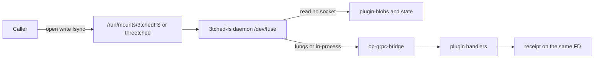

# 3tchedFS (FuseFS) — operator and caller guide

One-file reference for the two live FUSE views, how a call works, and how the bridge relates to mounts it did not create.

Sources: `crates/_3tched-fs/src/{fuse_fs,dispatch,namespace,mounted,fused_mount}.rs`, `crates/op-grpc-bridge/src/{runtime,runtime_fuse,runtime_lungs,runtime_lungs_identity,runtime_checkpoint,admission}.rs`, `deploy/runit/libexec-3tched/mount-3tchedfs`, `deploy/runit/3tched-fs/run`, `deploy/scripts/3tchedfs-invoke.sh`.

Live numbers below were read from `/proc/mounts` and `/run/mounts/3tchedFS/.3tchedfs.json` on this host. Re-read those before trusting a generation, hash, or session id.

## 0. Are they mounted on `/run/mounts/`?

Yes. Both views are up.

| Mountpoint | Source | Type | Surface | Objects | Catalog generation |
|---|---|---|---|---|---|
| `/run/mounts/3tchedFS` | `3tchedFS` | `fuse.3tchedFS` | `3tched` (`3tched_fs`) | 72 | 146 |
| `/run/mounts/threetchedFS` | `threetched` | `fuse.3tchedFS` | `threetched` (`threetched_fs`) | 1 | 146 |

Shared options: `rw,nosuid,nodev,noexec,noatime,user_id=0,group_id=0,default_permissions,allow_other`.

Shared catalog hash `fc9e8cff76082572f13db1c28b113d174927508b8e09a36e962f555416a5eaa3`, declared catalog `/dev/shm/opdbus/plugin-blobs`.

The host `3tchedFS` view is **not** `guest_kernel`. Its declaration is:

- `mount_identity.kind`: `host_session`
- `session`: `414fbc56-03fb-20ab-758a-bcc7a7cbdc0e`
- `local_call_owner_uid`: `1001`
- `allowed_operator_uid`: `0`
- `instance_uuid`: `d3ce4157-9b37-4ce2-aab5-1eabdb7a07b2`

Reads of sealed schema and committed state work for anyone who can read the mount. A `call` still needs a session the bridge has recorded, a grant for that principal, and a checkpoint owner. See §7.

These two directories are the **host** pair. A container such as the chatbot has its own mounts inside its mount namespace. The bridge does not create that pair and must not stack another FUSE daemon on the same path.

## 1. What it is

3tchedFS is the typed filesystem projected from sealed plugin blobs plus committed shared-memory state. The container is the identity. This filesystem is the way that identity reads and calls.

- One plugin schema, sealed by `opblob` into `/dev/shm/opdbus/plugin-blobs/<plugin_id>.<schema_hash16>.blob`. A plugin exists only when that blob is in the catalog. There is no parallel `schemas/` directory.
- The FUSE daemon projects that catalog, checks call arguments against the sealed schema, and dispatches. It does not decide grants.
- Two surfaces, never merged: `3tched` (our plugins) and `threetched` (methods discovered from the external `threetched` binary). One identity gets one pair.
- MCP is retired. Do not add a client for `/mcp`. The `3tched-fs mcp` subcommand is only a stdio adapter over this same mount.



## 2. Layout

Root of each mount:

```
.3tchedfs.json     declaration: view, catalog hash/generation, mount_identity, instance_uuid, surface
view.json          plugin id -> object hash
capabilities/      declared names only; not an authorization decision
operations/        symlinks into plugins/<plugin>/operations/<method>
plugins/           canonical tree
relationships/     dependency symlinks
```

`plugins/<plugin>/operations/<method>/`:

| File | Role |
|---|---|
| `input.schema.json` | Argument schema |
| `output.schema.json` | Result schema |
| `metadata.json` | `side_effect`, `idempotent`, `required_capability`, `subid` |
| `call` | The only writable node. Nothing is stored in it |

Canonical invoke path, five components, percent-encoded names:

`plugins/<encoded-plugin>/operations/<encoded-method>/call`

Example: `incus.start_instance` requires capability `cap.service.incus.instance.start@v1`, `side_effect` `mutation`, `idempotent` false (`plugins/incus/operations/start_instance/metadata.json`).

## 3. Identity modes

`MountIdentity` in `namespace.rs` is a public declaration. It is not a credential.

| Kind | How the bridge proves the caller |
|---|---|
| `host_session` | `LungsV1.Bind(session)`. Peer must be host root in the bridge's namespaces. Session is the canonical UUID. The bridge loads that session's SID1 from the committed sled. |
| `guest_kernel` | `BindCurrentContainer()`. Exactly one running container sled whose namespaces contain the socket peer. |
| `credential` | SID1 file, re-read per call, `RegisterCurrentSender` on the session bus. The current bridge does not serve plugin methods on that bus. |
| `container_bound` | Bridge-hosted in-process mount. The bridge pinned the caller when it built the mount. No socket and no credential in the guest. |
| `unbound` | No call dispatch. |

FUSE requests carry uid and gid only. The daemon's local gate is the daemon uid or `--call-owner-uid`. The principal is established by the bridge from the peer, the sled, or the pinned executor. Do not put a session, identity, or capability in the argument JSON.

## 4. How to call

One call is one file descriptor:

1. Open `call` read-write.
2. Write one complete JSON argument object (at most 1 MiB).
3. `fsync` or close. That is the only dispatch. A raw write only buffers.
4. Seek to 0 and read the terminal receipt from that same descriptor.

A second `fsync` on the same handle does not run the method again. There is no separate result file and no error file. Arguments are checked in the daemon and again in the bridge.

Do not retry automatically when the result is `EIO` or the stage is `outcome_unknown`. The effect may already have happened. Keep `operation_id`. A duplicate id at the bridge is recovery, not a second execution.

### Shell

Fragile. Prefer the Python or CLI form. Discover the schema before inventing arguments.

```sh
M=/run/mounts/3tchedFS
cat "$M/plugins/adc/operations/get_status/metadata.json"
cat "$M/plugins/adc/operations/get_status/input.schema.json"
exec 3<>"$M/plugins/adc/operations/get_status/call"
printf '%s' '{}' >&3
python3 -c 'import os; os.fsync(3)'
cat <&3
exec 3<&- 3>&-
```

### Python

Same sequence as `mounted.rs` `execute_descriptor`: write, `fsync`, seek, read.

```python
import json, os
path = "/run/mounts/3tchedFS/plugins/adc/operations/get_status/call"
fd = os.open(path, os.O_RDWR)
try:
    os.write(fd, json.dumps({}).encode())
    os.fsync(fd)
    os.lseek(fd, 0, os.SEEK_SET)
    body = b""
    while chunk := os.read(fd, 65536):
        body += chunk
finally:
    os.close(fd)
receipt = json.loads(body)
result = receipt["result"]
```

### CLI and the repo helper

The helper checks the mount is `fuse` or `fuse.3tchedFS`, checks the operation directory and input schema, then execs `3tched-fs invoke`. It does not retry and it does not fall back to another transport.

```sh
deploy/scripts/3tchedfs-invoke.sh adc get_status '{}'
deploy/scripts/3tchedfs-invoke.sh incus start_instance '{"name":"3tchedChatbot"}' --confirm-side-effects
```

`OP_3TCHEDFS_MOUNT` selects the mount (default `/run/mounts/3tchedFS`). `_3TCHED_FS` selects the client binary. Mutations need `--confirm-side-effects`.

Direct equivalents:

```sh
3tched-fs describe --mount /run/mounts/3tchedFS --expected-session 414fbc56-03fb-20ab-758a-bcc7a7cbdc0e --plugin adc
3tched-fs invoke 'plugins/adc/operations/get_status/call' \
  --mount /run/mounts/3tchedFS \
  --expected-session 414fbc56-03fb-20ab-758a-bcc7a7cbdc0e \
  --args '{}'
```

Use `--guest-kernel` only when `.3tchedfs.json` says `guest_kernel`. A mismatch fails before any write. The client re-reads the mount after the call. "mount changed during operation; do not retry automatically" means do not submit again.

`3tched-fs call` without `--mount` opens the session bus directly. That server side is not the live bridge. Do not build on it.

## 5. Receipts and errno

Success on the descriptor is a `CallReceipt`: `plugin_id`, `method`, `subid`, `required_capability`, `side_effect`, `idempotent`, and `result`. `result` is the execution receipt and includes `operation_id`. The client checks attribution, the operation id, and the result schema.

Failure on the same descriptor is `{plugin, method, stage, error, operation_id?}`.

| Errno | Meaning |
|---|---|
| `EACCES` | Grant, bind, or credential refusal. For a prepared local mount this is also a writable `call` opened without the current grant, before a job is charged. |
| `EIO` | Transport failure, unknown outcome, contained worker panic, or a catalog/state refresh failure. |
| `ENOENT` | Unknown name. |
| `EINVAL` | Bad flags or arguments that are not the sealed JSON. |
| `EBADF` / `EAGAIN` | Wrong handle, or read/write while the call is running or already closed. |
| `EBUSY` | More than 4 in-flight jobs, more than 32 waiters, or the single-writer guard. That descriptor will not dispatch later; open a new one only when the outcome is known not to have started. |
| `EROFS` | Write to a node that is not `call`. |
| `EFBIG` / `ENOMEM` | Over the document or handle budget. Slot exhaustion is reported as `ENOMEM`. |

Bridge order on success: durable ledger append, shared-memory publish, notification, then the receipt. A lost reply does not mean the effect was skipped.

The lungs socket maps a bridge `Denied` to `org.freedesktop.DBus.Error.AccessDenied` with `method admission refused; operation_id=...` (`runtime_lungs.rs`). That string is the class only. It does not say which check failed.

## 6. Transports

| Path | What it is |
|---|---|
| `/dev/fuse` | Kernel fd for the daemon. Not an IPC socket to the bridge. |
| `/run/opdbus/lungs/lungs.sock` | Bridge p2p D-Bus. Each standalone-daemon call opens a connection, `Bind` or `BindCurrentContainer`, then `CallWithOperationId`. The bridge records the **daemon** peer, not the process that wrote the file. |
| `/run/opdbus/session-bus.sock` | Credential registration only. Plugin methods are not served here. |
| `:8090` | gRPC door. Same runtime core. FUSE does not dial it. |
| `/dev/shm/opdbus/plugin-blobs`, `state`, `capability-grants.json` | Files, not sockets. |

### Standalone daemon (what is mounted now)

`deploy/runit/libexec-3tched/mount-3tchedfs` captures a schema-only view and runs `3tched-fs mount` with `--lungs-socket /run/opdbus/lungs/lungs.sock` and `--lungs-session`. A `call` fsync becomes `dispatch::call_over_socket`. The chatbot's own mounts do the same from inside the container: `guest_kernel` uses `BindCurrentContainer`.

### Bridge-hosted mounts (linked, not running)

`op-grpc-bridge` links `_3tched-fs` and can serve mounts inside the bridge process (`runtime_fuse.rs`, `Lungs::Local`). `runtime_bootstrap.rs` calls `start_local_mounts` after the lungs listener. That function reads `OP_FUSE_LOCAL_MOUNTS`. The deployed run script sets it to empty, so startup mounts nothing. An empty setting is a no-op, not a mount of `/run/mounts/3tchedFS`.

A spec, if set, is `container:3tched_mount:threetched_mount:call_owner_uid[:store_root]`. The container name must be a running Incus instance with exactly one committed sled. The bridge then `mount2`s both surfaces itself. Dropping the bridge `MNT_DETACH`s them. A bad spec fails bridge startup.

Prepared calls (`invoke_bound`) ioctl `BIND_CALL_IOCTL` on the `call` descriptor **before** any write. The daemon accepts that ioctl only when the mount's lungs mode is `Lungs::Local` (`fuse_fs.rs` ioctl). A socket mount, including the chatbot's mount and the current host pair, returns `EACCES` and the write never happens. That is why pointing the bridge at the chatbot's existing mount does not execute a prepared call.

### Why received calls are not bounced back onto those mounts

A call that already arrived on the lungs socket **came through** the chatbot or host mount. The bridge's job is to admit and run it.

Writing that same call back out to the mount would:

- open a second lungs call into this bridge if the daemon is the socket kind, or
- fail the prepared ioctl immediately if the code uses `invoke_bound`.

The socket round-trip also cannot keep the caller's `operation_id`. The daemon allocates its own. Fallback after `fsync` could run the effect twice. Fallback is valid only when the descriptor never reached dispatch (`CallState` still not `EXECUTING`, `abort_before_dispatch`).

So the automatic path is:

1. Caller writes the identity's existing `call` file. That is the FUSE hop.
2. The daemon delivers one lungs call, or a local executor callback if the mount is bridge-hosted.
3. The bridge runs `Runtime::call` once.
4. If the mount is missing or the prepared ioctl fails **before** dispatch, the bridge may run that same `operation_id` in-process. That is the fallback.
5. If dispatch may have started, the result is `outcome_unknown` and nothing is submitted again.

`OP_FUSE_LOCAL_MOUNTS` stays an optional override for a bridge-hosted pair. It is not required for the chatbot's own mounts, and it must not target `/run/mounts/3tchedFS` while the standalone daemon still owns that path.

## 7. Why `incus.start_instance` returned AccessDenied

The helper reached the mount, validated `{"name":"3tchedChatbot"}`, and the bridge answered `stage: call` / `AccessDenied` / `method admission refused` with an `operation_id`. The handler did not run. The instance was not started. A later attempt is a new operation id, which is safe **because** this class is a pre-effect refusal. Do not apply that rule to `EIO`.

`start_instance` requires exactly `cap.service.incus.instance.start@v1`.

`Runtime::call_owned` then does, in order:

1. `authorize_nested` → `require_capability`, re-reading the current grant projection for the bound principal.
2. Argument checks against the pinned seal.
3. `checkpoint_preflight`, which returns `Denied` with "operation has no trusted grounding policy owner" when `caller.checkpoint` is `None`.

A lungs caller is built by `LungsIdentity::caller` as `VerifiedCaller::new`. That value has no checkpoint. Only `invoke_fuse_with_checkpoint`, result-reader recovery, and checkpoint reconciliation attach one. The lungs error text is the same for a missing grant and a missing checkpoint owner.

Discriminate before changing policy:

```sh
deploy/scripts/3tchedfs-invoke.sh identity_sled get_own_identity '{}'
sudo jq -r 'to_entries[] | select(.value.capabilities | index("cap.service.incus.instance.start@v1")) | .key' \
  /etc/opdbus/capability-grants.json
```

- The read fails with the same `AccessDenied`: the process is dying in `checkpoint_preflight` (or an earlier check shared by every method), not in the incus grant.
- The read succeeds and the principal's entry lacks `cap.service.incus.instance.start@v1`: the grant is the refusal. Adding that one capability is an owner-approved edit of `/etc/opdbus/capability-grants.json` plus `op-grants-materializer`. Do not add other capabilities, edit Cozo by hand, or mint a SID1 outside the identity subsystem.

Routing this call through a second FUSE write does not fix either check. The lungs delivery already is the FUSE hop.

## 8. Engine limits

Implemented FUSE operations: `init` (`max_write` 1 MiB), `destroy`, `lookup`, `getattr`, `setattr` (truncate only), `readlink`, `open` (`FOPEN_DIRECT_IO`), `read`, `write` (buffer only), `opendir`, `readdir`, `releasedir`, `access`, and the prepared-call `ioctl`. Not implemented: create, unlink, mkdir, rmdir, rename, symlink, link, forget, statfs, xattr, lock, fallocate.

Inodes other than root are the first 8 bytes of `blake3(surface + path)` with the high bit set. Attribute TTL is zero. Node cap is 100,000.

Budgets in `fuse_buffers.rs`: 256 handles, 64 MiB charged bytes, 16 MiB per document, 1 MiB per call body, 4 jobs, 32 waiters.

The `fuser` loop is synchronous. Dispatch runs on worker threads. A handler must not read or write the same mount; the loop and the shared-memory flock deadlock if it does.

Services are runit: `sudo sv status 3tched-fs threetched-fs op-grpc-bridge`. Do not use `systemctl`. The launcher ignores inherited FUSE environment overrides and requires `conf` to be root:root mode 600 with one hard link.

## 9. Troubleshooting

| Symptom | Check |
|---|---|
| No `/run/mounts`, no `fuse.3tchedFS` in `/proc/mounts` | `sv status 3tched-fs threetched-fs`. Read `/etc/sv/3tched-fs/run` and `conf`. |
| Reads work, every call is `EACCES` / `method admission refused` | §7. Session in `.3tchedfs.json`, then grant, then whether the caller has a checkpoint. |
| `EIO` stage `transport` | `/run/opdbus/lungs/lungs.sock` present, not only `lungs.sock.lock`. Bridge process up. |
| `EIO` stage `outcome_unknown` | Keep `operation_id`. Do not retry. |
| `EBUSY` | Fewer than 4 concurrent calls. Open a new descriptor only after the refusal is known to be pre-dispatch. |
| Whole mount `EIO` or `ENODEV` | Daemon gone or the kernel connection aborted. `/sys/fs/fuse/connections/<id>/waiting` and the service log. |
| Plugin list looks old | Compare `.3tchedfs.json` `source_catalog_generation` with `plugin-blobs/.manifest.json`. Remount through the service. Do not copy blobs into place by hand. |

## 10. Invariants

- The sealed blob is the plugin. Daemon schema checks do not replace bridge admission.
- The bridge pins identity from the kernel peer or the container sled. A path, uid, or file name grants nothing.
- Grants are read again at the call and at the effect boundary.
- Commit, then notify, then show the receipt.
- One writer: `BridgeCore` and `ExecutionAdmission`.
- A denial is evidence. Record the operation, caller, capability, and error. Do not switch identity, edit the database, or call another transport to get past it.

## 11. What was verified

| Claim | Status |
|---|---|
| Both host mounts are on `/run/mounts` as `fuse.3tchedFS`, generation 146 | Read from `/proc/mounts` and `.3tchedfs.json` while writing this file |
| Host view identity is `host_session` `414fbc56-03fb-20ab-758a-bcc7a7cbdc0e` | Same read |
| `OP_FUSE_LOCAL_MOUNTS` defaults empty, so the bridge does not mount at startup | `deploy/runit/op-grpc-bridge/run` and `start_local_mounts` |
| Prepared ioctl works only for `Lungs::Local` | `fuse_fs.rs` ioctl |
| Lungs `AccessDenied` hides grant vs checkpoint | `runtime_lungs.rs` `runtime_error`, `call_owned`, `checkpoint_preflight` |
| Tests, clippy, fmt | Not run |

Manual check when you want one: `findmnt -t fuse.3tchedFS`; read one `metadata.json`; one read-only call; confirm state from `plugins/<plugin>/value.json`, not from the write alone.

## 12. How schema and state reach the UI (chatbot renderer)

Sources: `crates/op-grpc-bridge/src/{container_ui,runtime_catalog,service_runtime,runtime,runtime_identity}.rs`, `crates/op-plugins/src/state_plugins/fuse.rs` (`GetCatalog*` types), `crates/_3tched-fs/src/{source,namespace,mounted,fuse_fs}.rs`, `crates/op-core/src/projection_shm.rs`.

The chatbot is the UI: it renders every plugin for the human in the browser. That only works if three things the old code fused into the end user's identity are kept apart:

| Concern | Identity | Where it is decided |
|---|---|---|
| Execution (any method call, any effect) | The requesting human's `VerifiedCaller` | `Runtime::call` grants, re-read at the call and the effect boundary (§10) |
| Rendering reads (schema, committed state, subscriptions) | The designated chatbot **renderer principal** — its own service identity | `configured_renderer` / `can_render_plugin` (below) |
| Private-state selection | The requesting human, and nobody else | `StateScope::Private { principal_id, session_id }` of the caller |

### 12.1 Schema is delivered over FuseFS — but the browser never reads the mount

Schema has exactly one authority chain:

1. Each plugin declares its `PluginSchema` (state type, methods, `required_capability`, `side_effect`, `public_state.paths`) in `crates/op-plugins/src/state_plugins/`.
2. `opblob seal-shm` seals it into `/dev/shm/opdbus/plugin-blobs/<plugin>.<schema_hash16>.blob` (`OPBLOB01`; schema JSON is section 1, SHA-256 pinned in the header) plus `.manifest.json` (`catalog_hash`, monotonic `generation`).
3. `3tched-fs capture` (`_3tched-fs/src/source.rs`) decodes the manifest-pinned blobs, pairs them with committed state (below), and stores immutable, BLAKE3-content-addressed objects and a pinned view in the `ObjectStore`. **Schema is frozen at capture**; state is not.
4. The FUSE daemon projects the view (§2): `plugins/<plugin>/schema.json`, `object.blob.json`, `object.hash`, `capabilities.json`, and under `operations/<method>/`: `input.schema.json`, `output.schema.json`, `metadata.json`, `call`. Views live at `/run/mounts/3tchedFS` (our plugins) and `/run/mounts/threetchedFS` (upstream binary), and per-container under `/run/mounts/by-container/<name>/`.
5. The bridge carries the schema from the container's own mounts to the browser. The UI is static assets (`CHAT_UI_DIR`) served by `container_ui.rs` only after its mount verifies. When the renderer asks, `fuse.get_catalog` (`runtime_catalog.rs`) opens **both** mounts with `MountedNamespace` (`_3tched-fs/src/mounted.rs`: descriptor walk with `O_NOFOLLOW`, `.3tchedfs.json` cross-checked against `view.json`, mount `instance_uuid` pinned) **inside the container**, reads each `plugins/<plugin>/schema.json`, and **hard-fails if it differs from the sealed runtime catalog** — the UI can never render a schema the backend will not enforce.

`get_catalog` returns `GetCatalogOutput { views[] { view_id, source_catalog_hash, source_catalog_generation, plugins[] { plugin_id, object_hash, schema_hash, schema, operations[] { method, call_path, metadata_path, currently_granted }, state: "not_requested" } } }`.

Disclosure is **by flag, not by filter**: every plugin in both views is returned with its full method list. The requesting human's grants only annotate each operation (`currently_granted` is `true` when the method needs no capability or the human holds it). The renderer renders an ungranted operation as present-but-not-runnable; the grant still denies it in `Runtime::call` if invoked. Grants changing mid-read fail the call rather than return stale flags. State is deliberately **not** in this payload (`state: "not_requested"`); see §12.3.

### 12.2 State is a pull, and FuseFS has no push

State also has one authority chain: `MutationEngine` (the single write door) publishes one JSON file per plugin to `/dev/shm/opdbus/state/<plugin>.json` (atomic temp+rename; `.manifest.json` `generation` written last is the commit point). The value disclosed anywhere outside the bridge is only the projection through the sealed `public_state.paths` (`project_public_value`); an empty policy means nothing is public.

In a **view** mount, `value.json` and every `data/` leaf is a live file: each `open()` re-reads the SHM state under the projection lock, re-verifies the pinned catalog before and after, re-projects, and snapshots bytes for that handle only. There is no polling, watching, inotify, or caching in the daemon. Reopening is the refresh. Workspace (COW) mounts are the opposite: frozen captured objects, no live reads.

### 12.3 StateSync: the wakeup channel above FuseFS

Freshness for the browser comes from `StateSync`, a gRPC/gRPC-Web service on the production bridge door (`BridgeService` in `service.rs`, production path in `service_runtime.rs`). It is not a FuseFS feature and not an execution channel:

- **Hydrate, then wake.** The client subscribes before reading. `production_subscribe` opens the commit-notice receiver first (no race), then sends hydration frames: committed state for the public scope plus the caller's own private scope (`include_initial_state`), and one schema frame per catalog plugin (`include_schema`).
- **Notices carry no state.** `Core::subscribe_commits()` emits metadata-only `StateNotice`s after a durable commit. For each notice in scope, the server re-reads the committed SHM value (`committed_frame`) and emits a `StateChange` with the fresh value and `state_generation`, deduplicated per `(plugin, scope, generation)`.
- **Lag means re-read, not trust.** A lagged receiver gets `Status::data_loss("committed state stream lagged; hydrate again")`. Heartbeats keep the stream alive; they carry no new data. The rule for any UI client is: hydrate once, treat each frame as "state changed, here is the re-read value", and on disconnect/lag/catalog change, hydrate again. Never poll on a timer; if polling is unavoidable, key it on the SHM `generation`, not the clock.
- **Not an authority.** StateSync frames are not the schema authority (the sealed catalog is), carry no grants, and execute nothing. Actions taken on rendered UI still go through `call` files / lungs / `Runtime::call` as the human (§4).

### 12.4 The renderer principal (separating rendering from identity)

Before this separation, `StateSync` and `GetState`/`GetProperty` gated every frame and read on the *human's* `can_read_plugin`, so a plugin the human could not read never hydrated, never updated, and could not even be re-read — the rendered UI silently lost state.

Now the read gates use a dedicated renderer caller:

- `designated_chatbot` (`runtime_identity.rs`) resolves the configured chatbot service identity from bridge configuration alone: the run script derives `OP_CONTROL_PLANE_CHATBOT_PRINCIPAL_ID` (and session) from the chatbot WireGuard key in `/etc/op-dbus/env/op-chatbot-wireguard-pubkey`; the committed identity registry must contain exactly one row for that principal with `principal_kind = "service"`. `ResponderAuthority::revalidate` re-checks the configuration and the authored transport wire. Nothing about this identity is ever accepted from a request.
- `configured_renderer` admits that caller for reads only: it inherits no execution gate from the requester, carries no sealed identity for wire transport, and must never be passed to `Runtime::call`.
- `can_render_plugin` (`runtime.rs`) is the renderer read gate: same sealed-schema pin check as `can_read_plugin`, but a capability-free `Read` method satisfies it, so a plugin is never lost for rendering merely because its reads need no grant. The human's `can_read_plugin` is unchanged and still guards the non-renderer channels (MQTT wakes, signal admission).
- In `production_subscribe`, schema frames, hydration frames, and live notices are all gated on the renderer. The data selected is still only the public scope or `caller.private_scope()`, and the spawned loop revalidates the **human's** authority before every live frame — a revoked session ends the stream even though reads run as the renderer. `GetState`/`GetProperty` (`selected_snapshot`) use the same split: renderer gates the read, the human's scope selects the value.
- If the renderer is not configured, subscription and state reads fail closed. There is no fallback to the old human-filtered behavior.

```mermaid
sequenceDiagram
  participant B as Browser (human session)
  participant Br as op-grpc-bridge
  participant R as Renderer principal (chatbot service)
  participant F as FuseFS mounts (in container)
  participant S as SHM state + sealed catalog
  B->>Br: fuse.get_catalog (as human)
  Br->>F: MountedNamespace: schema.json per plugin
  Br-->>B: full catalog; currently_granted from human grants
  B->>Br: StateSync.Subscribe (as human)
  Br->>R: configured_renderer (service identity)
  Br->>S: hydration: public + human-private committed frames
  Br-->>B: initial StateChange frames (renderer-gated)
  S-->>Br: StateNotice (metadata only, after commit)
  Br->>S: committed_frame re-read at new generation
  Br-->>B: StateChange update (human revalidated first)
  B->>Br: user action on rendered operation (as human)
  Br->>Br: Runtime::call — human grants enforced; renderer never executes
```

Operational notes: the renderer principal currently sits in the `$ROOT` group of the durable grants document, which is broader than rendering needs; the code paths above only ever exercise it against read gates and committed-state reads, but a future `$RENDERER` group (all `Read` capabilities, no mutations, regenerated from the sealed catalog like `$ROOT`) would narrow it without changing this design. Lungs/`call`-file admission, MQTT wake doorbells, and the special private streams (chatbot episodes, generation jobs, UI workspace) keep their own identity checks and are not covered by the renderer gate.
