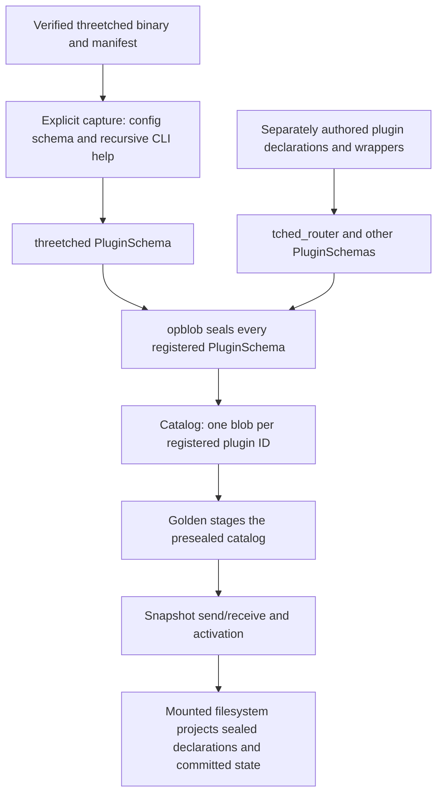

# Handwritten overlap with threetched — mounted-source map

2026-10-18 · Codex `/root` with Luna `/root/schema_capture_build` and `/root/schema_capture_luna` · Task `threetched-single-surface-20261018` / OD-121 · source HEAD `051a20d056afba074e21d797aa34f8947c543c5a` plus shared uncommitted work.

**Finding:** duplication extends beyond `tched_router`, `tched_plugins` and `tched_skills`. Confirmed wrappers also exist in LLM selection/generation, cron, native configuration, provider discovery and routing. Much of `cognitive` uses native threetched inference or covers domains native threetched already implements. The current capture is insufficient to establish complete operation equivalence: it captures CLI arguments and the native configuration schema, but omits native HTTP, WebSocket and tool contracts.

**Owner direction:** use threetched as the authority for functionality it owns; collapse handwritten overlap into that surface. Moving the same declarations under `large_language_model` would preserve the duplicate authority and is superseded. Our filesystem/project code is `3tched`; the external ZeroClaw-derived runtime is `threetched`. Current access is filesystem I/O and the plugin is `cognitive`. Lungs becoming an MCP interface is a later step, after consolidation settles.

This pass maps and reports only. No additional application edits, build, seal, deployment, mount changes or operation calls were made during the mapping pass. Two wrapper deletions made before the mapping instruction remain unbuilt and undeployed; see the final status below.

## Evidence and coverage

Primary reference: [`/run/mounts/threetched/plugins/threetched/schema.json`](/run/mounts/threetched/plugins/threetched/schema.json). Comparison set: the 70 schemas under `/run/mounts/3tchedFS/plugins/` and the four schemas under `/run/mounts/threetched/plugins/`. Source inspection disambiguates their implementations; it does not replace the mounted declarations as evidence of what is deployed.

| Evidence | Observed value |
|---|---|
| Mounted catalog | 74 plugins, 1,388 method declarations |
| Our mount | 70 plugins, 1,180 methods |
| Upstream mount | `threetched` 147; `tched_router` 43; `tched_plugins` 6; `tched_skills` 12 |
| Native reference | 147 CLI operations and 83 top-level configuration sections |
| Cognitive | 670 methods; every name assigned to a functional group below |
| Binary / capture format | `threetched 0.8.4` / `threetched-cli/1` |
| Catalog generation | 74; before/after view inventories matched during enumeration |
| Catalog hash | `8a34d0da9517b137063314e07f5fa9a24fe3a3fe33920b1de2df941380041fd6` |
| threetched source schema hash | `5e27757d2c046632f9dcda0866fd58a6a0d38b14fc96ba19625f61166975149c` |
| Binary SHA-256 | `22e121f5eb1b66352138b714cc3d40d9eb977ed0c13bd6316f693a11a875a75e` |
| Native Config capture SHA-256 | `a98561f7b8c9f6a1be529557afc1bf123fee566958363cee211c998a5cb34cef` |

The companion [machine-readable inventory](threetched-overlap-map-20261018.json) records every plugin and method name, declared capability, effect, idempotence, input/output field names, source path, assessment and reference targets. It includes the complete reference command list, configuration-section list and catalog object pins. It is an audit artifact, not a new runtime schema authority.

Coverage means every mounted method was inventoried and screened; it does **not** mean 1,388 end-to-end semantic equivalence proofs. No authenticated invocation or cancellation was exercised. An ordinary read of mounted `tched_router/value.json` returned `Input/output error`; no alternate transport was used to obtain native tool state. Previously recorded human provisioning remains unresolved, so NotebookLM sync was not claimed or routed around.

## Where the schema enters the blobs

1. [`opblob.rs:688`](/srv/git/odbus-verified/crates/op-plugins/src/bin/opblob.rs:688) explicitly calls `threetched::prepare_schema_capture` before sealing. Runtime startup consumes the catalog rather than discovering schemas again.
2. [`threetched.rs:54`](/srv/git/odbus-verified/crates/op-plugins/src/state_plugins/threetched.rs:54) establishes one capture per explicit authoring process; its capture path verifies the selected binary, manifest, version and digests.
3. [`threetched-surface.rs:180`](/srv/git/odbus-verified/crates/threetched-fs/src/threetched-surface.rs:180) captures `config schema`, recursive `--help`, and `--version`, then checks that the binary did not change. `schema_from_capture` turns that into the `threetched` PluginSchema, including per-command capabilities.
4. The sealer obtains each registered plugin's schema. [`op-blob/src/lib.rs:72`](/srv/git/odbus-verified/crates/op-blob/src/lib.rs:72) canonicalizes and seals the **full** PluginSchema in `SCHEMA_JSON`; reflection/manifest views derive from that same value.
5. [`catalog.rs:153`](/srv/git/odbus-verified/crates/op-blob/src/catalog.rs:153) writes `<plugin_id>.<schema_hash16>.blob` and updates the catalog. A full reseal removes IDs absent from the build via `retain_plugins`.
6. Golden preparation validates/stages an already sealed catalog. Deployment transports the snapshot; FUSE projects its blobs. FUSE does not invent or reseal an upstream schema when a file is read.

**The duplicate authority is introduced before sealing.** Separate handwritten plugin registrations become separate blobs even when one native binary owns their behavior. A single catalog does not remove that duplication. Capturing native Config once also does not automatically derive the handwritten HTTP, generation or tool declarations from it.

## Confirmed wrappers and shared native backends

“Confirmed” below means the wrapper/backend relationship is supported by source. It does not assert that replacing a typed method with a CLI command preserves its complete result, identity and receipt contract.

| Current surface | Mounted/native reference | Finding and obligations |
|---|---|---|
| `tched_plugins` — all 6 | `plugin.install/list/migrate/info/remove/search` | Direct duplicated native plugin-command surface. Current names: `install_plugin`, `list_plugins`, `migrate_plugins`, `plugin_info`, `remove_plugin`, `search_plugins`. |
| `tched_skills` — all 12 | `skills.add/audit/edit/install/list/remove/test`; `skills.bundle.add/list/remove/rename/show` | Direct duplicated native skill-command surface. Bundle and skill methods map one-for-one by action. |
| `large_language_model` — all 8 | Router facade over native providers/models/config/generation | `list_providers→ListProviders`; `get_provider/get_config→GetState`; `set_provider→SetProvider`; `generate→Chat`; `stream_generate→start_generation`; `list_models→ListModels`; `update_config→SetSelection`. Has no independent state owner. Native completion and selection must remain authoritative when callers move. |
| `cron` — all 9 use the native store | `cron.add/list/update/resume/pause/remove`; native HTTP cron API | `create_job→cron.add` (also native add-at/add-every/once variants); `list_jobs/get_job→cron.list`; update/enable/disable/delete→update/resume/pause/remove. `get_history` and `run_job` use native HTTP routes omitted from the CLI capture. Preserve typed jobs, scoped access, publication diagnostics, indeterminate-outcome receipts and SHM readback. |
| `mcp` — 2 of 3 | Native `/mcp` Config section; `config.get/patch` | `get_config→GetMcpConfig`; `configure_server→PatchConfig`, restricted to server descendants. `configure_tool_groups` is local bridge projection policy and needs a separate relevance decision for the current filesystem interface. Its existence does not authorize an MCP implementation now. |
| `gemma_brain.route` — 1 of 17 | `model_routes`; native routing | Direct `ResolveRoute` facade. Exact native resolver result contract is not captured. Other 16 methods include UI, classification and tag behavior; native inference alone does not establish equivalence for them. |
| `model_registry.native_list_providers` — 1 of 6 | `providers`, `providers.list`, `/providers` | Uses native provider inventory with additional protected-agent-profile filtering. The other five methods mix provider metadata, credentials and local model profiles; see candidate mapping. |
| Cognitive personas + `specialist` — 568 | `agent`, `agents.*`; `/agents`, `/delegate`, profiles/bundles | Demonstrated shared threetched completion backend. Local prompt/persona/context assembly is additional behavior to map; it does not justify 568 independently authored schema operations. |

Implementation evidence: [LLM facade](/srv/git/odbus-verified/crates/op-plugins/src/state_plugins/large_language_model_methods.rs:44), [cron gateway](/srv/git/odbus-verified/crates/op-grpc-bridge/src/cron_gateway.rs:123), [MCP config facade](/srv/git/odbus-verified/crates/op-plugins/src/state_plugins/mcp_methods.rs:62), [model registry dispatcher](/srv/git/odbus-verified/crates/op-grpc-bridge/src/model_registry_dispatch.rs:1021), [persona completion](/srv/git/odbus-verified/crates/op-grpc-bridge/src/specialist.rs:383).

## All 43 router methods

| Group | Methods | Reference and unresolved contract |
|---|---|---|
| Config/schema — 15 | `GetConfig`, `GetConfigSchema`, `GetMcpConfig`, `PatchConfig`; `config_get`, `config_init`, `config_list`, `config_migrate`, `config_patch`, `config_set`; `get`, `init`, `list`, `patch`, `set` | Same native Config domain as `config.*`. Native HTTP property/list/patch/init/migrate response and error types exist in pinned source but are absent from the current CLI capture. Masked secrets, revision/coherent observation and alias behavior require explicit reconciliation. |
| Inventory/projection — 9 | `GetState`, `GetProviderCatalog`, `GetModelRoutes`, `GetRouter`, `GetStructuredOutput`, `GetTools`, `ListModels`, `ListProviders`, `ListUiSurfaces` | Providers/models/config sections overlap. `GetTools` reads native `/api/tools` but drops native `param_domains`; no tool declarations are captured as native methods. UI/structured-output and complete committed-state projections need field-level comparison. |
| Selection/routing/bindings — 12 | `SetModel`, `SetProvider`, `SetSelection`, `SetCozoRetrievalModel`, `SetObfuscationModel`, `SetOvsRoutingModel`, `SetQdrantRetrievalModel`, `SetVectorizationModel`, `ResolveRoute`, `apply_catalog_model_binding`, `resolve_catalog_model_binding`, `get_own_agent_route` | Native `/providers`, `/agents`, `/model_routes`, `/embedding_routes`, `models.set` and config mutation cover the domain. Local role names, catalog-model bindings, caller-specific routes and atomic selection/admission are obligations to map, not grounds for retaining a second schema owner. |
| Generation — 7 | `Chat`, `start_generation`, `cancel_generation`, `get_generation_job`, `get_generation_jobs`, `delete_generation_job`, `recover_generation_jobs` | Native `agent` and patched stateless `/ws/chat` supply inference. OP-DBUS job CRUD, private committed SHM state, recovery and cancellation semantics are not shown equivalent by the current native capture. Capture native frames/errors/cancellation first, then separate true local job bookkeeping from duplicated generation declarations. |

Source: [router declarations](/srv/git/odbus-verified/crates/op-plugins/src/state_plugins/tched_router.rs:1863), [native tools adapter](/srv/git/odbus-verified/crates/op-grpc-bridge/src/tched_router_legacy_dispatch.rs:89), [pinned generation patch](/srv/git/odbus-verified/vendor/tched-router/patches/0002-stateless-provider-generation.patch).

Known affected callers include LLM/MCP facades, specialist/agent dispatch, generation admission and publisher, model registry, cron/config paths, schema loader/server defaults, UI workspace/schema consumers, op-web state/SSE/routes, and the sibling UI's `src/chat/{door-chat-adapter,native-routing,control-plane-model,router-committed-route}.ts`. These dependencies identify migration work; they do not justify preserving another upstream schema authority. The shipped pinned UI archive must move with its source when those callers change.

## All 670 cognitive methods

Names and counts come from the mounted `cognitive` schema. The machine inventory assigns each method to one group.

| Group | Count | Native overlap / additional behavior |
|---|---:|---|
| Persona consultations | 567 | 81 personas × `advise/analyze/consult/explain/help/recommend/review`. Native completion is shared; local persona prompts and scoped context must be mapped to native agents/profiles. |
| Execution catalog | 59 | 12 exposed aliases backed by five executors: Rust 12, Python 12, JavaScript/TypeScript 18, Go 15, shell 2. Native `/shell_tool`, runtime and agent profiles overlap functionally. Current implementation uses `UnifiedExecution` D-Bus `ExecuteCatalog`; identity/project restrictions and language wrappers must be compared with native tool contracts. |
| Orchestration catalog | 18 | Six agents × `list_steps/run_workflow/validate`: code-review-orchestrator, context-manager, dx-optimizer, memory, sequential-thinking, tdd-orchestrator. Native pipeline/delegate/SOP domains overlap. Preserve child-by-child admission, cancellation and committed results. |
| Memory | 7 | `memory_store/retrieve/query/recall/delete/list_namespaces/semantic_query`. Native `memory.get/list/clear`, `/memory` and embedding config overlap. Current namespace selection is server-bound to caller mode/session; `memory_recall` already aliases query internally. Exact native put/delete/query tool shapes are missing. |
| Code retrieval/indexing | 3 | `code_search`, `code_context`, `code_index`. Native `/project_intel`, `/memory`, `/web_search` are related; symbol filtering, Voyage collections and session context equivalence is unproven. |
| Compatibility agent facades | 6 | `rust_pro`, `python_pro`, `typescript_pro`, `sequential_thinking`, `context_manager`, `code_review_orchestrator` normalize into catalog methods above. Three are execution aliases and three orchestration aliases. |
| Workflow facades | 2 | `workflow_query/run` use the same local workstack owner as `workflows.query_workflows/start_workflow`; native SOP/pipeline equivalence still needs mapping. |
| Specialist/provider calls | 2 | `specialist` shares native completion. `gemini_query` is a separate Gemini HTTPS/research implementation: likely provider/search overlap, but grounded citations/deep-research result compatibility is not captured. |
| Discovery/admission/policy | 6 | `get_health`, `list_tools`, `invoke_tool`, `schema_read`, `oscal_subids`, `toolsets`. Current bridge/catalog policy and dispatch; native tool discovery is related, but OP-DBUS identity/capability/schema semantics are not proven replaceable. |
| **Total** | **670** | **644 agent methods + 26 core/facade methods.** |

Source: [cognitive registration](/srv/git/odbus-verified/crates/op-plugins/src/state_plugins/cognitive_agents.rs:331), [agent descriptors](/srv/git/odbus-verified/crates/op-agents/src/agent_catalog.rs:45), [registered implementations](/srv/git/odbus-verified/crates/op-cognitive/src/agent_tools.rs:16), [execution dispatch](/srv/git/odbus-verified/crates/op-grpc-bridge/src/agent_catalog_dispatch.rs:136), [workflow dispatch](/srv/git/odbus-verified/crates/op-grpc-bridge/src/agent_workflow.rs:31), [code tools](/srv/git/odbus-verified/crates/op-cognitive/src/code_tools.rs:1).

There is no standalone cognitive file-read/write or browser method among these 670 names. `agent_search_specialist_*` is persona consultation; `agent_memory_*` is orchestration. Native `/browser`, `/browser_delegate`, `/file_download`, `/file_upload`, `/web_fetch` do not establish a matching cognitive method merely because the domain sounds similar.

## Native capture gaps that block a complete collapse map

| Missing in mounted capture | Evidence in pinned native implementation | Needed comparison |
|---|---|---|
| Typed config HTTP operations | `crates/zeroclaw-gateway/src/api_config.rs`: property/list/patch/init/migrate types; `openapi.rs::build_spec` exposes a config/version OpenAPI subset | Native request/result/error types, masked fields, revisions and authorization. Config JSON alone is not the method contract. |
| Native tool catalog | Existing adapter reads `/api/tools`: name, description, parameters, optional output, plus upstream `param_domains` discarded by adapter | Shell, memory, browser, file, search and delegate inputs/results; capability and state ownership. No successful current mounted tool-state read was available. |
| WebSocket generation | Pinned patch implements `tched_router.generation.v1`, connect/prompt and session_start/connected/chunk/done/error frames | SID1 forwarding, provider/model selection, usage, cancellation, failure and disconnect semantics; distinguish native inference from local job receipts. |
| Native cron HTTP | Existing cron gateway uses `/api/cron`, per-job `/runs`, and `/run` | Typed job/history/run results and errors, scoped state, non-CLI operations. |
| Other gateway facilities | Pinned native gateway declares chat, SOP-run and canvas WebSockets, among other APIs | Native availability is demonstrated in source; complete exported operation contracts and equivalence remain uncaptured. |

Pinned input: [`vendor/tched-router/source.pin`](/srv/git/odbus-verified/vendor/tched-router/source.pin), source archive `vendor/tched-router/source.tar.gz`, upstream v0.8.4 commit `a56c345d51dd8ab562e9351e0d4ab83f6a741db9`, plus checked-in patches. No upstream HTTP/WS call was made in this audit.

The present 147 CLI methods all declare `mutation`, `idempotent=false`, a per-command hashed capability, and `{stdout, stderr, exit}` output. This is useful command discovery, but is materially weaker than typed domain results and errors. It cannot by itself justify replacing read methods, narrowing grants or preserving cancellation/state publication. Native capture needs to supply those missing contracts at the existing authoring boundary, with provenance, without a new parallel `schemas/` authority.

## Full plugin disposition inventory

These are comparison results, not approved deletion instructions. **Wrapper** means confirmed delegation; **Mixed** combines confirmed overlap and local obligations; **Candidate** means functional overlap with incomplete equivalence; **Different scope** means a similar native domain does not establish the same operation; **Unestablished** means no equivalent is demonstrated by the captured reference. Unestablished is not proof that native threetched lacks the feature.

| Plugin | Methods | Assessment | Reference / evidence boundary |
|---|---:|---|---|
| `adc` | 1 | Different scope | Application-default-credential validation; native provider authentication does not establish the same host ADC status contract. Reference: auth.*, /providers, /cloud_ops. |
| `agent_config` | 5 | Candidate | Separate Cozo agent/tool configuration overlaps native agent identity, provider, tools, workspace, risk and runtime profiles. Reference: agents.*, onboard.agents, /agents. |
| `antigravity` | 3 | Candidate | Safety/auth/usage may overlap native provider facilities; no Antigravity-specific native binding demonstrated. Reference: auth.*, /providers, /risk_profiles. |
| `antigravity_chat` | 3 | Candidate | Bridge configuration/status/token refresh versus native provider authentication; exact native binding unestablished. Reference: auth.*, /providers. |
| `btrfs` | 12 | Different scope | Host subvolume/device/scrub/balance administration is not established by native storage/backup configuration. Reference: /storage, /backup. |
| `chat_response` | 8 | Candidate | Conversation/turn/private receipt semantics need comparison with native chat; native inference alone is not equivalence. Reference: agent, /gateway, /conversational_ai. |
| `cognitive` | 670 | Mixed | All 670 methods grouped separately; shared inference, executor/workflow/memory candidates and local admission obligations. Reference: agent, agents.*, memory.*, sop.*, /shell_tool, /pipeline, /project_intel. |
| `config` | 5 | Different scope | Arbitrary OP-DBUS key/value configuration differs from the native Config tree. Reference: config.*. |
| `cozo` | 14 | Different scope | Database queries/relations/graph administration versus a native memory backend; no equivalent administration contract captured. Reference: /memory, /storage. |
| `cron` | 9 | Mixed | All nine methods use native cron store; seven relate to CLI actions, history/run require missing HTTP contracts. Reference: cron.*, /cron, /scheduler. |
| `ctl_plane_chatbot` | 9 | Candidate | PII/significance/private episode/knowledge behavior overlaps agent memory broadly; exact scoped lifecycle unestablished. Reference: agent, /memory, /embedding_routes. |
| `datastore` | 5 | Different scope | Policy-filtered committed OP-DBUS plugin-state index, not native storage configuration. Reference: /storage. |
| `dnsresolver` | 20 | Unestablished | DNS link/resolver administration has no demonstrated equivalent in native tunnel/proxy configuration. Reference: /tunnel, /proxy. |
| `elevation` | 2 | Different scope | OP-DBUS task authorization/protected actions; native escalation settings do not replace identity/capability admission. Reference: /escalation, /security. |
| `embedding_model` | 5 | Candidate | Model selection and embed calls overlap native embedding/memory; native embed tool inputs/results not captured. Reference: onboard.embedding_routes, /embedding_routes, /memory, /providers. |
| `emqx` | 12 | Unestablished | Broker lifecycle, hooks, clients and toolset/wake publishing not established by native messaging channels. Reference: channel.*, /channels. |
| `endpoint` | 4 | Unestablished | OP-DBUS endpoint registration has no demonstrated native registry equivalent. Reference: /nodes, /node_transport. |
| `fail2ban` | 4 | Unestablished | Jail/ban administration not established by a security configuration section. Reference: /security_ops. |
| `freedesktop` | 7 | Different scope | D-Bus protocol/introspection/property methods; no corresponding native agent operation demonstrated. Reference: none. |
| `full_system` | 2 | Unestablished | Host snapshot and hostname mutation differ from native runtime status. Reference: status, /observability. |
| `gcloud_adc` | 1 | Different scope | Google application-default-credential status is not established as a native provider-auth contract. Reference: /cloud_ops, /providers. |
| `gemma_brain` | 17 | Mixed | route is a confirmed router facade; remaining classification/tag/UI-workspace methods need distinct native comparison. Reference: /model_routes, agent, /query_classification, /conversational_ai. |
| `ghostbridge` | 4 | Unestablished | Ghostrunner/identity/endpoint projection has no demonstrated native operation equivalent. Reference: /nodes, /tunnel. |
| `hardware` | 5 | Different scope | Our host CPU/RAM/disk/device inventory versus native USB boards/chips/serial peripherals. Reference: hardware.*, peripheral.*, /hardware, /peripherals. |
| `human_principal` | 6 | Different scope | Principal key registry/revocation/alias authority differs from native agent configuration. Reference: /agents, /security. |
| `identity_sled` | 16 | Different scope | Identity/credential/provisioning/physical-root lifecycle; native agents/storage do not establish replacement semantics. Reference: /agents, /storage. |
| `incus` | 13 | Different scope | Incus instance/device/snapshot administration versus native agent execution runtime. Reference: /runtime, /runtime_profiles. |
| `json_render` | 23 | Different scope | Svelte json-render catalog/spec promotion and validation; native canvas is not an equivalent component authority. Reference: /conversational_ai, /gateway. |
| `keypair` | 1 | Different scope | OP-DBUS keypair enumeration; native secret configuration does not establish equivalent access. Reference: /secrets, /security. |
| `keyring` | 2 | Different scope | Desktop secret-service collection discovery versus native secret configuration. Reference: /secrets. |
| `large_language_model` | 8 | Wrapper | All eight methods are tched_router facades; exact facade targets retained per method. Reference: providers, providers.list, models.*, config.*, agent. |
| `login1` | 23 | Different scope | Host seats/sessions/power/device management, not native agent sessions. Reference: /runtime, /security. |
| `mail_server` | 9 | Different scope | Mail domain/mailbox/alias/quota/queue administration differs from native communication integrations. Reference: /channels, /google_workspace, /microsoft365. |
| `mcp` | 3 | Mixed | Two native config facades; configure_tool_groups owns bridge projection policy. Current access is filesystem I/O. Reference: onboard.mcp, onboard.mcp.servers, /mcp, config.*. |
| `memory` | 10 | Candidate | Principal/session namespace CRUD and compaction overlap native memory; native scoped CRUD/tool equivalence incomplete. Reference: memory.*, /memory, /embedding_routes. |
| `model_registry` | 6 | Mixed | One confirmed native provider wrapper; metadata, credentials, refresh and model profiles need comparison. Reference: providers, providers.*, models.*, auth.*, /providers. |
| `net` | 2 | Different scope | Host interface/OVS control is not native outbound tunnel configuration. Reference: /tunnel, /proxy. |
| `notebooklm` | 47 | Unestablished | 47 notebook/source/studio/research/auth methods; generic workspace/knowledge integration does not prove a NotebookLM binding. Reference: /google_workspace, /knowledge. |
| `oci` | 7 | Different scope | OCI image/container lifecycle versus native agent runtime configuration. Reference: /runtime, /runtime_profiles. |
| `openflow` | 9 | Unestablished | Controller/flow/datapath/fail-mode administration has no demonstrated native counterpart. Reference: /tunnel, /security_ops. |
| `openflow_obfuscation` | 2 | Unestablished | OpenFlow representation transforms have no captured equivalent. Reference: /security_ops. |
| `oscal_subid_registry` | 6 | Different scope | OSCAL sub-ID semantics registry/admission metadata; no matching native registry demonstrated. Reference: /security, /trust. |
| `ovsdb_bridge` | 14 | Unestablished | OVSDB transactions/locks/monitoring/bridge/ports not established by native network configuration. Reference: /tunnel, /node_transport. |
| `packagekit` | 6 | Different scope | System package management differs from native extensions and runtime self-update. Reference: plugin.*, update. |
| `pcidecl` | 2 | Different scope | PCI inventory versus native peripheral hardware discovery. Reference: hardware.*, /hardware. |
| `persona` | 7 | Candidate | Local roles/identity/auth/triggers overlap native agents; lifecycle and trigger contracts need comparison. Reference: agents.*, onboard.agents, /agents, /delegate. |
| `privacy_routes` | 2 | Unestablished | Own privacy-route state/deletion has no demonstrated native operation equivalent. Reference: /proxy, /tunnel. |
| `procfs` | 7 | Different scope | Host process/CPU/memory/network procfs observations differ from native runtime status. Reference: status, /observability. |
| `project` | 12 | Candidate | Workspace/context/agent selection overlap; membership, invitations, ACL and document ownership are not captured. Reference: /agents, /project_intel, /knowledge. |
| `proxy_server` | 3 | Different scope | Fixed host TCP relays versus native outbound HTTP/SOCKS proxy configuration. Reference: /proxy, /tunnel. |
| `qdrant` | 10 | Different scope | Vector DB collections/index/snapshot/point administration is not established by native memory tool configuration. Reference: /memory, /embedding_routes. |
| `routing_decision` | 3 | Candidate | Own routing/shadow-decision ledger versus native routing; result/audit equivalence not captured. Reference: /model_routes, /query_classification. |
| `rovs_commands` | 8 | Unestablished | OVS bridge/port administration has no demonstrated native counterpart. Reference: /tunnel, /node_transport. |
| `rtnetlink` | 10 | Unestablished | Host links/addresses/routes/rules not established by native connection configuration. Reference: /tunnel, /node_transport. |
| `schema_renderer` | 4 | Different scope | OP-DBUS schema/gallery renderer versus native UI/canvas; same purpose is not identical contracts. Reference: /gateway, /conversational_ai. |
| `schema_tag_registry` | 10 | Different scope | OP-DBUS schema-tag policy/protected-method authority has no demonstrated equivalent. Reference: /security, /trust. |
| `service` | 3 | Different scope | Arbitrary runit service definition lifecycle versus native threetched daemon service management. Reference: service.*. |
| `sess_decl` | 2 | Different scope | OP-DBUS session declarations differ from native agent/chat session configuration. Reference: /agents, /gateway. |
| `shared_unix_socket` | 3 | Different scope | Shared socket registration/configuration is not established by native transport settings. Reference: /node_transport. |
| `snowball` | 11 | Different scope | Committed-state events, chained snapshots, retention and rollback; native memory/backup sections do not establish equivalent semantics. Reference: /memory, /backup, /storage. |
| `software` | 4 | Different scope | Host software package inventory/install/update versus native plugin/runtime management. Reference: plugin.*, update. |
| `tched_fs` | 3 | Different scope | Our filesystem protocol/receipt contract. The engine projects both namespaces; it is not a native upstream feature to delete. Reference: none. |
| `unix_socket` | 4 | Different scope | Socket bind/listen/accept/close lifecycle versus native transport configuration. Reference: /node_transport. |
| `users` | 4 | Different scope | Host OS account CRUD differs from native agent identities. Reference: /agents, /security. |
| `web_ui` | 3 | Candidate | Own json-render/Gemma UI facade versus native canvas/UI; input, state and renderer semantics unresolved. Reference: /gateway, /conversational_ai. |
| `wg_opdbus` | 2 | Unestablished | Host WireGuard interface/status not established by native tunnel configuration. Reference: /tunnel. |
| `wgcf` | 8 | Unestablished | WARP registration/keys/config/endpoint management has no demonstrated native counterpart. Reference: /tunnel. |
| `wireguard` | 6 | Unestablished | Peer/device configuration is not established as a native operation by tunnel settings. Reference: /tunnel. |
| `workflows` | 5 | Candidate | Own workstack start/pause/resume/cancel/query versus native orchestration; state and cancellation need mapping. Reference: sop.*, /sop, /pipeline, /delegate, /scheduler. |
| `xray` | 4 | Unestablished | Xray inbound/user/stats administration has no demonstrated native counterpart. Reference: /proxy, /tunnel. |
| `tched_plugins` | 6 | Wrapper | Six duplicated native plugin operations. Reference: plugin.*. |
| `tched_router` | 43 | Mixed | All 43 grouped separately; native overlaps plus local state/admission/jobs and missing native contract capture. Reference: config.*, providers.*, models.*, agent, /agents, /model_routes, /gateway. |
| `tched_skills` | 12 | Wrapper | Twelve duplicated native skill and bundle operations. Reference: skills.*, skills.bundle.*. |
| `threetched` | 147 | Reference | Binary-derived reference. HTTP/WebSocket/tools contracts are not yet captured; CLI output is stdout/stderr/exit. Reference: all 147 CLI commands and 83 Config sections. |

## Proposed consolidation sequence — not implemented

1. Complete native contract capture at the existing threetched authoring boundary: HTTP config, tool catalog, generation frames and cron operations. Retain provenance and derive declarations from the native owner, including results/errors and metadata currently discarded.
2. Remove duplicate plugin/skill wrappers and migrate direct facade callers to the derived threetched operations. Reconcile all 43 router methods against the completed native contracts; preserve required local state/admission/receipt machinery without independently reauthoring native schemas.
3. Work through the cognitive/agent, memory, model, embedding and workflow candidates in the inventory. Transfer persona/config behavior into native facilities where equivalent; document any remaining OP-DBUS-only responsibility rather than inferring independence from an existing second implementation.
4. Reconcile consumers, private-state partitions, exact capability references, static generated views, pinned UI inputs and the two mount selections. No blanket grants or semantic changes to identity admission. Existing per-command capability hashes are not interchangeable with existing read/write capabilities.
5. After the owner reviews this report and selects the next implementation scope: required native GNU build, isolated full reseal with catalog-removal review, canonical snapshot deployment and bounded operation/state receipts. Tests/Clippy/fmt/fixtures only on explicit owner request. Future lungs MCP follows settled consolidation.

## Current status and limits

The already deployed release is `release-c6ece6d3-7cd5-4761-99a2-56bf684706fe` in B/root304; A/root299 is previous. This audit did not redeploy it. Both mounted views still advertise the original 74-plugin catalog.

Before the owner requested mapping first, source-only edits deleted `tched_plugins.rs` and `tched_skills.rs`, removed their exports/dispatch references and moved the required hash helper into `threetched.rs`. Those edits are **unbuilt, unsealed and undeployed**. They were not extended or reverted in this pass. The host adapter still selects `threetched,tched_router,tched_plugins,tched_skills`; deploying that partial source state without reconciliation would be incomplete.

This report supersedes the earlier suggestion to move router functions into `large_language_model` and the earlier framing that only three plugins need review. No implementation decision is inferred from the remaining capture gaps. Shared work is preserved; no commit/push. Guard/storage holds and later subvolume pinning are outside this mapping task. NotebookLM sync and authenticated operation proof remain unavailable pending the documented identity prerequisite.
